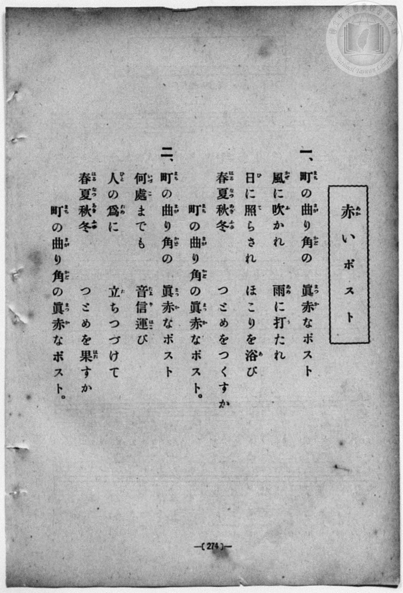
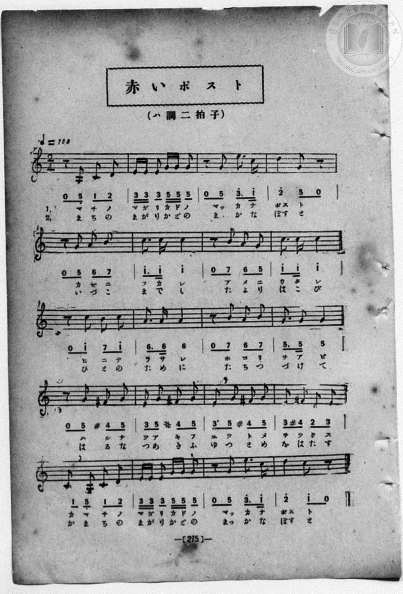

# 赤いポスト

> Re:Shōka 使用 AI 協助辨識與重建樂譜，可能會有錯誤。歡迎回報。

<audio controls src="akai_posuto.mp3"></audio>

- book: 新編 小學校・公學校 唱歌教材集（尋常科五・六學年用）
- 一條慎三郎 編《新編 小學校・公學校 唱歌教材集》（大正十二年十二月，索書號 0725-41）

## 說明

> [!NOTE]
> **原書資訊與歌詞全文**（對應 `P282.jpg`–`P283.jpg`，原書 p. 274–275，尋常科五・六學年第 25 首）：
> - **調性與拍號**：ハ調二拍子（C 大調 2/4 拍），♩= 100
> - **樂曲結構**：全曲共 20 小節（5 行，每行 4 小節），大量運用前半拍八分休止符起唱之輕快切分節奏，第四行連續導入變化半音 ♯F4（`4'`），歌頌矗立街角、四季不輟為人們傳遞書信的紅色郵筒。
> - **假名表記**：歌詞頁第 2 段印為「何處（いづこ）までも」，樂譜頁簡譜下方標為「いづこまでも」。
>
> **一、**
> 町（まち）の曲（まが）り角（かど）の　眞赤（まつか）なポスト
> 風（かぜ）に吹（ふ）かれ　雨（あめ）に打（う）たれ
> 日（ひ）に照（て）らされ　ほこりを浴（あ）び
> 春夏秋冬（はるなつあきふゆ）　つとめをつくすか
> 町（まち）の曲（まが）り角（かど）の眞赤（まつか）なポスト。
>
> **二、**
> 町（まち）の曲（まが）り角（かど）の　眞赤（まつか）なポスト
> 何處（いづこ）までも　音信運（たよりはご）び
> 人（ひと）の爲（ため）に　立（た）ちつづけて
> 春夏秋冬（はるなつあきふゆ）　つとめを果（はた）すか
> 町（まち）の曲（まが）り角（かど）の眞赤（まつか）なポスト。


## 歌詞

```text
（TMD 檔案未包含歌詞註解）
```

## ABC

```abc
X:1
T:赤いポスト
M:2/4
L:1/16
Q:1/4=100
K:C
V:V1 name="Piano" snm="Pia"
[V:V1]
z2 G,2 C2 D2 | E E E2 G G G2 | z2 G2 e3 c | d4 G2 z2 |
w: 1.~マ チ ノ | マ ガ リ カ ド ノ | マッ カ ナ | ポス ト
w: 2.~ま ち の | ま が り か ど の | まっ か な | ぽす と
z2 G2 A2 B2 | c3 c c4 | z2 B2 A2 G2 | c3 c c4 |
w: 1.~カ ゼ ニ | フ カ レ | ア メ ニ | ウ タ レ
w: 2.~い づ こ | ま で も | た よ り | は こ び
z2 c2 B2 c2 | A3 A A4 | z2 B2 A2 B2 | G3 G G4 |
w: 1.~ヒ ニ テ | ラ サ レ | ホ コ リ | ヲ ア ビ
w: 2.~ひ と の | た め に | た ち つ | づ け て
z2 G2 ^F2 G2 | E2 G2 ^F2 G2 | E2 G2 ^F2 G2 | E2 ^F2 D2 E2 |
w: 1.~ハ ル ナ | ツ ア キ フ | ユ ツ ト メ | ヲ ツ ク ス
w: 2.~は る な | つ あ き ふ | ゆ つ と め | を は た す
C2 G,2 C2 D2 | E E E2 G G G2 | z2 G2 e3 c | d4 c2 z2 |
w: 1.~カ マ チ ノ | マ ガ リ カ ド ノ | マッ カ ナ | ポス ト
w: 2.~か ま ち の | ま が り か ど の | まっ か な | ぽす と
z2 G,2 C2 D2 | E E E2 G G G2 | z2 G2 e3 c | d4 G2 z2 |
w: 1.~マ チ ノ | マ ガ リ カ ド ノ | マッ カ ナ | ポス ト
w: 2.~ま ち の | ま が り か ど の | まっ か な | ぽす と
z2 G2 A2 B2 | c3 c c4 | z2 B2 A2 G2 | c3 c c4 |
w: 1.~カ ゼ ニ | フ カ レ | ア メ ニ | ウ タ レ
w: 2.~い づ こ | ま で も | た よ り | は こ び
z2 c2 B2 c2 | A3 A A4 | z2 B2 A2 B2 | G3 G G4 |
w: 1.~ヒ ニ テ | ラ サ レ | ホ コ リ | ヲ ア ビ
w: 2.~ひ と の | た め に | た ち つ | づ け て
z2 G2 ^F2 G2 | E2 G2 ^F2 G2 | E2 G2 ^F2 G2 | E2 ^F2 D2 E2 |
w: 1.~ハ ル ナ | ツ ア キ フ | ユ ツ ト メ | ヲ ツ ク ス
w: 2.~は る な | つ あ き ふ | ゆ つ と め | を は た す
C2 G,2 C2 D2 | E E E2 G G G2 | z2 G2 e3 c | d4 c2 z2 |
w: 1.~カ マ チ ノ | マ ガ リ カ ド ノ | マッ カ ナ | ポス ト
w: 2.~か ま ち の | ま が り か ど の | まっ か な | ぽす と
```

## TMD 檔案連結

- [主旋律 TMD 檔案](akai_posuto.tmd) [[在 TMD Studio 編輯](https://tmdlang.github.io/Tmd-TS/#tmd=s7IKdvYPcrWy4qpTUCpJTLdSSM7PyUlNLsnMz7MqzsjPTozPrsyvSsyML84ojTe0NDJWgqssy88pzU21Si9KTEmNN403Q8gU55cWJadaFSdn5OfnxJekVpQk5edno8vHFySmp1oFGFkYIWQKivLLUvMS84C6C4oy80pSU8DaEQpSyzJTUkHSxcmJefFlqUWZaZmpKUiOSi0qBrsdYkVJUWJecXJRZgHIQwhV-UUlGflAhxdkVFplZBaX5BdlJifmxGcn5iUiFJVkpAK9l5KYmVMZn5OZloouk5xZlpmsxKWlpfBi65LHjS2Pm-c-btr5uLlDQUuLS9FWwdDAgMveVsGZy8ZI38QOpBkUClYKz6ZteL59hcLTDf1P1-54tmDh4-bdT1vXQNgKT6dsfLa259nUmc_mTng5u-39no6nG7qf7tjxfPnEJ7umgJWuBSp9unPL8ykr3u_pBDvqyY6GZ4vmPmvte7Kj82VznwLQ-McNXaTY87ihG2TVkuXP1i5-2tv4ZFcP0AYI49mcjvd7ep5vWfRs9o4XM-crGJgbmeqaGILt5tLXUrClFuBSUFCwU4hW9PMPcY2FcLS0nvbNB9m7uf3Fiq4XHe1AN79YOe9p64pn09q1tMCh0_usvVMhAZSM9LIK0hMeNUwGcYzBHKDDIQYoFOgpGJmbACWNzE1BorgCdc0aBSNThZfLpgH9937PLIgzdIEOebFq_7OG5SAndPcCgwFk-azHzf1AYVAYdfc-XTsB6BxnBWAYAsUUgFGuABQFm9LzaOZKSHKAm_ZsRdOz2Zueb53wbHk32CiQl2Zvetq6UcHIABRlz9c3AI0zVXixsAdowLP1_UCGgglcBmQq0KaX7f0vG7uBKeFpZ-_T3i6QM1pXP-1oe7Jn4rO1i56vWfZi63ZgTD_Z2f1iz9Sn-4FS7UBZoAlPl_aDInXNmqezZwNNftmw-Dkwyjf0PW1d-mJd19OeaUDTXs7frPBo5no3E6BDEkzUgYEJshUYAy8X9DyfP_356u4XC6e_WD7pcUMj0JSnaxc_2dH7Ys_85027nuza9bRh4tOmzS8b5wED_8n-hc9ntTzf0vqic9PL5q3P1wK1NCHC4mlj-9MJvS8WrnixYgY4LCCR_HJBIzg2FJ6t2_q0dwPQ2McNPU_2Tn0xcyrQQaD81rj0ceNkoKseN-573Lj8cVPT4wZggPcAw_bF2jkg7RsWAhlPdnQ_m7bz2YqZEBPgGpF1wdwDS3XADAX0FTAbg_nPp-wC2whUvxBs3TpgVMFEgNHT-bipCxgOYJHux40rIWoeNzQ8nzMPWDTAVALLCGAmA0qtgpcUEPNfLgLmZIjeOWAFq59O2AkW2Qrmdj9u6gGa9nI2RFnT46ZGiLJnnUDvA0WAxQSQOx-oDGLgs-lLweJAR4KUPW9dDuYuAzsVKDIVYuDjxt2gcGjqetw06dnWLRDDwVo2Q82ZsfTpkv7ny7uftq0By65_3AR05CqwX5oeN_YCXfi4CWw7yDSg4Aqg24Cmgdn9jxtnAh1PSRgSDECMiNsF9BjdIo5QamwAZiFg4gdmUbAaYAR1gEIbGIyNU5DDGZhfIPEFDECoxzsg7gRqgcY1yFWroeaARRaCHQa0dCIwZimMr2fzgAkPrB5qOL0ijvJaAwoUtPS5uByzEzMD8otLS_KtAjIT8_IdagxqFKpB9ijYGJppgVOJArYqSwFY0gDzPKiM1YAVsjoKsGpEE4sGoHUgw2oUDIBlmGk8kDAEYiMgrlEwBkOgMBiCRMCKgNg4DkgAlcYBxYwgbIgESEEN2EQfwxoFkHGPm-eByUYw2Qc2BiT2uGkNkF4FEm1aDWR1wmWhuh43N0MlQYY_bu4CawQFO9Q-UAtFF6waaqMRVG_jPjC5EEyug9gIFANGM9C4LrBoNxCvhMtCdT1uXAyVBBvfuAqscS8wFcFsbFwBtxF_HOzqITsOgNgMiM3BLgOGMDSgoSxYLICkQcog8YJNGWosgIPxcdMecLiBPAgKzKkQX4HDfw3ceIj6RWCV4DCEqW9aBlW_H1k9Wti3gMmlYHIyPOwhobccqLcJ1Z7G-WATQTEJiRuQ-vVQ9ZOBeDPcHgKpvpPcEAcHGSg8wYwacLCCAhdCowc4JF5AwQ7JGFhDu3kSPNweN7dBQ3slNPS2YoZ282ywDMivkDwBUr8Jqn4RkA0KSWyhDVIDSZWIlA4KUZC-RiAbknnQQhuaM5ZA1YPiCsSfCMSQGCYY2pDWFtnp20QdygCVMcQKgbmgggnEQQ_vfjAJTuPAggISfuCUCEnHTWvBMqD0DpIB-RIqDy5DIOkcFuYwnaBUCClt0EMdIgOOXWAhAQlFUGgCKycw2Qsmt0JkmkDxD5MHxxQwZiAy4FQCMQ0aM6CShmDZMoWcsAcV65SV7-DsgVrAQ4sVuhbxkPKZPoV8LReXrp0CojpWwOApcwEA)]
- [鋼琴伴奏 TMD 檔案](akai_posuto_piano.tmd) [[在 TMD Studio 編輯](https://tmdlang.github.io/Tmd-TS/#tmd=s7IKdvYPcrWy4qpTUCpJTLdSSM7PyUlNLsnMz7MqzsjPTozPrsyvSsyML84ojTe0NDJWgqssy88pzU21Si9KTEmNN403Q8gU55cWJadaFSdn5OfnxJekVpQk5edno8vHFySmp1oFGFkYIWQKivLLUvMS84C6C4oy80pSU8DaEQpSyzJTUkHSxcmJefFlqUWZaZmpKUiOSi0qBrsdYkVJUWJecXJRZgHIQwhV-UUlGflAhxdkVFplZBaX5BdlJifmxGcn5iUiFCUWATWnp-am5pVYFWQm5uXHJyYn5-cWJOZlgsQQCksygIqsUhIzcyrjczLTUtFlkjPLMpOVuLS0FF5sXfK4seVx89zHTTsfN3e839PxcvbMZ53dL7v3PJ-w5cmeLU-X9r_f06mgpcWlaKtgaGDAZW-r4MxlY6RvYgcyFBSMVgrPpm14vn2FwtMN_U_X7ni2YOHj5t1PW9dA2ApPp2x8trbn2dSZz-ZOeDm7DWjF0w3dT3fseL584pNdU8BK1wKVPt255fmUFUC7wI59sqPh2aK5z1r7nuzofNncpwA0_nFDFyn2PG7oBlm1ZPmztYuf9jY-2dUDtAHCeDYH6NGe51sWPZu948XM-QoG5kamuiaGYLu5HLMTMwPyi0tL8q0CQGEc5OFQY1CjUM2lAAQ2hmZadmCWvpaCLTpQeL5mDdDhLxb2KGiYgFz5fH2DjgIwPRnrZRWka2LRoKUPNqxGwUBBV8E0HkgYArERENcoGIMhUBgMQSJgRUBsHAckgErjgGJGEDZEAqSgBmyij2GNAsi4x83zwGQjmOwDGwMSe9y0BkivAok2rQayOuGyUF2Pm5uhkiDDHzd3gTWCkgnUPmBqAZIg1VAbjaB6G_eByYVgch3ERqDY48YeoHFdYNFuIF4Jl4Xqety4GCoJNr5xFVjj3seNM2E2Nq6A24g_Dnb1kB0HQGwGxOZglwFDGBrQUBYsFkDSIGWQeMGmDDUWwMH4uGkPONxAHgQF5lSIr8DhvwZuPET9IrBKcBjC1Dctg6rfj6weLexbwORSMDkZHvaQ0FsO1NuEak_jfLCJoJiExA1I_Xqo-slAvBluD4FU30luiIODDBSeYEYNOFhBgQuh0QMcEi-gYIdkDKyh3TwJHm6Pm9ugob0SGnpbMUO7eTZYBuRXSJ4Aqd8EVb8IyAaFJLbQBqmBpEpESgeFKEhfI5ANyTxooQ3NGUug6kFxBeJPBGJIDBMM7aezZ1OSvk3UoQxQGUOsEJgLKphAHPTw7geT4DQOLCgg4QdOiZB03LQWLANK7yAZkC-h8uAyBJLOYWEO0wlKhZDSBj3UITLg2AUWEpBQBIXm40ZQ6n7c2Asmt0JkmkDxD5MHxxQwZiAy4FQCMQ0aM6CShmDZMoWcsAcV65SV7-DsgVrAQ4sVuhbxkPKZPoV8LWZt7INSG1tAK2Ng-MYrRBvGwijCfNN4IMs0PhbMMID6D00YzCCgFUMNwiyomDGQMs4FKTIBskxiYRTJBhkBKSMkNTj5WMylNJSg7gFGiK6dAiJOon2AytBEgE4AiihzAQA)]

## 分析

```text
================================================================================
📊 TMD Song Profile: [ 赤いポスト ]
================================================================================
⏱  Duration:       0:48 (48.0s), 40 measures total
🎼 Key & Tempo:    首調基準 C, != 100.0 BPM, <2/4>
   - 分析範圍：      由實際發聲的音符與和弦推測調性；播放脈絡另行呈現
🎤 人聲音域:    G3 (MIDI 55) – E5 (MIDI 76) [跨度: 21 個半音 / 1.8 個八度, 難度: difficult]
   - 最低音:  G3 in [AkaiPosuto #1 @ m.1, 0:00]
   - 最高音: E5 in [AkaiPosuto #1 @ m.3, 0:03]
   - 適合: mezzo-soprano, contralto, baritone, bass
🏛  結構:      AkaiPosuto (24.0s) -> AkaiPosuto (24.0s)
⚡ 編曲密度:        Peak 1 軌道同時演奏
🗝  調性診斷：       G 調性不明確（純淨自然大調，未偵測到可信轉調）
   - 風格氣質:    純淨自然大調（陽光明朗、易唱易記，無明顯調外色彩）
   - 轉調歷程:    全曲維持單一推測調性（未偵測到可信轉調）
   - 核心骨幹音:  G, C, E, D, A
   - 調性數值:    G 調性不明確 [相關度: 0.86, 穩定度: Ambiguous, 自然音純度: 100.0%]
   - 候選調性 (K-S): G 大調 (0.86), C 大調 (0.83), E 小調 (0.75)
   - 五度圈歷程:   +1 -> +1
   - 各段落調性細節:
     • [AkaiPosuto #1]: G 調性不明確 (r: 0.86, 自然音純度: 100.0%)
     • [AkaiPosuto #2]: G 調性不明確 (r: 0.86, 自然音純度: 100.0%)

  [ 五度圈游移軌跡 ]
               C  
         F           [G ]*
      Bb               D  
      Eb               A  
         Ab           E  
            Db       B  
               F# 
     (* = active key center)

  [ 十二半音累積音高分佈 ]
     C  : █████████████████         21.4%
     C# :                            0.0%
     D  : ████████                  10.0%
     D# :                            0.0%
     E  : █████████████             15.7%
     F  :                            0.0%
     F# : █████                      5.7%
     G  : ████████████████████████  30.0%
     G# :                            0.0%
     A  : ████████                  10.0%
     A# :                            0.0%
     B  : ██████                     7.1%
--------------------------------------------------------------------------------
Assignment 軌道音域：
  - Piano         : G3 – E5 (21 個半音 / 1.8 個八度, 136 個音符)
================================================================================
```


## 原書掃描頁






