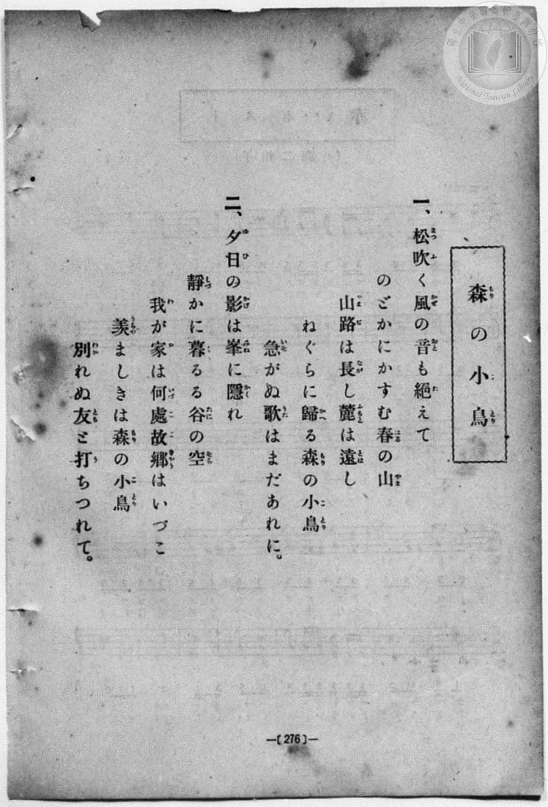
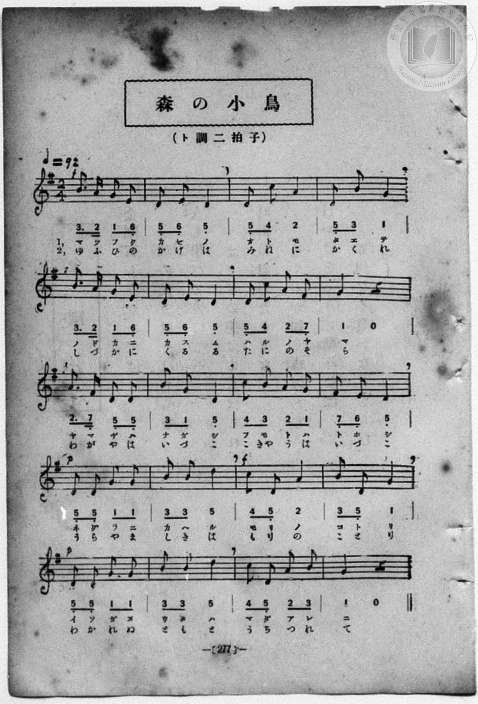

# 森の小鳥

> Re:Shōka 使用 AI 協助辨識與重建樂譜，可能會有錯誤。歡迎回報。

- **鋼琴伴奏版**：<br><audio controls src="mori_no_kotori.mp3"></audio>
- **NEUTRINO 歌聲合成版**：<br><audio controls src="mori_no_kotori_neutrino.mp3"></audio>

- book: 新編 小學校・公學校 唱歌教材集（尋常科五・六學年用）
- 一條慎三郎 編《新編 小學校・公學校 唱歌教材集》（大正十二年十二月，索書號 0725-41）

## 說明

> [!NOTE]
> **原書資訊與歌詞全文**（對應 `P284.jpg`–`P285.jpg`，原書 p. 276–277，尋常科五・六學年第 26 首）：
> - **調性與拍號**：ト調二拍子（G 大調 2/4 拍），♩= 92
> - **樂曲結構**：全曲共 20 小節（5 行，每行 4 小節）。注意五線譜上明確標有力度對比：第 1 小節 `f`、第 5 小節 `p`、第 9 小節 `f`、第 13 小節 `p`、第 15 小節 `f`、第 17 小節 `p`。
> - **原譜印刷對照**：第 15 小節首拍「モ／も」簡譜誤加下點（`4_`），第 19 小節「マダ／うち」簡譜漏印下點（`4 5`），此處皆依五線譜實際音高校正。另外第 2 段第 15 小節歌詞為「もりの」，與手抄《唱歌帳》（作「やまの」）略有不同。
>
> **一、**
> 松吹（まつふ）く風（かぜ）の音（おと）も絕（た）えて
> のどかにかすむ春（はる）の山（やま）
> 山路（やまぢ）は長（なが）し麓（ふもと）は遠（とほ）し
> ねぐらに歸（かへ）る森（もり）の小鳥（ことり）
> 急（いそ）がぬ歌（うた）はまだあれに。
>
> **二、**
> 夕日（ゆふひ）の影（かげ）は峯（みね）に隱（かく）れ
> 靜（しづ）かに暮（く）るる谷（たに）の空（そら）
> 我（わ）が家（や）は何處故鄉（いづここきやう）はいづこ
> 羨（うらや）ましきは森（もり）の小鳥（ことり）
> 別（わか）れぬ友（とも）と打（う）ちつれて。


## 歌詞

```text
（TMD 檔案未包含歌詞註解）
```

## ABC

<div class="abc-score" data-abc-src="mori_no_kotori.abc" aria-label="五線譜載入中"></div>

[下載 ABC 原始檔](mori_no_kotori.abc)

## TMD 檔案連結

- [主旋律 TMD 檔案](mori_no_kotori.tmd) [[在 TMD Studio 編輯](https://tmdlang.github.io/Tmd-TS/#tmd=s7IKdvYPcrWy4qpTUCpJTLdSSM7PyUlNLsnMz7MqzsjPTozPrsyvSsyML84ojTe0NDJWgqssy88pzU21Si9KTEmNN403Q8gU55cWJadaFSdn5OfnxJekVpQk5edno8vHFySmp1oFGFmYIGQKivLLUvMS84C6C4oy80pSU8DaEQpSyzJTUkHSxcmJefFlqUWZaZmpKUiOSi0qBrsdYkVJUWJecXJRZgHIQwhV-UUlGflAhxdkVFplZBaX5BdlJifmxGcn5iUiFJVkpAK9l5dYUlqUii6amJeZm5iDbGBmemaeVUliZjnQWflpaZnJmSB5LS2FZ4vXPW5c93RD_8vNSxW0tLgUbRUsjbjsbRXcuWyM9E3sQGaAgsdK4dm0Dc-3r1AAKn26dsezBQsfN-9-2roGwlZ4OmXjs7U9z6bOfDZ3wsvZbe_3dDzd0P10x47nyyc-2TUFrHQtUOnTnVueT1nxfk8n2G1PdjQ8WzT3WWvfkx2dL5v7FIDGP27oIsWexw3dIKuWLH-2dvHT3sYnu3qANkAYz-Z0vN_T83zLomezd7yYOV_BwNzIVNfEEGw3l76Wgi21AJeCgoKdQrSin3-IayyEo6X1tG8-yN7N7S9WdL3oaAe6-cXKeU9bVzyb1q6lBQ6d3mftnQoJoPSll1WQnvCoYTKIYwrmAB0OMUChQE_ByNwMKGlkbg4SxRWoa9YoGJkpvFw2Dei_93tmQZyhC3TIi1X7nzUsBzmhuxcYDCDLZz1u7gAKg8Kou_fp2glA57grAMMQKKYAjHIFoCjYlJ5HM1eCUwPcsGcrmp7N3vR864Rny7vBJoF8NHvT09aNCkYGoBh7vr4BaJqpwouFPUD9z9b3AxkKJnCZzscNTc82r3jW0g90__Pts16snfNkR9ezGX3PF-16tmLmszmdT7tmP921DBQ666cAzQf5yxCqXSEhLeFxQyNIyBQuVAATssRUZWiMqcwQoRWhzhxFXRPCv8BIADrxae-Gpx3bgW563roc7GsUg4BhDgywxw09j5sXvd_T_7ip6XFD7_MNC4EaX6xa8rRrwZMd3S93zwMGS4JJPDBmQQELNgDmYrDWeY-bgeHT_7ix7XHjQrgBz_b0Ay1HMkDBFGrCs7VLXsyc-nxW25N9c-Fh-XT9spezZr-cv_nl6hnAzALME0DfPO1f9nTJNHACUXi2biuK2yHJ8nnTLpAbgA5v6gKWBUDbgRaAUkxn97OuFmCOhGS6pzs2Q7Lbk71zwOpbHjfug6nvfD51KTD6nuzofTqhBxaGsMwAzOfAoAYWLmD-s7n7nk7YCTQHrH3J48atoITR2P9yEbBgAAp2P26cAxZZB_QJWAToKlCZAXTh861TwSLzwQqAjGUQM0HOaFwJ1rsaTM583NTwbMZSsOL1j5uAzgYZ-HTjRpAI2OVAEYheoOCL7evh4o8bgdEIVLz-5dTtYO2rHjcCEzNQZPrLXZPBIltBYQVxElBZ4wKw4IrHjbshymBOWvu4ccLjJqDI6mdrd8C8BmQAPdINLHbBNoLCHOo2cBEMVjYZZBpYHBpiDRBxoPPmghX3PG5cA4wRsCAwwUBCYz3Y8QseNwLNBCpYjRELu4ARA4-Fp0umPpsONrYJaMLWx42boM7YCw4ikFMnQYx9uhkcOI37gT4Ci6x-OQuuph_snR6ImS_nAiMOKD79cSPQZKBKUHQ8mwX2KVRlNxC92AAJ2PlAWYilz1fuAovMBQYXwtcdE8HOA2ts7Hm6bhskjiCuerJ3KjADPJva-rIFqAUSOEvBQQdEveCoBNZCkGCBSkGMfb4PkszaQFEDNQ0YbkA39wIVkxQvTzsgAQjMtuAEBgr2NU_7QXkErLIJbMKKZ52QZANxz0JQmgepXAaNIMprIChQ0NLn4vIF1vV--d75oEaDVUBmYl6-Q41BTTXIIgUbQzMtcHJQwFb_KQCLBmBOBZXYGrAiW0cBVidpYtEAtA9kWI1CdVqtgjGwxNQFljGGQNIsHkjUKJiCKDAbzAJBqKAJWCmKEEg_SC9YCGyuj2GNArBkBIs8bm4B4qkgVtN6sKbHTavBvD1g2T64YY-bVoFFOsDkIiTx_WD1K8Dibag2GYHkIWLAzADEm8CsdRCdjd1g3iQwCbIdamIj2MTGtWAS5BqYOER9P9i-HrhN-EN-Vw9ZIV9AZsibQxTCQtwAS8hDwvRxcycsrJtB_kKE_E6w2AKEv5vBPm6GqAXpfty8BCoDiUVdBbhrEOHeOB0a7kvhIQcyASQDCUGwGJiEhe98uCpIHAFLDqjLOjHsIZDeO8lN75DkCwxGcLCCiRp4IkYKdVCAg4RB6kFSNZCgR4scpGAHBRko6OYBcROYBQoGkEwXOCDWgMntSMEOzhbgpA5L9jAdEN5sVB1ISR6kDhR8PUB2C5gFzVyNEN5SMDkZKehBbEgBC2aA8gwBTfhj4Ons2eSme0TAg8IVEragkAZhU7iTQXEFigOwQkSZA1YE04seBb3gANsADryVYBIl5TfPAJNIOR4a-JCSB7ks2owUKSBZ9LQPDj9wqoWF6D5oWIJyBTCg4eELMxGcJJrASQGc9lEjBly6gWWJKnOm0DbsTeCqQAEPksNb4jSBkv7jpr1gEpzMm0GlJ0hmGVgMXN6CEzcs3EHlCrDpDJaFxAFIH0gGVl5gKXHAyR5a1oDLZ2C1DQ1FSPiBwxjMhoUuJJ0vBJMQV0Jd1ghyGao9tVxcunYKyBWxAha-MhcA)]
- [鋼琴伴奏 TMD 檔案](mori_no_kotori_piano.tmd) [[在 TMD Studio 編輯](https://tmdlang.github.io/Tmd-TS/#tmd=s7IKdvYPcrWy4qpTUCpJTLdSSM7PyUlNLsnMz7MqzsjPTozPrsyvSsyML84ojTe0NDJWgqssy88pzU21Si9KTEmNN403Q8gU55cWJadaFSdn5OfnxJekVpQk5edno8vHFySmp1oFGFmYIGQKivLLUvMS84C6C4oy80pSU8DaEQpSyzJTUkHSxcmJefFlqUWZaZmpKUiOSi0qBrsdYkVJUWJecXJRZgHIQwhV-UUlGflAhxdkVFplZBaX5BdlJifmxGcn5iUiFCUWATWnp-am5pVYFWQm5uXHJyYn5-cWJOZlgsQQCksygIqs8hJLSotS0UVBihNzlLi0tBSeLV73uHHd0w39Lzcvfb-n4-Xsmc86u19273k-YcuTPVueLu1_v6dTQUuLS9FWwdKIy95WwZ3LxkjfxA5kIij8rBSeTdvwfPsKBaART9fueLZg4ePm3U9b10DYCk-nbHy2tufZ1JnP5k54ObsNaMPTDd1Pd-x4vnzik11TwErXApU-3bnl-ZQVQKvALn2yo-HZornPWvue7Oh82dynADT-cUMXKfY8bugGWbVk-bO1i5_2Nj7Z1QO0AcJ4Nqfj_Z6e51sWPZu948XM-QoG5kamuiaGYLu5fIFh7pfvnQ8Ke6sAUPAGeTjUGNRUcykAgY2hmZYdmKWvpWCLDhSer1kDdPmLhT0KGiYgZz5f36CjAExJpnpZBemaWDRo6YMNq1GoTqtVMFbQBUIjBUMgaRYPJGoUTEEUmA1mgSBU0ASsFEUIpB-kFywENtfHsEbhcfM8sMjj5hYgngpiNa0Ha3rctBrM2wOW7YMb9rhpFVikA0wuQhLfD1a_AizehmqTEUgeIva4cSsQbwKz1kF0NnaDeZPAJMh2qImNYBMb14JJkGtg4hD1_WD7euA24Q_5XT1khXwBmSFvDlEIC3EDLCEPCdPHzZ2wsG4G-QsR8jvBYgsQ_m4G-7gZohak-3HzEqgMJBZ1FeCuQYR743RouC-FhxzIBJAMJATBYmASFr7z4aogcfS4cS7UZZ0Y9hBI753kpndI8gUGIzhYwUQNPBEjhToowEHCIPUgqRpI0KNFDlKwg4IMFHTzgLgJzAIFA0imCxwQa8DkdqRgB2cLcFKHJXuYDghvNqoOpCQPUgcKvh4guwXMgmauRghvKZicjBT0IPbjxl6YclCeIaAJfww8nT2b3HSPCHhQuELCFhTSIGwKdzIorkBxAFaIKHPAimB60aOgFxxgG8CBtxJMoqT85hlgEinHQwMfUvIgl0WbkSIFJIue9sHhB061sBDdBw1LUK4ABjQ8fGEmgpNEEzgpgNM-asSASzewLFFlzhTahr0JXBUo4EFyeEucJlDSf9y0F0yCk3kzqPQEySwDi4HLW3DihoU7qFx53NwAloXEAUgfSAZWXmApccDJHlrWgMvnx41QXdDwA4cxmA0LXUg6XwgmIa6EuqwR5DJUe2qx1cM-yPWwBbQaBoZGvEK0YSyYMomPhQqAWFAJUKkNZJkCReAMiCIQC0gbQD1GVaNwKYQaj8UwsJARkGEEEcDqLLAi_OYQ5z9yDQLGjK6dAnLkRPsA9WKIAT0BFFPmAgA)]

## 分析

```text
================================================================================
📊 TMD Song Profile: [ 森の小鳥 ]
================================================================================
⏱  Duration:       0:52 (52.2s), 40 measures total
🎼 Key & Tempo:    首調基準 G, != 92.0 BPM, <2/4>
   - 分析範圍：      由實際發聲的音符與和弦推測調性；播放脈絡另行呈現
🎤 人聲音域:    C4 (MIDI 60) – D5 (MIDI 74) [跨度: 14 個半音 / 1.2 個八度, 難度: moderate]
   - 最低音:  C4 in [MoriNoKotori #1 @ m.19, 0:23]
   - 最高音: D5 in [MoriNoKotori #1 @ m.14, 0:17]
   - 適合: soprano, mezzo-soprano, contralto, tenor, baritone, bass
🏛  結構:      MoriNoKotori (26.1s) -> MoriNoKotori (26.1s)
⚡ 編曲密度:        Peak 1 軌道同時演奏
🗝  調性診斷：       G 大調（純淨自然大調，未偵測到可信轉調）
   - 風格氣質:    純淨自然大調（陽光明朗、易唱易記，無明顯調外色彩）
   - 轉調歷程:    全曲維持單一推測調性（未偵測到可信轉調）
   - 核心骨幹音:  D, G, B, A, C
   - 調性數值:    G 大調 [相關度: 0.87, 穩定度: Moderate, 自然音純度: 100.0%]
   - 候選調性 (K-S): G 大調 (0.87), D 大調 (0.83), B 小調 (0.66)
   - 五度圈歷程:   +1 -> +1
   - 各段落調性細節:
     • [MoriNoKotori #1]: G 大調 (r: 0.87, 自然音純度: 100.0%)
     • [MoriNoKotori #2]: G 大調 (r: 0.87, 自然音純度: 100.0%)

  [ 五度圈游移軌跡 ]
               C  
         F           [G ]*
      Bb               D  
      Eb               A  
         Ab           E  
            Db       B  
               F# 
     (* = active key center)

  [ 十二半音累積音高分佈 ]
     C  : █████                      6.6%
     C# :                            0.0%
     D  : ████████████████████████  34.2%
     D# :                            0.0%
     E  : █████                      6.6%
     F  :                            0.0%
     F# : ██                         3.3%
     G  : ███████████████           21.1%
     G# :                            0.0%
     A  : █████████                 12.5%
     A# :                            0.0%
     B  : ███████████               15.8%
--------------------------------------------------------------------------------
Assignment 軌道音域：
  - Piano         : C4 – D5 (14 個半音 / 1.2 個八度, 128 個音符)
================================================================================
```


## 原書掃描頁






