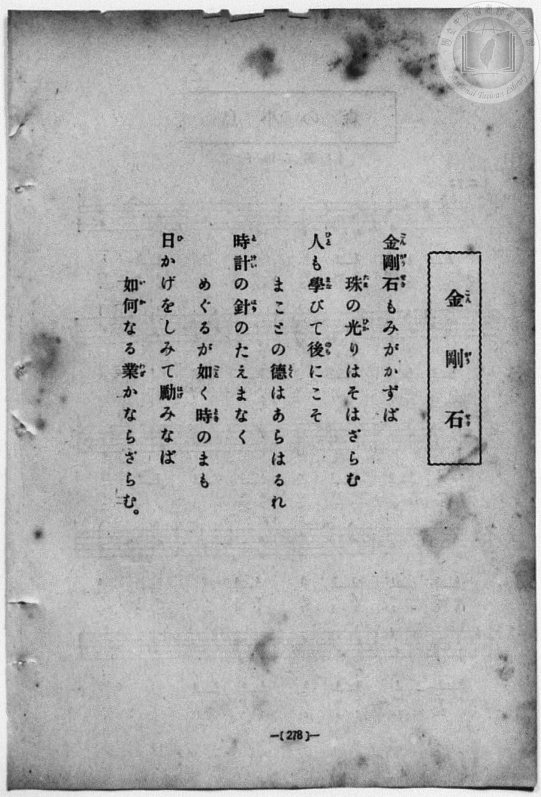
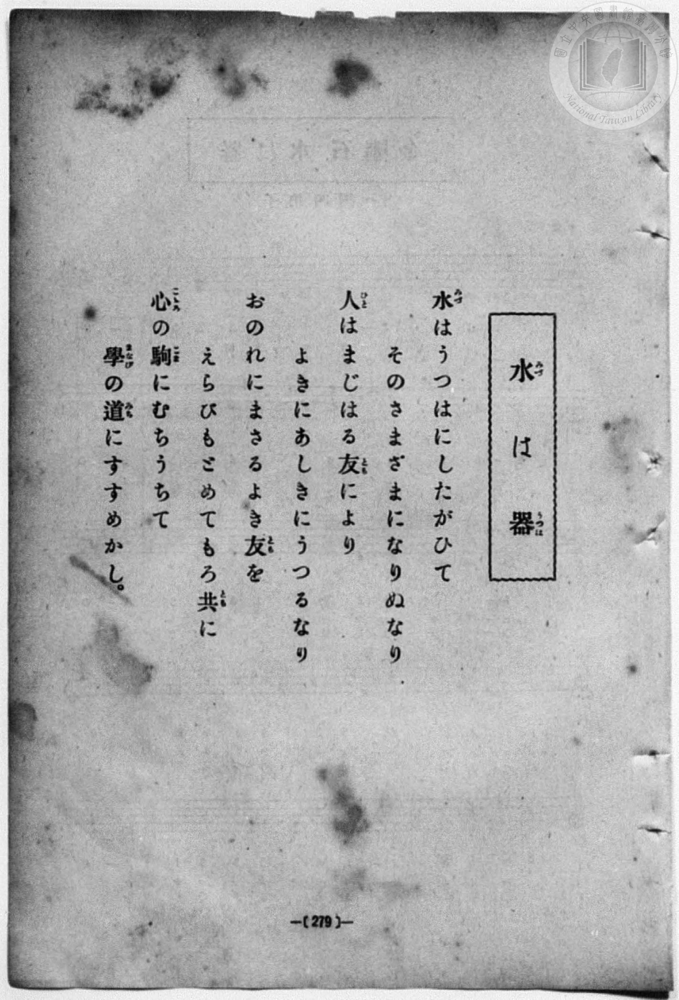
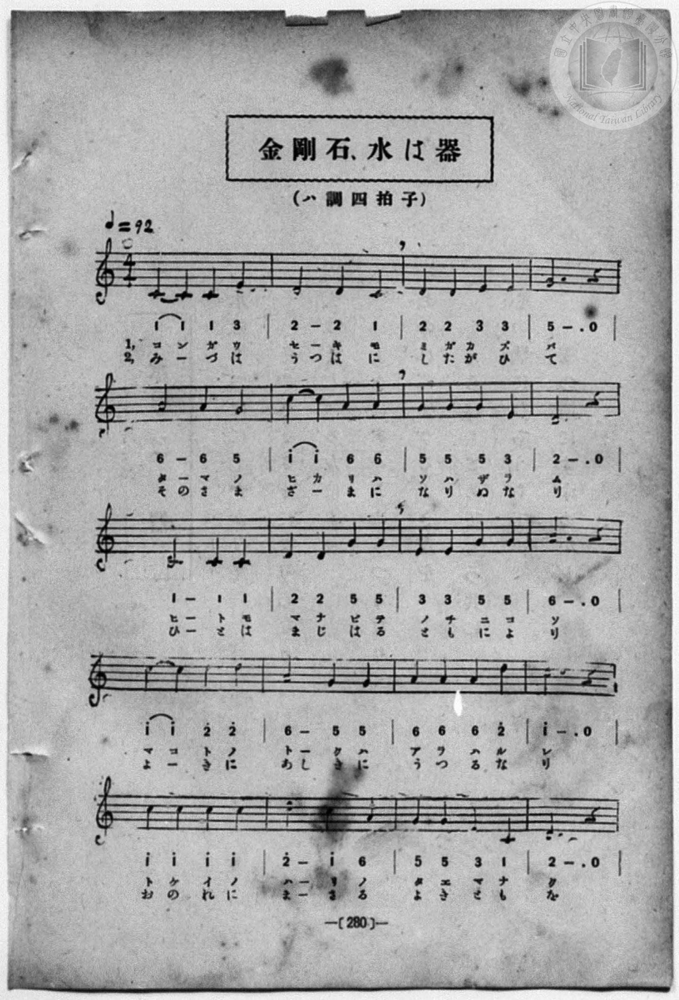
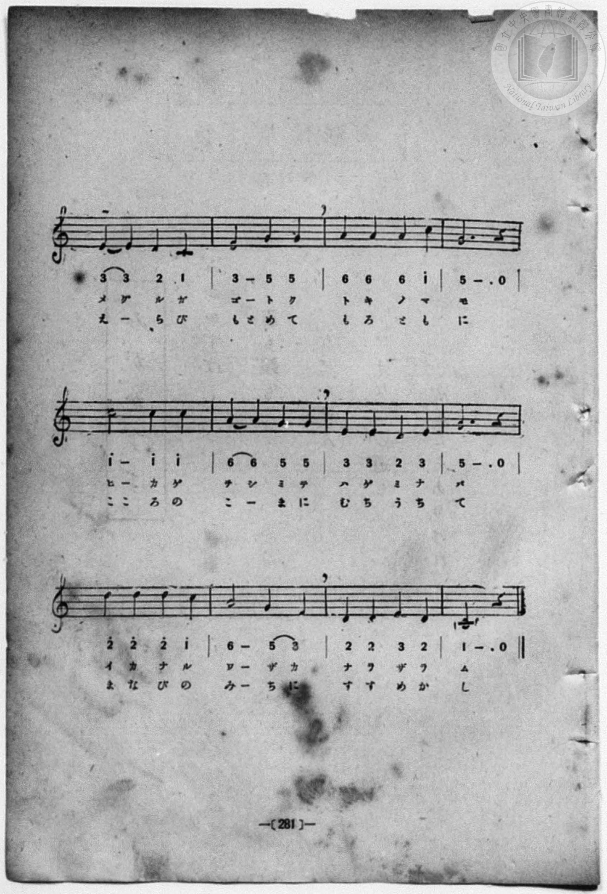

# 金剛石、水は器

> Re:Shōka 使用 AI 協助辨識與重建樂譜，可能會有錯誤。歡迎回報。

<audio controls src="kongoseki.mp3"></audio>

- book: 新編 小學校・公學校 唱歌教材集（尋常科五・六學年用）
- 一條慎三郎 編《新編 小學校・公學校 唱歌教材集》（大正十二年十二月，索書號 0725-41）
- lyricist: 昭憲皇太后（御歌）
- composer: 奥好義

## 說明

> [!NOTE]
> **原書資訊與歌詞全文**（對應 `P286.jpg`–`P289.jpg`，原書 p. 278–281，尋常科五・六學年第 27 首）：
> - **曲名**：〈金剛石、水は器〉（p. 278 題為「金剛石」，p. 279 題為「水は器」，p. 280 樂譜合題為「金剛石、水は器」）
> - **調性與拍號**：ハ調四拍子（C 大調 4/4 拍），♩ = 92
> - **版本校勘**：本曲與《新定兒童唱歌》第一學年用所載〈金剛石〉同源（奥好義作曲），惟本教材集併錄昭憲皇太后御歌二首（第一段片假名〈金剛石〉、第二段平假名〈水は器〉），且第 6 小節旋律印為 `1^ 1^ 6 6`（異於《新定兒童唱歌》之 `2 2 7 7`），速度標為 ♩ = 92，句尾作「そはざらむ」「時のまも」「ならざらむ」。
>
> **一、金剛石**（p. 278）
> 金剛石（こんがうせき）もみがかずば
> 珠（たま）の光（ひか）りはそはざらむ
> 人（ひと）も學（まな）びて後（のち）にこそ
> まことの德（とく）はあらはるれ
> 時計（とけい）の針（はり）のたえまなく
> めぐるが如（ごと）く時（とき）のまも
> 日（ひ）かげをしみて勵（はげ）みなば
> 如何（いか）なる業（わざ）かならざらむ。
>
> **二、水は器**（p. 279）
> 水（みづ）はうつはにしたがひて
> そのさまざまになりぬなり
> 人（ひと）はまじはる友（とも）により
> よきにあしきにうつるなり
> おのれにまさるよき友（とも）を
> えらびもとめてもろ共（とも）に
> 心（こころ）の駒（こま）にむちうちて
> 學（まなび）の道（みち）にすすめかし。


## 歌詞

```text
（TMD 檔案未包含歌詞註解）
```

## ABC

```abc
X:1
T:金剛石、水は器
M:4/4
L:1/16
Q:1/4=92
K:C
V:V1 name="Piano" snm="Pia"
[V:V1]
C4 C4 C4 E4 | D8 D4 C4 | D4 D4 E4 E4 | G12 z4 |
w: コ ン ガ ウ | セ キ モ | ミ ガ カ ズ | バ
A8 A4 G4 | c4 c4 A4 A4 | G4 G4 G4 E4 | D12 z4 |
w: タ マ ノ | ヒ カ リ ハ | ソ ハ ザ ラ | ム
C8 C4 C4 | D4 D4 G4 G4 | E4 E4 G4 G4 | A12 z4 |
w: ヒ ト モ | マ ナ ビ テ | ノ チ ニ コ | ソ
c4 c4 d4 d4 | A8 G4 G4 | A4 A4 A4 d4 | c12 z4 |
w: マ コ ト ノ | ト ク ハ | ア ラ ハ ル | レ
c4 c4 c4 c4 | d8 c4 A4 | G4 G4 E4 C4 | D12 z4 |
w: ト ケ イ ノ | ハ リ ノ | タ エ マ ナ | ク
E4 E4 D4 C4 | E8 G4 G4 | A4 A4 A4 c4 | G12 z4 |
w: メ グ ル ガ | ゴ ト ク | ト キ ノ マ | モ
c8 c4 c4 | A4 A4 G4 G4 | E4 E4 D4 E4 | G12 z4 |
w: ヒ カ ゲ | ヲ シ ミ テ | ハ ゲ ミ ナ | バ
d4 d4 d4 c4 | A8 G4 E4 | D4 D4 E4 D4 | C12 z4 |
w: イ カ ナ ル | ワ ザ カ | ナ ラ ザ ラ | ム
C4 C4 C4 E4 | D8 D4 C4 | D4 D4 E4 E4 | G12 z4 |
w: み _ づ は | うつ は に | し た が ひ | て
A8 A4 G4 | c4 c4 A4 A4 | G4 G4 G4 E4 | D12 z4 |
w: その さ ま | ざ _ ま に | な り ぬ な | り
C8 C4 C4 | D4 D4 G4 G4 | E4 E4 G4 G4 | A12 z4 |
w: ひ と は | ま じ は る | と も に よ | り
c4 c4 d4 d4 | A8 G4 G4 | A4 A4 A4 d4 | c12 z4 |
w: よ _ き に | あし き に | う つ る な | り
c4 c4 c4 c4 | d8 c4 A4 | G4 G4 E4 C4 | D12 z4 |
w: お の れ に | ま さ る | よ き と も | を
E4 E4 D4 C4 | E8 G4 G4 | A4 A4 A4 c4 | G12 z4 |
w: え _ ら び | もと め て | も ろ と も | に
c8 c4 c4 | A4 A4 G4 G4 | E4 E4 D4 E4 | G12 z4 |
w: ここ ろ の | こ _ ま に | む ち う ち | て
d4 d4 d4 c4 | A8 G4 E4 | D4 D4 E4 D4 | C12 z4 |
w: ま な び の | み ち に | す す め か | し
```

## TMD 檔案連結

- [主旋律 TMD 檔案](kongoseki.tmd) [[在 TMD Studio 編輯](https://tmdlang.github.io/Tmd-TS/#tmd=s7IKdvYPcrWy4qpTUCpJTLdSSM7PyUlNLsnMz7MqzsjPTozPrsyvSsyML84ojTe0NDJWgqssy88pzU21Si9KTEmNN403Q8gU55cWJadaFSdn5OfnxJekVpQk5edno8vHFySmp1oFGFkg6Swoyi9LzUvMA-ouKMrMK0lNAWtHKEgty0xJBUkXJyfmxZelFmWmZaamIDkqtagY7HaIFSVFiXnFyUWZBSAPIVTlF5Vk5AMdXpBRaZWRWVySX5SZnJgTn52Yl4hQVJKRCvRebn5RYo4Sl5aWwsv2iU87Zz-fv_lxQ-OzDVseN65_OnOFgpYWl6KtgqURl72tgjOXjYm-iR3IBJCHrRSeTdvwfPsKhacb-p-u3fFswcLHzbuftq6BsBWeTtn4bG3Ps6kzn82d8HJ22_s9HU83dD_dseP58olPdk0BK10LVPp055bnU1a839MJdtmTHQ3PFs191tr3ZEfny-Y-BaDxjxu6SLHncUM3yKoly5-tXfy0t_HJrh6gDRDGszkd7_f0PN-y6NnsHS9mzlcwMDcy1TUxhNmdUwkMJmBoAf01Y-2ztk3PZ7U_XbLq6YQ-kHn7FgItgalMzs8tyC9OLbJSeLp06dOle5_vW6nExaWvpWBLLcCloKBgpxCt6Ocf4hoL4WhpPe2bD3L55vYXK7pedLQDHfRi5bynrSueTWvX0gKHb--z9k6FBFCa08sqSE941DAZxLEEc4BehxigUKCnYGRuAZQ0sgB6vgdntKxZA1Sn8HLZNKC_3--ZBXGGLtAhz2ZvejqhF2TnrMcNHVgTzuMGoJYOiE0KLxf2PG_a9bihB0lpL9BmsLQlQhpJN0zawkDh2YqmF2vnPJ3Qgc0YZBuBejoRjnyxav-zhuWgcOruBcY2xLXN_UDhp7NnA8Werp0AdKGzAjCpAMUUgClbASgK9mrPo5krFcCpHm7a886OZ3PWANPb0-4ZYKNAvNmbgMZD0ufTdbOetk56vnopJDkCUyEw-ICpGZ7Cn3U2vNjTiRpcnU8n9DzbBXIGPB092TsHaCzEFc-a54NsgaXsJ3u3vuxpQUubkIQJTNzgaOqAWPps3dbnne1PG9uBsYRmIzDEQGqAmWHd1qc7N8PVoEYcyPYnO6aAUoAZKNs9X9_wbHr3033dT3s3AKNAIcEwTgGIzBTMgMmq4_nUDc-m7cEVDk92diskGCkYKZgrmANVg4x-2TD_6a5lz1bMBJkFC2tQSuxf-nTDPmAQAOP4ceNcoIMeN0573NT5uKkBGLugBDKz6XHjuseN-x43NUFEHjeuAilAUdYEjjZYrgGGB9DT8DAA5xRIuoQnF7gkUOpx4-THTZMfNwJNbnvcOPtxIyhJgKxr3A8W7H7cOOtx4waIxuf9C8Ba5gOdBFLWuO5pKyjdP27cBFQJ1tgF9gWKXyB6n-zaBVMJKv6AVgDTClhkH9BTYNM2P25c9nQfsNgBCgJ9vRAsuBrkwsa5EEPAioHcFSCr920HqwSy-8EqgTY2gQNn_eOm7sdNPRAtwDB8sQJYEEJUTnzc2AJx-cv2uWBBoOIuiAjYX1D3AM2E2tjU-LhxAsjAxp6ny5rAWqZAvdDYDzQcZjI43GCRBbV6-lKIl8FSQBMmPW6a9LhxOjhslz3t3gp1QOMksAKgINBeaFAD7XqydypYQQs0bEFR3_1s6VqQYFM_MHhhxqIlCbT0sAuYKhHFBiI9WMLTA1ASbBHQAUAHQ0ISmBiWgBnA8Ac6GBgywMQAjLtlsIgARjHQs1PBwTUNTAJVAl0CTABrIAzs8Q4yE6h4BiSanvaDqi9QADYBQxIc3U1A30H1gtiNvWCTgQkS6AwIG-w2UIwgbHncCLR3HTDSwQqA5k8FpwGQdnQrmibBtAAtAqc6UGoHygIjehmI3dT7tHUjmqugkbK_GZplQLkGGuMvlwOjDyIIyRRALzQAUy_YnUASGmLIqR1oKVRv42RYyMNT-0wQAjkG6MHp0NikvIaFAgUtfS4u7_y8dGB9np1pFZCZmJfvUGNQo1ANskbBxkQLnHAUsFXuCpDS9sXCHgUNE2gxqaMArHAtQBWuJhYNQMtAhtUoGIKhMZBlBKxejIBsEMsIKAISMwWK6SoYKNSAVfsY1gAjfrPC42YgbloDxMuAah437Qaqedy0Fii-CMRvng-VXQ3Eu8AiE8DmxMPMMQKKNe4H6WpcCsTrQWrAaQcstB6IV4OFpgMx0LDGHiDeBBZZBjcIf2Ds6iEnMMyAZpsBPQ0MFli1Ag4EEIQFEXpwgL3RPA-I-8BenQTxePMqIO4HB89eMOtx0zYgvRKsZgGW4ADlWrD3p4LKUrBnp4H5--DBATSyqQtIA8MWyAYZ3UVkcOzoJC9t6IJTByRFgAKhBpwuICxQYKEFBtDzoMDogKcEULAAXdw8GYjbwCJ9QNwIxN3glAQJHszA2AT2-Qp42gCFwQxI0mjqBosA5ZqawCEDLEtICQtgm4ussAAnCCMwgvgdFgogCBYEymOGCDAEwDkGFCaQBNIBzi1An0CTxyJwsgAnkWZwPDevwQwRoB9BIdILTwugUhdNqA2Il4ADiNTksWsK-UECQcAkAvI9OM9AcowxNOFgBgkwKJo2AjHQrdAg6QcnG1COAfOBeepxEzCCockHJLIeSyIBZYV1QDlQ6QAJgX2wDARJJMBAg4QPJLGAREAJlJhE0roWM0TAvRe8IQLKHJAi1BgtgYCDCEtp2rwQ6KgN4JgHlZkgJ26B5SGgp2HBBSpbQTlnHlhkEZbAgKSqTiALkqtAFSdYCJjZgKUmWAiIUUIDGGpEFh_N5IQGOD_AkgcoEBAlCKh-wR4e4BIEXHOAC_zmTUDWdkidAi1BQEUpUBQsAk4cWGsXUEMAbBTIx-vAvgXzEcVpUwOQBQx-cL5ZSErt8rR1NTnhASk8gAgaIKAUAqlVQMFhBC1w0esXUI4G1SegYhRSPIDyArg2AYqD-CAZYAFCoH4B-RuYw4DJAxYekAoYFAKQ3DMTgsEpBlLIgkoYiDm1XFy6dgrw5km0j2GsAqqAEVhAmQsA)]
- [鋼琴伴奏 TMD 檔案](kongoseki_piano.tmd) [[在 TMD Studio 編輯](https://tmdlang.github.io/Tmd-TS/#tmd=s7IKdvYPcrWy4qpTUCpJTLdSSM7PyUlNLsnMz7MqzsjPTozPrsyvSsyML84ojTe0NDJWgqssy88pzU21Si9KTEmNN403Q8gU55cWJadaFSdn5OfnxJekVpQk5edno8vHFySmp1oFGFkg6Swoyi9LzUvMA-ouKMrMK0lNAWtHKEgty0xJBUkXJyfmxZelFmWmZaamIDkqtagY7HaIFSVFiXnFyUWZBSAPIVTlF5Vk5AMdXpBRaZWRWVySX5SZnJgTn52Yl4hQlFgE1JyempuaV2JVkJmYlx-fmJycn1uQmJcJEkMoLMkAKrLKzS9KzFHi0tJSeNk-8Wnn7OfzNz9uaHy2YcvjxvVPZ654v6fj5eyZzzq7X3bveT5hy5M9W54u7X-_p1NBS4tL0VbB0ojL3lbBmcvGRN_EDmQyKMSsFJ5N2_B8-wqFpxv6n67d8WzBwsfNu5-2roGwFZ5O2fhsbc-zqTOfzZ3wcnYb0IanG7qf7tjxfPnEJ7umgJWuBSp9unPL8ylA-zvBLn6yo-HZornPWvue7Oh82dynADT-cUMXKfY8bugGWbVk-bO1i5_2Nj7Z1QO0AcJ4Nqfj_Z6e51sWPZu948XM-QoG5kamuiaGMLtzKoHhDAxuoL9mrH3Wtun5rPanS1Y9ndAHMm_fQqAlMJWgcM4vTi2yUni6dOnTpXuf71upxMXlnZ-XDhTNzrQKAMVHkIdDjUGNQjWXAhDYmGjZgRn6Wgq26EDh-Zo1QI-_WNijoGEC8uXz9Q06CsCkZ6GXVZCuiUWDlj7YsBoFQzA0BrKMFHSB2BDMMgKKgMRMgWK6CgYKNWDVPoY1Co-bNis8bgbipjVAvAyo5nHTbqCax01rgeKLQPzm-VDZ1UC8CywyAWxOPMwcI6BY436QrsalQLwepKax7XHjErDQeiBeDRaaDsRAwxp7gHgTWGQZ3CD8gbGrh5zAMAOabQb0NDBY4kDIDAhBgQCCsCBCDw6wN5rnAXEf2KuTIB5vXgXE_eDg2QtmPW7aBqRXgtUswBIccx83rgN7fyoQ7wN7dhqYvw8eHEAjm7qANDBsgWyQ0V1EBseOTvLShi44dUBSBCgQasDpAsICBRZaYAA9DwqMDnhKAAUL0MXNk4G4DSzSB8SNQNwNTkmQ4MEMjE1gn6-Apw1QGMyAJI2mbrAIUK6pCRwyj5s6SAmLp7NnkxUW4ARhBEYQv8NCAQTBgkB5zBABhgA4x4DCBJJAOsC5BegTaPJYBE4W4CTSDI7n5jWYIQL0IyhEeuFpoQmUO1CF2oB4CTiASE0eu6aQHyQQBEwiIN-D8wwkxxhDEw5mkACDomkjEAPdCg2SfnCyAeUYMB-Ypx43ASMYmnxAIuuxJBJQVlgHlAOVDpAQ2AfLQJBEAgw0SPhAEgtIBJRAiUkkrWsxQ8SSYIiAMgekCDVGSyDgIMJSmjYvBDpqAzjmQWUmyIlbYHkI6GlYcIHKVlDOmQcWWYQlMCCpqhPIguQqYPpYARYCZjZgqQkWAmKU0ACGGpHFRzM5oQHOD7DkAQoERAkCql-whwe4BAHXHOACv3kTkLUdUqdASxBQUQoUBYuAEwfW2mUyEIGNAvl4Hdi3YD6iOG1qALKAwQ_ONwtJqV2etq4mJzwghQcQQQMElEIgtQooOIygBS56_QLK0aD6BFSMQooHUF4A1yZAcRAfJAMsQAjULyB_A3MYMHnAwgNSAYNCAJJ7ZkIwOMVACllQCQMxpxajdeKDq3XybNfqp5N6nrbueDm7FVjYPuvufbp2AqQ9iJQ24hWiDWNhFDApxANZpvGxCAaSGHZVsGCqUTABipogKYPyoRQByxDG4FQGF0FXgbAIwzFI_jADMc3iczE1IilCGI3bQTj8hTCfaK8RaTJ-Q9CDnchgxgxWdIOwJQbU8AEmR107BXiKjPYBSqEKGIEFlLkA)]

## 分析

```text
================================================================================
📊 TMD Song Profile: [ 金剛石、水は器 ]
================================================================================
⏱  Duration:       2:46 (167.0s), 64 measures total
🎼 Key & Tempo:    首調基準 C, != 92.0 BPM, <4/4>
   - 分析範圍：      由實際發聲的音符與和弦推測調性；播放脈絡另行呈現
🎤 人聲音域:    C4 (MIDI 60) – D5 (MIDI 74) [跨度: 14 個半音 / 1.2 個八度, 難度: moderate]
   - 最低音:  C4 in [Kongoseki[L1] #1 @ m.1, 0:00]
   - 最高音: D5 in [Kongoseki[L1] #1 @ m.13, 0:32]
   - 適合: soprano, mezzo-soprano, contralto, tenor, baritone, bass
🏛  結構:      Kongoseki[L1] (83.5s) -> Kongoseki[L2] (83.5s)
⚡ 編曲密度:        Peak 1 軌道同時演奏
🗝  調性診斷：       C 大調（純淨自然大調，未偵測到可信轉調）
   - 風格氣質:    純淨自然大調（陽光明朗、易唱易記，無明顯調外色彩）
   - 轉調歷程:    全曲維持單一推測調性（未偵測到可信轉調）
   - 核心骨幹音:  C, D, G, A, E
   - 調性數值:    C 大調 [相關度: 0.81, 穩定度: Moderate, 自然音純度: 100.0%]
   - 候選調性 (K-S): C 大調 (0.81), G 大調 (0.76), A 小調 (0.64)
   - 五度圈歷程:   +0 -> +0
   - 各段落調性細節:
     • [Kongoseki[L1] #1]: C 大調 (r: 0.81, 自然音純度: 100.0%)
     • [Kongoseki[L2] #1]: C 大調 (r: 0.81, 自然音純度: 100.0%)

  [ 五度圈游移軌跡 ]
              [C ]*
         F            G  
      Bb               D  
      Eb               A  
         Ab           E  
            Db       B  
               F# 
     (* = active key center)

  [ 十二半音累積音高分佈 ]
     C  : ████████████████████████  25.8%
     C# :                            0.0%
     D  : ████████████████████      21.7%
     D# :                            0.0%
     E  : ████████████              13.3%
     F  :                            0.0%
     F# :                            0.0%
     G  : ████████████████████      21.7%
     G# :                            0.0%
     A  : ████████████████          17.5%
     A# :                            0.0%
     B  :                            0.0%
--------------------------------------------------------------------------------
Assignment 軌道音域：
  - Piano         : C4 – D5 (14 個半音 / 1.2 個八度, 192 個音符)
================================================================================
```


## 原書掃描頁










