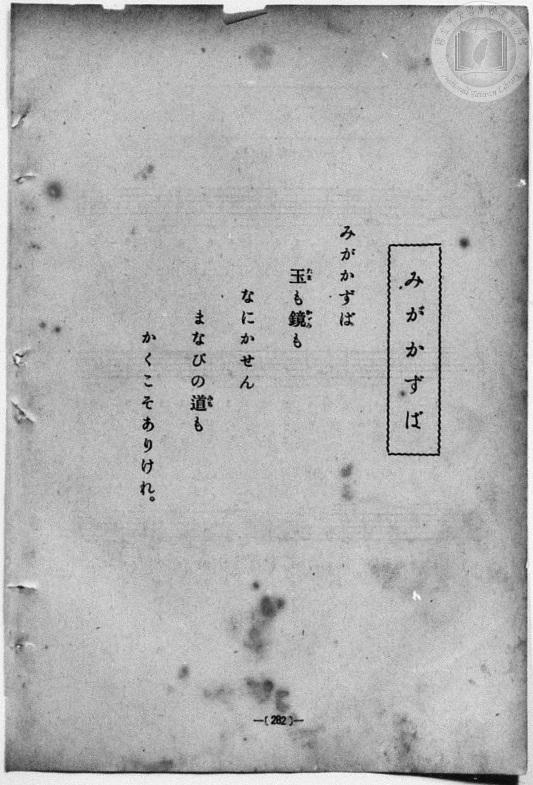
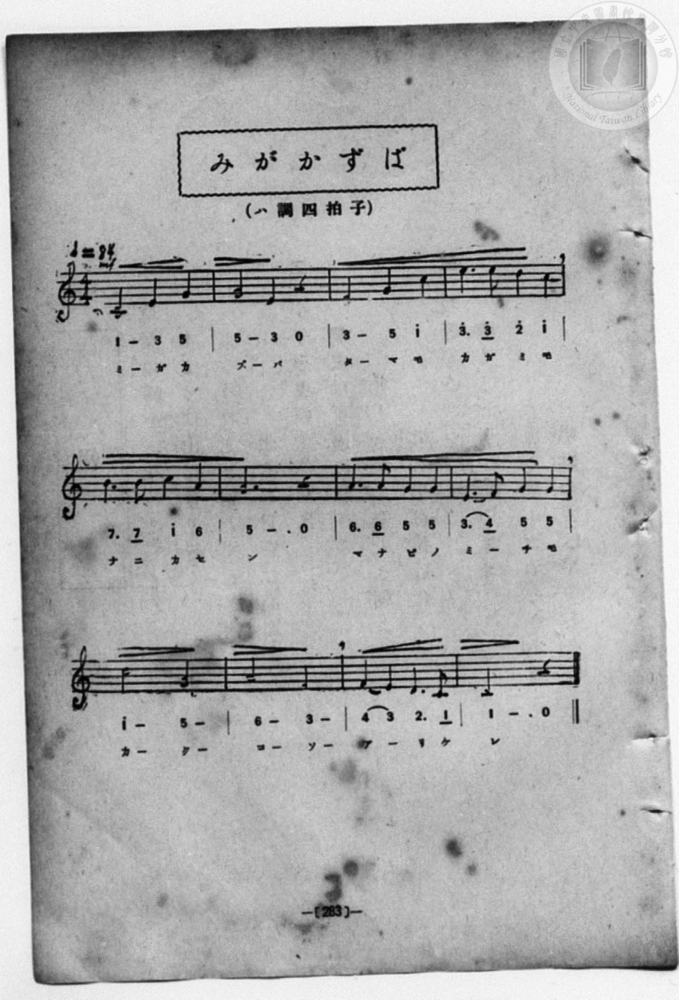

# みがかずば

> Re:Shōka 使用 AI 協助辨識與重建樂譜，可能會有錯誤。歡迎回報。

- **鋼琴伴奏版**：<br><audio controls src="migakazuba.mp3"></audio>
- **NEUTRINO 歌聲合成版**：<br><audio controls src="migakazuba_neutrino.mp3"></audio>

- book: 新編 小學校・公學校 唱歌教材集（尋常科五・六學年用）
- 一條慎三郎 編《新編 小學校・公學校 唱歌教材集》（大正十二年十二月，索書號 0725-41）
- lyricist: 昭憲皇太后（御歌）
- composer: 東儀季芳

## 說明

> [!NOTE]
> **原書資訊與歌詞全文**（對應 `P290.jpg`–`P291.jpg`，原書 p. 282–283，尋常科五・六學年第 28 首）：
> - **調性與拍號**：ハ調四拍子（C 大調 4/4 拍），♩ = 84，力度標記 `mf`
> - **背景說明**：昭憲皇太后御歌、東儀季芳作曲之著名唱歌（原見於明治十一年東京女子師範學校《保育唱歌》）。
>
> みがかずば
> 玉（たま）も鏡（かがみ）も
> なにかせん
> まなびの道（みち）も
> かくこそありけれ。


## 歌詞

```text
（TMD 檔案未包含歌詞註解）
```

## ABC

<div class="abc-score" data-abc-src="migakazuba.abc" aria-label="五線譜載入中"></div>

[下載 ABC 原始檔](migakazuba.abc)

## TMD 檔案連結

- [主旋律 TMD 檔案](migakazuba.tmd) [[在 TMD Studio 編輯](https://tmdlang.github.io/Tmd-TS/#tmd=s7IKdvYPcrWy4qpTUCpJTLdSSM7PyUlNLsnMz7MqzsjPTozPrsyvSsyML84ojTe0NDJWgqssy88pzU21Si9KTEmNN403Q8gU55cWJadaFSdn5OfnxJekVpQk5edno8vHFySmp1oFGFkaIGQKivLLUvMS84C6C4oy80pSU8DaEQpSyzJTUkHSxcmJefFlqUWZaZmpKUiOSi0qBrsdYkVJUWJecXJRZgHIQwhV-UUlGflAhxdkVFplZBaX5BdlJifmxGcn5iUiFJVkpAK9l5tflJiDrDMzPTMPKJqXVAoMH0yJ1MysTCQva2kpPG7c_7ix53Fj9-PGWY8bNyhoaXEp2ipYmHDZ2yo4c9mY6JvYgUwBqbdSeDZtw_PtKxSebuh_unbHswULHzfvftq6BsJWeDpl47O1Pc-mznw2d8LL2W3v93Q83dD9dMeO58snPtk1Bax0LVDp051bnk9Z8X5PJ9h1T3Y0PFs091lr35MdnS-b-xSAxj9u6CLFnscN3SCrlix_tnbx097GJ7t6gDZAGM_mdLzf0_N8y6Jns3e8mDlfwcDcyFTXxBBmd04lMGCB4Qv014y1z9o2PZ_V_nTJqqcT-kDm7VsItASmMjk_tyC_OLUIqHLuxqctDU_XLn7RtVmJi0tfS8GWWoBLQUHBTiFa0c8_xDUWwtHSeto3H-T4ze0vVnS96GgHuunFynlPW1c8m9aupQUO4t5n7Z0KCaCEqpdVkJ7wqGEyiGMI5gB9DzFAoUBPwcjCCChpZGEMEsUVM2vWANUpvFw2Dej193tmQZyhC3TIi1X7nzUsBzmhuxcYliDLZz1u7gcKP509Gyj2dO0EoHOcFYARARRTAKYbBaAo2JSeRzNXKoDSFMjirtlPdy17tmLmixUzFBJy0xKQbGjueTZz_YtVq57N6AMbjxYrkCh53NCIHAdP9s55NnvTk53dLyZOfzqhF5I2QOHSN__Fsu5n0_YADXu2aTcoPexoAHoQqPfJrjVPl24GuvfpjtXP17dAU1hD15P9c180bYKYAE5UnY8bmsDOg7gRLadABJ_3AT3Y8bhx_uPGfSAdTU0v-xeCRYDKgIr3QwRhJqx63LgaLDX7cdNkmOA-sPjmx43rXjZOBusFWgQ0BFkjUEv_48bJjxvnPm5setzU9bhx4uMmoDPBCihPe1CgoKXPxeWbmZ6YnVhVmpRoFZCZmJfvUGNQo1ANskfBxkILHBgK2NK9AjDxAAP5xcIeBQ0TUN59vr5BRwGWFjWxaADaBjIMaHpuWq2CITAVgKAxEJsCcQ2YhIkYgEVALBAEyRjGQYRAFFBNnIIRiAURBZvrU6PwuHk-VMfjpjVgcjVY0-OmXTDx5glAMh4quh8uOg9MLoKKg3RBzICYCJXhwh8Yu3rICQxzsF3mEJ-YoQQECEICAiQOkgXJQAILEjQmCBFEGHRB_dQN9cnjpt0QfzVvRjIYGgZgn4NUdwHxZDCrDyoDD8vmRqLDYEcnOWEA9jssokEQ5mNIYoCImEB5RmC-IUgbejjBwwAagyC_r4cb8LgJ5v_HTXuRREH-gvhzFVR2I9j_oBSEElpctVxcunYKiByjAOQpcwEA)]
- [鋼琴伴奏 TMD 檔案](migakazuba_piano.tmd) [[在 TMD Studio 編輯](https://tmdlang.github.io/Tmd-TS/#tmd=s7IKdvYPcrWy4qpTUCpJTLdSSM7PyUlNLsnMz7MqzsjPTozPrsyvSsyML84ojTe0NDJWgqssy88pzU21Si9KTEmNN403Q8gU55cWJadaFSdn5OfnxJekVpQk5edno8vHFySmp1oFGFkaIGQKivLLUvMS84C6C4oy80pSU8DaEQpSyzJTUkHSxcmJefFlqUWZaZmpKUiOSi0qBrsdYkVJUWJecXJRZgHIQwhV-UUlGflAhxdkVFplZBaX5BdlJifmxGcn5iUiFCUWATWnp-am5pVYFWQm5uXHJyYn5-cWJOZlgsQQCksygIqscvOLEnOUuLS0FB437n_c2PO4sftx46zHjRve7-l4OXvms87ul917nk_Y8mTPlqdL-9_v6VTQ0uJStFWwMOGyt1Vw5rIx0TexA5kJCisrhWfTNjzfvkLh6Yb-p2t3PFuw8HHz7qetayBshadTNj5b2_Ns6sxncye8nN0GtOHphu6nO3Y8Xz7xya4pYKVrgUqf7tzyfMoKoFVgtz7Z0fBs0dxnrX1PdnS-bO5TABr_uKGLFHseN3SDrFqy_NnaxU97G5_s6gHaAGE8m9Pxfk_P8y2Lns3e8WLmfAUDcyNTXRNDmN05lcAQBgY00F8z1j5r2_R8VvvTJaueTugDmbdvIdASmEpQCOcXpxYBVc7d-LSl4enaxS-6NitxcflmpidmJ1aVJiVaBYBiI8jDocagRqGaSwEIbCy07MAMfS0FW3Sg8HzNGqDnXyzsUdAwAfn0-foGHQVgwjPUyypI18SiQUsfbBjQ9Ny0WgVDBV0wNAZiUyCuAZMwEQOwCIgFgiAZwziIEIgCqolTMAKxIKJgc31qFB43z4fqeNy0BkyuBmt63LQLJt48AUjGQ0X3w0XngclFUHGQLogZEBOhMlz4A2NXDzmBYQ62yxziEzOUgABBSECAxEGyIBlIYEGCxgQhggiDLqifuqE-edy0G-Kv5s1IBkPDAOxzkOouIJ4MZvVBZeBh2dxIdBjs6CQnDMB-h0U0CMJ8DEkMEBETKM8IzDcEaUMPJ3gYQGMQ5Pf1cAMeN8H8_7hpL5IoyF8Qf66Cym4E-x-UglBCi6sWM8P4oGQYE0SGedHX9bK992nrjpezW5_Onv2su_fp2gmQYgrJ4_EK0YaxMAqZb4Bb1jQeSJvGA0WgpsAFTIC0CZpKkEFQcYIGoVuIrg_KR-hDdTAofHTtFBBBpADkKXMBAA)]

## 分析

```text
================================================================================
📊 TMD Song Profile: [ みがかずば ]
================================================================================
⏱  Duration:       0:34 (34.3s), 12 measures total
🎼 Key & Tempo:    首調基準 C, != 84.0 BPM, <4/4>
   - 分析範圍：      由實際發聲的音符與和弦推測調性；播放脈絡另行呈現
🎤 人聲音域:    C4 (MIDI 60) – E5 (MIDI 76) [跨度: 16 個半音 / 1.3 個八度, 難度: moderate]
   - 最低音:  C4 in [Migakazuba #1 @ m.1, 0:00]
   - 最高音: E5 in [Migakazuba #1 @ m.4, 0:08]
   - 適合: soprano, mezzo-soprano, contralto, tenor, baritone, bass
🏛  結構:      Migakazuba (34.3s)
⚡ 編曲密度:        Peak 1 軌道同時演奏
🗝  調性診斷：       C 大調（純淨自然大調，未偵測到可信轉調）
   - 風格氣質:    純淨自然大調（陽光明朗、易唱易記，無明顯調外色彩）
   - 轉調歷程:    全曲維持單一推測調性（未偵測到可信轉調）
   - 核心骨幹音:  G, C, E, A, D
   - 調性數值:    C 大調 [相關度: 0.89, 穩定度: Moderate, 自然音純度: 100.0%]
   - 候選調性 (K-S): C 大調 (0.89), E 小調 (0.79), G 大調 (0.71)
   - 五度圈歷程:   +0
   - 各段落調性細節:
     • [Migakazuba #1]: C 大調 (r: 0.89, 自然音純度: 100.0%)

  [ 五度圈游移軌跡 ]
              [C ]*
         F            G  
      Bb               D  
      Eb               A  
         Ab           E  
            Db       B  
               F# 
     (* = active key center)

  [ 十二半音累積音高分佈 ]
     C  : ███████████████████       23.3%
     C# :                            0.0%
     D  : █████                      5.6%
     D# :                            0.0%
     E  : ███████████████████       23.3%
     F  : ███                        3.3%
     F# :                            0.0%
     G  : ████████████████████████  28.9%
     G# :                            0.0%
     A  : █████████                 11.1%
     A# :                            0.0%
     B  : ████                       4.4%
--------------------------------------------------------------------------------
Assignment 軌道音域：
  - Piano         : C4 – E5 (16 個半音 / 1.3 個八度, 34 個音符)
================================================================================
```


## 原書掃描頁






