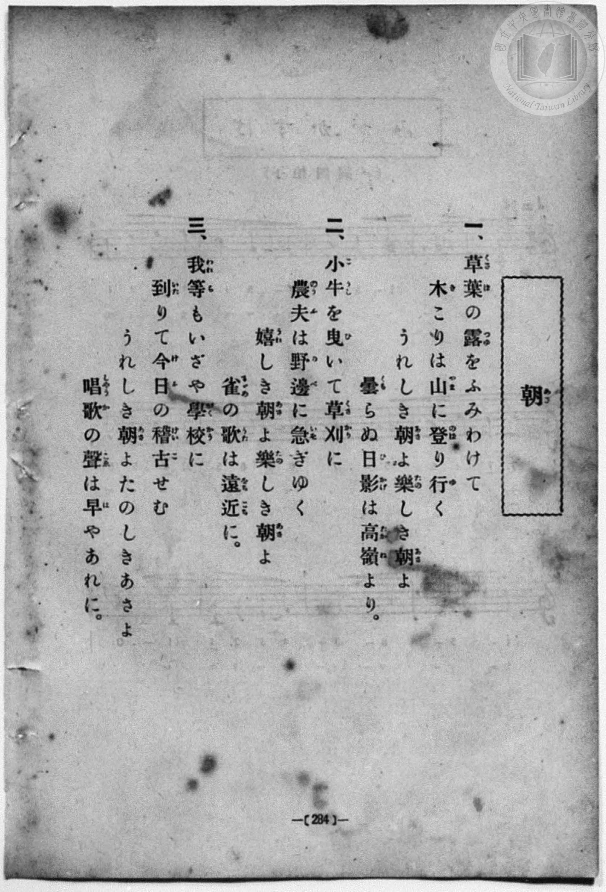
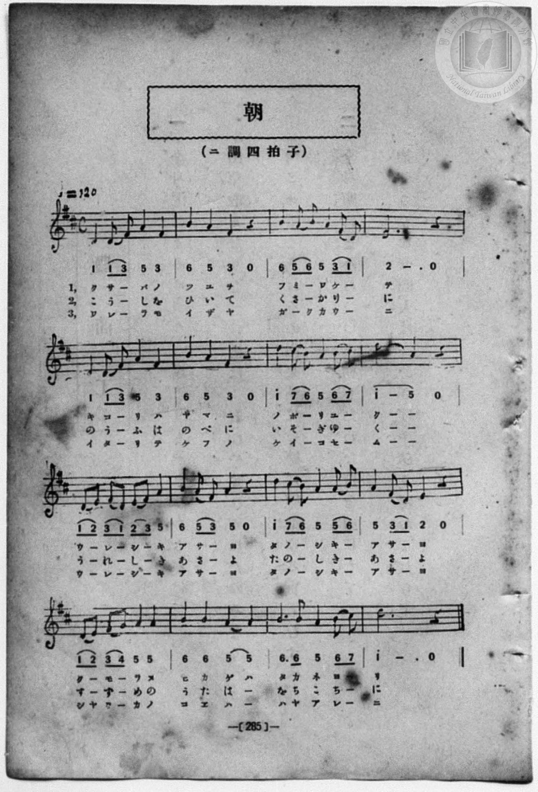

# 朝

> Re:Shōka 使用 AI 協助辨識與重建樂譜，可能會有錯誤。歡迎回報。

<audio controls src="asa.mp3"></audio>

- book: 新編 小學校・公學校 唱歌教材集（尋常科五・六學年用）
- 一條慎三郎 編《新編 小學校・公學校 唱歌教材集》（大正十二年十二月，索書號 0725-41）
- 公學校唱歌帳 (P213, 285頁, 昭和2年1月29日)

## 說明

> [!NOTE]
> **原書資訊與歌詞全文**（對應 `P292.jpg`–`P293.jpg`，原書 p. 284–285，尋常科五・六學年第 29 首）：
> - **調性與拍號**：ニ調四拍子（D 大調 4/4 拍），♩ = 120
> - **譜面特點**：五線譜與簡譜並排，譜下並列三段歌詞（一、三段為片假名，二段為平假名）。
>
> **一、**
> 草葉（くさば）の露（つゆ）をふみわけて
> 木（き）こりは山（やま）に登（のぼ）り行（ゆ）く
> うれしき朝（あさ）よ樂（たの）しき朝（あさ）よ
> 曇（くも）らぬ日影（ひかげ）は高嶺（たかね）より。
>
> **二、**
> 小牛（こうし）を曳（ひ）いて草刈（くさかり）に
> 農夫（のうふ）は野邊（のべ）に急（いそ）ぎゆく
> 嬉（うれ）しき朝（あさ）よ樂（たの）しき朝（あさ）よ
> 雀（すずめ）の歌（うた）は遠近（をちこち）に。
>
> **三、**
> 我等（われら）もいざや學校（がくかう）に
> 到（いた）りて今日（けふ）の稽古（けいこ）せむ
> うれしき朝（あさ）よたのしきあさよ
> 唱歌（しやうか）の聲（こゑ）は早（は）やあれに。


## 歌詞

```text
（TMD 檔案未包含歌詞註解）
```

## ABC

```abc
X:1
T:朝
M:4/4
L:1/16
Q:1/4=120
K:D
V:V1 name="Piano" snm="Pia"
[V:V1]
D4 D2 F2 A4 F4 | B4 A4 F4 z4 | B4 A2 B2 A4 F2 D2 | E12 z4 |
w: 1.~ク サ _ バ ノ | ツ ユ ヲ | フ ミ _ ワ ケ _ | テ
w: 2.~こ う _ し を | ひ い て | く さ _ か り _ | に
w: 3.~ワ レ _ ラ モ | イ ザ ヤ | ガ _ ク カ ウ _ | ニ
D4 D2 F2 A4 F4 | B4 A4 F4 z4 | d4 c2 B2 A4 B2 c2 | d8 A4 z4 |
w: 1.~キ コ _ リ ハ | ヤ マ ニ | ノ ボ _ リ ユ _ | ク _
w: 2.~の う _ ふ は | の べ に | い そ _ ぎ ゆ _ | く _
w: 3.~イ タ _ リ テ | ケ フ ノ | ケ イ _ コ セ _ | ム _
D2 E2 F2 D2 E2 F2 A4 | B4 A2 F2 A4 z4 | d4 c2 B2 A4 A2 B2 | A4 F2 D2 E4 z4 |
w: 1.~ウ _ レ _ シ _ キ | ア サ _ ヨ | タ ノ _ シ キ _ | ア サ _ ヨ
w: 2.~う _ れ _ し _ き | あ さ _ よ | た の _ し き _ | あ さ _ よ
w: 3.~ウ _ レ _ シ _ キ | ア サ _ ヨ | タ ノ _ シ キ _ | ア サ _ ヨ
D2 E2 F2 G2 A4 A4 | B4 B4 A4 A4 | B6 B2 A4 B2 c2 | d12 z4 |
w: 1.~ク _ モ _ ラ ヌ | ヒ カ ゲ ハ | タ カ ネ ヨ _ | リ
w: 2.~す _ ず _ め の | う た は _ | を ち こ ち _ | に
w: 3.~シヤ _ ウ _ カ ノ | コ エ ハ _ | ハ ヤ ア レ _ | ニ
D4 D2 F2 A4 F4 | B4 A4 F4 z4 | B4 A2 B2 A4 F2 D2 | E12 z4 |
w: 1.~ク サ _ バ ノ | ツ ユ ヲ | フ ミ _ ワ ケ _ | テ
w: 2.~こ う _ し を | ひ い て | く さ _ か り _ | に
w: 3.~ワ レ _ ラ モ | イ ザ ヤ | ガ _ ク カ ウ _ | ニ
D4 D2 F2 A4 F4 | B4 A4 F4 z4 | d4 c2 B2 A4 B2 c2 | d8 A4 z4 |
w: 1.~キ コ _ リ ハ | ヤ マ ニ | ノ ボ _ リ ユ _ | ク _
w: 2.~の う _ ふ は | の べ に | い そ _ ぎ ゆ _ | く _
w: 3.~イ タ _ リ テ | ケ フ ノ | ケ イ _ コ セ _ | ム _
D2 E2 F2 D2 E2 F2 A4 | B4 A2 F2 A4 z4 | d4 c2 B2 A4 A2 B2 | A4 F2 D2 E4 z4 |
w: 1.~ウ _ レ _ シ _ キ | ア サ _ ヨ | タ ノ _ シ キ _ | ア サ _ ヨ
w: 2.~う _ れ _ し _ き | あ さ _ よ | た の _ し き _ | あ さ _ よ
w: 3.~ウ _ レ _ シ _ キ | ア サ _ ヨ | タ ノ _ シ キ _ | ア サ _ ヨ
D2 E2 F2 G2 A4 A4 | B4 B4 A4 A4 | B6 B2 A4 B2 c2 | d12 z4 |
w: 1.~ク _ モ _ ラ ヌ | ヒ カ ゲ ハ | タ カ ネ ヨ _ | リ
w: 2.~す _ ず _ め の | う た は _ | を ち こ ち _ | に
w: 3.~シヤ _ ウ _ カ ノ | コ エ ハ _ | ハ ヤ ア レ _ | ニ
```

## TMD 檔案連結

- [主旋律 TMD 檔案](asa.tmd) [[在 TMD Studio 編輯](https://tmdlang.github.io/Tmd-TS/#tmd=s7IKdvYPcrWy4qpTUCpJTLdSSM7PyUlNLsnMz7MqzsjPTozPrsyvSsyML84ojTe0NDJWgqssy88pzU21Si9KTEmNN403Q8gU55cWJadaFSdn5OfnxJekVpQk5edno8vHFySmp1oFGFkaIWQKivLLUvMS84C6C4oy80pSU8DaEQpSyzJTUkHSxcmJefFlqUWZaZmpKUiOSi0qBrsdYkVJUWJecXJRZgHIQwhV-UUlGflAhxdkVFplZBaX5BdlJifmxGcn5iUiFJVkpAK9V56aCGQUKXFpaSk8mzNXQUuLS9FWwdDIgMveVsGFy8ZE38QOpAXkQyuFZ9M2PN--QuHphv6na3c8W7DwcfPup61rIGyFp1M2Plvb82zqzGdzJ7yc3fZ-T8fTDd1Pd-x4vnzik11TwErXApU-3bnl-ZQV7_d0gp3yZEfDs0Vzn7X2PdnR-bK5TwFo_OOGLlLsedzQDbJqyfJnaxc_7W18sqsHaAOE8WxOx_s9Pc-3LHo2e8eLmfMVDMyNTHVNDGF2w42EmPh0x2YFjQAjQ2MdBSML05cLGnUUns1Y-3RSjxHQQEOgWUaWz6Yv1VTi4tLXUrClFuBSUFCwU4hW9PMPcY2FcLS0nvbNBzl5c_uLFV0vOtqBjnuxct7T1hXPprVraYEDtvdZe6dCAih16WUVpCc8apgM4hiDOUA_QwxQKNADesUEKAn0EEgUV3ysWaNgZKnwctk0YNC83zML4gxdoENerNr_rGE5yAndvcAQBFk-63FzN1D46ezZQLGnaycAneOiAAx-oJgCMLUoAEXBpvQ8mrlSAZKUEMatnfNy7qLnnTtf7p4HNgvokOfbZwGFgVY837AQyHiyY9mzvklA7WB2N5D7tGM6MHE8W7cVEgxA-4CJ5nFDI0TwedOu553tTxvbn04A2tsDinWw4NOdm2GCnY8bmsBugAUvRD8wqYP5L3o7X0wEOrjjcWP_48apjxs3gLQ0rns5ZxNYcMnjJmBi7nzcNOlx49bHjfsfNwGVTXzcuAyi_dkcYGIGKgNb1Dj5cVPX48b1TzduBAk2tTxu3AcWX_185m6wsnWPG_eATet6sbAHrAZseGM_xLTHjW2Pm3oeN04HGgjMj2AtTUBXgbV0PFvRBBaZDzQHrAu7MqjDZrdDPdUE1AUUB6pfA0zBT_eC3da46XFj9-NGYFADxde_XD3j6bZdMMOB4mshRoG8gx56u3qQQg-YR593zgZrnAxyfON0SFg9m70ZYgvYfGA4LAOG89MOYIaEh3M30HBI4EAjYt-mp0tWw0IJaNRWqNva-16CVELEd0K0PGtYChYBmgz0PlCkDxiS8GB8ugYSoaDAxBNQJIXny9kNYPGZjxtnPW5qhCQSYJqEWtQ4H-raxgUv9k8ExywwwSwEB8tCiJsx0yEwacJD8lnHxOdrwc4GJjBgGmgCsoG2A50B9OM0YFqCFFZg64ApBBiGwGiCJB5oAD7tACZdSJiAHQNKisue7O4CRjpYHJhoIUG67vmKvU_7l8AEgeong8VnP25qICYdQkIMIgsRh4cSpCwFq58OTv_AkAEW0CBLX4ASAzidNAHDBxRWz6avBIusBxsLVNwEthQWUJSXrlCgoKXPxeVYnGgVkJmYl-9QY1CjUA2yQMHGQgscGwrYinQFYLkILCqA-VRBwwSc0Nc36CjAillNLBqA1oAMq1EwBBZ3hgrGCqZA2hiIaxTMgCSMZ4AkYgYVNQSKGAFZMAhWAzbNx7BG4XHTeiD_cdNWENk8AUz2gU153NwC5i0Dk5uAZDxUfCpYZD6YhOjeCJVpQ7IHrBpijxFQrnEySGUjSAUwAsG6JkF0NYLMBqYVMAmyDWpPYz9YBGxbYzdYRxdUZjV2e4xBbgC7qHkNmFwJJhdBdDUtAZuxDSwGYkPtaQKpBcmsB2KQyY-bQK4AmQWyFdUe_HG6q4dWcWoYB6TMoZFqBmRBhUAQJIQeq2vB_tgM9usqMAkKTZCfwKHQPA9MgvwHi1VQrD9unoOkAxoK4BSCK1bXgWMHEqvgNNQIUo2Q2QkmQaEKi1VIPM8Fk2A7m0C6YfGNI1ahcbcfyXVQXeC0B0uTIPNgsQoWh-oDh0PTbqhPF2DYQyCndpIXq0bg3AciQTEEi1UID0usgrJsDTzTgrIseqRCsiI4aTdtB5OgaAbJgJI4LBOvQAoESIBBgpkIHUgRC47Sph5wNIGza2MvNJqawDxwgDd1IEUsuECARjsROpAil_b-whvBwBYn-RFsAo07WATDsi5CBCSGJdfiLIvB5RWs7AJFACjNgspKWOkELi9h-RkcFBC5x82gAId4G6QHlE9w5duZ4CiZBdbZCI84eMRDIxOW80H2gFwAElsIL8sXQnXgKY2btkMLHEgcQzwAq2Cg2RLkXIh3oFZB2SCd0PgEpw3sBXItF5eunQKwClZAUMpcAA)]
- [鋼琴伴奏 TMD 檔案](asa_piano.tmd) [[在 TMD Studio 編輯](https://tmdlang.github.io/Tmd-TS/#tmd=s7IKdvYPcrWy4qpTUCpJTLdSSM7PyUlNLsnMz7MqzsjPTozPrsyvSsyML84ojTe0NDJWgqssy88pzU21Si9KTEmNN403Q8gU55cWJadaFSdn5OfnxJekVpQk5edno8vHFySmp1oFGFkaIWQKivLLUvMS84C6C4oy80pSU8DaEQpSyzJTUkHSxcmJefFlqUWZaZmpKUiOSi0qBrsdYkVJUWJecXJRZgHIQwhV-UUlGflAhxdkVFplZBaX5BdlJifmxGcn5iUiFCUWATWnp-am5pVYFWQm5uXHJyYn5-cWJOZlgsQQCksygIqsylMTgYwiJS4tLYVnc-a-39PxcvbMZ53dL7v3PJ-w5cmeLU-X9r_f06mgpcWlaKtgaGTAZW-r4MJlY6JvYgcyChREVgrPpm14vn2FwtMN_U_X7ni2YOHj5t1PW9dA2ApPp2x8trbn2dSZz-ZOeDm7DWjF0w3dT3fseL584pNdU8BK1wKVPt255fmUFUC7wE58sqPh2aK5z1r7nuzofNncpwA0_nFDFyn2PG7oBlm1ZPmztYuf9jY-2dUDtAHCeDan4_2enudbFj2bvePFzPkKBuZGpromhjC74UZCTHy6Y7OCRoCRobGOgpGF6csFjToKz2asfTqpxwhooCHQLCPLZ9OXaipxcTkWJ1oFgMI8yMOhxqBGoZpLAQhsLLTswAx9LQVbdKDwfM0aoF9fLOxR0DABeez5-gYdBWDyMtbLKkjXxKJBSx9sWI2CoYIuEBsrmAJpYyCuUTADkjCeAZKIGVTUEChiBGTBIFgN2DQfwxqFx03rgfzHTVtBZPMEMNkHNuVxcwuYtwxMbgKS8VDxqWCR-WASonsjVKYNyR6waog9RkC5xskglY0gFY8bp4N1TYLoagSZ_bgRbFsjyDaoPY39YBGwbY3dYB1dUJnV2O0xBrkB7KLmNWByJZhcBNHVtARsxjawGIgNtacJpBYksx6IQSY_bgK5AmQWyFZUe_DH6a4eWsWpYRyQModGqhmQBRUCQZAQeqyuBftjM9ivq8AkKDRBfgKHQvM8MAnyHyxWQbH-uHkOkg5oKIBTCK5YXQeOHUisgtNQI0g1QmYnmASFKixWIfE8F0yC7WwC6YbFN45YhcbdfiTXQXWB0x4sTYLMg8UqWByqDxwOTbuhPl2AYQ-BnNpJXqwagXMfiATFECxWITwssQrKsjXwTAvKsuiRCsmK4KTdtB1MgqIZJANK4rBMvAIpECABBglmInQgRSw4Spt6wNEEzq6NvdBoagLzwAHe1IEUseACARrtROhAilza-wtvBD-dPZv8CDaBxh0sgmFZFyECEsOSa3GWxeDyClZ2gSIAlGZBZSWsdAKXl7D8DA4KiNzjZlCAQ7wN0gPKJ7jy7UxwlMwC62yERxw84qGRCcv5IHtALgCJLYSX5QuhOvCUxk3boQUOJI4hHoBVMNBsCXIuxDtQq6BskE5ofILTBvYCuRapBvZBqYFNoDUwMMzjFaINY2FUjYIJkGEC5hug8CCypvFAlml8LJgBVECKIXC9yOoxzACrIsIlSMqJcQcKH6dLgAGma6cADLNoH6AgjGmEYBqDmcpcAA)]

## 分析

```text
================================================================================
📊 TMD Song Profile: [ 朝 ]
================================================================================
⏱  Duration:       1:04 (64.0s), 32 measures total
🎼 Key & Tempo:    首調基準 D, != 120.0 BPM, <4/4>
   - 分析範圍：      由實際發聲的音符與和弦推測調性；播放脈絡另行呈現
🎤 人聲音域:    D4 (MIDI 62) – D5 (MIDI 74) [跨度: 12 個半音 / 1.0 個八度, 難度: easy]
   - 最低音:  D4 in [Asa #1 @ m.1, 0:00]
   - 最高音: D5 in [Asa #1 @ m.7, 0:12]
   - 適合: soprano, mezzo-soprano, contralto, tenor, baritone, bass
🏛  結構:      Asa (32.0s) -> Asa (32.0s)
⚡ 編曲密度:        Peak 1 軌道同時演奏
🗝  調性診斷：       D 大調（純淨自然大調，未偵測到可信轉調）
   - 風格氣質:    純淨自然大調（陽光明朗、易唱易記，無明顯調外色彩）
   - 轉調歷程:    全曲維持單一推測調性（未偵測到可信轉調）
   - 核心骨幹音:  A, D, B, F#, E
   - 調性數值:    D 大調 [相關度: 0.83, 穩定度: Moderate, 自然音純度: 100.0%]
   - 候選調性 (K-S): D 大調 (0.83), A 大調 (0.79), F# 小調 (0.63)
   - 五度圈歷程:   +2 -> +2
   - 各段落調性細節:
     • [Asa #1]: D 大調 (r: 0.83, 自然音純度: 100.0%)
     • [Asa #2]: D 大調 (r: 0.83, 自然音純度: 100.0%)

  [ 五度圈游移軌跡 ]
               C  
         F            G  
      Bb              [D ]*
      Eb               A  
         Ab           E  
            Db       B  
               F# 
     (* = active key center)

  [ 十二半音累積音高分佈 ]
     C  :                            0.0%
     C# : ███                        3.5%
     D  : █████████████████         21.9%
     D# :                            0.0%
     E  : ████████                   9.6%
     F  :                            0.0%
     F# : ███████████               14.0%
     G  : █                          0.9%
     G# :                            0.0%
     A  : ████████████████████████  30.7%
     A# :                            0.0%
     B  : ███████████████           19.3%
--------------------------------------------------------------------------------
Assignment 軌道音域：
  - Piano         : D4 – D5 (12 個半音 / 1.0 個八度, 136 個音符)
================================================================================
```


## 原書掃描頁






