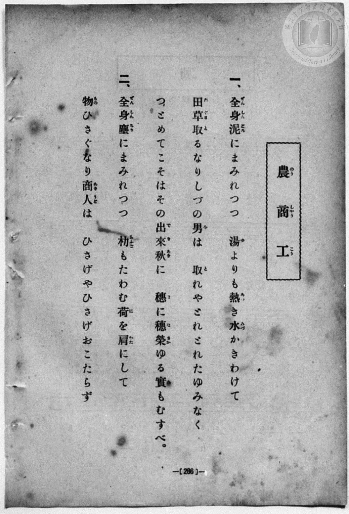
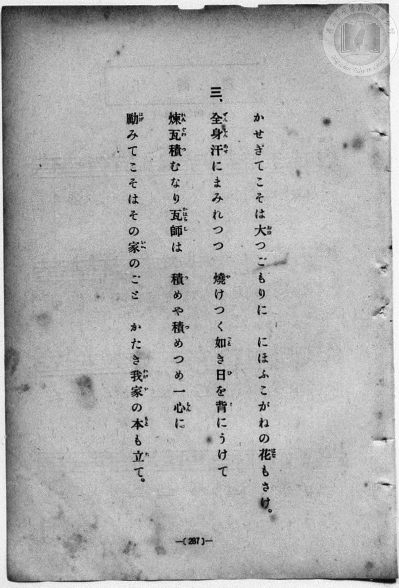
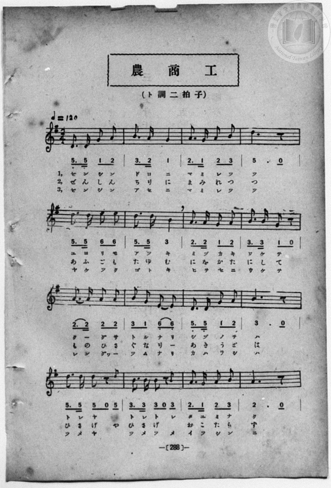
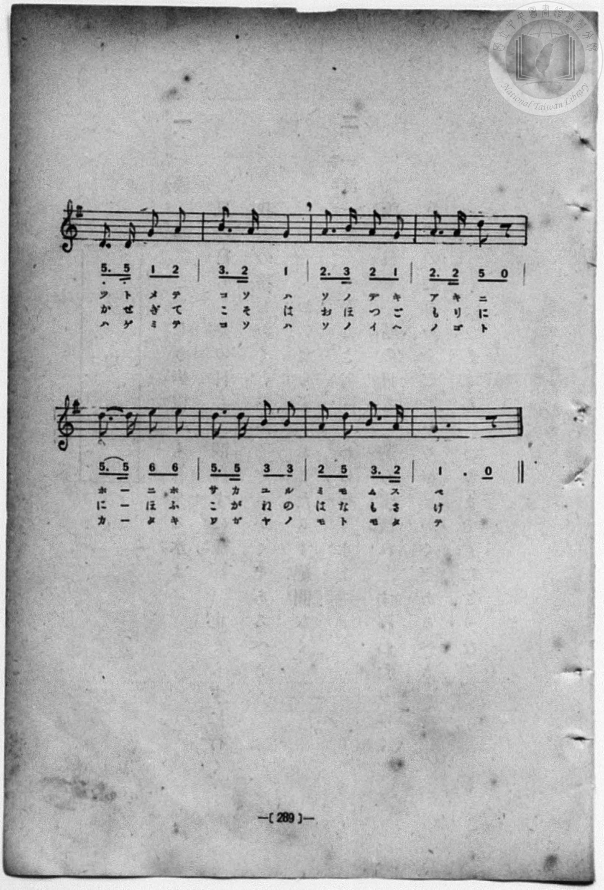

# 農商工

> Re:Shōka 使用 AI 協助辨識與重建樂譜，可能會有錯誤。歡迎回報。

- **鋼琴伴奏版**：<br><audio controls src="no_sho_ko.mp3"></audio>
- **NEUTRINO 歌聲合成版**：<br><audio controls src="no_sho_ko_neutrino.mp3"></audio>

- book: 新編 小學校・公學校 唱歌教材集（尋常科五・六學年用）
- 一條慎三郎 編《新編 小學校・公學校 唱歌教材集》（大正十二年十二月，索書號 0725-41）
- composer: 宮島慎三郎

## 說明

> [!NOTE]
> **原書資訊與歌詞全文**（對應 `P294.jpg`–`P297.jpg`，原書 p. 286–289，尋常科五・六學年第 30 首）：
> - **調性與拍號**：ト調二拍子（G 大調 2/4 拍），♩ = 120
> - **版本校勘**：本曲原出大正四年臺灣總督府《公學校唱歌集》（宮島慎三郎作曲），惟本教材集（`P296.jpg`–`P297.jpg`）第 1–4 小節改為 `5_. 5_ 1 2 | 3. 2 1 | 2. 1 2 3 | 5 . 0`（原大正四年版為 `5_. 5_ 6_ 7_ | 1. 7_ 6_ | 7_. 6_ 7_ 1 | 3 . 0`），第 17–20 小節亦改為 `5_. 5_ 1 2 | 3. 2 1 | 2. 3 2 1 | 2. 2 5 0`（原大正四年版為 `5_. 5_ 6_ 7_ | 1. 7_ 6_ | 7_. 1 7_ 6_ | 7_. 7_ 5 0`），第 21 小節首拍記為附點連結線 `5. 5`。又第 6 小節第二段歌詞於 p. 286 印為「朸もたわむ」，於 p. 288 譜下印為「あふごもたゆむ」；第 13–14 小節配合第一、三段「取れや｜取れ取れ」「積めや｜積め積め」（3+4 拍）與第二段「ひさげや｜ひさげ」（4+3 拍）並列休止符與音符。
>
> **一、**
> 全身（ぜんしん）泥（どろ）にまみれつつ
> 湯（ゆ）よりも熱（あつ）き水（みづ）かきわけて
> 田草（たぐさ）取（と）るなりしづの男（を）は
> 取（と）れやとれとれたゆみなく
> つとめてこそはその出來秋（できあき）に
> 穗（ほ）に穗（ほ）榮（さか）ゆる實（み）もむすべ。
>
> **二、**
> 全身（ぜんしん）塵（ちり）にまみれつつ
> 朸（あふご）もたわむ荷（に）を肩（かた）にして
> 物（もの）ひさぐなり商人（あきうど）は
> ひさげやひさげおこたらず
> かせぎてこそは大（おほ）つごもりに
> にほふこがねの花（はな）もさけ。
>
> **三、**
> 全身（ぜんしん）汗（あせ）にまみれつつ
> 燒（や）けつく如（ごと）き日（ひ）を背（せ）にうけて
> 煉瓦（れんぐわ）積（つ）むなり瓦師（かはらし）は
> 積（つ）めや積（つ）めつめ一心（いつしん）に
> 勵（はげ）みてこそはその家（いへ）のごと
> かたき我家（わがや）の本（もと）も立（た）て。


## 歌詞

```text
（TMD 檔案未包含歌詞註解）
```

## ABC

<div class="abc-score" data-abc-src="no_sho_ko.abc" aria-label="五線譜載入中"></div>

[下載 ABC 原始檔](no_sho_ko.abc)

## TMD 檔案連結

- [主旋律 TMD 檔案](no_sho_ko.tmd) [[在 TMD Studio 編輯](https://tmdlang.github.io/Tmd-TS/#tmd=s7IKdvYPcrWy4qpTUCpJTLdSSM7PyUlNLsnMz7MqzsjPTozPrsyvSsyML84ojTe0NDJWgqssy88pzU21Si9KTEmNN403Q8gU55cWJadaFSdn5OfnxJekVpQk5edno8vHFySmp1oFGFmaIGQKivLLUvMS84C6C4oy80pSU8DaEQpSyzJTUkHSxcmJefFlqUWZaZmpKUiOSi0qBrsdYkVJUWJecXJRZgHIQwhV-UUlGflAhxdkVFplZBaX5BdlJifmxGcn5iUiFJVkpAK9V55fhORyoML0zDyrksTMcqD1-WlpmcmZiTlKXFpaCi_2bXo6te3p9qUKWlpcirYKhkYGXPa2Cu5cNkb6JnYgE0CBYKXwbNqG59tXKDzd0P907Y5nCxY-bt79tHUNhK3wdMrGZ2t7nk2d-WzuhJez297v6Xi6ofvpjh3Pl098smsKWOlaoNKnO7c8n7Li_Z5OsMue7Gh4tmjus9a-Jzs6Xzb3KQCNf9zQRYo9jxu6QVYtWf5s7eKnvY1PdvUAbYAwns3peL-n5_mWRc9m73gxc76CgbmRqa6JIczu5Pzcgvzi1CIrhafr1j3dvA3uCiUuLn0tBVtqAS4FBQU7hWhFP_8Q11gIR0vrad98kKs2t79Y0fWiox3ooxcr5z1tXfFsWruWFjjsep-1dyokgNKYXlZBesKjhskgjjmYA_QWxACFAj0FIwszoKSRhSVIFFeQr1mjYGyg8HLZNKDv3--ZBXGGLtAhL1btf9awHOSE7l5gIIEsn_W4uQMoDArB7t6naycAneOuAAxhoJgCMEEoAEXBpvQ8mrlSAZJa4MY97-x4NmcNMJ6eds8AmwXizd4EdO3T9l3QWJo9G-iiF-27njcufr5j7_O5i5_umgOMdXgUQ2IYEbeosfNk7xyggRAHPGueDzIfKc2BwsgMW4B1goLAEChoAkpXz9c3PJuy83nTLoUE03g9BdN4BUMFI4UaBWNgcAKZNQpGemARYyDTVEFPwQBoQgfIE0g-AHoV2QCzeAXzeKByQz0QDeTVAGk9qDDISGOoOSCHgx1jDoo2A6hznuxaRtBFxgimEdBZ5DvKEIUHZEMMg7nMyBDqKGB6ASWLFTOAZr6c2fJy97yXDYufb53wfPssoBVAGxIeNzQ97e8AaTKD6gGyQSln3VZImn42bQ80kSo87d0ANOdxAzBj7njc1PS4cf7jpv7HTQ2PG4DpqQeu0ELhxdo5T3Z0w5U_bgSq3fq4cQpMUxtM02xwOBoDw9EQFq0vW3ufTgA5CFi0PG5oBKYZoFOAhjztn_a4qedxU8v7vXMgbKhIQy9Q9vnK3sdNjRBZCBsqArKlw1gbluiB-QTuP7DLNj1unPq4cRJEJ4IL1maibQzV9mTHsqcd05_smfhs7aLna5YBTXk5fzOQAQw9cNaBlQoQNwMLYTAfWBy82LUaaNDjxjmPmyY_bpwOJIGmPdu8FCy48nETyPDHjasfN-573Lgf5JvGJUAE0f5s53qQsiZgtuh83ARkdAHD73nbRrBeYEAuAevtfbZhC1hk_-NGoLFAkW6gIChiGic-blwGMer5lA0veoGpA6hs_uPGCUBPAlUCww8sAirMHzcBda0CWQF0ZOPSx43rnk_ZDrZ9EtjM9VAfoWgBxQaQDXY2hATHLcglqx439kO0gH0ElG0EOuZxIzAQ5gJNA5PrgCXKk31tz5eDConHjctBzgb5CxomUJevnA6W3Q0RROY-W7YOzAZGGNAEoHuAyar76fplkNAAizSBElrjzMeNOzFiahcw5RCMqacLt4IFFwJDBl9MzdkBixRQModaDcseL3rBIdkINB8oPulF00owFxjg82FmAsMcFlOdYFmQdqDvgLKQFAmMMlDsAGv5J7t2wewCBhcwtIHqERGEnKAR7EZgtAI9BXQPUCW07gA7YPbjxj7keAGWRGDDgeohAQ70IzjXghIGNEbADt4N9ilQFzAc1gKd-qILkiyBMbsK5n2g1RMxM0gnMRlkIySWgYbMxhPsz9uBiRMYVi1gNcDUDpTqf7qsCax3CjSVAjPIdEh2A9U5oPBv7gFz4SYDwxApp7R2Pp8MTkKg5A100gRgJIJqn5WgEgGa6UCJChQdQJVPd0DcDwzM9eDgBbocER2oukDlE7oI0M1NwEKu4en-ZrA4MNaAvoCGAzzMn3ZD0iEweCH5EZjFMHLTum0wE4CpEahmHSQQkKIbmPd7n3VMhKoEFRHgAhWsGFgPwxIeJHc3PV8NyZiQVAor6yhvT0GBgpY-F5dffnBGvne-VUBmYl6-Q41BjUI1yBIFG0MzLXCiUcDWklOAVA8vFvYoaMDqDR0FWMtBE4sGoF0gw4CNgXhgM0cXUj3rAmthXXDFDhICVc0gGiQCEtcFV-C6YFlQIwIiB4IGIBGweT6GNQqPm_aARR83bwayt0NZID2PmzuhMmuBuBtu-uPmeVDx-UC8BsxqgcqAaBgEORVqjxFQrnEORFfTZCB7OpQF1tW4ECrTBcqdCHsa90HEG_cD5XrArCVQGRCNxR5jvP5pWgS1ZzcF_sEfq7t6yIpVsPmmwDaMLhgjRCBxi4hTSCwjx7sxWAQtTpuXQX20AohXgVkgvyOFAdBnj5vWIoXBfKh4K1AcFAcQWZDMemiobQSy21DDGxyvTdBY2grEU8AqQSIgGaiZTW1A3ICwCxrHwMIMlK_BekEqkWSA6QOYZVHtAsVtMyTeIW4Bxc3jJpDrQP7aAnV_B5q_JkHFN4HjHcQC2QjSAQ0jNH8RyLWd5MQvLO5ANCLuQPEGbARDCXx5G3u-3Q8Vf9y0AUxuhfq4A-xLcBw2d4FJUAoA6QDlBmgcAzu7kFCB6OlHsgctfsGxCYqTdaDqGcyaCo2tCWAeOH0B8y4ifmE6eoEYFLLAWh4qA0lLWPMtOOfB8i3YR-CUB8uFj5sXYPERNL0A3f-4GWQHxI_YfYQ3ZoHdF0pyLogGxw88V4JoSNmLWRpDRLDGKjj2QD5aA03tkLSBKg6JYVB4IdIBKM9DcjEkjEAyOEIbnGtBMQmJS0hzC2EVqhRUO0gcEsXAehuaYYENBqjMLOwWgaMVUoQ-bl6I5iFkcUgEg6oBkLOhmRxcRKFWSLBCm8hIBY5CYEYquEdOtUoW1CeGZGVENocnBqRohfkWWDyB_QkpckC-BfkNFJZ7kRItSHwvVEcfELeDVayFysCqsbXQEEGPWkgoAZuIQAzO5uCiFCQDqnBB_LlIWRE5ZoEVI7hqhRTkSJkfXjWjxy7ExY-bgMUrNPGR4C9wTD9ungGRARdJIB1boEmcmGzbupasGAbbhKvCRWRSkCgs5oGjGFBfYMu2s6HikBiB8EG-BRXKID-tBmdQWMEMq3Ah1TKkaAOp2gmWmYlkD3rcwppHoLgCkdBCHx6zPUAMSieg4hpR5MIKaVjBPBUsMxG7PeBGFNwecPGC2RiAFU-QWAPJQHwCKZpgKXQ_WAaUIlDtqeXi0rVTgLaeFVCZylwA)]
- [鋼琴伴奏 TMD 檔案](no_sho_ko_piano.tmd) [[在 TMD Studio 編輯](https://tmdlang.github.io/Tmd-TS/#tmd=s7IKdvYPcrWy4qpTUCpJTLdSSM7PyUlNLsnMz7MqzsjPTozPrsyvSsyML84ojTe0NDJWgqssy88pzU21Si9KTEmNN403Q8gU55cWJadaFSdn5OfnxJekVpQk5edno8vHFySmp1oFGFmaIGQKivLLUvMS84C6C4oy80pSU8DaEQpSyzJTUkHSxcmJefFlqUWZaZmpKUiOSi0qBrsdYkVJUWJecXJRZgHIQwhV-UUlGflAhxdkVFplZBaX5BdlJifmxGcn5iUiFCUWATWnp-am5pVYFWQm5uXHJyYn5-cWJOZlgsQQCksygIqsyvOLgF7U0lJ4sW_T06ltT7cvfb-n4-Xsmc86u19273k-YcuTPVueLu1_v6dTQUuLS9FWwdDIgMveVsGdy8ZI38QOZBoolKwUnk3b8Hz7CoWnG_qfrt3xbMHCx827n7augbAVnk7Z-Gxtz7OpM5_NnfBydhvQiqcbup_u2PF8-cQnu6aAla4FKn26c8vzKSuAdoFd-WRHw7NFc5-19j3Z0fmyuU8BaPzjhi5S7Hnc0A2yasnyZ2sXP-1tfLKrB2gDhPFsTsf7PT3Ptyx6NnvHi5nzFQzMjUx1TQxhdoNCLL84tchK4em6dU83b4O7QomLyy8_OCPfO98qABS6QR4ONQY1CtVcCkBgY2imZQdm6Wsp2KIDhedr1gD99GJhj4KGCcgDz9c36CgAU5KZXlZBuiYWDVr6YMNqFEzjFXSBEEgZAikjIK5RMAYLGYFFQLAGLK4L5INokCxQH1QOBA1AImDzfAxrFB437QGLPm7eDGRvh7JAeh43d0Jl1gJxN9z0x83zoOLzgXgNmNUClQHRMAhyKtQeI6Bc4xyIrqbJQPZ0KAusq3EhVKYLyF6NsKdxH0S8cT9QrgfMWgKVAdFY7DHG65-mRVB7dlPgH_yxuquHrFgFm2-qYAYkQRghAolbRJxCYhk53o3BImhx2rwM6qMVQLwKzAL5HSkMgD573LQWKQzmQ8VbgeKgOIDIgmTWQ0NtI5Ddhhre4HhtgsbSViCeAlYJEgHJQM1sagPiBoRd0Dh-3DQJyAbFA0QlkgwwfTxuBPkBLW6bIfEOcQsobh43gVwH8tcWqPs70Pw1CSq-CRzvIBbIRpAOaBih-YtAru0kJ35hcQeiEXEHijczkKVgAl_exp5v90PFHzdtAJNboT7uAPsSHIfNXWASlAJAOkC5ARrHwGIUEioQPf1I9qDFLzg2QXGyDohB6h83ToXG1gQwD5y-gHkXEb8wHb1ADArZx40roTKQtIQ134JzHizfgn0ETnmwXPi4eQEWH0HTC9D9j5tBdkD8iN1HeGP26ezZlORcEA2OH3iuBNGQshezNIaIYI1VcOyBfLQGmtohaQNVHBLDoPBCpANQnofkYkgYgWRwhDY414JiEhKXjxsnPW4CBTHUKlQpqHaQOCSKHzeCCnCwRU2gCgIkMwu7ReBohRShj5sXonkIWRwSwaBqAORsaCYHF1GoFRKs0CYyUoFNCsxINadqJWsMpkGiiGwOTwxI0QrzLbB4AvsTUuSAfAvyGygs9yIlWpD4XqiOPiBuB6tYC5WBVWNroSGCHrWQUHrcOBuIwdkcXJSCZEAVLog_FykrIscssGIEV62Qghwp88OrZvTYhbj4cROweIUmPhL8BY7px80zIDLgIgmkYws0iROTbVvXkhXDYJtwVbiITAoShcV8DTzusWXb2VBxSIxA-CDfggplkJ9WgzMorGCGVbiQahlStIFU7QTLzESyBz1uYc0jUFyBSGihD4_ZHiAGpRNQcY0ocmGFNKxgngqWmYjdHnAjCm4PuHjBbAzAiidIrIFkID6BFE2wFLofLANKEaj21KI1nn1QGs8miLbz0-4lT7s7n83oe7p_9ZOd3aD2enfv07UTnm5fBuyYQLokyBk3XiHaND4WFFdAliGIARIDYbCQAdSPSPKEFKKZaRafS7KpUO0gJk5z0ZyAqhakwASXsVAHAINU104BGqrRPkBVyFwjVK4xmKvMBQA)]

## 分析

```text
================================================================================
📊 TMD Song Profile: [ 農商工 ]
================================================================================
⏱  Duration:       0:48 (48.0s), 48 measures total
🎼 Key & Tempo:    首調基準 G, != 120.0 BPM, <2/4>
   - 分析範圍：      由實際發聲的音符與和弦推測調性；播放脈絡另行呈現
🎤 人聲音域:    D4 (MIDI 62) – E5 (MIDI 76) [跨度: 14 個半音 / 1.2 個八度, 難度: moderate]
   - 最低音:  D4 in [NoShoKo #1 @ m.1, 0:00]
   - 最高音: E5 in [NoShoKo #1 @ m.5, 0:04]
   - 適合: soprano, mezzo-soprano, contralto, tenor, baritone, bass
🏛  結構:      NoShoKo (24.0s) -> NoShoKo (24.0s)
⚡ 編曲密度:        Peak 1 軌道同時演奏
🗝  調性診斷：       D 大調（純淨自然大調，未偵測到可信轉調）
   - 風格氣質:    純淨自然大調（陽光明朗、易唱易記，無明顯調外色彩）
   - 轉調歷程:    全曲維持單一推測調性（未偵測到可信轉調）
   - 核心骨幹音:  A, D, B, G, E
   - 調性數值:    D 大調 [相關度: 0.80, 穩定度: Moderate, 自然音純度: 100.0%]
   - 候選調性 (K-S): D 大調 (0.80), G 大調 (0.68), B 小調 (0.63)
   - 五度圈歷程:   +2 -> +2
   - 各段落調性細節:
     • [NoShoKo #1]: D 大調 (r: 0.80, 自然音純度: 100.0%)
     • [NoShoKo #2]: D 大調 (r: 0.80, 自然音純度: 100.0%)

  [ 五度圈游移軌跡 ]
               C  
         F            G  
      Bb              [D ]*
      Eb               A  
         Ab           E  
            Db       B  
               F# 
     (* = active key center)

  [ 十二半音累積音高分佈 ]
     C  :                            0.0%
     C# :                            0.0%
     D  : █████████████████████     24.7%
     D# :                            0.0%
     E  : ██████                     6.7%
     F  :                            0.0%
     F# :                            0.0%
     G  : ██████████████            16.9%
     G# :                            0.0%
     A  : ████████████████████████  28.1%
     A# :                            0.0%
     B  : ████████████████████      23.6%
--------------------------------------------------------------------------------
Assignment 軌道音域：
  - Piano         : D4 – E5 (14 個半音 / 1.2 個八度, 156 個音符)
================================================================================
```


## 原書掃描頁










