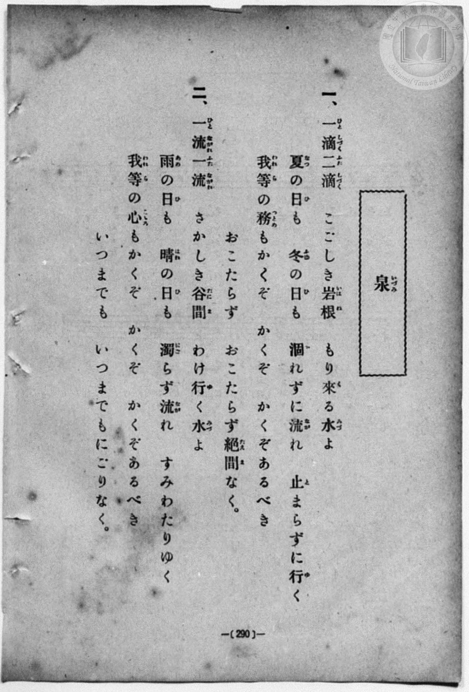
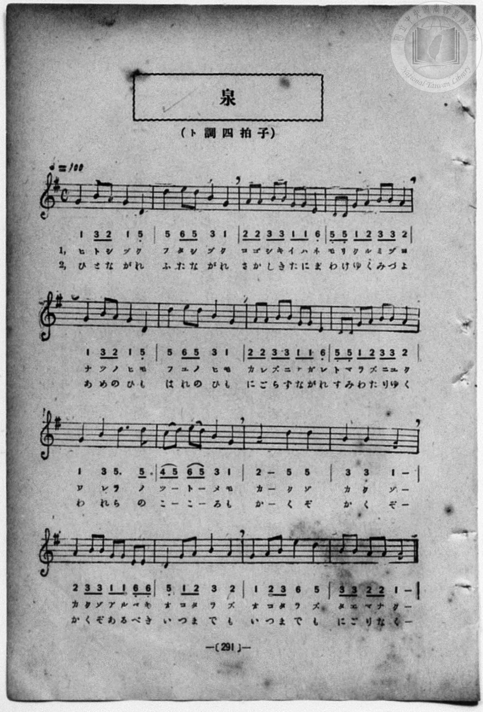

# 泉

> Re:Shōka 使用 AI 協助辨識與重建樂譜，可能會有錯誤。歡迎回報。

<audio controls src="izumi.mp3"></audio>

- book: 新編 小學校・公學校 唱歌教材集（尋常科五・六學年用）
- 一條慎三郎 編《新編 小學校・公學校 唱歌教材集》（大正十二年十二月，索書號 0725-41）
- 出處：共益商社樂器店《唱歌教科書 教師用 巻二》第二十八～二十九頁（第十三曲）

## 說明

> [!NOTE]
> **原書資訊與歌詞全文**（對應 `P298.jpg`–`P299.jpg`，原書 p. 290–291，尋常科五・六學年第 31 首）：
> - **調性與拍號**：ト調四拍子（G 大調 4/4 拍），♩ = 100
> - **版本校勘**：與共益商社《唱歌教科書 教師用 巻二》（♩=126）相比，本教材集速度標為 ♩ = 100，且第 5 小節（第二行第一小節）印為 `1 (3 2) 1 5_`（與第 1 小節節奏相同）。
>
> **一、**
> 一滴（ひとしづく）二滴（ふたしづく）
> こごしき岩根（いはね）　もり來（く）る水（みづ）よ
> 夏（なつ）の日（ひ）も　冬（ふゆ）の日（ひ）も
> 涸（か）れずに流（なが）れ　止（と）まらずに行（ゆ）く
> 我等（われら）の務（つとめ）もかくぞ　かくぞ　かくぞあるべき
> おこたらず　おこたらず絕間（たえま）なく。
>
> **二、**
> 一流（ひとながれ）二流（ふたながれ）
> さかしき谷間（たにま）　わけ行（ゆ）く水（みづ）よ
> 雨（あめ）の日（ひ）も　晴（はれ）の日（ひ）も
> 濁（にご）らず流（なが）れ　すみわたりゆく
> 我等（われら）の心（こころ）もかくぞ　かくぞ　かくぞあるべき
> いつまでも　いつまでもにごりなく。


## 歌詞

```text
（TMD 檔案未包含歌詞註解）
```

## ABC

```abc
X:1
T:泉
M:4/4
L:1/16
Q:1/4=100
K:G
V:V1 name="Piano" snm="Pia"
[V:V1]
G4 B2 A2 G4 D4 | d4 e2 d2 B4 G4 | A2 A2 B2 B2 G2 G2 E4 | D2 D2 G2 A2 B2 B2 A4 |
w: ヒ ト シ ヅ ク | フ タ シ ヅ ク | コ ゴ シ キ イ ハ ネ | モ リ ク ル ミ ヅ ヨ
G4 B2 A2 G4 D4 | d4 e2 d2 B4 G4 | A2 A2 B2 B2 G2 G2 E4 | D2 D2 G2 A2 B2 B2 A4 |
w: ナ ツ ノ ヒ モ | フ ユ ノ ヒ モ | カ レ ズ ニ ナ ガ レ | ト マ ラ ズ ニ ユ ク
G4 B4 d6 d2 | c2 d2 e2 d2 B4 G4 | A8 d4 d4 | B4 B4 G8 |
w: ワ レ ラ ノ | ツ _ ト _ メ モ | カ ク ゾ | カ ク ゾ
A4 B2 B2 G2 G2 E2 E2 | D4 G2 A2 B4 A4 | G4 A2 B2 e4 d4 | B2 B2 A2 A2 G8 |
w: カ ク ゾ ア ル ベ キ | オ コ タ ラ ズ | オ コ タ ラ ズ | タ エ マ ナ ク
G4 B2 A2 G4 D4 | d4 e2 d2 B4 G4 | A2 A2 B2 B2 G2 G2 E4 | D2 D2 G2 A2 B2 B2 A4 |
w: ひ と な が れ | ふ た な が れ | さ か し き た に ま | わ け ゆ く み づ よ
G4 B2 A2 G4 D4 | d4 e2 d2 B4 G4 | A2 A2 B2 B2 G2 G2 E4 | D2 D2 G2 A2 B2 B2 A4 |
w: あ め の ひ も | は れ の ひ も | に ご ら ず な が れ | す み わ た り ゆ く
G4 B4 d6 d2 | c2 d2 e2 d2 B4 G4 | A8 d4 d4 | B4 B4 G8 |
w: わ れ ら の | こ _ こ _ ろ も | か く ぞ | か く ぞ
A4 B2 B2 G2 G2 E2 E2 | D4 G2 A2 B4 A4 | G4 A2 B2 e4 d4 | B2 B2 A2 A2 G8 |
w: か く ぞ あ る べ き | い つ ま で も | い つ ま で も | に ご り な く
```

## TMD 檔案連結

- [主旋律 TMD 檔案](izumi.tmd) [[在 TMD Studio 編輯](https://tmdlang.github.io/Tmd-TS/#tmd=s7IKdvYPcrWy4qpTUCpJTLdSSM7PyUlNLsnMz7MqzsjPTozPrsyvSsyML84ojTe0NDJWgqssy88pzU21Si9KTEmNN403Q8gU55cWJadaFSdn5OfnxJekVpQk5edno8vHFySmp1oFGFlaIGQKivLLUvMS84C6C4oy80pSU8DaEQpSyzJTUkHSxcmJefFlqUWZaZmpKUiOSi0qBrsdYkVJUWJecXJRZgHIQwhV-UUlGflAhxdkVFplZBaX5BdlJifmxGcn5iUiFJVkpAK9V55YklqELpiXWFJalKrEpaWl8Gxzp4KWFpeirYKhgQGXva2CO5eNib6JHUgHyNdWCs-mbXi-fYXC0w39T9fueLZg4ePm3U9b10DYCk-nbHy2tufZ1JnP5k54Obvt_Z6Opxu6n-7Y8Xz5xCe7poCVrgUqfbpzy_MpK97v6QS75MmOhmeL5j5r7Xuyo_Nlc58C0PjHDV2k2PO4oRtk1ZLlz9Yuftrb-GRXD9AGCOPZnI73e3qeb1n0bPaOFzPnKxiYG5nqmhjC7H7avuvFzKnv98x62rrx-eyup1Pbni_Z92xF09OZK57umg50BtwmoBeARigAWU93rAa6XuHp9t1A84FWP1-zBmRjb-PT1tXv986DsJ_snPtyQSPQVUBZEHdH57PZm8C2culrKdhSC3ApKCjYKUQr-vmHuMZCOFpaT_vmg3y7uf3Fiq4XHe1A979YOe9p64pn09q1tMBx0vusvVMhAZRY9bIK0hMeNUwGcSzBHGBwQQxQKNBTMLI0AEoaWQIDrAdnVK5Zo2BsqPBy2TSg_4BBCXGGLtAhL1btf9awHOSE7l5g4IMsn_W4uQMo_HT2bKDY07UTgM5xVwDGHFBMAZjQFICiYFN6Hs1cqQBJhXDjnnd2PJuzBhj_T7tngM0Cmowcb8RFF9BGoNm2hkZmQIuez97xbP0UoHUgg2HJ6WXD_Ke7lj1bMfN50y4FuDuAip7smALyrCkoVT5f3wCJXaCpLxb2gBg7GmDinU97N4A0JxgqaBgrGGkqGCqYxgNDtgPoYpAJhlATgOjp0n6gI55O6AHqetzQBPYtLCKBJj5uaATmRzAflE92bwEa8rhx0-PGFY8bpz9uXPq4sR-oEZTQoVJbHzfOR5aC6H3cOPlx4xSweO_TTSufLdgJVtzyuHH948a1YKsbHjc1PW7qerIPlG0heh83dT_bADF2P9BAsEgHxMCnS4AKgOKrHjcuAYk3rns2HagA5DawsiaggU_b1kCd1AQ0E4saiFHPtu0ACwJjBijY87hx1uPG1c-2gjIP2HxwyADFGxqerV0EFgQVHY8b9z1uApIgxcDwB4lDbemHGtsx8flaYEoCiveDtDcB2SA3PO2eCTZkCSgMm4C2gF3b2A3U-LhxHigcsLIbgYEDZO8EBiAsSLvAoTof6gyQYhSR51unvpw2GWwXMEaA5D6wA4A-6seIaFDKRIloqPchEQ0KBKAXoBENlYJENEIK5qqpYDeDIvrFhu1IDlgNdQAoooE-mogWaLgi-uVsYGgDxYHeB4cVtoh-NhOidz3EJTgjej_E5UCXALMcUBwUSlgj-nHjTJBLQO4EBmYX0JGEo3V_M9gcYPhPftwEKkTIjVZgpgCmjX2PG5dDfIcuAnY_yFXIUUl5UQ4FClr6XFyeVaW5mVYBmYl5-Q41BjUK1SArFGwstMApRgFbDaIAKYGAsaqgYQItXnQUYKW6JhYNQItAhtUASyNdBWApBaZN44FEDbCI01UwA5LGQBokXAOUNgLyjIE8QwUzqKJ4EDKEShiBxMAm-hjWKDxungTkAwt7hcdN24F0K4jXtB6s73HzVDBvPza5ps1AvAUi07QWiJcAVfQDcS9U7yIgXgVW_7h5NRDPB5vwuHkFwn4joLrGTSBTG1cAMVB1Yw_YDhAJktsKlgPqxCI3FYi7gXg6EPdCVQHtadwHdR_QLY0TgXQbkAaxgb5oXArkd4Dtxx8_4KpikMRPFzh-WoC4Dx5bi5Djp3kZNrkmUJivAdK7gDQwnIDmPG4C8oFiEL3AGG-eB8QrkdQATYLEL1L8NIFDvRHIWgeLrSaQGEgOpBYUI9jkQHExBcjvBNKz4DGIiL-ZkDgBxxMw7ppA7oPEFeH42dFJfvwA4waIQWSNggmQRI8ekBxEDQjXgOVg8iCIHDdg_4NDFBSOIFlQTIBkWqC5CkQuRIsXiDmQkH7cBEuvIHFkMSS7QPEADCdY6geFKdgEYKiDQnIymA0mm0C5DxEH3TC7wKEKLEeRxJHFIHbhDXNgS5CcMAeFJ1JyByJwegcFJyi560KSOzhwQXwzpGAHZQVIZkILdnhQgQLqcROooAEldmCCAhZEIPlVYHlQAQVMYOCIASVxSDDjkwMlR2BBBM4WoOQIigy0aIAHHSjgQJkDWC0B6Z3gQggkD474RmBhCCyIgBURSnTgk4NlF6C94KwCihyI3bVcXLp2CuCqJtrHMFYBwTECc5S5AA)]
- [鋼琴伴奏 TMD 檔案](izumi_piano.tmd) [[在 TMD Studio 編輯](https://tmdlang.github.io/Tmd-TS/#tmd=s7IKdvYPcrWy4qpTUCpJTLdSSM7PyUlNLsnMz7MqzsjPTozPrsyvSsyML84ojTe0NDJWgqssy88pzU21Si9KTEmNN403Q8gU55cWJadaFSdn5OfnxJekVpQk5edno8vHFySmp1oFGFlaIGQKivLLUvMS84C6C4oy80pSU8DaEQpSyzJTUkHSxcmJefFlqUWZaZmpKUiOSi0qBrsdYkVJUWJecXJRZgHIQwhV-UUlGflAhxdkVFplZBaX5BdlJifmxGcn5iUiFCUWATWnp-am5pVYFWQm5uXHJyYn5-cWJOZlgsQQCksygIqsyhNLUovQBfMSS0qLUpW4tLQUnm3ufL-n4-Xsmc86u19273k-YcuTPVueLu1_v6dTQUuLS9FWwdDAgMveVsGdy8ZE38QOZBIo2KwUnk3b8Hz7CoWnG_qfrt3xbMHCx827n7augbAVnk7Z-Gxtz7OpM5_NnfBydhvQiqcbup_u2PF8-cQnu6aAla4FKn26c8vzKSuAdoFd-GRHw7NFc5-19j3Z0fmyuU8BaPzjhi5S7Hnc0A2yasnyZ2sXP-1tfLKrB2gDhPFsTsf7PT3Ptyx6NnvHi5nzFQzMjUx1TQxhdj9t3_Vi5tT3e2Y9bd34fHbX06ltz5fse7ai6enMFU93TQc6A24T0AtAIxSArKc7VgNdr_B0-26g-UCrn69ZA7Kxt_Fp6-r3e-dB2E92zn25oBHoKqAsiLuj89nsTWBbuTyrSnMzrQJAkRjk4VBjUKNQzaUABDYWWnZghr6Wgi06UADZsqPhxcIeBQ0TUKg8X9-gowBMr5Z6WQXpmlg0aOmDDatRMFTQVTBWMALTpvFAokbBFEiaAUljIA0SrgFKGwF5xkCeoYIZVFE8CBlCJYxAYmATfQxrFB43TwLyHzd3KDxu2g6kW0G8pvVgfY-bp4J5-7HJNW0G4i0Qmaa1QLwEqKIfiHuhehcB8Sqw-sfNq4F4PtiEx80rEPYbAdU1bgKZ2rgCiIGqG3vAdoBIkNxWsBxQJxa5qUDcDcTTgbgXqgpoT-M-qPuAbmmcCKTbgDSIDfRF41IgvwNsP_742dUzeOKnCxw_LUDcB4-tRcjx07wMm1wTKMzXAOldQBoYTkBzHjcB-UAxiF5gjDfPA-KVSGqAJkHiFyl-msCh3ghkrYPFVhNIDCQHUguKEWxyoLiYAuR3AulZ8BhExN9MSJyA4wkYd00g90HiinD87OgkP36AcQPEILJGwQRIokcPSA6iBoRrwHIweRBEjhuw_8EhCgpHkCwoJkAyLdBcBSIXosULxBxISD9ugqVXkDiyGJJdoHgAhhMs9YPCFGwCMNRBITkZzAaTTaDch4iDbphd4FB93DgPSRxZDGIX3jB_Ons2OWEOCk-k5A5E4PQOCk5QcteFJHdw4IL4ZkjBDsoKkMyEFuzwoAIF1OMmUEEDSuzABAUsiEDyq8DyoAIKmMDAEQNK4pBgxicHSo7AggicLUDJERQZaNEADzpQwIEyx-MmUCG0E1wIgeTBEd8ILAyBBdHjxuUo0YFPDpZdgPaCswoociB216LUND4oNY0JoqZ50df1sr33aeuOl7NbIW0ApJQfrxBtGAsMeCBtGh8LSvlAlkksTALiQVDMQBVApbHopIeJBoSNg4nDGGRbi1MlkAK6AxT6unYK4AiI9gEKIzhGYI4yFwA)]

## 分析

```text
================================================================================
📊 TMD Song Profile: [ 泉 ]
================================================================================
⏱  Duration:       1:16 (76.8s), 32 measures total
🎼 Key & Tempo:    首調基準 G, != 100.0 BPM, <4/4>
   - 分析範圍：      由實際發聲的音符與和弦推測調性；播放脈絡另行呈現
🎤 人聲音域:    D4 (MIDI 62) – E5 (MIDI 76) [跨度: 14 個半音 / 1.2 個八度, 難度: moderate]
   - 最低音:  D4 in [Izumi[L1] #1 @ m.1, 0:01]
   - 最高音: E5 in [Izumi[L1] #1 @ m.2, 0:03]
   - 適合: soprano, mezzo-soprano, contralto, tenor, baritone, bass
🏛  結構:      Izumi[L1] (38.4s) -> Izumi[L2] (38.4s)
⚡ 編曲密度:        Peak 1 軌道同時演奏
🗝  調性診斷：       G 大調（純淨自然大調，未偵測到可信轉調）
   - 風格氣質:    純淨自然大調（陽光明朗、易唱易記，無明顯調外色彩）
   - 轉調歷程:    全曲維持單一推測調性（未偵測到可信轉調）
   - 核心骨幹音:  G, B, D, A, E
   - 調性數值:    G 大調 [相關度: 0.86, 穩定度: High, 自然音純度: 100.0%]
   - 候選調性 (K-S): G 大調 (0.86), D 大調 (0.72), B 小調 (0.64)
   - 五度圈歷程:   +1 -> +1
   - 各段落調性細節:
     • [Izumi[L1] #1]: G 大調 (r: 0.86, 自然音純度: 100.0%)
     • [Izumi[L2] #1]: G 大調 (r: 0.86, 自然音純度: 100.0%)

  [ 五度圈游移軌跡 ]
               C  
         F           [G ]*
      Bb               D  
      Eb               A  
         Ab           E  
            Db       B  
               F# 
     (* = active key center)

  [ 十二半音累積音高分佈 ]
     C  : █                          0.8%
     C# :                            0.0%
     D  : ███████████████████       21.9%
     D# :                            0.0%
     E  : ████████                   8.6%
     F  :                            0.0%
     F# :                            0.0%
     G  : ████████████████████████  27.3%
     G# :                            0.0%
     A  : ████████████████          18.7%
     A# :                            0.0%
     B  : ████████████████████      22.7%
--------------------------------------------------------------------------------
Assignment 軌道音域：
  - Piano         : D4 – E5 (14 個半音 / 1.2 個八度, 172 個音符)
================================================================================
```


## 原書掃描頁






