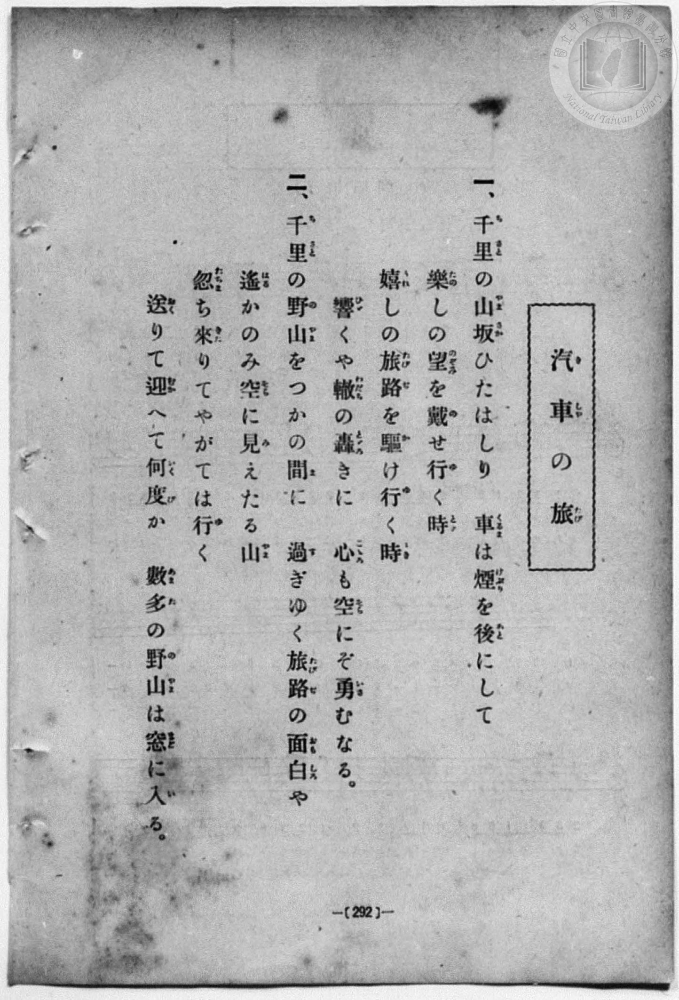
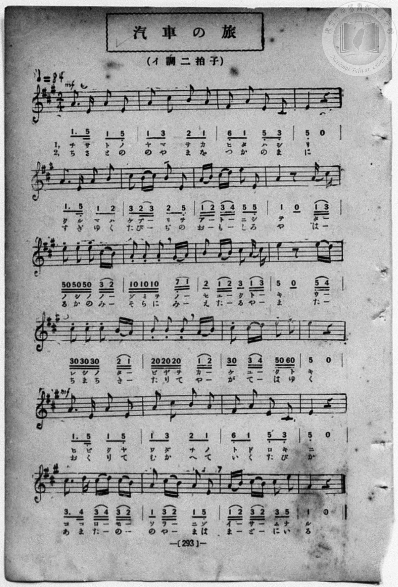

# 汽車の旅

> Re:Shōka 使用 AI 協助辨識與重建樂譜，可能會有錯誤。歡迎回報。

- **鋼琴伴奏版**：<br><audio controls src="kisha_no_tabi.mp3"></audio>
- **NEUTRINO 歌聲合成版**：<br><audio controls src="kisha_no_tabi_neutrino.mp3"></audio>

- book: 新編 小學校・公學校 唱歌教材集（尋常科五・六學年用）
- 一條慎三郎 編《新編 小學校・公學校 唱歌教材集》（大正十二年十二月，索書號 0725-41）
- 公學校唱歌帳 (P212, 293頁, 昭和2年1月29日)

## 說明

> [!NOTE]
> **原書資訊與歌詞全文**（對應 `P300.jpg`–`P301.jpg`，原書 p. 292–293，尋常科五・六學年第 32 首）：
> - **調性與拍號**：イ調二拍子（A 大調 2/4 拍），♩ = 84，力度標記 `mf`
> - **版本校勘**：對照原書掃描（`P301.jpg`），第 6 小節末音為低音 `5_`（E4），第 8 小節末兩十六分音符為 `(1 3)`（A4–C#5，手抄《唱歌帳》誤同第 12 小節抄作 `5 4`），第 23 小節前兩拍為十六分音符圓滑線 `(1 2) (3 2) 3 5`（手抄《唱歌帳》作 `1 - 2 3 2 - 3 5`）。
>
> **一、**
> 千里（ちさと）の山坂（やまさか）ひたはしり
> 車（くるま）は煙（けぶり）を後（あと）にして
> 樂（たの）しの望（のぞみ）を載（の）せ行（ゆ）く時（とき）
> 嬉（うれ）しの旅路（たびぢ）を驅（か）け行（ゆ）く時（とき）
> 響（ひび）くや轍（わだち）の轟（とどろ）きに
> 心（こころ）も空（そら）にぞ勇（いさ）むなる。
>
> **二、**
> 千里（ちさと）の野山（のやま）をつかの間（ま）に
> 過（す）ぎゆく旅路（たびぢ）の面白（おもしろ）や
> 遙（はる）かのみ空（そら）に見（み）えたる山（やま）
> 忽（たちま）ち來（きた）りてやがては行（ゆ）く
> 送（おく）りて迎（むか）へて幾度（いくたび）か
> 數多（あまた）の野山（のやま）は窓（まど）に入（い）る。


## 歌詞

```text
（TMD 檔案未包含歌詞註解）
```

## ABC

<div class="abc-score" data-abc-src="kisha_no_tabi.abc" aria-label="五線譜載入中"></div>

[下載 ABC 原始檔](kisha_no_tabi.abc)

## TMD 檔案連結

- [主旋律 TMD 檔案](kisha_no_tabi.tmd) [[在 TMD Studio 編輯](https://tmdlang.github.io/Tmd-TS/#tmd=s7IKdvYPcrWy4qpTUCpJTLdSSM7PyUlNLsnMz7MqzsjPTozPrsyvSsyML84ojTe0NDJWgqssy88pzU21Si9KTEmNN403Q8gU55cWJadaFSdn5OfnxJekVpQk5edno8vHFySmp1oFGBsYIGQKivLLUvMS84C6C4oy80pSU8DaEQpSyzJTUkHSxcmJefFlqUWZaZmpKUiOSi0qBrsdYkVJUWJecXJRZgHIQwhV-UUlGflAhxdkVFplZBaX5BdlJifmxGcn5iUiFJVkpAK9BzahAKgBWXdmemaeVUliJjCEgAGTX54Yn5uYmZeTmAd0iZaWwrONe1_s7nrcuO7Z9FYFLS0uRVsFCxMue1sFRy4bI30TO5BJoBCxUng2bcPz7SsUnm7of7p2x7MFCx83737augbCVng6ZeOztT3Pps58NnfCy9lt7_d0PN3Q_XTHjufLJz7ZNQWsdC1Q6dOdW55PWfF-TyfYhU92NDxbNPdZa9-THZ0vm_sUgMY_bugixZ7HDd0gq5Ysf7Z28dPexie7eoA2QBjP5nS839PzfMuiZ7N3vJg5X8HA3MhU18QQZjfcSIiJT3dsVtAIMDI00lEwsjR-uaBRR-HZjLVPJ_UYAQ00BJplZPls-lJNJS4ufS0FW2oBLgUFBTuFaEU__xDXWAhHS-tp33yQkze3v1jR9aKjHei4FyvnPW1d8Wxau5YWOGB7n7V3KiSAUqNeVkF6wqOGySCOIZgD9DPEAIUCPaBXjICSQA-BRHHFx5o1CsZGCi-XTQMGzfs9syDO0AU65MWq_c8aloOc0N0LDEGQ5bMeNy0BCoOCt7v36doJQOc4KgCDHyimAEwtCkBRsCk9j2auVAClJJDFXbOf7lr2bMXMFytmKCTkpiUgbHje2fFszhpQJHTPABsP9Nvz1uUQDzzra37W3w-0AdlzILNBLjYDpY_n6xuezVn9cv7m5027nuztAzIUEkzjgao6XIEWw5RaIJQ-bV0JTBwgr3e0gbStWQbUqZCgYahgrAnS5mgCDC5nZVOgzmed3c-6WoDJEZ4-gGntxaolTyeADTU0gpna1fJk7xygvQomSM4zMoZKP-3sBVoKDBagRWhWP50z-dnuic-3zwI7wEhTQcMYRBormIKcgtV-sE2GwKAzAiozAtIQxZ2PG5rAgQpLQsCM9bihEZibwfynvc0v23uAZj5uXPi4cerjRlAGBOb4pxs3Pp3bBBJvanncuA8sBcxOQKlNjxvnP25c_7hx-uOmLoghwEICbEL_46ZuoGKwsvXPW2eCBSc-btwGVAkSbJr0dB_EriaYRatB5jQug5jzbAXYRpD568CyQKl1z-bMBguue9w473Hjfog5L0ChCRIEK5v9YiHY2CZg2QLk9j-bCTFnxeNGUJKD-nQNREvb4yagYpjh01tfbF8Ps3Tz48ZFEPNfrmwFC0K8PJEY81_OB7oNKAgMn80QZcCge7EXqACosf9x4wJgCEPC9sXe-TDtKx83gUwAmgMMCqg79zeDZSeDEES2qen5yl1gwbmPm4C-gITbvKfd7WBBYARNBStreNy4ChQF6DG-q4eIGH_Z3geMdGhQgyMdEhSPG5cAwwGkYNpksCwkfqGufdnYBxYExjVQsA8YRKDwwRqqQBPmLno-cy9YvAvoKXASgniwBWYaJM2sB_oCrAVkLzDSMb3_YhmocIemh0awRU3dUPfDHA8LT4iNQJcA_Qtx_MIn-0DVEDjYgXEBdACwllsG1tgDYjSuR4txqPMaGqGObwSWPVBdL_aDQwAU-BA37wAKPt25D1iuwWIHGPugcID4CJrUp-54umQWLC8A8xfYGbhiAZibVkEDH5hmICHwtHUpxHywS2CRTnm9AwUKWvpcXN7AlkGiX35IYlKmVUBmYl6-Q41BTTXIHgUbQzMtcApTwFbpKQALOmBBAwxFBQ0TaHGnowArqzWxaABaBzKsRqE6N61WAVSO6SqYxoMZQEoXKAFiGoPLN10wu0bBDCQBV2EMUQZmg6ABlK4BG-xjWKPwuLkRLPK4aSuQ3QFiAVsWIE2Pm5eAefOgsiByNVRmEpi3HyzfD2Zvh8qsgtoAsxFqkxFQrnEhxKbGqUC8AsxaB9EFpoFRCxbbB2aDbADJgN3Q2A1XDZEHyYDcgmoT_qDf1UNO0KOEOiiYa6ABDqlQ4PEAEjBRMEWNGliQA-tL5CBvWg8JiObVsOAFByJIZiOYNw1MgoLycfMmqMwiMA8SQeDggAd5G1JAQCIFOdBnQgO9DygHUgnMetAAnA_mbQaTYNPh0dEFNqkJLDYdzO6FugIURXC7GkH-IBTsOzrJCXZTYLjBMCikQeFpAMfmoOiogaZ6UMhDgxgc_rBAB7YwUNJ5H9DRoEADkhA2LJ037QPz5oPJTSgyu8HBvQwcBCDPQiIAJLMWJdBBKpACvakbZAow1YLIdWASHC1Aei7YFZ1gsdUoMuCohUQKUD8sP4BkQCkeEeggFQQC_elsUPVPcqAbgwMbgo2gIQxiQTAopGFqQCndANioNEALc_SyZQ16mEOSJ5A3GSzWhAhzWNkCzAIgMViYg9gdQBI9zDHLFlBYgmMSyoYmWWB4gUzvAostA7Nh4doDFYMkZZBMG8QmcBYhqWyZMuiKdVABCkqwk-FJF1SUgmQgvAYwCSr8EQU-pHTpBJOgwIYEOUgGlCBxBT2otICUK6BgBrHA2QHIA9sBLbx3IMs0Qop6cNWBVA6BZDBtwp_UW9eSl9RBZpuAkzKsfAGFOSjZo5XqkPIFlMpRC3W0AG8CeQAUZJthgdcMKlRBMnvBvJVgEpKzoXVYE7h2g9StzQvAJCgAQQGOWbshAhxUMENqQljg4axHIUU0nAd2A7jmhEQBpKxCt6mWi0vXTgGpoaOAyVXmAgA)]
- [鋼琴伴奏 TMD 檔案](kisha_no_tabi_piano.tmd) [[在 TMD Studio 編輯](https://tmdlang.github.io/Tmd-TS/#tmd=s7IKdvYPcrWy4qpTUCpJTLdSSM7PyUlNLsnMz7MqzsjPTozPrsyvSsyML84ojTe0NDJWgqssy88pzU21Si9KTEmNN403Q8gU55cWJadaFSdn5OfnxJekVpQk5edno8vHFySmp1oFGBsYIGQKivLLUvMS84C6C4oy80pSU8DaEQpSyzJTUkHSxcmJefFlqUWZaZmpKUiOSi0qBrsdYkVJUWJecXJRZgHIQwhV-UUlGflAhxdkVFplZBaX5BdlJifmxGcn5iUiFCUWATWnp-am5pVYFWQm5uXHJyYn5-cWJOZlgsQQCksygIqswFYVAE1W4tLSUni2ce-L3V2PG9c9m976fk_Hy9kzn3V2v-ze83zClid7tjxd2v9-T6eClhaXoq2ChQmXva2CI5eNkb6JHchQUGBZKTybtuH59hUKTzf0P12749mChY-bdz9tXQNhKzydsvHZ2p5nU2c-mzvh5ew2oA1PN3Q_3bHj-fKJT3ZNAStdC1T6dOeW51NWAK0CO_bJjoZni-Y-a-17sqPzZXOfAtD4xw1dpNjzuKEbZNWS5c_WLn7a2_hkVw_QBgjj2ZyO93t6nm9Z9Gz2jhcz5ysYmBuZ6poYwuyGGwkx8emOzQoaAUaGRjoKRpbGLxc06ig8m7H26aQeI6CBhkCzjCyfTV-qqcTF5Z1ZnJHolx-SmJRpFQCKhSAPhxqDmmouBSCwMTTTsgOz9LUUbNGBwvM1a4B-frGwR0HDBOTB5-sbdBSACc5QL6sgXROLBi19sGE1CtW5abUKhgq6QGgaD2YAKV2gBIhpDMRGQAxi1yiYgSTgKowhysBsEDSA0jVgg30MaxQeNzeCRR43bQWyO0AsYFyAND1uXgLmzYPKgsjVUJlJYN5-sHw_mL0dKrMKagPMRqhNRkC5xoUQmxqnAvEKMGsdRBeYftzUAhbbB2aDbADJgN3Q2A1XDZEHyYDcgmoT_qDf1UNO0KOEOiiYa6ABbgzmweMBJGCiYIoaNbAgNwRKIgV503pIQDSvhgUvOBBBMhvBvGlgEhSUj5s3QWUWgXmQCAIHBzzI25ACAhIpyIE-ExrofUA5kMrHjVC7GueDeZvBJNh0eHR0gU1qAotNB7N7oa4ARRHcrkaQPwgF-45OcoLdFBhuMAwKaVB4GsCxOSg6aqCpHhTy0CAGhz8s0E2B8YGczvuAjgYFGpCEsGHpvGkfmDcfTG5CkdkNDu5l4CAAeRYSASCZtSiBDlKBFOhN3SBTgKkWRK4Dk-BoAdJzwa7oBIutRpEBRy0kUoD6YfkBJANK8YhAB6kgEOhPZ88mJ9CNwYENwUbQEAaxIBgU0jA1oJRuoGAGxKhhjl62rEEPc0jyBPImg8WaEGEOK1uAWQAkBgtzELsDSKKHOWbZAgpLcExC2dAkCwwvkOldYLFlYDYsXHugYpCkDJJpg9gEziIklS1TBl2xDipAQQl2MjzpgopSkAyE1wAmQYU_osCHlC6dYBIU2JAgB8mAEiSuoAeVFpByBRTMIBY4OwB5YDughfcOZJlGSFEPrjqQyiGQDKZN-JN661rykjrIbBNwUoaVL6AwByV7tFIdUr6AUjlqoY4W4E0gD4CCbDMs8JpBhSpIZi-YtxJMQnI2tA5rAtdukLq1eQGYBAUgKMAxazdEgIMKZkhNCAs8nPUopIiG88BuANeckCiAlFXoNtViaef4ILdzLKDNHGCAxCtEG8bCKDjfNB4mYAJimcQjKQHLmQJFQAxgAUKESSDVEBGQSWhCEE0EDcK0n1QXoSjDcADYaWT5jirhBOfDDcIZTMDo1bVTQIrhaB-gJLqQEVhImQsA)]

## 分析

```text
================================================================================
📊 TMD Song Profile: [ 汽車の旅 ]
================================================================================
⏱  Duration:       1:08 (68.6s), 48 measures total
🎼 Key & Tempo:    首調基準 A, != 84.0 BPM, <2/4>
   - 分析範圍：      由實際發聲的音符與和弦推測調性；播放脈絡另行呈現
🎤 人聲音域:    C#4 (MIDI 61) – F#5 (MIDI 78) [跨度: 17 個半音 / 1.4 個八度, 難度: challenging]
   - 最低音:  C#4 in [KishaNoTabi #1 @ m.3, 0:03]
   - 最高音: F#5 in [KishaNoTabi #1 @ m.15, 0:21]
   - 適合: soprano, mezzo-soprano, tenor, baritone
🏛  結構:      KishaNoTabi (34.3s) -> KishaNoTabi (34.3s)
⚡ 編曲密度:        Peak 1 軌道同時演奏
🗝  調性診斷：       A 大調（純淨自然大調，未偵測到可信轉調）
   - 風格氣質:    純淨自然大調（陽光明朗、易唱易記，無明顯調外色彩）
   - 轉調歷程:    全曲維持單一推測調性（未偵測到可信轉調）
   - 核心骨幹音:  A, E, C#, B, D
   - 調性數值:    A 大調 [相關度: 0.92, 穩定度: High, 自然音純度: 100.0%]
   - 候選調性 (K-S): A 大調 (0.92), E 大調 (0.71), C# 小調 (0.62)
   - 五度圈歷程:   +3 -> +3
   - 各段落調性細節:
     • [KishaNoTabi #1]: A 大調 (r: 0.92, 自然音純度: 100.0%)
     • [KishaNoTabi #2]: A 大調 (r: 0.92, 自然音純度: 100.0%)

  [ 五度圈游移軌跡 ]
               C  
         F            G  
      Bb               D  
      Eb              [A ]*
         Ab           E  
            Db       B  
               F# 
     (* = active key center)

  [ 十二半音累積音高分佈 ]
     C  :                            0.0%
     C# : ███████████████           19.7%
     D  : ██                         3.2%
     D# :                            0.0%
     E  : ████████████████████      26.8%
     F  :                            0.0%
     F# : ██                         3.2%
     G  :                            0.0%
     G# :                            0.6%
     A  : ████████████████████████  31.8%
     A# :                            0.0%
     B  : ███████████               14.6%
--------------------------------------------------------------------------------
Assignment 軌道音域：
  - Piano         : C#4 – F#5 (17 個半音 / 1.4 個八度, 194 個音符)
================================================================================
```


## 原書掃描頁






