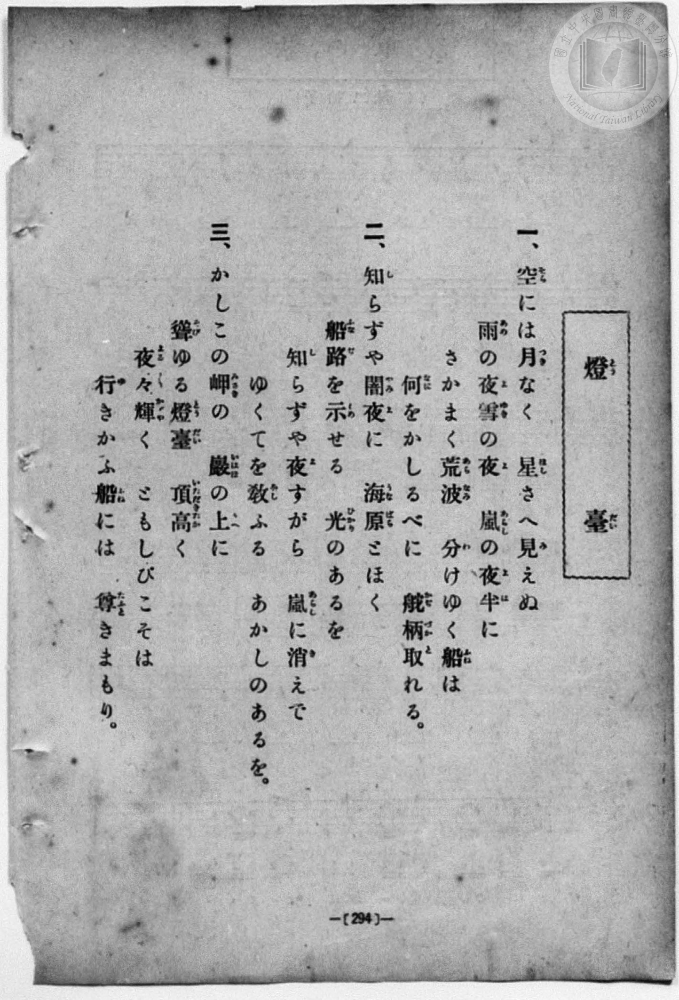
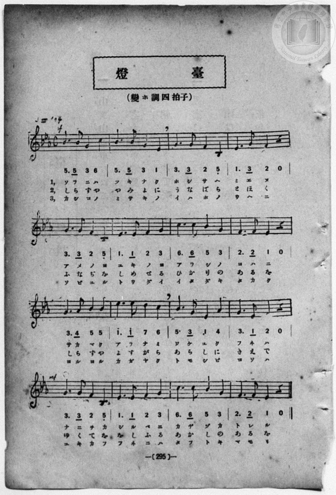

# 燈臺

> Re:Shōka 使用 AI 協助辨識與重建樂譜，可能會有錯誤。歡迎回報。

<audio controls src="todai.mp3"></audio>

- 詞：文部省（尋常小學唱歌）
- 曲：文部省（尋常小學唱歌）
- 一條慎三郎 編《新編 小學校・公學校 唱歌教材集》（大正十二年十二月，索書號 0725-41）
- 臺灣總督府《公學校唱歌》第四學年用（昭和十一年，索書號 0729 73）

## 說明

原書資訊與歌詞全文（對應 P041.jpg–P042.jpg，原書 pp. 36–37）：
調性與拍號：ト長調（G 大調）4/4 拍，速度 ♩=80


## 跨冊／重複收錄參照

> 同詞異曲（同採文部省『尋常小學唱歌』「遠く見ゆるは沖の島…」歌詞；《公學校唱歌》第四學年為文部省 G 大調原曲，《新定兒童唱歌》第四學年為田村虎藏 e 小調曲）

- **[同名異曲]** 《公學校唱歌》第四學年用（昭和12年／1937）：[**〈燈臺〉**](../../../kogakko_shoka/grade_4/13_todai/index.md)（`G` / `4/4` — [原始 TMD](../../../kogakko_shoka/grade_4/13_todai/todai.tmd)）
- **[同名異曲]** 《新定兒童唱歌》尋常科第四學年用（2020.006.0847.0004）：[**〈燈臺〉**](../../../shintei_jido_shoka/grade_4_2020.006.0847.0004/2_08_todai/index.md)（`G` / `4/4` — [原始 TMD](../../../shintei_jido_shoka/grade_4_2020.006.0847.0004/2_08_todai/todai.tmd)）
- 總表：[跨冊重複與同名歌曲總索引](../../../duplicate_songs.md)

## 歌詞

```text
一
空に月なく星さへなくて、
一寸先（さき）すら見えざる夜（よる）に、
沖の汽船や軍艦などは、
何を目あてに航路（かうろ）をきむる。

二
岸にみさきに燈臺（とうだい）ありて、
遠く沖まで光りてをれば、
沖の汽船や軍艦などは、
それを目あてに航路をきむる。

三
きめし航路を進みて行けば、
淺瀨暗礁（あさせあんせう）數ある海も、
さはることなくわたるを得べし。
ああ燈臺のたふときことよ。
```

## ABC

```abc
X:1
T:燈臺
C:曲：文部省（尋常小學唱歌）
M:4/4
L:1/16
Q:1/4=80
K:G
V:V1 name="Piano" snm="Pia"
[V:V1]
!mf! D8 G4 B4 | d6 d2 d4 d4 | c6 B2 A4 G4 | A4 B4 A4 z4 |
w: 1.~ソ ラ ニ | ツ キ ナ ク | ホ シ サ ヘ | ナ ク テ
w: 2.~き し に | み さ き に | と う だ い | あ り て
w: 3.~キ メ シ | カ ウ ロ ヲ | ス ス ミ テ | ユ ケ バ
G6 G2 F4 E4 | D6 D2 G4 A4 | B6 B2 A4 G4 | A4 A4 D4 z4 |
w: 1.~イ ッ ス ン | サ キ ス ラ | ミ エ ザ ル | ヨ ル ニ
w: 2.~と _ ほ く | お き ま で | ひ か り て | を れ ば
w: 3.~ア _ サ セ | ア ン セ ウ | カ ズ ア ル | ウ ミ モ
!mp! G6 A2 B4 B4 | e6 e2 e4 e4 | !mf! d6 c2 B4 A4 | G4 A4 B4 z4 |
w: 1.~オ キ ノ _ | キ セ ン ヤ | グ ン カ ン | ナ ド ハ
w: 2.~お き の _ | き せ ん や | ぐ ん か ん | な ど は
w: 3.~サ ハ ル _ | コ ト ナ ク | ワ タ ル ヲ | ウ ベ シ
!f! G8 F4 E4 | D6 D2 G4 A4 | !mf! B6 B2 A4 G4 | A4 d4 G4 z4 |
w: 1.~ナ ニ ヲ | メ ア テ ニ | カ ウ ロ ヲ | キ ム ル
w: 2.~そ れ を | め あ て に | か う ろ を | き む る
w: 3.~ア ア ト | ウ ダ イ ノ | タ フ ト キ | コ ト ヨ
```

## TMD 檔案連結

- [主旋律 TMD 檔案](todai.tmd) [[在 TMD Studio 編輯](https://tmdlang.github.io/Tmd-TS/#tmd=s7IKdvYPcrWy4qpTUCpJTLdSSM7PyUlNLsnMz7MqzsjPTozPrsyvSsyML84ojTe0NDJWgqssy88pzU21Si9KTEmNN403Q8gU55cWJadaFSdn5OfnxJekVpQk5edno8vHFySmp1oFGBsYIWQKivLLUvMS84C6C4oy80pSU8DaEQpSyzJTUkHSqSmZJflFmYk5SA5KLSoGuxtifElRYl5xclFmAcgzCFX5RSUZ-UBHF2RUWmVkFoMMSU7Mic9OzEtEKCrJSAV6rTgVQ6ggJzE5VYlLS0vheXvHi_ZdClpaXIq2ChYGXPa2Cu5cNib6JnYgLU92NDxbNPdZa9-THZ0vm_sUnm9f8bih69m0DUCGwtMN_U_X7ni2YOHj5t1PW9dA2ApPp2x8trbn2dSZz-ZOeDm77XFD9_s9HU-XLH-2dvHT3sYnu3qe7twCYTyb0_F-T8_zLYuezd7xYuZ8BQNzI1NdE8P3ezrBzn2xct77PbOeTWt_2bzi-ZxGkCkbup_u2AGxFmINTO2z2ZuIVgv07vPGxc937H0-d_HTXXOA_oE7HqIQ6OTna9Y8nT0bpHXnludTVgDNezZj7dNJPSCH72gACqI73FLB3BhsAZe-loIttQCXgoLC0775IGs2t79Y0fWiox3oPmDAPG1dAfQs2Ju9z9o7FQIMTAz1sgrSHzVMBjKNQEygCyFaFQoK9BSMzYBSxuZAJwLDCWTsi1X7nzUsBxnY3Qv0A1D0cXPHy6nbgeJAY90VgDEGZnYCk4ICUA3QuJcN85_uWqbwaOZKW2BCARkCDAsQ9XzlrseNq4HR-bhx1ePG_mcz5j9unPq4cQeE-7hx2eOGRqjyp-t3PG0FRjtQKVAF0NTOx40zHzd1vljW_bgRKDjtcVP30yVzQAqagAiYdoAKVkP1P9s07XHjumcb977o2Pm4qeXF7t4XncvAlqx83LgeZsneqY-bJj2fve5xYxPI6sbVLzpWvdi-Hmwn0JK2x01ga5smAe1_3NQAtORxQxPEO7t6wCG-Cejy1Y8b90PcCGRDMgnYhBUgExoXPG5sATut6XFTF8KDL0ES_WBn7nvcuPxpK9AasDTQsqaex40bSPHI48a5IE3Y_ILV8Ts6IbqA4o2PG6fDVb5s2AT2y7IXC4FOmIjkiu27njeseDZr-vMloBwDtgPo4dlgX00GM9qAnnw2FRgcQJHuZ1u3P25qgrsOqBRoPDBEgUqBoQKO6iZgbM8HCTZNerpv-uPGnUCHgBwI1gA0vgkSkkDPg9Q1bgXrBIYw2AhghEOUUp5xoEBBS5-LKyQ_JTHTKiAzMS_focagphpkg4KNhZYdmIEtuyoAsz8wrQLDS0HDBFTMPV_foAPPY5pYNADtARlWo1Cdm1arYBqvoAuGhkBsDMQ1CqZgvimYBuEaBROwiLGCEVRdDZgFUg2iDUAiYDN9DGsUHjfthZr4uHklmOwG63jc3AIRbVoLZHeBWeuhMrOhMtuBeCtYzwyoDELd4-Y2IAlyLdQuI6B8Yy_MrsbpYHI1RF_jfqjoVKgahMwKqEwbEC8As0DuAsk0ge0C29i4DNUuY5C_1sL9tRDqWrC-JpDJIP4yoAxIzePmTVCZnVCZnUCx-XA_gPwFMv9x00aw2AS4XfhjeVcPObEMii9QrJmDrDAD2wOLdCAFkgXFYQ04NjHjGITBqtEjeQk0KJqh3nzcvBnqaVAEQqMZKgNKBiBPg4IAJLMCiLeBZaCR0gyKFAgPklzQoxkSaaCI2Q0m-6FRBoosEL8XiPeBWcuhMqAoAPG7UaIU5L5JYDf0gMU2oNoFjuZFMLsgSbEJZCNCHORPiBgowlETwC6oKri_wCpgUQ-SISaad3SSl5kLaqFxbQSOS0heNgOLmIFpEIblerCwCTwLQ5IJLFOjx_UqRIwC21WQ0EFkCFBoQGL_cTMoVYBkQOEKCytIrEJTByRDN3eCSVAsosc0coyuQ9gFzejAgh5o4mSwrbBsC8o-IP5kcGxDWBAZkLuB1RSYBBUh6DENTalAd0BiDOYvkFtB4h0YBRWIBvH3w1MrLKtDYnomWBZUMBAR08BWG1kxDYw_SETrEszU4MjGnrNBSQDEQ4tssIch3gcHJsyD4DIP5LlF0FIMXq7jKf8gPHApCw4u9MieC7MLkh3BWROkrxEiCiyRIdkWUXqD7ATxgaV3E7hch-mBlPJNDWASrQhBy9aQLNqBFHEgfgO0UIMkcZAMtA5pBtYhYNUQ_8ASCFQMXHRB7Krl4tK1UwBX4QpAhjIXAA)]
- [鋼琴伴奏 TMD 檔案](todai_piano.tmd) [[在 TMD Studio 編輯](https://tmdlang.github.io/Tmd-TS/#tmd=s7IKdvYPcrWy4qpTUCpJTLdSSM7PyUlNLsnMz7MqzsjPTozPrsyvSsyML84ojTe0NDJWgqssy88pzU21Si9KTEmNN403Q8gU55cWJadaFSdn5OfnxJekVpQk5edno8vHFySmp1oFGBsYIWQKivLLUvMS84C6C4oy80pSU8DaEQpSyzJTUkHSqSmZJflFmYk5SA5KLSoGuxtifElRYl5xclFmAcgzSlxaWgrP2ztetO96v6fj5eyZzzq7X3bveT5hy5M9W54u7X-_p1NBS4tL0VbBwoDL3lbBncvGRN_EDmT2kx0NzxbNfdba92RH58vmPoXn21c8buh6Nm0DkKHwdEP_07U7ni1Y-Lh599PWNRC2wtMpG5-t7Xk2deazuRNezm573NANtPTpkuXP1i5-2tv4ZFfP051bIIxnczre7-l5vmXRs9k7Xsycr2BgbmSqa2IIdA7YXy9Wznu_Z9azae0vm1c8n9MIMmVD99MdOyDWQqyBqX02exPRaoHB8Lxx8fMde5_PXfx01xygf-COhygEOvn5mjVPZ88Gad255fmUFUDzns1Y-3RSD8jhOxqAgugOt1QwNwZbwBWSn5KYaRWQmZiXH-ThUGNQU82lAAQ2Flp2YEaNQnVuWq2CabyCLhgaArExENcomIL5pmAahGsUTMAixgpGUHU1YBZINYg2AImAzfQxrFF43LQXauLj5pVgshus43FzC0S0aS2Q3QVmrYfKzIbKbAfirWA9M6AyCHWPm9uAJMi1ULuMgPKNvTC7GqeDydUQfY37oaJToWoQMiugMm1AvADMArkLJNMEtgtsY-MyVLuMQf5aC_fXQqhrwfqaQCaD-MuAMiA1j5s3QWV2QmV2AsXmw_0A8hfI_MdNG8FiE-B2QSMGFMSggDYHiZqBpWDxBKRAsqBgrwFHAGa0gDBYNXq8LIG6vhnqssfNm6HuBIU5NGagMqCYA7kT5GqQzAog3gaWgYZjMygcITxIDKPHDCScQWG5G0z2Q0MZFL4gfi8Q7wOzlkNlQKEG4nejxALIfZPAbugBi21AtQscM4tgdkFSTxPIRoQ4yJ8QMVAcocbZLqgquL_AKmCxBZJBiZnq3IJaaPQYgYMfkmPMwCJmYBqEYXkLLGwCzyiQmIVlHfToWYWIBGAJB_EQItmBPACJsMfNoIgEyYCCAuY9SERAIxSSbZo7wSQo4NEjBzkS1iHsgmanx42zgSZOBtsKyxygRAriTwZHEIQFkQG5-3EjOKs3gjIqeuRAExfQHZBAhvkL5FaQeAdGcQCiQfz98AQGy1CQyJkJlgVlP9TIAQY5JG50CWYdcPxgzz-gWAPx0OIH7EaIi8H-h7kJXBiA3LMImr3hBR6eggHCAxc_YB-ix89cmF2QRA_OACB9jRBRYFEFyRyIYg1kJ4gPLNaawAUeTA-k-GtqAJNoGRUt80AyQgdSWIP4DdCiA5IqQTLQwrUZWLiCVUP8A4tTqBi4gIDYVYtSG_kg10Ym8NrIMF4h2jAWRmHyTYAM03gkAdN4qAiIYQD1ElwfXJawyfgNQnGASSyMgsjDdGHYRBX3QM0BBp-unQI4BKN9gCoQHCNkjjGYo8wFAA)]

## 分析

```text
================================================================================
📊 TMD Song Profile: [ 燈臺 ]
================================================================================
⏱  Duration:       0:48 (48.0s), 16 measures total
🎼 Key & Tempo:    首調基準 G, != 80.0 BPM, <4/4>
   - 分析範圍：      由實際發聲的音符與和弦推測調性；播放脈絡另行呈現
🎤 人聲音域:    D4 (MIDI 62) – E5 (MIDI 76) [跨度: 14 個半音 / 1.2 個八度, 難度: moderate]
   - 最低音:  D4 in [Todai #1 @ m.1, 0:00]
   - 最高音: E5 in [Todai #1 @ m.10, 0:27]
   - 適合: soprano, mezzo-soprano, contralto, tenor, baritone, bass
🏛  結構:      Todai (48.0s)
⚡ 編曲密度:        Peak 1 軌道同時演奏
🗝  調性診斷：       G 大調（純淨自然大調，未偵測到可信轉調）
   - 風格氣質:    純淨自然大調（陽光明朗、易唱易記，無明顯調外色彩）
   - 轉調歷程:    全曲維持單一推測調性（未偵測到可信轉調）
   - 核心骨幹音:  D, G, A, B, E
   - 調性數值:    G 大調 [相關度: 0.85, 穩定度: Moderate, 自然音純度: 100.0%]
   - 候選調性 (K-S): G 大調 (0.85), D 大調 (0.82), B 小調 (0.62)
   - 五度圈歷程:   +1
   - 各段落調性細節:
     • [Todai #1]: G 大調 (r: 0.85, 自然音純度: 100.0%)

  [ 五度圈游移軌跡 ]
               C  
         F           [G ]*
      Bb               D  
      Eb               A  
         Ab           E  
            Db       B  
               F# 
     (* = active key center)

  [ 十二半音累積音高分佈 ]
     C  : ████                       3.3%
     C# :                            0.0%
     D  : ████████████████████████  22.5%
     D# :                            0.0%
     E  : ███████████               10.0%
     F  :                            0.0%
     F# : ████                       3.3%
     G  : ████████████████████████  22.5%
     G# :                            0.0%
     A  : ██████████████████████    20.8%
     A# :                            0.0%
     B  : ███████████████████       17.5%
--------------------------------------------------------------------------------
Assignment 軌道音域：
  - Piano         : D4 – E5 (14 個半音 / 1.2 個八度, 58 個音符)
================================================================================
```


## 原書掃描頁






