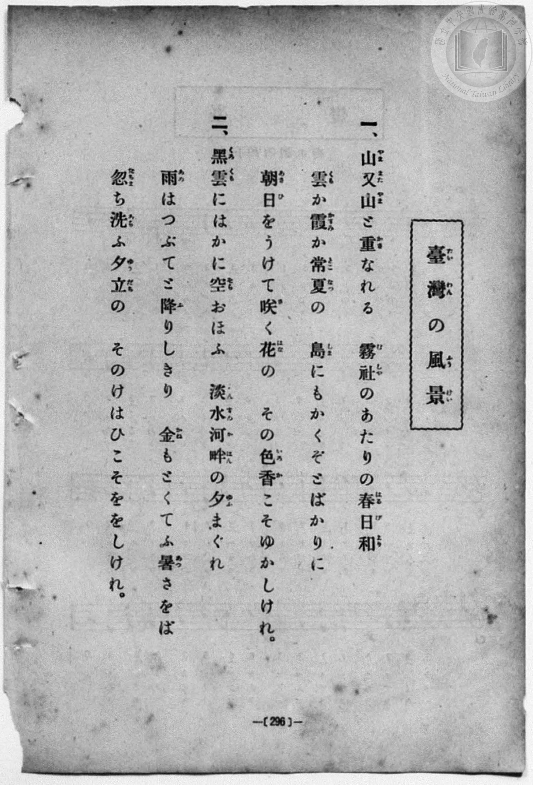
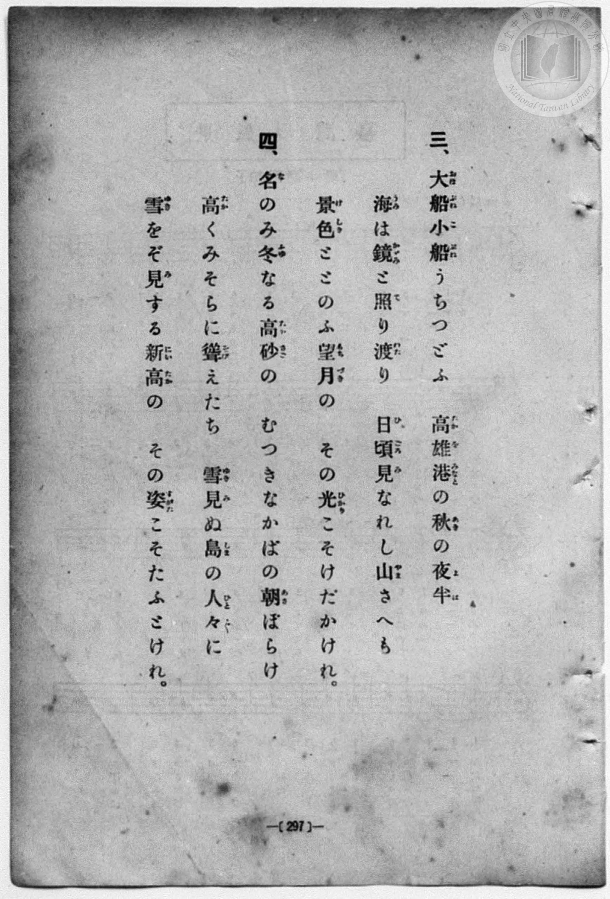
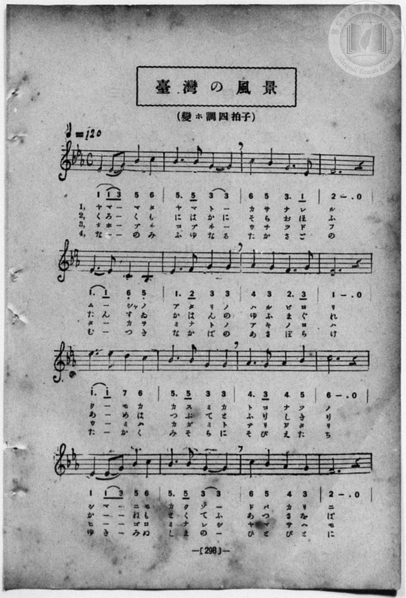
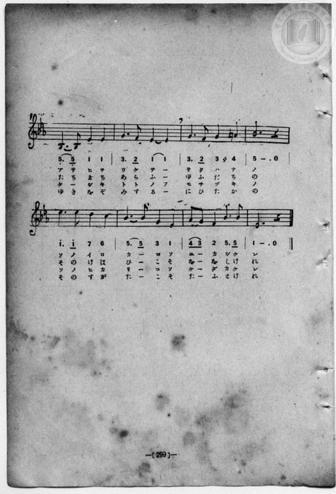

# 臺灣の風景

> Re:Shōka 使用 AI 協助辨識與重建樂譜，可能會有錯誤。歡迎回報。

- **鋼琴伴奏版**：<br><audio controls src="taiwan_no_fukei.mp3"></audio>
- **NEUTRINO 歌聲合成版**：<br><audio controls src="taiwan_no_fukei_neutrino.mp3"></audio>

- book: 新編 小學校・公學校 唱歌教材集（尋常科五・六學年用）
- 一條慎三郎 編《新編 小學校・公學校 唱歌教材集》（大正十二年十二月，索書號 0725-41）
- composer: 宮島慎三郎

## 說明

> [!NOTE]
> **原書資訊與歌詞全文**（對應 `P304.jpg`–`P307.jpg`，原書 p. 296–299，尋常科五・六學年第 34 首）：
> - **調性與拍號**：變ホ調四拍子（E♭ 大調 4/4 拍），♩ = 120
> - **版本校勘**：本曲原出大正四年臺灣總督府《公學校唱歌集》（宮島慎三郎作曲），惟大正十二年本教材集有多處重要修訂：
>   1. **地名改制反映**：因應大正九年（1920）臺灣地名改制，第三段第二句由大正四年版之「打狗（たかを）港（みなと）の秋の夜半」改印為「高雄港（たかをみなと）の秋の夜半」（見 p. 297）。
>   2. **旋律修訂**：對照 p. 298–299 譜面，第 6 小節印為 `1. 2 3 3`（大正四年版為 `7_. 2 3 3`），第 10–12 小節印為 `5. 5 3 3 | 4. 3 4 5 | 6 - . 0`（大正四年版為 `5. 5 1 1 | 2. 1 2 3 | 5 - . 0`），第 15 小節印為 `6 5 4 3`（大正四年版為 `6 5 3 1`），第 2、14、18 小節後半拍均記為雙四分音符加圓滑線以容納各段字數差異。
>
> **一、**
> 山（やま）又（また）山（やま）と重（かさ）なれる
> 霧社（むしや）のあたりの春日和（はるびより）
> 雲（くも）か霞（かすみ）か常夏（とこなつ）の
> 島（しま）にもかくぞとばかりに
> 朝日（あさひ）をうけて咲（さ）く花（はな）の
> その色香（いろか）こそゆかしけれ。
>
> **二、**
> 黑雲（くろくも）にはかに空（そら）おほふ
> 淡水河畔（たんすゐかはん）の夕（ゆふ）まぐれ
> 雨（あめ）はつぶてと降（ふ）りしきり
> 金（かね）もとくてふ暑（あつ）さをば
> 忽（たちま）ち洗（あら）ふ夕立（ゆふだち）の
> そのけはひこそををしけれ。
>
> **三、**
> 大船（おほぶね）小船（こぶね）うちつどふ
> 高雄港（たかをみなと）の秋（あき）の夜半（よは）
> 海（うみ）は鏡（かがみ）と照（て）り渡（わた）り
> 日頃（ひごろ）見（み）なれし山（やま）さへも
> 景色（けしき）ととのふ望月（もちづき）の
> その光（ひかり）こそけだかけれ。
>
> **四、**
> 名（な）のみ冬（ふゆ）なる高砂（たかさご）の
> むつきなかばの朝（あさ）ぼらけ
> 高（たか）くみそらに聳（そび）えたち
> 雪見（ゆきみ）ぬ島（しま）の人々（ひとびと）に
> 雪（ゆき）をぞ見（み）する新高（にひたか）の
> その姿（すがた）こそたふとけれ。


## 歌詞

```text
（TMD 檔案未包含歌詞註解）
```

## ABC

<div class="abc-score" data-abc-src="taiwan_no_fukei.abc" aria-label="五線譜載入中"></div>

[下載 ABC 原始檔](taiwan_no_fukei.abc)

## TMD 檔案連結

- [主旋律 TMD 檔案](taiwan_no_fukei.tmd) [[在 TMD Studio 編輯](https://tmdlang.github.io/Tmd-TS/#tmd=s7IKdvYPcrWy4qpTUCpJTLdSSM7PyUlNLsnMz7MqzsjPTozPrsyvSsyML84ojTe0NDJWgqssy88pzU21Si9KTEmNN403Q8gU55cWJadaFSdn5OfnxJekVpQk5edno8vHFySmp1oFGBuYIGQKivLLUvMS84C6C4oy80pSU8DaEQpSyzJTUkHSxcmJefFlqUWZaZmpKUiOSi0qBrsdYkVJUWJecXJRZgHIQwhV-UUlGflAhxdkVFplZBaX5BdlJifmxGcn5iUiFJVkpAK9l5dYUlqUii5akJOYjCQI1J-emWdVkphZDnRVflpaZnJmYo4Sl5aWwov2Xc8bFz9uXPdy0YpnM9craGlxKdoqGBoZcNnbKrjqcNmY6JvYgQwCBZGVwrNpG55vX6HwdEP_07U7ni1Y-Lh599PWNRC2wtMpG5-t7Xk2deazuRNezm57v6fj6Ybupzt2PF8-8cmuKWCla4FKn-7c8nzKivd7OsEOfLKj4dmiuc9a-57s6HzZ3KcANP5xQxcp9jxu6AZZtWT5s7WLn_Y2PtnVA7QBwng2p-P9np7nWxY9m73jxcz5CgbmRqa6JoYwu5Pzcwvyi1OLrBSerlv3dPM2uCuUuLj0tRRsqQW4FBQU7BSiFf38Q1xjIRwtrad980Gu2tz-YkXXi452oI9erJz3tHXFs2ntWlrgsOt91t6pkABKgXpZBekJjxomgzjmYA7QWxADFAr0FIwszYCSRpaWIFFcQb5mjYKxicLLZdOAvn-_ZxbEGbpAh7xYtf9Zw3KQE7p7gYEEsnzWi3Vdj5tnA2Wezp4NFH66dgLQRa6PZq5VAIYzUFgBmCwUgBJgs3oezVypAEk0cEOfd3Y8m7MGGFtPu2eATQTxZm8Cuvlp-y5oXM2eDXQXJAE-37H3-dzFT3fNAcY9PKIh8YyIYdQ4erJ3DtBAiAOeNc9Hi3-QdbAE8mxO59Mls17MnPqyvffFssYn-9e9WNEEDwIFBUM9UHTM2fB0Qu-zKTufdmx72t_7bMYCsLOfzl4AjAWI4U92zgWaDHQJsKAxAFoMcTqyRlBiW7MG6L5n67aCGECn9C99PmUjsoeBIfNkZ_fjhp5nnZOfd08HGve4cf7jxu7HTZOAZj7bsR4ssv9x46rHjaBcAsybz5d3A8mnS-Y87e163AC2q3fD86ZdQENerp7xcnYLTBfUHPzagSpfLOuGpBtzkIqGJlhIGIFC4tn07qf7uiGhBAmDDb3PW5dDNFhAEprCi7VzXs5dBPGvghkooz5f3wBxlUICMECNFIwVjIGpFJYvYV4Hy5vHIxSAog9khqEB0GRDIzSTTPUUTEEKFWoUTPSAlAmQWwO0T1dBT8EAl_FgTYZAWAPykCHYqhqgEEwT3EpTNNvMgIpMcDsbJG2sYIhkgtHjhkZDExBhATNqXw8wlEFZZi4wY88A6ns5eybImI62l_M3P1-z7GnXgqdzJj_bPfH59llPdi99um7n8y29Tye0AFPM07XTn03d8XT7uudTN8AiBVZaAItJoDXA0hnMf7pxIyi-m1oeN-4DuuZpP7CYA0b_PmAKAHFRZYHpAJjwwQqA6WAqWGTV46aex03dENNezln-fAlQJVBLw-PG6UCNkHTzuLEJlKSauoDsZzOWPpu-9OmkHrA564F6HzduftwE1NIFVAw1B5QdgbL9j5uA2QtoQvfLOfNg9s4EJkqIILB4erqkHyy-4nHjZHBKXQKxEeq7zcCMBJSdDnP_aqCBYEP6HzfOA-vaAE7oQIethmh5Nmcu0HlgXUCVUx83ggoGcE5oe9w48XHjsqeTIG6DeL__RRc4iIAeaVyFbPXjxrlA9ovOTS-XzQQraHnc1Au0C6wG6NS5j5uABgJdAnTbRFAYokfTLqAQPJpe7p6IFCZAc-AhsxpsNdCc1c9X7gIrAJoMTFVAKaCndj9u3Ar11_aFzzZsebZp8_OpU6A5vAnojJmPmyaAtQMjYjLE_U-XAL0GjA6g87aCRYCJYQLQhbCoAZYF4MBpagTLAm1f8rhxGzBkQMljJiR5gDWCQhXou14gA6q3fSIsEteCFQBDGBgFwLgA6t36bBZEFigIicSp4GDfAI3K_XthBdNCWGwufLYFUuoBHQPx8lag45-vBpXxEPc_blwAVIYZL-CoBLp8EywuJoHtwhUXO4BFGyLLAOutjp1geyEhDPQ7yDvAbAsTB5oJFQQnG6CDgUG0Eh4XRBa1sNAA1Y3wYhfsNVB6g2eWZ1u3g1UCLYLki_Uv-4FehoRzD0xwBbDgBQsug0TNsx1gNU3AwAfldHgcARP_ywXNYJXAwJkCTGyg-mkZxDEQo8BZvnE6RuEAzCw7gHEKNWfmemDiB-sCBjUoGUCcAUbA8N_6bM5scKMKaALQj8AgWgr3KXJMPW0FxizEMaB8isg-IGOBkQv0I7YoAxaUyFE2AZIsoTkU6JGnbWsgCRWYTmCe6gbGy_MFwGwFixSQj4CZBclJoGINGJXADAiMKaACYOmxDlhiwIsLsOI9wNQIdBU8ruEGQkoMcESDMikwz75o3AzNsyAGUASawmF5bRU05EGJGWgpJPzXYBRr657sAlbhrbCAAobwZlhCghZrQKPg5sAKtHmo0QosCrqBrWWYg4EFC9AouLNRI2U5UAtQDbAoBqYEcPqBRgpQPTDTAR2AFCmUN3uhQEFLn4srBNz38Mt3K81OzbQKyEzMy3eoMaipBtmkYGOhBU4CCtga3QrgFlXDi4U9Chom0FpWRwHYEDYDNYQ1sWgA2gcyrAZY9esCsTG46ge1GSCNAF1wNa4LxpC2BEgUxAOpBrYZwCwINACpAZvmY1ij8Lh5CZD_uHkegmzaDzYFIgMRfdzcAdUNFG9aDVa1FSzXBVWzBqwDJAOD8Qh7jIByjf1gXb0gEspugpjXCNEFLC6AuBvMAomAZOaC1XWCxaA2Ne4Gy4Bsx2KTMch9q8Aumg0mp4FJkK0gmc1Q106DisF8tAws2ggmW6BqOsE-mordHhOQG0D2QNy0DkxCww3qNmASh6oBJmeozHywOogfISYD8zVYBmQCqj34U8-uHnJTDyhFmIGsMAXbAxUDNShh6ccEyoKkGlBDE6IGe_pZAAuFpu2wxNQHDdZFUIn9QDFIpEBlmsEJAJxcHjdPhgb4CrAMLFCxJSFQ8IHMmwxkzwSzJkADFhSk0CQElIVFCcgNbWAeOLE27oOqmgCW6cFuEzgJgaISYhfEjZug7oa6AJjsIVkC1a-Pm9bCxRA-AvkVRxJqaoDZ0wgOuUZoQoUmLZC_gEU7sn8aQZkGkniA5TvUjeCk2jgRwx4CBVAnWUkoDmwBkDIHUriKIFASArFBNEgWUijhSEJN62Gh0AwJRWj2B9Mg_k5oyMNloMURKENDiiBItgXJQMIee_oBhR1EHzirA1MLJEyhBV3jNiAGFwWNK6AysKwMjO_G6cgxBBTBnXpAZkD8A3Y1OAUg-2cNXAbkD5CrQakUxF8FxCBXIQphHPkBXABBUiOiSIHaAy6IQPy58MITuUAF8YHh1ghOv2AzQDILMezBm3qAzRpaV1-wYghv9dW0HRxukOoLHArgNIQc2qAyAZLzEWnncTOo5IDlblAYg2QgpQj2tAOTA7amwTphlRcopUDCHpZ2QGkGkVMh-RqcX5smQWVAORpH2mkGqYG4ewvYbSDb0EueNWB5kM_RKnBopTwDKgMpf7GmHWi5CErNkPQCbM1BXQdK55DSElEtgcRBZSDEv6D0g5xLMKt9ApXXFMy0Ax4DxJt2wPUVuNqCpCKQ3ZAmjhEWERBtog4WgiQx7MkHVkVthQY9vKiHZuLHTRvh2RMiDisSgMkKWo2BigJCRQ80-oDZDFINQTIcolACZVREqwYWQZDkBOxeoOjAbCsgip6NUHFoxgBXSEgFJpCGuBPSskEkksfA1s_j5lYUPTj8A08-kAQESdbARjzUdbDCZya03QNLPrBW3iZoaECyFBltH-D4LznJh1DFBUk-wLEycHEDk8Hb9mnaCw27PiAbkg2hYQctfEChCc4qYJWgMAUXEdAWNCiGICkMJAPKfrhSD6zYXget5hFVFyi1QuQgzR6QSpD94DiBxgwsQ08k2OxB8g8kN8ArXHhbF9U_4PT2uBnUjEEUuHj9A664kP0Dbsg1glyFWqWh-AeaYiDNOFiRi8s_tVxcunYKKN0zBWwCylwA)]
- [鋼琴伴奏 TMD 檔案](taiwan_no_fukei_piano.tmd) [[在 TMD Studio 編輯](https://tmdlang.github.io/Tmd-TS/#tmd=s7IKdvYPcrWy4qpTUCpJTLdSSM7PyUlNLsnMz7MqzsjPTozPrsyvSsyML84ojTe0NDJWgqssy88pzU21Si9KTEmNN403Q8gU55cWJadaFSdn5OfnxJekVpQk5edno8vHFySmp1oFGBuYIGQKivLLUvMS84C6C4oy80pSU8DaEQpSyzJTUkHSxcmJefFlqUWZaZmpKUiOSi0qBrsdYkVJUWJecXJRZgHIQwhV-UUlGflAhxdkVFplZBaX5BdlJifmxGcn5iUiFCUWATWnp-am5pVYFWQm5uXHJyYn5-cWJOZlgsQQCksygIqs8hJLSotS0UULchKTgYJaWgov2nc9b1z8uHHdy0Urns1c_35Px8vZM591dr_s3vN8wpYne7Y8Xdr_fk-ngpYWl6KtgqGRAZe9rYKrDpeNib6JHchUUBhaKTybtuH59hUKTzf0P12749mChY-bdz9tXQNhKzydsvHZ2p5nU2c-mzvh5ew2oB1PN3Q_3bHj-fKJT3ZNAStdC1T6dOeW51NWAC0Du_bJjoZni-Y-a-17sqPzZXOfAtD4xw1dpNjzuKEbZNWS5c_WLn7a2_hkVw_QBgjj2ZyO93t6nm9Z9Gz2jhcz5ysYmBuZ6poYwuwGhWd-cWqRlcLTdeuebt4Gd4USF1dIYmZ5Yp5fvltpdmqmVQAoBoI8HGoMaqq5FIDAxkLLDszQ11KwRQcKz9esAfrrxcIeBQ0TkCeer2_QUQCmNTO9rIJ0TSwatPTBhtUoGCroArGxgimQNgPiGjBLF0gaA0kQrgGLg0RBPJDqGgUjMAsCDUBqwKb5GNYoPG5eAuQ_bp6HIJv2g02ByEBEHzd3QHUDxZtWg1VtBct1QdWsAesAycBgPMIeI6BcYz9YVy-IhLKbIOY1QnQ9blwPxN1gFkgEJDMXrK4TLAa1qXE3WAZkOxabjEHuWwV20WwwOQ1MgmwFyWyGunYaVAzmo2Vg0UYw2QJV0wn20VTs9piA3ACyB-KmdWASGm5Qtz1uaoOqedwE8hVIZj5YHcSPEJMfN04By4BMQLUHf-rZ1UNu6gGlCDOQFaZge6BiRkjpxwTKgqQaY7ga7OlnASwUmrbDElMfNFgXQSX2A8UgkQKVaQYnAHByedw8GRrgK8AysEDFloRAwQcybzKQPRPMmgANWFCQQpMQUBYWJSA3tIF54MTauA-qagJYpge7TeAkBIpKiF0QN26CuhvqAmCyh2QJVL8-bloLF0P4CORXHEmoqQFmTyM45BqhCRWatED-ety4Adk_jaBMA0k8jxv3QN0ITqqNEzHsIVAAdZKVhOLAFgApcyCFqwgCJSEQG0SDZCGFEo4k1LQeFgrNkFCEZn8wDeLvhIY8XAZaHIEyNKQIgmRbkAwk7LGnH1DYQfSBszowtUDCFFrQNW4DYnBR0LgCKgPLysD4bpyOHENAEdypB2QGxD9gV4NTALJ_1sBlQP4AuRqUSkH8VUAMchWiEMaRH8AFECQ1IooUqD3gggjEnwsvPJELVBAfGG6N4PQLNgMksxDDHryp5-ns2bSuvmDFEN7qq2k7ONwg1Rc4FMBpCDm0QWUCJOcj0s7jZlDJAcvdoDAGyUBKEexpByb3uHEtWCes8gKlFEjYw9IOKM0gciokX4Pza9MkqAwoR-NIO80gNRB3bwG7DWQbesmzBiwP8jlaBQ6tlGdAZSDlL9a0Ay0XQakZkl4eN4JMBbkOlM4hpSWiWgKJg8pAiH9B6Qc5l2BW-wQqrymYacecYNoB11fgaguSikB2Q5o4RlhEQLSJOlgIksSwJx9YFbUVGvTwoh6aiR83bYRnT4g4rEgAJitoNQYqCggVPdDoA2YzSDUEyXCIQgmUURGtGlgEQZLT40ZQHYvQgdlWQBQ9G6Hi0IwBrpCQCkwgDXEnpGWDSCSPga2fx82tKHpw-AeefCAJCJKsHzeCEiBy4TMT2u6BJR9YK28TNDQgWYqMtg-wl0BO8iFUcUGSjwmQDSpuYDJ42z5Ne6Fh1wdkQ7IhNOyghQ8oNMFZBawSFKbgIgLaggbFECSFgWRA2Q9X6oEV2-ug1Tyi6gKlVogcpNkDUgmyHxwn0JiBZeiJBJs9SP6B5AZ4hQtv66L6B5zeHjeDmjGIAhevf8AVF7J_wA25RpCrUKs0FP9AUwykGQcrcnH5pxZr78wHuXdmAu2dAaM3XiHaMBZMmcSi8oEUMEFAJOB803ggyzQ-FswwgPoKrs0MJAtWh80cIAOuHVkFhjFgVficA6IgpoBtNIvPhdiNYRKl_oILwxWiGwRlGAEpI8IBhNtnYAOA3sAZQsBo1bVTQInZaB-gNKYg0B2YgsbYBIEuAQoqcwEA)]

## 分析

```text
================================================================================
📊 TMD Song Profile: [ 臺灣の風景 ]
================================================================================
⏱  Duration:       1:36 (96.0s), 48 measures total
🎼 Key & Tempo:    首調基準 E,, != 120.0 BPM, <4/4>
   - 分析範圍：      由實際發聲的音符與和弦推測調性；播放脈絡另行呈現
🎤 人聲音域:    A#3 (MIDI 58) – D#5 (MIDI 75) [跨度: 17 個半音 / 1.4 個八度, 難度: challenging]
   - 最低音:  A#3 in [TaiwanNoFukei #1 @ m.5, 0:09]
   - 最高音: D#5 in [TaiwanNoFukei #1 @ m.9, 0:16]
   - 適合: soprano, mezzo-soprano, contralto, tenor, baritone, bass
🏛  結構:      TaiwanNoFukei (48.0s) -> TaiwanNoFukei (48.0s)
⚡ 編曲密度:        Peak 1 軌道同時演奏
🗝  調性診斷：       D# 大調（純淨自然大調，未偵測到可信轉調）
   - 風格氣質:    純淨自然大調（陽光明朗、易唱易記，無明顯調外色彩）
   - 轉調歷程:    全曲維持單一推測調性（未偵測到可信轉調）
   - 核心骨幹音:  D#, A#, G, C, F
   - 調性數值:    D# 大調 [相關度: 0.93, 穩定度: High, 自然音純度: 98.9%]
   - 候選調性 (K-S): D# 大調 (0.93), G 小調 (0.71), A# 大調 (0.70)
   - 五度圈歷程:   -3 -> -3
   - 各段落調性細節:
     • [TaiwanNoFukei #1]: D# 大調 (r: 0.93, 自然音純度: 98.9%, 調外音: A)
     • [TaiwanNoFukei #2]: D# 大調 (r: 0.93, 自然音純度: 98.9%, 調外音: A)

  [ 五度圈游移軌跡 ]
               C  
         F            G  
      Bb               D  
     [Eb]*              A  
         Ab           E  
            Db       B  
               F# 
     (* = active key center)

  [ 十二半音累積音高分佈 ]
     C  : ███████████               11.1%
     C# :                            0.0%
     D  : ██                         2.2%
     D# : ████████████████████████  24.4%
     E  :                            0.0%
     F  : ███████████               11.1%
     F# :                            0.0%
     G  : █████████████████████     21.1%
     G# : █████                      5.6%
     A  : █                          1.1%
     A# : ███████████████████████   23.3%
     B  :                            0.0%
--------------------------------------------------------------------------------
Assignment 軌道音域：
  - Piano         : A#3 – D#5 (17 個半音 / 1.4 個八度, 162 個音符)
================================================================================
```


## 原書掃描頁










