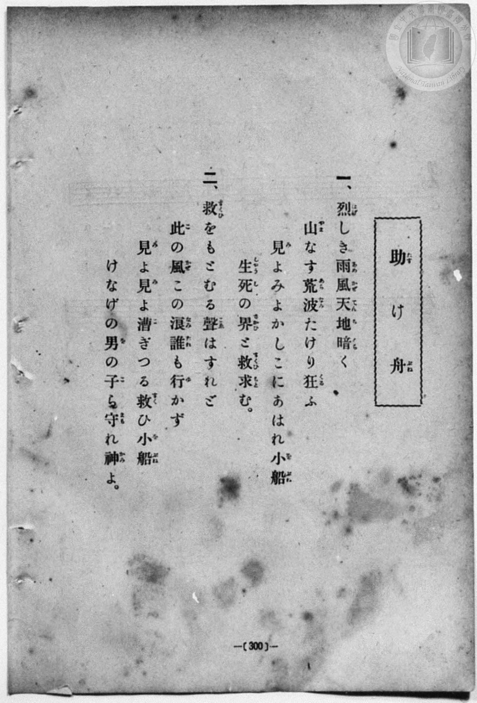
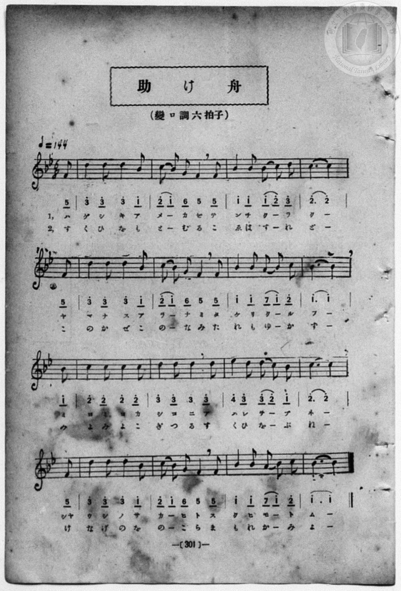

# 助け舟

> Re:Shōka 使用 AI 協助辨識與重建樂譜，可能會有錯誤。歡迎回報。

- **鋼琴伴奏版**：<br><audio controls src="tasukebune.mp3"></audio>
- **NEUTRINO 歌聲合成版**：<br><audio controls src="tasukebune_neutrino.mp3"></audio>

- book: 新編 小學校・公學校 唱歌教材集（尋常科五・六學年用）
- 一條慎三郎 編《新編 小學校・公學校 唱歌教材集》（大正十二年十二月，索書號 0725-41）

## 說明

> [!NOTE]
> **原書資訊與歌詞全文**（對應 `P308.jpg`–`P309.jpg`，原書 p. 300–301，尋常科五・六學年第 35 首）：
> - **調性與拍號**：變ロ調六拍子（B♭ 大調關係小調 g 小調色彩，6/8 拍，弱起 1 八分音符），♪ = 144（附點四分音符 ♩. = 48，此處以四分音符換算標為 `!= 72`）
> - **版本校勘**：本曲題為〈助け舟〉，與文部省《尋常小學唱歌》（及昭和十一年臺灣總督府《公學校唱歌》）所收〈助け船〉（「はげしき雨風、天地くらく。今しもしづまん沖の小船……」`5_ | 1 - 1 1 - 7_`）同屬變ロ調 6/8 拍海難救助題材，惟本教材集所載歌詞為「烈しき雨風天地暗く　山なす荒波たけり狂ふ……」，且第 1、5、13 小節旋律始於高音 `3 - 3 3 - 1`（D5–B♭4），第 4、8、12 小節長音帶連結線。
>
> **一、**
> 烈（はげ）しき雨風（あめかぜ）天地（てんち）暗（くら）く
> 山（やま）なす荒波（あらなみ）たけり狂（くる）ふ
> 見（み）よみよかしこにあはれ小船（をぶね）
> 生死（しやうし）の界（さかひ）と救（すくひ）求（もと）む。
>
> **二、**
> 救（すくひ）をもとむる聲（こゑ）はすれど
> 此（こ）の風（かぜ）この浪（なみ）誰（たれ）も行（ゆ）かず
> 見（み）よ見（み）よ漕（こ）ぎつる救（すく）ひ小船（をぶね）
> けなげの男（を）の子（こ）ら守（まも）れ神（かみ）よ。


## 歌詞

```text
（TMD 檔案未包含歌詞註解）
```

## ABC

<div class="abc-score" data-abc-src="tasukebune.abc" aria-label="五線譜載入中"></div>

[下載 ABC 原始檔](tasukebune.abc)

## TMD 檔案連結

- [主旋律 TMD 檔案](tasukebune.tmd) [[在 TMD Studio 編輯](https://tmdlang.github.io/Tmd-TS/#tmd=s7IKdvYPcrWy4qpTUCpJTLdSSM7PyUlNLsnMz7MqzsjPTozPrsyvSsyML84ojTe0NDJWgqssy88pzU21Si9KTEmNN403Q8gU55cWJadaFSdn5OfnxJekVpQk5edno8vHFySmp1oFGBtYIGQKivLLUvMS84C6C4oy80pSU8DaEQpSyzJTUkHSxcmJefFlqUWZaZmpKUiOSi0qBrsdYkVJUWJecXJRZgHIQwhV-UUlGflAhxdkVFplZBaX5BdlJifmxGcn5iUiFJVkpAK9l5tYlFmSmZuKIZ5flJiDbGJmemYeUDQvqRQYbpgSqZlZmViCAipdnlpcklqUF5-bmpOfUqnEpaWl8LRr5ePGiS865itoaXEp2iqYG3HZ2yo46XDZmOlb2IEMAJlkpfBs2obn21coPN3Q_3TtjmcLFj5u3v20dQ2ErfB0ysZna3ueTZ35bO6El7Pb3u_peLqh--mOHc-XT3yyawpY6Vqg0qc7tzyfsuL9nk6ww57saHi2aO6z1r4nOzpfNvcpAI1_3NBFij2PG7pBVi1Z_mzt4qe9jU929QBtgDCezel4v6fn-ZZFz2bveDFzvoKBuZGprokh2G4ufS0FW2oBLgUFBTuFaEU__xDXWAhHS-tp33yQvZvbX6zoetHRDnTzi5XznraueDatXUsLHDq9z9o7FRJAqVIvqyA94VHDZBDHEswBOhxigEKBnoKxgQFQ0tgA6PQenIG6Zo2CsanCy2XTgP57v2cWxBm6QIe8WLX_WcNykBO6e4HBALJ81ot1XY-b1wJlgPqBwk_XTgC6yOnRzLUKwJAECr-cPufJ_iZgBADZCumgmAAyXnRuerp3JdANwFShANQFcs2ejS-2blcwVHjauvppR9vL-Zufr1kGdkDPo5mrFGwVDE1MgCa_nNnycve8p7Nnw9UoPJq5Ug8ob2IBVPps7ZIXM6c-2b0UWcWz_tnP101_tmLm86ZdCgngVAkMlU6Ev553djybswaYJJ52zwB7CsSbvenlwh6gjscNHfBU_bgB5B5QAExrf9m84vmcRmAag4QjJIlBkhQ0JfV3PZux9umkHlAa2tEADNkX7bueNy5-vmPv87mLn-6aA9ILS4xIGjufdTY8m7INyd6dYHs7Hjf0PG5c_7hx0uPG6Y8be1_OXvFyETCRNz5dsvLpnA2PG_sfN3WCyIamJ7u7QGqamsAqlz5u3Pe4afKzTdMeN64DRUDHzkcNy4DocUNvgmm8Qg0w1HWBGESax4OC5umEnqcb18CjVgEaTc-2bn85e_GzqROBDgMGDjDbgIK8eT4ouGC5COj4F0AvgNMoOPR6njd3IDsY4tpns4AiQKc2PN248XHjqseNM1_0Tnq2edHjxvlALz9u6nreDXT8Vrg7gRY92TEFlDQNgT42BWJDY1Bier6-4dn07qf7up8u7342bc_L1TOAca6QYAz0ijEQAr0F9E-Hiykw1YMSJTAJgWIQZI4J0AwLkDlGUHNeTt0O1Pt0x7aXDYufb53wfPssYEiCEwksIwJjEagBWLKB-UB_gSIFHCNAY5H9CBZvetzU-Lix-3HjHFCIgn0NFl8GjIvHjQtBET1rOlgEFHFgE_ohJgPDBCTe1AKMOLA4InxgJkME94NlESEGMw2UioChBzHtxTJQaoQqbgIxwCTQYUAHA12yGmQg0BdNwBIBlDbAVgPT2LbHjWvh2eT5lPnP1u4GmwNMV0CHtQEZYFvWPZ_aAxafCjZzE1hwBTCRgAVngtwDFny2Eew8UJoEFdqPm4BhiRa8u4AZAB68mCaAXAXWDtLb1P0CJAhUMPlxE1Al0FJgRMwE-uJx40qoCWuXQBRA3AmLF2iMgP2-7tnWVWBBaGC-WAWJo_lAc8A2Nr1YCPZdE7AaAmoB6oWWh2ihisZ9tmcqktV9jxuXAB2M7COw-CY8AQ6KU5CrgOLrnk_ZDlED8QikjIUa3tT5dB0kHQLzODCEgSI9z5fOg_kUFumQoKa8goICBS19Lq6QxOLS7NSk0jxggygzMS_foUbXsKYaZI-CjYUWOFoVsFWOCsDsB8xKwJBV0IAW-9oKJtBcqKMAq7k0segEWgsytUbBAJi1IRBcgCHldyDPCEiaxYNkoNKw8s0IqAQkjawXbKCPYY0CSDUEPm7uByp73LQJxG7aDsRrwaxFINHmhWD2aiDeA1bbBhbdDGY3AkXXg1krwSaA2DAzl8DsMkKxq3EmSGVjP5i9CahnEtj8JrDoCjC7AYi7wfKTwaZOBLPXg_WC5HvAalcimQlUx4U__Hf1gMOfxGAnKpzN48FBDeFCIFA1PJwfN88Dh0cX0OU7kcIV5H6waPN8sOh-sF83gkVXwcN1NVjtVKRwnY8UrsDcAfZ_NxDPQYQYVBRoSuN-MAuoBxxukJAG5m6oLpDaWUjhCHQDgXDc0UlOOIKSoBGURA5VUPI0gfJAoYszsT5uBicNoOehLGCCBHlpO5i9GSgKTjDQoAUnruY1QAxO0s3TwKK9CI82bUdNn8AiA-p_GAsSjn1g9hJ4esSadhu3gUVBeQYWjhMJhSOwvUbP9GiAHJRNyyBBAAwSsP-atoKDcjU4qCYBMTgEgGkVlqMhoovArA5wUC6AmwyPJHBqXAX2PVA1JAUCwweRGicD-Z1g1j6wyU1gFT3gdAhNe9DQR5hcy8Wla6eAKHgVMHjKXAA)]
- [鋼琴伴奏 TMD 檔案](tasukebune_piano.tmd) [[在 TMD Studio 編輯](https://tmdlang.github.io/Tmd-TS/#tmd=s7IKdvYPcrWy4qpTUCpJTLdSSM7PyUlNLsnMz7MqzsjPTozPrsyvSsyML84ojTe0NDJWgqssy88pzU21Si9KTEmNN403Q8gU55cWJadaFSdn5OfnxJekVpQk5edno8vHFySmp1oFGBtYIGQKivLLUvMS84C6C4oy80pSU8DaEQpSyzJTUkHSxcmJefFlqUWZaZmpKUiOSi0qBrsdYkVJUWJecXJRZgHIQwhV-UUlGflAhxdkVFplZBaX5BdlJifmxGcn5iUiFCUWATWnp-am5pVYFWQm5uXHJyYn5-cWJOZlgsQQCksygIqschOLMkuAMhji-UWJOUpcWloKT7tWPm6c-KJj_vs9HS9nz3zW2f2ye8_zCVue7NnydGn_-z2dClpaXIq2CuZGXPa2Ck46XDZm-hZ2IONAwWel8GzahufbVyg83dD_dO2OZwsWPm7e_bR1DYSt8HTKxmdre55Nnfls7oSXs9uAVjzd0P10x47nyyc-2TUFrHQtUOnTnVueT1kBtAvszCc7Gp4tmvuste_Jjs6XzX0KQOMfN3SRYs_jhm6QVUuWP1u7-Glv45NdPUAbIIxnczre7-l5vmXRs9k7Xsycr2BgbmSqa2IItpsrJLG4NDs1qTQPmAJAYRvk4VCja1hTzaUABDYWWnZghr6Wgi06UHi-Zg3Q3S8W9ihoPN2z8cXW7QraCiYg1z5f36CjAExPlnpZBemaWHRq6YNNrVEwUNCFQtN4INcYyDAGk4ZAnhGQNIsHyUClDcEShkAJY7A0sl6wgT6GNQog1RD4uLkfqOxx0yYQu2k7EK8FsxaBRJsXgtmrgXgPWG0bWHQzmN0IFF0PZq0EmwBiw8xcArPLCMWuxpkglY39YPYmoJ5JYPObwKIrwOwGIO4Gy08GmzoRzF4P1guS7wGrXYlkJlAdF_7w39UDDn8Sg52ocDaPBwc1hAuBQNXwcH7cPA8cHl1Al-9ECleQ-8GizfPBovvBft0IFl0FD9fVYLVTkcJ1PlK4Pm5cB_Z_NxDPQYQYVBRoSuN-MAuoBxxukJB-3NQG1QVSOwspHIFuIBCOOzrJCUdQEjSCksihCkqeJlAeKHRxJtbHzeCkAfQ8lAVMkCAvbQezNwNFwQkGGrTgxNW8BojBSbp5Gli0F-HRpu2o6fNxUwfU_zAWJBz7wOwl8PSINe02bgOLgvIMLBwnEgrHp7Nn0zM9GiAHZdMySBAAgwTsv6at4KBcDQ6qSUAMDgFgWoXlaIjoIjCrAxyUC-AmwyMJnBpXgX0PVA1JgcDwQaTGyUB-J5i1D2xyE1hFDzgdQtMeNPQRJtdilrs-WMtd5BIS6FkFQ0iJA6WAiSwewjKF0pgqYDIQGhZgJJiE3WiEQagWYHMCzGh6uAkYsrp2CojAjfYxjFVAEzECiyhzAQA)]

## 分析

```text
================================================================================
📊 TMD Song Profile: [ 助け舟 ]
================================================================================
⏱  Duration:       1:20 (80.0s), 32 measures total
🎼 Key & Tempo:    首調基準 B,, != 72.0 BPM, <6/8>
   - 分析範圍：      由實際發聲的音符與和弦推測調性；播放脈絡另行呈現
🎤 人聲音域:    F4 (MIDI 65) – D#5 (MIDI 75) [跨度: 10 個半音 / 0.8 個八度, 難度: easy]
   - 最低音:  F4 in [Tasukebune #1 @ m.1, 0:02]
   - 最高音: D#5 in [Tasukebune #1 @ m.12, 0:27]
   - 適合: soprano, mezzo-soprano, contralto, tenor, baritone, bass
🏛  結構:      Tasukebune (40.0s) -> Tasukebune (40.0s)
⚡ 編曲密度:        Peak 1 軌道同時演奏
🗝  調性診斷：       A# 大調（純淨自然大調，未偵測到可信轉調）
   - 風格氣質:    純淨自然大調（陽光明朗、易唱易記，無明顯調外色彩）
   - 轉調歷程:    全曲維持單一推測調性（未偵測到可信轉調）
   - 核心骨幹音:  A#, D, C, F, G
   - 調性數值:    A# 大調 [相關度: 0.79, 穩定度: High, 自然音純度: 100.0%]
   - 候選調性 (K-S): A# 大調 (0.79), F 大調 (0.58), D 小調 (0.55)
   - 五度圈歷程:   -2 -> -2
   - 各段落調性細節:
     • [Tasukebune #1]: A# 大調 (r: 0.75, 自然音純度: 100.0%)
     • [Tasukebune #2]: A# 大調 (r: 0.79, 自然音純度: 100.0%)

  [ 五度圈游移軌跡 ]
               C  
         F            G  
     [Bb]*              D  
      Eb               A  
         Ab           E  
            Db       B  
               F# 
     (* = active key center)

  [ 十二半音累積音高分佈 ]
     C  : ██████████████████        24.0%
     C# :                            0.0%
     D  : ███████████████████       25.0%
     D# : ██                         2.1%
     E  :                            0.0%
     F  : ██████████                12.5%
     F# :                            0.0%
     G  : ██                         3.1%
     G# :                            0.0%
     A  : ██                         2.1%
     A# : ████████████████████████  31.2%
     B  :                            0.0%
--------------------------------------------------------------------------------
Assignment 軌道音域：
  - Piano         : F4 – D#5 (10 個半音 / 0.8 個八度, 126 個音符)
================================================================================
```


## 原書掃描頁






