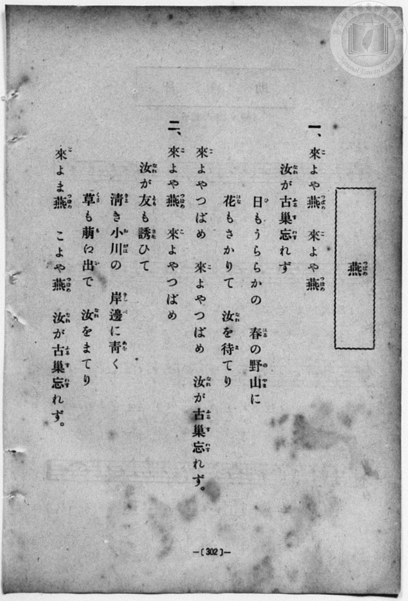
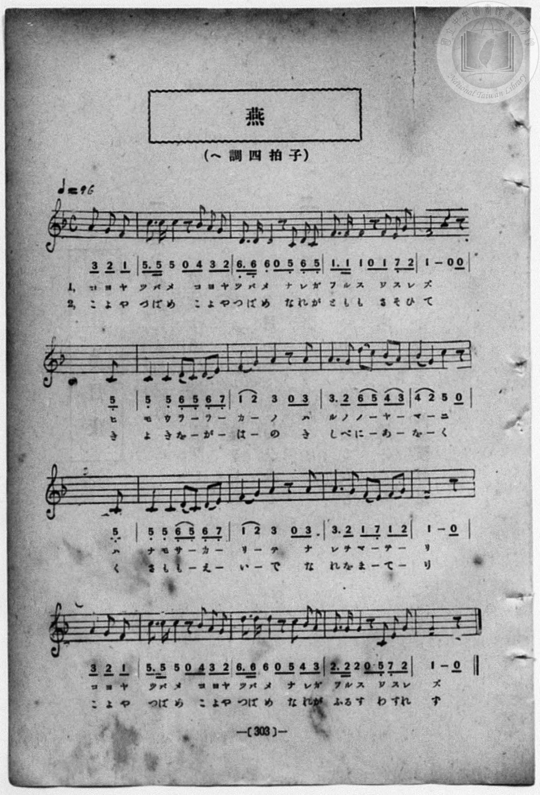

# 燕

> Re:Shōka 使用 AI 協助辨識與重建樂譜，可能會有錯誤。歡迎回報。

<audio controls src="tsubame.mp3"></audio>

- book: 新編 小學校・公學校 唱歌教材集（尋常科五・六學年用）
- 一條慎三郎 編《新編 小學校・公學校 唱歌教材集》（大正十二年十二月，索書號 0725-41）
- 公學校唱歌帳 (P208, 302頁, 昭和2年1月29日)

## 說明

> [!NOTE]
> **原書資訊與歌詞全文**（對應 `P310.jpg`–`P311.jpg`，原書 p. 302–303，尋常科五・六學年第 36 首）：
> - **調性與拍號**：ヘ調四拍子（F 大調 4/4 拍，弱起 3 八分音符），♩ = 96
> - **版本校勘**：對照原書掃描（`P311.jpg`），全曲共 16 小節（含不完全小節首尾相合）；各行行首之 `5_`（第 2、3 行）及 `3 2 1`（第 4 行）為跨行弱起拍，第 5、9 小節前兩拍為兩個四分音符 `5_ 5_`（無底線），第 3、5、8、11、15 小節之導音皆為自然 `7_`（E4，手抄《唱歌帳》舊轉錄誤作 `7,_`）。又 p. 302 第二段末行首句印為「來よま燕」（「ま」為「や」之活字誤植），p. 303 譜下印為「こよやつばめ」。
>
> **一、**
> 來（こ）よや燕（つばめ）　來（こ）よや燕（つばめ）
> 汝（なれ）が古巢（ふるす）忘（わす）れず
> 日（ひ）もうららかの　春（はる）の野山（のやま）に
> 花（はな）もさかりて　汝（なれ）を待（ま）てり
> 來（こ）よやつばめ　來（こ）よやつばめ
> 汝（なれ）が古巢（ふるす）忘（わす）れず。
>
> **二、**
> 來（こ）よや燕（つばめ）　來（こ）よやつばめ
> 汝（なれ）が友（とも）も誘（さそ）ひて
> 淸（きよ）き小川（をがは）の　岸邊（きしべ）に青（あを）く
> 草（くさ）も萌（も）え出（い）で　汝（なれ）をまてり
> 來（こ）よや燕（つばめ）　こよや燕（つばめ）
> 汝（なれ）が古巢（ふるす）忘（わす）れず。


## 歌詞

```text
（TMD 檔案未包含歌詞註解）
```

## ABC

```abc
X:1
T:燕
M:4/4
L:1/16
Q:1/4=96
K:F
V:V1 name="Piano" snm="Pia"
[V:V1]
z10 A2 G2 F2 | C3 C C2 z2 B2 A2 G4 | D3 D D2 z2 C2 D2 C4 | F3 F F2 z2 F2 E2 G4 |
w: コ ヨ ヤ | ツ バ メ コ ヨ ヤ | ツ バ メ ナ レ ガ | フ ル ス ワ ス レ
F8 z6 C2 | C4 C4 D2 C2 D2 E2 | F4 G4 A4 z2 A2 | A6 G2 d2 c2 B2 A2 |
w: ズ ヒ | モ ウ ラ _ ラ _ | カ _ ノ ハ | ル ノ ノ _ ヤ _
B4 G4 c4 z2 C2 | C4 C4 D2 C2 D2 E2 | F4 G4 A4 z2 A2 | A6 G2 F2 E2 F2 G2 |
w: マ _ ニ ハ | ナ モ サ _ カ _ | リ _ テ ナ | レ ヲ マ _ テ _
F8 z2 A2 G2 F2 | C3 C C2 z2 B2 A2 G4 | D3 D D2 z2 c2 B2 A4 | G3 G G2 z2 C2 E2 G4 |
w: リ コ ヨ ヤ | ツ バ メ コ ヨ ヤ | ツ バ メ ナ レ ガ | フ ル ス ワ ス レ
F8 z8 | z10 A2 G2 F2 | C3 C C2 z2 B2 A2 G4 | D3 D D2 z2 C2 D2 C4 |
w: ズ | こ よ や | つ ば め こ よ や | つ ば め な れ が
F3 F F2 z2 F2 E2 G4 | F8 z6 C2 | C4 C4 D2 C2 D2 E2 | F4 G4 A4 z2 A2 |
w: と も も さ そ ひ | て き | よ き を _ が _ | は _ の き
A6 G2 d2 c2 B2 A2 | B4 G4 c4 z2 C2 | C4 C4 D2 C2 D2 E2 | F4 G4 A4 z2 A2 |
w: し べ に _ あ _ | を _ く く | さ も も _ え _ | い _ で な
A6 G2 F2 E2 F2 G2 | F8 z2 A2 G2 F2 | C3 C C2 z2 B2 A2 G4 | D3 D D2 z2 c2 B2 A4 |
w: れ を ま _ て _ | り こ よ や | つ ば め こ よ や | つ ば め な れ が
G3 G G2 z2 C2 E2 G4 | F8 z8 |
w: ふ る す わ す れ | ず
```

## TMD 檔案連結

- [主旋律 TMD 檔案](tsubame.tmd) [[在 TMD Studio 編輯](https://tmdlang.github.io/Tmd-TS/#tmd=s7IKdvYPcrWy4qpTUCpJTLdSSM7PyUlNLsnMz7MqzsjPTozPrsyvSsyML84ojTe0NDJWgqssy88pzU21Si9KTEmNN403Q8gU55cWJadaFSdn5OfnxJekVpQk5edno8vHFySmp1oFGBsaIGQKivLLUvMS84C6C4oy80pSU8DaEQpSyzJTUkHSxcmJefFlqUWZaZmpKUiOSi0qBrsdYkVJUWJecXJRZgHIQwhV-UUlGflAhxdkVFplZBaX5BdlJifmxGcn5iUiFJVkpAK9l5iXmZuYo8SlpaXwvH2qgpYWl6KtgqUZl72tghuXjYm-iR1IA8h_VgrPpm14vn2FwtMN_U_X7ni2YOHj5t1PW9dA2ApPp2x8trbn2dSZz-ZOeDm77f2ejqcbup_u2PF8-cQnu6aAla4FKn26c8vzKSve7-kEO-TJjoZni-Y-a-17sqPzZXOfAtD4xw1dpNjzuKEbZNWS5c_WLn7a2_hkVw_QBgjj2ZyO93t6nm9Z9Gz2jhcz5ysYmBuZ6poYwuyGGwkx8emOzQoaAUYGFjoKxgZGLxc06ig8m7H26aQeI6CBhkCzjCyfTV-qqcTFpa-lYEstwKWgoGCnEK3o5x_iGgvhaGk97ZsPcvLm9hcrul50tAMd92LlvKetK55Na9fSAgds77P2ToUEUNrSyypIT3jUMBnEMQRzgH6GGKBQoAfyClDS2MAYJIorPtasUTA2U3i5bBowaN7vmQVxhi7QIS9W7X_WsBzkhO5eYAiCLJ_1uHkGUPjp7NlAsadrJwCd46YADH6gmAIwtSgARUFW7dn4Yut2BWOFp62rn3a0vZy_-fmaZWDTex7NXKkATmFwW553djybswYUEd0zwFYA_fe8dTnEE8_6mp_19wNtQfYgyBxQeMze9LR1o4KhGSipPF_fAAqaCauf7Oh9ug4kDREEeuvphn3PZ-94OgGYHIA6Zz-d0PJiYQ8QAaWe7OxWSDCNB5rZAQoGo8cNjcYKQCmgyqf9XQoJxgpGCoYwWROozPOmXS-2rwCyId6EeBmkwBSo3RLqmKedvU9bVwLlgKqBjKcN3cAwg4cFyFIFqL0tC5_umvp8-yyIv8CxATQHZJYFEBsagghTqKlA9z7d0AcyY1YbyBntq563bFNIMAeb5GoC1P-ss_tZVwswF8GTNTCLvOjoerG382VPy4tVS57snQPUoAPS0fm4oelpfwc0oSgArQZlm3Vbn81ZDQmep_1Ln_ZuAFr0uKHnyb62x00djxv3AcuJxw1AL3cABYFcIBui4HET0NpeoAufbdn9dO10oFXPlgCVgTwFtgAYsGvnPNnRDTfxceNkkIlAbY1LHjdueNzUCNQPdBI4acAyA7CIAAYAsFwC84GOAFncOBnkeLBeoGvAIlATwJ5qIEYZxMBnG-eCxVc9bgJF7ePGnqf9S55uXwQW3Pq4qftx40xQYtg_AyTS1A_hAhU_boRmFGCpAFa8CSze9LgRGExABtAooN51QMc8mwFRsB5oGtiKdS_b-55u3AgWXAf2_j6w-GqIgS-6IFLrga6CmTkVZFpT1-PGZSAD0dzcNOnpvlawCMScZUCVuIILKaixhBJclvLAwYjHXT3UiEciXAiqEB43rgCGGyT0XqwCOw8UhkDFQDWbgEEE1b59B1iqF2g4WKoXVOlsB5vZNAloGjAWIFEGdMzTTTteNnVB1TdOf9y4ExJrL-dOAgs2AbWARfqh8dgLTPpAcWCwAL0GdskEoCOBJoMd1tjxtH0XWEELmLsca8yCMhjeCMUabvCcRYtkD41Zyis_KFDQ0ufiCikuTUoEtkcCMhPz8h1qDGoUqkGWKNgYmmmB05ACtmoXXGTtaAAWVgoa0DpHG1hMQ8pKHQVYlaGJRSfQUpCpNQoGwEoIHRoDsREQGwJxDbCcBguCS2wgDdJggqQIBGsUzCCKgBSYBVIEVg3mQU0AqQMZCTIYRIMUgWhzkDTCKIgSBER2IdikGrDTfQxrFGDmIsPHTZtBZPMKMLkEbOTj5haIXPMEIF4IZIF0YqqEOACH6uYuMLkGrBNEwlRPhapeDRTfCVe9HqwOxIfogapu2oXmXmQ_PG6ehPCfEQ7_NU4Gm9wBJkEuBZraCHE9MJkDxRphbsBQCXUDDtWrwOp6wGwQCVMNCh-QTBMYw1SDfA0sUsDkJiTVy_D5r7EX7D_8KXoXqHWioEFiQoYnMjgDkfbALHAyQyQvWIIDpWMQBCUzELsGLgJTZQYyBohhqb4GzEI2AyQLMwMtiT5uXgTzfBMsaB43r8RggZLGaiSLIbJ9UBYkSfVD1AETGroahErUhDwPw8RuTBPhyQ2SVBARBXE1KElCxJATBSh5o5jcuA7ZZEhEA-npKGrA2aER5n5gpYEwEW4PQjXIdQgTIW4lUBh2Dq6kAy_eQAyQAPbiDaXARUo6oBIHEm2IRLQVzoIFI0glKO-iBF5zG5SFKLtA6mAlEUQNKN8iEglCDzYTsZeYSIkHXCJAXAaLViRWIyxpgVTCyiK4SxqXI9sCLolASQKW4CBmgRIIsEEA1wPLTiCVsJBCcS1mSYk_-QC7KBQkH9IrSCSFEEUQ5UZgGl6WkFA9glUgpZ-hUeshuRqcjmhZl0FyD7CFB2TPhIcIqGiB8BFpDqR6FkFX13Jx6dopQJtv0T6GsQrIXCMwV5kLAA)]
- [鋼琴伴奏 TMD 檔案](tsubame_piano.tmd) [[在 TMD Studio 編輯](https://tmdlang.github.io/Tmd-TS/#tmd=s7IKdvYPcrWy4qpTUCpJTLdSSM7PyUlNLsnMz7MqzsjPTozPrsyvSsyML84ojTe0NDJWgqssy88pzU21Si9KTEmNN403Q8gU55cWJadaFSdn5OfnxJekVpQk5edno8vHFySmp1oFGBsaIGQKivLLUvMS84C6C4oy80pSU8DaEQpSyzJTUkHSxcmJefFlqUWZaZmpKUiOSi0qBrsdYkVJUWJecXJRZgHIQwhV-UUlGflAhxdkVFplZBaX5BdlJifmxGcn5iUiFCUWATWnp-am5pVYFWQm5uXHJyYn5-cWJOZlgsQQCksygIqsQMKJOUpcWloKz9unvt_T8XL2zGed3S-79zyfsOXJni1Pl_a_39OpoKXFpWirYGnGZW-r4MZlY6JvYgcyCBRAVgrPpm14vn2FwtMN_U_X7ni2YOHj5t1PW9dA2ApPp2x8trbn2dSZz-ZOeDm7DWjD0w3dT3fseL584pNdU8BK1wKVPt255fmUFUCrwA58sqPh2aK5z1r7nuzofNncpwA0_nFDFyn2PG7oBlm1ZPmztYuf9jY-2dUDtAHCeDan4_2enudbFj2bvePFzPkKBuZGpromhjC74UZCTHy6Y7OCRoCRgYWOgrGB0csFjToKz2asfTqpxwhooCHQLCPLZ9OXaipxcYUUlyYlAoM0ABTqQR4ONQY1CtVcCkBgY2imZQdm6Wsp2KIDhedr1gA9_GJhj4LG0z0bX2zdrqCtYALy5vP1DToKwKRmqJdVkK6JRaeWPtjUGgUDBV0MaAzERkBsCMQ1CqbxYEEgBWaBNJggKQLBGgUziCIgBWaBFIFVg3lQE0DqQEaCDAbRIEUg2hwkjTAKogQBkV0INqkG7HQfwxoFmLnI8HHTZhDZvAJMLgEb-bi5BSLXPAGIFwJZIJ2YKiEOwKG6uQtMrgHrBJEw1VOhqlcDxXfCVa8HqwPxIXqgqpt2obkX2Q-Pmych_GeEw3-Nk8Emd4BJkEuBpjZCXP-4cQNQrBHmBgyVUDfgUL0KrK4HzAaRMNWg8AHJNIExTDXI148b54LJTUiql-HzX2Mv2H_4U_SuHnCKJjEhwxMZnIFIe2AWOJkhkhcswYHSMQiCkhmIXQMXgakyAxkDxLBUXwNmIZsBkoWZgZZEHzcvgnm-CRY0j5tXYrBASWM1ksUQ2T4oC5Kk-iHqgAkNXQ1CJWpCnodhYjemifDkBkkqiIiCuBqUJCFiyIkClLxRTG5ch2wyJKKB9HQUNeDs0Ahz_-NGUHKC-R5mD0I1yHUIEyFuJVAYdg6upAMv3kAMkAD24g2lwEVKOqASBxJtiES0Fc6CBSNIJSjvogRecxuUhSi7QOpgJRFEDSjfIhIJQg82E7GXmEiJB1wiQFwGi1YkViMsaYFUwsoiuEsalyPbAi6JQEkCluAgZoESyOPGfXA9sOwEUgkLKRTXYpaU-JPP09mzKUg-pFeQSAohiiDKjcA0vCwhoXoEq0BKP0Oj1kNyNTgd0bIug-Sex03dQPZMeIiAihYIH5HmQKpnEXR1LVrrzQel9WYCbbyBmlkQCIy_eIVow1hg1AJp0_hYUG0CYpoAmVApbGqgIkAKaAbUTOyqQCyIMpgCsPlgc41gSskyh2TnYHoM7ACj-Fw8hgFDVNdOARqo0T5ACWSuEZirzAUA)]

## 分析

```text
================================================================================
📊 TMD Song Profile: [ 燕 ]
================================================================================
⏱  Duration:       1:25 (85.0s), 34 measures total
🎼 Key & Tempo:    首調基準 F, != 96.0 BPM, <4/4>
   - 分析範圍：      由實際發聲的音符與和弦推測調性；播放脈絡另行呈現
🎤 人聲音域:    C4 (MIDI 60) – D5 (MIDI 74) [跨度: 14 個半音 / 1.2 個八度, 難度: moderate]
   - 最低音:  C4 in [Tsubame[L1] #1 @ m.2, 0:02]
   - 最高音: D5 in [Tsubame[L1] #1 @ m.8, 0:18]
   - 適合: soprano, mezzo-soprano, contralto, tenor, baritone, bass
🏛  結構:      Tsubame[L1] (42.5s) -> Tsubame[L2] (42.5s)
⚡ 編曲密度:        Peak 1 軌道同時演奏
🗝  調性診斷：       F 大調（純淨自然大調，未偵測到可信轉調）
   - 風格氣質:    純淨自然大調（陽光明朗、易唱易記，無明顯調外色彩）
   - 轉調歷程:    全曲維持單一推測調性（未偵測到可信轉調）
   - 核心骨幹音:  C, F, G, A, D
   - 調性數值:    F 大調 [相關度: 0.87, 穩定度: Moderate, 自然音純度: 100.0%]
   - 候選調性 (K-S): F 大調 (0.87), C 大調 (0.83), A 小調 (0.63)
   - 五度圈歷程:   -1 -> -1
   - 各段落調性細節:
     • [Tsubame[L1] #1]: F 大調 (r: 0.87, 自然音純度: 100.0%)
     • [Tsubame[L2] #1]: F 大調 (r: 0.87, 自然音純度: 100.0%)

  [ 五度圈游移軌跡 ]
               C  
        [F ]*          G  
      Bb               D  
      Eb               A  
         Ab           E  
            Db       B  
               F# 
     (* = active key center)

  [ 十二半音累積音高分佈 ]
     C  : ████████████████████████  22.8%
     C# :                            0.0%
     D  : ███████████               10.5%
     D# :                            0.0%
     E  : █████                      4.4%
     F  : ██████████████████████    21.1%
     F# :                            0.0%
     G  : ████████████████████      19.3%
     G# :                            0.0%
     A  : ██████████████████        16.7%
     A# : ██████                     5.3%
     B  :                            0.0%
--------------------------------------------------------------------------------
Assignment 軌道音域：
  - Piano         : C4 – D5 (14 個半音 / 1.2 個八度, 164 個音符)
================================================================================
```


## 原書掃描頁






