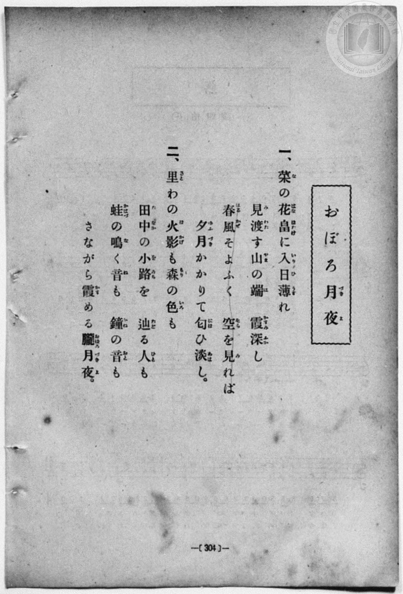
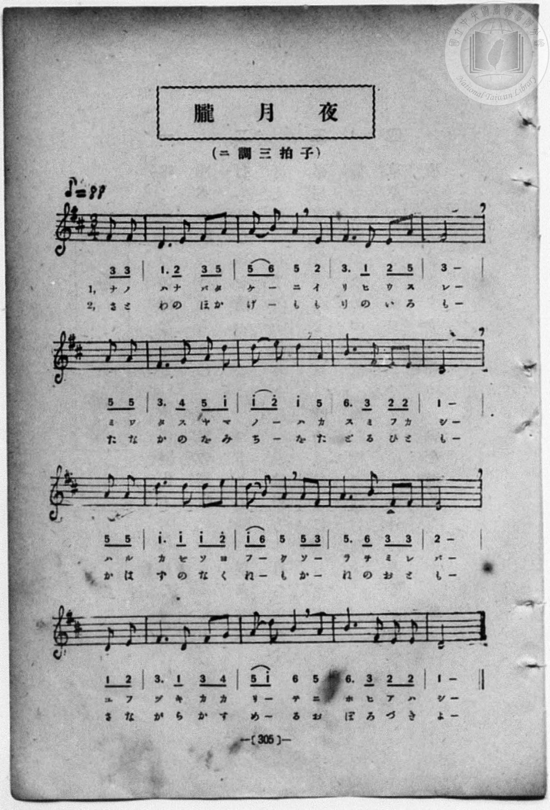

# 朧月夜

> Re:Shōka 使用 AI 協助辨識與重建樂譜，可能會有錯誤。歡迎回報。

<audio controls src="oborozukiyo.mp3"></audio>

- book: 新編 小學校・公學校 唱歌教材集（尋常科五・六學年用）
- 一條慎三郎 編《新編 小學校・公學校 唱歌教材集》（大正十二年十二月，索書號 0725-41）
- lyricist: 高野辰之（文部省尋常小學唱歌）

## 說明

> [!NOTE]
> **原書資訊與歌詞全文**（對應 `P312.jpg`–`P313.jpg`，原書 p. 304–305，尋常科五・六學年第 37 首）：
> - **曲名**：p. 304 歌詞頁題為「おぼろ月夜」，p. 305 樂譜頁題為「朧月夜」
> - **調性與拍號**：ニ調三拍子（D 大調 3/4 拍，弱起 1 拍），♪ = 88
> - **異曲同詞重要發現**：本曲歌詞雖與文部省《尋常小學唱歌（六）》〈おぼろ月夜〉（高野辰之作詞、岡野貞一作曲）完全相同，惟本教材集（`P313.jpg`）所配樂譜並非岡野貞一之著名旋律（`1 2 | 3. 4 5 3 | 4 6 5 1`），而是另一首ニ長調 3/4 拍別曲（`3 3 | 1. 2 (3 5) | (5 6) 5 2 | 3. 1 (2 5_) | 3 -`）！又第二段「田中の小路」於 p. 304 振假名及 p. 305 譜下皆作「をみち」。
>
> **一、**
> 菜（な）の花畠（はなばたけ）に入日（いりひ）薄（うす）れ
> 見渡（みわた）す山（やま）の端（は）　霞（かすみ）深（ふか）し
> 春風（はるかぜ）そよふく　空（そら）を見（み）れば
> 夕月（ゆふづき）かかりて匂（にほ）ひ淡（あは）し。
>
> **二、**
> 里（さと）わの火影（ほかげ）も森（もり）の色（いろ）も
> 田中（たなか）の小路（をみち）を辿（たど）る人（ひと）も
> 蛙（かはづ）の鳴（な）く音（ね）も　鐘（かね）の音（おと）も
> さながら霞（かす）める朧月夜（おぼろづきよ）。


## 歌詞

```text
（TMD 檔案未包含歌詞註解）
```

## ABC

```abc
X:1
T:朧月夜
M:3/4
L:1/16
Q:1/4=88
K:D
V:V1 name="Piano" snm="Pia"
[V:V1]
z4 z4 F2 F2 | D6 E2 F2 A2 | A2 B2 A4 E4 | F6 D2 E2 A,2 |
w: ナ ノ | ハ ナ バ タ | ケ _ _ イ | リ ヒ ウ ス
F8 A,2 A,2 | F6 G2 A2 d2 | d2 e2 d4 A4 | B6 F2 E2 E2 |
w: レ ミ ワ | タ ス ヤ マ | ノ _ _ カ | ス ミ フ カ
D8 A,2 A,2 | d6 d2 d2 e2 | d2 B2 A4 A2 F2 | A6 B2 F2 F2 |
w: シ ハ ル | カ ゼ ソ ヨ | フ _ _ ソ _ | ラ ヲ ミ レ
E8 D2 E2 | F6 D2 F2 G2 | A2 d2 B4 A4 | B6 F2 E2 E2 |
w: バ ユ フ | ヅ キ カ カ | リ _ _ ニ | ホ ヒ ア ハ
D8 z4 | z4 z4 F2 F2 | D6 E2 F2 A2 | A2 B2 A4 E4 |
w: シ | さ と | わ の ほ か | げ _ _ も
F6 D2 E2 A,2 | F8 A,2 A,2 | F6 G2 A2 d2 | d2 e2 d4 A4 |
w: り の い ろ | も た な | か の を み | ち _ _ た
B6 F2 E2 E2 | D8 A,2 A,2 | d6 d2 d2 e2 | d2 B2 A4 A2 F2 |
w: ど る ひ と | も か は | づ の な く | ね _ _ か _
A6 B2 F2 F2 | E8 D2 E2 | F6 D2 F2 G2 | A2 d2 B4 A4 |
w: ね の お と | も さ な | が ら か す | め _ _ お
B6 F2 E2 E2 | D8 z4 |
w: ぼ ろ づ き | よ
```

## TMD 檔案連結

- [主旋律 TMD 檔案](oborozukiyo.tmd) [[在 TMD Studio 編輯](https://tmdlang.github.io/Tmd-TS/#tmd=s7IKdvYPcrWy4qpTUCpJTLdSSM7PyUlNLsnMz7MqzsjPTozPrsyvSsyML84ojTe0NDJWgqssy88pzU21Si9KTEmNN403Q8gU55cWJadaFSdn5OfnxJekVpQk5edno8vHFySmp1oFGBsaIWQKivLLUvMS84C6C4oy80pSU8DaEQpSyzJTUkHSxcmJefFlqUWZaZmpKUiOSi0qBrsdYkVJUWJecXJRZgHIQwhV-UUlGflAhxdkVFplZBaX5BdlJifmxGcn5iUiFJVkpAK9V5KZmxqfnxafkliJLlWcmlicn1esxKWlpfBszvJnczqeLpmjoKXFpWirYGHBZW-r4MJlY6xvYgfSBwoBK4Vn0zY8375C4emG_qdrdzxbsPBx8-6nrWsgbIWnUzY-W9vzbOrMZ3MnvJzd9n5Px9MN3U937Hi-fOKTXVPAStcClT7dueX5lBXv93SC3fNkR8OzRXOftfY92dH5srlPAWj844YuUux53NANsmrJ8mdrFz_tbXyyqwdoA4QB9NL7PT3Ptyx6NnvHi5nzFQzMjUx1TQxhdudUAsMNGHxWCi9Xz3jZ3vdi34YnO0GGPZvW_rJ5xfM5jRAPQJwBsRasl0tfS8GWWoBLQUHBTiFa0c8_xDUWwtHSeto3H-Tmze0vVnS96GgHWvxi5bynrSuALtPSAods77P2ToUEUPLTyypIT3jUMBnEMQZzgJ6GGKBQoKdgbGAClDQ2MAWJ4oqQNWsUjM0VXi6bBvTf-z2zIM7QBTrk2exNTyf0guycBTFLAeKWlwsaXy7sed6063FDz-PGrseNex439UKS0OOGXqBVYNWmCs9WNL1YOwdZNTypAdUh7Hmxav-zhuUgr3b3AqMKbOHj5m6gMDBhAMWerp0A9LaLAjCegWIKwGSpABQFeWnPxhdbtysYQrhAx_c8mrlKAZyC4YY_n7oB7A-ww9t7XyxrfD5zz_P-fWBbns1ZA5SE-mr2NJATYNEPTInYUkAHMNyAVgET3uOGDgzPA53QgZyenuydAzT5cUPj000LQYKb5gHTPFAQaCnQkKfreoDR-nz2DqDrgG5_1jwf5B6kPIQcq53POhtetvZCwvTJjmUv585DMXRn94uJ04HR9Wx699N9oIScYKhgpFCjYKynYKJgqmAMZJoomAFZhiDDgNa9AEbHjPVP-5cBdQMjHxjgL6duRwrfpx1Lwc7sSDAG6zbUA5qnYaxgqgnkaJgqmGkCDYPaYKigYaRgGg-SMVbQhVjQ-LS_A5i2QFlx3VZg3D-fsuHJjrWPG9cBA_TF9vXAFPBs2h5oIlV41rP-aWM70PlP-7sgYqYKYH92P5_VBgwwUEprmvS4cf_jxoVAnY8bmsAxDMsyQC8AAxlYfIH5L_rnAJ39uHEVKKIa173o2vh86gKwyHqg4OPGDY8b5z9unAiWXf20demz6UvBsi2Pm4DxCYqZF9NawCJtjxtngpQ19UBNXtb9bMdCsNT-x039QHPAhsx8unEjSLCp5XHjPoilz1evh9gITiwNL-fMA3O7gYqBekHRuR2spXErUBCsZTrEimczlr5cBCwiwa5tAqoHIqB3gArmPm6CqO8HGvh85S6wGqAgMKyBLpwEdBvEYRAHA70JMfDpkqngshDoPKB3gNqXPm4E5Rawyd1gLy972tME1rv6ceNusNSmZ9sh3myCeqFxOkaY7-pBCvOX7aDM8bhx6uNGUPkODpx1z4HBuxfizd1g6yaBpZqeLV4Hdk8T0HZoHHWCUho4CsBua4LYpQBJNGApYJQB4w4SVtA0BDYEmiqggbAP6H2I4pVgke4nuyABtQnmMKjJL2YDYxYSI8BUAUwAIGNfbt6ClHL6X87fDOaCczzQtcB4nDADpgssCNQCVQMMRhTzwUEBdDAw3XYixz5YTSPQYfCyEKYdVJBAYgcY0eBkAzaK8loGChS09Lm4_JPyi_KrSrMzK_OtAjIT8_IdagxqFKpBFinYWGiBY1cBWxWnAMrLOxpeLOxR0ICWu9rAEgUYEc_XN-gowEoqTSw6gfaCTK1RMACWyCAMLVCALF1gCQIsUoA8YIECxCC-LqQUAUJQCWYaD-fqgjggPtg4H8MahXigGAg_bu4C4j6gysfN_WCVEJEJCo-b9oNEmzZCRbuB7CVgKx43r4KKTQKKLQPinWDRNVC7HjfPB-L1MNuMkGxrnArEK8DmQm1rXAfEu4G4GyTaOAki2tQExmDbmrqQVLYA-b1gUZAsRBxoW-MqoG34Y2BXDzgGSAx4SPiB6gHDOFDIxykYxYFIYIiCXWcGljcGBjeoQIdEDGZog8IS4q-dwJBZAsTzwCHWBw2vfqDMaqhvdyKFITC0gOIg0e3wsAWqbQaKwcMWFHLw8GkCxkgjON4aF0JtBInMh5jduBIqBozLxk3wmECEJEgcFG8E0nInOSEJDjRgygQHHzAQwSKQlAupZEEsXaAIJI2DUjMsJSMHJCiYQF7YA8R7gUEB9gIwoCCi68GikEQK9Wwz0KPgwFwDFp0AD0hgwgXqQw7IpUgJbRUQ94MDbS0iSYKDGkkMrBKYXTACEpTMCSbJp7Nnk58kDYG0CTjUwMGIPz2Cig6kQGxuhXppLThAoWkMnqvbwLkdEoizoWKgnL4InPqQUyMoTyMHYA_U3E5oWpoJVt2IlOpAeRmkcg9UrBcc7MCSG6yyA8XcWi4uXTsFpHI32scwVgFdyAgspMwFAA)]
- [鋼琴伴奏 TMD 檔案](oborozukiyo_piano.tmd) [[在 TMD Studio 編輯](https://tmdlang.github.io/Tmd-TS/#tmd=s7IKdvYPcrWy4qpTUCpJTLdSSM7PyUlNLsnMz7MqzsjPTozPrsyvSsyML84ojTe0NDJWgqssy88pzU21Si9KTEmNN403Q8gU55cWJadaFSdn5OfnxJekVpQk5edno8vHFySmp1oFGBsaIWQKivLLUvMS84C6C4oy80pSU8DaEQpSyzJTUkHSxcmJefFlqUWZaZmpKUiOSi0qBrsdYkVJUWJecXJRZgHIQwhV-UUlGflAhxdkVFplZBaX5BdlJifmxGcn5iUiFCUWATWnp-am5pVYFWQm5uXHJyYn5-cWJOZlgsQQCksygIqsSoCi8flp8SmJlehSxamJxfl5xUpcWloKz-Ysfzan4-mSOe_3dLycPfNZZ_fL7j3PJ2x5smfL06X97_d0KmhpcSnaKlhYcNnbKrhw2Rjrm9iBzAMFoZXCs2kbnm9fofB0Q__TtTueLVj4uHn309Y1ELbC0ykbn63teTZ15rO5E17ObgPa8HRD99MdO54vn_hk1xSw0rVApU93bnk-ZQXQKrA7n-xoeLZo7rPWvic7Ol829ykAjX_c0EWKPY8bukFWLVn-bO3ip72NT3b1AG2AMIBefb-n5_mWRc9m73gxc76CgbmRqa6JIczunEpgwAPD30rh5eoZL9v7Xuzb8GQnyLBn09pfNq94PqcR4gGIMyDWgvVy-SflF-VXlWZnVuZbBYAiJ8jDocagRqGaSwEIbCy07MAMfS0FW3Sg8HzNGqCnXyzsUdB4umfji63bFbQVTEBefb6-QUcBmCCN9bIK0jWx6NTSB5tao2CgoAvGxkBYo2AIZOkqGAHZpkCeqYIZEIP4ukCeMVjOEMgzjYdzdUEcEB9snI9hjUI8UAyEHzd3AXEfUOXj5n6wSojIBIXHTftBok0boaLdQPYSsBWPm1dBxSYBxZYB8U6w6BqoXY-b5wPxephtRki2NU4F4hVgc6G2Na4D4t1A3A0SbZwEEW1qAmOwbU1dSCpbgPxesChIFiIOtK1xFdA2_DGwqwccAyQGPCT8TIABbBgHCvk4BaM4EAkMUbDrzMDyxsDgNoJHDGZog8IS4q-dwJBZAsTzwCHWBw2vfqDMaqhvdyKFITC0gOIg0e3wsAWqbQaKwcMWFHLw8GkCxkgjON4aF0JtBInMh5jduBIqBozLxk3wmECEJEgcFG8E0nInOSEJDjRgygQHHzAQwSKQlGsKTtUgli5QBJLGQakZlpKRAxIUTCAv7AHivcCgAHsBGFAQ0fVgUUgihXq2GehRcGCuAYtOgAckMOEC9SEH5FKkhLYKiPvBgbYWkSTBQY0kBlYJzC4YAQlK5gST5NPZs8lPkoZA2gQcauBgxJ8eQUUHUiA2t0K9tBYcoNA0Bs_VbeDcDgnE2VAxUE5fBE59yKkRlKeRA7AHam4nNC3NBKtuREp1oLwMUrkHKtYLDvbHjZA83YFibi2WYtcHpdg1gRa7oAISBIE-jleINowF4xoFEyDHBMgxjQfxYFIoPKAeWPrEphO3McRoRJExjQfyQEZQZCUwTHTtFJCCJdoHKIMuZAQWUuYCAA)]

## 分析

```text
================================================================================
📊 TMD Song Profile: [ 朧月夜 ]
================================================================================
⏱  Duration:       1:09 (69.5s), 34 measures total
🎼 Key & Tempo:    首調基準 D, != 88.0 BPM, <3/4>
   - 分析範圍：      由實際發聲的音符與和弦推測調性；播放脈絡另行呈現
🎤 人聲音域:    A3 (MIDI 57) – E5 (MIDI 76) [跨度: 19 個半音 / 1.6 個八度, 難度: challenging]
   - 最低音:  A3 in [Oborozukiyo[L1] #1 @ m.4, 0:07]
   - 最高音: E5 in [Oborozukiyo[L1] #1 @ m.7, 0:12]
   - 適合: soprano, mezzo-soprano, contralto, tenor, baritone, bass
🏛  結構:      Oborozukiyo[L1] (34.8s) -> Oborozukiyo[L2] (34.8s)
⚡ 編曲密度:        Peak 1 軌道同時演奏
🗝  調性診斷：       D 大調（純淨自然大調，未偵測到可信轉調）
   - 風格氣質:    純淨自然大調（陽光明朗、易唱易記，無明顯調外色彩）
   - 轉調歷程:    全曲維持單一推測調性（未偵測到可信轉調）
   - 核心骨幹音:  D, F#, A, E, B
   - 調性數值:    D 大調 [相關度: 0.89, 穩定度: High, 自然音純度: 100.0%]
   - 候選調性 (K-S): D 大調 (0.89), A 大調 (0.70), F# 小調 (0.67)
   - 五度圈歷程:   +2 -> +2
   - 各段落調性細節:
     • [Oborozukiyo[L1] #1]: D 大調 (r: 0.89, 自然音純度: 100.0%)
     • [Oborozukiyo[L2] #1]: D 大調 (r: 0.89, 自然音純度: 100.0%)

  [ 五度圈游移軌跡 ]
               C  
         F            G  
      Bb              [D ]*
      Eb               A  
         Ab           E  
            Db       B  
               F# 
     (* = active key center)

  [ 十二半音累積音高分佈 ]
     C  :                            0.0%
     C# :                            0.0%
     D  : ████████████████████████  26.0%
     D# :                            0.0%
     E  : ██████████████            15.6%
     F  :                            0.0%
     F# : █████████████████████     22.9%
     G  : ██                         2.1%
     G# :                            0.0%
     A  : ████████████████████      21.9%
     A# :                            0.0%
     B  : ███████████               11.5%
--------------------------------------------------------------------------------
Assignment 軌道音域：
  - Piano         : A3 – E5 (19 個半音 / 1.6 個八度, 122 個音符)
================================================================================
```


## 原書掃描頁






