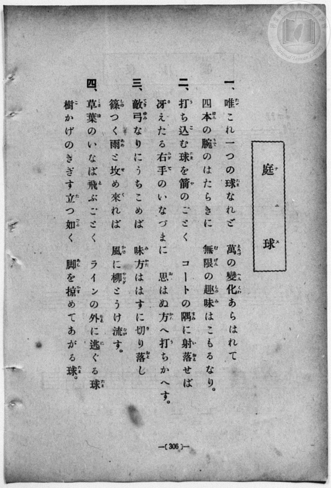
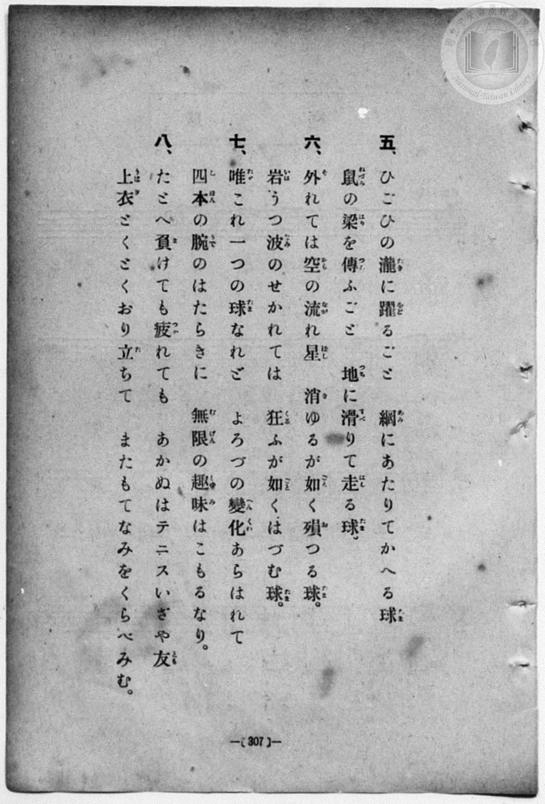
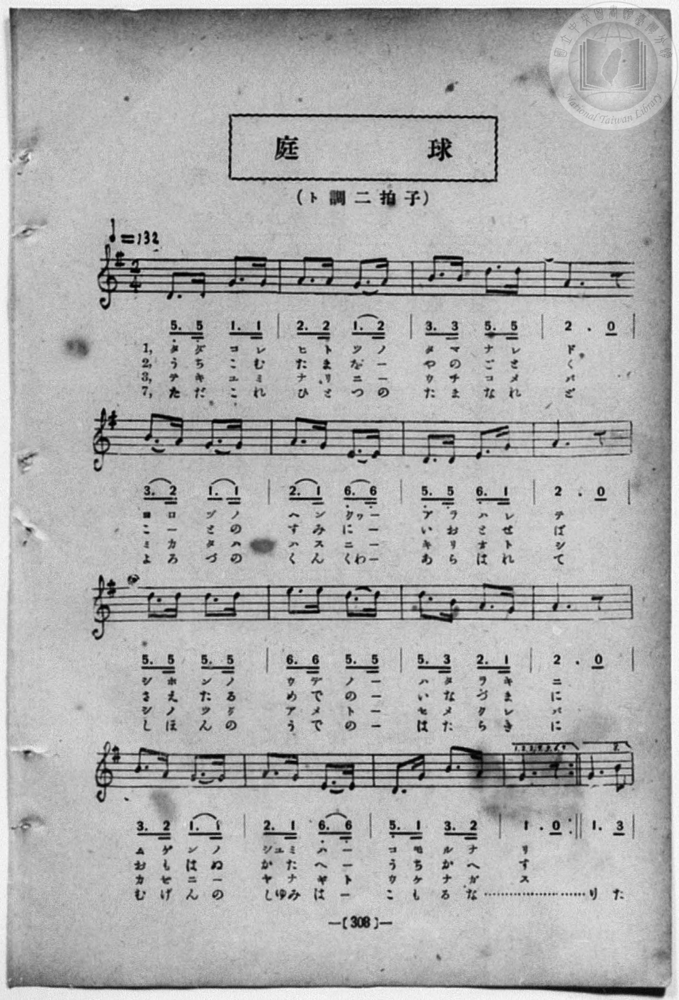
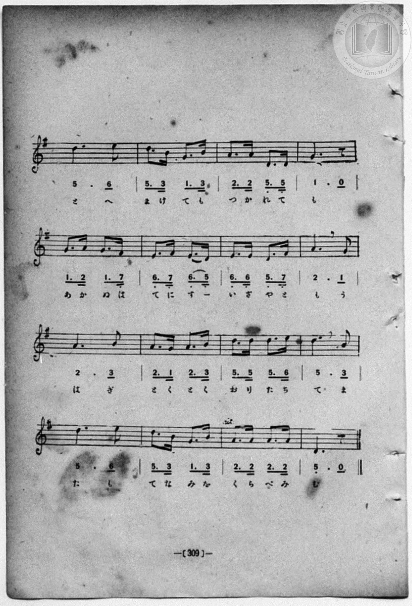

# 庭球

> Re:Shōka 使用 AI 協助辨識與重建樂譜，可能會有錯誤。歡迎回報。

<audio controls src="tenisu_no_uta.mp3"></audio>

- book: 新編 小學校・公學校 唱歌教材集（尋常科五・六學年用）
- 一條慎三郎 編《新編 小學校・公學校 唱歌教材集》（大正十二年十二月，索書號 0725-41）
- 公學校唱歌帳 (P209-P210, 308頁, 昭和2年1月29日)

## 說明

> [!NOTE]
> **原書資訊與歌詞全文**（對應 `P314.jpg`–`P317.jpg`，原書 p. 306–309，尋常科五・六學年第 38 首）：
> - **曲名**：〈庭球（テニス）〉（p. 306 漢字旁註片假名「テニス」，p. 308 題為「庭球」）
> - **調性與拍號**：ト調二拍子（G 大調 2/4 拍），♩ = 132
> - **曲式與版本校勘**：全曲由前段（p. 308，16 小節，反覆演唱第一至七段）與尾聲段（p. 309，16 小節，第八段）組成。對照原書掃描（`P316.jpg`–`P317.jpg`）：
>   1. 第一、七段第三句原書印為「四本（しほん）の腕（うで）のはたらきに」（雙打四隻手臂，手抄《唱歌帳》誤作「二本」）。
>   2. 尾聲段（`P317.jpg`）第 2、14 小節印為 `5. 3 1. 3`（無升記號，手抄《唱歌帳》誤作 `5. 3 1 2' 3`），第 5 小節印為附點節奏 `1. 2 1. 7_`，第 15 小節印為 `2. 2 2. 2`。
>   3. 尾聲段末小節（p. 309 末小節）五線譜印為主音 G4（`1.`），簡譜誤植為 `5_.`，此處依五線譜收於主音 `1`。
>
> **一、**
> 唯（ただ）これ一（ひと）つの球（たま）なれど　萬（よろづ）の變化（へんくわ）あらはれて
> 四本（しほん）の腕（うで）のはたらきに　無限（むげん）の趣味（しゆみ）はこもるなり。
>
> **二、**
> 打（う）ち込（こ）む球（たま）を箭（や）のごとく　コートの隅（すみ）に射落（いおと）せば
> 冴（さ）えたる右手（みぎて）のいなづまに　思（おも）はぬ方（かた）へ打（う）ちかへす。
>
> **三、**
> 敵（てき）弓（ゆみ）なりにうちこめば　味方（みかた）ははすに切（き）り落（おと）し
> 篠（しの）つく雨（あめ）と攻（せ）め來（く）れば　風（かぜ）に柳（やなぎ）とうけ流（なが）す。
>
> **四、**
> 草葉（くさば）のいなば飛（と）ぶごとく　ラインの外（そと）に逃（に）ぐる球（たま）
> 樹（こ）かげのきぎす立（た）つ如（ごと）く　脚（あし）を掠（かす）めてあがる球（たま）。
>
> **五、**
> ひごひの瀧（たき）に躍（をど）るごと　網（あみ）にあたりてかへる球（たま）
> 鼠（ねづみ）の梁（はり）を傳（つた）ふごと　地（つち）に滑（すべ）りて走（はし）る球（たま）。
>
> **六、**
> 外（そ）れては空（そら）の流（なが）れ星（ぼし）　消（き）ゆるが如（ごと）く殞（お）つる球（たま）
> 岩（いは）うつ波（なみ）のせかれては　狂（くる）ふが如（ごと）くはづむ球（たま）。
>
> **七、**
> 唯（ただ）これ一（ひと）つの球（たま）なれど　よろづの變化（へんくわ）あらはれて
> 四本（しほん）の腕（うで）のはたらきに　無限（むげん）の趣味（しゆみ）はこもるなり。
>
> **八、**
> たとへ負（ま）けても疲（つか）れても　あかぬはテニスいざや友（とも）
> 上衣（うはぎ）とくとくおり立（た）ちて　またもてなみをくらべみむ。


## 歌詞

```text
（TMD 檔案未包含歌詞註解）
```

## ABC

```abc
X:1
T:庭球
M:2/4
L:1/16
Q:1/4=132
K:G
V:V1 name="Piano" snm="Pia"
[V:V1]
D3 D G3 G | A3 A G3 A | B3 B D3 D | A6 z2 |
w: タ ダ コ レ | ヒ ト ツ ノ | タ マ ナ レ | ド
B3 A G3 G | A3 G E3 E | D3 D E3 G | A6 z2 |
w: ヨ ロ ヅ ノ | ヘ ン クワ _ | ア ラ ハ レ | テ
D3 D D3 D | E3 E D3 D | D3 B A3 G | A6 z2 |
w: シ ホ ン ノ | ウ デ ノ ハ | タ ラ キ ニ | _
B3 A G3 G | A3 G E3 E | D3 G B3 A | G6 z2 |
w: ム ゲ ン ノ | シユ ミ ハ コ | モ ル ナ リ | _
D3 D G3 G | A3 A G3 A | B3 B D3 D | A6 z2 |
w: う ち こ む | た ま を や | の ご と く | _
B3 A G3 G | A3 G E3 E | D3 D E3 G | A6 z2 |
w: こ ー と の | す み に い | お と せ ば | _
D3 D D3 D | E3 E D3 D | D3 B A3 G | A6 z2 |
w: さ え た る | み ぎ て の | い な づ ま | に
B3 A G3 G | A3 G E3 E | D3 G B3 A | G6 z2 |
w: お も は ぬ | か た へ う | ち か へ す | _
D3 D G3 G | A3 A G3 A | B3 B D3 D | A6 z2 |
w: テ キ ユ ミ | ナ リ ニ ウ | チ コ メ バ | _
B3 A G3 G | A3 G E3 E | D3 D E3 G | A6 z2 |
w: ミ カ タ ハ | ハ ス ニ キ | リ オ ト シ | _
D3 D D3 D | E3 E D3 D | D3 B A3 G | A6 z2 |
w: シ ノ ツ ク | ア メ ト セ | メ ク レ バ | _
B3 A G3 G | A3 G E3 E | D3 G B3 A | G6 z2 |
w: カ ゼ ニ ヤ | ナ ギ ト ウ | ケ ナ ガ ス | _
D3 D G3 G | A3 A G3 A | B3 B D3 D | A6 z2 |
w: く さ ば の | い な ば と | ぶ ご と く | _
B3 A G3 G | A3 G E3 E | D3 D E3 G | A6 z2 |
w: ら い ん の | そ と に に | ぐ る た ま | _
D3 D D3 D | E3 E D3 D | D3 B A3 G | A6 z2 |
w: こ か げ の | き ぎ す た | つ ご と く | _
B3 A G3 G | A3 G E3 E | D3 G B3 A | G6 z2 |
w: あ し を か | す め て あ | が る た ま | _
D3 D G3 G | A3 A G3 A | B3 B D3 D | A6 z2 |
w: ヒ ゴ ヒ ノ | タ キ ニ ヲ | ド ル ゴ ト | _
B3 A G3 G | A3 G E3 E | D3 D E3 G | A6 z2 |
w: ア ミ ニ ア | タ リ テ カ | ヘ ル タ マ | _
D3 D D3 D | E3 E D3 D | D3 B A3 G | A6 z2 |
w: ネ ヅ ミ ノ | ハ リ ヲ ツ | タ フ ゴ ト | _
B3 A G3 G | A3 G E3 E | D3 G B3 A | G6 z2 |
w: ツ チ ニ ス | ベ リ テ ハ | シ ル タ マ | _
D3 D G3 G | A3 A G3 A | B3 B D3 D | A6 z2 |
w: そ れ て は | そ ら の な | が れ ぼ し | _
B3 A G3 G | A3 G E3 E | D3 D E3 G | A6 z2 |
w: き ゆ る が | ご と く お | つ る た ま | _
D3 D D3 D | E3 E D3 D | D3 B A3 G | A6 z2 |
w: い は う つ | な み の せ | か れ て は | _
B3 A G3 G | A3 G E3 E | D3 G B3 A | G6 z2 |
w: く る ふ が | ご と く は | づ む た ま | _
D3 D G3 G | A3 A G3 A | B3 B D3 D | A6 z2 |
w: た だ こ れ | ひ と つ の | た ま な れ | ど
B3 A G3 G | A3 G E3 E | D3 D E3 G | A6 z2 |
w: よ ろ づ の | へ ん くわ _ | あ ら は れ | て
D3 D D3 D | E3 E D3 D | D3 B A3 G | A6 z2 |
w: し ほ ん の | う で の は | た ら き に | _
B3 A G3 G | A3 G E3 E | D3 G B3 A | G6 z2 |
w: む げ ん の | しゆ み は こ | も る な り | _
z6 B2 | d6 e2 | d3 B G3 B | A3 A D3 D |
w: た | と へ | ま け て も | つ か れ て
G6 z2 | G3 A G3 F | E3 F E3 D | E3 E D3 F |
w: も | あ か ぬ は | て に す _ | い ざ や と
A6 G2 | A6 B2 | A3 G A3 B | d3 d d3 e |
w: も う | は ぎ | と く と く | お り た ち
d6 B2 | d6 e2 | d3 B G3 B | A3 A A3 A |
w: て ま | た も | て な み を | く ら べ み
G6 z2 |
w: む
```

## TMD 檔案連結

- [主旋律 TMD 檔案](tenisu_no_uta.tmd) [[在 TMD Studio 編輯](https://tmdlang.github.io/Tmd-TS/#tmd=s7IKdvYPcrWy4qpTUCpJTLdSSM7PyUlNLsnMz7MqzsjPTozPrsyvSsyML84ojTe0NDJWgqssy88pzU21Si9KTEmNN403Q8gU55cWJadaFSdn5OfnxJekVpQk5edno8vHFySmp1oFGBuaIGQKivLLUvMS84C6C4oy80pSU8DaEQpSyzJTUkHSxcmJefFlqUWZaZmpKUiOSi0qBrsdYkVJUWJecXJRZgHIQwhV-UUlGflAhxdkVFplZBaX5BdlJifmxGcn5iUiFJVkpAK9V1wAVFysxKWlpfB019rnE5oVtLS4FG0VDI2NuOxtFdy5bIz0TexAmkB-tFJ4Nm3D8-0rFJ5u6H-6dsezBQsfN-9-2roGwlZ4OmXjs7U9z6bOfDZ3wsvZbe_3dDzd0P10x47nyyc-2TUFrHQtUOnTnVueT1nxfk8n2DFPdjQ8WzT3WWvfkx2dL5v7FIDGP27oIsWexw3dIKuWLH-2dvHT3sYnu3qANkAYz-Z0vN_T83zLomezd7yYOV_BwNzIVNfEEGY33EiIiU93bFbQCDAysNQNMDI00FEwNrB4uaBRR-HZjLVPJ_UYAU01BBpoZPls-lJNJS4ufS0FW2oBLgUFBTuFaEU__xDXWAhHS-tp33yQuze3v1jR9aKjHejCFyvnPW1d8Wxau5YWOHR7n7V3KiSAEpleVkF6wqOGySCOOZgD9DjEAIUCPaBXzICSxgaWIFFckbJmjYKxhcLLZdOA4fN-zyyIM3SBDnk2e9PTCb0gO2c9buiAJBSg_Y-b2x43dz9u2glU_7gBqKUDYpPCsz2Lnq6d_mx644sVu593tj9tbAdqf9zQA9fwuKEX6BCwaqCFC3ueN-0CSkMMBst1Iix_sWr_s4blIP939wLjEOKK5g6gMCiCu3ufrp0AtNldAZgAgGIKwPSqABQFe6Hn0cyVCpDEjOKXPf1A4553djybswYU-d0zwIaCQnb2pudTNj7t7H22bivMOxZAcwzNQEnx-foGUPD1975Y1vZszxRgogEGGTD9vmjf_GRHM1hLJ9Dgpxv2vWjchGQCKNCRTQDqetq6GqL--daWZx0THjc0ASPzeetySIw962t-1t8P1A6KTTNsUYuIHwUFQz0FiDseNzRC3AHmdj7tXwox7mnvBmgAz54N9DIo5hqnP27c_bhpMijmGte9aJ0KFmx73LgcIvK4cf3jxvmPm4Ds3seNq8Fx0vFy9sxnnZOBhryctftZZ_eL9iagZ4CMZ10twCwLz0PA_Phi1ZIne-cAbQTnwTWQKAV6EuZkIz1gaCBCCcVnoGRoBPSKoQk0xCDOV0gwBYYlyLPGQFUdz1sWPu0FZowZwCSB3xUwjQpG6mCtoHQBssMUxfiXM1te7p4H4i7tV0gA2mIEsso8HpSNQKoNUZUrJAC9YATyh1ECkr-Mkfz1bM5qWIxDk4ECklAnMPM93z7rxdo5EAOf7Nj9cv5mBXcTUHAY6sHcuWEhUAXQH8-W9ELCIB4k1fNs7ZIXM6c-2TcXbsqzKdueTdsDNSXBEO4oWFkCSR7Awh3MfzplPTjC5z9uXACO8MmPm3qASsCCmx43gkrnx41LgAkBmtNBKveBBVcBVT5uXPm4oeHFBHBSagIiYBpZCk1K67qe9gALEKCWHcD09bix_3ETMCUDpZrAqWk9WPsyqDPIT48NwATwciYo5z9uanjcOAmhd9vipxM3Q81sApqwHywO1A70I9AN3WAvdGGEz64epPABJnOIA8B6F77YtwfMBVvR1IAeJk2Tnq9bC3ZJC8y1U4BhCPJ7Q8Pjps2Pm_cACyyg-MtZrWCNM2GuAiaHlhcT9oIFWx43dsFCfvbjxg3QIGrbApYFBghQHGxpU_fT_s3ABA8W3_-4sQ8YnjB7gYasAsYF0GGQUHrWMBesrAvod1g4rHk2DVhiAwWBQQHMO0DBHWj-BUvtALkTIxUBczEilKaCMi_QdmCkADU-3QM2BBHm4HAGOgMUj0AzgeHfCPQX0FXACIK5Aeh-uDOAbgMiYOCsftrRDpYFFxtNXbAggofPdIgDnq8Hpl5I4lkHS7H9L2cD1QAFgXHdCBZc8WzKbrDIbLBpjU_2gZomQJVgLjA1gpz0chFEF9AxcyBR82w-OBU1QYK0D2IU2C8Tn20FmgxUDBTvAYtjBBQwZSMF1IvezhcTQfUjKEk0TgXaiBpfG14uBroNKAvx3TaU9NO88nHTksfNm4Hqny6B5Ky5MJWrXzZAkuJqMHcCMG2gJU5oTK2AhDYkjwD9OAlsOzArARPPzOerIWkJEgtLni4DJhUgF-QGsAjIGS9aZkFDtXE6JM0_64MEPtC0mZCABacEoIIeTGdgZrcpSOEDLnOA1gHJdc8bgFkeohEc-42rX-wCVT5AG4HFDtgioI3g8AEWAts2wVwFzVBgNjCPAJMK0DHgZIwjTF7ugbh_LTi_QLSve7YIErPAYqoL4s2nTZDCBJi0IOGzFW770znAeIRILYSmmd0TYRkc3CgCO-PFVogyYNqGBB2hwAG2yJDLalikw5Ir0F_rn6_cBU0JTcB0BXY5Wpps6nk2A-hgoMgeqL3A0mAbsDkMz1Zt4JDswYzuZ-vmQbIbNE_hCMCnm4DRASm4gLUJUCUwayx5tnkRzBnQIAWXZsBGH9TloFjrhtgIrBqACQ8SpFicAQ6xpVjKW4xCCdhmpG7VBq_UhnCNBmxiomQxoDeBRcqOF5sgyR7i5YmgSGlqej4Nko-AwQKOEUhkAQ0HBgUoQwGtWAOyEd5-B0X6NGDZ-LQfUnSsgNQvELue7Oh6sXAxzL9Ad8ILT2CcQkhgfdSFWuwAK4hlYOuANRcwWICWAlMLKBWBMz4wzIFqgPYCucCGDNinlPe6oEBBS5-LKwzYtQb21zMT8_IdagxqFKpBVijYGJppgUNUAVtvD9rufrGwR0ED1lrVUYC12TWxaADaBDKsRsE0Htgb0QVRhmCGIVDMCMwCNjyhdA2w2QpiGSOphqmCQAMgrgGb6GNYo_C4aT9Y9HFzA5C9GcpeA9TzuHkSlNcBxC1Qdh9IBq5nHhB3oejpRLIJ5ACoTUZAucY2iMrGhUA8GcJuagDpapwPldkHFIHa2tQCllkHlZkCxCug7H6gDMRzGPYYg9wAtadpLZC9DOq6-WDXwdy6Coi7oaqWgWUaobzNQPZCqKoJuO0xAbmtH-qeqUC8AcpeB3Y1NLQagfbAZVaAZbaR5h9TpHho2oIUJyjxAPYp1D_Nm5Di4XHzarA-WDzitMcM5La5UNN6gGxouDWuB7saJtOJFCOrwDI9SHr2QGWm47bHHDm2FyClgx6waZvgYQUsV1BCFCmFAG1G1rMSwyb8eW9XDzl5D5KrYPkMkfMMFcwgXgVSyDkUKopQCIFoma8ZmgSaQRHYCmWDo7Z5BpQHTJBNwEJ0PdQAUKwvgkqtBGJoGoTmPkjKxwh1cO6DhnTzHqSUBwnbmVDefiBeDWVDch80v4DjYzaUvYFA7oPGVBMo5cHKCVAKh7u1aSdS7lsLloHFKChfdkDZ2_HnPmBahLkUWOuh-AeaWsGuhvlnNVhmAtTsbpQUhTf3wUN7PpKrF6GUgiBXw8ocsD3wyEMOg3kEcl8v1IQ2sPsgboOk8ClI_oGVOV1gGWgeIdY_oNzXBAvfXqDapSjhtgMqMxlkD7DBAjUAJNUElQIVAJCkCMt-kIIC2SoCVV8nZVUfcrWGyHrIolC2MTyH4q__tkPjZzY4s0HYkNIVVne0g0WQUjI8ToE5EJiCIexu3OEOzn9ToWENrE1hcQWMN5AM1LTGPqRyF7MegcUVKH5h6RrDJlAOhPsIaB6s3m4Cl-PwtAysgeH5bDc4xULrPKA6UFkCUUWo_oPlOlDqg9ZLUHf3IvkIVrqAa2B4qU5K_Qc1DVhAwksXaCEJK_1AORBadwB9jBxDwLqZ6PoPFtrAMIC3VZaAXQ0tn8AlJKz-mw2WgZUI6HUmvvpvOlTdboySC2brciR7IDUwLMWAMiAsdEFlDaY9eLMfsK9B89rPEK68BqoBAtHrvgVQL23CyHjbkdttiHpjMzjOYWkYWLYitefw5z2ouqYmRPHVCK4xYfEHDF94-QeMBZAMNEeAUzdMZib-ug9Y-kPsAdax8PYYOAXBXNq0DinngVueTRuh6rqAbGjOA9aQ-HMetDgGpiR4exnoTqS6vKkRKT02gWVgLTUS6j54qx9oGrzuA7ntcTPUHuS6D1o2wkofUuo-WAyD3LYV6jbcdR8kR0DLQ2APgvi6rwGqbhJGzgP1kqECoEwOSySTwV6C1X4g58GaKqAKGNOqWi4u5_yURDL6hJDZHchMgILG0z0bX2zdrqCtAJ8DQuRU4LQObO4Db6YF5TcYBOVIYAZFEjFDEgHNdEBoRIcSuUbFkYtRAwASC6CwhJTrMFFQ3gGJ7oPyJyJSJjBgkesEYPACy1EIG5I3IAGPHMBQv8G6uxDaHKkxAGRDWdibCGC1yO0BkBFwDyGyFiiuodkRmuBg2QmYsKHZDOIxWLUxDehgGBvc2UNxPqRwh3sA2QWQyIGVqBAaFBWQyDGF0mZoEQjWhXA3rIMAsQvUXEFEBSjroFa3iCIRWOzAs89CJH_CTAJFG9zVpCQgGI0n-cBshtoFDi_kkAY1e6BFCLCYQy4oQNXgTqiq_eCwhmRtCITnRV07BfAYTbSPYawCgmOEzDFG5pggc0yROWbIHHMwB5TTQbQyFwA)]
- [鋼琴伴奏 TMD 檔案](tenisu_no_uta_piano.tmd) [[在 TMD Studio 編輯](https://tmdlang.github.io/Tmd-TS/#tmd=s7IKdvYPcrWy4qpTUCpJTLdSSM7PyUlNLsnMz7MqzsjPTozPrsyvSsyML84ojTe0NDJWgqssy88pzU21Si9KTEmNN403Q8gU55cWJadaFSdn5OfnxJekVpQk5edno8vHFySmp1oFGBuaIGQKivLLUvMS84C6C4oy80pSU8DaEQpSyzJTUkHSxcmJefFlqUWZaZmpKUiOSi0qBrsdYkVJUWJecXJRZgHIQwhV-UUlGflAhxdkVFplZBaX5BdlJifmxGcn5iUiFCUWATWnp-am5pVYFWQm5uXHJyYn5-cWJOZlgsQQCksygIqsiguAphYrcWlpKTzdtfb5hOb3ezpezp75rLP7Zfee5xO2PNmz5enS_vd7OhW0tLgUbRUMjY247G0V3LlsjPRN7ECGgQLJSuHZtA3Pt69QeLqh_-naHc8WLHzcvPtp6xoIW-HplI3P1vY8mzrz2dwJL2e3Aa14uqH76Y4dz5dPfLJrCljpWqDSpzu3PJ-yAmgX2JFPdjQ8WzT3WWvfkx2dL5v7FIDGP27oIsWexw3dIKuWLH-2dvHT3sYnu3qANkAYz-Z0vN_T83zLomezd7yYOV_BwNzIVNfEEGY33EiIiU93bFbQCDAysNQNMDI00FEwNrB4uaBRR-HZjLVPJ_UYAU01BBpoZPls-lJNJS6uMGBsApMIKPCDPBxqDGoUqrkUgMDG0EzLDszS11KwRQcKz9esAfr5xcIeBQ0TkAefr2_QUQAmNDO9rIJ0TSwatPTBhtUomMYr6AIhkDIEMwyBYkZglhFUxAgoYgxmGSOphqmCQAMgrgGb6GNYo_C4aT9Y9HFzA5C9GcpeA9TzuHkSlNcBxC1Qdh9IBq5nHhB3oejpRLIJ5ACoTUZAucY2iMrGhUA8GcJuagDpapwPldkHFIHa2tQCllkHlZkCxCug7H6gDMRzGPYYg9wAtadpLZC9DOq6-WDXwdy6Coi7oaqWgWUaobzNQPZCqKoJuO0xAbmtH-qeqUC8AcpeB3Y1NLQagfbAZVaAZbaR5h9TpHho2oIUJyjxAPYp1D_Nm5Di4XHzarA-WDzitMcM5La5UNN6gGxouDWuB7saJtOJFCOrwDI9SHr2QGWm47bHHDm2FyClgx6waZvgYfW4cQlKiCKlEKDNyHpWYtiEP-_t6iEn70FyFSyfIXKeoYIZxKtACjmHQkURCiEQLfM1Q5NAMygCW6FscNQ2z4DygAmyaf3j5vVQA0CxvggqtRKIoWkQmvsgKR8j1MG5DxrSzXuQUh4kbGdCefuBeDWUDcl90PwCjo_ZUPYGArkPGlNNoJQHKydAKRzu1qadSLlvLVgGFqOgfNkBZW_Hn_uAaRHm0sdNUL9B_QNNrWBXw_yzGiwzAWp2N0qKwpv74KE9H8nVi1BKQZCrYWUO2B545CGHwTwCua8XakIb2H0Qt0FS-BQk_8DKnC6wDDSPEOsfUO5rgoVvL1DtUpRw2wGVmQyy53ETxCpwkmtsgkqBCgBIUoRlP0hBgWwVgaqvk7KqD7laQ2Q9ZFEo2xieQ_HXf9uh8TMbnNkgbEjpCqs72sEiSCkZHqfAHAhMwRB2N-5wB-e_qdCwBtamsLgCxhtIBmpaYx9SuYtZj8DiChS_sHSNYRMoB8J9BDQPVm83gctxeFoG1sDwfLYbnGKhdR5QHagsgagiVP_Bch0o9UHrJai7e5F8BCtdwDUwvFQnpf6DmgYsIOGlC7SQhJV-oBwIrTuAPkaOIWDdTHT9BwttYBjA2ypLwK6Glk_gEhJW_80Gy8BKBPQ6E1_9Nx2qbjdGyQWzdTmSPZAaGJZiQBkQFrqgsgbTHrzZ7-ns2TSv_QzhymugGiAQve5bAPXSJoyMtx253YaoNzaD4xyWhoFlK1J7Dn_eg6prakIUX43gGhMWf8DwhZd_wFgAyUBzBDh1w2Rm4q_7gKU_xB5gHQtvj4FTEMylTeuQch645dm0EaquC8iG5jxgDYk_50GLY2BKgreXge5EqsubGpHSYxNYBtZSI6Hug7f6gabB6z6Q2x43Q-1BrvugZSOs9CGl7oPFMMhtW6Fuw133QXIEtDwE9iCIr_saoOomYeS86aCKFyIAyuSwRDIZ7CVY7QdyHqypAqqAMa2qRekW-qB0Cy2gvUJgrohXiDaMhVGgjANkmcYjieBUAWIYQP2EqcwEpMwEqAzOgKsBi5BlFrqjjGD6KXIWilaocQh9ILOAYemcn5JIVg_7aevqZ-u2Pt2w7wWwT6HxdM_GF1u3K2grGJphlHuPGiYDmeYEi0BQ6QWDoPIN6AMkETMkEWNoqWcMLyaNUNonOMpE1OQESdOglAmpJWGioJIIJLoPyp-IyOfAZIpcwwITK7BWgrAhJQ0kGSMnV1h8QV0Joc2RmlZANpSFvcEFVovcugIZAfcQoqAC5Rxo4QbNvrDCCVhMQAstiMdglfA0oINhbHDXGcX5kKoS7gFkF0AiB1Y_QWhQVEAixxRKm6FFIFgXwt2w7hbELlDjDxEVoIIItfGCqGCAhTi8MFqI5E-YSaBog7ualAQEo_EkH5jNULvA4YUc0qBGJLRABlYayMUuqFGxE6pqPzisIQUlBMJLNkRuxFWwGUAhShGAUgxhL9Gw5n-MsgSiCLNcQhHBWzChWorFHeiFL7rbsbqLXA8Cg1TXTgFcX0T7AIURHCNkjjEyxwSZY4rMMUPmmIM5oAgD0cpcAA)]

## 分析

```text
================================================================================
📊 TMD Song Profile: [ 庭球 ]
================================================================================
⏱  Duration:       1:57 (117.3s), 129 measures total
🎼 Key & Tempo:    首調基準 G, != 132.0 BPM, <2/4>
   - 分析範圍：      由實際發聲的音符與和弦推測調性；播放脈絡另行呈現
🎤 人聲音域:    D4 (MIDI 62) – E5 (MIDI 76) [跨度: 14 個半音 / 1.2 個八度, 難度: moderate]
   - 最低音:  D4 in [Verse[L1] #1 @ m.1, 0:00]
   - 最高音: E5 in [Coda #1 @ m.114, 1:43]
   - 適合: soprano, mezzo-soprano, contralto, tenor, baritone, bass
🏛  結構:      Verse[L1] (14.5s) -> Verse[L2] (14.5s) -> Verse[L3] (14.5s) -> Verse[L4] (14.5s) -> Verse[L5] (14.5s) -> Verse[L6] (14.5s) -> Verse[L7] (14.5s) -> Coda (15.5s)
⚡ 編曲密度:        Peak 1 軌道同時演奏
🗝  調性診斷：       D 大調（純淨自然大調，未偵測到可信轉調）
   - 風格氣質:    純淨自然大調（陽光明朗、易唱易記，無明顯調外色彩）
   - 轉調歷程:    全曲維持單一推測調性（未偵測到可信轉調）
   - 核心骨幹音:  A, D, G, E, B
   - 調性數值:    D 大調 [相關度: 0.84, 穩定度: Moderate, 自然音純度: 100.0%]
   - 候選調性 (K-S): D 大調 (0.84), G 大調 (0.72), A 大調 (0.57)
   - 五度圈歷程:   +2 -> +2 -> +2 -> +2 -> +2 -> +2 -> +2 -> +2
   - 各段落調性細節:
     • [Verse[L1] #1]: D 大調 (r: 0.83, 自然音純度: 100.0%)
     • [Verse[L2] #1]: D 大調 (r: 0.83, 自然音純度: 100.0%)
     • [Verse[L3] #1]: D 大調 (r: 0.83, 自然音純度: 100.0%)
     • [Verse[L4] #1]: D 大調 (r: 0.83, 自然音純度: 100.0%)
     • [Verse[L5] #1]: D 大調 (r: 0.83, 自然音純度: 100.0%)
     • [Verse[L6] #1]: D 大調 (r: 0.83, 自然音純度: 100.0%)
     • [Verse[L7] #1]: D 大調 (r: 0.83, 自然音純度: 100.0%)
     • [Coda #1]: D 大調 (r: 0.90, 自然音純度: 100.0%)

  [ 五度圈游移軌跡 ]
               C  
         F            G  
      Bb              [D ]*
      Eb               A  
         Ab           E  
            Db       B  
               F# 
     (* = active key center)

  [ 十二半音累積音高分佈 ]
     C  :                            0.0%
     C# :                            0.0%
     D  : ██████████████████████    25.8%
     D# :                            0.0%
     E  : ██████████                12.4%
     F  :                            0.0%
     F# :                            0.3%
     G  : ██████████████████        21.6%
     G# :                            0.0%
     A  : ████████████████████████  28.6%
     A# :                            0.0%
     B  : █████████                 11.3%
--------------------------------------------------------------------------------
Assignment 軌道音域：
  - Piano         : D4 – E5 (14 個半音 / 1.2 個八度, 413 個音符)
================================================================================
```


## 原書掃描頁










