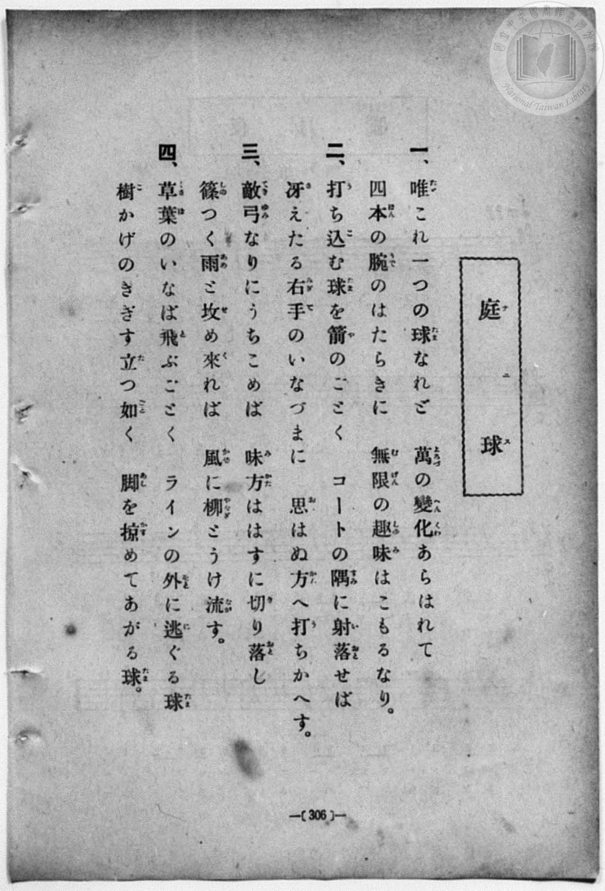
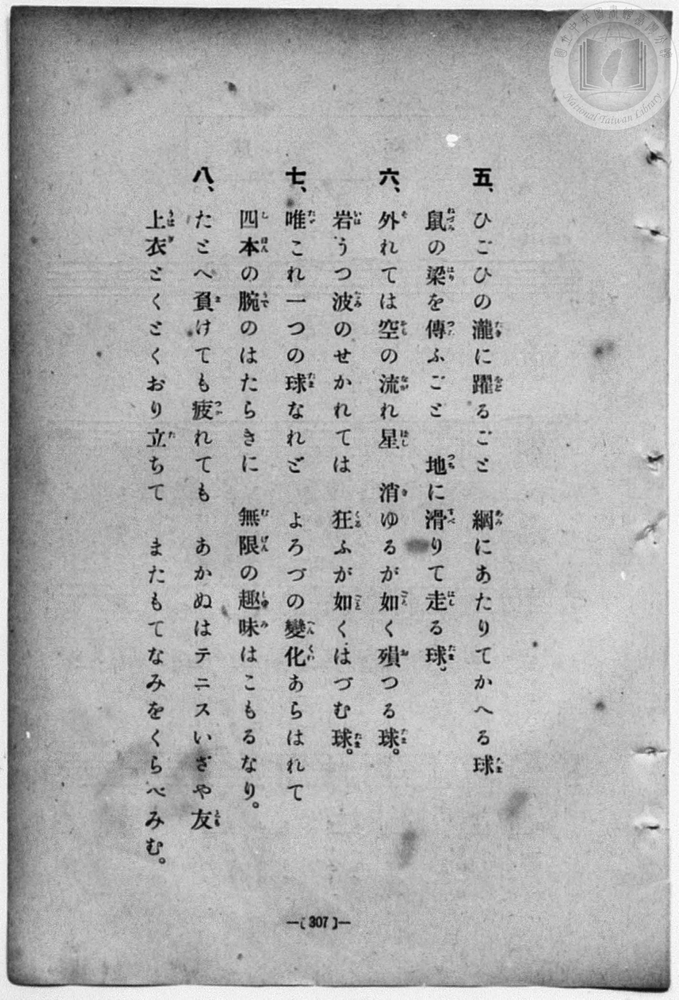
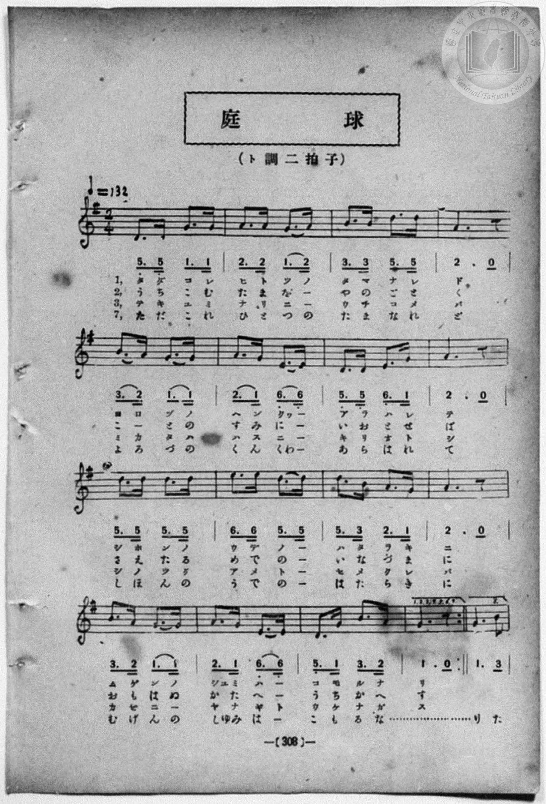
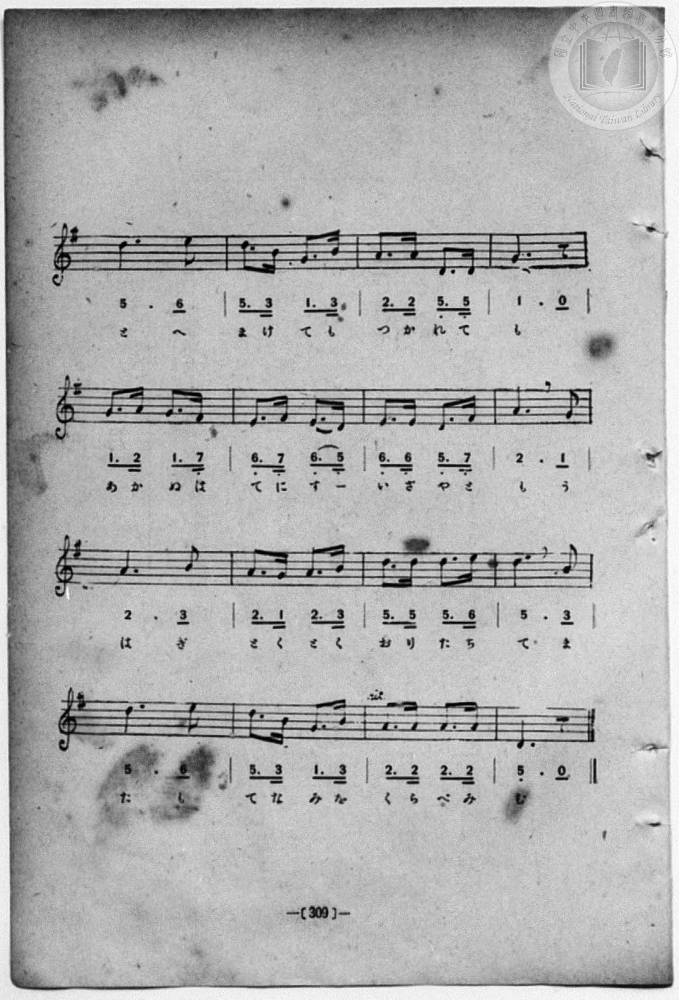

# 庭球

> Re:Shōka 使用 AI 協助辨識與重建樂譜，可能會有錯誤。歡迎[回報](https://github.com/TMDLang/reshoka/issues)。

- **鋼琴伴奏版**：<br><audio controls src="tenisu_no_uta.mp3"></audio>
- **NEUTRINO 歌聲合成版**：<br><audio controls src="tenisu_no_uta_neutrino.mp3"></audio>

- book: 新編 小學校・公學校 唱歌教材集（尋常科五・六學年用）
- 一條慎三郎 編《新編 小學校・公學校 唱歌教材集》（大正十二年十二月，索書號 0725-41）
- 公學校唱歌帳 (P209-P210, 308頁, 昭和2年1月29日)

## 說明

> [!NOTE]
> **原書資訊與歌詞全文**（對應 `P314.jpg`–`P317.jpg`，原書 p. 306–309，尋常科五・六學年第 38 首）：
> - **曲名**：〈庭球（テニス）〉（p. 306 漢字旁註片假名「テニス」，p. 308 題為「庭球」）
> - **調性與拍號**：ト調二拍子（G 大調 2/4 拍），♩ = 132
> - **曲式與版本校勘**：全曲由前段（p. 308，16 小節，反覆演唱第一至七段）與尾聲段（p. 309，16 小節，第八段）組成。對照原書掃描（`P316.jpg`–`P317.jpg`）：
>   1. 第一、七段第三句原書印為「四本（しほん）の腕（うで）のはたらきに」（雙打四隻手臂，手抄《唱歌帳》誤作「二本」）。
>   2. 尾聲段（`P317.jpg`）第 2、14 小節印為 `5. 3 1. 3`（無升記號，手抄《唱歌帳》誤作 `5. 3 1 2' 3`），第 5 小節印為附點節奏 `1. 2 1. 7_`，第 15 小節印為 `2. 2 2. 2`。
>   3. 尾聲段末小節（p. 309 末小節）五線譜印為主音 G4（`1.`），簡譜誤植為 `5_.`，此處依五線譜收於主音 `1`。
>
> **一、**
> 唯（ただ）これ一（ひと）つの球（たま）なれど　萬（よろづ）の變化（へんくわ）あらはれて
> 四本（しほん）の腕（うで）のはたらきに　無限（むげん）の趣味（しゆみ）はこもるなり。
>
> **二、**
> 打（う）ち込（こ）む球（たま）を箭（や）のごとく　コートの隅（すみ）に射落（いおと）せば
> 冴（さ）えたる右手（みぎて）のいなづまに　思（おも）はぬ方（かた）へ打（う）ちかへす。
>
> **三、**
> 敵（てき）弓（ゆみ）なりにうちこめば　味方（みかた）ははすに切（き）り落（おと）し
> 篠（しの）つく雨（あめ）と攻（せ）め來（く）れば　風（かぜ）に柳（やなぎ）とうけ流（なが）す。
>
> **四、**
> 草葉（くさば）のいなば飛（と）ぶごとく　ラインの外（そと）に逃（に）ぐる球（たま）
> 樹（こ）かげのきぎす立（た）つ如（ごと）く　脚（あし）を掠（かす）めてあがる球（たま）。
>
> **五、**
> ひごひの瀧（たき）に躍（をど）るごと　網（あみ）にあたりてかへる球（たま）
> 鼠（ねづみ）の梁（はり）を傳（つた）ふごと　地（つち）に滑（すべ）りて走（はし）る球（たま）。
>
> **六、**
> 外（そ）れては空（そら）の流（なが）れ星（ぼし）　消（き）ゆるが如（ごと）く殞（お）つる球（たま）
> 岩（いは）うつ波（なみ）のせかれては　狂（くる）ふが如（ごと）くはづむ球（たま）。
>
> **七、**
> 唯（ただ）これ一（ひと）つの球（たま）なれど　よろづの變化（へんくわ）あらはれて
> 四本（しほん）の腕（うで）のはたらきに　無限（むげん）の趣味（しゆみ）はこもるなり。
>
> **八、**
> たとへ負（ま）けても疲（つか）れても　あかぬはテニスいざや友（とも）
> 上衣（うはぎ）とくとくおり立（た）ちて　またもてなみをくらべみむ。


## 歌詞

```text
（TMD 檔案未包含歌詞註解）
```

## ABC

<div class="abc-score" data-abc-src="tenisu_no_uta.abc" aria-label="五線譜載入中"></div>

[下載 ABC 原始檔](tenisu_no_uta.abc)

## TMD 檔案連結

- [主旋律 TMD 檔案](tenisu_no_uta.tmd) [[在 TMD Studio 編輯](https://tmdlang.github.io/Tmd-TS/#tmd=s7IKdvYPcrWy4qpTUCpJTLdSSM7PyUlNLsnMz7MqzsjPTozPrsyvSsyML84ojTe0NDJWgqssy88pzU21Si9KTEmNN403Q8gU55cWJadaFSdn5OfnxJekVpQk5edno8vHFySmp1oFGBuaIGQKivLLUvMS84C6C4oy80pSU8DaEQpSyzJTUkHSxcmJefFlqUWZaZmpKUiOSi0qBrsdYkVJUWJecXJRZgHIQwhV-UUlGflAhxdkVFplZBaX5BdlJifmxGcn5iUiFJVkpAK9V1wAVFyMrDUzPTPPqiQxsxzogPy0tMzkzMQcJS4tLYWnu9Y-n9CsoKXFpWirYGhsxGVvq-DOZWOkb2IH0g4KAyuFZ9M2PN--QuHphv6na3c8W7DwcfPup61rIGyFp1M2Plvb82zqzGdzJ7yc3fZ-T8fTDd1Pd-x4vnzik11TwErXApU-3bnl-ZQV7_d0gp31ZEfDs0Vzn7X2PdnR-bK5TwFo_OOGLlLsedzQDbJqyfJnaxc_7W18sqsHaAOE8WxOx_s9Pc-3LHo2e8eLmfMVDMyNTHVNDGF2w42EmPh0x2YFjQAjA0vdACNDAx0FYwOLlwsadRSezVj7dFKPEdBUQ6CBRpbPpi_VVOLi0tdSsKUW4FJQULBTiFb08w9xjYVwtLSe9s0HuXtz-4sVXS862oEufLFy3tPWFc-mtWtpgUO391l7p0ICKBHqZRWkJzxqmAzimIM5QI9DDFAo0AN6xQwoaWxgCRLFFSlr1igYWyi8XDYNGD7v98yCOEMX6JBnszc9ndALsnPW44YOSEIB2v-4ue1xc_fjpp1A9Y8bgFo6IDYpPNuz6Ona6c-mN75Ysft5Z_vTxnag9scNPXANjxt6gQ4BqwZauLDnedMuoDTEYLBcJ8LyF6v2P2tYDvJ_dy8wDiGuaO4ACoMiuLv36doJQJvdFYAJACimAEyvCkBRsBd6Hs1cqQBJzCh-2dMPNO55Z8ezOWtAkd89A2woKGRnb3o-ZePTzt5n67bCvGMBNMfQDJQUn69vAAVff--LZW3P9kwBJhpgkAHT74v2zU92NIO1dAINfrph34vGTUgmgAId2QSgrqetqyHqn29tedYx4XFDEzAyn7cuh8TYs77mZ_39QO2g2DTDFrWI-FFQMNRTgLjjcUMjxB1gbufT_qUQ4572boAG8OzZQC-DYq5x-uPG3Y-bJoNirnHdi9apYMG2x43LISKPG9c_bpz_uAnI7n3cuBocJx0vZ8981jkZaMjLWbufdXa_aG8CegbIeNbVAsyy8DwEzI8vVi15sncO0EZwHlwDiVKgJ2FONtIDhgYilFB8BkqGRkCvGJpAQwzifIUEU2BYgjxrDFTV8bxl4dNeYMaYAUwS-F0B06hgpA7WCkoXIDtMUYx_ObPl5e55IO7SfoUEoC1GIKvM40HZCKTaEFW5QgLQC0YgfxglIPnLGMlfz-ashsU4NBkoIAl1AjPf8-2zXqydAzHwyY7dL-dvVnA3AQWHoR7MnRsWAlUA_fFsSS8kDOJBUj3P1i55MXPqk31z4aY8m7Lt2bQ9UFMSDOGOgpUlkOQBLNzB_KdT1oMjfP7jxgXgCJ_8uKkHqAQsuOlxI6h0fty4BJgQoDkdpHIfWHAVUOXjxpWPGxpeTAAnpSYgAqaRpdCktK7raQ-wAAFq2QFMX48b-x83AVMyUKoJnJrWg7UvgzqD_PTYAEwAL2eCcv7jpobHjZMQerctfjpxM9TMJqAJ-8HiQO1APwLd0A32QhdG-OzqQQofYDKHOACsd-GLfXvAXLAVTQ3oYdI06fm6tWCXtMBcOwUYhiC_NzQ8btr8uHkPsMACir-c1QrWOBPmKmByaHkxYS9YsOVxYxcs5Gc_btwADaK2LWBZYIAAxcGWNnU_7d8MTPBg8f2PG_uA4QmzF2jIKmBcAB0GCaVnDXPByrqAfoeFw5pn04AlNlAQGBTAvAMU3IHmX7DUDpA7MVIRMBcjQmkqKPMCbQdGClDj0z1gQxBhDg5noDNA8Qg0Exj-jUB_AV0FjCCYG4DuhzsD6DYgAgbO6qcd7WBZcLHR1AULInj4TIc44Pl6YOqFJJ51sBTb_3I2UA1QEBjXjWDBFc-m7AaLzAab1vhkH6hpAlQJ5gJTI8hJLxdBdAEdMwcSNc_mg1NREyRI-yBGgf0y8dlWoMlAxUDxHrA4RkABUzZSQL3o7XwxEVQ_gpJE41SgjajxteHlYqDbgLIQ321DST_NKx83LXncvBmo_ukSSM6aC1O5-mUDJCmuBnMnANMGWuKExtQKSGhD8gjQj5PAtgOzEjDxzHy-GpKWILGw5OkyYFIBckFuAIuAnPGiZRY0VBunQ9L8sz5I4ANNmwkJWHBKACrowXQGZnabghQ-4DIHaB2QXPe8AZjlIRrBsd-4-sUuUOUDtBFY7IAtAtoIDh9gIbBtE8xV0AwFZgPzCDCpAB0DTsY4wuTlHoj714LzC0T7umeLIDELLKa6IN582gQpTIBJCxI-W-G2P50DjEeI1EJomtk9EZbBwY0isDNebIUoA6ZtSNARChxgiwy5rIZFOiy5Av21_vnKXdCU0ARMV2CXo6XJpp5nM4AOBorsgdoLLA22AZvD8GzVBg7JHszofrZuHiS7QfMUjgB8ugkYHZCCC1ibAFUCs8aSZ5sXwZwBDVJwaQZs9EFdDoq1boiNwKoBmPAgQYrFGeAQW4qlvMUolIBtRupWbfBKbQjXaMAmJkoWA3oTWKTseLEJkuwhXp4IipSmpufTIPkIGCzgGIFEFtBwYFCAMhTQijUgG-Htd1CkTwOWjU_7IUXHCkj9ArHryY6uFwsXw_wLdCe88ATGKYQE1kddqMUOsIJYBrYOWHMBgwVoKTC1gFIROOMDwxyoBmgvkAtsyIB9SnmvCwoUtPS5uMKAXW9gfz4zMS_focagphpkg4KNoZkWOEAVsHX2oM3uFwt7FDRgjVUdBViTXROLBqBFIMNqFEzjgZ0RXRBlCGYYAsWMwCxguxNK1wBbrSCWMZJqmCoINADiGrCJPoY1Co-b9oNFHzc3ANmboew1QD2PmydBeR1A3AJl94Fk4HrmAXEXip5OJJtADoDaZASUa2yDqGxcCMSTIeymBpCuxvlQmX1AEaitTS1gmXVQmSlAvALK7gfKQDyHYY8xyA1Qe5rWAtnLoK6bD3YdzK2rgLgbqmoZWKYRytsMZC-EqpqA2x4TkNv6oe6ZCsQboOx1YFdDQ6sRaA9cZgVYZhtp_jFFioemLUhxghIPYJ9C_dO8CSkeHjevBuuDxSNOe8xAbpsLNa0HyIaGW-N6sKthMp1IMbIKLNODpGcPVGY6bnvMkWN7AVI66AGbtgkeVsBiBSVEkVII0GZkPSsxbMKf93b1kJP3ILkKls8QOc9QwQziVSCFnEOhogiFEIiW-ZqhSaAZFIGtUDY4aptnQHnABNkELEPXQw0AxfoiqNRKIIamQWjug6R8jFAH5z5oSDfvQUp5kLCdCeXtB-LVUDYk90HzCzg-ZkPZGwjkPmhMNYFSHqycAKVwuFubdiLlvrVgGViMgvJlB5S9HX_uA6ZFmEuBlR6Kf6CpFexqmH9Wg2UmQM3uRklReHMfPLTnI7l6EUopCHI1rMwB2wOPPOQwmEcg9_VCTWgDuw_iNkgKn4LkH1iZ0wWWgeYRYv0Dyn1NsPDtBapdihJuO6Ayk0H2ANsrUANAUk1QKVABAEmKsOwHKSiQrSJQ9XVSVvUhV2uIrIcsCmUbw3Mo_vpvOzR-ZoMzG4QNKV1hdUc7WAQpJcPjFJgDgSkYwu7GHe7g_DcVGtbA2hQWV8B4A8lATWvsQyp3MesRWFyB4heWrjFsAuVAuI-A5sHq7SZwOQ5Py8AaGJ7PdoNTLLTOA6oDlSUQVYTqP1iuA6U-aL0EdXcvko9gpQu4BoaX6qTUf1DTgAUkvHSBFpKw0g-UA6F1B9DHyDEErJuJrv9goQ0MA3hbZQnY1dDyCVxCwuq_2WAZWImAXmfiq_-mQ9Xtxii5YLYuR7IHUgPDUgwoA8JCF1TWYNqDN_sBuxo0r_0M4cproBogEL3uWwD10iaMjLcdud2GqDc2g-McloaBZStSew5_3oOqa2pCFF-N4BoTFn_A8IWXf8BYAMlAcwQ4dcNkZuKv-4ClP8QeYB0Lb4-BUxDMpU3rkHIeuOXZtBGqrgvIhuY8YA2JP-dBi2NgSoK3l4HuRKrLmxqR0mMTWAbWUiOh7oO3-oGmwes-kNseN0PtQa77oGUjrPQhpe6DxTDIbVuhbsNd90FyBLQ8BPYgiK_7GqDqJmHkPFAnGSoAyuSwRDIZ7CVY7QdyHqypAqqAMa2q5eJyzk9JJL1LCJnbgcwDKGg83bPxxdbtCtoK8BkgREYFTurAZj7w5llQdoNBUIYE5k8kETMkEdA8B4RG9CeRK1QcmRjV_5BIAAUlpFiHiYKyDkh0H5Q_EZEwgeGKXCUAQxdYjELYkKwBCXfk8IX6DdbbhdDmSG0BIBvKwt5CAKtFbg6AjIB7CJGzQFENzY3Q9AbLTcB0Dc1lEI_Bao1pQAfD2OC-HorzIWU73APILoBEDqxAhdCgqIBEjimUNkOLQLAuhLth_QOIXaDWCiIqQDkHtbZFlIjAUgeeexYi-RNmEija4K4mJQHBaDzJB2Yz1C5weCGHNKjVAy1BgKUccjkBqgV3QlXtB4c1JGdDIDwr6topgEdoFJAZoPwJopW5AA)]
- [鋼琴伴奏 TMD 檔案](tenisu_no_uta_piano.tmd) [[在 TMD Studio 編輯](https://tmdlang.github.io/Tmd-TS/#tmd=s7IKdvYPcrWy4qpTUCpJTLdSSM7PyUlNLsnMz7MqzsjPTozPrsyvSsyML84ojTe0NDJWgqssy88pzU21Si9KTEmNN403Q8gU55cWJadaFSdn5OfnxJekVpQk5edno8vHFySmp1oFGBuaIGQKivLLUvMS84C6C4oy80pSU8DaEQpSyzJTUkHSxcmJefFlqUWZaZmpKUiOSi0qBrsdYkVJUWJecXJRZgHIQwhV-UUlGflAhxdkVFplZBaX5BdlJifmxGcn5iUiFCUWATWnp-am5pVYFWQm5uXHJyYn5-cWJOZlgsQQCksygIqsiguAphYrcWlpKTzdtfb5hOb3ezpezp75rLP7Zfee5xO2PNmz5enS_vd7OhW0tLgUbRUMjY247G0V3LlsjPRN7ECGgQLJSuHZtA3Pt69QeLqh_-naHc8WLHzcvPtp6xoIW-HplI3P1vY8mzrz2dwJL2e3Aa14uqH76Y4dz5dPfLJrCljpWqDSpzu3PJ-yAmgX2JFPdjQ8WzT3WWvfkx2dL5v7FIDGP27oIsWexw3dIKuWLH-2dvHT3sYnu3qANkAYz-Z0vN_T83zLomezd7yYOV_BwNzIVNfEEGY33EiIiU93bFbQCDAysNQNMDI00FEwNrB4uaBRR-HZjLVPJ_UYAU01BBpoZPls-lJNJS6uMGBsApMIKPCDPBxqDGqquRSAwMbQTMsOzNLXUrBFBwrP16wBevnFwh4FDROQ_56vb9BRAKYzM72sgnRNLBq09MGG1SiYxivoAiGQMgQzDIFiRmCWEVTECChiDGYZI6mGqYJAAyCuAZvoY1ij8LhpP1j0cXMDkL0Zyl4D1PO4eRKU1wHELVB2H0gGrmceEHeh6OlEsgnkAKhNRkC5xjaIysaFQDwZwm5qAOlqnA-V2QcUgdra1AKWWQeVmQLEK6DsfqAMxHMY9hiD3AC1p2ktkL0M6rr5YNfB3LoKiLuhqpaBZRqhvM1A9kKoqgm47TEBua0f6p6pQLwByl4HdjU0tBqB9sBlVoBltpHmH1OkeGjaghQnKPEA9inUP82bkOLhcfNqsD5YPOK0xwzktrlQ03qAbGi4Na4Huxom04kUI6vAMj1IevZAZabjtsccObYXIKWDHrBpm-Bh9bhxCUqIIqUQoM3IelZi2IQ_7-3qISfvQXIVLJ8hcp6hghnEq0AKOYdCRREKIRAt8zVDk0AzKAJboWxw1DbPgPKACbJp_ePm9VADQLG-CCq1EoihaRCa-yApHyPUwbkPGtLNe5BSHiRsZ0J5-4F4NZQNyX3Q_AKOj9lQ9gYCuQ8aU02glAcrJ0ApHO7Wpp1IuW8tWAYWo6B82QFlb8ef-4BpEebSx01Qv0H9A02tYFfD_LMaLDMBanY3SorCm_vgoT0fydWLUEpBkKthZQ7YHnjkIYfBPAK5rxdqQhvYfRC3QVL4FCT_wMqcLrAMNI8Q6x9Q7muChW8vUO1SlHDbAZWZDLLncRPEKnCSa2yCSoEKAEhShGU_SEGBbBWBqq-TsqoPuVpDZD1kUSjbGJ5D8dd_26HxMxuc2SBsSOkKqzvawSJIKRkep8AcCEzBEHY37nAH57-p0LAG1qawuALGG0gGalpjH1K5i1mPwOIKFL-wdI1hEygHwn0ENA9WbzeBy3F4WgbWwPB8thucYqF1HlAdqCyBqCJU_8FyHSj1QeslqLt7kXwEK13ANTC8VCel_oOaBiwg4aULtJCElX6gHAitO4A-Ro4hYN1MdP0HC21gGMDbKkvAroaWT-ASElb_zQbLwEoE9DoTX_03HapuN0bJBbN1OZI9kBoYlmJAGRAWuqCyBtMevNnv6ezZNK_9DOHKa6AaIBC97lsA9dImjIy3Hbndhqg3NoPjHJaGgWUrUnsOf96DqmtqQhRfjeAaExZ_wPCFl3_AWADJQHMEOHXDZGbir_uApT_EHmAdC2-PgVMQzKVN65ByHrjl2bQRqq4LyIbmPGANiT_nQYtjYEqCt5eB7kSqy5sakdJjE1gG1lIjoe6Dt_qBpsHrPpDbHjdD7UGu-6BlI6z0IaXug8UwyG1boW7DXfdBcgS0PAT2IIiv-xqg6iZh5LzpoIoXIgDK5LBEMhnsJVjtB3IerKkCqoAxrapF6RX6IPcKLaCdQmCmiFeINoyFUaB8A2SZxiOJ4FQBYhhAvYSpzASkzASoDM6AqwGLkGUWuqOMYPopchaKVqhxCH0gs4BB6ZyfkkhO__pp6-pn67Y-3bDvBbBHofF0z8YXW7craCsYmmGUeo8aJgOZ5gQLQFDZBYOg0g3oASQRMyQRY2iZZwwvJI1QWic4SkTUxARJ0aB0CakjYaKgcggkug_Kn4jI5cBEily_ApMqsE6CsCHlDCQRIydWWHRBXQmhzZEaVkA2lIW9uQVWi9y2AhkB9xCimALlG2jRBs28sKIJWEhAiyyIx2BV8DSgg2FscMcZxfmQihLuAWQXQCIHVjtBaFBUQCLHFEqboUUgWBfC3bDOFsQuUNMPERWgYgi16YKoXoBFOLwoWojkT5hJoGiDu5qUBASj8SQfmM1Qu8DhhRzSoCYktDgGVhnIhS6oSbETqmo_OKwhxSQEwss1RGbEUawZQCFKAYBSCGEvz7DmfoySBKIIs1RCEcFbLKFaisUd6EUvutuxuotcDwJDVNdOAVxZRPsAhREcI2SOMTLHBJljiswxQ-aYgzmg-ALRylwA)]

## 分析

```text
================================================================================
📊 TMD Song Profile: [ 庭球 ]
================================================================================
⏱  Duration:       0:44 (44.5s), 49 measures total
🎼 Key & Tempo:    首調基準 G, != 132.0 BPM, <2/4>
   - 分析範圍：      由實際發聲的音符與和弦推測調性；播放脈絡另行呈現
🎤 人聲音域:    D4 (MIDI 62) – E5 (MIDI 76) [跨度: 14 個半音 / 1.2 個八度, 難度: moderate]
   - 最低音:  D4 in [Verse #1 @ m.1, 0:00]
   - 最高音: E5 in [Coda #1 @ m.34, 0:30]
   - 適合: soprano, mezzo-soprano, contralto, tenor, baritone, bass
🏛  結構:      Verse (14.5s) -> Verse (14.5s) -> Coda (15.5s)
⚡ 編曲密度:        Peak 1 軌道同時演奏
🗝  調性診斷：       D 大調（純淨自然大調，未偵測到可信轉調）
   - 風格氣質:    純淨自然大調（陽光明朗、易唱易記，無明顯調外色彩）
   - 轉調歷程:    全曲維持單一推測調性（未偵測到可信轉調）
   - 核心骨幹音:  A, D, G, E, B
   - 調性數值:    D 大調 [相關度: 0.86, 穩定度: High, 自然音純度: 100.0%]
   - 候選調性 (K-S): D 大調 (0.86), G 大調 (0.73), A 大調 (0.56)
   - 五度圈歷程:   +2 -> +2 -> +2
   - 各段落調性細節:
     • [Verse #1]: D 大調 (r: 0.83, 自然音純度: 100.0%)
     • [Verse #2]: D 大調 (r: 0.83, 自然音純度: 100.0%)
     • [Coda #1]: D 大調 (r: 0.90, 自然音純度: 100.0%)

  [ 五度圈游移軌跡 ]
               C  
         F            G  
      Bb              [D ]*
      Eb               A  
         Ab           E  
            Db       B  
               F# 
     (* = active key center)

  [ 十二半音累積音高分佈 ]
     C  :                            0.0%
     C# :                            0.0%
     D  : ████████████████████████  27.0%
     D# :                            0.0%
     E  : ███████████               12.3%
     F  :                            0.0%
     F# : █                          0.8%
     G  : ███████████████████       21.6%
     G# :                            0.0%
     A  : ████████████████████████  27.6%
     A# :                            0.0%
     B  : █████████                 10.7%
--------------------------------------------------------------------------------
Assignment 軌道音域：
  - Piano         : D4 – E5 (14 個半音 / 1.2 個八度, 153 個音符)
================================================================================
```


## 原書掃描頁










