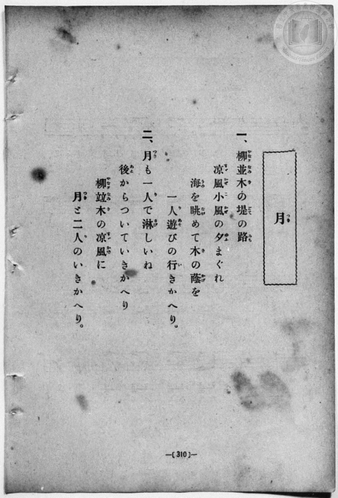
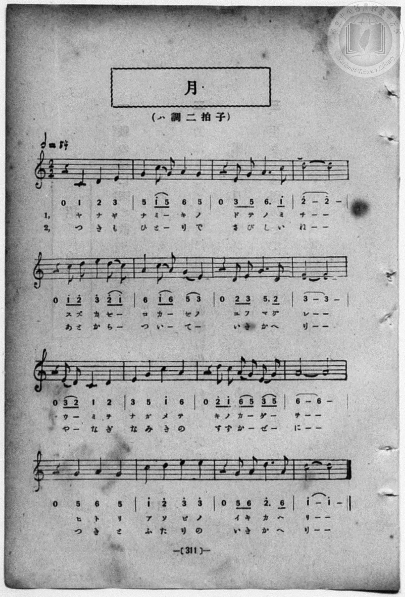

# 月

> Re:Shōka 使用 AI 協助辨識與重建樂譜，可能會有錯誤。歡迎回報。

<audio controls src="tsuki.mp3"></audio>

- book: 新編 小學校・公學校 唱歌教材集（尋常科五・六學年用）
- 一條慎三郎 編《新編 小學校・公學校 唱歌教材集》（大正十二年十二月，索書號 0725-41）
- 日治時期公學校《唱歌帳》（典藏號 2020.006.0843・P155）
- 原載《小公唱材集》第 311 頁（大正 13 年 12 月 23 日抄）

## 說明

> [!NOTE]
> **原書資訊與歌詞全文**（對應 `P318.jpg`–`P319.jpg`，原書 p. 310–311，尋常科五・六學年第 39 首）：
> - **調性與拍號**：ハ調二拍子（C 大調 2/2 拍），𝅗𝅥 = 64（換算四分音符 `!= 128`）
> - **背景與曲風**：每一樂句均以四分休止符後接優雅上行旋律展開，描寫黃昏柳樹並木堤岸上涼風習習，孩童獨自散步回家時，天邊明月宛如也怕孤單似地一路相隨，變成了與月亮兩人的同行。
> - **比較校勘**：與公學校手抄《唱歌帳》（`docs/shokacho/vol_01/p155_tsuki`）旋律、調性、拍號完全吻合。本檔依原書補齊雙段歌詞（`L1:`、`L2:`）及長音圓滑線。
>
> **一、**
> 柳並木（やなぎなみき）の堤（どて）の路（みち）
> 涼風（すゞかぜ）小風（こかぜ）の夕（ゆふ）まぐれ
> 海（うみ）を眺（なが）めて木（き）の蔭（かげ）を
> 一人遊（ひとりあそ）びの行（い）きかへり。
>
> **二、**
> 月（つき）も一人（ひとり）で淋（さび）しいね
> 後（あと）からついていきかへり
> 柳並木（やなぎなみき）の涼風（すゞかぜ）に
> 月（つき）と二人（ふたり）のいきかへり。

### 編曲說明（鋼琴伴奏版）：

1. 前奏 (Intro, 4 小節)：取末樂句旋律，描繪柳堤微風與明月相伴的悠然步調。
2. 主歌伴奏 (Song, 16 小節 × 2 段)：左手在第 1 拍歌唱休止處以低音先導，帶動流暢的 2/2 拍律動。


## 歌詞

```text
（TMD 檔案未包含歌詞註解）
```

## ABC

```abc
X:1
T:月
M:2/2
L:1/16
Q:1/2=64
K:C
V:V1 name="Piano" snm="Pia"
[V:V1]
z4 C4 D4 E4 | G4 c2 G2 A4 G4 | z4 E2 G2 A6 c2 | d16 |
w: 1.~ヤ ナ ギ | ナ ミ _ キ ノ | ド テ ノ ミ | チ
w: 2.~つ き も | ひ と _ り で | さ び し い | ね
z4 c2 d2 e4 d2 c2 | A4 c2 A2 G4 E4 | z4 D2 E2 G6 D2 | E16 |
w: 1.~ス ズ カ ゼ _ | コ カ _ ゼ ノ | ユ フ マ グ | レ
w: 2.~あ と か ら _ | つ い _ て _ | い き か へ | り
z4 E2 D2 C4 D4 | E4 G4 c4 A4 | z4 d2 c2 A2 G2 E2 G2 | A16 |
w: 1.~ウ _ ミ ヲ | ナ ガ メ テ | キ ノ カ _ ゲ _ | ヲ
w: 2.~や _ な ぎ | な み き の | す ず か _ ぜ _ | に
z4 G4 A4 G4 | c4 d4 e4 e4 | z4 G2 A2 d6 A2 | c16 |
w: 1.~ヒ ト リ | ア ソ ビ ノ | イ キ カ へ | リ
w: 2.~つ き と | ふ た り の | い き か へ | り
z4 C4 D4 E4 | G4 c2 G2 A4 G4 | z4 E2 G2 A6 c2 | d16 |
w: 1.~ヤ ナ ギ | ナ ミ _ キ ノ | ド テ ノ ミ | チ
w: 2.~つ き も | ひ と _ り で | さ び し い | ね
z4 c2 d2 e4 d2 c2 | A4 c2 A2 G4 E4 | z4 D2 E2 G6 D2 | E16 |
w: 1.~ス ズ カ ゼ _ | コ カ _ ゼ ノ | ユ フ マ グ | レ
w: 2.~あ と か ら _ | つ い _ て _ | い き か へ | り
z4 E2 D2 C4 D4 | E4 G4 c4 A4 | z4 d2 c2 A2 G2 E2 G2 | A16 |
w: 1.~ウ _ ミ ヲ | ナ ガ メ テ | キ ノ カ _ ゲ _ | ヲ
w: 2.~や _ な ぎ | な み き の | す ず か _ ぜ _ | に
z4 G4 A4 G4 | c4 d4 e4 e4 | z4 G2 A2 d6 A2 | c16 |
w: 1.~ヒ ト リ | ア ソ ビ ノ | イ キ カ へ | リ
w: 2.~つ き と | ふ た り の | い き か へ | り
```

## TMD 檔案連結

- [主旋律 TMD 檔案](tsuki.tmd) [[在 TMD Studio 編輯](https://tmdlang.github.io/Tmd-TS/#tmd=s7IKdvYPcrWy4qpTUCpJTLdSSM7PyUlNLsnMz7MqzsjPTozPrsyvSsyML84ojTe0NDJWgqssy88pzU21Si9KTEmNN403Q8gU55cWJadaFSdn5OfnxJekVpQk5edno8vHFySmp1oFGBtaIGQKivLLUvMS84C6C4oy80pSU8DaEQpSyzJTUkHSxcmJefFlqUWZaZmpKUiOSi0qBrsdYkVJUWJecXJRZgHIQwhV-UUlGflAhxdkVFplZBaX5BdlJifmxGcn5iUiFJVkpAK9l5dYUlqUqsSlpaXwbE6HgpYWl6KtgqGRBZe9rYIzl42RvpEdSAfIg1YKz6ZteL59hcLTDf1P1-54tmDh4-bdT1vXQNgKT6dsfLa259nUmc_mTng5u-39no6nG7qf7tjxfPnEJ7umgJWuBSp9unPL8ykr3u_pBLvkyY6GZ4vmPmvte7Kj82VznwLQ-McNXaTY87ihG2TVkuXP1i5-2tv4ZFcP0AYIA-ih93t6nm9Z9Gz2jhcz5ysYmBuZ6poYwux-Nn3ps027n81sejZnPtx4oO0QC57u2Aw1unXHi-n9IP1GBkYGegYGZnoGFibGQDcFGJqawgx72jf_xZ5OkG6go4GGAc2AOe_5mjUKxoaGCi8XNMJdqmBorAB0JzCkwcFuZKwAck1XC9g4Ln0tBVtqAS4FBQU7hWhFP_8Q11gIR0sL6FpQmGxuf7Gi60VHO9C7L1bOe9q64tm0di0tcMz1PmvvVEgApV69rIL0hEcNk0EcSzAHGKgQAxQK9IA-MwBKAv0HEsUV4aAQsFR4uWwa0H_v98yCOEMX6JAXq_Y_a1gOckJ3LzCIQZbPetzcDxQGxV9379O1E4DOcVYAhhpQTAGYHBWAomBTej7MbZ0OxEsVbBXMTICqnvXPfr5u-tPZs592tL2cv_n5mmUKCZDEDHRxJ5KdzT3PZq4H2Tl708tFK8B2PlvfD0qKK5qe9i99Orf9ye6lEHOe7Jn4bO0ioFFP9_U861v6tGXVy9mtT3Z0vVjY82x699N93U83Tn05DZhMep719z9dv_rl7uZnM_qfzd_8bMXOJzuWPZuz4umCJU837QBqebZtD9C25_snAREorNaufL566fPeFS_aVz2buvjZWqCN856u2wZMjyDZJStfNnU9m9EHTB1P181-uqzpyc75zxqmPl275Om0dU_27Hk6ZwPQwS-2r38-e8fLWcD81PNiXdezjglPdrWBfDan48mudU9bVz7Ztev5rJanE3qADn7c0IQIhGfrp7zY0wxM8E-7Z4BDAKgLngmedXYD0yJmVkhIyU8u1geXm8CyTx9YQsYbGOoXALNBfElxaXYmKJwhwfK4oREStUAGJGqfrusBJrCnE3Y_ndABdMmzOWuerZryZN9caFJcPOfl3q6Xs2c-W7cVkhpB1vkYWiUADUjwMbICGf20v-vl1O3AqH06Z_Kz3ROfb58F8xIsXQODBKgeWIiB-cBogMQB0KzHTS2PG1c9buwDk_sfN4IS0ePGdcDoAck2rnzcuAwiAgxTsAhQzUJ4uoFEHlh85uOmeY8bux83zgE5aUM_THwyXBBk7JKpYEvbHjduBYvse9w44XFTD9S0rdvBWoCy-0GyTZOez9kFFgG6rQcs0gh0D9TlMKe-mLIWzAXaAkxAIF0Q04CeBkbzy8YusOymx40rHjd1PW5setw4F6xxM0jvQqCxQFlQAQM0EGzIDpAy9ADcBUwmiAAEFaBAXUugbmhqgtiFbBHYwOXPtoPSx-PGqUDrwCLTgXY9blwLMQeYecCyQCeBSn6Q7U1AEmgsUM0yMIlwEvFxhytSHjeuxu7-xhVA_8Hcv_Vx43yY-9ehuQEaLJSXvlCgoKXPxRWcn5duFZCZmJfvUGNQo1ANskHBxkILHPgK2Mp8BWDBCcrlC3sUNExA1eHz9Q06CrByWBOLBqA9IMNqFAyAudwQiI2A2BiIaxRMQSJxQMoMyABxIIqMoSJgyRoFozgwGwFrwAb6GNYoxAN5j5uXgMkuENm0DmwKlNc8Hyy2FszuA8tAdHQCcRtUDKIOpKcRuz1GUF2NYHsae8FmNkHsadwEFlsBFgPb2bgcYU_jVCDeDMTTIfY0toD1gNyDag_-4N4FKirJC-44UOgZgwIQSINDExSwQIYZOLwh0QBSaQQOdZBrjIAiIHE8Id60E4h3AfFqMG8PJCyaNoN5CDHUMF8GxMDwaJ4HCYumDeAwX0MgzJvAoQvMBWA9ndBQh8REC5hcBtMJ1dECjiOIDhB_B9htoLghJcx3dJIb5sbAEIQlc0hIQpO5LjjsocENjg1QJICCHRIr-AIc5Elocm4GJTl4Em8CBeDj5oVgsg0RDMBEDwp-WHTA9IBoPMHdBAnSVWASEnkw3n4wCU78jZBMBgnumUA8CxZBjXOgekC2khDcwJYNucENClxE8QEOZnCBAU70YAKmzgxWkpjBFOIJ8eZJYLIDTIJCAJSIFoHDaC9YbDKYRErgTUsgoQ4OcXjCA-vFl8CRChVwMQIKva1gHqTwghQqyCFObAKv5eLStVMAFfEKSLQyFwA)]
- [鋼琴伴奏 TMD 檔案](tsuki_piano.tmd) [[在 TMD Studio 編輯](https://tmdlang.github.io/Tmd-TS/#tmd=s7IKdvYPcrWy4qpTUCpJTLdSSM7PyUlNLsnMz7MqzsjPTozPrsyvSsyML84ojTe0NDJWgqssy88pzU21Si9KTEmNN403Q8gU55cWJadaFSdn5OfnxJekVpQk5edno8vHFySmp1oFGBtaIGQKivLLUvMS84C6C4oy80pSU8DaEQpSyzJTUkHSxcmJefFlqUWZaZmpKUiOSi0qBrsdYkVJUWJecXJRZgHIQwhV-UUlGflAhxdkVFplZBaX5BdlJifmxGcn5iUiFCUWATWnp-am5pVYFWQm5uXHJyYn5-cWJOZlgsQQCksygIqs8hJLSotSlbi0tBSezel4v6fj5eyZzzq7X3bveT5hy5M9W54u7X-_p1NBS4tL0VbB0MiCy95WwZnLxkjfyA5kEiiErBSeTdvwfPsKhacb-p-u3fFswcLHzbuftq6BsBWeTtn4bG3Ps6kzn82d8HJ2G9CKpxu6n-7Y8Xz5xCe7poCVrgUqfbpzy_MpK4B2gV34ZEfDs0Vzn7X2PdnR-bK5TwFo_OOGLlLsedzQDbJqyfJnaxc_7W18sqsHaAOEAfZoz_Mti57N3vFi5nwFA3MjU10TQ5jdz6YvfbZp97OZTc_mzIcbD7QdYsHTHZuhRrfueDG9H6TfyMDIQM_AwEzPwMLEGOimAENTU5hhT_vmv9jTCdINdDTQMKAZMOc9X7NGwdjQUOHlgkYlLi59LQVbagEuBQWFxw0Tns3e9Hz2uherVj2b0fe4YSJYFBhi7btezJz6fs8sLF6a0_18dfeL9l3PGxc_W7v9af-mp72znneufLlkBQ7fAr0J8gbIx3pZBekgvzxuaILa9GLV_mcNy190tD_r7gXqBFnZ3A8UBNrkrACMGTCzExgVwNSkAFQDZL1smP901zIFSFoDqvswt3U6EC-1NTMBKkUYDUwGQN9BvAZKtEjJ9XknMHaBps4CKVVQMNRTeNrZCxRX0PDMKynK11EwASWg5-sbNIFqnvZPezZn9bMVTU_7lz6b3v10HzAYep719z_fuerZ_M1PFyx5um_dy0UrQH6Y0QdMN89n7wDa8nxWy7OmBc9btj1buxToCaizFBSM9BSe7NgNDFGISxQ0gvPz0nUUDM2gNiocnq4A9Om6rWCrty8DZrSnc1aAAtAQ5H9QVEzZ-GTPxGdrFwGj6MnupU_29r0EOqMVmGWA3gRG1Lan3VOfbW18NmsR0A0K0HADuhooDHUF5akHChS09Lm4wEFmFQAqR4I8HGoMahSqwV61sdCyAzNqFAwUdBVMgdgMStcoGMYBKSMQYQwnYOrMIBIg5VCFMAiSr-GqRbHTB8VOE7idhvEK0YaxCqYQCpMPYphC-EAKLg-kDCB2gCKGsLcMQf4A-QDsAZDngC4G-QHmU5AiY6gIWLIG5j0ErAEb6GNYoxAP5D1uXgImu0Bk0zqwKVBe83yw2Fowuw8sA9HRCcRtUDGIOpCeRuz2GEF1NYLtaewFm9kEsadxE1hsBVgMbGfjcoQ9jVOBeDMQT4fY09gC1gNyD6o9yCEUB_IwOIaBNDgAQGEBZJiBgwgSciCVRuCAAhlgBBQBieMJpKadQLwLiFeDeXsgzm_aDOYhxFCDaRkQA73QPA_i_KYN4GBaQyCYmsAB8rixG6ynExpQkMBrAZPLYDqhOlrAwQrRAeLvALsNFJw4g8kY6GlYYoJ4HpqYINkGGkLgAASFGyikIAGJL4xA7oImmmZQxMITUhPIz4-bF4LJNoTLgUkLFGKwEITpAdF4QqgJEgqrwCQkvGG8_WASnMQaIUkZEkIzgXgWLEwb50D1gGzFGULUKEGwBFLzJDDZASZBjgZF1SKwt_aCxSaDSaRk1LQEElDgQIJHL1gvvmSElNvA-Qvk4a1gHiRXQ3IbciARm4xQSisSC0QTIGWCxDcDUma5SCWkEbSExGEMVD9UGGe5ClNPpGOg2o2BlDHYMTBngUTAzqNWMa9rpwCuTRSADFAgRvsApeFsIzBbmQsA)]

## 分析

```text
================================================================================
📊 TMD Song Profile: [ 月 ]
================================================================================
⏱  Duration:       1:00 (60.0s), 32 measures total
🎼 Key & Tempo:    首調基準 C, != 128.0 BPM, <2/2>
   - 分析範圍：      由實際發聲的音符與和弦推測調性；播放脈絡另行呈現
🎤 人聲音域:    C4 (MIDI 60) – E5 (MIDI 76) [跨度: 16 個半音 / 1.3 個八度, 難度: moderate]
   - 最低音:  C4 in [Song #1 @ m.1, 0:00]
   - 最高音: E5 in [Song #1 @ m.5, 0:08]
   - 適合: soprano, mezzo-soprano, contralto, tenor, baritone, bass
🏛  結構:      Song (30.0s) -> Song (30.0s)
⚡ 編曲密度:        Peak 1 軌道同時演奏
🗝  調性診斷：       C 調性不明確（純淨自然大調，未偵測到可信轉調）
   - 風格氣質:    純淨自然大調（陽光明朗、易唱易記，無明顯調外色彩）
   - 轉調歷程:    全曲維持單一推測調性（未偵測到可信轉調）
   - 核心骨幹音:  E, D, A, C, G
   - 調性數值:    C 調性不明確 [相關度: 0.73, 穩定度: Ambiguous, 自然音純度: 100.0%]
   - 候選調性 (K-S): C 大調 (0.73), A 小調 (0.72), G 大調 (0.68)
   - 五度圈歷程:   +0 -> +0
   - 各段落調性細節:
     • [Song #1]: C 調性不明確 (r: 0.73, 自然音純度: 100.0%)
     • [Song #2]: C 調性不明確 (r: 0.73, 自然音純度: 100.0%)

  [ 五度圈游移軌跡 ]
              [C ]*
         F            G  
      Bb               D  
      Eb               A  
         Ab           E  
            Db       B  
               F# 
     (* = active key center)

  [ 十二半音累積音高分佈 ]
     C  : ██████████████████████    19.6%
     C# :                            0.0%
     D  : ███████████████████████   20.5%
     D# :                            0.0%
     E  : ████████████████████████  21.4%
     F  :                            0.0%
     F# :                            0.0%
     G  : ████████████████████      17.9%
     G# :                            0.0%
     A  : ███████████████████████   20.5%
     A# :                            0.0%
     B  :                            0.0%
--------------------------------------------------------------------------------
Assignment 軌道音域：
  - Piano         : C4 – E5 (16 個半音 / 1.3 個八度, 110 個音符)
================================================================================
```


## 原書掃描頁






