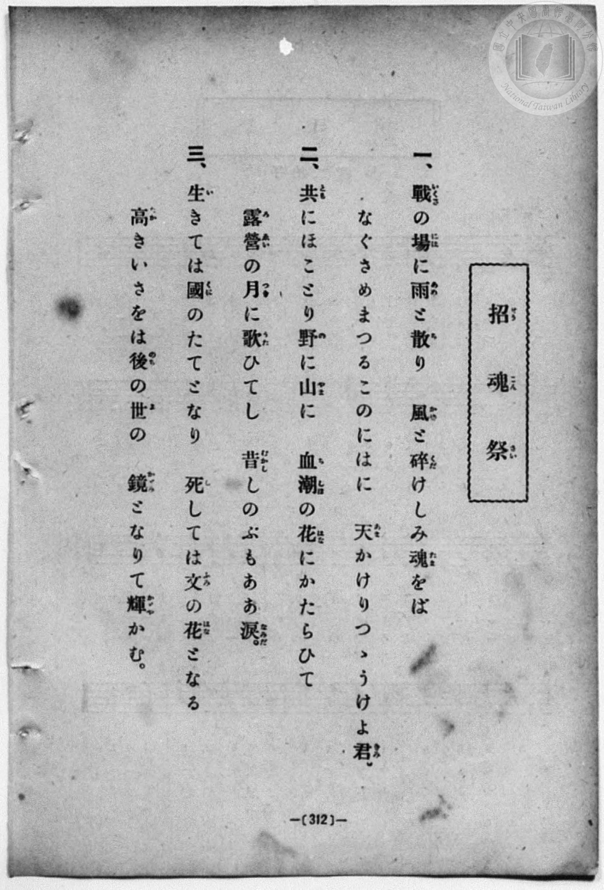
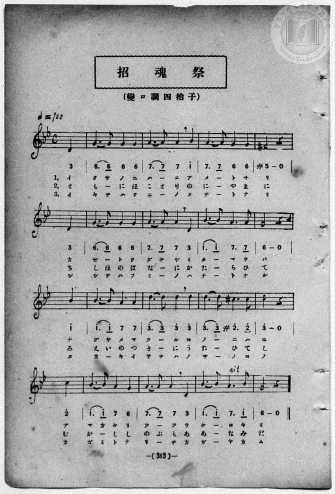

# 招魂祭

> Re:Shōka 使用 AI 協助辨識與重建樂譜，可能會有錯誤。歡迎回報。

- **鋼琴伴奏版**：<br><audio controls src="shokonsai.mp3"></audio>
- **NEUTRINO 歌聲合成版**：<br><audio controls src="shokonsai_neutrino.mp3"></audio>

- book: 新編 小學校・公學校 唱歌教材集（尋常科五・六學年用）
- 一條慎三郎 編《新編 小學校・公學校 唱歌教材集》（大正十二年十二月，索書號 0725-41）

## 說明

> [!NOTE]
> **原書資訊與歌詞全文**（對應 `P320.jpg`–`P321.jpg`，原書 p. 312–313，尋常科五・六學年第 40 首）：
> - **調性與拍號**：變ロ調四拍子（B♭ 大調關係小調ト短調 / G 小調，4/4 拍），♩= 100，弱起拍（第 4 拍起唱）
> - **曲調特色**：嚴肅莊重的西洋和聲小調（含導音 `#5` 與臨時變音 `#2^`）混搭附點進行曲節奏，末行倒數第 2 小節標有 `rit.`（漸慢）。
>
> **一、**
> 戰（いくさ）の場（には）に雨（あめ）と散（ち）り　風（かぜ）と碎（くだ）けしみ魂（たま）をば
> なぐさめまつるこのにはに　天（あま）かけりつゝうけよ君（きみ）。
>
> **二、**
> 共（とも）にほことり野（の）に山（やま）に　血潮（ちしほ）の花（はな）にかたらひて
> 露營（ろえい）の月（つき）に歌（うた）ひてし　昔（むかし）しのぶもああ淚（なみだ）。
>
> **三、**
> 生（い）きては國（くに）のたてとなり　死（し）しては文（ふみ）の花（はな）となる
> 高（たか）きいさをは後（のち）の世（よ）の　鏡（かゞみ）となりて輝（かゞや）かむ。


## 歌詞

```text
（TMD 檔案未包含歌詞註解）
```

## ABC

<div class="abc-score" data-abc-src="shokonsai.abc" aria-label="五線譜載入中"></div>

[下載 ABC 原始檔](shokonsai.abc)

## TMD 檔案連結

- [主旋律 TMD 檔案](shokonsai.tmd) [[在 TMD Studio 編輯](https://tmdlang.github.io/Tmd-TS/#tmd=s7IKdvYPcrWy4qpTUCpJTLdSSM7PyUlNLsnMz7MqzsjPTozPrsyvSsyML84ojTe0NDJWgqssy88pzU21Si9KTEmNN403Q8gU55cWJadaFSdn5OfnxJekVpQk5edno8vHFySmp1oFGBsZIGQKivLLUvMS84C6C4oy80pSU8DaEQpSyzJTUkHSxcmJefFlqUWZaZmpKUiOSi0qBrsdYkVJUWJecXJRZgHIQwhV-UUlGflAhxdkVFplZBaX5BdlJifmxGcn5iUiFJVkpAK9l5xalJqbn1eJLp6bmZNZkliEJA40JD0zz6o0D-TCEqi7tLQUnnXPfrm26fnStQpaWlyKtgqGBgZc9rYKTjpc2amVtgruuVw2JvomdiBzQMFkpfBs2obn21coPN3Q_3TtjmcLFj5u3v20dQ2ErfB0ysZna3ueTZ35bO6El7Pb3u_peLqh--mOHc-XT3yyawpY6Vqg0qc7tzyfsuL9nk6w-57saHi2aO6z1r4nOzpfNvcpAI1_3NBFij2PG7pBVi1Z_mzt4qe9jU929QBtgDCezel4v6fn-ZZFz2bveDFzvoKBuZGprokh2G4ufS0FW2oBLgUFBTuFaEU__xDXWAhHS-tp33yQvZvbX6zoetHRDnTzi5XznraueDatXUsLHDq9z9o7FRJA6UwvqyA94VHDZBDHEMwBOhxigEKBnoKxoRFQ0tjQGCSKK1DXrFEwMVB4uWwa0H_v98yCOEMX6JAXq_Y_a1gOckJ3LzAYQJbPerGu63HzWqDM09mzgcJP104Ausjp0cy1CsCQBAq_nD7nyf4mYAQA2Y-bO57PB6lV0FdwB0UKkAl0CDBpAFNQL9i2nkczV4LTD8iBeza-2LodLNMBdhRIFVAEGG9AtQhnPZu9CWjQ886dLzo3gd30dNaWF02tL_q6Xrb3Pp_V8mLp_mdbup9O6nnRuAlmacfTCaufbuh7OX-zQoKyaYIC0FMv2lc8m9kE9A9E0CgOGHSdz7ZvfzZh7cuZLS93z3vZsOnFwh6gbc_XNzxd2g904bM5q4EiTxsmPZu6A-RCI5CngLLPVsx8NgcYI0WZJXpAUzqe7dnxrHUR0LjHDU1gd8OiFphqHzc0AjMNmP-sYwNQ8ePGlseN_Y8bp4LUN657umALWHD148b1YJHVL2cDUz1QpOlxUyNYZMWzqYvBIgtB3Kauxw0NLxdB1HQ_bpwDUfN8UR9YBGjyArDIxMeN0x837gdmXLD4_MeN-8DaJz1u3ABxz-PGVY8bJwBdArQIKPu4ccnjJqCBk4GugrgHRDY0PF2yEuoeiAkgSyeCnAFSP_dxYxuYCwzx2WBlvUBLsQXFrh6koHjaCoxjoOIVj5uAzgP5-nHjbrDVQBFgvEL8sg4i9XQjWHETMNwgDgC56sXChmd7gQpAwQL26W5IeL7ogpgMdPwqmMlAB89_3ARkb3rcuAzigJdzNj1vnw82FuhgUKRAtIOLAiB3CdAjEO3A_AgWAXoTqB5qCMjGhoZnM6aATWgAWzEdLAt0CTD0tgH9BQ6xpmfbZ4G1A4N6PzRqMBIJUAgeMs-ngF0FdQ_QbUC71j-dAyq7wJG7GuJOcIQCpVaATAYniWdrgSEAVAN3BkgjsAwBC26FRgqW8IGY0A0NltUzYKkFaCPEAcBgB6YQYLJZ_3QfJCiAtoOTYuO6JzuApQgwBICBBnYVMGX2A6XAKbNpHsxSmCMbl73YMxch2wTxI5ANzCXgMKG8hIUCBS19Lq5gYO2fn1ecmGkVkJmYl-9QY1CjUA2yRsHG0EwLHP4K2Ep3BXjJpKCtAMz3wFwMLAYUNEyg2V9HAVb6amLRDLQZZHCNggGw9AJBdNo4HsqoUTCDMIEUlAVmQxjmEAaQqoGxdRUMMSTh6uGm6SqYqsNYMAizuwbsNh_DGgWYCnT6cdMSuIGPm9ZDxbYqPAZWulAVzd1wVj9CLUK0aRFcfiGc1YGkshEuugrNnXDPQNxphMedjSuQ3NkEF10NZ-2GsybDdYDUdsHF12HqampBmNq4D0MehzuNiQ3PtRCx5jaksIOFMnLIgkIJHt5N--HybXAWcnjCfYQnPHGndlAK39UzWFI4XC8kqRuiqIJrhUGYjbB8QUz6hsUlKD72wETh4YkcGw1QkY1gtdvh4vPhahExMw9KbwLHyAQ0d8Jth8cVMSkclntAaXE6VGw3SrqFu7URFvMgtYg8AM-TjQg3d0JFwC5tXIbLpU29qC7Fm8ZhYYMIJ7Q03jwVzoK5BCWNI6lEpGZInIBEQGpx5UFELBBK5Ts6yUnlaAkRnm6BaRVK1kBZMBGEjJE6mAGkEGpgEJZ2jeCuh6Xdx00boD4DlbuIMhSSxkAspFIKHi6PmzbD5dHLalD4IpfRmGEIK7MR6RLYLILINbagpDlYeQZsHCBcgZTm4GUUIs0B0xqEXoaUlrG5ApLjkNMcIr_CSk_kMhUUQhD_QfIdIhUhQgBR20DEHjeD6wG4CkxXwEsI_OkJ2CUCpydjCtMTeQWiIb7yEAaR0hSshAL6DlSiwcIEVm6gpikY-3ETrHxA1gOpeUHxAVILi2X0cERzAzhFIcojWBpAZkHSGLD1jFanY2NB3A1sYYJT1ALi3ABOT2ugvpiPXOpjqUNBfoOnZaRUCNEPUglJhSA5kFrCbqjl4tK1U4A3SxXQOcpcAA)]
- [鋼琴伴奏 TMD 檔案](shokonsai_piano.tmd) [[在 TMD Studio 編輯](https://tmdlang.github.io/Tmd-TS/#tmd=s7IKdvYPcrWy4qpTUCpJTLdSSM7PyUlNLsnMz7MqzsjPTozPrsyvSsyML84ojTe0NDJWgqssy88pzU21Si9KTEmNN403Q8gU55cWJadaFSdn5OfnxJekVpQk5edno8vHFySmp1oFGBsZIGQKivLLUvMS84C6C4oy80pSU8DaEQpSyzJTUkHSxcmJefFlqUWZaZmpKUiOSi0qBrsdYkVJUWJecXJRZgHIQwhV-UUlGflAhxdkVFplZBaX5BdlJifmxGcn5iUiFCUWATWnp-am5pVYFWQm5uXHJyYn5-cWJOZlgsQQCksygIqsklOLUnPz8yrRxXMzczJLEouA4lpaCs-6Z79c2_R86dr3ezpezp75rLP7Zfee5xO2PNmz5enS_vd7OhW0tLgUbRUMDQy47G0VnHS4slMrbRXcc7lsTPRN7EBGg4LSSuHZtA3Pt69QeLqh_-naHc8WLHzcvPtp6xoIW-HplI3P1vY8mzrz2dwJL2e3Ae16uqH76Y4dz5dPfLJrCljpWqDSpzu3PJ-yAmgp2MlPdjQ8WzT3WWvfkx2dL5v7FIDGP27oIsWexw3dIKuWLH-2dvHT3sYnu3qANkAYz-Z0vN_T83zLomezd7yYOV_BwNzIVNfEEGw3l2deSVG-VQAoiIM8HGoMahSquRSAwMbQTMsOzKpRMFDQBUN02ghK1ygYgmlDBfN4qJAZjAEVAVI1CFljGANNnyFQEVwnDMJsg8EarloUZ_ugONsEydUQCDIyXiHaLD43VsEIyDAC0jVAJwCZxvGxCAayOhALqBNkUzAwI-bnFSdmkhlIcL_CvQak4J7EH06Q4EGWhKtHCihTdVxBVgN2m49hjQJMBTr9uGkJ3MDHTeuhYlsVHgMTIVRFczec1Y9QixBtWgSXXwhndSCpbISLrkJzJ9wzEHca4XFn4wokdzbBRVfDWbvhrMlwHSC1XXDxdZi6mloQpjbuw5DH4U5jYsNzLUSsuQ0p7GChjByyoFCCh3fTfrh8G5yFHJ5wH-EJTxomSlyZF6wKZ-6FJWVikiQs-EFBuAcmCg8C5ABsgIpsBKvdDhefD1eLCMx5UHoTOBAnoLkTbjs8eIlJlLAED0o-06Fiu1GSGtytjbDIAqlFJFt4NmpEuLkTKgJ2aeMyXC5t6kV1Kd5kCQsbRDihJcvmqXAWzCUoyRJJJSIBQuIEJAJSiyvbIGIBnjAxKgxE8oKSwCIaRQQhY6QOZgAphBoYxKia4MntcdMGqGNApRuipIIkCxALqSyAe-Vx02a4PHqJCAoS5JIQ09uwkhGRlB43QoOssQUlmcBKjceNvQhXICUTeEmASCbA5AGhlyElP2yugGQS5GSCyGKwMgq55AKFEMR_kKyCiHhECCDKdIjY42ZwaQtXgekKeKbGmQRo2maAJwNYOQB0EKjcgHkDljtRkwGM_bgJlguR9UCqJFAQgtTCIgbd62huACcCRK6HRRsyC5IsHjduQ6vssLEg7n7cuB-cCBYQ5wZwElgD9cV85LIVS-UC8hs8-SElHIh-kEpIwgHJgdQSdgNmq4qUNhyYBWmwwdtuCNkaeBsPJAlqw5FhEq7mIMQohDjOtiO2RiY2A0BuJcUBwJDTtVMAN34VgAx4KEb7GMaiCRihCxiDBZS5AA)]

## 分析

```text
================================================================================
📊 TMD Song Profile: [ 招魂祭 ]
================================================================================
⏱  Duration:       1:07 (67.2s), 28 measures total
🎼 Key & Tempo:    首調基準 B,, != 100.0 BPM, <4/4>
   - 分析範圍：      由實際發聲的音符與和弦推測調性；播放脈絡另行呈現
🎤 人聲音域:    D4 (MIDI 62) – D5 (MIDI 74) [跨度: 12 個半音 / 1.0 個八度, 難度: easy]
   - 最低音:  D4 in [Shokonsai #1 @ m.1, 0:01]
   - 最高音: D5 in [Shokonsai #1 @ m.9, 0:21]
   - 適合: soprano, mezzo-soprano, contralto, tenor, baritone, bass
🏛  結構:      Shokonsai (33.6s) -> Shokonsai (33.6s)
⚡ 編曲密度:        Peak 1 軌道同時演奏
🗝  調性診斷：       G 小調（流行色彩小調，未偵測到可信轉調）
   - 風格氣質:    流行小調（略帶和弦色彩音與裝飾副屬和弦）
   - 轉調歷程:    全曲維持單一推測調性（未偵測到可信轉調）
   - 核心骨幹音:  G, A, D, A#, F#
   - 調性數值:    G 小調 [相關度: 0.75, 穩定度: Moderate, 自然音純度: 93.3%]
   - 候選調性 (K-S): G 小調 (0.75), D 大調 (0.68), G 大調 (0.62)
   - 五度圈歷程:   +1 -> +1
   - 各段落調性細節:
     • [Shokonsai #1]: G 小調 (r: 0.75, 自然音純度: 93.3%, 調外音: C#, F#)
     • [Shokonsai #2]: G 小調 (r: 0.75, 自然音純度: 93.3%, 調外音: C#, F#)

  [ 五度圈游移軌跡 ]
               C  
         F           [G ]*
      Bb               D  
      Eb               A  
         Ab           E  
            Db       B  
               F# 
     (* = active key center)

  [ 十二半音累積音高分佈 ]
     C  : ██                         2.2%
     C# : ██                         2.2%
     D  : ██████████████████        22.2%
     D# :                            0.0%
     E  :                            0.0%
     F  :                            0.0%
     F# : ████                       4.4%
     G  : ████████████████████████  28.9%
     G# :                            0.0%
     A  : ██████████████████████    26.1%
     A# : ████████████              13.9%
     B  :                            0.0%
--------------------------------------------------------------------------------
Assignment 軌道音域：
  - Piano         : D4 – D5 (12 個半音 / 1.0 個八度, 112 個音符)
================================================================================
```


## 原書掃描頁






