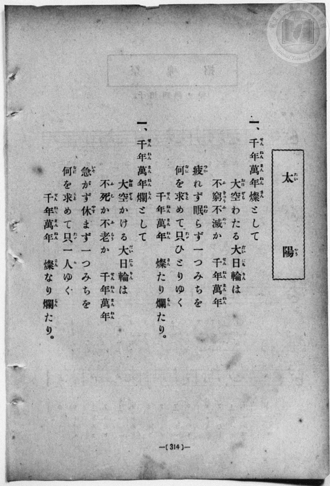
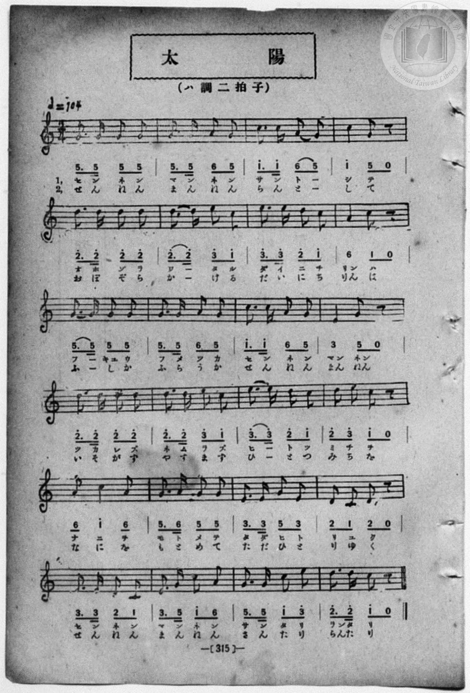

# 太陽

> Re:Shōka 使用 AI 協助辨識與重建樂譜，可能會有錯誤。歡迎回報。

- **鋼琴伴奏版**：<br><audio controls src="taiyo.mp3"></audio>
- **NEUTRINO 歌聲合成版**：<br><audio controls src="taiyo_neutrino.mp3"></audio>

- book: 新編 小學校・公學校 唱歌教材集（尋常科五・六學年用）
- 一條慎三郎 編《新編 小學校・公學校 唱歌教材集》（大正十二年十二月，索書號 0725-41）

## 說明

> [!NOTE]
> **原書資訊與歌詞全文**（對應 `P322.jpg`–`P323.jpg`，原書 p. 314–315，尋常科五・六學年第 41 首）：
> - **調性與拍號**：ハ調二拍子（C 大調 2/4 拍），♩= 104
> - **同名異曲辨正**：本曲歌頌橫渡長空、不窮不滅的大日輪（「千年萬年燦として」），與公學校手抄《唱歌帳》（`docs/shokacho/vol_01/p107_taiyo`）抄自《大正幼年唱歌 第十二集》之俄羅斯曲調〈太陽〉（「オヒガデルト　アカルクナルヨ」，變ロ調短調）為完全不同的同名異曲。
>
> **一、**
> 千年萬年（せんねんまんねん）燦（さん）として
> 大空（おほぞら）わたる大日輪（だいにちりん）は
> 不窮（ふきゆう）不滅（ふめつ）か　千年萬年（せんねんまんねん）
> 疲（つか）れず眠（ねむ）らず一（ひと）つみちを
> 何（なに）を求（もと）めて只（たゞ）ひとりゆく
> 千年萬年（せんねんまんねん）　燦（さん）たり爛（らん）たり。
>
> **二、**
> 千年萬年（せんねんまんねん）爛（らん）として
> 大空（おほぞら）かける大日輪（だいにちりん）は
> 不死（ふし）か不老（ふらう）か　千年萬年（せんねんまんねん）
> 急（いそ）がず休（やす）まず一（ひと）つみちを
> 何（なに）を求（もと）めて只一人（たゞひとり）ゆく
> 千年萬年（せんねんまんねん）　燦（さん）なり爛（らん）たり。


## 歌詞

```text
（TMD 檔案未包含歌詞註解）
```

## ABC

<div class="abc-score" data-abc-src="taiyo.abc" aria-label="五線譜載入中"></div>

[下載 ABC 原始檔](taiyo.abc)

## TMD 檔案連結

- [主旋律 TMD 檔案](taiyo.tmd) [[在 TMD Studio 編輯](https://tmdlang.github.io/Tmd-TS/#tmd=s7IKdvYPcrWy4qpTUCpJTLdSSM7PyUlNLsnMz7MqzsjPTozPrsyvSsyML84ojTe0NDJWgqssy88pzU21Si9KTEmNN403Q8gU55cWJadaFSdn5OfnxJekVpQk5edno8vHFySmp1oFGBsZIWQKivLLUvMS84C6C4oy80pSU8DaEQpSyzJTUkHSxcmJefFlqUWZaZmpKUiOSi0qBrsdYkVJUWJecXJRZgHIQwhV-UUlGflAhxdkVFplZBaX5BdlJifmxGcn5iUiFJVkpAK9l5dYUlqUiqw1Mz0zzyo3NTMrE4vXoNIliZnA0AMGWn55YnxuYmZeTmIe0JVaWgpPl6x6OXOvgpYWl6KtgqGBCZe9rYIzl42RvokdyBCQaVYKz6ZteL59hcLTDf1P1-54tmDh4-bdT1vXQNgKT6dsfLa259nUmc_mTng5u-39no6nG7qf7tjxfPnEJ7umgJWuBSp9unPL8ykr3u_pBDvuyY6GZ4vmPmvte7Kj82VznwLQ-McNXaTY87ihG2TVkuXP1i5-2tv4ZFcP0AYI49mcjvd7ep5vWfRs9o4XM-crGJgbmeqaGILt5tLXUrClFuBSUFCwU4hW9PMPcY2FcLS0nvbNB9m7uf3Fiq4XHe1AN79YOe9p64pn09q1tMCh0_usvVMhAZTS9LIK0hMeNUwGcYzBHKDDIQYoFOgpGBuaACWNDU1BorgCdc0aBRNDhZfLpgH9937PLIgzdIEOebFq_7OG5SAndPcCgwFk-azHzf1AYVAYdfc-XTsB6BxnYBJYDhRTAEa5AlAUbErPo5krIckBbtrTCT1PJ_Q-n7rh2exNL_atAIY62MBnc9YABYCefLmg59nK1c92LHw5dfvzlbseNzQ-2dH7fNU6IPlsd-vzWS2gqJq-9MWeVUBLHzf0PO1tBrr-xYQ1ID-0L3vcuOJx4_THjcseN0CdAHQ4PPKfdXY_62oBphBIIni6YzMk-hNS8pOL9cEFAzBz6wOLgHgDQ_0CQwPzeGCSr8wHBmcnUOOL9lUgvZC0snMPKKGAzVEABh4kyUAS1JOd3U_2tzzf1_ps2nqQN1ftf9wATGKgHPK4AegmkLsfN6163DzpcdOax83tj5tXP24GCjY8blr0uAnIXv24af3j5i6wODBBA33S82IdkLsWaNTz-SAS6KDnTbuerusBpghg0ABDFRQ0SGH7uKEJHOiw5ATMKcCwBOZPMB851EDuaZz9uGny48a1YHIfnA2ypX0ZWMFUCBcevlBzliwHRhJYQdfjxt2PG-c9bgJ6sPNxU__jxvmPm7pRYqtxwePGlseNqx83Lnzc1AUzcD3EKEg0g5VtfdzY-7ip7XEjsBTohEQ8VLyp8XHjErCubmBwEe8LiBXPp20CK1sC1A52ZM_jxlnP5ywACwJVNoAFgYbPAoYWWHAT0L9g64Ba9oOdPQnq2r1TwQpWAb0D1jXp2cYmkEhTE1QLyKnLnvZDPA4Minlgc0AGgv0O9F0_qXEB9DJGdABN7nreMRtsNdBShCBGAtjVQ14CQDecuAQAjKDGiaQmgGdrd8MSwHSIIUDBFw2NsNgHioCSBHmx_6xhKVgZ0AFzwYaAYv_Jnolg3wEFZ4IF91E39oFGPdkFCR9QGoAnALAaaqWBVQTSAOU1FBQoaOlzcYWASkSrgMzEvHyHGoOaapANCjaGZlrgpKaArWIEFZDAkHixsEdBwwRULz9f36CjAKusNLFoAFoEMqxGwRRYa-gCSRANwggRM7iIYRxYCEhhiEG4BiAhsIE-hjUKj5t2g2UeN28G4l4oC6TpcfM8XDJNW5FkOqBmg8S3Q9mPm9uAZDzCJiOgbONsiFzTZCB7LZQF1te4D5dMUyeSzAqETY3TYTY1LoPbhD_Id_WQE-RGkKADUmAWmEAWNQaxwOFbA2HrgiiwPFQUFA3QGMEM_FXQ4JoNZIMC4XHzSmjgr4d5sGk_WHw1VLwBKroEyO4GyzRCZYB1KCh-IAb2Ywn_LmiI7QZiUNxCQhckAzIIIjcRLA7ig8QXQEVbgBjkAGC-h8YLqMCCawK5lZgo2NFJz1RvDHUflkTfPBUeumsfN4NS0OMmEImQety8EIhbwDLQoMeXU5CDvhfCQQ99SJ4BBRco7ULCHCEOigtggY4igye_IIc-qDAkLgKezp49MHkAzEYoQ48NUDBDAvpx8xowaxc0YEHBDArTBdCcgZCZBA9vUAEEMQMkPh_MA-WJx82bsEQD1K7GuUDcA2bNgkYvTGYmtECCyzSCzIHIgYogYBUIFQfnTHCWANZ6xEUBsKdBThSAUjW8FAdxYJnADClbQBK8MZgHYgPDHaQNFElYAh1UGkCKEEgwgjwJEl8ED1ZQHoCV5aAAAnkXxG-ABj8k6MFFD5gHyUeIwgAR6GB5cAkCiWiQbpCJTfBgBTYSwCxoLmwERSOID4x4cPBDgh5c8oBNgOQURCmHP923riUn0GHhCQtFmIgpJCqQowEqBE7iyFkDa6FPYY0LrRBAYQrSsxJW9oAkIMJUqHgbocUgWAYcfeCAB1fJsMIHFEsQYYiFtVxcunYK4CaRAjJDmQsA)]
- [鋼琴伴奏 TMD 檔案](taiyo_piano.tmd) [[在 TMD Studio 編輯](https://tmdlang.github.io/Tmd-TS/#tmd=s7IKdvYPcrWy4qpTUCpJTLdSSM7PyUlNLsnMz7MqzsjPTozPrsyvSsyML84ojTe0NDJWgqssy88pzU21Si9KTEmNN403Q8gU55cWJadaFSdn5OfnxJekVpQk5edno8vHFySmp1oFGBsZIWQKivLLUvMS84C6C4oy80pSU8DaEQpSyzJTUkHSxcmJefFlqUWZaZmpKUiOSi0qBrsdYkVJUWJecXJRZgHIQwhV-UUlGflAhxdkVFplZBaX5BdlJifmxGcn5iUiFCUWATWnp-am5pVYFWQm5uXHJyYn5-cWJOZlgsQQCksygIqs8hJLSotSlbi0tBSeLln1cube93s6Xs6e-ayz-2X3nucTtjzZs-Xp0v73ezoVtLS4FG0VDA1MuOxtFZy5bIz0TexAhoECyUrh2bQNz7evUHi6of_p2h3PFix83Lz7aesaCFvh6ZSNz9b2PJs689ncCS9ntwGteLqh--mOHc-XT3yyawpY6Vqg0qc7tzyfsgJoF9iRT3Y0PFs091lr35MdnS-b-xSAxj9u6CLFnscN3SCrlix_tnbx097GJ7t6gDZAGM_mdLzf0_N8y6Jns3e8mDlfwcDcyFTXxBBsN5dnXklRvlUAKPCCPBxqDGqquRSAwMbQTMsOzKpRMFbQBUJjBSMgaQjEMBFTBcM4IGUGFjJFFjIGETUKRiBKF0SBRQ1Agly1KHb6INtpAbfSMF4h2jBWwTQeQsMFTICUCYgPk0GoALNM42NBSg0g9oQkZlYS8BvM2SAahBEiIG9BRMCOB3o9DlMMwoV4DGSgj2GNwuOm3WCZx82bgbgXygJpetw8D5dM01YkmQ6o2SDx7VD24-Y2IBmPsMkIKNs4GyLXNBnIXgtlgfU17sMl09SJJLMCYVPjdJhNjcvgNkFDCRGRYBaYQBYFxzc4SIBpAyIKpMDyUFFQyEEDETO8VkF9OBvIBrn7cfNKaHith7mpaT9YfDVUvAEqugTI7gbLNEJlVkGCFGJgP5Yg64J6cjcQg6IDEiAgGZBBELmJYHEQHyS-ACraAsQgBzxuXAgNyi5IqEKkQW5FCTVy0xYkd2FNWs1T4QGy9nEzKJ4eN4FIhNTj5oVA3AKWgYYWvvSIHFq9EA56gEFSJsiHoBQCCSaEOCj4HjeC0iZCBk-qRA6wtRAOlVMamI1Qhh6AoJCBhM3j5jVg1i5oWIBCBhQMC6DpDyEzCR5EoJwJMQMkPh_MA6W8x82bsIQc1K7GuUDcA2bNgsYITGYmNKfCZRpB5kDkQHnzceMSqDg4_YMT3uMmkHtQQg2UduAlEnJ5bIaU-GDFOIgHYgODCqQNFK5YwgmUTSB5C-JzkLtA4ovgIQFKabByCeQnkAtB_AZoiEFCC5wnwTxIakXkEkQ4geXBWQsSNyDdIBOb4CHxuAkcyuCSCaQDFPIgPjCuwCEGCS1wlgSbAEmPiOxPk5qMagU-tHADBQNIz0pYpgRJQISpUO43QssHsAw4xMFhBa4RYLkSFLAQYYiFqHUoiXU11sobXQGopoaWlrD6G85ArdNxmA1tEUAr_cHgIvSGCMQwqDvhDRjCbkSxnrDnSGsa6dopgFthCkAGOIqjfYBKERwjMEeZCwA)]

## 分析

```text
================================================================================
📊 TMD Song Profile: [ 太陽 ]
================================================================================
⏱  Duration:       0:55 (55.4s), 48 measures total
🎼 Key & Tempo:    首調基準 C, != 104.0 BPM, <2/4>
   - 分析範圍：      由實際發聲的音符與和弦推測調性；播放脈絡另行呈現
🎤 人聲音域:    C4 (MIDI 60) – E5 (MIDI 76) [跨度: 16 個半音 / 1.3 個八度, 難度: moderate]
   - 最低音:  C4 in [Taiyo #1 @ m.20, 0:22]
   - 最高音: E5 in [Taiyo #1 @ m.6, 0:06]
   - 適合: soprano, mezzo-soprano, contralto, tenor, baritone, bass
🏛  結構:      Taiyo (27.7s) -> Taiyo (27.7s)
⚡ 編曲密度:        Peak 1 軌道同時演奏
🗝  調性診斷：       G 大調（純淨自然大調，未偵測到可信轉調）
   - 風格氣質:    純淨自然大調（陽光明朗、易唱易記，無明顯調外色彩）
   - 轉調歷程:    全曲維持單一推測調性（未偵測到可信轉調）
   - 核心骨幹音:  G, D, C, E, A
   - 調性數值:    G 大調 [相關度: 0.84, 穩定度: Moderate, 自然音純度: 100.0%]
   - 候選調性 (K-S): G 大調 (0.84), C 大調 (0.79), E 小調 (0.62)
   - 五度圈歷程:   +1 -> +1
   - 各段落調性細節:
     • [Taiyo #1]: G 大調 (r: 0.84, 自然音純度: 100.0%)
     • [Taiyo #2]: G 大調 (r: 0.84, 自然音純度: 100.0%)

  [ 五度圈游移軌跡 ]
               C  
         F           [G ]*
      Bb               D  
      Eb               A  
         Ab           E  
            Db       B  
               F# 
     (* = active key center)

  [ 十二半音累積音高分佈 ]
     C  : ██████████████████        21.1%
     C# :                            0.0%
     D  : ███████████████████       22.2%
     D# :                            0.0%
     E  : ████████████████          18.3%
     F  :                            0.0%
     F# :                            0.0%
     G  : ████████████████████████  27.8%
     G# :                            0.0%
     A  : █████████                 10.6%
     A# :                            0.0%
     B  :                            0.0%
--------------------------------------------------------------------------------
Assignment 軌道音域：
  - Piano         : C4 – E5 (16 個半音 / 1.3 個八度, 172 個音符)
================================================================================
```


## 原書掃描頁






