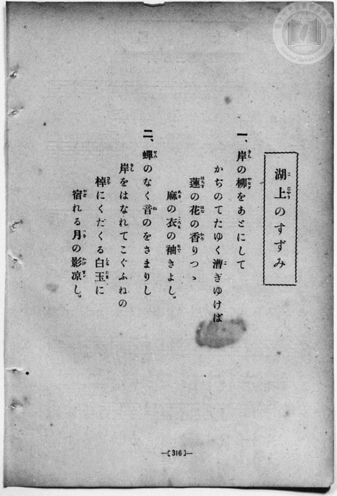
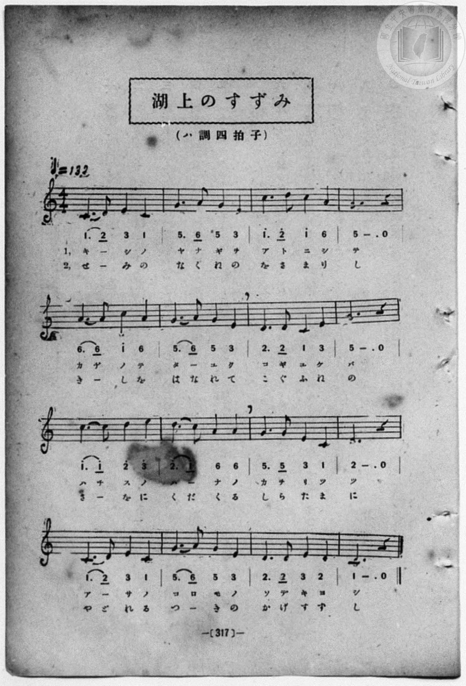

# 湖上のすずみ

> Re:Shōka 使用 AI 協助辨識與重建樂譜，可能會有錯誤。歡迎回報。

- **鋼琴伴奏版**：<br><audio controls src="kojo_no_suzumi.mp3"></audio>
- **NEUTRINO 歌聲合成版**：<br><audio controls src="kojo_no_suzumi_neutrino.mp3"></audio>

- book: 新編 小學校・公學校 唱歌教材集（尋常科五・六學年用）
- 一條慎三郎 編《新編 小學校・公學校 唱歌教材集》（大正十二年十二月，索書號 0725-41）

## 說明

> [!NOTE]
> **原書資訊與歌詞全文**（對應 `P324.jpg`–`P325.jpg`，原書 p. 316–317，尋常科五・六學年第 42 首）：
> - **調性與拍號**：ハ調四拍子（C 大調 4/4 拍），♩= 132
> - **原頁油墨污損說明**：`P325.jpg` 第三行第 2 小節（全曲第 10 小節）前兩拍遭墨漬遮蔽，然五線譜高音譜表第四線（D5，`2^`）附點四分音符與第三間（C5，`1^`）八分音符連音清晰可辨，簡譜亦可見 `2.` 與連音線，對應第一節「はー（なの）」與第二節「くだ（くる）」。
>
> **一、**
> 岸（きし）の柳（やなぎ）をあとにしつ
> かぢのてたゆく漕（こ）ぎゆけば
> 蓮（はちす）の花（はな）の香（かを）りつゝ
> 麻（あさ）の衣（ころも）の袖（そで）きよし。
>
> **二、**
> 蟬（せみ）のなく音（ね）のをさまりし
> 岸（きし）をはなれてこぐふねの
> 棹（さを）にくだくる白玉（しらたま）に
> 宿（やど）れる月（つき）の影（かげ）涼（すゞ）し。
>
> （註：P324 第一節首句印作「あとにしつ」，P325 譜下配字作「アトニシテ」，此處譜內 L1 依譜下實際配字記之。）


## 歌詞

```text
（TMD 檔案未包含歌詞註解）
```

## ABC

<div class="abc-score" data-abc-src="kojo_no_suzumi.abc" aria-label="五線譜載入中"></div>

[下載 ABC 原始檔](kojo_no_suzumi.abc)

## TMD 檔案連結

- [主旋律 TMD 檔案](kojo_no_suzumi.tmd) [[在 TMD Studio 編輯](https://tmdlang.github.io/Tmd-TS/#tmd=s7IKdvYPcrWy4qpTUCpJTLdSSM7PyUlNLsnMz7MqzsjPTozPrsyvSsyML84ojTe0NDJWgqssy88pzU21Si9KTEmNN403Q8gU55cWJadaFSdn5OfnxJekVpQk5edno8vHFySmp1oFGBuZIGQKivLLUvMS84C6C4oy80pSU8DaEQpSyzJTUkHSxcmJefFlqUWZaZmpKUiOSi0qBrsdYkVJUWJecXJRZgHIQwhV-UUlGflAhxdkVFplZBaX5BdlJifmxGcn5iUiFJVkpAK9l5dYUlqUii5anJpYjGpgZnpmnlVpHsh1JVA3aWkpPNs57cmOrseN6x43znzcOOtx434FLS0uRVsFQ2MjLntbBWcuGxN9EzuQOaAgslJ4Nm3D8-0rFJ5u6H-6dsezBQsfN-9-2roGwlZ4OmXjs7U9z6bOfDZ3wsvZbe_3dDzd0P10x47nyyc-2TUFrHQtUOnTnVueT1nxfk8n2H1PdjQ8WzT3WWvfkx2dL5v7FIDGP27oIsWexw3dIKuWLH-2dvHT3sYnu3qANkAYz-Z0vN_T83zLomezd7yYOV_BwNzIVNfEEGw3l76Wgi21AJeCgoKdQrSin3-IayyEo6X1tG8-yN7N7S9WdL3oaAe6-cXKeU9bVzyb1q6lBQ6d3mftnQoJoDSml1WQnvCoYTKIYwrmAB0OMUChQE_B2NAMKGlsaA4SxRWoa9YomBgpvFw2Dei_93tmQZyhC3TIi1X7nzUsBzmhuxcYDCDLZz1u7gcKP509Gyj2dO0EoHOcFYBhCBRTAEa5AlAUbErPo5krIckBbhrQVS8XND7btPPpohXPNi58NqH3xapVz2b0gY1FuF8B6B5gnL5Y2ANymBEoLp-vbwB5GxgCszeBBA0N4KKdTzt7n7auBFr7snEtyOA9a142rnsxZS8o_lq2Ab36fPusF2vnvFw94-X8zUDGi4UrgEYA3Q8UBxrqYgpUmGAUBwy2zpczW17ungeUetrRBlT8fM0yoNchrnk5bTLIp2DFhmDFT1tXw5W9bFgMZDzb0fps5oan_etf7AOm0p7nGxYCrXuyaxlIZFm3QoKRXoIC0ECIYrDtwCgBxSTYigagdx439DxuXP-4eQ_QrseNq4D5C2jR44ZeqDN29cDU9D9uXABW0_-4CZiIQWoeNzSBgxqWiIAmPm5oBOZKMP_pph1g9b2PG6eD1DeuezZ_M0ikqQVsUR9IsGnS48amx40rHjeuBip73LgEovdxY_fjxkXgzL7sceP8x01tQHuf7ZkKNhAYLEDT-sCCEx83boBoeTEZ6HKg7PrHjQuBRQTExhddG2GCqyAiL5cBpYAi3UCrwQ4AFilLHjfNhRjyctdusCzQSUC7wCYsXAyx9HFT7-OmJqjgImC6BQrOfdy4HCwClAJyp2MEyK4epAB5MX8NWNdsYNkFMQccDv3AqAGLr4UKgsJk6uPGfWC3TccemCA1IE89bgJGDTCIJj9unPC4cSvQEKAJEC3PFu8Ea5kK9SkohEGRCInB5zP3Pu8DZhqws5uAsvOBNkKUQW1cB3QkJLJWgm3sAeoCF1JALUuALoG49uleSAgD4wtky7NtkIQ083HTPLACtDABSr5YAQzjWaCCBJLtQKkQWBA87V_6tHfDk71zwKkNJU0Akxow4YJyqwIoee_oftkKLAemQ9U2LXrc3PG4GRih2x83A0tYkNpna5e8mDkVqPhp63IFH0OFJ_vmQnQ-Xb_s5azZEP0vVsx4srMb6D6gQ0Guo7xohQIFLX0uLu_8rHy__ODSqtLcTKuAzMS8fIcagxqFapBNCjYWWuAAUcBWsEODBVgaKWiYQEsdHQVYYaWJRQPQPpBhNQqGwFJPF1iAGQNJELtGwRQsYgamQaJANXEQRXEQlhmSMgg0AImADfQxrFF43LQWKg4MYBAJrPhAOh43L4GINncBZdaBWZsgMk2LoDIdQNwN1wnS04ZkTzzCHiOgXONsmD3Aqh1EgswEia-CivYDMcgtcJmmSVCZqUC8D2xPF1TPdAx78Af3rh5yghsUdqAQxAhI5PA2gsYJKD4gIvgCezU06JqgAQ0JMpAMKFAgcsvAXl0PFd8MjZx1cJmN0MCegCewe-GBDQoqSFCCxEGmgkRXAcV6wCyQmSCZyVCZCUC8FcwCRQZIBhQdpAQ2uKYlPW1D0i2QAiZdYFCCCGDowkVB4Y8cB6ZIuQASB1hDvLkfGqqNQB_vBLNgCRwiA0niSOLwONoExKDE-bi5BaoDROMK8akw08BhDSzcoKEHtb9xAZQNLGahMpBEDCydgez5YDWgRA6SgbiA6BAHti9oVZrAUjeIB2LDdGFP3ZCCAeQncAqChyg0DTevBWKQGoTMXqhMO7Qgety8AioDKlJwhHUTJB6ANRcsFcPDFFJogeRAOQBRyIDkQfxJQDwTzJqFEgvI9tRycenaKSAX8ApY-MpcAA)]
- [鋼琴伴奏 TMD 檔案](kojo_no_suzumi_piano.tmd) [[在 TMD Studio 編輯](https://tmdlang.github.io/Tmd-TS/#tmd=s7IKdvYPcrWy4qpTUCpJTLdSSM7PyUlNLsnMz7MqzsjPTozPrsyvSsyML84ojTe0NDJWgqssy88pzU21Si9KTEmNN403Q8gU55cWJadaFSdn5OfnxJekVpQk5edno8vHFySmp1oFGBuZIGQKivLLUvMS84C6C4oy80pSU8DaEQpSyzJTUkHSxcmJefFlqUWZaZmpKUiOSi0qBrsdYkVJUWJecXJRZgHIQwhV-UUlGflAhxdkVFplZBaX5BdlJifmxGcn5iUiFCUWATWnp-am5pVYFWQm5uXHJyYn5-cWJOZlgsQQCksygIqs8hJLSotS0UWLUxOLQTZraSk82zntyY6ux43rHjfOfNw463Hj_vd7Ol7Onvmss_tl957nE7Y82bPl6dL-93s6FbS0uBRtFQyNjbjsbRWcuWxM9E3sQAaDgtFK4dm0Dc-3r1B4uqH_6dodzxYsfNy8-2nrGghb4emUjc_W9jybOvPZ3AkvZ7cBrXi6ofvpjh3Pl098smsKWOlaoNKnO7c8n7ICaBfYwU92NDxbNPdZa9-THZ0vm_sUgMY_bugixZ7HDd0gq5Ysf7Z28dPexie7eoA2QBjP5nS839PzfMuiZ7N3vJg5X8HA3MhU18QQbDeXZ15JUb5VACh4gzwcagxqFKq5FIDAxkLLDsyoUTBU0AVCIwVjIAli1yiYgkXMwDRItAYoi1ADYsN0QaABSISrFsU2HxTbTBC2xStEG8YqmMZDaCwCYJZpPFQIxIArAlIGEJu887Py_fKDS6tKczMp955hHERRHIRlhqQM2YcgA30MaxQeN62Fij9u2g4igVEK0vG4eQlEtLkLKLMOzNoEkWlaBJXpAOJuuE6QnjYke-IR9hgB5Rpnw-xp3A8mQWaCxFdBRfuBGOQWuEzTJKjMVCDeB7anC6pnOoY90BACeRfkaQy_Y0sBoCCEiOALn9VQ3zZBwwbiS5AMyB8QuWVg162Him-Ghuc6uMxGaPhMwBM-vfDwAfkO4nuQOMhUkOgqoFgPmAUyEyQzGSozAYi3glmg8APJgEIQa_hAUweQAiYQoO9BBDBA4KKgIEMONlOktAYJNqyB1NwPDYhGoCN3glmwZASRgSQkJHF4sG4CYlASeNzcAtUBonEF0lSYaeDgedwIMgUkDrW_cQGU_bgJlDARSeVxUyeQPR-sBpSUQDIQF2ALJLAQ5aUIIg1BcgzIGeB4ggcCNKU0rwVikBqEzF6oTDs0hz5uXgGVAeU1HMHTBAm6x40rYWkFHgyQ3AySA6UzRO4DyYP4k4B4Jpg1CyXgkO3BWlaRXziaABkmsTAKRQGoZIQYg0cRWhELlUErdBEmEWs_yeaQV-rr2imAqxgFIAM5VKN9gMowxIzAYspcAA)]

## 分析

```text
================================================================================
📊 TMD Song Profile: [ 湖上のすずみ ]
================================================================================
⏱  Duration:       0:58 (58.2s), 32 measures total
🎼 Key & Tempo:    首調基準 C, != 132.0 BPM, <4/4>
   - 分析範圍：      由實際發聲的音符與和弦推測調性；播放脈絡另行呈現
🎤 人聲音域:    C4 (MIDI 60) – E5 (MIDI 76) [跨度: 16 個半音 / 1.3 個八度, 難度: moderate]
   - 最低音:  C4 in [KojoNoSuzumi #1 @ m.1, 0:00]
   - 最高音: E5 in [KojoNoSuzumi #1 @ m.9, 0:15]
   - 適合: soprano, mezzo-soprano, contralto, tenor, baritone, bass
🏛  結構:      KojoNoSuzumi (29.1s) -> KojoNoSuzumi (29.1s)
⚡ 編曲密度:        Peak 1 軌道同時演奏
🗝  調性診斷：       C 大調（純淨自然大調，未偵測到可信轉調）
   - 風格氣質:    純淨自然大調（陽光明朗、易唱易記，無明顯調外色彩）
   - 轉調歷程:    全曲維持單一推測調性（未偵測到可信轉調）
   - 核心骨幹音:  C, G, D, E, A
   - 調性數值:    C 大調 [相關度: 0.85, 穩定度: Moderate, 自然音純度: 100.0%]
   - 候選調性 (K-S): C 大調 (0.85), G 大調 (0.80), E 小調 (0.55)
   - 五度圈歷程:   +0 -> +0
   - 各段落調性細節:
     • [KojoNoSuzumi #1]: C 大調 (r: 0.85, 自然音純度: 100.0%)
     • [KojoNoSuzumi #2]: C 大調 (r: 0.85, 自然音純度: 100.0%)

  [ 五度圈游移軌跡 ]
              [C ]*
         F            G  
      Bb               D  
      Eb               A  
         Ab           E  
            Db       B  
               F# 
     (* = active key center)

  [ 十二半音累積音高分佈 ]
     C  : ████████████████████████  26.7%
     C# :                            0.0%
     D  : ██████████████████        20.0%
     D# :                            0.0%
     E  : ██████████████            15.0%
     F  :                            0.0%
     F# :                            0.0%
     G  : ███████████████████████   25.8%
     G# :                            0.0%
     A  : ███████████               12.5%
     A# :                            0.0%
     B  :                            0.0%
--------------------------------------------------------------------------------
Assignment 軌道音域：
  - Piano         : C4 – E5 (16 個半音 / 1.3 個八度, 104 個音符)
================================================================================
```


## 原書掃描頁






