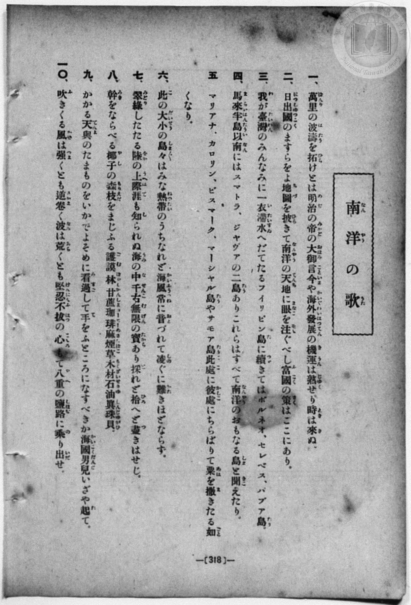
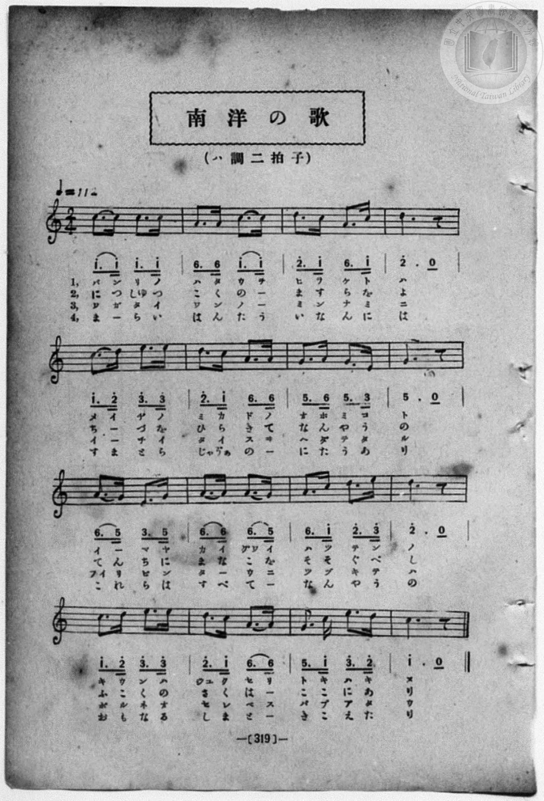

# 南洋の歌

> Re:Shōka 使用 AI 協助辨識與重建樂譜，可能會有錯誤。歡迎回報。

<audio controls src="nanyo_no_uta.mp3"></audio>

- book: 新編 小學校・公學校 唱歌教材集（尋常科五・六學年用）
- 一條慎三郎 編《新編 小學校・公學校 唱歌教材集》（大正十二年十二月，索書號 0725-41）
- 日治時期公學校《唱歌帳》（典藏號 2020.006.0843・P207）
- 原載《小公唱材集》第 319 頁（昭和 2 年 1 月 29 日抄）

## 說明

> [!NOTE]
> **原書資訊與歌詞全文**（對應 `P326.jpg`–`P327.jpg`，原書 p. 318–319，尋常科五・六學年第 43 首）：
> - **調性與拍號**：ハ調二拍子（C 大調 2/4 拍），♩= 112
> - **比較校勘**：與公學校手抄《唱歌帳》（`docs/shokacho/vol_01/p207_nanyo_no_uta`）旋律、調性、拍號完全吻合。原譜 `P327.jpg` 譜下印有第 1～4 節配字（`L1:`～`L4:`），`P326.jpg` 印有全十節歌詞。
>
> **一、**
> 萬里（ばんり）の波濤（はたう）を拓（ひら）くとは明治（めいぢ）の帝（みかど）の大御言（おほみこと）今（いま）や海外發展（かいぐわいはつてん）の機運（きうん）は熟（じゆく）せり時（とき）は來（き）ぬ。
>
> **二、**
> 日出國（につしゆつこく）のますらをよ地圖（ちづ）を披（ひら）きて南洋（なんやう）の天地（てんち）に眼（まなこ）を注（そゝ）ぐべし富國（ふこく）の策（さく）はここにあり。
>
> **三、**
> 我（わ）が臺灣（たいわん）のみんなみに一衣帶水（いちいたいすゐ）へだてたるフイリツピン島（たう）に續（つゞ）きてはボルネオ、セレベス、パプア島（たう）。
>
> **四、**
> 馬來半島（まらいはんたう）以南（いなん）にはスマトラ、ジヤヴアの二島（たう）ありこれらはすべて南洋（なんやう）のおもなる島（しま）と聞（きこ）えたり。
>
> **五、**
> マリアナ、カロリン、ビスマーク、マーシヤル島（たう）やサモア島（たう）此處（こゝ）に彼處（かしこ）にちらばりて粟（あは）を撒（ま）きたる如（ごと）くなり。
>
> **六、**
> 此（こ）の大小（だいせう）の島々（しまじま）はみな熱帶（ねつたい）のうちなれど海風（かいふう）常（つね）に音（おと）づれて凌（しの）ぐに難（かた）きほどならず。
>
> **七、**
> 翠綠（みどり）したたる陸（をか）の上（うへ）際涯（はて）も知（し）られぬ海（うみ）の中（なか）千古無限（せんこむげん）の寶（たから）あり採（と）れど拾（ひろ）へど盡（つ）きはせじ。
>
> **八、**
> 幹（みき）をならべる椰子（やし）の森（もり）枝（えだ）をまじふる護謨（ごむ）の林（はやし）甘蔗（かんしよ）珈琲（コーヒー）麻（あさ）煙草（たばこ）木材（もくざい）石油（せきゆ）眞珠貝（しんじゆがひ）。
>
> **九、**
> かかる天與（てんよ）のたまものをいかでよそめに看過（みすご）して手（て）をふところになすべきか海國男兒（かいこくだんじ）いざや起（た）て。
>
> **一〇、**
> 吹（ふ）きくる風（かぜ）は強（つよ）くとも逆卷（さかま）く波（なみ）は荒（あら）くとも堅忍不拔（けんにんふばつ）の心（こゝろ）もて八重（やへ）の鹽路（しほぢ）に乘（の）り出（いだ）せ。


## 歌詞

```text
（TMD 檔案未包含歌詞註解）
```

## ABC

```abc
X:1
T:南洋の歌
M:2/4
L:1/16
Q:1/4=112
K:C
V:V1 name="Piano" snm="Pia"
[V:V1]
c3 c c3 c | A3 A c3 c | d3 c A3 c | d4 z4 |
w: バ ン リ ノ | ハ タ ウ ヲ | ヒ ラ ク ト | ハ
c3 d e3 e | d3 c A3 A | G3 A G3 E | G4 z4 |
w: メ イ ヂ ノ | ミ カ ド ノ | オ ホ ミ コ | ト
A3 G E3 G | A3 A A3 G | A3 c d3 e | d4 z4 |
w: イ _ マ ヤ | カ イ グワ イ | ハ ツ テ ン | ノ
c3 d e3 e | d3 c A3 A | G3 c e3 d | c4 z4 |
w: キ ウ ン ハ | ジユ ク セ リ | ト キ ハ キ | ヌ
c3 c c3 c | A3 A c3 c | d3 c A3 c | d4 z4 |
w: に つ しゆ つ | こ く の _ | ま す ら を | よ
c3 d e3 e | d3 c A3 A | G3 A G3 E | G4 z4 |
w: ち _ づ を | ひ ら き て | な ん や う | の
A3 G E3 G | A3 A A3 G | A3 c d3 e | d4 z4 |
w: て ん ち に | ま な こ を | そ そ ぐ べ | し
c3 d e3 e | d3 c A3 A | G3 c e3 d | c4 z4 |
w: ふ こ く の | さ く は _ | こ こ に あ | り
c3 c c3 c | A3 A c3 c | d3 c A3 c | d4 z4 |
w: ワ ガ タ イ | ワ ン ノ _ | ミ ン ナ ミ | ニ
c3 d e3 e | d3 c A3 A | G3 A G3 E | G4 z4 |
w: イ チ イ タ | イ ス ヰ _ | へ ダ テ タ | ル
A3 G E3 G | A3 A A3 G | A3 c d3 e | d4 z4 |
w: フイ リ ツ ピ | ン タ ウ ニ | ツ ヅ キ テ | ハ
c3 d e3 e | d3 c A3 A | G3 c e3 d | c4 z4 |
w: ボ ル ネ オ | セ レ ベ ス | パ プ ア タ | ウ
c3 c c3 c | A3 A c3 c | d3 c A3 c | d4 z4 |
w: ま _ ら い | は ん た う | い な ん に | は
c3 d e3 e | d3 c A3 A | G3 A G3 E | G4 z4 |
w: す ま と ら | じや ヴあ の _ | に た う あ | り
A3 G E3 G | A3 A A3 G | A3 c d3 e | d4 z4 |
w: こ れ ら は | す べ て _ | な ん や う | の
c3 d e3 e | d3 c A3 A | G3 c e3 d | c4 z4 |
w: お も な る | し ま と _ | き こ え た | り
```

## TMD 檔案連結

- [主旋律 TMD 檔案](nanyo_no_uta.tmd) [[在 TMD Studio 編輯](https://tmdlang.github.io/Tmd-TS/#tmd=s7IKdvYPcrWy4qpTUCpJTLdSSM7PyUlNLsnMz7MqzsjPTozPrsyvSsyML84ojTe0NDJWgqssy88pzU21Si9KTEmNN403Q8gU55cWJadaFSdn5OfnxJekVpQk5edno8vHFySmp1oFGBsh6Swoyi9LzUvMA-ouKMrMK0lNAWtHKEgty0xJBUkXJyfmxZelFmWmZaamIDkqtagY7HaIFSVFiXnFyUWZBSAPIVTlF5Vk5AMdXpBRaZWRWVySX5SZnJgTn52Yl4hQVJKRCvJeKlShEpeWlsLT3unPtnQ_blz3bG2PgpYWl6KtgqGhEZe9rYIzl42RvokdSDfIs1YKz6ZteL59hcLTDf1P1-54tmDh4-bdT1vXQNgKT6dsBJrwbOrMZ3MnvJzd9n5Px9MN3U937Hi-fOKTXVPAStcClT7dueX5lBXv93SCXfVkR8OzRXOftfY92dH5srlPAWj844YuUux53NANsmrJ8mdrFz_tbXyyqwdoA4TxbE7H-z09z7csejZ7x4uZ8xUMzI1MdU0MYXY_m7702abdz2Y2PZszH2480HaIBU93bIYa3brjxfR-kH4jAyMDPQMDMz0DCxNjoJsCjAzMYYY97Zv_Yk8nSDfQ0UDDgGbAnPd8zRoFY0NLhZcLGoHGPZux9umkHgUjBaAzFQwVgG5UMLJUALmlqwVsGJe-loIttQCXgoKCnUK0op9_iGsshKOlBXQrKEQ2t79Y0fWiox3o2Rcr5z1tXfFsWruWFjjeep-1dyokgNKxXlZBesKjhskgjjmYAwxSiAEKBXpAf1kAJYG-A4niim6g_02MFV4umwb03_s9syDO0AU65MWq_c8aloOc0N0LDGCQ5bMeN_cDhUGx1937dO0EoHOcFYCxCxRTACZGBaAo2JSeRzNXQhIq3LRn66e82NMMjMOn3TPARgENhsfrs85uYABjxm5CSn5ysT64WABmbX1gARBvYKhfAIzZeGCercyPz8uPLy1JBPq689n07qf7uh83NEKcDWRAnP10XQ8w8J5O2P10QsfjhiZQSlg7Bxx6kABTAHKf7Oh-2rvh2ZxOUGAYvt87z0Th-fqGl61AL04HucLH0CoBKJrgYwKkwf5DhD4wh4J0guzobQTqgsQX0Caw12GRCsxJQBcB8y-Y_2LCmpftPUCTHzdueNw0-XFTF9BUUB7fvOjZ_iVg8fWPG-c_bgTm087HTZOedU8GC2563AS0HKiy_3HjCqCaZzP6gHkEJNXU-Lix5XHjIog5T3fMBavf_7gRWHSshAouWf5038IXKxrAUl2PG3eDFUwGGgVU8GQ30A1AcaAh-8CWtjzbuv3pkmnPZ-55unEqWApoFFB2wuMmoO1ABtCFSx43LgO6H-r4lfNfNoIi7XFjL9DlMPH1z9vmgwVnPG5qA7ocLDgb6GVg1gaLAz0CSjRAlU_2gcolGHcNRhju6kEKQ2CefNq-6-kciI2rwY6ZDrYCyAB6CmLROqB3HjfOBIYbMBgfN3U8nbPh6RxgSgdqWfi4cSk0eLtWowYv0P3LIAUvWHwVOI6AXgZHBygkVwLNAUuBvA80Ciy--vmcPWBBoI2rgG6AGr4ZGLxAwbmPm4CRAlQ24XHjTqBTn67vgTl-K7KDn6-FOG8qTAQYzkBZIAL6sQkYbphJC1iwIYKlYyI4PUD09rxo3_W8cTHYQGByagHFHSy-QLEPcjzQqcBksBqYQl8sXPx0x7ZnG7bAUgIwiIAkWCMoDIHZHahxx-PGBSCPA8Wbuh83T33ctORx86rHzS2Pm4EFy-anm7fBrIME1-rnuyBJfcnjpnnw4AX5q3nO4-bVj5t7HzetAvrgcdPux81rHjcDLdoJ4jZPfNwMjNBF6Aaief_p7NlI3n-5bA0wFT3t7YLp2geKekhyBXkWasiT3UuB8QvzJih-IU4FK9v5uHne4-aOx80rwa7a8bgZ6MEtQJcAAw1UgaF7EBwpwAhq6gHbBYyvmeAoxpeEQBmwqQks3g0zcDo06zWueNEIDChIPoI4DGwdlqgHFuUIv4OdDTRw0eNmoEqgy4FhuxYcNcDSFBieQAdAvLbncdN6sAiEvR3swdXo_gK6tmnr4-ZFmFHwbO2SFzMhZQLQTEiqXv107x6YILCgAPoFHqQLwcECLOiAobTs-SZIaQD0-3poBpk0CRJTsLQBSldPl0EKhymQ0glc4gG9hhECwGoMOfGvhRSe0BQOKvE2ADMCUASYYoGBPxuRhTdve9zQCg92UOkEdQAw-oDZYdXzto3AvABWsBZcpIByASzugIUMMGsA3dMDLF2B5eTLRZA8DikhgdkZZAuwtoUm-8a1kKB4OX8zrOyFeGop2IRlT6F1AdAl62BFxOqXsyHZFmgmMMQgIQMssVeC7QVyZ2GWA81IQfF8_4Ln2xbAaoGVsCoGaAXQI6AQfjkT7DxgqQgqtEH-erIDUgUAfQeU6nw5a_azbcA4glRGy8CR1fR8PrDMBDkVzAUioPvXAEMApnE_zCigl8HJHmz4097mp_1LnrcsfDkT1GQAl__gMq2p4XEjsFiGxdd6eDLrhhXFoMz1rA9YwIJqCrCl4DDvBkYWpMSGVBbAQmnl89kQZcA0AAkuoLOBMT4DM82sRgqopzt3wkIJbBQoQCAhvBMYSs-WbIA0c8CZF-xrYE23GBhNQBGQ20DZYR6ktgUlM5gJkBS1FWjCi7XbX6yBJI8pQP9CTZgHKXyApQ3U2OdTZryYAhEE-h0YOMCiD9g-7nze3_F8wiawdZtBubV5EpAExc4ucL0PykfATNf5vHXmi15giEFCbwMkCzybswLYzIU6FZSDpkHS8PP5m59tgvgaGD7A4heUXJ_Pmfe8f8GLTRC_AG0HugFSZQMDHOgAjIL3yc65yIUPKKECXd4NrByBLTtE5Qj2BTjXAB0GLI2BLlkHDiKgx4FalgMVgCtHYAMGWIF2v2zsg0UHsBSdAku0y4AtRIiZsBAG5jJgywFoPjCigYUMMKVBSl0gtxvUdJnT_XzK9qetkLIFkjFBlSyoKAB7DWwyUHAaMApeQBMwJKMtw9p4a0dOMxMgobcVltKAtWo3UiEwB1KSPN0DMRZY8UECAdxsa2p62QCsoSBSwFoeqB5S8vQDm3-wXAPJR-tf9ELcD0xpSA2_pqanC1qf7u99sqP3WTcwiIAKJoI9tRpMAkMGmAAguWDd0_3N8IIamllAUbAMmAletgO5kIQNyu9AxS937n2xHZLlgWEOLG0g7cnVT3YCgwsoCC6dmrqA7S5Y1QlO8MBUBAkxyntEUKCgpc_F5Qdq4fvlh5YkWgVkJublO9QY1ChUg-xRsDE00wJHjwK27pgCsBkPbs70KGiYgPqpwGa5jgKsxa-JRQPQOpBhNQqGccDOii6IQrBqFMzATDMUMSM4GyKLLKirYACla8Dm-hjWAGvnCWARYG0MxKug7D6gJmCfCsJr2g_Ey6Aym8Ayk6C8lUCZ9VB2B5IeXYV4VJuMgHKNqyEqG5cAMahNDOeCJCdDef1AvA6mGcjeBxWfCbSqE-qgSSCZpg7sVhmDnAF1VNMasPMhbLA9MBmwd_sQ9jTPRxLvgrLng2W6sdtjgnAdyHSo2xpbwK6G2T8ZyIaa3NgGlmmB8laBZSHs1Uh6kO3Bn5R29VCQlIBJwhjCAlKYycYMKGYKZUFoY7gI9mS0EB7Kj5uboOEHSUZQ_zetBrKhoQSRaYIlt9lIqjaD9eCIW3AygtgECrelUD3g9NC4CR4TwMIPqmIZWAZqDyg2mmDhD4kNWErDkoaAPoG4rhHBBqYlJJmmnUDZDTCdQNN2QHU0ADE0dUN0NEOSPvY0NBPqon1AvALuB5AMsKKDOhfY0G9sQssZsOw0H-wbCLsJ7D5I-iU-Je3oJCclQVKKKTBlQGhEgQSTgYkAkxU0gSEnNqzpCBq2IC_Pg9LgfAtMPfD01bQBkcEhmRpaUjW3IAIemJFBMrAsji0hQcs0cCaFJl9oVoQVOsBMCiuYoIlsLlRmLhBDS87GnWCZ6dhtAhdHoN4o1FlAI4HOhLCngJ24GWoBcjHbDZaBqWsFyqyFssHpFlcxC05PMAf3IJVK68FOhKU0YLqFeh6SkkjJH3hTErDXS48yCSgEVQhUA9eOPT1Bww0YsvCQBoYeSAbYg4algPVAvBseQYgCCKQdUQ-uBcv0YA96cIraCg08UIqC6gIGIUhmKpQHqt5gBT1ytQfSAcvQuDIxIj3NgboVVKT2Ql0HdjfcF8CKrxka3cBiCqRnIlRmOlBkEVQGUpzBkgK2xAStCptAhQ8smYATJzS9IxdbEB9B3QP2ETQUgUUUdh_VcnHp2ikgWlTRPoaxCmgiRhgixhgiJmARZS4A)]
- [鋼琴伴奏 TMD 檔案](nanyo_no_uta_piano.tmd) [[在 TMD Studio 編輯](https://tmdlang.github.io/Tmd-TS/#tmd=s7IKdvYPcrWy4qpTUCpJTLdSSM7PyUlNLsnMz7MqzsjPTozPrsyvSsyML84ojTe0NDJWgqssy88pzU21Si9KTEmNN403Q8gU55cWJadaFSdn5OfnxJekVpQk5edno8vHFySmp1oFGBsh6Swoyi9LzUvMA-ouKMrMK0lNAWtHKEgty0xJBUkXJyfmxZelFmWmZaamIDkqtagY7HaIFSVFiXnFyUWZBSAPIVTlF5Vk5AMdXpBRaZWRWVySX5SZnJgTn52Yl4hQlFgE1JyempuaV2JVkJmYlx-fmJycn1uQmJcJEkMoLMkAKrJKT4WaqMSlpaXwtHf6sy3djxvXPVvb835Px8vZM591dr_s3vN8wpYne7Y8Xdr_fk-ngpYWl6KtgqGhEZe9rYIzl42RvokdyFRQaFkpPJu24fn2FQpPN_Q_Xbvj2YKFj5t3P21dA2ErPJ2yEWjys6kzn82d8HJ2G9CKpxu6n-7Y8Xz5xCe7poCVrgUqfbpzy_MpK4B2gV37ZEfDs0Vzn7X2PdnR-bK5TwFo_OOGLlLsedzQDbJqyfJnaxc_7W18sqsHaAOE8WxOx_s9Pc-3LHo2e8eLmfMVDMyNTHVNDGF2P5u-9Nmm3c9mNj2bMx9uPNB2iAVPd2yGGt2648X0fpB-IwMjAz0DAzM9AwsTY6CbAowMzGGGPe2b_2JPJ0g30NFAw4BmwJz3fM0aBWNDS4WXCxqBxj2bsfbppB4FIwWgMxUMFYBuVDCyVAC5pasFbBiXb2JmnlVYPjD6HWoMahSquRSAwMbQTMsOzKpRMIxT0AVCIIVg1SiYgZlmKGJGcDZEFllQV8EASteAzfUxrFF43DwBLPK4eTMQr4Ky-4CaHjf3Q3hN-4F4GVRmE1hmEpS3EiizHsruQNKjqxCPapMRUK5xNURl4xIgnv64qQ3OBUlOhvL6gXgdTDOQvQ8qPhNoVSfUQZNAMk0d2K0yBjkD6qimNWDnQ9hge2AyYO_2Iexpno8k3gVlzwfLdGO3xwThOpDpULc1toBdDbN_MpANNbmxDSzTAuWtAstC2KuR9CDbgxr7wFg0hrCAFGZMmwHFTKEsCG0MF8Ee8wvhAfO4uQnqZUjMQ53ctBrIhnoMItMESyGzkVRtBuvBER3gmIfYBPLqUqgecBQ2boIH3uPGXqiKZWAZqD2gAGyCBRkkAGGJA0u0A30CcV0jgg2MfiSZpp1A2Q0wnUDTdkB1NAAxNEFCdDRDUiv2aJ8JddE-IF4B9wNIZgbcuc1bHjc2oSVmWA6YD_YNhN0Edh8kyWGJfEjkmgIjE0Ijsj1MBiYCTAnQNIGcPrBGPTQ4QK6cB6XBuQMY4fAk0bQBkY0gWQdaHjS3IMIKmF1AMrCMhC3uoSUHOCtAUxw0wcOyNjArwLI_NF3MhcrMBWJo-dS4EywzHbtN4Ew_FZEAgEYCnQlhTwE7cTPUAuTCrBssA1PXCpRZC2WDkxquwgycBGAO7kHK--vBToQlDmBSg3oeEvmkJGkycz5QCKoQqAauHXsSgHoVGBjwwAF6GCSz43EzLNLWA_FueJgisjlIO6KCWAuW6cEeWuBEsBXqX1AigOoC-hokMxXKA5X7sBIQuT4A6YBlG1xZBZEE5kDdCiq4eqGuA7sb7gtgjdAMjSFgYQDSMxEqMx0osggqAyk0YLGHLf6hdUQTKIvDYhacnqBJFLlwgPgI6h6wj6ChCCwIsPuoFtooCAC1-YI8cDQLjLVNtRGVPyoPGPvaJtqwBIIuB5TRRiQjhEqopDlMEj3poNgJVANiayOnTSS9KAaD0qihNlAzlIdgg2op83htIygX00aEIaYKpvHaQJ1QDqoXkZUhywCdgeRbdEfSyINAKWSdUE0ohiPbjBLdPrii2xCWPuAMoHOwiBnBmHBJYPkQD2NjBC8WExCqkYzArxDdWGwOg4shmQpnwl1NFcciBBEsJO0oQa9rpwAK_Wgfw1gFONsIiW2MxDYBs5W5AA)]

## 分析

```text
================================================================================
📊 TMD Song Profile: [ 南洋の歌 ]
================================================================================
⏱  Duration:       1:08 (68.6s), 64 measures total
🎼 Key & Tempo:    首調基準 C, != 112.0 BPM, <2/4>
   - 分析範圍：      由實際發聲的音符與和弦推測調性；播放脈絡另行呈現
🎤 人聲音域:    E4 (MIDI 64) – E5 (MIDI 76) [跨度: 12 個半音 / 1.0 個八度, 難度: easy]
   - 最低音:  E4 in [NanyoNoUta[L1] #1 @ m.7, 0:07]
   - 最高音: E5 in [NanyoNoUta[L1] #1 @ m.5, 0:04]
   - 適合: soprano, mezzo-soprano, contralto, tenor, baritone, bass
🏛  結構:      NanyoNoUta[L1] (17.1s) -> NanyoNoUta[L2] (17.1s) -> NanyoNoUta[L3] (17.1s) -> NanyoNoUta[L4] (17.1s)
⚡ 編曲密度:        Peak 1 軌道同時演奏
🗝  調性診斷：       A 小調（純淨自然小調，未偵測到可信轉調）
   - 風格氣質:    純淨自然小調（陰鬱抒情、旋律集中，無明顯調外色彩）
   - 轉調歷程:    全曲維持單一推測調性（未偵測到可信轉調）
   - 核心骨幹音:  A, C, D, E, G
   - 調性數值:    A 小調 [相關度: 0.80, 穩定度: Moderate, 自然音純度: 100.0%]
   - 候選調性 (K-S): A 小調 (0.80), C 大調 (0.72), G 大調 (0.60)
   - 五度圈歷程:   +3 -> +3 -> +3 -> +3
   - 各段落調性細節:
     • [NanyoNoUta[L1] #1]: A 小調 (r: 0.80, 自然音純度: 100.0%)
     • [NanyoNoUta[L2] #1]: A 小調 (r: 0.80, 自然音純度: 100.0%)
     • [NanyoNoUta[L3] #1]: A 小調 (r: 0.80, 自然音純度: 100.0%)
     • [NanyoNoUta[L4] #1]: A 小調 (r: 0.80, 自然音純度: 100.0%)

  [ 五度圈游移軌跡 ]
               C  
         F            G  
      Bb               D  
      Eb              [A ]*
         Ab           E  
            Db       B  
               F# 
     (* = active key center)

  [ 十二半音累積音高分佈 ]
     C  : ███████████████████████   25.0%
     C# :                            0.0%
     D  : ███████████████████       20.5%
     D# :                            0.0%
     E  : █████████████             14.3%
     F  :                            0.0%
     F# :                            0.0%
     G  : █████████████             14.3%
     G# :                            0.0%
     A  : ████████████████████████  25.9%
     A# :                            0.0%
     B  :                            0.0%
--------------------------------------------------------------------------------
Assignment 軌道音域：
  - Piano         : E4 – E5 (12 個半音 / 1.0 個八度, 208 個音符)
================================================================================
```


## 原書掃描頁






