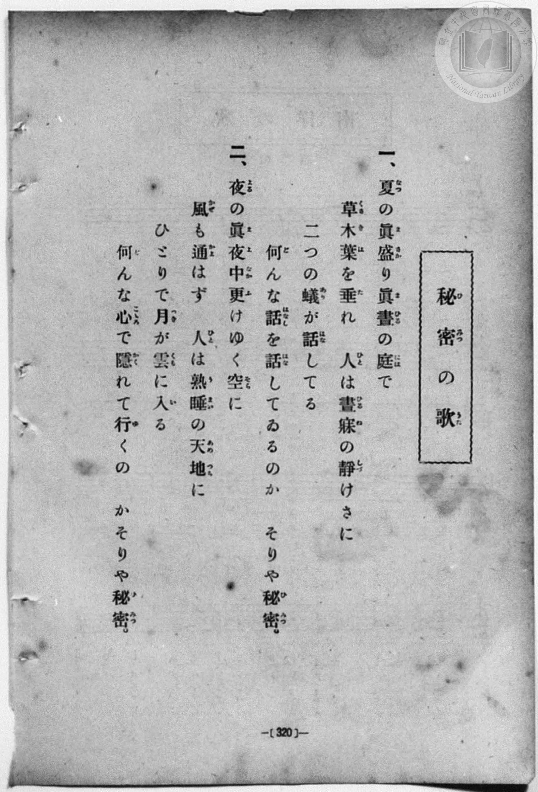
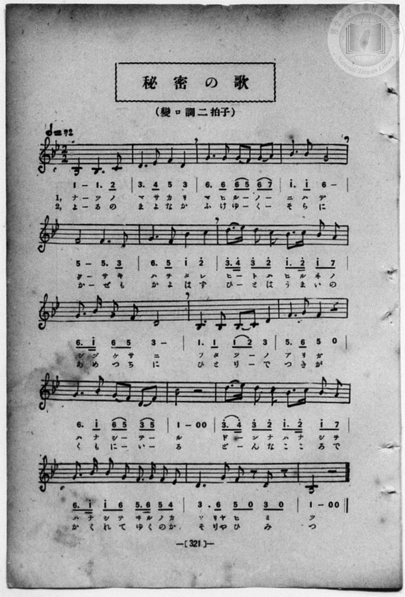

# 秘密の歌

> Re:Shōka 使用 AI 協助辨識與重建樂譜，可能會有錯誤。歡迎回報。

- **鋼琴伴奏版**：<br><audio controls src="himitsu_no_uta.mp3"></audio>
- **NEUTRINO 歌聲合成版**：<br><audio controls src="himitsu_no_uta_neutrino.mp3"></audio>

- book: 新編 小學校・公學校 唱歌教材集（尋常科五・六學年用）
- 一條慎三郎 編《新編 小學校・公學校 唱歌教材集》（大正十二年十二月，索書號 0725-41）
- lyricist: 蘆谷蘆村
- composer: 本居長世

## 說明

> [!NOTE]
> **原書資訊與歌詞全文**（對應 `P328.jpg`–`P329.jpg`，原書 p. 320–321，尋常科五・六學年第 44 首）：
> - **調性與拍號**：變ロ調二拍子（B♭ 大調 2/2 拍），𝅗𝅥 = 72（換算四分音符 `!= 144`）
> - **詞曲背景**：蘆谷蘆村作詞、本居長世作曲之大正童謠名作〈秘密の歌〉，以靜謐幽默的口吻描寫盛夏午睡時庭院裡兩隻螞蟻的竊竊私語、以及深夜萬籟俱寂時月亮悄悄躲進雲裡的心事，句末以斷奏休止唱出「そりや秘密」（那是秘密）。
>
> **一、**
> 夏（なつ）の眞盛（まさか）り眞晝（まひる）の庭（には）で
> 草木（くさき）葉（は）を垂（た）れ　人（ひと）は晝寐（ひるね）の靜（しづ）けさに
> 二つの蟻（あり）が話（はな）してる
> 何（ど）んな話（はなし）を話（はな）してゐるのか　そりや秘密（ひみつ）。
>
> **二、**
> 夜（よる）の眞夜中（まよなか）更（ふ）けゆく空（そら）に
> 風（かぜ）も通（かよ）はず　人（ひと）は熟睡（うまい）の天地（あめつち）に
> ひとりで月（つき）が雲（くも）に入（い）る
> 何（ど）んな心（こゝろ）で隱（かく）れて行（ゆ）くの　かそりや秘密（ひみつ）。
>
> （註：P328 第二節末句活字誤將「行くのか　そりや秘密」斷行排為「行くの　かそりや秘密」，P329 譜下配字正確印作「かくれてゆくのか，そりやひみつ」。）


## 歌詞

```text
（TMD 檔案未包含歌詞註解）
```

## ABC

```abc
X:1
T:秘密の歌
M:2/2
L:1/16
Q:1/2=72
K:Bb
V:V1 name="Piano" snm="Pia"
[V:V1]
B8 B6 c2 | d6 e2 f4 d4 | g6 g2 g2 f2 g2 a2 | b6 b2 g8 |
w: 1.~ナ ツ ノ | マ サ カ リ | マ ヒ ル _ ノ _ | ニ ハ デ
w: 2.~よ る の | ま よ な か | ふ け ゆ _ く _ | そ ら に
f8 f6 d2 | g6 f2 b4 c'4 | d'6 e'2 d'4 c'4 | b6 c'2 b4 a4 |
w: 1.~ク サ キ | ハ ヲ タ レ | ヒ _ ト ハ | ヒ ル ネ ノ
w: 2.~か ぜ も | か よ は ず | ひ _ と は | う ま い の
g6 b2 g4 f4 | d16 | B6 B2 B2 c2 d4 | f6 g2 f4 z4 |
w: 1.~シ ヅ ケ サ | ニ | フ タ ツ _ ノ | ア リ ガ
w: 2.~あ め つ ち | に | ひ と り _ で | つ き が
g6 b2 g2 f2 d2 f2 | B8 z4 z4 | d'6 e'2 d'4 c'4 | b6 c'2 b4 a4 |
w: 1.~ハ ナ シ _ テ _ | ル | ド _ ン ナ | ハ ナ シ ヲ
w: 2.~く も に _ い _ | る | ど _ ん な | こ こ ろ で
g6 b2 b4 g4 | f6 g2 f4 e4 | d6 g2 f2 z2 d2 z2 | B8 z4 z4 |
w: 1.~ハ ナ シ テ | ヰ ル ノ カ | ソ リヤ ヒ ミ | ツ
w: 2.~か く れ て | ゆ く の か | そ りや ひ み | つ
B8 B6 c2 | d6 e2 f4 d4 | g6 g2 g2 f2 g2 a2 | b6 b2 g8 |
w: 1.~ナ ツ ノ | マ サ カ リ | マ ヒ ル _ ノ _ | ニ ハ デ
w: 2.~よ る の | ま よ な か | ふ け ゆ _ く _ | そ ら に
f8 f6 d2 | g6 f2 b4 c'4 | d'6 e'2 d'4 c'4 | b6 c'2 b4 a4 |
w: 1.~ク サ キ | ハ ヲ タ レ | ヒ _ ト ハ | ヒ ル ネ ノ
w: 2.~か ぜ も | か よ は ず | ひ _ と は | う ま い の
g6 b2 g4 f4 | d16 | B6 B2 B2 c2 d4 | f6 g2 f4 z4 |
w: 1.~シ ヅ ケ サ | ニ | フ タ ツ _ ノ | ア リ ガ
w: 2.~あ め つ ち | に | ひ と り _ で | つ き が
g6 b2 g2 f2 d2 f2 | B8 z4 z4 | d'6 e'2 d'4 c'4 | b6 c'2 b4 a4 |
w: 1.~ハ ナ シ _ テ _ | ル | ド _ ン ナ | ハ ナ シ ヲ
w: 2.~く も に _ い _ | る | ど _ ん な | こ こ ろ で
g6 b2 b4 g4 | f6 g2 f4 e4 | d6 g2 f2 z2 d2 z2 | B8 z4 z4 |
w: 1.~ハ ナ シ テ | ヰ ル ノ カ | ソ リヤ ヒ ミ | ツ
w: 2.~か く れ て | ゆ く の か | そ りや ひ み | つ
```

## TMD 檔案連結

- [主旋律 TMD 檔案](himitsu_no_uta.tmd) [[在 TMD Studio 編輯](https://tmdlang.github.io/Tmd-TS/#tmd=s7IKdvYPcrWy4qpTUCpJTLdSSM7PyUlNLsnMz7MqzsjPTozPrsyvSsyML84ojTe0NDJWgqssy88pzU21Si9KTEmNN403Q8gU55cWJadaFSdn5OfnxJekVpQk5edno8vHFySmp1oFGBtZIGQKivLLUvMS84C6C4oy80pSU8DaEQpSyzJTUkHSxcmJefFlqUWZaZmpKUiOSi0qBrsdYkVJUWJecXJRZgHIQwhV-UUlGflAhxdkVFplZBaX5BdlJifmxGcn5iUiFJVkpAK9l5dYUlqUii6akpiZUxmfk5mGJAM0JD0zz6okMRMYcMDwyi9PjM9NzMzLScwDOlBLS-H58hlP17c9blz3bG2PgpYWl6KtgqGJCZe9rYKTDpeNkb6RHcgsUFBZKTybtuH59hUKTzf0P12749mChY-bdz9tXQNhKzydshFoxLOpM5_NnfBydtv7PR1PN3Q_3bHj-fKJT3ZNAStdC1T6dOeW51NWvN_TCXbjkx0NzxbNfdba92RH58vmPgWg8Y8bukix53FDN8iqJcufrV38tLfxya4eoA0QxrM5He_39DzfsujZ7B0vZs5XMDA3MtU1MYTZnVMJDGBgOFspvJjR9mLDdiD5bO5EsFRyfm5BfnFqEdDLc9Y83dj6cur2JzumKXFx6Wsp2FILcCkoKNgpRCv6-Ye4xkI4WlpP--aDXLu5_cWKrhcd7UCfvlg572nrimfT2rW0wGHa-6y9UyEBlEL1sgrSEx41TAZxLMEcoHchBigU6CkYGxkAJY2NgB7uwRkVa9YomJgovFw2DRgq7_fMgjhDF-iQF6v2P2tYDnJCdy8w8ECWz3qxrutx81qgDChwu3ufrp0AdJHTo5lrFYDhDxRWACYXBaAE2KyeD3NbpwPxUgVbBXMjoMJn_bOfr5v-dPbspx1tL-dvfr5mmUICJLUB3d2JZPPKec9mb3rR3PNs5nqItUjR82TvHKD844ZG5IgBCgJ1PNnZDUkGz1cvfbFmwdMJvUDxxw0dyCn8cQPIZU92L305d86LNROe7tz7cveM57NanvYvfjph97P-_qfrVz8HunBJ_9PejudzFz6b2fR019qXMxe9WLzwaevKl7N2v5g378X83UAtz1d3gdDyxherQO4Bmvm0v-vZ9o1Pl8x5MWHN843zn-zf-HR9E9AEYDp8smvds6YWIHqxa9PLhk0vgf5bvBBk7_7mJ7uACbjnaf_SZ3NWAw15Nm3706X9T_ZMfLZ2ETCpP23f9bih53Hj3MdNXY-bWqB-aQAGccfLpsXPZqyHiAAD8HFDEzgMYSkJmLWAzgLmaDAf6COglseNqx43LgEpblz3fM48oE_BgvseN0593Ah0RifQFqD4s5lzYeKbHjeBxRvXAcMBLLj6ceN6sMhyiMkvejufzQFmaKBUP9gcUPS_mAgMZ6AIWGXTpKfzmsDc-WAuMBYanuzaBRbZ9LgRVBgAVQItfboelKAglj5uBFoHshcYU2DB6Y8bl4JFJoJtWQ2xHZgSgT4CKgNGClhZE9ALYGXAjLMR4gagr8EiQBOWAU2Gatw7FSy7EuykyUA1yOqBiiEux2HIBLAL1wEDDegXtNiB-Ws_NKjR4wXoYuR4AfuuCYig4QwMf6Dgkx2Q0N4HkgK5ByT7bPYWsOBWaDg0AVN1__OVkJAEugEY5kBxaMi8XASJFKA7gVYA_dL0smEWVKQJWDCCwvxx4yyscfG8bT4w8YMFgVYAk0ELNA0sWfl0zgZYODeCQx6oDGEpxBBQaDQuBxe_QJVANaAkAYwRYLKHppMmYHoA6XraCoxToAjYfNxRA8wmYJHJj5uA3oSYtvzlLEjUAD0ITNvgdNW47MXCHnB4gnMEKEGuA0cQUA3xcQSUfLECmJpmgQpZBWARCYyy5-sbgPkTlEu37H66dvqLVUuebmgH5kygfVBrsCUFYEYF5megmmd9k543gXIyQj02Z4Ezdg-oOFd4sRaYBrpftgJL2emgMm3Rrqe9G8AFGtAAkJch_oWkAYj9QK1w8-C-AxoJ9B20gKW80oICBS19Li6PzNzMkuJSv_zQkkSrgMzEvHyHGoMahWqQTQo2Flrg4FTAVmWCA3VHAzAwFDRMQPU8MHh1FGDVmCYWDUD7QIbVKBgC6wgQhNBGQBFjMMtEwRRIgtg1CmZgETMgNAVic5CuOIimOKgcUBXYPB_DGoXHzV1QscfNLVC6D6jncfM8CK9pKxCvBouvApsPl2meBMQQmT6oTDdUph-I21HtMgLKN3XA7GqCqmxcB9LXuA8q2gFkg2wBxifExMatUHUTgbJtYFY_VGYuVE8nkA1yBcQu_KG-C5QEFTSMSQt1UNiCIIQ2hoexKSRkjUAEMCYgoWwSB2FBRaFhD-SBWeaogd-0Hh4gUI82rQUHJMiToIDcBBTZD2atgQbxJHh0gQITohIhDoqQx829iEhBBD44SCGBOQdqVxM4IKFRAQ58kHuA5SI0iDfBdawAkyBZkDgoIkD8fUAMSjSgaCQc-Ds6yQl8SFBD0y4oBmBpHgFh-cIQCI2guQASV6A8oKtggBbo26FB1Qpkb4QHPiL9Ipv8uHkqNHj2Q3MIPLU3LYKaswrIBkVPPFqAN0F1NgLZS8DBtBAagLD0imQPNLBBQQ0sxMCs5VAZkF4QvxeIe-D24A1sYEOTnPIFKbBNgQFpilTkgAIRHJBkJXR4gu6Chv_jZlAiAsnAwgLkK7DPgGKdULHHzZuhuiDimKaAQg05zKEqgEkbEsqQBAqKLVjcItnTuBJmT9NksFpoCdcI4oH4k4Ey4MwEiQtCpcsUisIcHG4gHmrqNYEEOlzEAMg2wBYxRIX2BqgMqJgApWNI2Q4Kn71QmVWPm5eAy5N4IDkfSIK0QaoGpMDDKFdAQQ-slcGsZVAjYeUEUAZcQiCKdVjhDaqtwWkfaFnjfohl0PSObFktF5eunQJylauAha_MBQA)]
- [鋼琴伴奏 TMD 檔案](himitsu_no_uta_piano.tmd) [[在 TMD Studio 編輯](https://tmdlang.github.io/Tmd-TS/#tmd=s7IKdvYPcrWy4qpTUCpJTLdSSM7PyUlNLsnMz7MqzsjPTozPrsyvSsyML84ojTe0NDJWgqssy88pzU21Si9KTEmNN403Q8gU55cWJadaFSdn5OfnxJekVpQk5edno8vHFySmp1oFGBtZIGQKivLLUvMS84C6C4oy80pSU8DaEQpSyzJTUkHSxcmJefFlqUWZaZmpKUiOSi0qBrsdYkVJUWJecXJRZgHIQwhV-UUlGflAhxdkVFplZBaX5BdlJifmxGcn5iUiFCUWATWnp-am5pVYFWQm5uXHJyYn5-cWJOZlgsQQCksygIqs8hJLSotS0UVTEjNzKuNzMtOAMlpaCs-Xz3i6vu1x47pna3ve7-l4OXvms87ul917nk_Y8mTPlqdL-9_v6VTQ0uJStFUwNDHhsrdVcNLhsjHSN7IDmQsKRSuFZ9M2PN--QuHphv6na3c8W7DwcfPup61rIGyFp1M2Ao1-NnXms7kTXs5uA9rxdEP30x07ni-f-GTXFLDStUClT3dueT5lBdAysHuf7Gh4tmjus9a-Jzs6Xzb3KQCNf9zQRYo9jxu6QVYtWf5s7eKnvY1PdvUAbYAwns3peL-n5_mWRc9m73gxc76CgbmRqa6JIczunEpg2AOjwErhxYy2Fxu2A8lncyeCpUCBnV-cWgT08pw1Tze2vpy6_cmOaUpcXJ55JUX5VgGgOAnycKgxqFGo5lIAAhsLLTswo0bBTEEXCA3jQEgXzKtRMAWLmYFpE7CIMVzEAMg2AIoYgkV0gWwIruGqRbHPB8U-E7h9JvEK0SaxMApoF5BhGAumTONBAoZwAbA1IAoEweZ7ZOZmlhSX-uWHliTi9xbMeRDaCO4FE7CnQGyY183A3jJTMAfpAoUBODQgciBvgczzMaxReNzcBRV73NwCpfuAeh43z4PwmrYC8Wqw-Cqw-XCZ5klADJHpg8p0Q2X6gbgd1S4joHxTB8yuJqjKxnUgfY37oKIdQDbIlseNIHmQzFaouolA2TYwqx8qMxeqpxPIBrkCYhc0oCBxrQuljeHBYgoJDCMQAQw8SMCYxEFYUFFocAF5YJY5ang1rYf7Aeq2prVgv4PcBfL7JqDIfjBrDTRUJsFDGOR_iEqEOCgMHzf3IsIREV7gUID4fw7Uriaw36GhBw4vkHseN86ChsomuI4VYBIkCxIHhR2Ivw-IQfEMCnmk8ILnFxADFGiwlIWAsNRnCIRG0LSGnKUg2QURTtuhvmsFsjfCwwuRSpBNftw8Feqj_dB0CE9TTYug5qwCskEhGo8WRk1QnY1A9hKwzxZC_QxLFUj2QMMHFDqPm0Ap_3HjcqgMSC-I3wvEPXB7MMPHFOh3U2xFBVnJCZ5suqBB9rgZFFUgGZjzQQ4BOwYo1gkVe9y8GaoLIo5pCsijyMEEVQFMQJCAgSQDUADDogPJnsaVMHuaJoPVQrN-I4gH4k8GyoCTLCT4MIKJ4mKXmADaAJUB5R9QaoGUUyAv7YXKrHrcvASc0eKB5HwgCdIGKeaQ_IuR4UCh9bgJlAgeNy6DGgnLQEAZcNZBFFGwgqjrcVMLOIUBLWvcD7EMmqqQLcNa4OOqV-DVBoTGIoBe80AVwPi4zIHKQ8WR6yeMCgsigFrRYeojRgBU3-E1BlwlkuoW8ipdXTsFcL2uAGQgx0e0D1AHhpgRWEyZCwA)]

## 分析

```text
================================================================================
📊 TMD Song Profile: [ 秘密の歌 ]
================================================================================
⏱  Duration:       1:06 (66.7s), 40 measures total
🎼 Key & Tempo:    首調基準 B,, != 144.0 BPM, <2/2>
   - 分析範圍：      由實際發聲的音符與和弦推測調性；播放脈絡另行呈現
🎤 人聲音域:    A#4 (MIDI 70) – D#6 (MIDI 87) [跨度: 17 個半音 / 1.4 個八度, 難度: challenging]
   - 最低音:  A#4 in [HimitsuNoUta #1 @ m.1, 0:00]
   - 最高音: D#6 in [HimitsuNoUta #1 @ m.7, 0:10]
🏛  結構:      HimitsuNoUta (33.3s) -> HimitsuNoUta (33.3s)
⚡ 編曲密度:        Peak 1 軌道同時演奏
🗝  調性診斷：       A# 大調（純淨自然大調，未偵測到可信轉調）
   - 風格氣質:    純淨自然大調（陽光明朗、易唱易記，無明顯調外色彩）
   - 轉調歷程:    全曲維持單一推測調性（未偵測到可信轉調）
   - 核心骨幹音:  A#, D, G, F, C
   - 調性數值:    A# 大調 [相關度: 0.88, 穩定度: Moderate, 自然音純度: 100.0%]
   - 候選調性 (K-S): A# 大調 (0.88), G 小調 (0.83), D 小調 (0.63)
   - 五度圈歷程:   -2 -> -2
   - 各段落調性細節:
     • [HimitsuNoUta #1]: A# 大調 (r: 0.88, 自然音純度: 100.0%)
     • [HimitsuNoUta #2]: A# 大調 (r: 0.88, 自然音純度: 100.0%)

  [ 五度圈游移軌跡 ]
               C  
         F            G  
     [Bb]*              D  
      Eb               A  
         Ab           E  
            Db       B  
               F# 
     (* = active key center)

  [ 十二半音累積音高分佈 ]
     C  : ██████                     6.8%
     C# :                            0.0%
     D  : ██████████████████        20.9%
     D# : ███                        3.4%
     E  :                            0.0%
     F  : ███████████████           17.6%
     F# :                            0.0%
     G  : ██████████████████        20.3%
     G# :                            0.0%
     A  : ███                        3.4%
     A# : ████████████████████████  27.7%
     B  :                            0.0%
--------------------------------------------------------------------------------
Assignment 軌道音域：
  - Piano         : A#4 – D#6 (17 個半音 / 1.4 個八度, 144 個音符)
================================================================================
```


## 原書掃描頁






