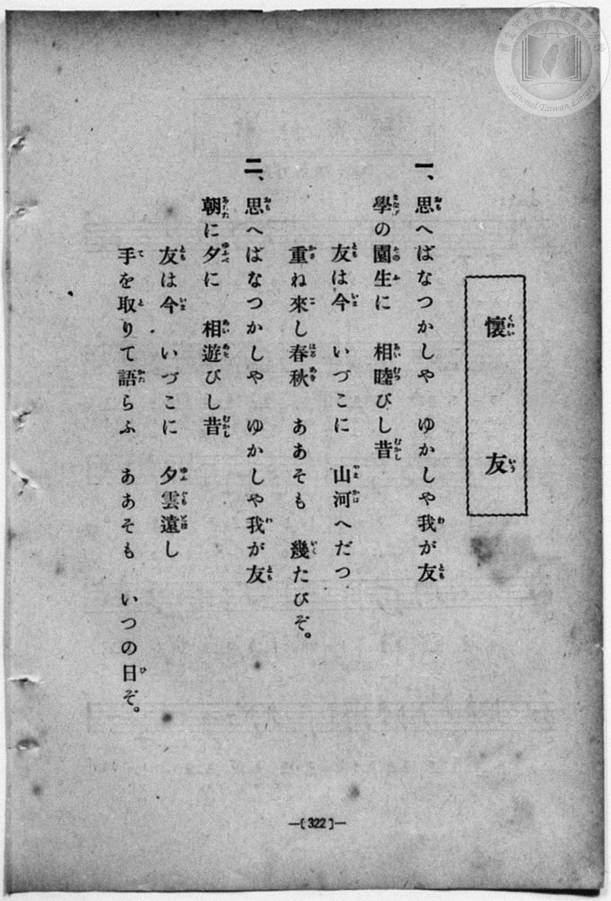
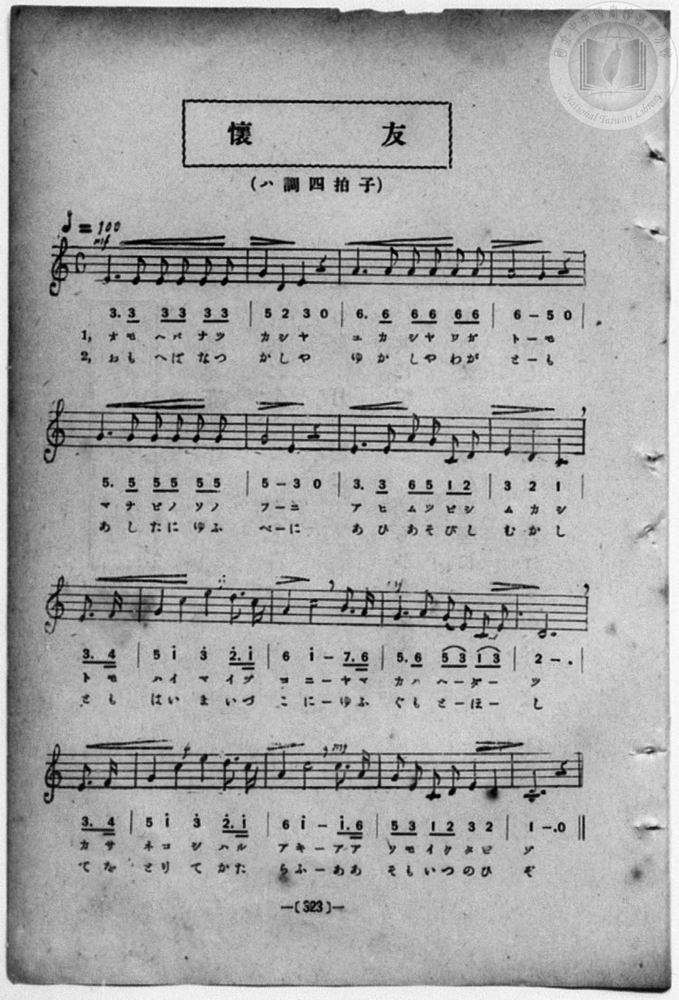

# 懷友

> Re:Shōka 使用 AI 協助辨識與重建樂譜，可能會有錯誤。歡迎回報。

<audio controls src="kaiyu.mp3"></audio>

- book: 新編 小學校・公學校 唱歌教材集（尋常科五・六學年用）
- 一條慎三郎 編《新編 小學校・公學校 唱歌教材集》（大正十二年十二月，索書號 0725-41）

## 說明

> [!NOTE]
> **原書資訊與歌詞全文**（對應 `P330.jpg`–`P331.jpg`，原書 p. 322–323，尋常科五・六學年第 45 首）：
> - **調性與拍號**：ハ調四拍子（C 大調 4/4 拍），♩= 100
> - **同名異曲辨正**：本曲為七五調抒情唱歌（「思へばなつかしや　ゆかしや我が友」），第 8 小節第 4 拍起以附點八分音符加十六分音符（`3. 4`）弱起轉入後半段高音區；與共益商社《唱歌教科書 教師用 巻二》所收〈懷友〉（「草鞋を足に、辨當腰に」，ニ調 4/4 拍）為完全不同的同名異曲。
>
> **一、**
> 思（おも）へばなつかしや　ゆかしや我（わ）が友（とも）
> 學（まなび）の園生（そのふ）に　相睦（あひむつ）びし昔（むかし）
> 友（とも）は今（いま）　いづこに　山河（やまかは）へだつ
> 重（かさ）ね來（こ）し春秋（はるあき）　ああそも　幾（いく）たびぞ。
>
> **二、**
> 思（おも）へばなつかしや　ゆかしや我（わ）が友（とも）
> 朝（あした）に夕（ゆふべ）に　相遊（あひあそ）びし昔（むかし）
> 友（とも）は今（いま）　いづこに　夕雲（ゆふぐも）遠（とほ）し
> 手（て）を取（と）りて語（かた）らふ　ああそも　いつの日（ひ）ぞ。


## 歌詞

```text
（TMD 檔案未包含歌詞註解）
```

## ABC

```abc
X:1
T:懷友
M:4/4
L:1/16
Q:1/4=100
K:C
V:V1 name="Piano" snm="Pia"
[V:V1]
!mf! E6 E2 E2 E2 E2 E2 | G4 D4 E4 z4 | A6 A2 A2 A2 A2 A2 | A8 G4 z4 |
w: 1.~オ モ へ バ ナ ツ | カ シ ヤ | ユ カ シ ヤ ワ ガ | ト モ
w: 2.~お も へ ば な つ | か し や | ゆ か し や わ が | と も
G6 G2 G2 G2 G2 G2 | G8 E4 z4 | E6 E2 A2 G2 C2 D2 | E4 D4 C4 E3 F |
w: 1.~マ ナ ビ ノ ソ ノ | フ ニ | ア ヒ ム ツ ビ シ | ム カ シ ト モ
w: 2.~あ し た に ゆ ふ | べ に | あ ひ あ そ び し | む か し と も
G4 c4 e4 d3 c | A4 c8 B3 A | G6 A2 G2 E2 C2 E2 | D12 E3 F |
w: 1.~ハ イ マ イ ヅ | コ ニ ヤ マ | カ ハ へ ダ _ _ | ツ カ サ
w: 2.~は い ま い づ | こ に ゆ ふ | ぐ も と ほ _ _ | し て を
G4 c4 e4 d3 c | !mp! A4 c8 c3 A | G2 E2 C2 D2 E4 D4 | C12 z4 |
w: 1.~ネ コ シ ハ ル | ア キ ア ア | ソ モ イ ク タ ビ | ゾ
w: 2.~と り て か た | ら ふ あ あ | そ も い つ の ひ | ぞ
!mf! E6 E2 E2 E2 E2 E2 | G4 D4 E4 z4 | A6 A2 A2 A2 A2 A2 | A8 G4 z4 |
w: 1.~オ モ へ バ ナ ツ | カ シ ヤ | ユ カ シ ヤ ワ ガ | ト モ
w: 2.~お も へ ば な つ | か し や | ゆ か し や わ が | と も
G6 G2 G2 G2 G2 G2 | G8 E4 z4 | E6 E2 A2 G2 C2 D2 | E4 D4 C4 E3 F |
w: 1.~マ ナ ビ ノ ソ ノ | フ ニ | ア ヒ ム ツ ビ シ | ム カ シ ト モ
w: 2.~あ し た に ゆ ふ | べ に | あ ひ あ そ び し | む か し と も
G4 c4 e4 d3 c | A4 c8 B3 A | G6 A2 G2 E2 C2 E2 | D12 E3 F |
w: 1.~ハ イ マ イ ヅ | コ ニ ヤ マ | カ ハ へ ダ _ _ | ツ カ サ
w: 2.~は い ま い づ | こ に ゆ ふ | ぐ も と ほ _ _ | し て を
G4 c4 e4 d3 c | !mp! A4 c8 c3 A | G2 E2 C2 D2 E4 D4 | C12 z4 |
w: 1.~ネ コ シ ハ ル | ア キ ア ア | ソ モ イ ク タ ビ | ゾ
w: 2.~と り て か た | ら ふ あ あ | そ も い つ の ひ | ぞ
```

## TMD 檔案連結

- [主旋律 TMD 檔案](kaiyu.tmd) [[在 TMD Studio 編輯](https://tmdlang.github.io/Tmd-TS/#tmd=s7IKdvYPcrWy4qpTUCpJTLdSSM7PyUlNLsnMz7MqzsjPTozPrsyvSsyML84ojTe0NDJWgqssy88pzU21Si9KTEmNN403Q8gU55cWJadaFSdn5OfnxJekVpQk5edno8vHFySmp1oFGBsbIGQKivLLUvMS84C6C4oy80pSU8DaEQpSyzJTUkHSxcmJefFlqUWZaZmpKUiOSi0qBrsdYkVJUWJecXJRZgHIQwhV-UUlGflAhxdkVFplZBaX5BdlJifmxGcn5iUiFJVkpAK9l1aUmZqXUpyRWYAuk5qbDzFVS0vhWfv2p_3dClpaXIq2CoYGBlz2tgrOXDYm-iZ2IF0g71spPJu24fn2FQpPN_Q_Xbvj2YKFj5t3P21dA2ErPJ2y8dnanmdTZz6bO-Hl7Lb3ezqebuh-umPH8-UTn-yaAla6Fqj06c4tz6eseL-nE-yaJzsani2a-6y178mOzpfNfQpA4x83dJFiz-OGbpBVS5Y_W7v4aW_jk109QBsgjGdzOt7v6Xm-ZdGz2TtezJyvYGBuZKprYgi2m0tfS8GWWoBLQUHBTiFa0c8_xDUWwtHSeto3H2Tv5vYXK7pedLQD3fxi5bynrSueTWvX0gKHTu-z9k6FBFD60csqSE941DAZxDEEc4AOhxigUKCnYGxkBJQ0NjIGieIK1DVrFExMFV4umwb03_s9syDO0AU65MWq_c8aloOc0N0LDAaQ5bMeN_cDhZ_Ong0Ue7p2AtA5zgrAMASKKQCjXAEoCjal59HMlZDkADft6YSepxN6n0_d8Gz2phf7VgBDHWzgszlrgALPm3Y92dEMdBnIzq5Jz5pbIbEFNP9xQ8-zhrmPG3c8btzwuHHV48Yljxu7HzdOf9zU8rih4XFTG5z7rGPi48YeYGp83AB1BchvFqDk8Hx9A9ifIAe-2Lr9ye6lL2e2vNwNDNbVTzvaXs7f_HzNsqddC4DRDwoXmAjQ9gRjPQUTYKB2Pt2zEajxxd7Op61Ln-7redrb9Wzd1perZwBVPu1teL9nNjCcnrZufD676-nUtudL9gFTIzzBAQMdFCFA1tMdq4GJWOHp9t3AZAZMgc86G55N2fa4oQOSjR43AF0N8vGL3s6X87ofN016sW3z48bVjxsagUH2fOq2F63AMABygf7redzcjRrswEB8uq4HmFKe7OgFhvbzWS3IYf64oQkcGbBkBsxBQGOB-RbMBwYxyObGrsdNTUCjiAxukJamfrB6ULiDTVgBMQFiLDCJgQX3gY3aDFa57umcSc-nzAeLA-N13ePGrWBxoLcans_e8XwuKNwfNzY9btz0uKkB6ACwLDAYpj-bMQVsI1AQ5AaELahWP25c_2R3F1ikBWg1SATochB76ePGyRCLnm7c-GwT0D1A00BqwAauh3l8AdBSiMkv24EBCzQHKDsVLLv2yT5QCQU0B8wFOmnp8-UQ29c_bgIqAzobFBdgG4FsIJoLdBXIxp1Al0CcBAmx-WBPzcOIF1DCoHW8PJsDMRbovOlAl0DC_-kSoB-BGoFGbX3cuBM5Ul42QsITHClgT9EkUpZMfTl7E5IbJkD0vmxcADWqcTck2KG-6IRYAUwwncC88rQfWISBlIG5XUDxF6vmwaIP7McmoN6tmFEDdgYwPNc9m74UrB7oBqBKWNRQXs5DgYKWPheXd2JmZalVQGZiXr5DjUGNQjXICgUbQzMtcBJQwFa_KAALL2B-fbGwR0HDBFqe6SjAynxNLBqANoEMAxqfm1arYAwsgWEQxEbHNQqmUFkjJFUgaAClaxTMkMwAsdExqgoQhJkJNwPsJB_DGoXHTauQ1D1uXgQiG3eA2RPAZBeYbAGb-7hpNUxl03a4niVQVjzchY-blyGbCtYF0QFR_bh5PVhkDVR1B5p7Ie5AMRPiYiOg6kaQixBmNyFc3LgBTIJ8BExFELMbu2EqG6fD9YB8g-bipjZkU8G6IDogqoGZGCzSAzV1BbqLwe5AdTH-RLSrh5xEBItJWKyiY1QVIIiZftDTICi1gHQZAjEo1SFUwNIgSAZhlgly-mmehxwK0NQyGUz2gcNlL5wNUj0VzXXAqhPKQo4LWOxDVEwCkwvAJDguIOaD0xPITJAMJA6wpU5I2gKlKOQ0BIstSGyD47lxPpiEpFVQagCWUBAbGneiuxqsCs3VaGZuApOQ1DkXTG6G2wXyYwNcJZYUCk1foFRFKB3t6KQkHRnGQRnGMIYRhAGUQJQjcFUwaA4mzdCSGywhgZIJKMlACjRYIkKH2BITKJNBPA4rVBAJDCb2uLkVHICg4ITwYQEID3xokQTSi1xoQcQgGRlSxMEiAQRB9sMKBnQIM-Nx01aUZAQqxsDijTCdwBoVTQxYr4KTByjRQvjI7oGYCil8QAkOpBJU8CLkIEkIlCCAlS6qe-EJBsO9jZACGFgXE0pAwB7EACSg6tyCWpgoLBnBkg0owaCXQDXwMggdYqnTmnthwYBIJEglAiSRPW5ejVLWPG5ai2YyTA5Eg1RCSjJwDQlOio-bILXYfrjJsCgGqYYlA3SIrUaD1SbAthKMBY1ARPkAKp9A5nbCxUGlE4p7oSUQiAaZCi51oMkHXG6C60Rg4wquHlRGQd3biFyOY3dvLReXrp0CuNWkgMxQ5gIA)]
- [鋼琴伴奏 TMD 檔案](kaiyu_piano.tmd) [[在 TMD Studio 編輯](https://tmdlang.github.io/Tmd-TS/#tmd=s7IKdvYPcrWy4qpTUCpJTLdSSM7PyUlNLsnMz7MqzsjPTozPrsyvSsyML84ojTe0NDJWgqssy88pzU21Si9KTEmNN403Q8gU55cWJadaFSdn5OfnxJekVpQk5edno8vHFySmp1oFGBsbIGQKivLLUvMS84C6C4oy80pSU8DaEQpSyzJTUkHSxcmJefFlqUWZaZmpKUiOSi0qBrsdYkVJUWJecXJRZgHIQwhV-UUlGflAhxdkVFplZBaX5BdlJifmxGcn5iUiFCUWATWnp-am5pVYFWQm5uXHJyYn5-cWJOZlgsQQCksygIqs0ooyU_NSijMyC9BlUnPzIdZraSk8a9_-tL_7_Z6Ol7NnPuvsftm95_mELU_2bHm6tP_9nk4FLS0uRVsFQwMDLntbBWcuGxN9EzuQaaDws1J4Nm3D8-0rFJ5u6H-6dsezBQsfN-9-2roGwlZ4OmXjs7U9z6bOfDZ3wsvZbUArnm7ofrpjx_PlE5_smgJWuhao9OnOLc-nrADaBXblkx0NzxbNfdba92RH58vmPgWg8Y8bukix53EDyDdPlyx_tnbx097GJ7t6gDZAGM_mdLzf0_N8y6Jns3e8mDlfwcDcyFTXxBBsN5dnXklRvlUAKFyDPBxqDGoUqrkUgMDG0EzLDsyqUTBQ0AVDdNoYTJoAVZhCRQzjYFIwhhGEAZSoUTBDVwWDUAEzqEkgcw1BeuF2QNggWAOWwQZhrqrhqkXxlg-Kt0yQfAWBQBPjFaINY2FUjYIJkGESC6Pg8qbxQNo0HkkESAH1g-zzTsysLCUQjNW5abVw_8DCDx0jwhLmY5gOuP_g4QgJM0yMqgIEYWYiwgjkJB_DGoXHTauQ1D1uXgQiG3eA2RPAZBeYbAGb-7hpNUxl03a4niVQVjzchY-blyGbCtYF0QFR_bh5PVhkDVR1B5p7Ie5AMRPiYiOg6kaQixBmNyFc3LgBTIJ89LgRZA9IdTdMZeN0uB6Qb9Bc3NSGbCpYF0QHRPXjpn6wSA_U1BXoLga7A9XF0HiHBT4sItAxqgoQxIxy9GQDimCQLlg2QaiAJRtYNoFnUkSUN89Ddjg0gieDyT6wV_bC2SDVU9Fc97gZFqTIwQeLMIiKSWByAZgEBx_EfHASAJkJkoEEG7YEBUkOoESAHO2wAIZEEDhqGueDSUjyAkXg48atEBsad6K7GqwKzdVoZm4Ck5AENRdMbobbBfJjA1wllkQFTRKghIAR9WSWi-ZgElYswiAs7mHFJKTYgMU7OsQW_6CkDHErLOsi0gRM7HFzK9jPoBCA8GF-hocXNOOD9CIXDRAxSHaBFCSwcANBkP2w7IcOYWY8btqKEvOgwgIs3gjT-bhxH5rY48al4BgFpTMIH9k9EFMhWRyURkAqQcUbQg4S66A4fNy4G9W98DjGcG8jpJh73DSJanFenVtQS-0KERHzvTCXI-IVKd9B0sXj5tUoOfpx01o0k2FyIBqkElJegKsOcOp53AQp3vfDTYbFCkg1LObQIbaiHlbMPm6CFfqwMEfkQlApADK3Ey4OKgNQ3AvN5yAaZCo4b0NjHFw6gSuLx43r4OpBJQHUvY3IpSV296I2AHA1OJCbEeB2BrxBAWlHYLQ7oAxoKwOHIShNERgPbgSaFaiGEGrwwOXhpoAYJBuDr92ka6cAbqopABngIIz2AcojOEZgjjIXAA)]

## 分析

```text
================================================================================
📊 TMD Song Profile: [ 懷友 ]
================================================================================
⏱  Duration:       1:16 (76.8s), 32 measures total
🎼 Key & Tempo:    首調基準 C, != 100.0 BPM, <4/4>
   - 分析範圍：      由實際發聲的音符與和弦推測調性；播放脈絡另行呈現
🎤 人聲音域:    C4 (MIDI 60) – E5 (MIDI 76) [跨度: 16 個半音 / 1.3 個八度, 難度: moderate]
   - 最低音:  C4 in [Kaiyu #1 @ m.7, 0:16]
   - 最高音: E5 in [Kaiyu #1 @ m.9, 0:20]
   - 適合: soprano, mezzo-soprano, contralto, tenor, baritone, bass
🏛  結構:      Kaiyu (38.4s) -> Kaiyu (38.4s)
⚡ 編曲密度:        Peak 1 軌道同時演奏
🗝  調性診斷：       C 大調（純淨自然大調，未偵測到可信轉調）
   - 風格氣質:    純淨自然大調（陽光明朗、易唱易記，無明顯調外色彩）
   - 轉調歷程:    全曲維持單一推測調性（未偵測到可信轉調）
   - 核心骨幹音:  E, G, C, A, D
   - 調性數值:    C 大調 [相關度: 0.82, 穩定度: Moderate, 自然音純度: 100.0%]
   - 候選調性 (K-S): C 大調 (0.82), E 小調 (0.73), G 大調 (0.69)
   - 五度圈歷程:   +0 -> +0
   - 各段落調性細節:
     • [Kaiyu #1]: C 大調 (r: 0.82, 自然音純度: 100.0%)
     • [Kaiyu #2]: C 大調 (r: 0.82, 自然音純度: 100.0%)

  [ 五度圈游移軌跡 ]
              [C ]*
         F            G  
      Bb               D  
      Eb               A  
         Ab           E  
            Db       B  
               F# 
     (* = active key center)

  [ 十二半音累積音高分佈 ]
     C  : ████████████████████      21.2%
     C# :                            0.0%
     D  : ██████████████            14.2%
     D# :                            0.0%
     E  : ████████████████████████  25.0%
     F  : █                          0.8%
     F# :                            0.0%
     G  : █████████████████████     21.7%
     G# :                            0.0%
     A  : ███████████████           15.8%
     A# :                            0.0%
     B  : █                          1.2%
--------------------------------------------------------------------------------
Assignment 軌道音域：
  - Piano         : C4 – E5 (16 個半音 / 1.3 個八度, 140 個音符)
================================================================================
```


## 原書掃描頁






