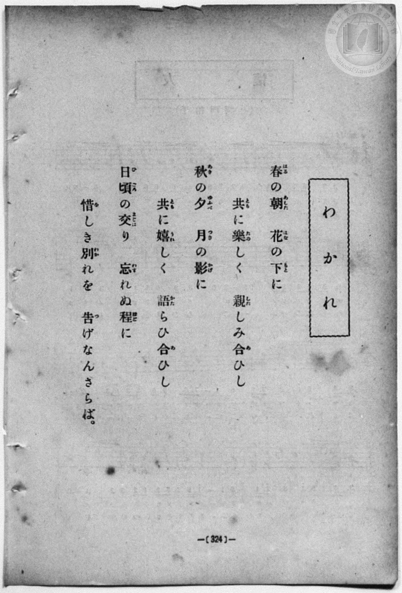
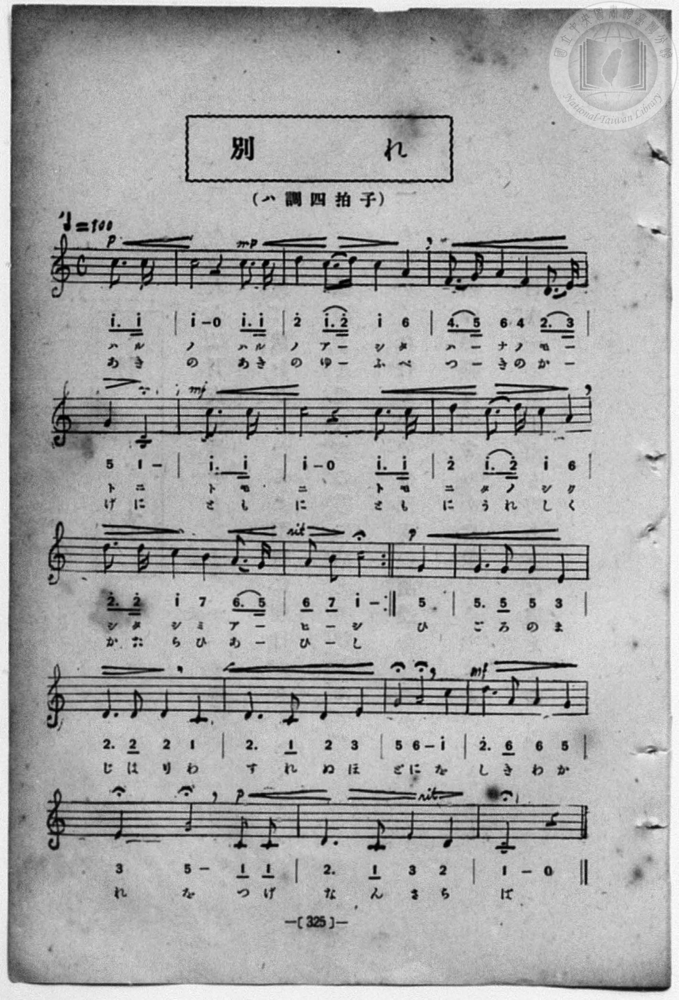

# 別れ

> Re:Shōka 使用 AI 協助辨識與重建樂譜，可能會有錯誤。歡迎回報。

<audio controls src="wakare.mp3"></audio>

- 詞：文部省
- 曲：文部省
- 一條慎三郎 編《新編 小學校・公學校 唱歌教材集》（大正十二年十二月，索書號 0725-41）
- 臺灣總督府《公學校唱歌》第六學年用（昭和十五年，索書號 523.37 4322-4）

## 說明

原書資訊與歌詞全文（對應 P066.jpg、P067.jpg，原書 pp. 62–63）：
調性與拍號：ハ長調（C 大調）4/4 拍（弱起一拍），速度 ♩=100
曲式結構：第 1–2 行（前 8 小節）譜下印有上下兩行片假名歌詞，第 2 行末附反覆記號（:||）；
第 3–4 行（後 8 小節）譜下印單行片假名歌詞。


## 跨冊／重複收錄參照

> 同曲（畢業惜別歌〈別れ〉「春のあしたの花の陰…」；《公學校唱歌》與《新定兒童唱歌》第六學年共用教材）

- **[同曲]** 《公學校唱歌》第六學年用（昭和15年／1940，國臺圖 523.37 4322-4）：[**〈別れ〉**](../../../kogakko_shoka/grade_6/20_wakare/index.md)（`C` / `4/4` — [原始 TMD](../../../kogakko_shoka/grade_6/20_wakare/wakare.tmd)）
- **[同曲]** 《新定兒童唱歌》尋常科第六學年用（2020.006.0847.0006）：[**〈別れ〉**](../../../shintei_jido_shoka/grade_6_2020.006.0847.0006/4_19_wakare/index.md)（`C` / `4/4` — [原始 TMD](../../../shintei_jido_shoka/grade_6_2020.006.0847.0006/4_19_wakare/wakare.tmd)）
- 總表：[跨冊重複與同名歌曲總索引](../../../duplicate_songs.md)

## 歌詞

```text
春の朝（あした）花の下（もと）に、
ともに楽しく親しみあひし、
秋の夕（ゆふべ）月の影に、
ともにうれしく語らひあひし、
日頃のまじはり忘れぬほどに、
惜しき別れをつげなん、さらば。
```

## ABC

```abc
X:1
T:別れ
C:曲：文部省
M:4/4
L:1/16
Q:1/4=100
K:C
V:V1 name="Piano" snm="Pia"
[V:V1]
!p! z4 z4 z4 c3 c | !mp! c8 z4 c3 c | d4 c3 d c4 A4 | F3 G A4 F4 D3 E |
w: 1.~ハ ル | ノ ハ ル | ノ ア ー シ タ | ハ ー ナ ノ モ ー
w: 2.~ア キ | ノ ア キ | ノ ユ ー フ ベ | ツ ー キ ノ カ ー
!mf! G4 C8 c3 c | c8 z4 c3 c | d4 c3 d c4 A4 | d3 d c4 B4 A3 G |
w: 1.~ト ニ ト モ | ニ ト モ | ニ タ ノ シ ク | シ タ シ ミ ア ー
w: 2.~ゲ ニ ト モ | ニ ト モ | ニ ウ レ シ ク | カ タ ラ ヒ ア ー
!p! A2 B2 c8 G4 | G6 G2 G4 E4 | D6 D2 D4 C4 | D6 C2 D4 E4 |
w: 1.~ヒ ー シ ヒ | ゴ ロ ノ マ | ジ ハ リ ワ | ス レ ヌ ホ
w: 2.~ヒ ー シ ヒ | ゴ ロ ノ マ | ジ ハ リ ワ | ス レ ヌ ホ
!mf! G4 A8 c4 | d6 A2 A4 G4 | !p! E4 G8 C2 C2 | D6 C2 E4 D4 |
w: 1.~ド ニ ヲ | シ キ ワ カ | レ ヲ ツ ゲ | ナ ン サ ラ
w: 2.~ド ニ ヲ | シ キ ワ カ | レ ヲ ツ ゲ | ナ ン サ ラ
C8 z4 z4 |
w: 1.~バ
w: 2.~バ
```

## TMD 檔案連結

- [主旋律 TMD 檔案](wakare.tmd) [[在 TMD Studio 編輯](https://tmdlang.github.io/Tmd-TS/#tmd=s7IKdvYPcrWy4qpTUCpJTLdSSM7PyUlNLsnMz7MqzsjPTozPrsyvSsyML84ojTe0NDJWgqssy88pzU21Si9KTEmNN403Q8gU55cWJadaFSdn5OfnxJekVpQk5edno8vHFySmp1oFGBsbIWQKivLLUvMS84C6C4oy80pSU8DaEQpSyzJTUkHSqSmZJflFmYk5SA5KLSoGuxtifElRYl5xclFmAcgzCFX5RSUZ-UBHF2RUWmVkFoMMSU7Mic9OzEtEKCrJSAV6La0oMzUvpTgjswBdBuTp0kSIwVpaCk87lj5u6lHQ0uJStFUwNDDgsrdVcOayMdE3sQNpfLKj4dmiuc9a-57s6HzZ3KfwfPuKxw1dz6ZtADIUnm7of7p2x7MFCx83737augbCVng6ZeOztT3Pps58NnfCy9ltjxu63-_peLpk-bO1i5_2Nj7Z1fN05xYI49mcjvd7ep5vWfRs9o4XM-crGJgbmeqaGL7f0wl29IuV897vmfVsWvvL5hXP5zSCxZ7N3oQh9qJ91_PGxc937H0-d_HTXXOA7oM7BuIWoBOer1nztHUtUBBo-fMpK4AuejZj7dNJPWCHTAEKojjE1MhYz9hcwcTYyEjXBOwcLn0tBVtqAS4FBYWnffNBlm1uf7Gi60VHO9CVQO8-bV0B9BoouDb0PmvvVAgwMDPTyypIf9zQCGSag5hAd0K0KhQU6CmYGT1qmGxmDHQiMFRAxr5Ytf9Zw3KQgd29QJ8ARR8397-cuh0oDjTWWQEYD2BmJzCCFYBqQHbt2fhi63ZQRIO4QIN6XjbMf7prmcKjmSttQSkCaCww2J_u6X--dcKz5cDYnAUMTQVDoM1GCi8W9oCM6OxVsAAlh-frG4BGvFg758mO7qe9G57N6XyyowvEbl0JVPm8s_1pY_vTCb0Q34KCHGgQ2JBnc1a_nNnytL_3xbK2FytmgJ3eYVVTA3bQbJATEACkyRhouwnM9n09WG1_Om0dpqWPG5q4wD6asfRx47pnc-YCDXjc2PS4cfrjRqCdnS-6NgLFgQaAxJuA4sC00vm4cTUwCkDagHyw6OpnS_eC9fS_WLYKzNgPNmUTiA1R-nx5N9Ckp0umgk1qe9y49XHjTqBhwFQPEt8LtAfD1MeNbcDcCDV41bzHTUCrgUaiGvxs-tKXC5qBZjxu3Pe4ccbjxvWPm7qe7p8B1rnmcePux40rEWY_a54DNq8XktMfN0163LjkcSOQXPW4aTJQ0ePGqWB7NoCCBqiB8vQNBQpa-lxc4YnZiUXAsjIzMS_focagphoclzaGZlp2YBa2fAWKYWB6BEaeggZy6lTQVjCGxjOYCRTSgecRTSzmAB0AsqNGwUBBFwzR6eqCWgXDODATSNXA2AgIV5iLptIIphIqCOTDNZtB6RoFEzBtCheB8IGqwaQxUIUpzBg0i6tz01AsBHvEx7BGIR6qAJ0G5nMovRpo7GNgWY1qICF1j5sWQcX3ANnb4aL74Z5B6ASqaO6Cmwc3oRlhAkh1B1y8G80tMDmQDqjPjPD4DOayprX4fYZD3ePmZUjungoXnYnksxYkv6_F9FnTamSfNW0i0mf4U_iuHkgK718KLP1AkQwqAXdvA5XW4BIQWIojF4gKwOKQyOSOMxmTnoKhqpAlzVEUmQIVgVggUQx7QfkLlsIRSRgz2BCJEyn4kNTBkiEoSpAT53q4O2GiIJVIKprnw9WiJs5JUDZIBqYaEYkgWSQ3AxMnOW6GJbs1ON0MTVYgNzevxLCdXDcTKFg7wcmOqIQEizsQBLFhfGO4HyAlGQSC2DA-rDxDVQEShfERZsBMhaU6GEQuA1HST9MWFJ-vBZOI7D4PbvLjph0oKkEF2OPmVXA-clzsRFG5Bkz2wPmzESqbO-GimNkfVjQgpZwh4Vq8aebp7NnEpxl4uQKCoCiFRSu8IIBHPXLyAkFwdQykQRgz4cB0wcSB5RyafvTqHTnJIGcYSBmPCFBYRoQEGCgwUYMHEWCgegJS_oNUwupAiNxmsNxWOB-WoUEqJ6CZhF7HISeXwe7SWi4uXTsFSMNOAchS5gIA)]
- [鋼琴伴奏 TMD 檔案](wakare_piano.tmd) [[在 TMD Studio 編輯](https://tmdlang.github.io/Tmd-TS/#tmd=s7IKdvYPcrWy4qpTUCpJTLdSSM7PyUlNLsnMz7MqzsjPTozPrsyvSsyML84ojTe0NDJWgqssy88pzU21Si9KTEmNN403Q8gU55cWJadaFSdn5OfnxJekVpQk5edno8vHFySmp1oFGBsbIWQKivLLUvMS84C6C4oy80pSU8DaEQpSyzJTUkHSqSmZJflFmYk5SA5KLSoGuxtifElRYl5xclFmAcgzSlxaWgpPO5Y-bup5v6fj5eyZzzq7X3bveT5hy5M9W54u7X-_p1NBS4tL0VbB0MCAy95WwZnLxkTfxA5k-JMdDc8WzX3W2vdkR-fL5j6F59tXPG7oejZtA5Ch8HRD_9O1O54tWPi4effT1jUQtsLTKRufre15NnXms7kTXs5ue9zQDbT16ZLlz9Yuftrb-GRXz9OdWyCMZ3M63u_peb5l0bPZO17MnK9gYG5kqmtiCHQP2GMvVs57v2fWs2ntL5tXPJ_TCBZ7NnsThtiL9l3PGxc_37H3-dzFT3fNAboP7hiIW4BOeL5mzdPWtUBBoOXPp6wAuujZjLVPJ_WAHTIFKIjiEFMjYz1jcwUTYyMjXROwc7g880qK8q0CMhPz8oM8HGoMaqq5FIDAxtBMyw7MqlGozk2rVTCKU9CFQzMoBkFTKF2jYIwmAoOGUFyjYIQmCtMBE68BiyJDAzS6hqsWxc0-yG42QXNyvEK0UW6sgkm8gmE8yOx4BdN4oJhpfCxEAKgAIgcSBstHG8YCrTKAWBOemJ1YBEzN-MIG3X0wurqgVsEQEmRACmg2cvChKMxFUwkPaKggkA_XDAvzGgUTMG0KF4HwYSFpDFQBiwX0EAUHDZKFYI_4GNYoxEMVoNOPm_uh9GqgsY-BmQXVQELqHjctgorvAbK3w0X3wz2D0AlU0dwFNw9uQjPCBJDqDrh4N5pbYHIgHVCfGeHxGcxlTWvx-wyHusfNy5DcPRUuOhPJZy1Ifl-L6bOm1cg-a9pEpM-gqQ9nqiI9QUFVIUuaoygyBSoCsUCiGPaCkju8IICnKExfINIKkm-Q1MFSBSiEkNPKerg7YaIglUgqmufD1aKmlUlQNkgGphoRpiBZJDcD0wo5boalgjU43QyNZZCbm1di2E6um6GpALm8BbFhfFjpilrugtgwPqxswCyZYXyEGTBTYUkGBpHLE5TIb9qC4uy1YBKRdebBTX7ctANFJagweNy8Cs5HDsidKCrXgMkeOH82QmVzJ1wUMyvBshlStA8J10IjnIK6GFwvAWnq1ceI-EZOqpDCDhEasCwA8S0oJFD9hvAtqMCEFIQglbDKACK3GSy3Fc6HZSWQygloJqEX9shxPdhditb4wNHIATVUwI0VSKxCWi-QFgyoBQQqkoHtGqA4SMokFtRqgDCA7R5IiwcqD9WD3HZCMw3dIJhG5KYUpkEIV0EpiEawLqgJEBHUZhmQgDoUzVH4GnSwYCDQptO1UwC3HhWADEgQR_sA5ZF4RmCeMhcA)]

## 分析

```text
================================================================================
📊 TMD Song Profile: [ 別れ ]
================================================================================
⏱  Duration:       0:40 (40.8s), 17 measures total
🎼 Key & Tempo:    首調基準 C, != 100.0 BPM, <4/4>
   - 分析範圍：      由實際發聲的音符與和弦推測調性；播放脈絡另行呈現
🎤 人聲音域:    C4 (MIDI 60) – D5 (MIDI 74) [跨度: 14 個半音 / 1.2 個八度, 難度: moderate]
   - 最低音:  C4 in [Wakare #1 @ m.5, 0:10]
   - 最高音: D5 in [Wakare #1 @ m.3, 0:04]
   - 適合: soprano, mezzo-soprano, contralto, tenor, baritone, bass
🏛  結構:      Wakare (40.8s)
⚡ 編曲密度:        Peak 1 軌道同時演奏
🗝  調性診斷：       C 大調（純淨自然大調，未偵測到可信轉調）
   - 風格氣質:    純淨自然大調（陽光明朗、易唱易記，無明顯調外色彩）
   - 轉調歷程:    全曲維持單一推測調性（未偵測到可信轉調）
   - 核心骨幹音:  C, D, G, A, E
   - 調性數值:    C 大調 [相關度: 0.83, 穩定度: High, 自然音純度: 100.0%]
   - 候選調性 (K-S): C 大調 (0.83), G 大調 (0.62), A 小調 (0.60)
   - 五度圈歷程:   +0
   - 各段落調性細節:
     • [Wakare #1]: C 大調 (r: 0.83, 自然音純度: 100.0%)

  [ 五度圈游移軌跡 ]
              [C ]*
         F            G  
      Bb               D  
      Eb               A  
         Ab           E  
            Db       B  
               F# 
     (* = active key center)

  [ 十二半音累積音高分佈 ]
     C  : ████████████████████████  36.9%
     C# :                            0.0%
     D  : ███████████████           22.5%
     D# :                            0.0%
     E  : █████                      7.0%
     F  : ██                         2.9%
     F# :                            0.0%
     G  : ██████████                15.6%
     G# :                            0.0%
     A  : ████████                  12.7%
     A# :                            0.0%
     B  : ██                         2.5%
--------------------------------------------------------------------------------
Assignment 軌道音域：
  - Piano         : C4 – D5 (14 個半音 / 1.2 個八度, 66 個音符)
================================================================================
```


## 原書掃描頁






