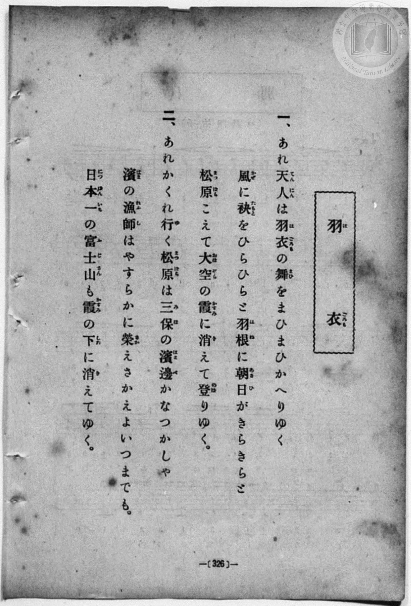
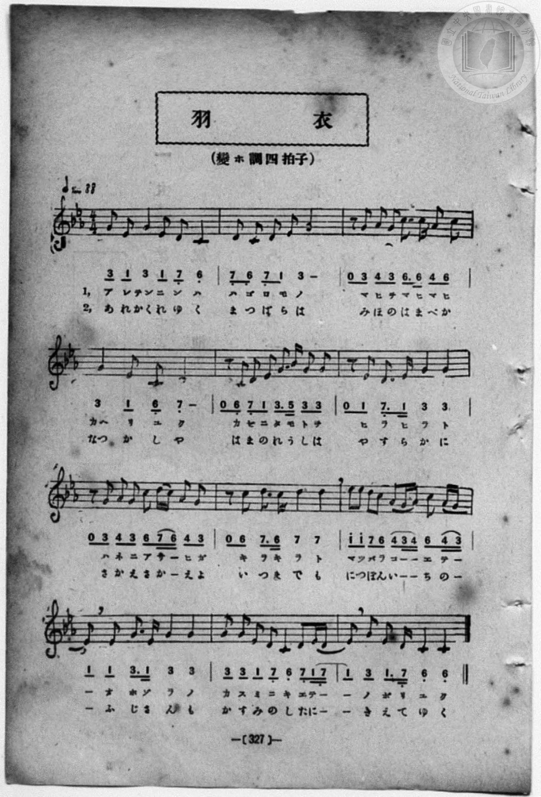

# 羽衣

> Re:Shōka 使用 AI 協助辨識與重建樂譜，可能會有錯誤。歡迎回報。

- **鋼琴伴奏版**：<br><audio controls src="hagoromo.mp3"></audio>
- **NEUTRINO 歌聲合成版**：<br><audio controls src="hagoromo_neutrino.mp3"></audio>

- book: 新編 小學校・公學校 唱歌教材集（尋常科五・六學年用）
- 一條慎三郎 編《新編 小學校・公學校 唱歌教材集》（大正十二年十二月，索書號 0725-41）
- 日治時期公學校《唱歌帳》（典藏號 2020.006.0843・P157）
- 原載《小公唱材集》第 327 頁（大正 13 年 12 月 23 日抄）

## 說明

> [!NOTE]
> **原書資訊與歌詞全文**（對應 `P334.jpg`–`P335.jpg`，原書 p. 326–327，尋常科五・六學年第 47 首）：
> - **調性與拍號**：變ホ調四拍子（E♭ 大調關係小調ハ短調 / C 小調・日本都節音階，4/4 拍），♩= 88
> - **比較校勘**：與公學校手抄《唱歌帳》（`docs/shokacho/vol_01/p157_hagoromo`）對照，原書五線譜與數字譜在第 3、5、6、8、10、12 小節記有細膩的附點八分音符＋十六分音符節奏（如 `6. 6`、`3. 5`、`7_. 1`、`7. 6`、`3. 1`、`1. 7_`），且第 11–12 小節跨小節延音為 `1 7_ - 1`（手抄本簡化為 `1 -`）。此外，第二節第 5 小節原書印作「濱の漁師（れうし）は」（手抄本誤抄為「はまのわかしは」）。本檔依原書五線譜與數字譜精確校訂並補齊雙段歌詞（`L1:`、`L2:`）。
>
> **一、**
> あれ天人（てんにん）は羽衣（はごろも）の舞（まひ）をまひまひかへりゆく
> 風（かぜ）に袂（たもと）をひらひらと羽根（はね）に朝日（あさひ）がきらきらと
> 松原（まつばら）こえて大空（おほぞら）の霞（かすみ）に消（き）えて登（のぼ）りゆく。
>
> **二、**
> あれかくれ行（ゆ）く松原（まつばら）は三保（みほ）の濱邊（はまべ）かなつかしや
> 濱（はま）の漁師（れうし）はやすらかに榮（さか）えさかえよいつまでも。
> 日本一（につぽんいち）の富士山（ふじさん）も霞（かすみ）の下（した）に消（き）えてゆく。


## 歌詞

```text
（TMD 檔案未包含歌詞註解）
```

## ABC

<div class="abc-score" data-abc-src="hagoromo.abc" aria-label="五線譜載入中"></div>

[下載 ABC 原始檔](hagoromo.abc)

## TMD 檔案連結

- [主旋律 TMD 檔案](hagoromo.tmd) [[在 TMD Studio 編輯](https://tmdlang.github.io/Tmd-TS/#tmd=s7IKdvYPcrWy4qpTUCpJTLdSSM7PyUlNLsnMz7MqzsjPTozPrsyvSsyML84ojTe0NDJWgqssy88pzU21Si9KTEmNN403Q8gU55cWJadaFSdn5OfnxJekVpQk5edno8vHFySmp1oFGBubIGQKivLLUvMS84C6C4oy80pSU8DaEQpSyzJTUkHSxcmJefFlqUWZaZmpKUiOSi0qBrsdYkVJUWJecXJRZgHIQwhV-UUlGflAhxdkVFplZBaX5BdlJifmxGcn5iUiFJVkpAK9l5afk52TX5SKLp6XWFKKLAo0Ij0zz6okMRMYbMDQyi9PjM9NzMzLScwDOk9LS-H5vr0vFi5W0NLiUrRVsLDgsrdVcNXhyk6ttFVwzuWyMdE3sQMZBgopK4Vn0zY8375C4emG_qdrdzxbsPBx8-6nrWsgbIWnUzY-W9vzbOrMZ3MnvJzd9n5Px9MN3U937Hi-fOKTXVPAStcClT7dueX5lBXv93SCHflkR8OzRXOftfY92dH5srlPAWj844YuUux53NANsmrJ8mdrFz_tbXyyqwdoA4TxbE7H-z09z7csejZ7x4uZ8xUMzI1MdU0MYXY_m7702abdz2Y2PZszH2480HaIBU93bIYa3brjxfR-kH4jAyMDPQMDMz0DCxNjoJsCDE3NYYY97Zv_Yk8nSDfQ0UDDgGbAnPd8zRoFYyNzhZcLGuEuVTA0VgC6U8HQSAHoSgUjYwWQa7pawMZx6Wsp2FILcCkoKNgpRCv6-Ye4xkI4WlpA14LCZHP7ixVdLzragd59sXLe09YVz6a1a2mBY673WXunQgIoG-hlFaQnPGqYDOKYgjnAQIUYoFCgB_SZGVAS6D-QKK4IB4aACTAAlk0D-u_9nlkQZ-gCHfJi1f5nDctBTujuBQYxyPJZL9Z1PW6eDZR5Ons2UPjp2glAF7k-mrlWARh2QOGX0-c82d8EDGcg-3Fz__P5a4EMBX0FZ1CCAYvtBgXmnDUvm_c-X9_wcv7ml7P6gK4DpmUFoHlgJ_Q8mrkSnN7hLnm2fsqLPc3AFPC0ewbEGR3t8FTxrLMbGDmYaSMhJT-5WB9cIgFLFX1g2RNvYKhfAEwX8RmJ6flF-bn5wNDqBAbn89bl8GADhs7z7bNerJ0D8vfUHU_XTgeyn85ZAU4ojxsaTYHYDIgtgNjQAEQYgbwG9MuLFTOezel8vmXDi7aVz2e1vJzZ8nI3MN5WP-1oA3rz-Zpl7_d0A9M-KOBhIkBdT5f2g-J0WZNCgpmeglkC0MQEYz0FUzDDPF5PwRDCQpKDiBjqKZjHgzwAdPqTHVNA7jM0BMY2wj3bV0AYT3dvA1nXtEshwRCoBxiihkB9HZBwA0bF8w0Ln_ZMg8rrgox83ND0bO2Sp0uASaIHaDAwuwKNAdlgCjUbElZPezc82TvncUPPs_0bHzeue7an8emO1UCTHzf1PG5se9w4HWRU4_rHDcB4RVj3YtUSIANoHVAjSLZxH1Dv46b-x43dQC0w9WA3zFnzbNWUJ_vm4oma55v2PV-0C5gMXqxoerJj2YvFc17u7Xo5e-azdVshOQeUEnwMrcBh5mNkBfUeOG3BchywoAPKAotZMP9xYxPQA0-XrHyyaxfIM43LHjdNfty4GkhC_AMplsFSQNdPedzU-7ipCSy17kUHyD6wlzaBRJomQdgwEujDHY-buh43AUOnH2Ldy0XAAheoBSg1B2zI6heLgKYBReYDjX3cCCqOweZsetwElIWQK4BueLZgJ8wNayEan82ZC8xcYEGgxqlQNzQCQxnoQiADQq6A2Pts7j5gsMJcu-Rx4wagLFg90LMgXwMz9POVkBDoety4-3HjPJiCdS_nQLwJdPPMx437obZvA5boQEFw5IFNeD5zN1hk3ePGPWBfQD2OEf67ejDCH2x4P5DxYmEPOEkBKy2gsf24nb0eWE092T8XLLUf6GCIU4FJ82VTFyyggFqAgQYUBxq-CqwdnOaaWqBhsn8jXCVUO6403dQC8jsoPIEmrH62bB1YIzDMgUUPxPsgNojRBGQDFQPtAtq-HBSnUO-Dq5U5a4CpD6x3NVjNXnBiA6pfCHHA0_U9TxevfroR4rCtjxtngEyGJMWmJmwRse7JDlDxB85LwIDCHjUoEUF5RQYFClr6XFzB-XnpVgGZiXn5DjUGNdUgCxRsDM20wNGtgK36VACVMTsagDGtoAGsesEljI4CrErTxKIBaA_IsBoFY1BpBsQgGgRBbHARZwYiQLAGiQ8p_JCUw2CNggFU1ARKm4HFzcB8ELsGbKGPYY3C46ZFQP7j5jVgsg1qwuPmzWCyG86GmAusBEEiTVvA4mvBJER_H4YbQK573DwPTE4Ck5vgIhAxZFmoi4yAdjQ2ge3oAZGNIBeA1TdCbAaLNsHcCVINFm_cByaXgMkNYDWdcJ3rUd3UuB9M7gaT65BUgEwBZim4vTVc-CN5Fyg7kxXJsMhFxCNm_GGLY1MwDcIQNfAEAmLCDIbRyJG8-nHzDFh4NK8Ck8vAoQQLG7R4a1oNJveAVYJTQRMo1CDx_bi5A8wCxScsniExvBKqBhS3EDaIB1KN5CBwHIPKK5gCcGADczjYmhbsDgJHESyawZEGTgogXhtML1gNzAMgc4DlCEQNMDEgJyWQ5yAOIpCLO8mJYGyZzxya-RBRBxGFZEsIDeODVBjGASkwARIDqYXoNoGyjZFiFxIB4GzQ3AsmIREGzphNW8Ei4OhpAmVyWPisBYtDIwzIwxph8CwKDs3mCXA9j5tghcLjphVgUVCWREQwJM6mgklI7IKTDKZIE4iEqYfEGSRdQDLjcrgtoEIB6iZw_MEyO6iKgWuGQWCFAyZBCYVAJAOb_uREMiwHQzIblswHz6mohTg0Q0MzLcQcmCqwLLyoR5T58JiGhAQk-86G8oChhBRzsGIYnOfB8uDirHk-mISkC3DMI8UawiEQ_Y-b50B5q6DFBMQmeDEKj2VIUINTWCOkeAHFMCRCMGMNEuugHAkrgiGFLyTvgl2IyJlQ08DpGZxSQPQypKIfUvBD3FPLxaVrpwCqqhWQaGUuAA)]
- [鋼琴伴奏 TMD 檔案](hagoromo_piano.tmd) [[在 TMD Studio 編輯](https://tmdlang.github.io/Tmd-TS/#tmd=s7IKdvYPcrWy4qpTUCpJTLdSSM7PyUlNLsnMz7MqzsjPTozPrsyvSsyML84ojTe0NDJWgqssy88pzU21Si9KTEmNN403Q8gU55cWJadaFSdn5OfnxJekVpQk5edno8vHFySmp1oFGBubIGQKivLLUvMS84C6C4oy80pSU8DaEQpSyzJTUkHSxcmJefFlqUWZaZmpKUiOSi0qBrsdYkVJUWJecXJRZgHIQwhV-UUlGflAhxdkVFplZBaX5BdlJifmxGcn5iUiFCUWATWnp-am5pVYFWQm5uXHJyYn5-cWJOZlgsQQCksygIqs0vJzsnPyi1LRxfMSS0pBolpaCs_37X2xcPH7PR0vZ8981tn9snvP8wlbnuzZ8nRp__s9nQpaWlyKtgoWFlz2tgquOlzZqZW2Cs65XDYm-iZ2IENBgWil8GzahufbVyg83dD_dO2OZwsWPm7e_bR1DYSt8HTKxmdre55Nnfls7oSXs9uAVj3d0P10x47nyyc-2TUFrHQtUOnTnVueT1kBtBPs2Cc7Gp4tmvuste_Jjs6XzX0KQOMfN3SRYs_jhm6QVUuWP1u7-Glv45NdPUAbIIxnczre7-l5vmXRs9k7Xsycr2BgbmSqa2IIs_vZ9KXPNu1-NrPp2Zz5cOOBtkMseLpjM9To1h0vpveD9BsZGBnoGRiY6RlYmBgD3RRgaGoOM-xp3_wXezpBuoGOBhoGNAPmvOdr1igYG5krvFzQqMTF5ZlXUpRvFQCK1CAPhxqDmmouBSCwsdCyAzNqFIwVDIFYF0iaxyuYxQNZNVAWkIRIgWCNggGQbQLEZmDSECgCVg2DBiBFXLUoVvogW2kCt9IsPl4h2iw-NxaJBXQIiG0MYiNYNQomILZJPKogqgEGEHuD8_PSsfjU0AzJqyBv6sL9BGIDPamL8AjY61A-mIWsHAZBQQERNYHSZmBxUMBA2DVgC30MaxQeNy0C8h83rwGTbVATHjdvBpPdcDbE3MfN_SCRpi1g8bVgEqK_D8MNINc9bp4HJieByU1wEYgYsizURUZAOxqbwHb0gMhGkAvA6hshNoNFm2DuBKkGizfuA5NLwOQGsJpOuM71qG5q3A8md4PJdUgqQKY8btwJt7eGCyleYPGBCHrMIMcWLaZgGoQhauBxCmLCDIYnYqR4Wf24eQbMC82rwOQysMdg3kEL6qbVYHIPWCU44ppAHoVE0ePmDjALFAWwqIFEykqoGlB0QNggHkg1koPA0bIKEr6QkAJb0DgdbE0LdgeBQxUWM-BwBsceiNcG0wtWA_MAyJzHjTMhaoDxhxz7IM9BHASNE2xJ3ByaxBGhDRGFJH4IDeODVBjGASkwARIDqYXoNoGyjZEiBBJm4MTW3AsmIWEMTv5NW8Ei4BBtAmUlmJfWgsWhYQzkYQ1jeEYAB0DzBLiex02wrPe4aQVYFJTwEXECCeapYBISIeBYxhRpApEw9ZBghkQlJMkvh9sCynpQN4GDHJal9j5umgzXDIOPGxeCSVDcwuMFlk8gSRpLEofnB9TSDZptoFkDYg5MFVgWXgYiCkN45EAcD8kks6E8oMeQAhtWPoFzFlgenM-b54NJSFSCIwspoBEOgeh_3DwHylsFzYwQm-DlCzxiIKEDThSNkEwMihRIGGIGNCSiQOkeVjZBSiVIDgG7EJH-oaaBkyA4ckH0MqQyEVIiQtyDUutQs7JDUgo1xhAoYAhXjVoJQuWQhZBMhRqAzWyM2hXVELgsmiPg9iFswe43pNpZ104B3DBQADJAYRbtAzQBzjYCs5W5AA)]

## 分析

```text
================================================================================
📊 TMD Song Profile: [ 羽衣 ]
================================================================================
⏱  Duration:       1:05 (65.5s), 24 measures total
🎼 Key & Tempo:    首調基準 E,, != 88.0 BPM, <4/4>
   - 分析範圍：      由實際發聲的音符與和弦推測調性；播放脈絡另行呈現
🎤 人聲音域:    C4 (MIDI 60) – D#5 (MIDI 75) [跨度: 15 個半音 / 1.2 個八度, 難度: moderate]
   - 最低音:  C4 in [Song #1 @ m.1, 0:02]
   - 最高音: D#5 in [Song #1 @ m.9, 0:21]
   - 適合: soprano, mezzo-soprano, contralto, tenor, baritone, bass
🏛  結構:      Song (32.7s) -> Song (32.7s)
⚡ 編曲密度:        Peak 1 軌道同時演奏
🗝  調性診斷：       G 大調（流行色彩大調，未偵測到可信轉調）
   - 風格氣質:    調式色彩／藍調前衛（調外音豐富，張力強烈）
   - 轉調歷程:    全曲維持單一推測調性（未偵測到可信轉調）
   - 核心骨幹音:  G, D, C, D#, G#
   - 調性數值:    G 大調 [相關度: 0.74, 穩定度: Moderate, 自然音純度: 78.6%]
   - 候選調性 (K-S): G 大調 (0.74), G 小調 (0.69), C 小調 (0.68)
   - 五度圈歷程:   +1 -> +1
   - 各段落調性細節:
     • [Song #1]: G 大調 (r: 0.74, 自然音純度: 78.6%, 調外音: D#, G#, A#)
     • [Song #2]: G 大調 (r: 0.74, 自然音純度: 78.6%, 調外音: D#, G#, A#)

  [ 五度圈游移軌跡 ]
               C  
         F           [G ]*
      Bb               D  
      Eb               A  
         Ab           E  
            Db       B  
               F# 
     (* = active key center)

  [ 十二半音累積音高分佈 ]
     C  : ██████████████            19.8%
     C# :                            0.0%
     D  : ████████████████          23.6%
     D# : ██████████                14.3%
     E  :                            0.0%
     F  :                            0.0%
     F# :                            0.0%
     G  : ████████████████████████  35.2%
     G# : █████                      6.6%
     A  :                            0.0%
     A# :                            0.5%
     B  :                            0.0%
--------------------------------------------------------------------------------
Assignment 軌道音域：
  - Piano         : C4 – D#5 (15 個半音 / 1.2 個八度, 150 個音符)
================================================================================
```


## 原書掃描頁






