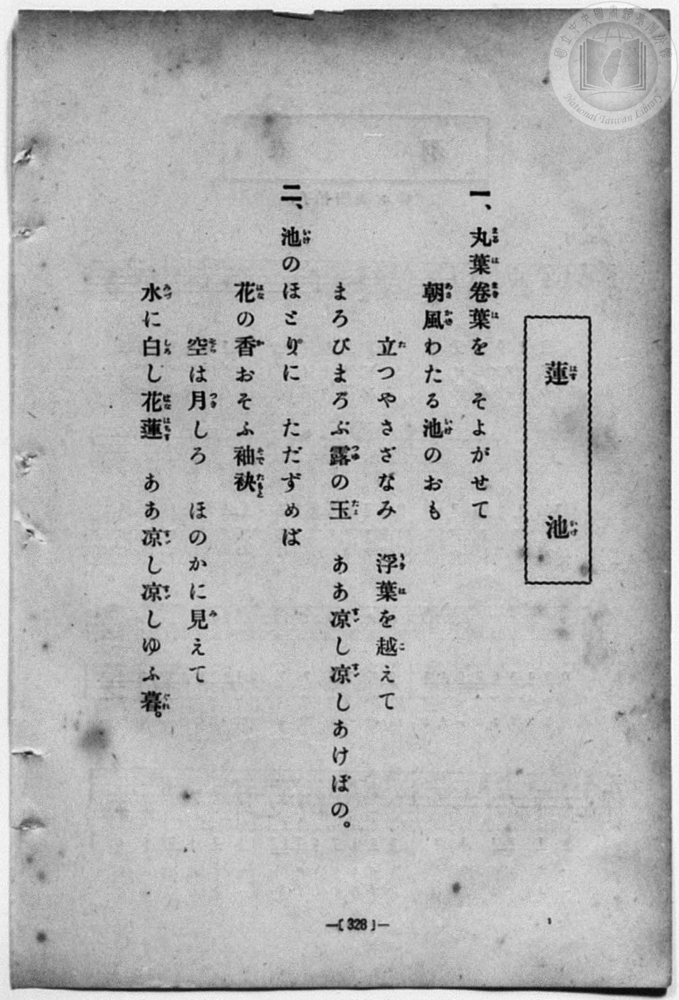
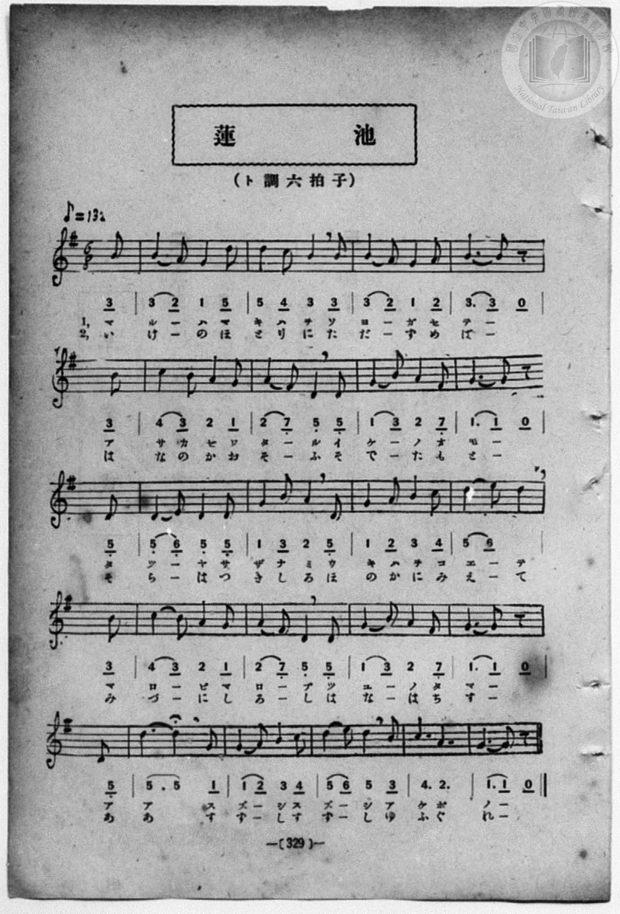

# 蓮池

> Re:Shōka 使用 AI 協助辨識與重建樂譜，可能會有錯誤。歡迎回報。

- **鋼琴伴奏版**：<br><audio controls src="hasuike.mp3"></audio>
- **NEUTRINO 歌聲合成版**：<br><audio controls src="hasuike_neutrino.mp3"></audio>

- book: 新編 小學校・公學校 唱歌教材集（尋常科五・六學年用）
- 一條慎三郎 編《新編 小學校・公學校 唱歌教材集》（大正十二年十二月，索書號 0725-41）
- lyricist: 文部省
- composer: 文部省

## 說明

> [!NOTE]
> **原書資訊與歌詞全文**（對應 `P336.jpg`–`P337.jpg`，原書 p. 328–329，尋常科五・六學年第 48 首）：
> - **調性與拍號**：ト調六拍子（G 大調 6/8 拍），♪= 132（換算四分音符 `!= 66`），弱起 1 拍（八分音符）
> - **曲調出處**：《尋常小學唱歌》第六學年曲目〈蓮池〉（ト長調 6/8 拍），亦收錄於臺灣教育會《新定兒童唱歌》尋常科第六學年用。
>
> **一、**
> 丸葉卷葉（まるばまきば）を　そよがせて
> 朝風（あさかぜ）わたる池（いけ）のおも
> 立（た）つやさざなみ　浮葉（うきは）を越（こ）えて
> まろびまろぶ露（つゆ）の玉（たま）　ああ涼（すゞ）し涼（すゞ）しあけぼの。
>
> **二、**
> 池（いけ）のほとりに　ただずめば
> 花（はな）の香（か）おそふ袖袂（そでたもと）
> 空（そら）は月（つき）しろ　ほのかに見（み）えて
> 水（みづ）に白（しろ）し花蓮（はなはちす）　ああ涼（すゞ）し涼（すゞ）しゆふ暮（ぐれ）。


## 歌詞

```text
（TMD 檔案未包含歌詞註解）
```

## ABC

```abc
X:1
T:蓮池
M:6/8
L:1/16
Q:3/8=44
K:G
V:V1 name="Piano" snm="Pia"
[V:V1]
z2 z2 z2 z2 z2 B2 | B4 A2 G4 d2 | d4 c2 B4 B2 | B4 A2 G4 A2 |
w: 1.~マ | ル _ ハ マ | キ ハ ヲ ソ | ヨ _ ガ セ
w: 2.~い | け _ の ほ | と り に た | だ _ ず め
B6 B2 z2 B2 | c4 B2 A4 G2 | A4 F2 D4 D2 | G4 B2 A4 F2 |
w: 1.~テ _ ア | サ カ ゼ ワ | タ _ ル イ | ケ _ ノ オ
w: 2.~ば _ は | な の か お | そ _ ふ そ | で _ た も
G6 G2 z2 D2 | D4 E2 D4 D2 | G4 B2 A4 D2 | G4 A2 B4 c2 |
w: 1.~モ _ タ | ツ _ ヤ サ | ザ ナ ミ ウ | キ ハ ヲ コ
w: 2.~と _ そ | ら _ は つ | き し ろ ほ | の か に み
d4 e2 d4 B2 | c4 B2 A4 G2 | A4 F2 D4 D2 | G4 B2 A4 F2 |
w: 1.~エ _ テ マ | ロ _ ビ マ | ロ _ ブ ツ | ユ _ ノ タ
w: 2.~え _ て み | づ _ に し | ろ _ し は | な _ は ち
G6 G2 z2 d2 | d6 d4 G2 | G4 A2 B4 c2 | d4 e2 d4 B2 |
w: 1.~マ _ ア | ア _ ス | ズ _ シ ス | ズ _ シ ア
w: 2.~す _ あ | あ _ す | ず _ し す | ず _ し ゆ
c6 A6 | G6 G2 z2 z2 | z2 z2 z2 z2 z2 B2 | B4 A2 G4 d2 |
w: 1.~ケ ボ | ノ _ | マ | ル _ ハ マ
w: 2.~ふ ぐ | れ _ | い | け _ の ほ
d4 c2 B4 B2 | B4 A2 G4 A2 | B6 B2 z2 B2 | c4 B2 A4 G2 |
w: 1.~キ ハ ヲ ソ | ヨ _ ガ セ | テ _ ア | サ カ ゼ ワ
w: 2.~と り に た | だ _ ず め | ば _ は | な の か お
A4 F2 D4 D2 | G4 B2 A4 F2 | G6 G2 z2 D2 | D4 E2 D4 D2 |
w: 1.~タ _ ル イ | ケ _ ノ オ | モ _ タ | ツ _ ヤ サ
w: 2.~そ _ ふ そ | で _ た も | と _ そ | ら _ は つ
G4 B2 A4 D2 | G4 A2 B4 c2 | d4 e2 d4 B2 | c4 B2 A4 G2 |
w: 1.~ザ ナ ミ ウ | キ ハ ヲ コ | エ _ テ マ | ロ _ ビ マ
w: 2.~き し ろ ほ | の か に み | え _ て み | づ _ に し
A4 F2 D4 D2 | G4 B2 A4 F2 | G6 G2 z2 d2 | d6 d4 G2 |
w: 1.~ロ _ ブ ツ | ユ _ ノ タ | マ _ ア | ア _ ス
w: 2.~ろ _ し は | な _ は ち | す _ あ | あ _ す
G4 A2 B4 c2 | d4 e2 d4 B2 | c6 A6 | G6 G2 z2 z2 |
w: 1.~ズ _ シ ス | ズ _ シ ア | ケ ボ | ノ _
w: 2.~ず _ し す | ず _ し ゆ | ふ ぐ | れ _
```

## TMD 檔案連結

- [主旋律 TMD 檔案](hasuike.tmd) [[在 TMD Studio 編輯](https://tmdlang.github.io/Tmd-TS/#tmd=s7IKdvYPcrWy4qpTUCpJTLdSSM7PyUlNLsnMz7MqzsjPTozPrsyvSsyML84ojTe0NDJWgqssy88pzU21Si9KTEmNN403Q8gU55cWJadaFSdn5OfnxJekVpQk5edno8vHFySmp1oFGBsj6Swoyi9LzUvMA-ouKMrMK0lNAWtHKEgty0xJBUkXJyfmxZelFmWmZaamIDkqtagY7HaIFSVFiXnFyUWZBSAPIVTlF5Vk5AMdXpBRaZWRWVySX5SZnJgTn52Yl4hQVJKRCvReQU5iHpL9EMG8xJLSolRk8zLTM_OscvPzkkqBoabEpaWl8GLyumcbFyhoaXEp2iqYmXHZ2yq4c9mY6VvYgbSBAsRK4dm0Dc-3r1B4uqH_6dodzxYsfNy8-2nrGghb4emUjc_W9jybOvPZ3AkvZ7e939PxdEP30x07ni-f-GTXFLDStUClT3dueT5lxfs9nWDnPNnR8GzR3GetfU92dL5s7lMAGv-4oYsUex43dIOsWrL82drFT3sbn-zqAdoAYTyb0_F-T8_zLYuezd7xYuZ8BQNzI1NdE0OY3TmVwGAEhibIX-0vm1c8n9MIFk_Ozy3IL04tQhHn0tdSsKUW4FJQULBTiFb08w9xjYVwtLSe9s0HuXNz-4sVXS862oF-fLFy3tPWFUBHaGmBQ7P3WXunQgIoBeplFaQnPGqYDOKYgzlAj0IMUCjQUzA2sgBKGhtZgkRxRcKaNQomFgovl00Dhsf7PbMgztAFOuTFqv3PGpaDnNDdCww2kOWzHjd3AIWBmoFiT9dOADrHXQEY5kAxBWASUQCKgk3peTRzla2CobERUMGz_tnP101_Onv20462l_M3P1-zTCEBnLSAbgUpfbpn44ut2xUMIZo7nrauhisEKkA459nsTSCr23e9mDkV4paGLoinIOkDkh6AyQDoI7jvgJqez173uKEDkqwfNwBt7AB64uXU7RhufrJr2bMp2172tDybtudF-67njYuBietF06Znc5ohafHpullPWyc9X70UbhU8UJHtBCbrxw1NYIfD4hSYvB83NALzFJj_ZMeOFxM7n_ZuB5Ig5zTue9zU_bhxA4jR2AtkAN3zuGnS44aGx41zHzcBFfQ8bpz9uHEZRPuzOXNfLgLmHKB40-PGqY8bgXrngLX0P26cDzQK6FGwbMvjxokg8cZ1jxu7HjdBnKTwfDUoowBVgqWWPG4CKgMaMu1x46rHjfuBlj7bug7msDawe9ZD3PNiWxdYcDJYI5ABdQ_Y_UBlm2GMbS_nbAKrBBoOzP8gBzzvgxg4H6gGJALyGtDxTc-27QGLz3zcNA-scjqmCFjlxMeNe0AeQQ_YXcBogAcsNo_vfty44nFT1-PG1WBLgQ5Y8Lhx1uOmRmA4Q3S96NoI1rUeGAIQXS-XzQSLAAMKyAXqnfu4ceuLRdNeLGoCiwO5y8FBDXQYqAiDBuzKXVDZJqBngRrXgwsecDg0gtIYyC_A8AE5A-gqoNuAEbf6xTJIdOxHC9VnG7ZAxB83LgVLrX4-cy9YBGQIxDSgy4HpGu54MLkQGHQkh3ATMKK3PpsFMWrC46YesAngoKa8lIMCBS19Li6PxOLSzGxg9ZmZmJfvUGNQUw2yQ8HGQgscpQrYSlcFaAmhrQDMZcCc9GJhj4KGCahWeL6-QUcBVvRpYtEJtBJkao2CARwaA3nGwALFCFji6CqYAnmmQNoELIYqZwTlgcTB-sBm-RjWKMTD4ePmeUBVj5tXg9U9bu4Hk2CxprVQkcfNm0Cspr1glSsgKpvWgMndYLE2sJguyLymRTB7jFDsaWwBqWycCNHduA5MgnU3gkwEpnAgC-QKYLoEiy6AqpwFlm0Ei21A2NO4HmgP7iAHhfSuHnJC2gQcXkZA0hDIA9Hm8Qqm8aCwjgcKgAIWIg0UhnBBKg3AsvAAfty0Fezs1UC8BxyMQOcC2fuhwQz2aNMSsNhGqFgfWGwVOEAXIQXofqQABWYSaPABMx-Y1QUOmLnQwALbCuSBxJZDxeaDzW2CBzUsAIGqCATgjk5yAhAcVmbYwwzONQKnTBNo6jUDk8gp9HFzCzRYloCdvxUcVNvAIsCU0gzx1DKs6XQzWBSaTsFpE5yiEYHY1AkNmvVgEhwNjb1g9nSgLIQFSZuQdNoNT5vAyACSHVD9y2Bi-AMS2Haga0pECUdQ6IBCYDIsHJDEpoFJcM5sBvkFkQzB_gSqxp6vgUU6NAQgoTIdHOKgcIPwIGELS66IkF4IFpuJlAiByZJQLp4CDjtTEhMh2AYQCQo7PCkOHMogWRCJHIoGKNkZliFBYbMT7NtdUN52nGLAEEPK3nOgNkBCGOJ_eJEBDtMmhB3AMAKJgMo-RIhiEWtqA4uBsj1IbALMjqYeFDtqubh07RSgdZcCKlOZCwA)]
- [鋼琴伴奏 TMD 檔案](hasuike_piano.tmd) [[在 TMD Studio 編輯](https://tmdlang.github.io/Tmd-TS/#tmd=s7IKdvYPcrWy4qpTUCpJTLdSSM7PyUlNLsnMz7MqzsjPTozPrsyvSsyML84ojTe0NDJWgqssy88pzU21Si9KTEmNN403Q8gU55cWJadaFSdn5OfnxJekVpQk5edno8vHFySmp1oFGBsj6Swoyi9LzUvMA-ouKMrMK0lNAWtHKEgty0xJBUkXJyfmxZelFmWmZaamIDkqtagY7HaIFSVFiXnFyUWZBSAPIVTlF5Vk5AMdXpBRaZWRWVySX5SZnJgTn52Yl4hQlFgE1JyempuaV2JVkJmYlx-fmJycn1uQmJcJEkMoLMkAKrIqyEnEFMxLLCktSlXi0tJSeDF53bONC97v6Xg5e-azzu6X3XueT9jyZM-Wp0v73-_pVNDS4lK0VTAz47K3VXDnsjHTt7ADmQUKOCuFZ9M2PN--QuHphv6na3c8W7DwcfPup61rIGyFp1M2Plvb82zqzGdzJ7yc3Qa04emG7qc7djxfPvHJrilgpWuBSp_u3PJ8ygqgVWA3PtnR8GzR3GetfU92dL5s7lMAGv-4oYsUex43dIOsWrL82drFT3sbn-zqAdoAYTyb0_F-T8_zLYuezd7xYuZ8BQNzI1NdE0OY3TmVwOAGhjrIX-0vm1c8n9MIFgcFbn5xahGKOJdnXklRvlUAKAKCPBxqDGqquRSAwMZCyw7MqFEwgENDIM9QQVfBSMEYSJoAeaZA2gxMGgN5JkAaJAsiISp1gSRIZw1XLYpVPoSsAmpRMIyHmAChMPkm8RCWKZSGq4AaALLTI7G4NDMbmA-I8iDIEyCvGYEdbwr1oAlYDFXOCMoDiYP1gc3yMaxRiIfDx83zgKoeN68Gq3vc3A8mwWJNa6Eij5s3gVhNe8EqV0BUNq0Bk7vBYm1gMV2QeU2LYPYYodjT2AJS2TgRortxHZgE624Emfi4qQvIArniceN8sOgCqMpZYNlGsNgGhD2N64H2QAMHFKfG4DgFxT6INo8Hhjg42KGRDJEGCiPHOUgWHiaPm7aCbVoNxHvAPgfaAGTvh4YM2G1NS8BiG6FifWCxVeAwWIQUBvuRwuBx4yqojx83doNZXWC_zIX6D2wrkAcSWw4Vmw82twkeOjA_A1XB_Az2nhl2b8K5ODIBws_NLVCfLAHbuBXsu21gEWB8NEPcsQxratgMFoWmBnAKAKcbhL-bOqG-WQ8mwSHX2AtmTwfKQliQFABJDd3wFAAMPyDZAdW_DCZGcXyjeB3kIZCjJ8OcjiQ2DUyCk2wzyHpEZIOdBlSNPcE_blwKdTTEI9PBgQTyKoQHCQ5YokAEzkKw2EykqAZGPjyqwYIgkpLCDZHOYSkV5J2dYAfugvK24xQDehIp3c-B2gAJFIiT4XkJHAxNCDuA3gKJgPIxIhCwiDW1gcVA-QEkNgFmR1MPih3oBSZZxTSsOEYvt3EW09CEh64Nph5DHwGDiNeHYRW9XURR1aZrpwCuURWADGisRfsYxqJwjcBcZS4A)]

## 分析

```text
================================================================================
📊 TMD Song Profile: [ 蓮池 ]
================================================================================
⏱  Duration:       2:00 (120.0s), 44 measures total
🎼 Key & Tempo:    首調基準 G, != 66.0 BPM, <6/8>
   - 分析範圍：      由實際發聲的音符與和弦推測調性；播放脈絡另行呈現
🎤 人聲音域:    D4 (MIDI 62) – E5 (MIDI 76) [跨度: 14 個半音 / 1.2 個八度, 難度: moderate]
   - 最低音:  D4 in [Hasuike #1 @ m.7, 0:17]
   - 最高音: E5 in [Hasuike #1 @ m.13, 0:33]
   - 適合: soprano, mezzo-soprano, contralto, tenor, baritone, bass
🏛  結構:      Hasuike (60.0s) -> Hasuike (60.0s)
⚡ 編曲密度:        Peak 1 軌道同時演奏
🗝  調性診斷：       G 大調（純淨自然大調，未偵測到可信轉調）
   - 風格氣質:    純淨自然大調（陽光明朗、易唱易記，無明顯調外色彩）
   - 轉調歷程:    全曲維持單一推測調性（未偵測到可信轉調）
   - 核心骨幹音:  D, G, B, A, C
   - 調性數值:    G 大調 [相關度: 0.89, 穩定度: High, 自然音純度: 100.0%]
   - 候選調性 (K-S): G 大調 (0.89), D 大調 (0.76), B 小調 (0.65)
   - 五度圈歷程:   +1 -> +1
   - 各段落調性細節:
     • [Hasuike #1]: G 大調 (r: 0.89, 自然音純度: 100.0%)
     • [Hasuike #2]: G 大調 (r: 0.89, 自然音純度: 100.0%)

  [ 五度圈游移軌跡 ]
               C  
         F           [G ]*
      Bb               D  
      Eb               A  
         Ab           E  
            Db       B  
               F# 
     (* = active key center)

  [ 十二半音累積音高分佈 ]
     C  : ████████                   8.2%
     C# :                            0.0%
     D  : ████████████████████████  24.6%
     D# :                            0.0%
     E  : ██                         2.5%
     F  :                            0.0%
     F# : ███                        3.3%
     G  : ███████████████████████   23.8%
     G# :                            0.0%
     A  : ██████████████████        18.0%
     A# :                            0.0%
     B  : ███████████████████       19.7%
--------------------------------------------------------------------------------
Assignment 軌道音域：
  - Piano         : D4 – E5 (14 個半音 / 1.2 個八度, 154 個音符)
================================================================================
```


## 原書掃描頁






