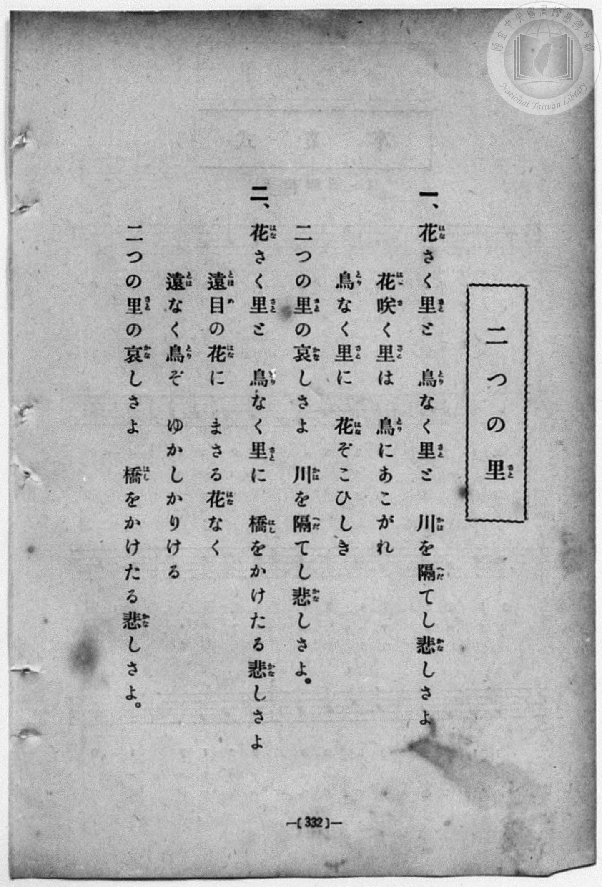
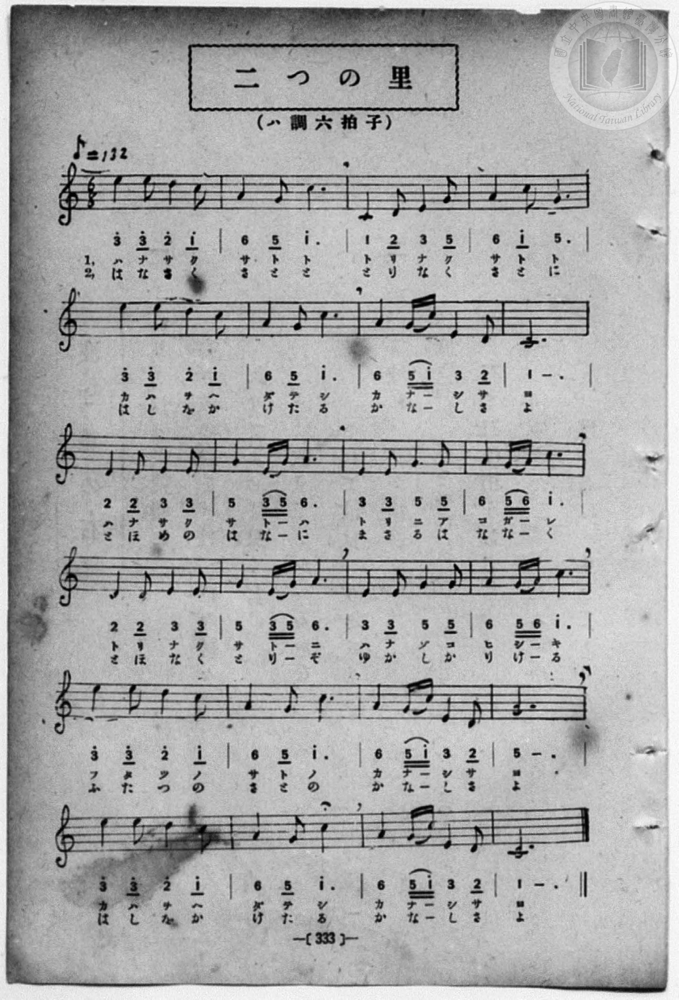

# 二つの里

> Re:Shōka 使用 AI 協助辨識與重建樂譜，可能會有錯誤。歡迎回報。

<audio controls src="futatsu_no_sato.mp3"></audio>

- book: 新編 小學校・公學校 唱歌教材集（尋常科五・六學年用）
- 一條慎三郎 編《新編 小學校・公學校 唱歌教材集》（大正十二年十二月，索書號 0725-41）

## 說明

> [!NOTE]
> **原書資訊與歌詞全文**（對應 `P340.jpg`–`P341.jpg`，原書 p. 332–333，尋常科五・六學年第 50 首）：
> - **調性與拍號**：ハ調六拍子（C 大調 6/8 拍），♪= 132（換算四分音符 `!= 66`）
> - **歌曲寓意**：描寫隔川相望的「花開之里」與「鳥鳴之里」——隔川時彼此欣羨思慕，等到架起橋樑得以往來後，卻發現近看的鮮花與近聽的鳥鳴反而不及遠望與遙聞時那般動人（寓意距離產生美感與人生哲理）。
> - **原頁印刷註記**：`P341.jpg` 第二行與第六行歌詞，第一節唱「カハヲヘダテシ」（川を隔てし），第二節唱「はしをかけたる」（橋をかけたる）；`P340.jpg` 歌詞頁第一節第 1 句印作「川を隔てし悲しさよ」，而 `P341.jpg` 第一行譜下配字為「ハナサクサトト　トリナクサトト（に）」，第二行緊接「カハヲヘダテシ　カナシサヨ」。
>
> **一、**
> 花（はな）さく里（さと）と　鳥（とり）なく里（さと）と　川（かは）を隔（へだ）てし悲（かな）しさよ
> 花咲（はなさ）く里（さと）は　鳥（とり）にあこがれ
> 鳥（とり）なく里（さと）に　花（はな）ぞこひしき
> 二つの里（さと）の哀（かな）しさよ　川（かは）を隔（へだ）てし悲（かな）しさよ。
>
> **二、**
> 花（はな）さく里（さと）と　鳥（とり）なく里（さと）に　橋（はし）をかけたる悲（かな）しさよ
> 遠目（とほめ）の花（はな）に　まさる花（はな）なく
> 遠（とほ）なく鳥（とり）ぞ　ゆかりかりける
> 二つの里（さと）の哀（かな）しさよ　橋（はし）をかけたる悲（かな）しさよ。
>
> （註：P340 第二節印作「ゆかしかりける」，P341 第四行譜下配字同為「ゆかしかりける」。）


## 歌詞

```text
（TMD 檔案未包含歌詞註解）
```

## ABC

```abc
X:1
T:二つの里
M:6/8
L:1/16
Q:3/8=44
K:C
V:V1 name="Piano" snm="Pia"
[V:V1]
e4 e2 d4 c2 | A4 G2 c6 | C4 D2 E4 G2 | A4 c2 G6 |
w: ハ ナ サ ク | サ ト ト | ト リ ナ ク | サ ト ト
e4 e2 d4 c2 | A4 G2 c6 | A4 G c E4 D2 | C10 z2 |
w: カ ハ ヲ へ | ダ テ シ | カ ナ _ シ サ | ヨ
D4 D2 E4 E2 | G4 E G A6 | E4 E2 G4 G2 | A4 G A c6 |
w: ハ ナ サ ク | サ ト _ ハ | ト リ ニ ア | コ ガ _ レ
D4 D2 E4 E2 | G4 E G A6 | E4 E2 G4 G2 | A4 G A c6 |
w: ト リ ナ ク | サ ト _ ニ | ハ ナ ゾ コ | ヒ シ _ キ
e4 e2 d4 c2 | A4 G2 c6 | A4 G c E4 D2 | G10 z2 |
w: フ タ ツ ノ | サ ト ノ | カ ナ _ シ サ | ヨ
e4 e2 d4 c2 | A4 G2 c6 | A4 G c E4 D2 | C10 z2 |
w: カ ハ ヲ へ | ダ テ シ | カ ナ _ シ サ | ヨ
e4 e2 d4 c2 | A4 G2 c6 | C4 D2 E4 G2 | A4 c2 G6 |
w: は な さ く | さ と と | と り な く | さ と に
e4 e2 d4 c2 | A4 G2 c6 | A4 G c E4 D2 | C10 z2 |
w: は し を か | け た る | か な _ し さ | よ
D4 D2 E4 E2 | G4 E G A6 | E4 E2 G4 G2 | A4 G A c6 |
w: と ほ め の | は な _ に | ま さ る は | な な _ く
D4 D2 E4 E2 | G4 E G A6 | E4 E2 G4 G2 | A4 G A c6 |
w: と ほ な く | と り _ ぞ | ゆ か し か | り け _ る
e4 e2 d4 c2 | A4 G2 c6 | A4 G c E4 D2 | G10 z2 |
w: ふ た つ の | さ と の | か な _ し さ | よ
e4 e2 d4 c2 | A4 G2 c6 | A4 G c E4 D2 | C10 z2 |
w: は し を か | け た る | か な _ し さ | よ
```

## TMD 檔案連結

- [主旋律 TMD 檔案](futatsu_no_sato.tmd) [[在 TMD Studio 編輯](https://tmdlang.github.io/Tmd-TS/#tmd=s7IKdvYPcrWy4qpTUCpJTLdSSM7PyUlNLsnMz7MqzsjPTozPrsyvSsyML84ojTe0NDJWgqssy88pzU21Si9KTEmNN403Q8gU55cWJadaFSdn5OfnxJekVpQk5edno8vHFySmp1oFGJsYIGQKivLLUvMS84C6C4oy80pSU8DaEQpSyzJTUkHSxcmJefFlqUWZaZmpKUiOSi0qBrsdYkVJUWJecXJRZgHIQwhV-UUlGflAhxdkVFplZBaX5BdlJifmxGcn5iUiFJVkpAK9l5afk52TX5SKLp6amw8xU0tL4cmunseNSx43rnvZ3qOgpcWlaKtgZsZlb6vgzGVjpm9hB9IKCgErhWfTNjzfvkLh6Yb-p2t3PFuw8HHz7qetayBshadTNj5b2_Ns6sxncye8nN32fk_H0w3dT3fseL584pNdU8BK1wKVPt255fmUFe_3dIKd9GRHw7NFc5-19j3Z0fmyuU8BaPzjhi5S7Hnc0A2yasnyZ2sXP-1tBHoGaAOE8WxOx_s9Pc-3LHo2e8eLmfMVDMyNTHVNDMF2c-lrKdhSC3ApKCjYKUQr-vmHuMZCOFpaT_vmg-zd3P5iRdeLjnagm1-snPe0dcWzae1aWuDQ6X3W3qmQAEpCelkF6QmPGiaDOIZgDtDhEAMUCvQUjI2NgJLGxsYgUVyBumaNgqmBwstl04D-e79nFsQZukCHvFi1_1nDcpATunuBwQCyfNbj5n6gMFAzUOzp2glA5zgrAMMQKKYAjHIFoCjYlJ5HM1fZKhgaGwEVPOuf_Xzd9KezZz_taHs5f_PzNcsUEsBJBejWToRtoLiZvenp-snPWvrBVj3r73-6fvXLWVOebp_7fPaOZ3NmP5_V8rih50XXxpfTup_s7AYmu8cNvUD3AQVfbl76cvMWuOCjhilABNH7bGbT0717nq1d8mzN4uf7VjxrACabqaD4Xdv5tGPDs3nbXmzd_mxl97MVE5_um_5k99Kn-xqe7Gt7uq8HFGi9u5_P3PO8f9-L_ROfz-kGOuDlunVABwAtBYq8aNwLEgFb_bS_90VDz5MdvU_7u142LgC6FqjmZePMF43zgA542bT4Rceap91Tn-zaBYpCsC9fbJ_7cvai51OAaP7zfX3PWuYDtQAVALlPJ296PgGYFTofNzQhgggYsS8XND7t3fC0Y_uLFbtfrJgBDihE5CsAIxOYfl8s7AGaBGQD4wnIhqQgkI-Bsjsanq9vAGYFYJg9bloNjM7HzZseN8943NzwuLntcdN2YOCBHLh97uOmScDwe9y47HHjdEicQgxHaG9cD5QCKnvc2P24ceLjxvmPm7oh2oHBiSYONmE2Is0qQBwF9A7cUaCEaKjwtH8p0INP9s4B2oDmimdNm0AWNk593NQBtqcHGOLgfIDk-x0NIN-vnfNkR_fLVmASnf68aRfIsSCPdj1u2vq4aT2IbO4AoQagp4GMVWAphDjQB48bV4NDH2QLPFCfb-961rcUd8g1gMWBRm0HGwUskXph8QfL3ED3PW5oBBaWYD4wJYHtAgbkKpB1QK819gNTMFgQyAYVd0ASaDIwkYEFVzxu6gILrsKlEhhoYEFg2K8HCYIDECyy43HjArAyaGDClEGshgYs3GFPJ0EUgNwGlAKrwbRxPTa3rX7c2PS4cfLjRmBA9UAMJM79q4GmYYTJPLBRkKjvhZiGXPOgmrDu6eQGrP6iPGQwohLoCNpFJSgogNkIZiYoC6JlKfwxCCyDns9eB7WocffjpkZI-GC4E2TR48Z9YL3dGLIgt8ENhJuGcDa6X-aBc0EbyFVNXTByItBkSiKOvHBAjS-gEmCRCSwtQUUQtJwEFWWwsgbqaJBmhKMh-R9UwIB0AKswtLLl6YQeaPGCQzfQDdBKjvLGAhQoaOlzcbmVliSWFJf65QcnluRbBWQm5uU71BjUKFSDrFKwMTTTAntbAVtjBVFMKmiYgNpKwGDQUYCVoppYNABtBBlWo2AcB6yHQBDMMILxDEGMGgUzKNcUJgSDNcByHcIyAulFUobQBNYAEoJrAtvpY1ijACxqoWLAwhVENm2F8ZvWgw1BEmnugJMI6xF8YGEPN4cEEyBuMQKqawSpB6trBJvUOBXOB7kSpAIhsgJOIrkFzgcmFLg5-E1YjeIW_DELrqnoF7MIKaAELGpB0YyIdGRoAPYBPGabYD6DxDGwRoX7fAckLJob4CrawGG2HcV6ZBMgaQMmD4lRkAnI4Q-D8Qh3oMXqdLDeSXB-N8SUxolwkflgFSBx5FiF8WHpAmQOhA-KTZBLkVMUqjsI5NVOcmIUFAewuIDFC4iugecyYyALFn0QXyCrg6lCzaYgHagpgKJsCtMBDUSMbAoP1KZFUBM2w0XWgFWASDS3gCMUnskad4NVN8L56yAmYWRklEwG5O-Dy4MiEBHhEJ0gFYiMCzEBxTf4IxVSlwyFSCW95ETLGRjJAh6w4MgEqYDnNnDufdy0FtMt2CIVS8mJXrbOQ3VLE6gMgegAuRI5l0LzOVgfRASU49HyOaGyd8pgKXuRa1IYRCt7m-G1TNN-ENncAuMDx1OwxyxIHDk0qVP2wm2BlKyNS-B8WFZFrw9B4kjuoF3ZC-lAj9amQ6o2reXi0rVTQGkiR_sYxipgChqBBZW5AA)]
- [鋼琴伴奏 TMD 檔案](futatsu_no_sato_piano.tmd) [[在 TMD Studio 編輯](https://tmdlang.github.io/Tmd-TS/#tmd=s7IKdvYPcrWy4qpTUCpJTLdSSM7PyUlNLsnMz7MqzsjPTozPrsyvSsyML84ojTe0NDJWgqssy88pzU21Si9KTEmNN403Q8gU55cWJadaFSdn5OfnxJekVpQk5edno8vHFySmp1oFGJsYIGQKivLLUvMS84C6C4oy80pSU8DaEQpSyzJTUkHSxcmJefFlqUWZaZmpKUiOSi0qBrsdYkVJUWJecXJRZgHIQwhV-UUlGflAhxdkVFplZBaX5BdlJifmxGcn5iUiFCUWATWnp-am5pVYFWQm5uXHJyYn5-cWJOZlgsQQCksygIqs0vJzsnPyi1LRxVNz8yGWa2kpPNnV87hxyePGdS_be97v6Xg5e-azzu6X3XueT9jyZM-Wp0v73-_pVNDS4lK0VTAz47K3VXDmsjHTt7ADGQkKQiuFZ9M2PN--QuHphv6na3c8W7DwcfPup61rIGyFp1M2Plvb82zqzGdzJ7yc3Qa04emG7qc7djxfPvHJrilgpWuBSp_u3PJ8ygqgVWCnPtnR8GzR3GetfU92dL5s7lMAGv-4oYsUex43dIOsWrL82drFT3sbgZ4E2gBhPJvT8X5Pz_Mti57N3vFi5nwFA3MjU10TQ7DdXJ55JUX5VgGgoA3ycKgxqFGo5lIAAhtDMy07MKtGwThOQRcMwQwjGM8QxKhRMINyTWFCMIgsBZQwhnKMwFKGSAph0AAkw1WL4igfFEdZwN1kGA8xOR5C1yiYQBhQcTgfoQAqYwCGYGvcSksSS4pL_fKDE0toFgYwj4K8DQsCkDKEJrAGkBBcE9hOH8MahcfN_VCxx81dILJpK4zftB5sCJJIcwecRFiP4D9uXgU3hwQTIG4xAqprBKkHq2sEm9Q4Fc4HuRKkAiGyAk4iuQXOf9wE9g3YHPwmrEZxy4AkSHhkNMEcA4mWx82b4I7dAXF-cwNcRRvYm9tRrEc2ARKdMHlIJIBMQA4yGASlXOwRMR2sdxKc3w0xpXEiXGQ-WAVIHDkiYHxYVILMgfBBEQByKXIiQHUHNBJAwQYLPlhQgugaeFo2BrJgIQ6xGFkdTBVqZgDpQI00ijIDTAfU3xiZAR4OTYugJmyGi6wBqwCRaG4BxwE8KTfuBqtuhPPXQUzCyC4oSRnI3weXB4U5Io4gOkEqENkDYgKKbwYwHkgvUtDSH0ZMwsMCHP4gFfA0Dc4jj5vWYroFWzxgKVLQC515qG5pAuVUiA6QK5HzAjQ3gfVBRED5Ci030bJQQq4VYBCtUGqGl5hN-0FkcwuMD2xHYI8MkDhyAFCnUILbAilyGpfA-bAMgV62g8SR3EGNQmm0ZoDZOxA1A_Y2FdlNOCgDZ5OOWk1BiDEwaXTrzdC1oZsL41PZHGK9ZQTjw1SieosaDWVdOwVwk1wByECJ4Ggfw1gsgkZgQWUuAA)]

## 分析

```text
================================================================================
📊 TMD Song Profile: [ 二つの里 ]
================================================================================
⏱  Duration:       2:10 (130.9s), 48 measures total
🎼 Key & Tempo:    首調基準 C, != 66.0 BPM, <6/8>
   - 分析範圍：      由實際發聲的音符與和弦推測調性；播放脈絡另行呈現
🎤 人聲音域:    C4 (MIDI 60) – E5 (MIDI 76) [跨度: 16 個半音 / 1.3 個八度, 難度: moderate]
   - 最低音:  C4 in [FutatsuNoSato[L1] #1 @ m.3, 0:05]
   - 最高音: E5 in [FutatsuNoSato[L1] #1 @ m.1, 0:00]
   - 適合: soprano, mezzo-soprano, contralto, tenor, baritone, bass
🏛  結構:      FutatsuNoSato[L1] (65.5s) -> FutatsuNoSato[L2] (65.5s)
⚡ 編曲密度:        Peak 1 軌道同時演奏
🗝  調性診斷：       C 大調（純淨自然大調，未偵測到可信轉調）
   - 風格氣質:    純淨自然大調（陽光明朗、易唱易記，無明顯調外色彩）
   - 轉調歷程:    全曲維持單一推測調性（未偵測到可信轉調）
   - 核心骨幹音:  C, E, A, G, D
   - 調性數值:    C 大調 [相關度: 0.84, 穩定度: Moderate, 自然音純度: 100.0%]
   - 候選調性 (K-S): C 大調 (0.84), A 小調 (0.76), E 小調 (0.64)
   - 五度圈歷程:   +0 -> +0
   - 各段落調性細節:
     • [FutatsuNoSato[L1] #1]: C 大調 (r: 0.84, 自然音純度: 100.0%)
     • [FutatsuNoSato[L2] #1]: C 大調 (r: 0.84, 自然音純度: 100.0%)

  [ 五度圈游移軌跡 ]
              [C ]*
         F            G  
      Bb               D  
      Eb               A  
         Ab           E  
            Db       B  
               F# 
     (* = active key center)

  [ 十二半音累積音高分佈 ]
     C  : ████████████████████████  25.9%
     C# :                            0.0%
     D  : ████████████              12.8%
     D# :                            0.0%
     E  : ██████████████████████    23.4%
     F  :                            0.0%
     F# :                            0.0%
     G  : █████████████████         18.8%
     G# :                            0.0%
     A  : ██████████████████        19.1%
     A# :                            0.0%
     B  :                            0.0%
--------------------------------------------------------------------------------
Assignment 軌道音域：
  - Piano         : C4 – E5 (16 個半音 / 1.3 個八度, 170 個音符)
================================================================================
```


## 原書掃描頁






