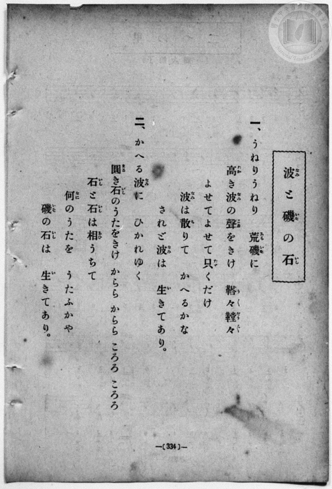
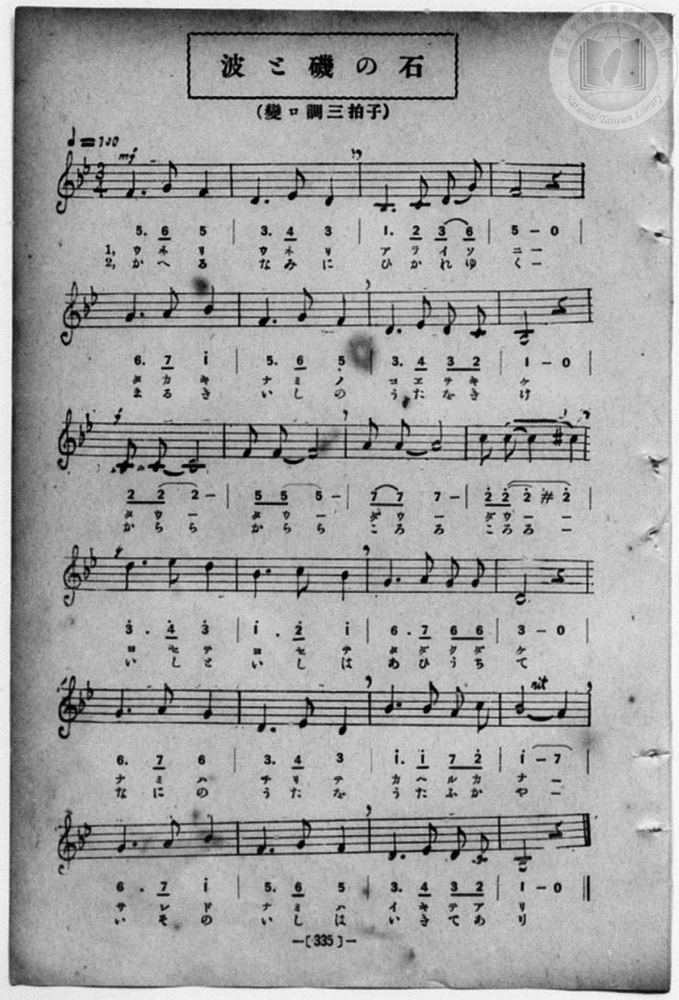

# 波と磯の石

> Re:Shōka 使用 AI 協助辨識與重建樂譜，可能會有錯誤。歡迎回報。

- **NEUTRINO 歌聲合成版**：<br><audio controls src="nami_to_iso_no_ishi_neutrino.mp3"></audio>
- **鋼琴伴奏版**：<br><audio controls src="nami_to_iso_no_ishi.mp3"></audio>


- book: 新編 小學校・公學校 唱歌教材集（尋常科五・六學年用）
- 一條慎三郎 編《新編 小學校・公學校 唱歌教材集》（大正十二年十二月，索書號 0725-41）
- 日治時期公學校《唱歌帳》（典藏號 2020.006.0843・P205）
- 原載《小公唱材集》第 335 頁（昭和 2 年 1 月 28 日抄）

## 說明

> [!NOTE]
> **原書資訊與歌詞全文**（對應 `P342.jpg`–`P343.jpg`，原書 p. 334–335，尋常科五・六學年第 51 首）：
> - **調性與拍號**：變ロ調三拍子（B♭ 大調 3/4 拍），♩= 100
> - **比較校勘**：與公學校手抄《唱歌帳》（`docs/shokacho/vol_01/p205_nami_to_iso_no_ishi`）對照，原書五線譜與數字譜在第 2 小節第 3 拍印作 `3`（D4），且第 1、5、11、17、21 小節之 `5`、`6`、`7` 均在中央八度（無低音點），第 9–12 小節「鼕々（ダウ〜） / からら」為八分音符加二分音符連音並逐級上行（`2` ➔ `5` ➔ `7` ➔ `2^ #2^`）推向高潮 `3^. 4^ | 3^`。本檔依原書五線譜與數字譜精確校訂並補齊雙段歌詞（`L1:`、`L2:`）。
>
> **一、**
> うねりうねり　荒磯（あらいそ）に
> 高（たか）き波（なみ）の聲（こゑ）をきけ　鼕々鼕々（だう／＼だう／＼）
> よせてよせて只（たゞ）くだけ
> 波（なみ）は散（ち）りて　かへるかな
> されど波（なみ）は　生（い）きてあり。
>
> **二、**
> かへる波（なみ）に　ひかれゆく
> 圓（まる）き石（いし）のうたをきけ　からら　からら　ころろ　ころろ
> 石（いし）と石（いし）は相（あひ）うちて
> 何（なに）のうたを　うたふかや
> 磯（いそ）の石（いし）は　生（い）きてあり。


## 歌詞

```text
（TMD 檔案未包含歌詞註解）
```

## ABC

```abc
X:1
T:波と磯の石
M:3/4
L:1/16
Q:1/4=100
K:Bb
V:V1 name="Piano" snm="Pia"
[V:V1]
!mf! f6 g2 f4 | d6 e2 d4 | B6 c2 d2 g2 | f8 z4 |
w: 1.~ウ ネ リ | ウ ネ リ | ア ラ イ ソ | ニ
w: 2.~か へ る | な み に | ひ か れ ゆ | く
g6 a2 b4 | f6 g2 f4 | d6 e2 d2 c2 | B8 z4 |
w: 1.~タ カ キ | ナ ミ ノ | コ ヱ ヲ キ | ケ
w: 2.~ま る き | い し の | う た を き | け
c2 c2 c8 | f2 f2 f8 | a2 a2 a8 | c'2 c'2 c'4 ^c'4 |
w: 1.~ダ ウ _ | ダ ウ _ | ダ ウ _ | ダ ウ _ _
w: 2.~か ら ら | か ら ら | こ ろ ろ | こ ろ ろ _
d'6 e'2 d'4 | b6 c'2 b4 | g6 a2 g2 g2 | d8 z4 |
w: 1.~ヨ セ テ | ヨ セ テ | タ ダ ク ダ | ケ
w: 2.~い し と | い し は | あ ひ う ち | て
g6 a2 g4 | d6 e2 d4 | b6 b2 a2 c'2 | b8 a4 |
w: 1.~ナ ミ ハ | チ リ テ | カ へ ル カ | ナ _
w: 2.~な に の | う た を | う た ふ か | や _
g6 a2 b4 | f6 g2 f4 | d6 e2 d2 c2 | B8 z4 |
w: 1.~サ レ ド | ナ ミ ハ | イ キ テ ア | リ
w: 2.~い そ の | い し は | い き て あ | り
!mf! f6 g2 f4 | d6 e2 d4 | B6 c2 d2 g2 | f8 z4 |
w: 1.~ウ ネ リ | ウ ネ リ | ア ラ イ ソ | ニ
w: 2.~か へ る | な み に | ひ か れ ゆ | く
g6 a2 b4 | f6 g2 f4 | d6 e2 d2 c2 | B8 z4 |
w: 1.~タ カ キ | ナ ミ ノ | コ ヱ ヲ キ | ケ
w: 2.~ま る き | い し の | う た を き | け
c2 c2 c8 | f2 f2 f8 | a2 a2 a8 | c'2 c'2 c'4 ^c'4 |
w: 1.~ダ ウ _ | ダ ウ _ | ダ ウ _ | ダ ウ _ _
w: 2.~か ら ら | か ら ら | こ ろ ろ | こ ろ ろ _
d'6 e'2 d'4 | b6 c'2 b4 | g6 a2 g2 g2 | d8 z4 |
w: 1.~ヨ セ テ | ヨ セ テ | タ ダ ク ダ | ケ
w: 2.~い し と | い し は | あ ひ う ち | て
g6 a2 g4 | d6 e2 d4 | b6 b2 a2 c'2 | b8 a4 |
w: 1.~ナ ミ ハ | チ リ テ | カ へ ル カ | ナ _
w: 2.~な に の | う た を | う た ふ か | や _
g6 a2 b4 | f6 g2 f4 | d6 e2 d2 c2 | B8 z4 |
w: 1.~サ レ ド | ナ ミ ハ | イ キ テ ア | リ
w: 2.~い そ の | い し は | い き て あ | り
```

## TMD 檔案連結

- [主旋律 TMD 檔案](nami_to_iso_no_ishi.tmd) [[在 TMD Studio 編輯](https://tmdlang.github.io/Tmd-TS/#tmd=s7IKdvYPcrWy4qpTUCpJTLdSSM7PyUlNLsnMz7MqzsjPTozPrsyvSsyML84ojTe0NDJWgqssy88pzU21Si9KTEmNN403Q8gU55cWJadaFSdn5OfnxJekVpQk5edno8vHFySmp1oFGJsYIWQKivLLUvMS84C6C4oy80pSU8DaEQpSyzJTUkHSxcmJefFlqUWZaZmpKUiOSi0qBrsdYkVJUWJecXJRZgHIQwhV-UUlGflAhxdkVFplZBaX5BdlJifmxGcn5iUiFJVkpAK9l5dYUlqUii5anliSWoRsXmZ6Zp5VSWJmOdBV-WlpmcmZiTlKXFpaCs82L3rcuOL54vWPG9c9n79ZQUuLS9FWwdDAgMveVsFJh8vGWN_EDmQQKIisFJ5N2_B8-wqFpxv6n67d8WzBwsfNu5-2roGwFZ5O2fhsbc-zqTOfzZ3wcnbb-z0dTzd0P92x4_nyiU92TQErXQtU-nTnludTVrzf0wl24JMdDc8WzX3W2vdkR-fL5j4FoPGPG7pIsedxQzfIqiXLn61d_LS38cmuHqANEMazOR3v9_Q837Lo2ewdL2bOVzAwNzLVNTGE2f1s-tJnm3Y_m9n0bM58uPFA2yEWPN2xGWp0644X0_tB-o0MjAz0DAzM9AwsTIyBbgowMjCFGfa0b_6LPZ0g3UBHAw0DmgFz3vM1axSMjU0VXi5oBBr3bMbap5N6FIwUgM5UMFQAulHByEIB5JauFrBhXPpaCrbUAlwKCgp2CtGKfv4hrrEQjpYW0K2gENnc_mJF14uOdqBnX6yc97R1xbNp7Vpa4HjrfdbeqZAASv16WQXpCY8aJoM4xmAOMEghBigU6AH9ZQKUBPoOJIoruoH-NzVUeLlsGtB_7_fMgjhDF-iQF6v2P2tYDnJCdy8wgEGWz3qxrutx81qgDDBFAIWfrp0AdJHTo5lrFYBxDBRWACZJBaAE2KyeRzNXQtIr3Mxn66e82NMMjMmn3TMgBna0w2P3WWc3MJgx4zghJT-5WB9cpACLBX1g4RFvYKhfAIzf-LzE3Mz4kvz4zOL8-DwQlZEJDIJOYBg9b10ODwugl59vn_Vi7RyQZ6bueLp2OpD9dM4KkN-BUb2h__n6BnA6ADn9ae-GJ3vnKCQYAw3qcDGB-OTJjikgBYaPGxpNgdgQxDA0BxJGhlD9T3Z2KySYJgCFEszApHmCwtO57UBbnuxY-3TJuqetq5_uWgY08nnLwid7-17O3_xy9zyI4SCTLYERZQhzy-OGnpd7pj5uaAUqf9zc8Lhp2eOGOUC1CvoKjxu7Hzd1glBD7_OmXSBTO9qAhj1fs-xp1wJQ_oJxXzYsBjKe7AAyJjzfMuvJjq4XC3tAoWmUoPBo3hSQYyE00KFg2ihOQdkoDhR8z_pWPJ0w8eXqGc_2rgMGRJyegkmcQo2CcRzQY8D8uObZqilP9s3FE7bPN-17vmgXMEpfrGgCuuDF4jkv93a9nD3z2bqtkPQMcoePoRU4oHyMrECWAo0GpxNYPgAWPkBZYJkH5j9ubHvcuPZxUxeC0dDwoncSsHQEBVJjEyhIGlseN84FGdW4GqIL6AWw7HxgsIHFe4FlKlhk1ePG_WCRdS8aN4FFJj9umggSaZoEVPa4cSLQfEgkIKKicQHQ9vd7-t_v2YPMBuqCOrIJqGb248ZlcMbT_lVQBzSBIvtxYz9Y40SIegzHrH82dTFYZCHYJUDPAmO-ARTnjTseNwFJIFoFC5Cpj5t6HjeuxDQEqOX5lPlgQVChBfbOMnAQAQMNLZB39aAEMtQiDDNXg52xCZz6eh43AaOgH6Ll6ZzJYJX7gLogdgFrKojVjxunQ0IYHGXAEEAELFIqRmMDY6EXhJDYEIswjF2BIbL--ewd0MQAilOgCNDehUC_Q0x4sncqzFOr0R0Gsg7MbtwKdk8L1FJo6oKnK1A9jGYp4dCmvKKAAgUtfS4u30RgcyEgMzEv36HGoEahGmSDgo2FFjhOFbBVTwrAAgaYm4DZX0HDBFrE6CjAqgxNLBqA9oAMA5qem1arYAosunUVzMA0sBQA80zAdA2wjgTxjIA8MyAPolJXwQAkBzbCx7AGmC2WgUUfN_cC8SqwPuxii6BiK4HsJUC8FyTa3A01NR5hqhFQvBEiDkyxQJUgNkgMZBJIbD8Qr4aKbYKKdQPV9QBxG1i0H8VU_IG3q4ecwDMDm2-uYBgHdgiuYDSCByNmwO2HOL1pNRCvhXinuQsaSPOBuA8acJuhYhuBeBNYLUh0I46A2wc1FRggjb3QQGqBBtJ0IF4HFWuDigFtapoEVgsSnUhCwO3oJCfgjMAQYgso3EAQxjMHQxgPWGdBEDANqoODGRF4zQ3wVAZRTJYISnoDllJgDFeNVWwykA9M1UCMRwx_wD2dPZucgDMGBQEwVcVBWMB0BREABhA0EcLSpBk4v0ISIUaya14BTSC7gWxQIsAhBkue4DBbD6bxJTvkJAYyDV1sPVSsCSoGTMjAJAgswsGisDghKr9OoSS_gmiMcg4SkEDKHBSacAGQetSwQ86eoDIGJNYIFVuFFHag0glaejWDsvdqpMyNmfZg5RpQJY7siSHWuBWcPkF2QUKZuJTXunaAyrqt0EBaA8Sg7IQjMIEVAyQhrgUHJqjSAKmEBBDuRDcXKeCwJTqYGDCTApMaKBGC7IJFB8TUWi4uXTsFUAWsgEQrcwEA)]
- [鋼琴伴奏 TMD 檔案](nami_to_iso_no_ishi_piano.tmd) [[在 TMD Studio 編輯](https://tmdlang.github.io/Tmd-TS/#tmd=s7IKdvYPcrWy4qpTUCpJTLdSSM7PyUlNLsnMz7MqzsjPTozPrsyvSsyML84ojTe0NDJWgqssy88pzU21Si9KTEmNN403Q8gU55cWJadaFSdn5OfnxJekVpQk5edno8vHFySmp1oFGJsYIWQKivLLUvMS84C6C4oy80pSU8DaEQpSyzJTUkHSxcmJefFlqUWZaZmpKUiOSi0qBrsdYkVJUWJecXJRZgHIQwhV-UUlGflAhxdkVFplZBaX5BdlJifmxGcn5iUiFCUWATWnp-am5pVYFWQm5uXHJyYn5-cWJOZlgsQQCksygIqs8hJLSotS0UXLE0tSi5S4tLQUnm1e9LhxxfPF6x83rns-f_P7PR0vZ8981tn9snvP8wlbnuzZ8nRp__s9nQpaWlyKtgqGBgZc9rYKTjpcNsb6JnYgU0FhaKXwbNqG59tXKDzd0P907Y5nCxY-bt79tHUNhK3wdMrGZ2t7nk2d-WzuhJez24B2PN3Q_XTHjufLJz7ZNQWsdC1Q6dOdW55PWQG0DOzaJzsani2a-6y178mOzpfNfQpA4x83dJFiz-OGbpBVS5Y_W7v4aW_jk109QBsgjGdzOt7v6Xm-ZdGz2TtezJyvYGBuZKprYgiz-9n0pc827X42s-nZnPlw44G2Qyx4umMz1OjWHS-m94P0GxkYGegZGJjpGViYGAPdFGBkYAoz7Gnf_Bd7OkG6gY4GGgY0A-a852vWKBgbmyq8XNAINO7ZjLVPJ_UoGCkAnalgqAB0o4KRhQLILV0tYMO4fBMz86wCQJEe5OFQY1CjUM2lAAQ2Flp2YAZQIDetVsFUQRcIzcB0jYIxmGcCpmuA5oJ4RkCeGZAHUamrYACSAxvhY1ij8LhpGVj0cXMvEK8C68MutggqthLIXgLEe0Gizd1QU-MRphoBxRsh4o8bdwBVgtggMZBJILH9QLwaKrYJKtYNVNcDxG1g0X4UU6H-NQMLmSsYxoH14vK5EdznmH7dD7GtaTUQr4W4oLkL6q_5QNwH9etmqNhGIN4EVgsS3YjDr_ugpgL90NgL9VcL1F_TgXgdVKwNKga0qWkSWC1IdCI2vxqBIUQC5FUQhPHMwRDGM4qDImBMq4NDBuHf5gZ4XEIUkyWCEquPmzrBGK4aq9hkIB-YdoAYjxjMr8YgVwPjLg7CAsYeRADoJ2hUw2LeDJyQIVGNEbnNK6DRsBvIBgU1DjFYIgB7cz2Yxhe5yBEJMg1dbD1UrAkqBkwuwIh-3LgQLAoLRqwJGURj5FmI34GUOSgA4AIg9ajeRU63oPwCEmuEiq1C8i4op0FzYjMo3a9GSvWYMQzLo0CVONIthljjVnAqANkFCRi0-KVCvt0K9dcaIAalMxz-B5ZLkOheC_Y_qMwCqYT4CXfUzkXyK7aohYkBUy8wQkFRDbILFoIQU2uRS2wflBLbBF5iG8YrRBvGgjEOjgmMYxofCwwFiGtrFEyAIkApPBpB6uE8hEbTeKhZUAUk8gm6G-YwuLtRbMcmi8fZKHaS4WVgHOjaKYCiIdoHKARnG4HZylwA)]

## 分析

```text
================================================================================
📊 TMD Song Profile: [ 波と磯の石 ]
================================================================================
⏱  Duration:       1:26 (86.4s), 48 measures total
🎼 Key & Tempo:    首調基準 B,, != 100.0 BPM, <3/4>
   - 分析範圍：      由實際發聲的音符與和弦推測調性；播放脈絡另行呈現
🎤 人聲音域:    A#4 (MIDI 70) – D#6 (MIDI 87) [跨度: 17 個半音 / 1.4 個八度, 難度: challenging]
   - 最低音:  A#4 in [Main #1 @ m.3, 0:03]
   - 最高音: D#6 in [Main #1 @ m.13, 0:22]
🏛  結構:      Main (43.2s) -> Main (43.2s)
⚡ 編曲密度:        Peak 1 軌道同時演奏
🗝  調性診斷：       A# 大調（純淨自然大調，未偵測到可信轉調）
   - 風格氣質:    純淨自然大調（陽光明朗、易唱易記，無明顯調外色彩）
   - 轉調歷程:    全曲維持單一推測調性（未偵測到可信轉調）
   - 核心骨幹音:  D, A#, F, G, C
   - 調性數值:    A# 大調 [相關度: 0.86, 穩定度: Moderate, 自然音純度: 98.5%]
   - 候選調性 (K-S): A# 大調 (0.86), D 小調 (0.79), G 小調 (0.74)
   - 五度圈歷程:   -2 -> -2
   - 各段落調性細節:
     • [Main #1]: A# 大調 (r: 0.86, 自然音純度: 98.5%, 調外音: C#)
     • [Main #2]: A# 大調 (r: 0.86, 自然音純度: 98.5%, 調外音: C#)

  [ 五度圈游移軌跡 ]
               C  
         F            G  
     [Bb]*              D  
      Eb               A  
         Ab           E  
            Db       B  
               F# 
     (* = active key center)

  [ 十二半音累積音高分佈 ]
     C  : █████████████             11.0%
     C# : ██                         1.5%
     D  : ████████████████████████  20.6%
     D# : ████                       3.7%
     E  :                            0.0%
     F  : █████████████████████     18.4%
     F# :                            0.0%
     G  : █████████████████         14.7%
     G# :                            0.0%
     A  : ███████████                9.6%
     A# : ████████████████████████  20.6%
     B  :                            0.0%
--------------------------------------------------------------------------------
Assignment 軌道音域：
  - Piano         : A#4 – D#6 (17 個半音 / 1.4 個八度, 138 個音符)
================================================================================
```


## 原書掃描頁






