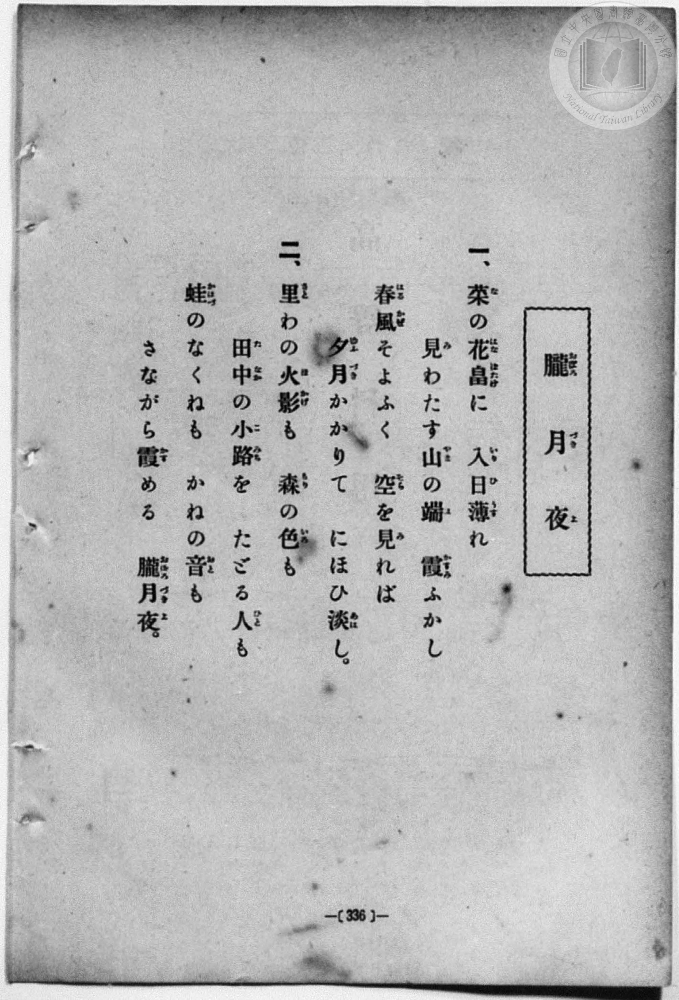
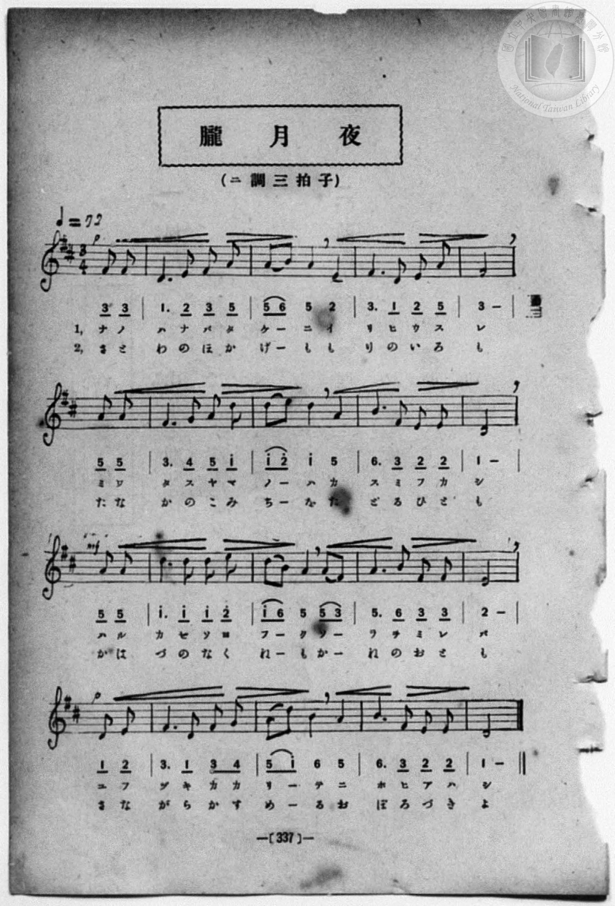

# 朧月夜

> Re:Shōka 使用 AI 協助辨識與重建樂譜，可能會有錯誤。歡迎回報。

<audio controls src="oborozukiyo.mp3"></audio>

- 一條慎三郎 編《新編 小學校・公學校 唱歌教材集》（大正十二年十二月，索書號 0725-41）

## 說明

朧月夜 (朦朧月夜)
Source: 唱歌帖 (2020.006.0843), P195.jpg (top)
Marginalia: 15.2.13 (大正15年2月13日)
Composer: 岡野貞一 / Lyricist: 高野辰之 (尋常小學唱歌 第六學年)


## 跨冊／重複收錄參照

> 同曲（高野辰之作詞、岡野貞一作曲〈朧月夜〉；收錄於《新定兒童唱歌》六年級與《唱歌帖》P195）

- **[同曲]** 《新定兒童唱歌》尋常科第六學年用（2020.006.0847.0006）：[**〈朧月夜〉**](../../../shintei_jido_shoka/grade_6_2020.006.0847.0006/1_01_oborozukiyo/index.md)（`D` / `3/4` — [原始 TMD](../../../shintei_jido_shoka/grade_6_2020.006.0847.0006/1_01_oborozukiyo/oborozukiyo.tmd)）
- **[同曲]** 《新編小公學校唱歌教材集》第五、六學年（大正12年／1923，國臺圖 0725-41）：[**〈おぼろ月夜〉**](../../grade_5_6/37_oborozukiyo/index.md)（`D` / `3/4` — [原始 TMD](../../grade_5_6/37_oborozukiyo/oborozukiyo.tmd)）
- **[同曲]** 楊金土手抄《唱歌帖》第 10 冊・X（2020.006.0843）：[**〈朧月夜 (朦朧月夜)〉**](../../../shokacho/vol_10/p195a_oborozukiyo/index.md)（`D` / `3/4` — [原始 TMD](../../../shokacho/vol_10/p195a_oborozukiyo/oborozukiyo.tmd)）
- 總表：[跨冊重複與同名歌曲總索引](../../../duplicate_songs.md)

## 歌詞

```text
1.
ナノハナバタケニ イリヒウスレ ミワタスヤマノハ カスミフカシ
ハルカゼソヨフク ソラヲミレバ ユフヅキカカリテ ニホヒアハシ

2.
さとわのひかげも もりにきえて たづねんこみちも こけむしたり
かはづのなくねも かねのおとも さながらかすめる おぼろづきよ
```

## ABC

```abc
X:1
T:朧月夜
M:3/4
L:1/16
Q:1/4=72
K:D
V:V1 name="Vocal" snm="Voc"
[V:V1]
z4 z4 D4 | D4 E4 F4 | A6 B2 A2 F2 | D8 E4 |
E8 D4 | F6 A2 F2 E2 | D8 B4 | A6 F2 E2 F2 |
D8 D4 | E4 E4 A4 | F4 E4 D4 | E6 E2 F2 A2 |
B4 A4 A4 | d4 B4 A2 F2 | A6 B2 A2 F2 | D6 B,2 D2 E2 |
F4 E4 F2 E2 | D12 |
```

## TMD 檔案連結

- [主旋律 TMD 檔案](oborozukiyo.tmd) [[在 TMD Studio 編輯](https://tmdlang.github.io/Tmd-TS/#tmd=s7IKdvYPcrWy4qpTUCpJTLdSSM7PyUlNLsnMz7MqzsjPTozPrsyvSsyML84ojTe0NDJWgqssy88pzU21ys4vyY83jDdCSBTnlxYlp1oVJ2fk5-fEl6RWlCTl52ejy8cXJKanWgUYm5giZAqK8stS8xLzgLoLijLzSlJTwNoRClLLMlNSQdKpKZkl-UWZiTlI7kktKgY7G2J8SVFiXnFyUWYByC8IVSUZqUBHl6cmAhlF6MLFqYnF-XnFSlxaWgrP5ix_Nqfj6ZI5ClpaXIq2CuZGXPa2Ci5cNsb6JnZcII1PdjQ8WzT3WWvfkx2dL5v7FJ5vX_G4oevZtA1AhsLTDf1P1-54tmDh4-bdT1vXQNgKT6dsfLa259nUmc_mTng5u-1xQ_f7PUA7lj9bu_hpb-OTXT1Pd26BMIB2v9_T83zLomezd7yYOV_BwNzIVNfE8P2eTiUufS0uBQUkB2o8m7MMztMEyQVDogBq39Md0xQ0jAyMDPQMDMz0DCxMjDV1FAIMLU31sgrSFTRK8gvAmnwTi9Iz8xJzMhOtFAxN9Yz0DI0VNCCOMzQFOswIaIGh8bPpS8GqnfNzC_KLU4uAlmxa-LK978WmecAAUdBX8KksykzOLC6xUni5egZIYt-GJzu7gSZt6H66YwckXCDuUni-Zs3T1rUg_s4tmlwgU8Gai61ATEM9EPm4uetxc9_j5n4wY8Ljpv2PmzY-bu5WeNy05HHzqsfNkx43LXvctPNx8xqg2vmPm9eDlQD5QOl5EK1AtavBQkDpqWD2dojRQEOBHCDa87hp7-PmFWDp9UDlQM7Kx82bwDrWAK0Fql0Gkmxufdy0FqxjNdjyNqBE9-Pm2WBnLAIZCDQaZLYRxPGNUx83rnjc1P-4cd3jxk2PG7sfNwIVNgFtaHrc1PW4cfXjxt7HjR2PG5cB1c5_3Lj0cSPQ-MmPG4Fo_-PGhWC1IM7Ex00NjxungxQ1dUGMBpq1HqwDaPSqx41AO4BaQcqBEmvBokALgJaDhIDOACrpedzUCZae-bip8XETMAxBSoB-B7oBaE7v46YOLi19Li7fxMw8q7D85MQchxqDGoVqkH0KNhZadmBGjYKBgi4YGwJxDZg0AmJjMM8USOoqmAFpY6gcCILka6C6QWwQhOgG6dIFqzZCUm-GZBZIBmgWVDdMBUQ3yCwQBqmEmAXiIeRAfGOgLEw3yFyQWoh6wzioVRDHYnO6WTyQAXQZVD_MBlTXgmANVy0Xl64dMBNl5ikAaWUuAA)]
- [鋼琴伴奏 TMD 檔案](oborozukiyo_piano.tmd) [[在 TMD Studio 編輯](https://tmdlang.github.io/Tmd-TS/#tmd=s7IKdvYPcrWy4qpTUCpJTLdSSM7PyUlNLsnMz7MqzsjPTozPrsyvSsyML84ojTe0NDJWgqssy88pzU21ys4vyY83jDdCSBTnlxYlp1oVJ2fk5-fEl6RWlCTl52ejy8cXJKanWgUYm5giZAqK8stS8xLzgLoLijLzSlJTwNoRClLLMlNSQdKpKZkl-UWZiTlI7kktKgY7G2J8SVFiXnFyUWYByC9KXFpaCs_mLH82p-Ppkjnv93S8nD3zWWf3y-49zydsebJny9Ol_e_3dCpoaXEp2iqYG3HZ2yq4cNkY65vYcYHMf7Kj4dmiuc9a-57s6HzZ3KfwfPuKxw1dz6ZtADIUnm7of7p2x7MFCx83737augbCVng6ZeOztT3Pps58NnfCy9ltjxu6gbY-XbL82drFT3sbn-zqebpzC4QBdNP7PT3Ptyx6NnvHi5nzFQzMjUx1TQyB7lHi0tfiUlBAOFxB49mcZXCepsKjhikKAZmJefkKjsnJ-bkFiXmZual5JSA9wZBIgLrj6Y5pChpGBkYGegYGZnoGFibGmjoKAYaWpnpZBekKGiX5BZogTb6JRemZeYk5mYlWCoamekZ6hsYKGhBHG5oCHWwEtNjQ-Nn0pWDVzkAb84tTi4CWbFr4sr3vxaZ5wIBS0FfwqSzKTM4sLrFSeLl6Bkhi34YnO7u5tPS5uHwTM_OswvKTE3McagxqFKpB5ijYWGjZgRk1CgYKumBsCMQ1YNIIiI3BPFMgqatgBqSNoXIgCJKvgeoGsUEQohukSxes2ghJvRmSWSAZoFlQ3TAVEN0gs0AYpBJiFoiHkAPxjYGyMN0gc0FqIeoN46BWQRyLzelm8UAG0GVQ_TAbUF0LCosarlpowIHjOsiDmKAzjdcGMYCUuU68NtgjQBFtSEgCaW1UJ0GVgwMMoQXmNiQhRADBzUOEsXG8NpJBhtom2pDQRtgHDDGYWYiAR9MGMx3J4TAmmAYbhWQ_mh_BkmYw16JGEsxJMAdBIwvIA0cYTBoaTbhDCS3usDkFW4hgiU0fArEJ1qJgGA8yXAdEgplQEXBwofEhquAuA_PgdmMoQwiYoAugGgQXhpiDMBfFIBQnGsGUgBkwgyD2gJVAjDIDCyAJ4_EcRC2m5zB8Aw9pXTtgqZaZp4BEK3MBAA)]

## 分析

```text
================================================================================
📊 TMD Song Profile: [ 朧月夜 ]
================================================================================
⏱  Duration:       0:45 (45.0s), 18 measures total
🎼 Key & Tempo:    首調基準 D, != 72.0 BPM, <3/4>
   - 分析範圍：      由實際發聲的音符與和弦推測調性；播放脈絡另行呈現
🎤 人聲音域:    B3 (MIDI 59) – D5 (MIDI 74) [跨度: 15 個半音 / 1.2 個八度, 難度: moderate]
   - 最低音:  B3 in [Main #1 @ m.16, 0:38]
   - 最高音: D5 in [Main #1 @ m.14, 0:32]
   - 適合: soprano, mezzo-soprano, contralto, tenor, baritone, bass
🏛  結構:      Main (45.0s)
⚡ 編曲密度:        Peak 1 軌道同時演奏
🗝  調性診斷：       D 大調（純淨自然大調，未偵測到可信轉調）
   - 風格氣質:    純淨自然大調（陽光明朗、易唱易記，無明顯調外色彩）
   - 轉調歷程:    全曲維持單一推測調性（未偵測到可信轉調）
   - 核心骨幹音:  D, E, A, F#, B
   - 調性數值:    D 大調 [相關度: 0.85, 穩定度: High, 自然音純度: 100.0%]
   - 候選調性 (K-S): D 大調 (0.85), A 大調 (0.70), B 小調 (0.54)
   - 五度圈歷程:   +2
   - 各段落調性細節:
     • [Main #1]: D 大調 (r: 0.85, 自然音純度: 100.0%)

  [ 五度圈游移軌跡 ]
               C  
         F            G  
      Bb              [D ]*
      Eb               A  
         Ab           E  
            Db       B  
               F# 
     (* = active key center)

  [ 十二半音累積音高分佈 ]
     C  :                            0.0%
     C# :                            0.0%
     D  : ████████████████████████  32.7%
     D# :                            0.0%
     E  : █████████████████         23.1%
     F  :                            0.0%
     F# : ████████████              16.3%
     G  :                            0.0%
     G# :                            0.0%
     A  : ██████████████            19.2%
     A# :                            0.0%
     B  : ██████                     8.7%
--------------------------------------------------------------------------------
Assignment 軌道音域：
  - Vocal         : B3 – D5 (15 個半音 / 1.2 個八度, 54 個音符)
================================================================================
```


## 原書掃描頁






