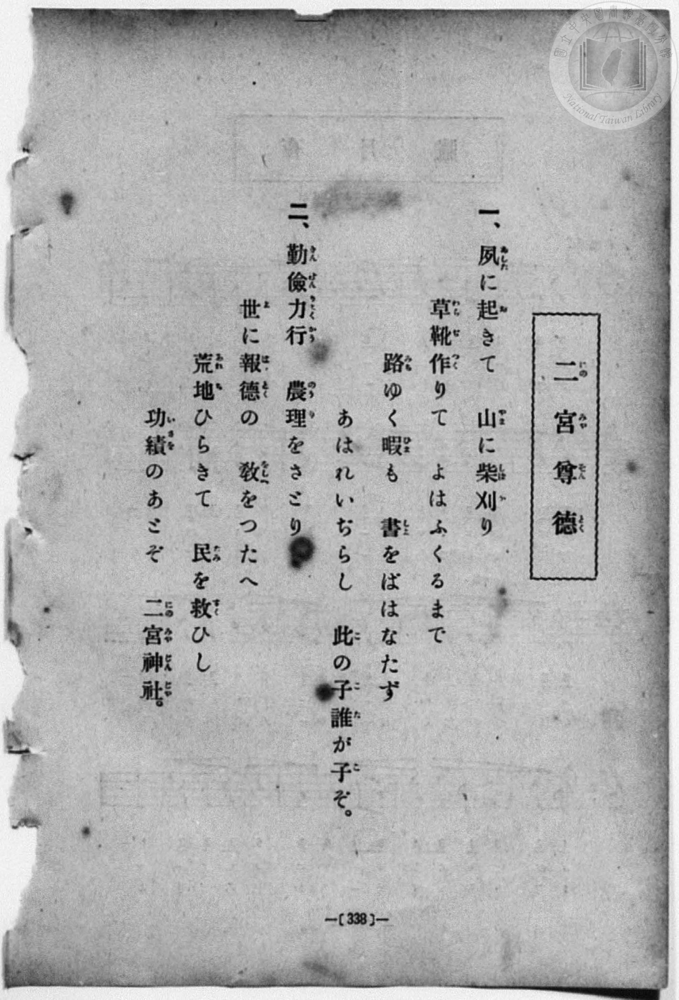
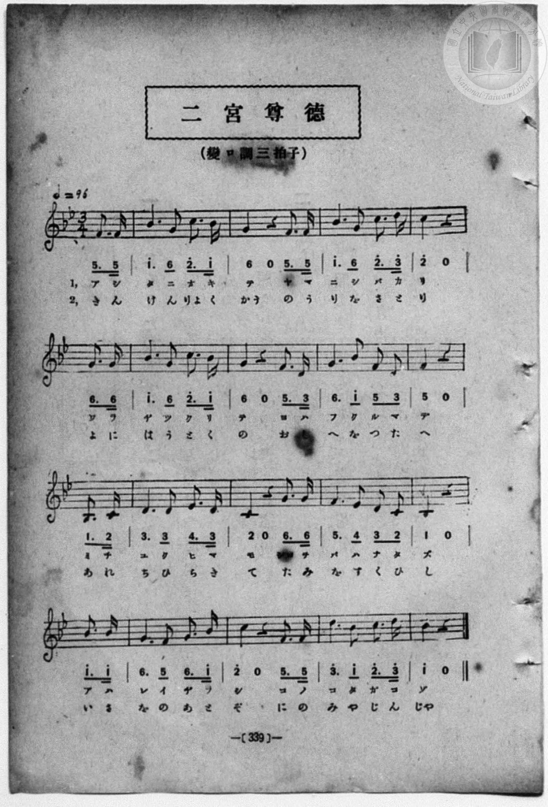

# 二宮尊徳

> Re:Shōka 使用 AI 協助辨識與重建樂譜，可能會有錯誤。歡迎回報。

- **NEUTRINO 歌聲合成版**：<br><audio controls src="ninomiya_sontoku_neutrino.mp3"></audio>
- **鋼琴伴奏版**：<br><audio controls src="ninomiya_sontoku.mp3"></audio>


- 詞：桑田春風
- 曲：田村虎藏
- book: 新編 小學校・公學校 唱歌教材集（高等科一・二學年用）
- 一條慎三郎 編《新編 小學校・公學校 唱歌教材集》（大正十二年十二月，索書號 0725-41）

## 說明

> [!NOTE]
> **原書資訊與歌詞全文**（對應 `P347.jpg`–`P348.jpg`，原書 p. 338–339，高等科一・二學年第 2 首）：
> - **調性與拍號**：變ロ調三拍子（B♭ 大調 3/4 拍），速度 ♩= 96，弱起拍（第 3 拍附點八分音符＋十六分音符起唱）。
> - **比較校勘**：先前檔案轉植自《新定兒童唱歌》尋常科第四學年用（`P037.jpg`，♩= 100），但本冊（`P348.jpg`）五線譜與數字譜有多處明確差異：
>   1. 速度標示為 `♩= 96`。
>   2. 弱起拍及各樂句第 2 小節第 3 拍（m.0, m.2, m.4, m.6, m.8, m.10, m.12, m.14）在本冊均為**附點八分音符＋十六分音符**（如 `5_. 5_`），而非兩個八分音符。
>   3. 第 3 小節本冊五線譜與數字譜均為 `1^. 6 2^. 3^`（對應 TMD `1 - - - - - 6_ - 2 - - 3`），而非《新定兒童唱歌》的 `3. 1 2. 3`。
>   4. 第 7 小節第 3 拍（`5_ 3_`）與第 11 小節第 3 拍（`3_ 2_`）在本冊均為**兩個八分音符**，而非附點節奏。
>   5. 歷史假名遣：第 2 節印作「報德（はうとく）」；第 6–7 小節對頁歌詞作「敎（をし）を」，譜下平假名作「おしへを」。
>
> **一、**
> 夙（あした）に起（お）きて　山（やま）に柴刈（しばか）り
> 草靴（わらぢ）作（つく）りて　よはふくるまで
> 路（みち）ゆく暇（ひま）も　書（しよ）をばはなたず
> あはれいぢらし　此（こ）の子（こ）誰（た）が子（こ）ぞ。
>
> **二、**
> 勤儉力行（きんけんりよくかう）　農理（のうり）をさとり
> 世（よ）に報德（はうとく）の　敎（をし）をつたへ
> 荒地（あれち）ひらきて　民（たみ）を救（すく）ひし
> 功績（いさを）のあとぞ　二宮神社（にのみやじんじや）。


## 歌詞

```text
（TMD 檔案未包含歌詞註解）
```

## ABC

```abc
X:1
T:二宮尊徳
C:曲：田村虎藏
M:3/4
L:1/16
Q:1/4=96
K:Bb
V:V1 name="Piano" snm="Pia"
[V:V1]
z4 z4 F3 F | B6 G2 c3 B | G4 z4 F3 F | B6 G2 c3 d |
w: 1.~ア シ | タ ニ オ キ | テ ヤ マ | ニ シ バ カ
w: 2.~き ん | け ん りよ く | かう の う | り を さ と
c4 z4 G3 G | B6 G2 c3 B | G4 z4 F3 D | G6 B2 F2 D2 |
w: 1.~リ ワ ラ | ヂ ツ ク リ | テ ヨ ハ | フ ク ル マ
w: 2.~り よ に | は う と く | の お し | へ を つ た
F4 z4 B,3 C | D6 D2 E3 D | C4 z4 G3 G | F6 E2 D2 C2 |
w: 1.~デ ミ チ | ユ ク ヒ マ | モ シヨ ヲ | バ ハ ナ タ
w: 2.~へ あ れ | ち ひ ら き | て た み | を す く ひ
B,4 z4 B3 B | G6 F2 G3 B | c4 z4 F3 F | d6 B2 c3 d |
w: 1.~ズ ア ハ | レ イ ヂ ラ | シ コ ノ | コ タ ガ コ
w: 2.~し い さ | を の あ と | ぞ に の | み や じ ん
B4 z4 z4 | z4 z4 F3 F | B6 G2 c3 B | G4 z4 F3 F |
w: 1.~ゾ | ア シ | タ ニ オ キ | テ ヤ マ
w: 2.~じや | き ん | け ん りよ く | かう の う
B6 G2 c3 d | c4 z4 G3 G | B6 G2 c3 B | G4 z4 F3 D |
w: 1.~ニ シ バ カ | リ ワ ラ | ヂ ツ ク リ | テ ヨ ハ
w: 2.~り を さ と | り よ に | は う と く | の お し
G6 B2 F2 D2 | F4 z4 B,3 C | D6 D2 E3 D | C4 z4 G3 G |
w: 1.~フ ク ル マ | デ ミ チ | ユ ク ヒ マ | モ シヨ ヲ
w: 2.~へ を つ た | へ あ れ | ち ひ ら き | て た み
F6 E2 D2 C2 | B,4 z4 B3 B | G6 F2 G3 B | c4 z4 F3 F |
w: 1.~バ ハ ナ タ | ズ ア ハ | レ イ ヂ ラ | シ コ ノ
w: 2.~を す く ひ | し い さ | を の あ と | ぞ に の
d6 B2 c3 d | B4 z4 z4 |
w: 1.~コ タ ガ コ | ゾ
w: 2.~み や じ ん | じや
```

## TMD 檔案連結

- [主旋律 TMD 檔案](ninomiya_sontoku.tmd) [[在 TMD Studio 編輯](https://tmdlang.github.io/Tmd-TS/#tmd=s7IKdvYPcrWy4qpTUCpJTLdSSM7PyUlNLsnMz7MqzsjPTozPrsyvSsyML84ojTe0NDJWgqssy88pzU21ys4vyY83jDdCSBTnlxYlp1oVJ2fk5-fEl6RWlCTl52ejy8cXJKanWgUYm5gjZAqK8stS8xLzgLoLijLzSlJTwNoRClLLMlNSQdLFyYl58WWpRZlpmakpSG5KLSoGOx1iRUlRYl5xclFmAcg_CFX5RSUZ-elFiQUZlVYZmcUl-UWZyYk58dmJeYkIRSUZqUDfQaQrlbi0tBSe7Op5um7d0w1dT_dtVtDS4lK0VbA047K3VXDS4bIx1jexA-kFedVK4dm0Dc-3r1B4uqH_6dodzxYsfNy8-2nrGghb4emUjc_W9jybOvPZ3AkvZ7e939PxcvWM52s7ny-f-GRHA1ApyKK1O57u3PJ8yor3ezrBbgLKPFs091lr35MdnS-b-xSAxj9u6CLFnscN3UCrni5Z_mzt4qe9jSBLdm6BMJ7N6Xi_p-f5lkXPZu94MXO-goG5kamuiSHM7hcr573fM-vZwonPp2x4NmPpy0UrwMLPZm8CCoPE5k58MbPvxfR-JS4ufS0FW2oBLgUFBTuFaEU__xDXWAhHS-tp33yQKze3v1jR9aKjHehDoPOetq54Nq1dSwvkwQ29z9o7FRJAKUsvqyA94VHDZBDHAswBehNigEKBnoKxsQVQ0tjYEiiKMwrWrFEwUni5bBowMIC-hbhCF-iOF6v2P2tYDnJBdy8wzEB2z3qxrutx81qgDDCSgMJP104AOsjp0cy1CsBgBworAFOJAlACbFbPy4b5T3ctU3g0cyUoIYFctmfji63bwfIdIHuNQWpfzmx5uRvowdVPO9pezt_8fM2y93u6gdH2tHUtXASoCxjZQFMfNzQhXPhs_ZQXe5qBKeFp9wyw8562djzt7H22asqzhR0v9nY-W9L7on0VJBU9XQeUnfR89VJIogGmlacbup_u2AEMEKBLns6ejZQgOxICDIwhYQt0NNj5hgYGED892dv2bM6ap21dYGWIUO98smvK8-2zXqydAwqxqTuerp0OZD-b0_l0yawXM6c-m9H3fNGup9vXPZ-6AR7KCgqGegqQQHq2YubzJbueN-1SSIAGVwLcqwoKRnoK8KB72t_1dELLsxVNT_uXQuIOmDmer2-AhyfQYbl6BjoKuXpGIMIERJiBCAsQYQiWMQRLGZoA3f10zgqIh57ObQfar6VFTHxAEuKyJoUE03g9BdN4UAAAA-dFQ8_LuUCtK58CgxfJACSvGOspQFwKcTXEaqxhB3GPQoJhnJ6CmYIRkDSOA9oDS_8hvi5AOWA6gEGzeCBhBGYao7gHVwJ4PqtFIQHoHkNQ-Bojh7cJxJHmWIIW6GEFY7B_gW4FSRgaYlNlHK9gBFaFEbyYoQMKTKhTIWEPNOzp0n4k95jqKTxbu_1p_6anje1PJ_S-bFwMKpfAkQ9S27vhyd45jxt6ni7Y-HTfdqD1jxvXP25se9y44nFjPzjTAN00G6TeDFgcwHwFDMeXCxohxQtE_7OpfSDNTZMeN04HaQMyQDp7gJHxZEf3052bIdZDFD9u7AIqe9y4A6IM5lpYKQYqZRoagZUImP90yUyws5rAWuaDDG9cDUzPYEFgVgJyex83AtNJw9ONwGwOdEPL48Z9EGXP5m952gEsvoEqgXo3PG4ElvJAt3VBTH7R2_ly7hawlv7HTUD1i0B5ce8csPolUP83AZ0KMvxxEyRotgLFHzd1A6143Lgcas729WAt-x83LgRrAQZf_7NZ7WDBTVDHNDUBDQGWrVDHNAFdBQ4lkKuAxq4Ceu1xIzRzgz27_nETMKCAflkEdtt0kPa1S8DaJ4N9tw5ShEK4L1YBywYgGxI-wPIZIfW4EZiM0UJ4FzARI0K4e8nTls6nXbNfLOwB6-p93DT5ceNEEAn0Psjj_cCgAyYLcIJoeLFv0_MJoKoZ6AZQWmkCxwLIL1NB6QYWvE92AOsFYNiCfdq4GmcKAxoC9Bpm-gFFATBMdsAia9LTORA_NoFDBhzUwOAFBQ40ATzbMBESCMC4gBjybCpEZCbMLmB0TIf6umv-8x3AqAHKAgN5KlAx1DGgwAe6DRhoDZBWzfOl854vgahcDVawH5zGZoBDCUi2ICoXyut1KFDQ0ufi8svMy8_NrEwMzs8ryc8utQrITMzLd6gxqKkG2aVgY2imBY5SBWwNC2ixr6ABK2R0FGB1jiYW1UD7QCbVKBhAy0QYDSy0oFQNWIWPYY0CREgXTj9uWgSlt8NUGWFR1dgLVTUZqAq3w4GlDbAIACZGBQ0T0tyOo0w3BEqBuTj8hUufMVAKwkJog5oDpBDB8bhpP5IBj5u7wZ5cBfXsWqApj5vb0AOjeQmUngeWB-mBmwAMRpDMBChvNVgFxDxkE9ZD6ZVIgQ7MtygmTQaToFwMEWjsBxkGzs3o5jWug9JtICVNXSjmTALLTIWqWIGiApEMYJYAXUwggnf10CmCgdUpkiRENVQSKKULlIQqROg0hAgYocRxcxNyeDS3gP0Li4FVOOJ4BZQGB3ozJPRgYQXS-7h5NZicB3bI4-Z2DBPmQ-lGlDiG2AuLN5C9oDhBjmBIXCLHLiS2gOUfWH4HilsgsQtKkcDSE-IWuAqECZAQAJa-hLNvJzmxC44PGARzTJDiEBgdqNGElBURcQiCYF1g_WA9wGSDEcNQEjl-l6GECCR2QOGCyKOQQg45vW9HRPEmsBJIloVFXj-YBAU8pIgAZZpdGIZAy05QIkGK4oXIJjVuAqvshPJ6wREEczAigqCJpXE_2CaI42FyM8Ek2EVg00AmTMcwAZSsIRmdQBQDuz3kRDFKRgRHGlQElIXRy1rkItoYSR8o9hAlNKxMQK-4kON2DXJQNIHTOTQ_g0tPaImLGi2bofJ9YHkIDyYHiszHTRBTQXIgFfvQTIDRSJGKFiWgPArPVZAytRFUEqBGCaiEgKgGyaPUNE3gUqhxBpQHrFZBPIgwdqfUcnHp2imgNSwUsAspcwEA)]
- [鋼琴伴奏 TMD 檔案](ninomiya_sontoku_piano.tmd) [[在 TMD Studio 編輯](https://tmdlang.github.io/Tmd-TS/#tmd=s7IKdvYPcrWy4qpTUCpJTLdSSM7PyUlNLsnMz7MqzsjPTozPrsyvSsyML84ojTe0NDJWgqssy88pzU21ys4vyY83jDdCSBTnlxYlp1oVJ2fk5-fEl6RWlCTl52ejy8cXJKanWgUYm5gjZAqK8stS8xLzgLoLijLzSlJTwNoRClLLMlNSQdLFyYl58WWpRZlpmakpSG5KLSoGOx1iRUlRYl5xclFmAcg_CFX5RSUZ-elFiQUZlVYZmcUl-UWZyYk58dmJeYlKXFpaCk929Txdt-7phq6n-za_39PxcvbMZ53dL7v3PJ-w5cmeLU-X9r_f06mgpcWlaKtgacZlb6vgpMNlY6xvYgeyAeRXK4Vn0zY8375C4emG_qdrdzxbsPBx8-6nrWsgbIWnUzY-W9vzbOrMZ3MnvJzdBrJi9YznazufL5_4ZEcDUCnIAWt3PN255fmUFUC7wC4HyjxbNPdZa9-THZ0vm_sUgMY_bugixZ7HDd1Aq54uWf5s7eKnvY0gS3ZugTCezel4v6fn-ZZFz2bveDFzvoKBuZGprokhzO4XK-e93zPr2cKJz6dseDZj6ctFK8DCz2ZvAgqDxOZOfDGz78X0fiUuLr_MvPzczMrE4Py8kvzsUquAzMS8_CAPhxpdw5pqLgUgsDE007IDs2oUDBR0wRBGm8bDqBqwCh_DGgWIkC6cfty0CEpvh6kywqKqsReqajJQFdQ6Q6gkCJqBVBqBmYZAKTAXh1Nw6TMGSkFYCG1Qc4AUwgePm_YjGfC4uRvsrlVQ960FmvK4uQ3d_c1LoPQ8sDxID9wEoM9BMhOgvNVgFRDzkE1YD6VXIoXT48aJKCZNBpNdj5s6IAKN_SDDGrsfN2K4qHEdlG4DKWnqQjFnElhmKlTFChQViJiDWQJ0MQVxYgyKE7gkRDVUEiilC5SEKkToNIQIGKFES3MTsheaW8BOhAXaKhzRsgJKg8OpGeJhmPdAeh83rwaT88AOedzcjmHCfCjdiBItEHthQQ2yFxSMyHECCX7kCIEE8OPG6WD5HShugUQIKBE9bgTZiKwCYQIkBB439SAiBByEMAjmmCAFOzAEUUMWKcEjgh0EwbrA-sF6gDGNESlQEjlKlqF4AhKgIK8gcgIk9yOnqu2IWNkEVgLJGLDw7geToLCCZERQ0tyFYQi0UAHFK1KsLEQ2qXETWGUnlNcLDlOYgxFhCo3fxv1gmyCOh8nNBJNgF4FNA5kwHcMEUEqEZCd4rKAkd3A4Q0VAGQW9EEIuu4yR9IECHFF0wXIeeiGMHB1rkF3fBE5N0FwDLlagRRFqSG6GyveB5SE8mBwo_B83QUwFyYFU7EMzAUYjxQNaKIJyAjztQgqbRlB-Qw1FUD6EqAbJoxTBTeC83jgDygNWESAeRBi7U2pxVG0-KFWbCVrNBvECOOlHG8aCMSgqgTyz-NxYoCKElGk8SM4UJAdiAqWw6YVyQBoRxkBINIMJ24xkAJrZaHpN0GxGdTKSNmAg6dopoIVTtA9QFpuwEVhYmQsA)]

## 分析

```text
================================================================================
📊 TMD Song Profile: [ 二宮尊徳 ]
================================================================================
⏱  Duration:       1:03 (63.8s), 34 measures total
🎼 Key & Tempo:    首調基準 B,, != 96.0 BPM, <3/4>
   - 分析範圍：      由實際發聲的音符與和弦推測調性；播放脈絡另行呈現
🎤 人聲音域:    A#3 (MIDI 58) – D5 (MIDI 74) [跨度: 16 個半音 / 1.3 個八度, 難度: moderate]
   - 最低音:  A#3 in [NinomiyaSontoku #1 @ m.9, 0:16]
   - 最高音: D5 in [NinomiyaSontoku #1 @ m.4, 0:07]
   - 適合: soprano, mezzo-soprano, contralto, tenor, baritone, bass
🏛  結構:      NinomiyaSontoku (31.9s) -> NinomiyaSontoku (31.9s)
⚡ 編曲密度:        Peak 1 軌道同時演奏
🗝  調性診斷：       A# 調性不明確（純淨自然大調，未偵測到可信轉調）
   - 風格氣質:    純淨自然大調（陽光明朗、易唱易記，無明顯調外色彩）
   - 轉調歷程:    全曲維持單一推測調性（未偵測到可信轉調）
   - 核心骨幹音:  A#, G, F, C, D
   - 調性數值:    A# 調性不明確 [相關度: 0.82, 穩定度: Ambiguous, 自然音純度: 100.0%]
   - 候選調性 (K-S): A# 大調 (0.82), G 小調 (0.80), F 大調 (0.64)
   - 五度圈歷程:   -2 -> -2
   - 各段落調性細節:
     • [NinomiyaSontoku #1]: A# 調性不明確 (r: 0.82, 自然音純度: 100.0%)
     • [NinomiyaSontoku #2]: A# 調性不明確 (r: 0.82, 自然音純度: 100.0%)

  [ 五度圈游移軌跡 ]
               C  
         F            G  
     [Bb]*              D  
      Eb               A  
         Ab           E  
            Db       B  
               F# 
     (* = active key center)

  [ 十二半音累積音高分佈 ]
     C  : ████████████████          16.9%
     C# :                            0.0%
     D  : █████████████             13.7%
     D# : ███                        3.1%
     E  :                            0.0%
     F  : █████████████████         18.1%
     F# :                            0.0%
     G  : ██████████████████████    23.1%
     G# :                            0.0%
     A  :                            0.0%
     A# : ████████████████████████  25.0%
     B  :                            0.0%
--------------------------------------------------------------------------------
Assignment 軌道音域：
  - Piano         : A#3 – D5 (16 個半音 / 1.3 個八度, 112 個音符)
================================================================================
```


## 原書掃描頁






