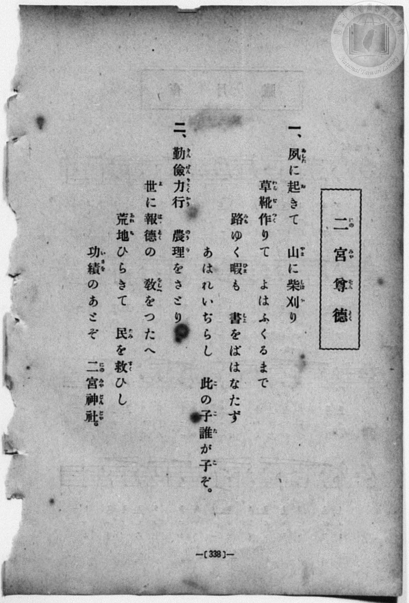
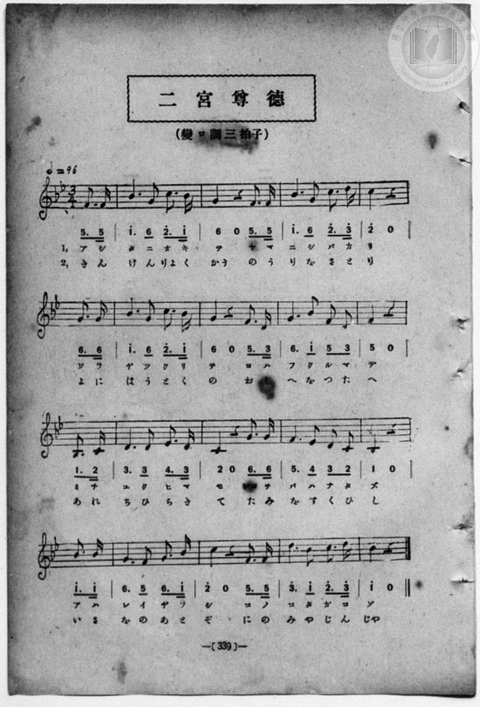

# 二宮尊徳

> Re:Shōka 使用 AI 協助辨識與重建樂譜，可能會有錯誤。歡迎回報。

- **鋼琴伴奏版**：<br><audio controls src="ninomiya_sontoku.mp3"></audio>
- **NEUTRINO 歌聲合成版**：<br><audio controls src="ninomiya_sontoku_neutrino.mp3"></audio>

- 詞：桑田春風
- 曲：田村虎藏
- book: 新編 小學校・公學校 唱歌教材集（高等科一・二學年用）
- 一條慎三郎 編《新編 小學校・公學校 唱歌教材集》（大正十二年十二月，索書號 0725-41）

## 說明

> [!NOTE]
> **原書資訊與歌詞全文**（對應 `P347.jpg`–`P348.jpg`，原書 p. 338–339，高等科一・二學年第 2 首）：
> - **調性與拍號**：變ロ調三拍子（B♭ 大調 3/4 拍），速度 ♩= 96，弱起拍（第 3 拍附點八分音符＋十六分音符起唱）。
> - **比較校勘**：先前檔案轉植自《新定兒童唱歌》尋常科第四學年用（`P037.jpg`，♩= 100），但本冊（`P348.jpg`）五線譜與數字譜有多處明確差異：
>   1. 速度標示為 `♩= 96`。
>   2. 弱起拍及各樂句第 2 小節第 3 拍（m.0, m.2, m.4, m.6, m.8, m.10, m.12, m.14）在本冊均為**附點八分音符＋十六分音符**（如 `5_. 5_`），而非兩個八分音符。
>   3. 第 3 小節本冊五線譜與數字譜均為 `1^. 6 2^. 3^`（對應 TMD `1 - - - - - 6_ - 2 - - 3`），而非《新定兒童唱歌》的 `3. 1 2. 3`。
>   4. 第 7 小節第 3 拍（`5_ 3_`）與第 11 小節第 3 拍（`3_ 2_`）在本冊均為**兩個八分音符**，而非附點節奏。
>   5. 歷史假名遣：第 2 節印作「報德（はうとく）」；第 6–7 小節對頁歌詞作「敎（をし）を」，譜下平假名作「おしへを」。
>
> **一、**
> 夙（あした）に起（お）きて　山（やま）に柴刈（しばか）り
> 草靴（わらぢ）作（つく）りて　よはふくるまで
> 路（みち）ゆく暇（ひま）も　書（しよ）をばはなたず
> あはれいぢらし　此（こ）の子（こ）誰（た）が子（こ）ぞ。
>
> **二、**
> 勤儉力行（きんけんりよくかう）　農理（のうり）をさとり
> 世（よ）に報德（はうとく）の　敎（をし）をつたへ
> 荒地（あれち）ひらきて　民（たみ）を救（すく）ひし
> 功績（いさを）のあとぞ　二宮神社（にのみやじんじや）。


## 歌詞

```text
（TMD 檔案未包含歌詞註解）
```

## ABC

<div class="abc-score" data-abc-src="ninomiya_sontoku.abc" aria-label="五線譜載入中"></div>

[下載 ABC 原始檔](ninomiya_sontoku.abc)

## TMD 檔案連結

- [主旋律 TMD 檔案](ninomiya_sontoku.tmd) [[在 TMD Studio 編輯](https://tmdlang.github.io/Tmd-TS/#tmd=s7IKdvYPcrWy4qpTUCpJTLdSSM7PyUlNLsnMz7MqzsjPTozPrsyvSsyML84ojTe0NDJWgqssy88pzU21ys4vyY83jDdCSBTnlxYlp1oVJ2fk5-fEl6RWlCTl52ejy8cXJKanWgUYm5gjZAqK8stS8xLzgLoLijLzSlJTwNoRClLLMlNSQdLFyYl58WWpRZlpmakpSG5KLSoGOx1iRUlRYl5xclFmAcg_CFX5RSUZ-elFiQUZlVYZmcUl-UWZyYk58dmJeYkIRSUZqUDfQaQrkfVmpmfmWeXm5yWVAgMIUyI1MysTi6eh0iWJmUBdwNDML0-Mz03MzMtJzAO6X0tL4cmunqfr1j3d0PV032YFLS0uRVsFSzMue1sFJx0uG2N9EzuQUSAzrRSeTdvwfPsKhacb-p-u3fFswcLHzbuftq6BsBWeTtn4bG3Ps6kzn82d8HJ22_s9HS9Xz3i-tvP58olPdjQAlYIsWrvj6c4tz6eseL-nE-xEoMyzRXOftfY92dH5srlPAWj844YuUux53NANtOrpkuXP1i5-2tsIsmTnFgjj2ZyO93t6nm9Z9Gz2jhcz5ysYmBuZ6poYwux-sXLe-z2zni2c-HzKhmczlr5ctAIs_Gz2JqAwSGzuxBcz-15M71fi4tLXUrClFuBSUFCwU4hW9PMPcY2FcLS0nvbNB7lyc_uLFV0vOtqBPgQ672nrimfT2rW0QB7c0PusvVMhAZRu9bIK0hMeNUwGcSzAHKA3IQYoFOgpGBtbACWNjS2BojijYM0aBSOFl8umAQMD6FuIK3SB7nixav-zhuUgF3T3AsMMZPesF-u6HjevBcoAIwko_HTtBKCDnB7NXKsADHagsAIwlSgAJcBm9bxsmP901zKFRzNXghISyGV7Nr7Yuh0s3wGy1xik9uXMlpe7gR5c_bSj7eX8zc_XLHu_pxsYbU9b18JFgLqAkQ009XFDE8KFz9ZPebGnGZgSnnbPADvvaWvH087eZ6umPFvY8WJv57MlvS_aV0FS0dN1QNlJz1cvhSQaYFp5uqH76Y4dwAABuuTp7NlICbIjIcDAGBK2QEeDnW9oYADx05O9bc_mrHna1gVWhgj1zie7pjzfPuvF2jmgEJu64-na6UD2szmdT5fMejFz6rMZfc8X7Xq6fd3zqRvgoaygYKinAAmkZytmPl-y63nTLoUEaHAlwL2qoGCkpwAPuqf9XU8ntDxb0fS0fykk7oCZ4_n6Bnh4Ah2Wq2ego5CrZwQiTECEGYiwABGGYBlDsJShCdDdT-esgHjo6dx2oP1aWsTEByQhLmtSSDCN11MwjQcFADBwXjT0vJwL1LryKTB4kQxA8oqxngLEpRBXQ6zGGnYQ9ygkGMbpKZgpGAFJ4zigPbD0H-LrApQDpgMYNIsHEkZgpjGKe3AlgOezWhQSgO4xBIWvMXJ4m0AcaY4laIEeVjAG-xfoVpCEoSE2VcbxCkZgVRjBixk6oMCEOhUS9kDDni7tR3KPqZ7Cs7Xbn_ZvetrY_nRC78vGxaByCRz5ILW9G57snfO4oefpgo1P920HWv-4cf3jxrbHjSseN_aDMw3QTbNB6s2AxQHMV8BwfLmgEVK8QPQ_m9oH0tw06XHjdJA2IAOkswcYGU92dD_duRliPUTx48YuoLLHjTsgymCuhZVioFKmoRFYiYD5T5fMBDurCaxlPsjwxtXA9AwWBGYlILf3cSMwnTQ83QjM5kA3tDxu3AdR9mz-lqcdwOIbqBKod8PjRmApD3RbF8TkF72dL-duAWvpf9wEVL8IlBf3zgGrXwL1fxPQqSDDHzdBgmYrUPxxUzfQiseNy6HmbF8P1rL_ceNCsBZg8PU_m9UOFtwEdUxTE9AQYNkKdUwT0FXgUAK5CmjsKqDXHjdCMzfYs-sfNwEDCuiXRWC3TQdpX7sErH0y2HfrIEUohPtiFbBsALIh4QMsnxFSjxuByRgthHcBEzEihLuXPG3pfNo1-8XCHrCu3sdNkx83TgSRQO-DPN4PDDpgsgAniIYX-zY9nwCqmoFuAKWVJnAsgPwyFZRuYMH7ZAewXgCGLdinjatxpjCgIUCvYaYfUBQAw2QHLLImPZ0D8WMTOGTAQQ0MXlDgQBPAsw0TIYEAjAuIIc-mQkRmwuwCRsd0qK-75j_fAYwaoCwwkKcCFUMdAwp8oNuAgdYAadU8Xzrv-RKIytVgBfvBaWwGOJSAZAuicqG8XocCBS19Li6_zLz83MzKxOD8vJL87FKrgMzEvHyHGoOaapBdCjaGZlrgKFXA1rCAFvsKGrBCRkcBVudoYlENtA9kUo2CAbRMhNHAQgtK1YBV-BjWKECEdOH046ZFUHo7TJURFlWNvVBVk4GqcDscWNoAiwBgYlTQMCHN7TjKdEOgFJiLw1-49BkDpSAshDaoOUAKERyPm_YjGfC4uRvsyVVQz64FmvK4uQ09MJqXQOl5YHmQHrgJwGAEyUyA8laDVUDMQzZhPZReiRTowHyLYtJkMAnKxRCBxn6QYeDcjG5e4zoo3QZS0tSFYs4ksMxUqIoVKCoQyQBmCdDFBCJ4Vw-dIhhYnSJJQlRDJYFSukBJqEKETkOIgBFKHDc3IYdHcwvYv7AYWIUjjldAaXCgN0NCDxZWIL2Pm1eDyXlghzxubscwYT6UbkSJY4i9sHgD2QuKE-QIhsQlcuxCYgtY_oHld6C4BRK7oBQJLD0hboGrQJgACQFg6Us4-3aSE7vg-IBBMMcEKQ6B0YEaTUhZERGHIAjWBdYP1gNMNhgxDCWR43cZSohAYgcULog8CinkkNP7dkQUbwIrgWRZWOT1g0lQwEOKCFCm2YVhCLTsBCUSpCheiGxS4yawyk4orxccQTAHIyIImlga94NtgjgeJjcTTIJdBDYNZMJ0DBNAyRqS0QlEMbDbQ04Uo2REcKRBRUBZGL2sRS6ijZH0gWIPUULDygT0igs5btcgB0UTOJ1D8zO49ISWuKjRshkq3weWh_BgcqDIfNwEMRUkB1KxD80EGI0UqWhRAsqj8FwFKVMbQSUBapSASgiIapA8Sk3TBC6FGmdAecBqFcSDCGN3Si0Xl66dAlrDQgEopMwFAA)]
- [鋼琴伴奏 TMD 檔案](ninomiya_sontoku_piano.tmd) [[在 TMD Studio 編輯](https://tmdlang.github.io/Tmd-TS/#tmd=s7IKdvYPcrWy4qpTUCpJTLdSSM7PyUlNLsnMz7MqzsjPTozPrsyvSsyML84ojTe0NDJWgqssy88pzU21ys4vyY83jDdCSBTnlxYlp1oVJ2fk5-fEl6RWlCTl52ejy8cXJKanWgUYm5gjZAqK8stS8xLzgLoLijLzSlJTwNoRClLLMlNSQdLFyYl58WWpRZlpmakpSG5KLSoGOx1iRUlRYl5xclFmAcg_CFX5RSUZ-elFiQUZlVYZmcUl-UWZyYk58dmJeYlKXFpaCk929Txdt-7phq6n-za_39PxcvbMZ53dL7v3PJ-w5cmeLU-X9r_f06mgpcWlaKtgacZlb6vgpMNlY6xvYgeyAeRXK4Vn0zY8375C4emG_qdrdzxbsPBx8-6nrWsgbIWnUzY-W9vzbOrMZ3MnvJzdBrJi9YznazufL5_4ZEcDUCnIAWt3PN255fmUFUC7wC4HyjxbNPdZa9-THZ0vm_sUgMY_bugixZ7HDd1Aq54uWf5s7eKnvY0gS3ZugTCezel4v6fn-ZZFz2bveDFzvoKBuZGprokhzO4XK-e93zPr2cKJz6dseDZj6ctFK8DCz2ZvAgqDxOZOfDGz78X0fiUuLr_MvPzczMrE4Py8kvzsUquAzMS8_CAPhxpdw5pqLgUgsDE007IDs2oUDBR0wRBGm8bDqBqwCh_DGgWIkC6cfty0CEpvh6kywqKqsReqajJQFdQ6Q6gkCJqBVBqBmYZAKTAXh1Nw6TMGSkFYCG1Qc4AUwgePm_YjGfC4uRvsrlVQ960FmvK4uQ3d_c1LoPQ8sDxID9wEoM9BMhOgvNVgFRDzkE1YD6VXIoXT48aJKCZNBpNdj5s6IAKN_SDDGrsfN2K4qHEdlG4DKWnqQjFnElhmKlTFChQViJiDWQJ0MQVxYgyKE7gkRDVUEiilC5SEKkToNIQIGKFES3MTsheaW8BOhAXaKhzRsgJKg8OpGeJhmPdAeh83rwaT88AOedzcjmHCfCjdiBItEHthQQ2yFxSMyHECCX7kCIEE8OPG6WD5HShugUQIKBE9bgTZiKwCYQIkBB439SAiBByEMAjmmCAFOzAEUUMWKcEjgh0EwbrA-sF6gDGNESlQEjlKlqF4AhKgIK8gcgIk9yOnqu2IWNkEVgLJGLDw7geToLCCZERQ0tyFYQi0UAHFK1KsLEQ2qXETWGUnlNcLDlOYgxFhCo3fxv1gmyCOh8nNBJNgF4FNA5kwHcMEUEqEZCd4rKAkd3A4Q0VAGQW9EEIuu4yR9IECHFF0wXIeeiGMHB1rkF3fBE5N0FwDLlagRRFqSG6GyveB5SE8mBwo_B83QUwFyYFU7EMzAUYjxQNaKIJyAjztQgqbRlB-Qw1FUD6EqAbJoxTBTeC83jgDygNWESAeRBi7U2pxVG0-KFWbCVrNBvECOOlHG8aCMSgqgTyz-NxYoCKElGk8SM4UJAdiAqWw6YVyQBoRxkBINIMJ24xkAJrZaHpN0GxGdTKSNmAg6dopoIVTtA9QFpuwEVhYmQsA)]

## 分析

```text
================================================================================
📊 TMD Song Profile: [ 二宮尊徳 ]
================================================================================
⏱  Duration:       0:31 (31.9s), 17 measures total
🎼 Key & Tempo:    首調基準 B,, != 96.0 BPM, <3/4>
   - 分析範圍：      由實際發聲的音符與和弦推測調性；播放脈絡另行呈現
🎤 人聲音域:    A#3 (MIDI 58) – D5 (MIDI 74) [跨度: 16 個半音 / 1.3 個八度, 難度: moderate]
   - 最低音:  A#3 in [NinomiyaSontoku #1 @ m.9, 0:16]
   - 最高音: D5 in [NinomiyaSontoku #1 @ m.4, 0:07]
   - 適合: soprano, mezzo-soprano, contralto, tenor, baritone, bass
🏛  結構:      NinomiyaSontoku (31.9s)
⚡ 編曲密度:        Peak 1 軌道同時演奏
🗝  調性診斷：       A# 調性不明確（純淨自然大調，未偵測到可信轉調）
   - 風格氣質:    純淨自然大調（陽光明朗、易唱易記，無明顯調外色彩）
   - 轉調歷程:    全曲維持單一推測調性（未偵測到可信轉調）
   - 核心骨幹音:  A#, G, F, C, D
   - 調性數值:    A# 調性不明確 [相關度: 0.82, 穩定度: Ambiguous, 自然音純度: 100.0%]
   - 候選調性 (K-S): A# 大調 (0.82), G 小調 (0.80), F 大調 (0.64)
   - 五度圈歷程:   -2
   - 各段落調性細節:
     • [NinomiyaSontoku #1]: A# 調性不明確 (r: 0.82, 自然音純度: 100.0%)

  [ 五度圈游移軌跡 ]
               C  
         F            G  
     [Bb]*              D  
      Eb               A  
         Ab           E  
            Db       B  
               F# 
     (* = active key center)

  [ 十二半音累積音高分佈 ]
     C  : ████████████████          16.9%
     C# :                            0.0%
     D  : █████████████             13.7%
     D# : ███                        3.1%
     E  :                            0.0%
     F  : █████████████████         18.1%
     F# :                            0.0%
     G  : ██████████████████████    23.1%
     G# :                            0.0%
     A  :                            0.0%
     A# : ████████████████████████  25.0%
     B  :                            0.0%
--------------------------------------------------------------------------------
Assignment 軌道音域：
  - Piano         : A#3 – D5 (16 個半音 / 1.3 個八度, 56 個音符)
================================================================================
```


## 原書掃描頁






