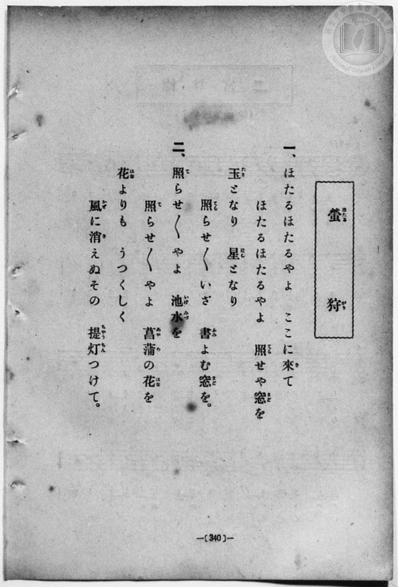
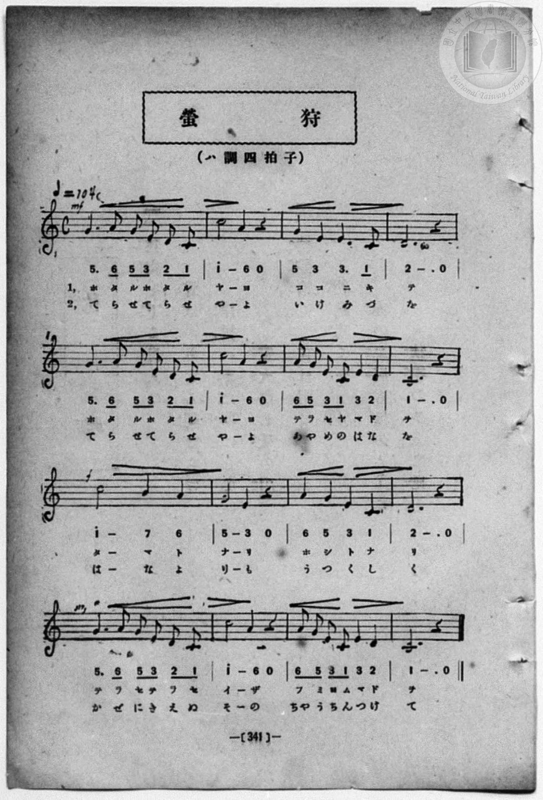

# 螢狩

> Re:Shōka 使用 AI 協助辨識與重建樂譜，可能會有錯誤。歡迎回報。

- **鋼琴伴奏版**：<br><audio controls src="hotarugari.mp3"></audio>
- **NEUTRINO 歌聲合成版**：<br><audio controls src="hotarugari_neutrino.mp3"></audio>

- book: 新編 小學校・公學校 唱歌教材集（高等科一・二學年用）
- 一條慎三郎 編《新編 小學校・公學校 唱歌教材集》（大正十二年十二月，索書號 0725-41）
- 文部省《尋常小學唱歌》第四學年

## 說明

> [!NOTE]
> **原書資訊與歌詞全文**（對應 `P349.jpg`–`P350.jpg`，原書 p. 340–341，高等科一・二學年第 3 首）：
> - **調性與拍號**：ハ調四拍子（C 大調 4/4 拍），速度 ♩= 104。
> - **曲目背景**：出自文部省《尋常小學唱歌》第四學年〈螢狩〉，本檔依原書五線譜與數字譜完整轉錄（含 `mf`、`f` 強弱記號與雙段歌詞）。
>
> **一、**
> ほたるほたるやよ　ここに來（き）て
> ほたるほたるやよ　照（てら）せや窓（まど）を
> 玉（たま）となり　星（ほし）となり
> 照（て）らせ／＼いざ　書（ふみ）よむ窓（まど）を。
>
> **二、**
> 照（て）らせ／＼やよ　池水（いけみづ）を
> 照（て）らせ／＼やよ　菖蒲（あやめ）の花（はな）を
> 花（はな）よりも　うつくしく
> 風（かぜ）に消（き）えぬその　提灯（ちやうちん）つけて。


## 歌詞

```text
（TMD 檔案未包含歌詞註解）
```

## ABC

<div class="abc-score" data-abc-src="hotarugari.abc" aria-label="五線譜載入中"></div>

[下載 ABC 原始檔](hotarugari.abc)

## TMD 檔案連結

- [主旋律 TMD 檔案](hotarugari.tmd) [[在 TMD Studio 編輯](https://tmdlang.github.io/Tmd-TS/#tmd=s7IKdvYPcrWy4qpTUCpJTLdSSM7PyUlNLsnMz7MqzsjPTozPrsyvSsyML84ojTe0NDJWgqssy88pzU21ys4vyY83jDdCSBTnlxYlp1oVJ2fk5-fEl6RWlCTl52ejy8cXJKanWgUYm1giZAqK8stS8xLzgLoLijLzSlJTwNoRClLLMlNSQdLFyYl58WWpRZlpmakpSG5KLSoGOx1iRUlRYl5xclFmAcg_CFX5RSUZ-elFiQUZlVYZmcUl-UWZyYk58dmJeYkIRSUZqUDf5SWWlBaloosWpyYW5-cVI5uYmZ6ZZ5Wbn5dUCgw2JS4tLYUX8xY9716poKXFpWirYGhgwmVvq-DMZWOib2IH0gcKEyuFZ9M2PN--QuHphv6na3c8W7DwcfPup61rIGyFp1M2Plvb82zqzGdzJ7yc3fZ-T8fL1TOer-18vnzikx0NQKVPdvUAlT7dueX5lBXv93SC3QOUebZo7rPWvic7Ol829ykAjX_c0EWKPY8buoFWPV2y_NnaxU97G0GW7NwCYTyb0_F-T8_zLYuezd7xYuZ8BQNzI1NdE0OY3c-mtb9sXvF8TiPQxqcbup_u2AGxEGIB0Nzna9Y8nT0b4mYlLi59LQVbagEuBQUFO4VoRT__ENdYCEdL62nffJBLN7e_WNH1oqMd6IgXK-c9bV0BdKiWFsiTG3qftXcqJICSoV5WQXrCo4bJQI6pAZgD9CrEAIUCPQVjEwOgpDHIsz04o2HNGgVjhZfLpgED5P2eWRBX6ALd8WLV_mcNy0Eu6O4FhhvI7lmPm_uBwsDgAIo9XTsB6BpnBWCgA8UUgGlEASgKNqXnZcP8p7uWKTyauRKcjB43NCHMfTZ70_PZ61409zybuR5s6NP2XS_aV5EUD48bOiBJ9XEDyLpnc9Y8WzXlyb65EK8_2TXl-fZZL9bOATl-6o6na6cD2U_XAVPLlhd7O1_2tIBCccJqhYTctITHDY0JaQkKT_dsf7pn44sVM4A-Bep6OXvms3VbIUEP9BHM_bAoAgVhQyMwl4D5jxt3P26c_7ipG8Foannc1PG4oeFx42QwWv1kHygrPG4Ehc_jxmUENT5vXQ5Wv-xxE9CDQC2zgVLPV00GC-573LgSJNg0CWLO8z6gGqD4fKAUWPGKx42rHjd1Ac15NmM-WApo_nRkKahGmC1g00C2vN_T_37PnseNLY8bp4G0z94BVrD1ceN-sJqOx00NmM7ACJ9dwAiDhw9OW2CefbZxwbMNW8BqgPZOBNr1uHEpigcJmfCif9qLSZvAaprAgo1gz6570bURLLge6GtkAzHEgf7qetzUBI6ytseNSx439gNDDEhC1L9cBCyrgOqBMTUHbPLqZ9uApQo8QoGMNY8b5wJtBHmnf8LzxvVg2YUgx4AMBDKAgQZUCTQZ6MFl0BCjvAiBAgUtfS4u30RgeR6QmZiX71BjUFMNskDBxkILHC0K2MotBWCeAqblFwt7FDRMQAXt8_UNOgqwskQTiwagNSDDahSqc9NqFUyBGVpXwQxIGysYKRgChQ3jwEIgQV0FAyCuASsyhmJdsCIjqBoQBKsBm-ljWKPwuHk2WPRx034gezWYD2ODZJdAdT1uXgEk48HmP27aDNYBJpu7ofrXgtW3IdkEVg2xyQgo17gMqrITyAbaAuTD2CAzW2A2NXUgbGoEiQIjEEzuh8g3LgWrn4RhE_5Q39VDTqgTFeAQaUNwgIOCGqiIugEODNbHzSuB6naDVTxungdW0QmV3UTlQG8CywDzNJC9DojXg4N9FUSW5IDf0UlWcgemdnhQm0ODGxYfkLQNC3xdeIoHBTve1A4MaFjwQoIQ5G1QEHbBxUHehAU7KKoeN22Hq4SoA8mAVOEKclBwQVIqSBUkaEF2w-1oakIKbFCOAZZSYLIfTE6HyoB4JAQ0sK6mbblCWjKHlASIZItIwqCwgCfzpm1I4T0ViOeDk_7j5gUkJXNoKdQ4B4iBmaqxF4g7gHgNOCTnwmNkHVLIg-oKcAQAmUCHTIZHA6i4QeQdZAtrubh07RRAxb4CkFbmAgA)]
- [鋼琴伴奏 TMD 檔案](hotarugari_piano.tmd) [[在 TMD Studio 編輯](https://tmdlang.github.io/Tmd-TS/#tmd=s7IKdvYPcrWy4qpTUCpJTLdSSM7PyUlNLsnMz7MqzsjPTozPrsyvSsyML84ojTe0NDJWgqssy88pzU21ys4vyY83jDdCSBTnlxYlp1oVJ2fk5-fEl6RWlCTl52ejy8cXJKanWgUYm1giZAqK8stS8xLzgLoLijLzSlJTwNoRClLLMlNSQdLFyYl58WWpRZlpmakpSG5KLSoGOx1iRUlRYl5xclFmAcg_CFX5RSUZ-elFiQUZlVYZmcUl-UWZyYk58dmJeYlKXFpaCi_mLXrevfL9no6Xs2c-6-x-2b3n-YQtT_Zsebq0__2eTgUtLS5FWwVDAxMue1sFZy4bE30TO5DZIF9aKTybtuH59hUKTzf0P12749mChY-bdz9tXQNhKzydsvHZ2p5nU2c-mzvh5ew2kBWrZzxf2_l8-cQnOxqASp_s6gEqfbpzy_MpK4B2gd0MlHm2aO6z1r4nOzpfNvcpAI1_3NBFij2PG7qBVj1dsvzZ2sVPextBluzcAmE8m9Pxfk_P8y2Lns3e8WLmfAUDcyNTXRNDmN3PprW_bF7xfE4j0ManG7qf7tgBsRBiAdDc52vWPJ09G-JmJS4u38TMPKuAzMS8_CAPhxqDGoVqLgUgsLHQsgMzgAK5abUKpgq6QGgGpI0VjBQMgcKGcWAhkKCuggEQ14AVGUOxLliREVQNCILVgM30MaxReNw8Gyz6uGk_kL0azIexQbJLoLoeN68AkvFg8x83bQbrAJPN3VD9a8Hq25BsAquG2GQElGtcBlXZCWQDbQHyYWyQmS0wm5o6EDY1gkQfN04Ek_sh8o1LweonYdgEDSiiwggibQgOI1DoABVRN4yAIfG4eSVQ3W6wisfN88AqOqGym6gcTk1gmcdNjUD2OiBeDw6pVRBZ3GFVDUxT8NAxh4YQLAghKQgWXrrwdAUKKbxpChg2sBCB-BrkUpCvu-DiIJfBQgoUuo-btsNVQtSBZECqcIUSyIeQ9ABSBQkNkN1wO5qakMIHlC4fN4Ji6nFjP5icDpUB8bCHDdEZjrTEBMkiiMSBSCgg58MTU9M2pCCaCsTzwQnscfMCkhITNHs2zgFiYNJt7AXiDiBeA_b8XHggrkMKrIXgtAQMMyAT6JDJ8JAD5UNECkW2sBa5CPNBKcJM4EWYYbxCtGEsjKpRMAEyTGJBlAEWWdN4IMs0PhbMACogxRC4XmT1GGbgUgUzk7ZOAQaZrp0CKNSifYCicLYRmK3MBQA)]

## 分析

```text
================================================================================
📊 TMD Song Profile: [ 螢狩 ]
================================================================================
⏱  Duration:       0:36 (36.9s), 16 measures total
🎼 Key & Tempo:    首調基準 C, != 104.0 BPM, <4/4>
   - 分析範圍：      由實際發聲的音符與和弦推測調性；播放脈絡另行呈現
🎤 人聲音域:    C4 (MIDI 60) – C5 (MIDI 72) [跨度: 12 個半音 / 1.0 個八度, 難度: easy]
   - 最低音:  C4 in [Main #1 @ m.1, 0:02]
   - 最高音: C5 in [Main #1 @ m.2, 0:02]
   - 適合: soprano, mezzo-soprano, contralto, tenor, baritone, bass
🏛  結構:      Main (36.9s)
⚡ 編曲密度:        Peak 1 軌道同時演奏
🗝  調性診斷：       C 大調（純淨自然大調，未偵測到可信轉調）
   - 風格氣質:    純淨自然大調（陽光明朗、易唱易記，無明顯調外色彩）
   - 轉調歷程:    全曲維持單一推測調性（未偵測到可信轉調）
   - 核心骨幹音:  C, G, D, E, A
   - 調性數值:    C 大調 [相關度: 0.89, 穩定度: High, 自然音純度: 100.0%]
   - 候選調性 (K-S): C 大調 (0.89), G 大調 (0.69), A 小調 (0.65)
   - 五度圈歷程:   +0
   - 各段落調性細節:
     • [Main #1]: C 大調 (r: 0.89, 自然音純度: 100.0%)

  [ 五度圈游移軌跡 ]
              [C ]*
         F            G  
      Bb               D  
      Eb               A  
         Ab           E  
            Db       B  
               F# 
     (* = active key center)

  [ 十二半音累積音高分佈 ]
     C  : ████████████████████████  32.1%
     C# :                            0.0%
     D  : █████████████             17.0%
     D# :                            0.0%
     E  : ████████████              16.1%
     F  :                            0.0%
     F# :                            0.0%
     G  : ███████████████           19.6%
     G# :                            0.0%
     A  : ██████████                13.4%
     A# :                            0.0%
     B  : █                          1.8%
--------------------------------------------------------------------------------
Assignment 軌道音域：
  - Piano         : C4 – C5 (12 個半音 / 1.0 個八度, 53 個音符)
================================================================================
```


## 原書掃描頁






