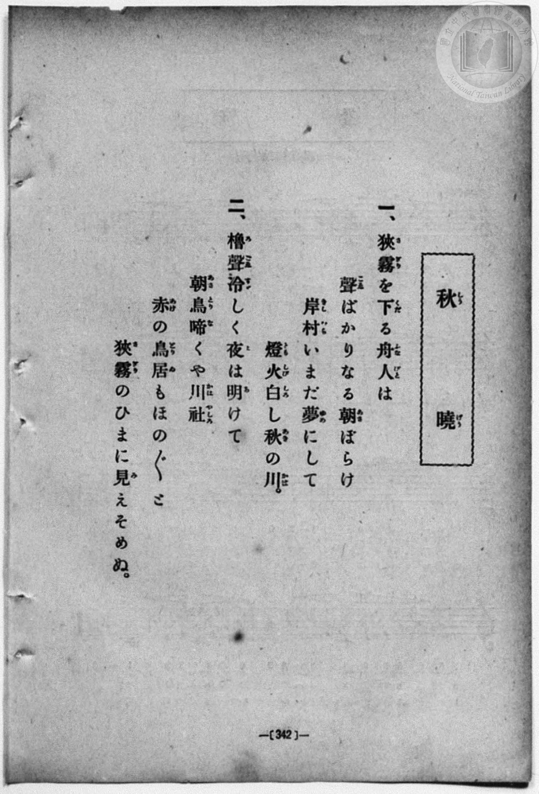
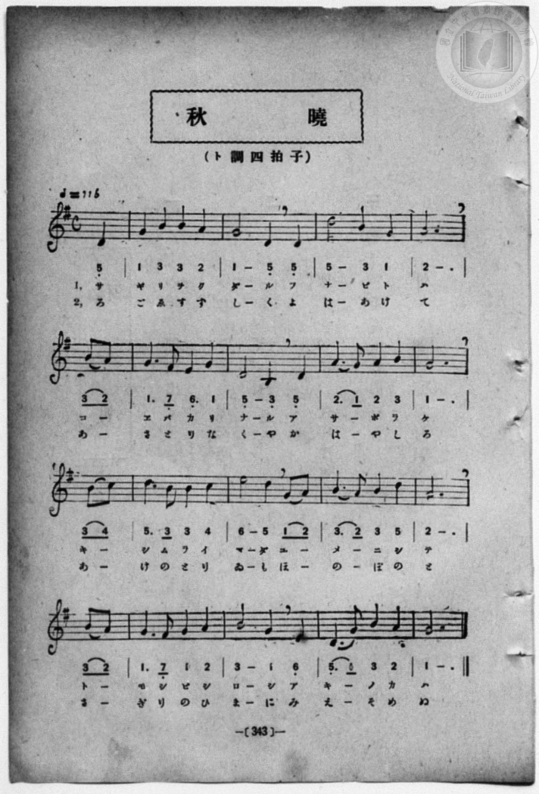

# 秋曉

> Re:Shōka 使用 AI 協助辨識與重建樂譜，可能會有錯誤。歡迎回報。

- **鋼琴伴奏版**：<br><audio controls src="shugyo.mp3"></audio>
- **NEUTRINO 歌聲合成版**：<br><audio controls src="shugyo_neutrino.mp3"></audio>

- book: 新編 小學校・公學校 唱歌教材集（高等科一・二學年用）
- 一條慎三郎 編《新編 小學校・公學校 唱歌教材集》（大正十二年十二月，索書號 0725-41）

## 說明

> [!NOTE]
> **原書資訊與歌詞全文**（對應 `P351.jpg`–`P352.jpg`，原書 p. 342–343，高等科一・二學年第 4 首）：
> - **調性與拍號**：ト調四拍子（G 大調 4/4 拍），速度 ♩= 116，弱起拍（第 4 拍起唱）。
> - **版面校勘**：
>   1. 第 4 小節第 4 拍（第二行弱起）對頁歌詞作「聲（こゑ）ばかり」，譜下片假名印作「コ ー エ バ カ リ」。
>   2. 第 15 小節第 1–2 拍（`キ ー`／`え ー`）五線譜為附點四分音符 D4（`5_.`）圓滑線接第二線八分音符 G4（`1`），下方簡譜第二音活字略糊似 `0`/`6` 但無低音點，依五線譜第二線 G4 記為 `1`。
>
> **一、**
> 狹霧（さぎり）を下（くだ）る舟人（ふなびと）は
> 聲（こゑ）ばかりなる朝（あさ）ぼらけ
> 岸村（きしむら）いまだ夢（ゆめ）にして
> 燈火（ともしび）白（しろ）し秋（あき）の川（かは）。
>
> **二、**
> 櫓聲（ろごゑ）冷（すず）しく夜（よ）は明（あ）けて
> 朝鳥（あさとり）啼（な）くや川社（かはやしろ）
> 赤（あけ）の鳥居（とりゐ）もほの／″＼と
> 狹霧（さぎり）のひまに見（み）えそめぬ。


## 歌詞

```text
（TMD 檔案未包含歌詞註解）
```

## ABC

<div class="abc-score" data-abc-src="shugyo.abc" aria-label="五線譜載入中"></div>

[下載 ABC 原始檔](shugyo.abc)

## TMD 檔案連結

- [主旋律 TMD 檔案](shugyo.tmd) [[在 TMD Studio 編輯](https://tmdlang.github.io/Tmd-TS/#tmd=s7IKdvYPcrWy4qpTUCpJTLdSSM7PyUlNLsnMz7MqzsjPTozPrsyvSsyML84ojTe0NDJWgqssy88pzU21ys4vyY83jDdCSBTnlxYlp1oVJ2fk5-fEl6RWlCTl52ejy8cXJKanWgUYmxoiZAqK8stS8xLzgLoLijLzSlJTwNoRClLLMlNSQdLFyYl58WWpRZlpmakpSG5KLSoGOx1iRUlRYl5xclFmAcg_CFX5RSUZ-elFiQUZlVYZmcUl-UWZyYk58dmJeYkIRSUZqUDf5SWWlBaloosWpyYW5-cVI5uYmZ6ZZ1WaB3JeCdRRWloKz5d3P5vdqaClxaVoq2BoaMZlb6vgzmVjom9iB9ILChcrhWfTNjzfvkLh6Yb-p2t3PFuw8HHz7qetayBshadTNj5b2_Ns6sxncye8nN32fk_Hy9Uznq_tfL584pMdDUClT3b1AJU-3bnl-ZQV7_d0gt0ElHm2aO6z1r4nOzpfNvcpAI1_3NBFij2PG7qBVj1dsvzZ2sVPextBluzcAmE8m9Pxfk_P8y2Lns3e8WLmfAUDcyNTXRNDsN1c-loKttQCXAoKCnYK0Yp-_iGusRCOltbTvvkgeze3v1jR9aKjHejmFyvnPW1d8Wxau5YWyMkbep-1dyokgBKWXlZBesKjhskgjhGYA3Q4xACFAj0FYxMjoKSxiTFQFGegrlmjYKLwctk0oPfe75kFcYUu0B0vVu1_1rAc5ILuXmAogOye9bi5Ayj8dPZsoNjTtROArnFXAAYhUEwBGOMKQFGwKT0vG-Y_3bVM4dHMleBEAXLUno0vtm4HK-iAWAkydut2YKwAtTxuaEJY_Lyz4-XcRcAoe9o9A2wrREpBwVBPAaIVGMHP1zfAjYEYCfTRi4VQe4BGAoPp5YJGSOg92TvncUPPi8ZNQJWPGyc_bpoIsrNxw-PG7sdNXY8bgCb0vFg758mO7ued7U8b259O6H3auwGi63HTZoXHzXsUHjetANITgPRqIL0KqAnuaAUFI4jLDE2RnGYIDHojqPMSHjetBZkCjJ7-hMeNHVB255NdU55vnwW0-nnTrpczW17ungcM26cdbS_nb36-ZpmCiwlIr2m8Hkjt0zmTn-2eCFT-rG8pxLtA9tPW1Qjl7mDlhiDFQA8BffNs2s7nGxaCjAerByp7tmX307XTn09d-nxz15M9exQSDBL0E8wSFJ7sbXvesvDJ3j6gGqArQNr3zUW4DmYd0AqFFytmAF2rALQHFgCwlAtKWQ2NwKIAzH_evfPlnOXgEJ_6uLEPGNCgQG-aBHQXWLD_ceMCsEj3i475T3btAgtufdy46nHj5seNoJz-uHE9xCicMQdU3NT9bM5csGwT0CKw7J7HTUByIkTv0007ns0F6gIq6H3cOP1xUwNQFqys5XHjPqAbni5ZBJJtanvc1AgWXw1S1rgM6ov2jueNq8HaVzxuAloBlNoMVPZ85l6wINBAUJoHMoAlIcwZEJF1T7dDHNYN9AhSIocH164epOB6tnoy1JtNQHdOgfj0aRswKQNNmPm4cRbEFmC4PV0yB6wMWEiBgujZjD6IvWDuRLjLgcHycvNSeMiA3Q-KgqdT94AFV4HV9z9uagG68_mSfXCnAkXg_oKG_9YlMHMg4b8OaPLTja2wYOl63AQsC4BRCVSwGygLTOWPGoChtAcoiy8xNK573LgJHAurXyyDhN5-sDiQMRcYHY8b10ADjfKyFgoUtPS5uHwTgVVZQGZiXr5DjUFNNcgCBRsLLXDMKGAr4BUgxQokcytooBVgOgqw4lcTi1aghSBjaxQMgKUbDJvGA4kasISPYY0CiAfDj5u2IuSM0OV6wXK4HQrKqjsagAWhggasnCTSeYZAk42h2AhkC1gEBMGOhbhYwRQqBlIFkq8Bq4VBYyAP4avHTetAbm5eBSY3gd2_HqzncXMDVMfj5tVgcipUvAsuPhlMdkDF-5FsARXJyCEEzC5g0YkgsnEmmJwF0dc4HaanEWQCMNNAxUHugIg3gUmQXpD4MmR7wHKEQhtc7ZAV2roK5vEKZqBwhYQkOIjBwYgU4JDgNQTToEBHRAskwE1QAnwFNPAg9RQs8FEDFizetAgiDk5sEPE5YHIlVHwjSoCvRQtwUHSBAghYJzaBTAYWJ9AAhEUUsBQBi3ejBzhUHBQxIHtACZq0AN_RSU6AQxKuMTgMTcB2m0FtBcmAwrcGLAdK_CAaJIo_cW-HhtsCaKg9bloCDet58DAFJfPHzaBEBRJfCBcHhQrEBJB4G3IYQJI8UliDkiYobNaBwxukDxTiIBdMgIcpJBHvhoY1KNtB9OyB6oSIQ1IHTA6c5fCHNbA1QlHiBjEgZQkkaCEpHZzk4cndEEuJA4KgYhIpuJtBCRYSaNCyAR58oMQJk0NO2nBxYAcBJA5K-OhlCVI5DA5skEpIEEOCDVhBQQNvHzzgwBmocT9UHBRdEPG5YJ2NUPE1GLbUcnHp2imAKh8FIK3MBQA)]
- [鋼琴伴奏 TMD 檔案](shugyo_piano.tmd) [[在 TMD Studio 編輯](https://tmdlang.github.io/Tmd-TS/#tmd=s7IKdvYPcrWy4qpTUCpJTLdSSM7PyUlNLsnMz7MqzsjPTozPrsyvSsyML84ojTe0NDJWgqssy88pzU21ys4vyY83jDdCSBTnlxYlp1oVJ2fk5-fEl6RWlCTl52ejy8cXJKanWgUYmxoiZAqK8stS8xLzgLoLijLzSlJTwNoRClLLMlNSQdLFyYl58WWpRZlpmakpSG5KLSoGOx1iRUlRYl5xclFmAcg_CFX5RSUZ-elFiQUZlVYZmcUl-UWZyYk58dmJeYlKXFpaCs-Xdz-b3fl-T8fL2TOfdXa_7N7zfMKWJ3u2PF3a_35Pp4KWFpeirYKhoRmXva2CO5eNib6JHchskC-tFJ5N2_B8-wqFpxv6n67d8WzBwsfNu5-2roGwFZ5O2fhsbc-zqTOfzZ3wcnYbyIrVM56v7Xy-fOKTHQ1ApU929QCVPt255fmUFUC7wG4GyjxbNPdZa9-THZ0vm_sUgMY_bugixZ7HDd1Aq54uWf5s7eKnvY0gS3ZugTCezel4v6fn-ZZFz2bveDFzvoKBuZGprokh2G4u38TMPKuAzMS8_CAPhxqDGoVqLgUgsLHQsgMzahQMFHTh2DQeSNSAJXwMaxRAPBh-3LQVIWeELtcLloOaaAjkGEOxEUgCLAKCYPMhliiYQsVAqkDyNWC1MGgM5CEc8rhpHcia5lVgchPYyvVgPY-bG6A6HjevBpNToeJdcPHJYLIDKt6PZMvjps0onnrcOAUsOhFENs4Ek7Mg-hqnw_Q0gkx43AQ1rxHkDoh4E5gE6QWJL0O2ByyHEkC6CubxCmagoIB4HhwqYJ8jhREkRAzBNCicECEJCSMTlDBaAfXvBCAbEhag8EINC7B40yKIODhKIeJzwORKqPhGlDBaixZGoBAG-WkFUA5k8uNGqD3gkIHoaQGLd6OHEVQcFJYge0DJBkcYQZKHMdjbJmDlZlCFIBlQkNSA5UBJDESDRPEnoe1Qry6AevRx0xJo8MyDBwMoMT1uBkUdSHwhXBzkEYgJIPE2ZGdDEhZS8IASAMg768BBBNIHCiSQCybAgwGSVHZDgweUuCF69kB1QsQhEQqTAydsjCQEYkAyGSQ0IOkJnLDgicoQS1YEQVCWRwqhZlCygPgTmmngPgYlAZgccgKCiwMLNZA4KHmhZzKkMgUcPiCVkFCB-PRxIyhDg2T2wf0KTqaN-6HioBCGiM8F62yEiq_BsKUWucTzQSnxTJBKPAiEOAoYJPEK0YaxYMo0PhZFAKgIWRpIgQIVqhDEQDUFJGqCoQ5qDpgPlIGLo1mE6RoTkBqQeUAGeY7B8JMZSL1ZfC5cLz4HAUNT104BFKDRPkBRONsIzFbmAgA)]

## 分析

```text
================================================================================
📊 TMD Song Profile: [ 秋曉 ]
================================================================================
⏱  Duration:       0:35 (35.2s), 17 measures total
🎼 Key & Tempo:    首調基準 G, != 116.0 BPM, <4/4>
   - 分析範圍：      由實際發聲的音符與和弦推測調性；播放脈絡另行呈現
🎤 人聲音域:    B3 (MIDI 59) – E5 (MIDI 76) [跨度: 17 個半音 / 1.4 個八度, 難度: challenging]
   - 最低音:  B3 in [Main #1 @ m.7, 0:13]
   - 最高音: E5 in [Main #1 @ m.11, 0:20]
   - 適合: soprano, mezzo-soprano, contralto, tenor, baritone, bass
🏛  結構:      Main (35.2s)
⚡ 編曲密度:        Peak 1 軌道同時演奏
🗝  調性診斷：       G 大調（純淨自然大調，未偵測到可信轉調）
   - 風格氣質:    純淨自然大調（陽光明朗、易唱易記，無明顯調外色彩）
   - 轉調歷程:    全曲維持單一推測調性（未偵測到可信轉調）
   - 核心骨幹音:  G, A, B, D, E
   - 調性數值:    G 大調 [相關度: 0.86, 穩定度: High, 自然音純度: 100.0%]
   - 候選調性 (K-S): G 大調 (0.86), D 大調 (0.73), B 小調 (0.61)
   - 五度圈歷程:   +1
   - 各段落調性細節:
     • [Main #1]: G 大調 (r: 0.86, 自然音純度: 100.0%)

  [ 五度圈游移軌跡 ]
               C  
         F           [G ]*
      Bb               D  
      Eb               A  
         Ab           E  
            Db       B  
               F# 
     (* = active key center)

  [ 十二半音累積音高分佈 ]
     C  : ██                         2.3%
     C# :                            0.0%
     D  : ██████████████████        20.3%
     D# :                            0.0%
     E  : █████                      6.2%
     F  :                            0.0%
     F# : █                          1.6%
     G  : ████████████████████████  27.3%
     G# :                            0.0%
     A  : ███████████████████       21.1%
     A# :                            0.0%
     B  : ███████████████████       21.1%
--------------------------------------------------------------------------------
Assignment 軌道音域：
  - Piano         : B3 – E5 (17 個半音 / 1.4 個八度, 55 個音符)
================================================================================
```


## 原書掃描頁






