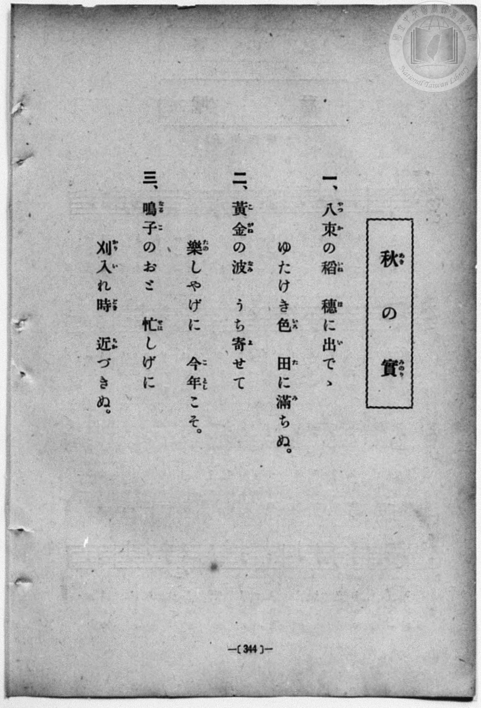
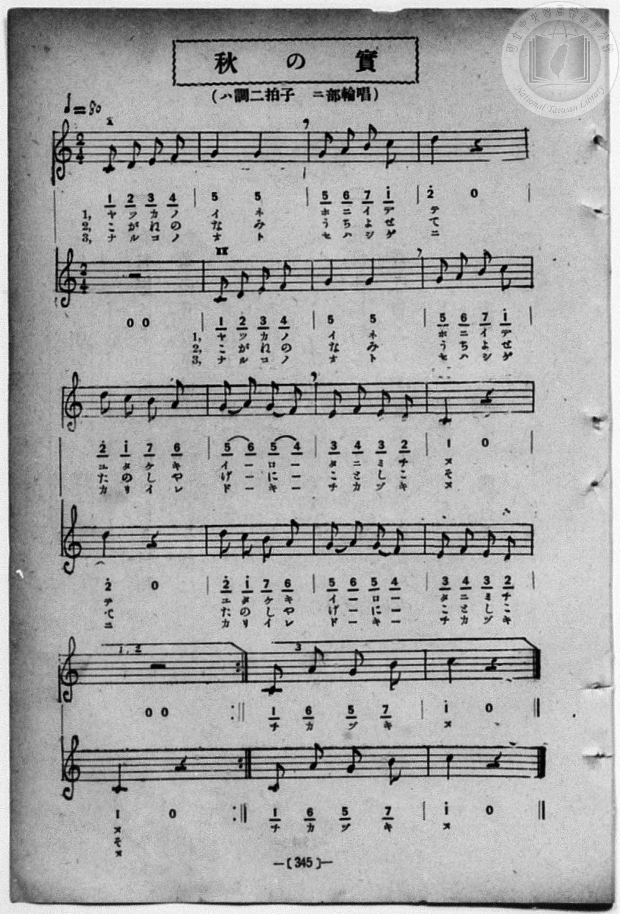

# 秋の實（二部輪唱）

> Re:Shōka 使用 AI 協助辨識與重建樂譜，可能會有錯誤。歡迎回報。

<audio controls src="aki_no_mi.mp3"></audio>

- book: 新編 小學校・公學校 唱歌教材集（高等科一・二學年用）
- 一條慎三郎 編《新編 小學校・公學校 唱歌教材集》（大正十二年十二月，索書號 0725-41）

## 說明

> [!NOTE]
> **原書資訊與歌詞全文**（對應 `P353.jpg`–`P354.jpg`，原書 p. 344–345，高等科一・二學年第 5 首）：
> - **調性與拍號**：ハ調二拍子・二部輪唱（C 大調 2/4 拍），速度 ♩= 80。
> - **比較校勘**：先前檔案轉植自手抄《唱歌帖》（`P204.jpg`），其中第 3–7 小節旋律與結尾多處與原書不符。本檔依原書五線譜與數字譜完全重校：
>   1. 第一部（I）起唱 1 小節後，第二部（II）於第 2 小節嚴格八度同度輪唱進入。
>   2. 原譜正確旋律為：`1 2 3 4 | 5 - 5 - | 5 6 7 1^ | 2^ - 0 - | 2^ 1^ 7 6 | (5 6) (5 4) | 3 4 3 2 | 1 - 0 - |`。
>   3. 第 9 小節為 `1, 2` 反覆括號（第一部休止、第二部唱完 `1 0`），反覆唱完三節歌詞後，接 `3` 結尾括號（兩部齊唱尾奏 `| 1 6_ 5_ 7_ | 1^ - 0 - |`「チカヅキヌ」）。
>
> **一、**
> 八束（やつか）の稻（いね）　穗（ほ）に出（い）でゝ
> ゆたけき色（いろ）　田（た）に滿（み）ちぬ。
>
> **二、**
> 黃金（こがね）の波（なみ）　うち寄（よ）せて
> 樂（たの）しやげに　今年（ことし）こそ。
>
> **三、**
> 鳴子（なるこ）のおと　忙（せは）しげに
> 刈入（かりい）れ時（どき）　近（ちか）づきぬ。


## 歌詞

```text
（TMD 檔案未包含歌詞註解）
```

## ABC

```abc
X:1
T:秋の實（二部輪唱）
M:2/4
L:1/16
Q:1/4=80
K:C
V:V1 name="Alto" snm="Alt"
V:V2 name="Soprano" snm="Sop"
[V:V1]
z4 z4 | C2 D2 E2 F2 | G4 G4 | G2 A2 B2 c2 |
w: ヤ ツ カ ノ | イ ネ | ホ ニ イ デ
d4 z4 | d2 c2 B2 A2 | G2 A2 G2 F2 | E2 F2 E2 D2 |
w: テ | ユ タ ケ キ | イ _ ロ _ | タ ニ ミ チ
C4 z4 | z4 z4 | C2 D2 E2 F2 | G4 G4 |
w: ヌ | こ が ね の | な み
G2 A2 B2 c2 | d4 z4 | d2 c2 B2 A2 | G2 A2 G2 F2 |
w: う ち よ せ | て | た の し や | げ _ に _
E2 F2 E2 D2 | C4 z4 | z4 z4 | C2 D2 E2 F2 |
w: こ と し こ | そ | ナ ル コ ノ
G4 G4 | G2 A2 B2 c2 | d4 z4 | d2 c2 B2 A2 |
w: オ ト | セ ハ シ ゲ | ニ | カ リ イ レ
G2 A2 G2 F2 | E2 F2 E2 D2 | C4 z4 | C2 A,2 G,2 B,2 |
w: ド _ キ _ | チ カ ヅ キ | ヌ | チ カ ヅ キ
c4 z4 |
w: ヌ
[V:V2]
C2 D2 E2 F2 | G4 G4 | G2 A2 B2 c2 | d4 z4 |
w: ヤ ツ カ ノ | イ ネ | ホ ニ イ デ | テ
d2 c2 B2 A2 | G2 A2 G2 F2 | E2 F2 E2 D2 | C4 z4 |
w: ユ タ ケ キ | イ _ ロ _ | タ ニ ミ チ | ヌ
z4 z4 | C2 D2 E2 F2 | G4 G4 | G2 A2 B2 c2 |
w: こ が ね の | な み | う ち よ せ
d4 z4 | d2 c2 B2 A2 | G2 A2 G2 F2 | E2 F2 E2 D2 |
w: て | た の し や | げ _ に _ | こ と し こ
C4 z4 | z4 z4 | C2 D2 E2 F2 | G4 G4 |
w: そ | ナ ル コ ノ | オ ト
G2 A2 B2 c2 | d4 z4 | d2 c2 B2 A2 | G2 A2 G2 F2 |
w: セ ハ シ ゲ | ニ | カ リ イ レ | ド _ キ _
E2 F2 E2 D2 | C4 z4 | z4 z4 | C2 A,2 G,2 B,2 |
w: チ カ ヅ キ | ヌ | チ カ ヅ キ
c4 z4 |
w: ヌ
```

## TMD 檔案連結

- [主旋律 TMD 檔案](aki_no_mi.tmd) [[在 TMD Studio 編輯](https://tmdlang.github.io/Tmd-TS/#tmd=s7IKdvYPcrWy4qpTUCpJTLdSSM7PyUlNLsnMz7MqzsjPTozPrsyvSsyML84ojTe0NDJWgqssy88pzU21ys4vyY83jDdCSBTnlxYlp1oVJ2fk5-fEl6RWlCTl52ejy8cXJKanWgUYmyIZWVCUX5aal5gH1F1QlJlXkpoC1o5QkFqWmZIKki5OTsyLL0stykzLTE1BclNqUTHY6RArSooS84qTizILQP5BqMovKsnITy9KLMiotMrILC7JL8pMTsyJz07MS0QoKslIBfquPDURyChCFy5OTSzOzytW4tLSUni-vPtx47qn65e939PxZFfPy-YVL_asejpl4_s9nQpaWlyKtgoWBlz2tgrOXDZG-iZ2XCCjQAFipfBs2obn21coPN3Q_3TtjmcLFj5u3v20dQ2ErQA04dnanmdTZz6bO-Hl7Dag4S9Xz3i-tvP58olPdjQAlQLtAip9unPL8ykrgHaBnQiUebZo7rPWvic7Ol829ykAjX_c0EWKPY8buoFWPV2y_NnaxU97G0GW7NwCYTyb0_F-T8_zLYuezd7xYuZ8BQNzI1NdE0Ow3Vz6Wgq21AJcCgoKdgrRin7-Ia6xEI6W1tO--SB7N7e_WNH1oqMd6OYXK-c9bV3xbFq7lhbIyRt6n7V3KiSAUpReVkF6wqOGySCOCZgDdDjEAIUCPQVjExOgpLGJKVAUZ6CuWaNgqvBy2TSg997vmQVxhS7QHS9W7X_WsBzkgu5eYCiA7J71uLkfKAwKou7ep2snQMxBSggdzgrAEAUqUQCmAAWgIrChPS8b5j_dtUzh0cyVoDTyuKEJYcuz9VNe7GkGxs_T7hlgK562djzt7H22asqzhR0v9nY-W9L7on3Vs87uZ10twBiGROLTHdMg0ZcQYGQA8zfIoqet257sWAvykjHQ4-aglPB8fcOz6d1P93UDffJ864SnG_Y9XTLrxcypQC4koJ7s6H2-ZhnQUc_mrAFa-2TfXKj4rinPt896sXYOKAim7ni6djqQ_XQd0I4VL9t7gS6Gh5aCgqGeAtBSYMgCwwLoLE-ga15s3Q50rIIh1A1P9_WA0hRQETjAQIpAqp5N2wNyrRFM1awtzxbsedq6GhhcTyf0AElIyL5s2PS0dSk84BQUjPQUgK4EOgiYep8v2gXx4fOmXUA3JRgCjTNWMFGoAcarLhiDWGYK5gqGcUCmURxQxAAsCmQChcyBcjUKGkAlmiDSRBPIA-k3BppTA_QAVHUCkvXGYP8qWEKdDbRYIcFQR8EoQeFpf--LZW3PutcAkwzQk_BQebJn4rO1ix43NMKDAOgtYGgC9SkYwGIPrBciDszXoJiDJH5w2D3rW6qQYJygAIlEuA1PW1cCDXu5F5Q0QJG7tF8hAeRqs3gF03gF83iQF-A-Bvqh53Fz4-Om1Y-bWx83rX3c3PO4AZRIYX6DZUJQJmloBJZqYD4wQp7NBVn2uKnlceOSx43AtNcJLAufr9gNEmwECq4FG9LwfOV0sAhQHKhg9dN2YIyAFIC5yx83zYUY-Lip7XHj_MeNEx839r7o3AQ1pAnikobnUzaARYA2ggx5tns_mAskgdyFjxvXYLh2F9AbcNe-3N38sn0iWMvkx409ULc1rnu2eRFYcBXUqIaGx41AZyx8uh7oPKDXgIUeUNnsx43LIOY8W9EEcQZQL1hqOtj7k4BOAup9srsLWHrAbFkBlAWrAbLnYgYm0DKE8zZvARYdUJc0AauUyRDnPW7sApnT0PB0_0ywLNAl66H2gi2FxkUHMMqXghV0P24CagGHbVPPs5kQ164EBinEdy_2QwIBGGKQ-FoKlEKEHuXFNxQoaOlzcfkmZuZZBecXACvifIcagxqFapAdCjYWWuBgUMBWbUDLjPd75z2dPRuSkxQ0YCW5Jhb1QItAZoGSN5FZHKzex7BG4XHzEiBuAaa81UC6D6jocdMSoIrHzb1g3Y-bZwNxN1j0cXM7WKQNKBOPMMUIKNY4GYh7gHgtEK8DqWpcBTKlcT_ElMY2IF4INKUDSM8GiyxDNcUYZHIXEAPd0bQZ7hawKc0dEFOadgPZ_UB6OxBvArulG24K_uDcNQUYnE92ziUpOJHLQVAwAgtB7GUgmEQP2GVAR-4H4o1AvBYpYNdCPQOUAwVs83wgbgR7pgfmGTCJHsRAdcCgBSZ7oN4WcBBOAgfxamgQg6JgBUQeyAaJzMVlHiiwwRG-Chqxa8D2d4LMA7oVEvGNUDWtMPdjdV8tNI075pRQlsDhFcCzmbPg1SOkgtNRICq64JFAIB_A4wjuC9KzATxekMwgNRPA4wLZHSRmARole2wtAbw5ACndw4sHyvIAUsqHFxWU5QKkggZebFCWD0Cp3zk_JZG8Eh7UkkFutShoGBOZ0nE0YyAeJNbNuHIs5cbr2imAyoRoH8NYBTjbCIltDGaDXAGilbkA)]
- [鋼琴伴奏 TMD 檔案](aki_no_mi_piano.tmd) [[在 TMD Studio 編輯](https://tmdlang.github.io/Tmd-TS/#tmd=s7IKdvYPcrWy4qpTUCpJTLdSSM7PyUlNLsnMz7MqzsjPTozPrsyvSsyML84ojTe0NDJWgqssy88pzU21ys4vyY83jDdCSBTnlxYlp1oVJ2fk5-fEl6RWlCTl52ejy8cXJKanWgUYmyIZWVCUX5aal5gH1F1QlJlXkpoC1o5QkFqWmZIKki5OTsyLL0stykzLTE1BclNqUTHY6RArSooS84qTizILQP5BqMovKsnITy9KLMiotMrILC7JL8pMTsyJz07MS1Ti0tJSeL68-3Hjuqfrl73f0_FkV8_L5hUv9qx6OmXj-z2dQJGXs2c-6-x-2b3n-YQtT_Zsebq0HyiuoKXFpWirYGHAZW-r4MxlY6RvYscFshDkdSuFZ9M2PN--QuHphv6na3c8W7DwcfPup61rIGwFoMnP1vY8mzrz2dwJL2e3gaxYPeP52s7nyyc-2dEAVAp0A1Dp051bnk9ZAbQL7BGgzLNFc5-19j3Z0fmyuU8BaPzjhi5S7Hnc0A206umS5c_WLn7a2wiyZOcWCOPZnI73e3qeb1n0bPaOFzPnKxiYG5nqmhiC7ebyTczMswrOLwCGbb5DjUGNQjWXAhDYWGjZgRk1CoYKRgrGCiZAlqmCLhiDWGYK5gqGcUCmURxQxAAkClbvY1ij8Lh5CRC3KDxuWg2k-4CKHjctAap43NwL1v24eTYQd4NFHze3g0XagDLxCFOMgGKNk4G4B4jXAvE6kKrGVSBTGvdDTGlsA-KFQFM6gPRssMgyVFOMQSZ3ATHQHU2b4W4Bm9LcATGlaTeQ3Q-ktwPxJrBbuuGmQIMA6EegX82BnoZ43RQcHKBAMQYGDiiIoEEAJtEDYxnQ4P1AvBGI1yIFxlqoA4ByoMBong_EjWAH9MAcACbRgwWoDhgcjxunA_W2gL09CRwsq6HBAgq2FRB5IBskMheXeaAAAkfSKmhkrAHb3wkyD-hWSGQ1QtW0wtyP1X210LTkmFOCIyHBw4ZAkoIHHdxw0lMUPLiQzCA1PcGDCNkdJKYmpBQE8zzRiQkpCcFzB2XJCSkRwXMKZQkKKZ_Bcw1lSQqekAIygUVSkAehQslQG5R-jMEkNEC1zYF8cOFkqg0OeFMQD-ZaqChQBKTQRBsUDyDtIBaINtKGGAuMDSALRJvHa4MjBsjUBQtCBUzjtRGRheJsHxRnmyCcHa8QbRofC2UZwhgQIdN4qBjMmSC-CVw1Qh8WlgHEBc75KYmESnOzeKDJQC-AOGhlNxFRA7YBdx6nivEEYh7JBmB8QaIWHgcIA3DFgQkwWEFBixxuunYKoMiL9gEGP5xthMQ2BrNBhoNoZS4A)]

## 分析

```text
================================================================================
📊 TMD Song Profile: [ 秋の實（二部輪唱） ]
================================================================================
⏱  Duration:       0:43 (43.5s), 29 measures total
🎼 Key & Tempo:    首調基準 C, != 80.0 BPM, <2/4>
   - 分析範圍：      由實際發聲的音符與和弦推測調性；播放脈絡另行呈現
🎤 人聲音域:    G3 (MIDI 55) – D5 (MIDI 74) [跨度: 19 個半音 / 1.6 個八度, 難度: challenging]
   - 最低音:  G3 in [Coda #1 @ m.28, 0:41]
   - 最高音: D5 in [Main[L1] #1 @ m.5, 0:06]
   - 適合: mezzo-soprano, contralto, tenor, baritone, bass
🏛  結構:      Main[L1] (13.5s) -> Main[L2] (13.5s) -> Main[L3] (13.5s) -> Coda (3.0s)
⚡ 編曲密度:        Peak 2 軌道同時演奏
🗝  調性診斷：       C 大調（純淨自然大調，未偵測到可信轉調）
   - 風格氣質:    純淨自然大調（陽光明朗、易唱易記，無明顯調外色彩）
   - 轉調歷程:    全曲維持單一推測調性（未偵測到可信轉調）
   - 核心骨幹音:  G, C, D, A, E
   - 調性數值:    C 大調 [相關度: 0.89, 穩定度: Moderate, 自然音純度: 100.0%]
   - 候選調性 (K-S): C 大調 (0.89), G 大調 (0.85), A 小調 (0.54)
   - 五度圈歷程:   +1 -> +1 -> +1 -> +0
   - 各段落調性細節:
     • [Main[L1] #1]: G 調性不明確 (r: 0.86, 自然音純度: 89.3%, 調外音: F)
     • [Main[L2] #1]: G 調性不明確 (r: 0.86, 自然音純度: 89.3%, 調外音: F)
     • [Main[L3] #1]: G 調性不明確 (r: 0.86, 自然音純度: 89.3%, 調外音: F)
     • [Coda #1]: C 大調 (r: 0.75, 自然音純度: 100.0%)

  [ 五度圈游移軌跡 ]
              [C ]*
         F           [G ]*
      Bb               D  
      Eb               A  
         Ab           E  
            Db       B  
               F# 
     (* = active key center)

  [ 十二半音累積音高分佈 ]
     C  : ████████████████████      20.0%
     C# :                            0.0%
     D  : ████████████████          16.7%
     D# :                            0.0%
     E  : ██████████                10.0%
     F  : ██████████                10.0%
     F# :                            0.0%
     G  : ████████████████████████  24.4%
     G# :                            0.0%
     A  : ███████████               11.1%
     A# :                            0.0%
     B  : ████████                   7.8%
--------------------------------------------------------------------------------
Assignment 軌道音域：
  - Alto          : G3 – D5 (19 個半音 / 1.6 個八度, 77 個音符)
  - Soprano       : G3 – D5 (19 個半音 / 1.6 個八度, 77 個音符)
================================================================================
```


## 原書掃描頁






