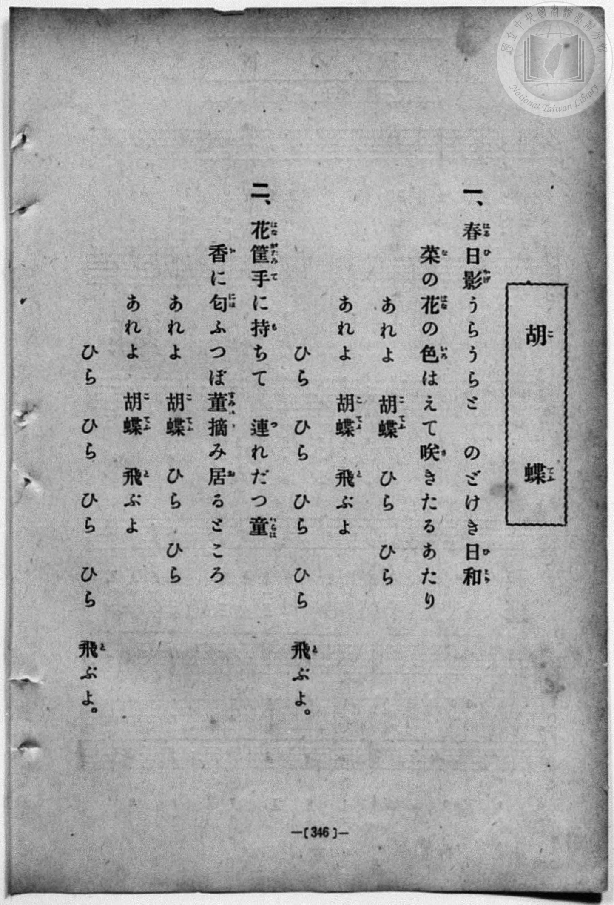
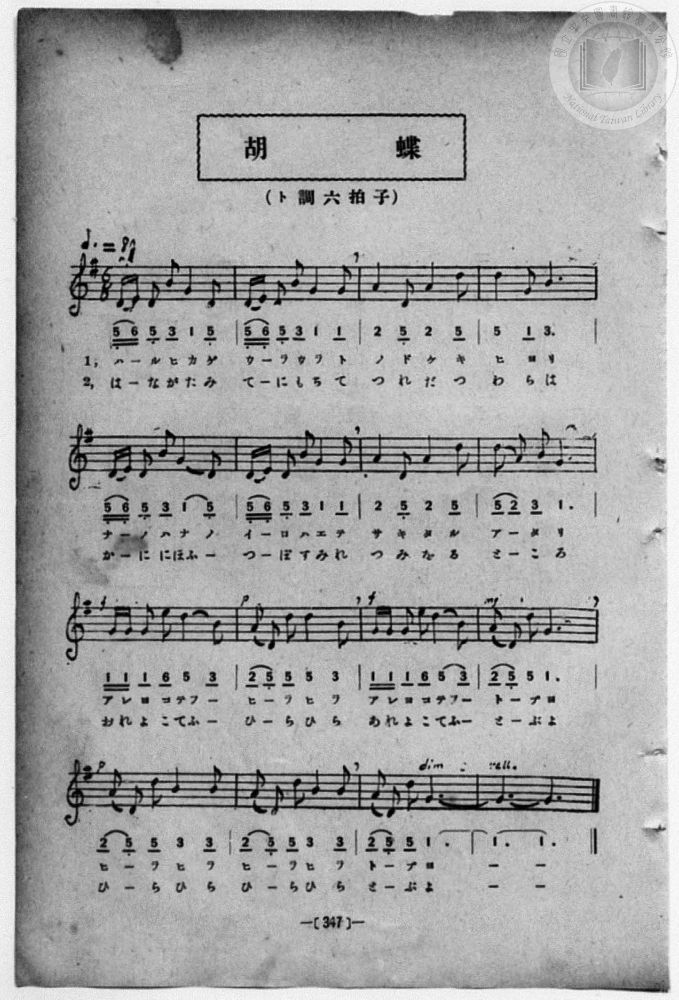

# 胡蝶

> Re:Shōka 使用 AI 協助辨識與重建樂譜，可能會有錯誤。歡迎回報。

<audio controls src="kocho.mp3"></audio>

- book: 新編 小學校・公學校 唱歌教材集（高等科一・二學年用）
- 一條慎三郎 編《新編 小學校・公學校 唱歌教材集》（大正十二年十二月，索書號 0725-41）
- 日治時期公學校《唱歌帳》（典藏號 2020.006.0843・P156）
- 原載《小公唱材集》第 347 頁（大正 14 年 1 月 5 日抄）

## 說明

> [!NOTE]
> **原書資訊與歌詞全文**（對應 `P355.jpg`–`P356.jpg`，原書 p. 346–347，高等科一・二學年第 6 首）：
> - **調性與拍號**：ト調六拍子（G 大調 6/8 拍），速度 ♩.= 80（換算四分音符 `!= 120`）。
> - **比較校勘**：先前檔案轉植自手抄《唱歌帳》（`P156.jpg`），對照原書五線譜與數字譜（`P356.jpg`）修正以下要點：
>   1. 第 1、2、5、6 小節開頭 `5_ 6_` 為**兩個十六分音符**（雙底線），第 4 拍 `1` 為**四分音符**（無底線），且 `5_ 6_ 5_` 帶有低音點（D4–E4–D4），第 3 個八分音符 `3` 為第三線 B4（無低音點）。
>   2. 第 3、7 小節為 `| 2 - - - 5_ - 2 - - - 5 - |`（第一個 `5_` 為低音 D4，第二個 `5` 為第四線 D5）。
>   3. 第 9、11 小節（`f`）開頭 `1 1` 為**兩個十六分音符**（`ア レ`／`あ れ`），接八分音符 `1`（`ヨ`／`よ`）、八分音符 `6`（`コ`／`こ`）、四分音符 `5` 與八分音符 `3` 圓滑線（`テフ ー`／`てふ ー`）。
>   4. 第 13–14 小節原書印有**兩次** `| (2 5_) 5 3 3 |`（「ヒーラヒラ　ヒーラヒラ」／「ひーらひら　ひーらひら」），對頁歌詞亦作四次「ひら」，手抄本誤省第 14 小節為延音。
>   5. 第 5 小節第 2 節譜下假名印作「か ー に にほ ふ ー」（對頁全文作「香（か）に匂（にほ）ふ」）。
>
> **一、**
> 春日影（はるひかげ）うらうらと　のどけき日和（ひより）
> 菜（な）の花（はな）の色（いろ）はえて咲（さ）きたるあたり
> あれよ胡蝶（こてふ）ひらひら　あれよ胡蝶（こてふ）飛（と）ぶよ
> ひら　ひら　ひら　ひら　飛（と）ぶよ。
>
> **二、**
> 花筐（はながたみ）手（て）に持（も）ちて　連（つ）れだつ童（わらは）
> 香（か）に匂（にほ）ふつぼ菫（すみれ）摘（つ）み居（を）るところ
> あれよ胡蝶（こてふ）ひらひら　あれよ胡蝶（こてふ）飛（と）ぶよ
> ひら　ひら　ひら　ひら　飛（と）ぶよ。


## 歌詞

```text
（TMD 檔案未包含歌詞註解）
```

## ABC

```abc
X:1
T:胡蝶
M:6/8
L:1/16
Q:3/8=80
K:G
V:V1 name="Piano" snm="Pia"
[V:V1]
D E D2 B2 G4 D2 | D E D2 B2 G4 G2 | A4 D2 A4 d2 | d4 G2 B6 |
w: 1.~ハ _ ル ヒ カ ゲ | ウ _ ラ ウ ラ ト | ノ ド ケ キ | ヒ ヨ リ
w: 2.~は _ な が た み | て _ に も ち て | つ れ だ つ | わ ら は
D E D2 B2 G4 D2 | D E D2 B2 G4 G2 | A4 D2 A4 d2 | d2 A2 B2 G6 |
w: 1.~ナ _ ノ ハ ナ ノ | イ _ ロ ハ エ テ | サ キ タ ル | ア _ タ リ
w: 2.~か _ に にほ ふ _ | つ _ ぼ す み れ | つ み を る | と _ こ ろ
!f! G G G2 e2 d4 B2 | !p! A2 D2 D2 d4 B2 | !f! G G G2 e2 d4 B2 | !mf! A2 D2 d2 G6 |
w: 1.~ア レ ヨ コ テフ _ | ヒ _ ラ ヒ ラ | ア レ ヨ コ テフ _ | ト _ ブ ヨ
w: 2.~あ れ よ こ てふ _ | ひ _ ら ひ ら | あ れ よ こ てふ _ | と _ ぶ よ
!p! A2 D2 d2 B4 B2 | A2 D2 d2 B4 B2 | !p! A2 D2 d2 G6- | [Q:3/8=67] G12 |
w: 1.~ヒ _ ラ ヒ ラ | ヒ _ ラ ヒ ラ | ト _ ブ ヨ | _
w: 2.~ひ _ ら ひ ら | ひ _ ら ひ ら | と _ ぶ よ | _
D E D2 B2 G4 D2 | D E D2 B2 G4 G2 | A4 D2 A4 d2 | d4 G2 B6 |
w: 1.~ハ _ ル ヒ カ ゲ | ウ _ ラ ウ ラ ト | ノ ド ケ キ | ヒ ヨ リ
w: 2.~は _ な が た み | て _ に も ち て | つ れ だ つ | わ ら は
D E D2 B2 G4 D2 | D E D2 B2 G4 G2 | A4 D2 A4 d2 | d2 A2 B2 G6 |
w: 1.~ナ _ ノ ハ ナ ノ | イ _ ロ ハ エ テ | サ キ タ ル | ア _ タ リ
w: 2.~か _ に にほ ふ _ | つ _ ぼ す み れ | つ み を る | と _ こ ろ
!f! G G G2 e2 d4 B2 | !p! A2 D2 D2 d4 B2 | !f! G G G2 e2 d4 B2 | !mf! A2 D2 d2 G6 |
w: 1.~ア レ ヨ コ テフ _ | ヒ _ ラ ヒ ラ | ア レ ヨ コ テフ _ | ト _ ブ ヨ
w: 2.~あ れ よ こ てふ _ | ひ _ ら ひ ら | あ れ よ こ てふ _ | と _ ぶ よ
!p! A2 D2 d2 B4 B2 | A2 D2 d2 B4 B2 | !p! A2 D2 d2 G6- | [Q:3/8=67] G12 |
w: 1.~ヒ _ ラ ヒ ラ | ヒ _ ラ ヒ ラ | ト _ ブ ヨ | _
w: 2.~ひ _ ら ひ ら | ひ _ ら ひ ら | と _ ぶ よ | _
```

## TMD 檔案連結

- [主旋律 TMD 檔案](kocho.tmd) [[在 TMD Studio 編輯](https://tmdlang.github.io/Tmd-TS/#tmd=s7IKdvYPcrWy4qpTUCpJTLdSSM7PyUlNLsnMz7MqzsjPTozPrsyvSsyML84ojTe0NDJWgqssy88pzU21ys4vyY83jDdCSBTnlxYlp1oVJ2fk5-fEl6RWlCTl52ejy8cXJKanWgUYm5oiZAqK8stS8xLzgLoLijLzSlJTwNoRClLLMlNSQdLFyYl58WWpRZlpmakpSG5KLSoGOx1iRUlRYl5xclFmAcg_CFX5RSUZ-elFiQUZlVYZmcUl-UWZyYk58dmJeYkIRSUZqUDfJeZl5ibmoIsWpyYW5-cVK3FpaSm8aF74Yu42BS0tLkVbBUMjAy57WwV3LhszfQs7kC6Q160Unk3b8Hz7CoWnG_qfrt3xbMHCx827n7augbAVnk7Z-Gxtz7OpM5_NnfBydtv7PR0vV894vrbz-fKJT3Y0AJU-2dUDVPp055bnU1a839MJdg1Q5tmiuc9a-57s6HzZ3KcANP5xQxcp9jxu6AZa9XTJ8mdrFz_tbQRZsnMLhPFsTsf7PT3Ptyx6NnvHi5nzFQzMjUx1TQxhdj-bvvTZpt3PZjY9mzMfbjzQdogFT3dshhrduuPF9H6QfiMDIwM9AwMzPQMLE2OgmwIMTc1ghj3tm_9iTydIN9DRQMOAZsCc93zNGgVjE3OFlwsa4S5VMDRRALpTwVAB6EgFUwWQW7pawIZx6Wsp2FILcCkoKNgpRCv6-Ye4xkI4WlpAt4JCZHP7ixVdLzragZ59sXLe09YVz6a1a2mBnLih91l7p0ICKFXrZRWkJzxqmAzimIE5wCCFGKBQoAf0lxlQEug7oCjO6Ab630zh5bJpQO-93zML4gpdoDterNr_rGE5yAXdvcDwBdk963FzB1D4aetaoNjTtROArnFXAAYZUEwBmBYVgKJgU3peNsx_umuZwqOZK_VsFSwMgOqe9c9-vm7609mzn3a0vZy_-fmaZQoJkLQMdDIwZpoQFj9bP-XFnmZgbD_tngG29Wlrx9PO3merpjxb2PFib-ezJb0v2lc96-wGxglmgkgAxTs0KEBOAQbX89blkDB5smvK8-2zXqydA_LV1B1P104HssF6EMHX-WT_OmASeLJ76ZMd3S-WNb7cPQ8eLAoKhnoKoAAzfNzQaATEpkBsBsoJz9c3vJzW_XLBWoUE03gFs_gEhedNu4Bx2bryaUM3ML0DgwzucXAsvpw98-muqUDXQFwJMtQEFH4KCYYwvUhhBdbyvGUhspYnO6ZALVMwBdr3dMe2Z3M6n-ztA-oAu7nDxQQY-a4gwsUEYYuxAshFrauR4sEYbCNQEpjNgcYrOAGVg2xDMgwRQwoKRpAwMAb63Rzqd6B2hYQaBSNg_IEg0FW6CA4Q1wADtgNsQQPQdpCzwVZCLFAAOQ_kNlCaBMvC3AMMApB7XExRHWAMcYAl0AGGhlAXgGIxDRR9sGgwVIAHJM5ISHjctEjhcfMaoL7-hMeNTQqPm3qgyeZZ31LUQDIEeSHhcfMKiOKmDki6BRqKrMoMoqppM9TIyTBVKAkf6EFgCsSIhKdzJj_bPREcwSCb2h43TwW6bg_UqGWPG7dCuciBYQJNkcbAeAYVW-DQgCT3p70bgEkCHADP1iwEViPAKNIwAsaOJjBSjIEQHC2PG3oeN08CGvy4eSWYsfJxA7CEQBMBZux-kMrGTSDxpk4QA0gCVaKLQIsAYL4DFqmQ0uvJrmVP9s4BhgHQGVBDoCp7INn42Zw1L1YteT6nEewVmC-Asfd09zZgACF51xTiXVOYEiDbSAHIAGZkYH592tj-dEIv0N9A68AWdYNCTOFx42oQfty4G0iBAxFsOagoBboRUrZCdLxcNhMUJI3AkgToodVPe5rAXJBWsMhWiP9gDoKV2aAytaERWD2D-c9mLAXWGE_3bgTrXf-4qRvk40YgOQlsSBs4tCAksEIFBuG6x40rHzdOfNzYC9I4qQesERhIHY-buoBaIMa-6AeVVY8bV4ENWfeiC2Y-XKRzE1ik5XET2JEgKSB32dNJEPGpYMHex43zwU5qAjO6IIaDuE09QBshTQ2w-smQRAfWBY4xRJzjU_xy8WywCKgZ8bhxG1AZzAqkJIODgakXI6h39SAFNTAQnoPrIUg4PG4Exvn8x437gdqBKQssvgwSlc96QPX74yZghAK5C0GuBVrXsBisZglIEOijxgVA9vPVS8Eq-8FeXg8Pf8Jpo3HJ48Y9L_pXg8VnAp0BNBPkkokzELY07n-6sRVsPjgxgCJiBSj0mnqHRkRQ3uqBAgUtfS6u4Py8dKuAzMS8fIcagxqFapANCjaGZlrg-FbA1tgC5X9gfnuxsEdBA1ZS6CjAanBNLBqAFoEMqwHVS-DaElgjGQOxIXJ1hVMWROOr2sAkTCFIIwzWgG31MawBFjj9QP7j5tVgchKIbAKxQfBx0yawKY-bloFlV4LFEGywmuYOiBpgGxwm0glWtxFuylqoCpDpEBUrwOQqTBcZAdU1rgfJNoJkgZkGTM6H6WzcDzGrEewKYNkJMr8JzF4IVwOSA6lZAncBxJQFcBUgGZC_QH6HqAC7GWwzwkX443lXz-CKZ5AIsib0eO4C-RAcS7A4B4lA4gMkCgoPULg8bgbFF1RNEyimIGraoGq2wsMMrK4JFCMQFaDYAKlYBFcBksMdz90gWUgcQmpAEANmPFgxNKqARReYnAkm4RaCoxUlosFywOILrgJkBUgF3BuNk8HivShOIpChO8mJ6Oq0WmBUgKAusBMDiSgQBEURULagFhxh4LiEEKjy-HXnAqUR2oEYR6RD2pCwDNe0GURCGm8ogYyUM8F5HI1PgkGgwgCicRqYhIU7etSD27NADFIPjRNIKxI18kHlDyQiIfkTlU-CQYj43wbWDnMnEfEPbBuSFf8oMQzEsPIXEoXESoGMQYlchWpQ39TAoBZJEBUiZ3qCEUuECrxxSsgV4NgmHI2EVeCNQTyuqOXi0rVTAFXmCki0MhcA)]
- [鋼琴伴奏 TMD 檔案](kocho_piano.tmd) [[在 TMD Studio 編輯](https://tmdlang.github.io/Tmd-TS/#tmd=s7IKdvYPcrWy4qpTUCpJTLdSSM7PyUlNLsnMz7MqzsjPTozPrsyvSsyML84ojTe0NDJWgqssy88pzU21ys4vyY83jDdCSBTnlxYlp1oVJ2fk5-fEl6RWlCTl52ejy8cXJKanWgUYm5oiZAqK8stS8xLzgLoLijLzSlJTwNoRClLLMlNSQdLFyYl58WWpRZlpmakpSG5KLSoGOx1iRUlRYl5xclFmAcg_CFX5RSUZ-elFiQUZlVYZmcUl-UWZyYk58dmJeYlKXFpaCi-aF76Yu-39no6Xs2c-6-x-2b3n-YQtT_Zsebq0__2eTgUtLS5FWwVDIwMue1sFdy4bM30LO5DZIF9aKTybtuH59hUKTzf0P12749mChY-bdz9tXQNhKzydsvHZ2p5nU2c-mzvh5ew2kBWrZzxf2_l8-cQnOxqASp_s6gEqfbpzy_MpK4B2gd0MlHm2aO6z1r4nOzpfNvcpAI1_3NBFij2PG7qBVj1dsvzZ2sVPextBluzcAmE8m9Pxfk_P8y2Lns3e8WLmfAUDcyNTXRNDmN3Ppi99tmn3s5lNz-bMhxsPtB1iwdMdm6FGt-54Mb0fpN_IwMhAz8DATM_AwsQY6KYAQ1MzmGFP--a_2NMJ0g10NNAwoBkw5z1fs0bB2MRc4eWCRiUuLs-8kqJ8q4DMxLz8IA-HGoMahWouBSCwMTTTsgOzahRM4xXM4kGkroIxEBsCMQiC6BoFIygPLA3ngKVAJEgEWRMI1iCxEdAAJMNVi-IkHxQnWcBdZBivEG0YC8ZITJBLgTzTeCAXRKDy0GVRNKIaaACEYKcE5-elEwicakgCrcUVSmABysIQphCkER6GYOt9DGsUHjf3A_mPm1eDyUkgsgnEBsHHTZvApjxuWgaWXQkWQ7DBapo7IGqA6R0m0glWtxFuylqoCpDpEBUrwOQqTBcZAdU1rgfJNoJkHzf2gMn5MJ2N-yFmNYJd0Qh2dVMTmL0QrgYkB1KzBO4CiCkL4CpAMiB_gfwOUQF2M9hmhIvwJ2AqRA3W5I0UNV0gR4EDFhZNIBFIEIJEQV4AeeVxMyiIoWqaQIELUdMGVbMV7k2wuiZQIEJUgAIQpGIRXAVIDnfUdINkIcHeuPpx424wA2Y8WDE0dB837gGTM8Ek3EJwTKDEDVjucRM8bTSBrACpgHujcTJYvBfFSbD8k1YLDD0Q1FUwA2JYggeFKlC2oBYcxuDghxCo8vh15wKlEdqBGEc8AUPvcfMaWLJu2gwim9seN09FDRek9A_OSWh8EgwCZTmIxmlgEhZU6LHVBA7wx00g9dBgbFyGGV-gXA4Je0guQOWTYBAiyraBtcPciRplKJECxLCCCRLqxEqBjEGtFsBlqQGwLEUIokLkrEUwLohQgTcaCLkCHEGEQ56wCryBjscVKBUUrqoSXj_hqjPJq0tx6CJQP1O73kYuQ3AYDUpleCp-vFpBxQdhy_FbQLQUODugWA_LDTgaJ7p2CuCmkgKQAUoH0T5ABXC2EZitzAUA)]

## 分析

```text
================================================================================
📊 TMD Song Profile: [ 胡蝶 ]
================================================================================
⏱  Duration:       0:53 (53.1s), 32 measures total
🎼 Key & Tempo:    首調基準 G, != 120.0 BPM, <6/8>
   - 分析範圍：      由實際發聲的音符與和弦推測調性；播放脈絡另行呈現
🎤 人聲音域:    D4 (MIDI 62) – E5 (MIDI 76) [跨度: 14 個半音 / 1.2 個八度, 難度: moderate]
   - 最低音:  D4 in [Song #1 @ m.1, 0:00]
   - 最高音: E5 in [Song #1 @ m.9, 0:12]
   - 適合: soprano, mezzo-soprano, contralto, tenor, baritone, bass
🏛  結構:      Song (24.3s) -> Song (28.8s)
⚡ 編曲密度:        Peak 1 軌道同時演奏
🗝  調性診斷：       G 大調（純淨自然大調，未偵測到可信轉調）
   - 風格氣質:    純淨自然大調（陽光明朗、易唱易記，無明顯調外色彩）
   - 轉調歷程:    全曲維持單一推測調性（未偵測到可信轉調）
   - 核心骨幹音:  D, G, B, A, E
   - 調性數值:    G 大調 [相關度: 0.89, 穩定度: High, 自然音純度: 100.0%]
   - 候選調性 (K-S): G 大調 (0.89), D 大調 (0.77), B 小調 (0.62)
   - 五度圈歷程:   +1 -> +1
   - 各段落調性細節:
     • [Song #1]: G 大調 (r: 0.89, 自然音純度: 100.0%)
     • [Song #2]: G 大調 (r: 0.89, 自然音純度: 100.0%)

  [ 五度圈游移軌跡 ]
               C  
         F           [G ]*
      Bb               D  
      Eb               A  
         Ab           E  
            Db       B  
               F# 
     (* = active key center)

  [ 十二半音累積音高分佈 ]
     C  :                            0.0%
     C# :                            0.0%
     D  : ████████████████████████  32.3%
     D# :                            0.0%
     E  : ███                        4.2%
     F  :                            0.0%
     F# :                            0.0%
     G  : ███████████████████████   31.2%
     G# :                            0.0%
     A  : ███████████               14.6%
     A# :                            0.0%
     B  : █████████████             17.7%
--------------------------------------------------------------------------------
Assignment 軌道音域：
  - Piano         : D4 – E5 (14 個半音 / 1.2 個八度, 148 個音符)
================================================================================
```


## 原書掃描頁






