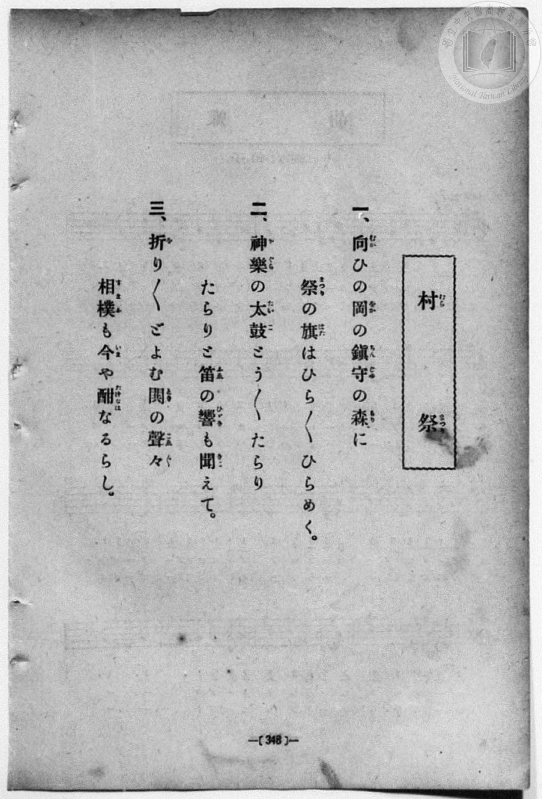
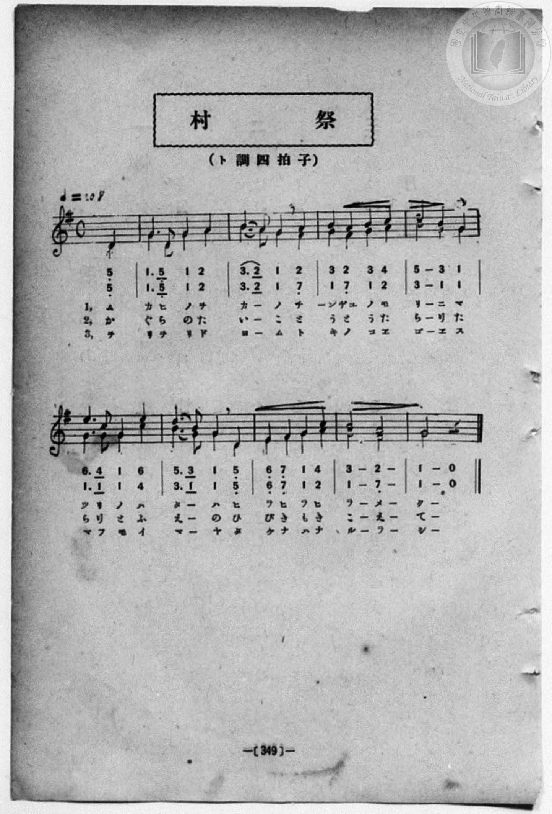

# 村祭（二部）

> Re:Shōka 使用 AI 協助辨識與重建樂譜，可能會有錯誤。歡迎回報。

- **NEUTRINO 歌聲合成版**：<br><audio controls src="muramatsuri_neutrino.mp3"></audio>
- **鋼琴伴奏版**：<br><audio controls src="muramatsuri.mp3"></audio>


- book: 新編 小學校・公學校 唱歌教材集（高等科一・二學年用）
- 一條慎三郎 編《新編 小學校・公學校 唱歌教材集》（大正十二年十二月，索書號 0725-41）
- 文部省《尋常小學唱歌》第三學年（二部合唱改編）

## 說明

> [!NOTE]
> **原書資訊與歌詞全文**（對應 `P357.jpg`–`P358.jpg`，原書 p. 348–349，高等科一・二學年第 7 首）：
> - **調性與拍號**：ト調四拍子・二部合唱（G 大調 4/4 拍），速度 ♩= 108，弱起拍（第 4 拍起唱）。
> - **比較校勘**：先前檔案轉植自《新定兒童唱歌》高等科男子用（`P073.jpg`，♩= 112，8 小節），但本冊（`P358.jpg`）為完全不同的 9 小節二部合唱版本（第一行 4 小節、第二行擴展為 5 小節，結尾拉長為 `| 3 - 2 - | 1 - 0 |`），且第 3 節歌詞作「鬨（とき）の聲々（こゑ／＼）／相撲（すまふ）も今（いま）や酣（たけなは）なるらし」。本檔依原書五線譜與雙排數字譜完整重校。
>
> **一、**
> 向（むか）ひの岡（をか）の鎭守（ちんじゆ）の森（もり）に
> 祭（まつり）の旗（はた）はひら／＼ひらめく。
>
> **二、**
> 神樂（かぐら）の太鼓（たいこ）とう／＼たらり
> たらりと笛（ふゑ）の響（ひゞき）も聞（きこ）えて。
>
> **三、**
> 折（を）り／＼どよむ鬨（とき）の聲々（こゑ／＼）
> 相撲（すまふ）も今（いま）や酣（たけなは）なるらし。


## 歌詞

```text
（TMD 檔案未包含歌詞註解）
```

## ABC

```abc
X:1
T:村祭（二部）
M:4/4
L:1/16
Q:1/4=108
K:G
V:V1 name="Alto" snm="Alt"
V:V2 name="Soprano" snm="Sop"
[V:V1]
z4 z4 z4 D4 | G6 D2 G4 A4 | B6 A2 G4 F4 | G4 F4 G4 A4 |
w: 1.~ム | カ ヒ ノ ヲ | カ _ ノ チ | ン ヂユ ノ モ
w: 2.~か | ぐ ら の た | い _ こ と | う と う た
w: 3.~ヲ | リ ヲ リ ド | ヨ _ ム ト | キ ノ コ エ
B8 G4 G4 | G6 G2 G4 c4 | B6 G2 G4 D4 | E4 F4 G4 A4 |
w: 1.~リ ニ マ | ツ リ ノ ハ | タ _ ハ ヒ | ラ ヒ ラ ヒ
w: 2.~ら り た | ら り と ふ | え _ の ひ | び き も き
w: 3.~ゴ エ ス | マ フ モ イ | マ _ ヤ タ | ケ ナ ハ ナ
G8 F8 | G8 z4 z4 | z4 z4 z4 D4 | G6 D2 G4 A4 |
w: 1.~ラ メ | ク | ム | カ ヒ ノ ヲ
w: 2.~こ え | て | か | ぐ ら の た
w: 3.~ル ラ | シ | ヲ | リ ヲ リ ド
B6 A2 G4 F4 | G4 F4 G4 A4 | B8 G4 G4 | G6 G2 G4 c4 |
w: 1.~カ _ ノ チ | ン ヂユ ノ モ | リ ニ マ | ツ リ ノ ハ
w: 2.~い _ こ と | う と う た | ら り た | ら り と ふ
w: 3.~ヨ _ ム ト | キ ノ コ エ | ゴ エ ス | マ フ モ イ
B6 G2 G4 D4 | E4 F4 G4 A4 | G8 F8 | G8 z4 z4 |
w: 1.~タ _ ハ ヒ | ラ ヒ ラ ヒ | ラ メ | ク
w: 2.~え _ の ひ | び き も き | こ え | て
w: 3.~マ _ ヤ タ | ケ ナ ハ ナ | ル ラ | シ
[V:V2]
z4 z4 z4 D4 | G6 D2 G4 A4 | B6 A2 G4 A4 | B4 A4 B4 c4 |
w: 1.~ム | カ ヒ ノ ヲ | カ _ ノ チ | ン ヂユ ノ モ
w: 2.~か | ぐ ら の た | い _ こ と | う と う た
w: 3.~ヲ | リ ヲ リ ド | ヨ _ ム ト | キ ノ コ エ
d8 B4 G4 | e6 c2 G4 e4 | d6 B2 G4 D4 | E4 F4 G4 c4 |
w: 1.~リ ニ マ | ツ リ ノ ハ | タ _ ハ ヒ | ラ ヒ ラ ヒ
w: 2.~ら り た | ら り と ふ | え _ の ひ | び き も き
w: 3.~ゴ エ ス | マ フ モ イ | マ _ ヤ タ | ケ ナ ハ ナ
B8 A8 | G8 z4 z4 | z4 z4 z4 D4 | G6 D2 G4 A4 |
w: 1.~ラ メ | ク | ム | カ ヒ ノ ヲ
w: 2.~こ え | て | か | ぐ ら の た
w: 3.~ル ラ | シ | ヲ | リ ヲ リ ド
B6 A2 G4 A4 | B4 A4 B4 c4 | d8 B4 G4 | e6 c2 G4 e4 |
w: 1.~カ _ ノ チ | ン ヂユ ノ モ | リ ニ マ | ツ リ ノ ハ
w: 2.~い _ こ と | う と う た | ら り た | ら り と ふ
w: 3.~ヨ _ ム ト | キ ノ コ エ | ゴ エ ス | マ フ モ イ
d6 B2 G4 D4 | E4 F4 G4 c4 | B8 A8 | G8 z4 z4 |
w: 1.~タ _ ハ ヒ | ラ ヒ ラ ヒ | ラ メ | ク
w: 2.~え _ の ひ | び き も き | こ え | て
w: 3.~マ _ ヤ タ | ケ ナ ハ ナ | ル ラ | シ
```

## TMD 檔案連結

- [主旋律 TMD 檔案](muramatsuri.tmd) [[在 TMD Studio 編輯](https://tmdlang.github.io/Tmd-TS/#tmd=s7IKdvYPcrWy4qpTUCpJTLdSSM7PyUlNLsnMz7MqzsjPTozPrsyvSsyML84ojTe0NDJWgqssy88pzU21ys4vyY83jDdCSBTnlxYlp1oVJ2fk5-fEl6RWlCTl52ejy8cXJKanWgUYm5ojZAqK8stS8xLzgLoLijLzSlJTwNoRClLLMlNSQdLFyYl58WWpRZlpmakpSG5KLSoGOx1iRUlRYl5xclFmAcg_CFX5RSUZ-elFiQUZlVYZmcUl-UWZyYk58dmJeYkIRSUZqUDfpaUWl2SWJeagiyfn5-aW5mWWVCKbmpmemWeVm5-XVAoMOiUuLS2FZ3MnPl-69v2ejie7el42r3i_p1NBS4tL0VbB0MCCy95WwZ3LxkTfxA5kBiiMrBSeTdvwfPsKhacb-p-u3fFswcLHzbuftq6BsBWeTtn4bG3Ps6kzn82d8HJ2G9DYl6tnPF_b-Xz5xCc7GoBKgbYAlT7dueX5FJBdYLcBZZ4tmvuste_Jjs6XzX0KQOMfN3SRYs_jhm6gVU-XLH-2dvHT3kaQJTu3QBjP5nS839PzfMuiZ7N3vJg5X8HA3MhU18QQZvezae1AXz-f0wi08emG7qc7dkAshFgANPf5mjVAZ0HcDA-lpxM6QAqm7AS6EGwSl76Wgi21AJeCgoKdQrSin3-IayyEo6X1tG8-yAeb21-s6HrR0Q503IuV8562rgB6QEsL5PkNvc_aOxUSQMlVL6sgPeFRw2QQxwLMAQYBxACFAj0FYxMLoKSxiSVQFGf0rFmjYK7wctk0oPfe75kFcYUu0B0vVu1_1rAc5ILuXmB4guye9bi5Ayj8dPZsoNjTtRMg5sCDCeg4dwVg3ACVKACTkgJQEdjQnpcN85_uWqbwaOZKcGoDuXHPxhdbt4MVdIBcAFYMFAGb0vm4oQnhjmfrp7zY0wxMC0-7Z4Ad8bS142ln77NVU54t7Hixt_PZkt4X7asg6ejpOqDspOerl8JjFe7t51O2A10MTowdCQEG5saw4IK4ytAIyLQAJcLn6xsgrn6yt-3ZnDVP27rAOhAB3Pm8adfTdT3AKHmyo_fphJ7ns1oULKE6kYPjeWcHUD_Eg8BAf7GwB-hNiLLHDY0gwV09QMFnk7c83TgVaKaCKdz6nudbJzzdsO9Zd-fLqdtBUgk1CsbA0DAC4hoFQyBpoFADcgrImTumgELQWAGoE5JYnuyd87ih5-UakFcfN6543AiKhseN6140bnrc0AoWnPy4aeL7Pf3v9-wBG9L_fPaOZ5M2gaVmPm7c97hxK0hLU9OT3SDfP25sAQqCRVpeti4Gi8x_3DjxceOqx43rwYavetzU_bgJyJj-uKEXGH9AnwNj6Mm-uZDU-GTXlOfbZ71YOweYnl7Onvmsb9KzqTuerp0OFAEG5bOpW16294KyPjTiYXkBlFYbGoHFFJj_dALQzR2PmxoeNwJLAaBdm4CeerppIVhwEkxw3cu-tU_XAcsCoCMXPm6a_LhxxuMmYAEFknq2eB1YcdPjJqC_gCKrISZDCkawx5fApNY9mz4dLLge6FmwCJCxCehHSLhB2I-bGh839mM4excw6cGd_XzpvGcrmsBGdT9unAA2AWT-0yWrXu6ZDAtMYAgD2UBxYHwBXQuxYj7Yii6IOXAuUM3zNbPBGreC4xHs6_n7wSJAV82DxnhT04vGeWDBXpjhQPYyzEAGZji4a591zYCEJ9gEYFBAXLLycRMo5IlPVFC_UzNdgZ1NeakLBQpa-lxcvonAajI4vwBYOec71BjUKFSD7FCwsdACB48CttJeAVJ4QfKqggZa8aWjACsqNLFoBdoJMrYGmH9BeRiCTeNB2Ros4WNYowDiwfDj5gUIOSM0ucZuhJwxur5NYDncnkAUShqwUolIp4OKH7CjQQxIiQQqm0BsVBEQC0SbgEVMwWogIiB1CA8_bloNlnncPAmI-xDOh8uARCDijRDx5s1gXtPj5mVIkougkqvgmkAh9Lh5HkoYAvMgRLapE8heBw7J-RCdjS0wnY2TweQKqHgbnAdjQ3UAzYDqaOpCiMPjBOYWkIcg7MfNIB0gGZBpEDlQHAOrVqiJaxE-agJ7swnqiqYtcLvALmnaCbYLfxyD6xgFDVjdQmQcm4HtMQFHFIgNiz5jsAgkwSqYgShzEAEShMQyJCVA4h4EYckFkdqR4r0ZEtyggIFFYT_Uq_vhgQMSAaUMSKCthPOQ2TAZiI6FcLsfN62HsmEZAykZQKMOFHGwqN0K0dUIigpIMoAkD2hqbARHR2MvWFcTnA2SASUXiA6YXpAoKHFisR2cMECJEuTaqdCE-7hpCdQnEBmQHEgEEhYg924Ei4GTGTRUQGyQDkQugYUCSP12DNtroSWeY07JaHFHneIOnP4hquBZAVkVRGS0wBvkBR4klg0xSjKICNYCD9EYB0Gw8GiJNwhLPF07BVChp4BEK3MBAA)]
- [鋼琴伴奏 TMD 檔案](muramatsuri_piano.tmd) [[在 TMD Studio 編輯](https://tmdlang.github.io/Tmd-TS/#tmd=s7IKdvYPcrWy4qpTUCpJTLdSSM7PyUlNLsnMz7MqzsjPTozPrsyvSsyML84ojTe0NDJWgqssy88pzU21ys4vyY83jDdCSBTnlxYlp1oVJ2fk5-fEl6RWlCTl52ejy8cXJKanWgUYm5ojZAqK8stS8xLzgLoLijLzSlJTwNoRClLLMlNSQdLFyYl58WWpRZlpmakpSG5KLSoGOx1iRUlRYl5xclFmAcg_CFX5RSUZ-elFiQUZlVYZmcUl-UWZyYk58dmJeYlKXFpaCs_mTny-dO37PR1PdvW8bF7xfk8nkP1y9sxnnd0vu_c8n7DlyZ4tT5f2A8UVtLS4FG0VDA0suOxtFdy5bEz0TexA9oB8bKXwbNqG59tXKDzd0P907Y5nCxY-bt79tHUNhK3wdMrGZ2t7nk2d-WzuhJez20BWrJ7xfG3n8-UTn-xoACoF2g5U-nTnludTQG4Aux8o82zR3GetfU92dL5s7lMAGv-4oYsUex43dAOterpk-bO1i5_2NoIs2bkFwng2p-P9np7nWxY9m73jxcz5CgbmRqa6JoYwu59NaweGxvM5jUAbn27ofrpjB8RCiAVAc5-vWQN0FsTN8NB7OqEDpGDKTqALwSZx-SZm5lkF5xcAIyffocagRqGaSwEIbCy07MCMGgUDBV04No0HEjVgCR_DGgUQD4YfNy9AyBmhyTV2I-SM0fVtAstBbTMEcsD2gBhGIBkFY7CQEZoIiAWiTcAipmA1EBGQOoQbHzetBss8bp4ExH0IG-EyIBGIeCNEvHkzmNf0uHkZkuQiqOQquCaQpx43z0Px9uPGCRDZpk4gex3Y8_MhOhtbYDobJ4PJFVDxNjgPxobqAJoB1dHUhRCHByPMLSAPQdiPm0E6QDIg0yByoGh53NwBNXEtwkdNYG82QV3RtAVuF9glTTvBdkGjxQwsZQIOWxAbFuLGYBFIslAwA1HmIAIkCIkYSORBogsEYTGMSFNIUdUMCSGQX2Ch3g913X64f0AioMiE-HMlnIfMhslAdCyE2_24aT2UDUt-SDEHDW1QWMNiYytEVyMo9CAxB4lRaAJqBIdgYy9YVxOcDZIBxTBEB0wvSBSUnrDYDo5LUDoCuXYqNK09bloC9QlEBiQHEoGEBci9G8Fi4JQBDRUQG6QDkbBhoQBSvx3D9lpoAeCYUzIUcj84bUFUwZMZsiqIyGj-p37-h0SMIUbGhohgzf-QiIHldrDwaAEwWAuAgExg_R_kQVIZQER21YYmAm2QMJQL4RhpQ5ORNqzqhogjMi9IG6TaMQSqBSc8MB-hB6QDd_KDWgAxFpIEwfbjSoQoQeGDEhQmSEEBgXAnxitEG8aCKdP4WFwCIBY2JQhzTIBiJrEwCk0NWBhmBljaNB4iD6ZRTIU4DugXXTsFkHeifYCCcLYREtsYzFbmAgA)]

## 分析

```text
================================================================================
📊 TMD Song Profile: [ 村祭（二部） ]
================================================================================
⏱  Duration:       0:44 (44.4s), 20 measures total
🎼 Key & Tempo:    首調基準 G, != 108.0 BPM, <4/4>
   - 分析範圍：      由實際發聲的音符與和弦推測調性；播放脈絡另行呈現
🎤 人聲音域:    D4 (MIDI 62) – C5 (MIDI 72) [跨度: 10 個半音 / 0.8 個八度, 難度: easy]
   - 最低音:  D4 in [Main #1 @ m.1, 0:01]
   - 最高音: C5 in [Main #1 @ m.6, 0:12]
   - 適合: soprano, mezzo-soprano, contralto, tenor, baritone, bass
🏛  結構:      Main (22.2s) -> Main (22.2s)
⚡ 編曲密度:        Peak 2 軌道同時演奏
🗝  調性診斷：       G 大調（純淨自然大調，未偵測到可信轉調）
   - 風格氣質:    純淨自然大調（陽光明朗、易唱易記，無明顯調外色彩）
   - 轉調歷程:    全曲維持單一推測調性（未偵測到可信轉調）
   - 核心骨幹音:  G, B, A, D, F#
   - 調性數值:    G 大調 [相關度: 0.89, 穩定度: High, 自然音純度: 100.0%]
   - 候選調性 (K-S): G 大調 (0.89), E 小調 (0.62), G 小調 (0.53)
   - 五度圈歷程:   +1 -> +1
   - 各段落調性細節:
     • [Main #1]: G 大調 (r: 0.89, 自然音純度: 100.0%)
     • [Main #2]: G 大調 (r: 0.89, 自然音純度: 100.0%)

  [ 五度圈游移軌跡 ]
               C  
         F           [G ]*
      Bb               D  
      Eb               A  
         Ab           E  
            Db       B  
               F# 
     (* = active key center)

  [ 十二半音累積音高分佈 ]
     C  : ███                        5.0%
     C# :                            0.0%
     D  : ████████                  12.1%
     D# :                            0.0%
     E  : ████                       6.4%
     F  :                            0.0%
     F# : █████                      8.6%
     G  : ████████████████████████  37.9%
     G# :                            0.0%
     A  : ████████                  12.9%
     A# :                            0.0%
     B  : ███████████               17.1%
--------------------------------------------------------------------------------
Assignment 軌道音域：
  - Alto          : D4 – C5 (10 個半音 / 0.8 個八度, 62 個音符)
  - Soprano       : D4 – E5 (14 個半音 / 1.2 個八度, 62 個音符)
================================================================================
```


## 原書掃描頁






