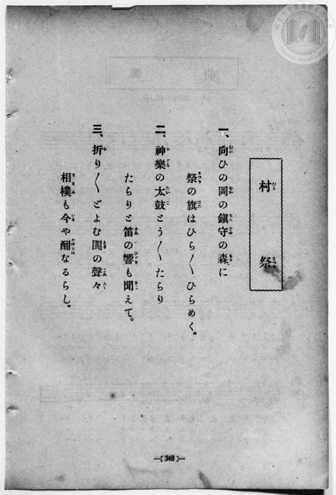
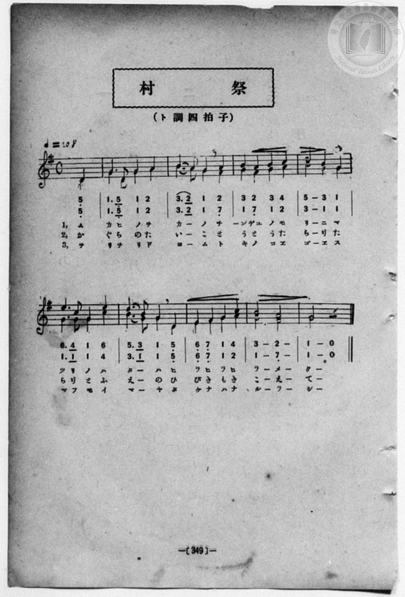

# 村祭（二部）

> Re:Shōka 使用 AI 協助辨識與重建樂譜，可能會有錯誤。歡迎回報。

- **鋼琴伴奏版**：<br><audio controls src="muramatsuri.mp3"></audio>
- **NEUTRINO 歌聲合成版**：<br><audio controls src="muramatsuri_neutrino.mp3"></audio>

- book: 新編 小學校・公學校 唱歌教材集（高等科一・二學年用）
- 一條慎三郎 編《新編 小學校・公學校 唱歌教材集》（大正十二年十二月，索書號 0725-41）
- 文部省《尋常小學唱歌》第三學年（二部合唱改編）

## 說明

> [!NOTE]
> **原書資訊與歌詞全文**（對應 `P357.jpg`–`P358.jpg`，原書 p. 348–349，高等科一・二學年第 7 首）：
> - **調性與拍號**：ト調四拍子・二部合唱（G 大調 4/4 拍），速度 ♩= 108，弱起拍（第 4 拍起唱）。
> - **比較校勘**：先前檔案轉植自《新定兒童唱歌》高等科男子用（`P073.jpg`，♩= 112，8 小節），但本冊（`P358.jpg`）為完全不同的 9 小節二部合唱版本（第一行 4 小節、第二行擴展為 5 小節，結尾拉長為 `| 3 - 2 - | 1 - 0 |`），且第 3 節歌詞作「鬨（とき）の聲々（こゑ／＼）／相撲（すまふ）も今（いま）や酣（たけなは）なるらし」。本檔依原書五線譜與雙排數字譜完整重校。
>
> **一、**
> 向（むか）ひの岡（をか）の鎭守（ちんじゆ）の森（もり）に
> 祭（まつり）の旗（はた）はひら／＼ひらめく。
>
> **二、**
> 神樂（かぐら）の太鼓（たいこ）とう／＼たらり
> たらりと笛（ふゑ）の響（ひゞき）も聞（きこ）えて。
>
> **三、**
> 折（を）り／＼どよむ鬨（とき）の聲々（こゑ／＼）
> 相撲（すまふ）も今（いま）や酣（たけなは）なるらし。


## 歌詞

```text
（TMD 檔案未包含歌詞註解）
```

## ABC

<div class="abc-score" data-abc-src="muramatsuri.abc" aria-label="五線譜載入中"></div>

[下載 ABC 原始檔](muramatsuri.abc)

## TMD 檔案連結

- [主旋律 TMD 檔案](muramatsuri.tmd) [[在 TMD Studio 編輯](https://tmdlang.github.io/Tmd-TS/#tmd=s7IKdvYPcrWy4qpTUCpJTLdSSM7PyUlNLsnMz7MqzsjPTozPrsyvSsyML84ojTe0NDJWgqssy88pzU21ys4vyY83jDdCSBTnlxYlp1oVJ2fk5-fEl6RWlCTl52ejy8cXJKanWgUYm5ojZAqK8stS8xLzgLoLijLzSlJTwNoRClLLMlNSQdLFyYl58WWpRZlpmakpSG5KLSoGOx1iRUlRYl5xclFmAcg_CFX5RSUZ-elFiQUZlVYZmcUl-UWZyYk58dmJeYkIRSUZqUDfpaUWl2SWJeagiyfn5-aW5mWWVCKbmpmemWeVm5-XVAoMOgyJksRMoDAwIPPLE-NzEzPzchLzgE7X0lJ4Nnfi86Vr3-_peLKr52Xzivd7OhW0tLgUbRUMDSy47G0V3LlsTPRN7EAGgkLSSuHZtA3Pt69QeLqh_-naHc8WLHzcvPtp6xoIW-HplI3P1vY8mzrz2dwJL2e3AY19uXrG87Wdz5dPfLKjAagUaAtQ6dOdW55PAdkFdihQ5tmiuc9a-57s6HzZ3KcANP5xQxcp9jxu6AZa9XTJ8mdrFz_tbQRZsnMLhPFsTsf7PT3Ptyx6NnvHi5nzFQzMjUx1TQxhdj-b1g709fM5jUAbn27ofrpjB8RCiAVAc5-vWQN0FsTN8FB6OqEDpGDKTqALwSZx6Wsp2FILcCkoKNgpRCv6-Ye4xkI4WlpP--aDfLC5_cWKrhcd7UDHvVg572nrCqAHtLRAnt_Q-6y9UyEBlKj1sgrSEx41TAZxLMAcYBBADFAo0FMwNrEAShqbWAJFcUbPmjUK5govl00Deu_9nlkQV-gC3fFi1f5nDctBLujuBYYnyO5Zj5s7gMJPZ88Gij1dOwFiDjyYgI5zVwDGDVCJAjApKQAVgQ3tedkw_-muZQqPZq4EpzaQG_dsfLF1O1hBB8gFYMVAEbApnY8bmhDueLZ-yos9zcC08LR7BtgRT1s7nnb2Pls15dnCjhd7O58t6X3RvgqSjp6uA8pOer56KTxW4d5-PmU70MXgxNiREGBgbgwLLoirDI2ATAtQIny-vgHi6id7257NWfO0rQusAxHAnc-bdj1d1wOMkic7ep9O6Hk-q0XBEqoTOTied3YA9UM8CAz0Fwt7gN6EKHvc0AgS3NUDFHw2ecvTjVOBZiqYwq3veb51wtMN-551d76cuh0klVCjYAwMDSMgrlEwBJIGCjUgp4CcuWMKKASNFYA6IYnlyd45jxt6Xq4BefVx44rHjaBoeNy47kXjpscNrWDByY-bJr7f0_9-zx6wIf3PZ-94NmkTWGrm48Z9jxu3grQ0NT3ZDfL948YWoCBYpOVl62KwyPzHjRMfN6563LgebPiqx03dj5uAjOmPG3qB8Qf0OTCGnuybC0mNT3ZNeb591ou1c4Dp6eXsmc_6Jj2buuPp2ulAEWBQPpu65WV7LyjrQyMelhdAabWhEVhMgflPJwDd3PG4qeFxI7AUANq1Ceipp5sWggUnwQTXvexb-3QdsCwAOnLh46bJjxtnPG4CFlAgqWeL14EVNz1uAvoLKLIaYjKkYAR7fAlMat2z6dPBguuBngWLABmbgH6EhBuE_bip8XFjP4azdwGTHtzZz5fOe7aiCWxU9-PGCWATQOY_XbLq5Z7JsMAEhjCQDRQHxhfQtRAr5oOt6IKYA-cC1TxfMxuscSs4HsG-nr8fLAJ01TxojDc1vWicBxbshRkOZC_DDGRghoO79lnXDEh4gk0ABgXEJSsfN4FCnvhEBfU7NdMV2NmUl7pQoKClz8XlC6whrYLzC4BVeL5DjUFNNcgKBRsLLXDoKGAr7BUgZRckqypooJVeOgqwkkITi1aglSBja4DZF5SFIdg0HpSrwRI-hjUKIB4MP25egJAzQpNr7EbIGaPr2wSWw-0JRJmkASuUiHQ6qPQBOxrEgBRIoKIJxEYVAbFAtAlYxBSsBiICUofw8OOm1WCZx82TgLgP4Xy4DEgEIt4IEW_eDOY1PW5ehiS5CCq5Cq4JFEKPm-ehhCEwC0JkmzqB7HXgkJwP0dnYAtPZOBlMroCKt8F5MDZUB9AMqI6mLoQ4PE5gbgF5CMJ-3AzSAZIBmQaRA8UxsGaFmrgW4aMmsDeboK5o2gK3C-ySpp1gu_DHMbiKUdCAVS1ExrEZ2B4TcESB2LDoMwaLQBKsghmIMgcRIEFILENSAiTuQRCWXBCpHSnemyHBDQoYWBT2Q726Hx44IBFQyoAE2ko4D5kNk4HoWAi3-3HTeigbljGQkgE06kARB4varRBdjaCogCQDSPKApsZGcHQ09oJ1NcHZIBlQcoHogOkFiYISJxbbwQkDlChBrp0KTbiPm5ZAfQKRAcmBRCBhAXLvRrAYOJlBQwXEBulA5BJYKIDUb8ewvRZa4DnmlIyWdlQp7cDJH6IKnhOQVUFERsu7QV7eQWLZEKMgg4hgLe8QTXEQBAuPFniDsMDTtVMAlXkKQFqZCwA)]
- [鋼琴伴奏 TMD 檔案](muramatsuri_piano.tmd) [[在 TMD Studio 編輯](https://tmdlang.github.io/Tmd-TS/#tmd=s7IKdvYPcrWy4qpTUCpJTLdSSM7PyUlNLsnMz7MqzsjPTozPrsyvSsyML84ojTe0NDJWgqssy88pzU21ys4vyY83jDdCSBTnlxYlp1oVJ2fk5-fEl6RWlCTl52ejy8cXJKanWgUYm5ojZAqK8stS8xLzgLoLijLzSlJTwNoRClLLMlNSQdLFyYl58WWpRZlpmakpSG5KLSoGOx1iRUlRYl5xclFmAcg_CFX5RSUZ-elFiQUZlVYZmcUl-UWZyYk58dmJeYlKXFpaCs_mTny-dO37PR1PdvW8bF7xfk8nkP1y9sxnnd0vu_c8n7DlyZ4tT5f2A8UVtLS4FG0VDA0suOxtFdy5bEz0TexA9oB8bKXwbNqG59tXKDzd0P907Y5nCxY-bt79tHUNhK3wdMrGZ2t7nk2d-WzuhJez20BWrJ7xfG3n8-UTn-xoACoF2g5U-nTnludTQG4Aux8o82zR3GetfU92dL5s7lMAGv-4oYsUex43dAOterpk-bO1i5_2NoIs2bkFwng2p-P9np7nWxY9m73jxcz5CgbmRqa6JoYwu59NaweGxvM5jUAbn27ofrpjB8RCiAVAc5-vWQN0FsTN8NB7OqEDpGDKTqALwSZx-SZm5lkFZCbm5Rs61Oga1lRzKQCBjYWWHZhRo2CgoAvHpvFAogYs4WNYowDiwfDj5gUIOSM0ucZuhJwxur5NYDmobYZADtgeEMMIJKNgDBYyQhMBsUC0CVjEFKwGIgJSh3Dj46bVYJnHzZOAuA9hI1wGJAIRb4SIN28G85oeNy9DklwElVwF1wTy1OPmeSjeftw4ASLb1AlkrwN7fj5EZ2MLTGfjZDC5AireBufB2FAdQDOgOpq6EOLwYIS5BeQhCPtxM0gHSAZkGkQOFC2PmzugJq5F-KgJ7M0mqCuatsDtArukaSfYLmi0mIGlTMBhC2LDQtwYLAJJFgpmIMocRIAEIREDiTxIdIEgLIYRaQopqpohIQTyCyzU-6Gu2w_3D0gEFJkQf66E85DZMBmIjoVwux83rYeyYckPKeagoQ0Ka1hsbIXoagSFHiTmIDEKTUCN4BBs7AXraoKzQTKgGIbogOkFiYLSExbbwXEJSkcg106FprXHTUugPoHIgORAIpCwALl3I1gMnDKgoQJig3QgEjYsFEDqt2PYXouc_42GQP4Hpy6IKnhCQ1YFERktAahfAkAixhAja0NEsJYAkIiB5Xew8GgRMKiLgCAPksoAIrKrNjQRaIOEoVwIx0gbmoy0YZU3RByReUHaIBWPIVAtOOGB-Qg9IB24kx_UAoixkCQIth9XIkQJCh-UoDBBCgoIhDsxXiHaMBZMmcbH4hIAsbApQZhjAhQziYVRaGrAwjAzwNKm8RB5MI1iKsRxQL_o2imAvBPtAxSEs42Q2MZgtjIXAA)]

## 分析

```text
================================================================================
📊 TMD Song Profile: [ 村祭（二部） ]
================================================================================
⏱  Duration:       0:22 (22.2s), 10 measures total
🎼 Key & Tempo:    首調基準 G, != 108.0 BPM, <4/4>
   - 分析範圍：      由實際發聲的音符與和弦推測調性；播放脈絡另行呈現
🎤 人聲音域:    D4 (MIDI 62) – C5 (MIDI 72) [跨度: 10 個半音 / 0.8 個八度, 難度: easy]
   - 最低音:  D4 in [Main #1 @ m.1, 0:01]
   - 最高音: C5 in [Main #1 @ m.6, 0:12]
   - 適合: soprano, mezzo-soprano, contralto, tenor, baritone, bass
🏛  結構:      Main (22.2s)
⚡ 編曲密度:        Peak 2 軌道同時演奏
🗝  調性診斷：       G 大調（純淨自然大調，未偵測到可信轉調）
   - 風格氣質:    純淨自然大調（陽光明朗、易唱易記，無明顯調外色彩）
   - 轉調歷程:    全曲維持單一推測調性（未偵測到可信轉調）
   - 核心骨幹音:  G, B, A, D, F#
   - 調性數值:    G 大調 [相關度: 0.89, 穩定度: High, 自然音純度: 100.0%]
   - 候選調性 (K-S): G 大調 (0.89), E 小調 (0.62), G 小調 (0.53)
   - 五度圈歷程:   +1
   - 各段落調性細節:
     • [Main #1]: G 大調 (r: 0.89, 自然音純度: 100.0%)

  [ 五度圈游移軌跡 ]
               C  
         F           [G ]*
      Bb               D  
      Eb               A  
         Ab           E  
            Db       B  
               F# 
     (* = active key center)

  [ 十二半音累積音高分佈 ]
     C  : ███                        5.0%
     C# :                            0.0%
     D  : ████████                  12.1%
     D# :                            0.0%
     E  : ████                       6.4%
     F  :                            0.0%
     F# : █████                      8.6%
     G  : ████████████████████████  37.9%
     G# :                            0.0%
     A  : ████████                  12.9%
     A# :                            0.0%
     B  : ███████████               17.1%
--------------------------------------------------------------------------------
Assignment 軌道音域：
  - Alto          : D4 – C5 (10 個半音 / 0.8 個八度, 31 個音符)
  - Soprano       : D4 – E5 (14 個半音 / 1.2 個八度, 31 個音符)
================================================================================
```


## 原書掃描頁






