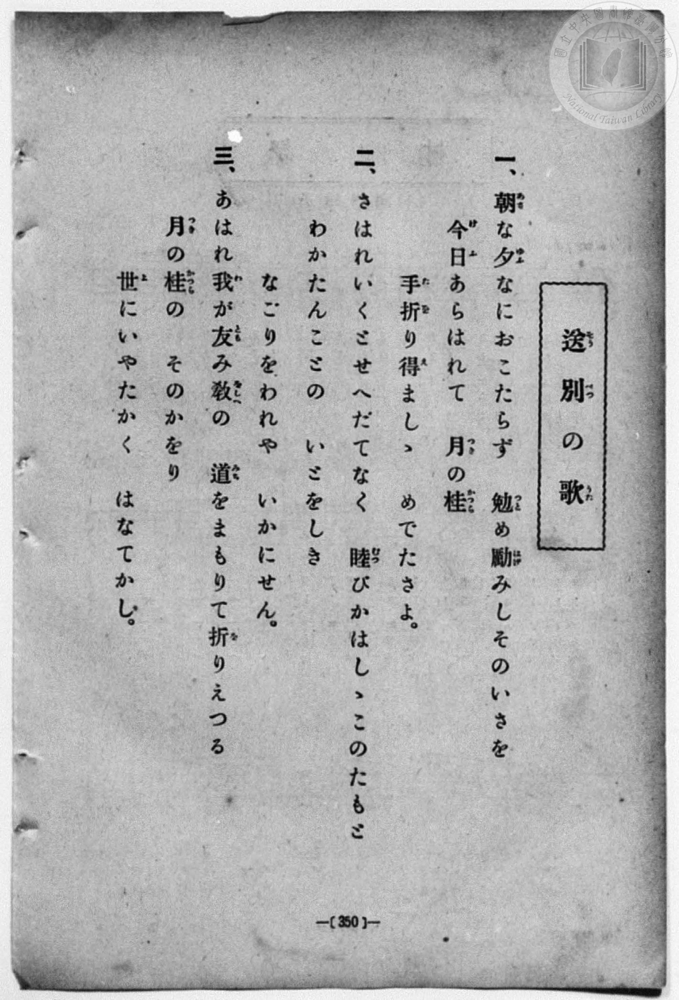
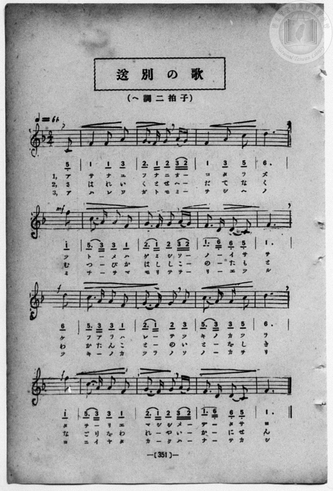

# 送別の歌

> Re:Shōka 使用 AI 協助辨識與重建樂譜，可能會有錯誤。歡迎回報。

<audio controls src="sobetsu_no_uta.mp3"></audio>

- 一條慎三郎 編《新編 小學校・公學校 唱歌教材集》（大正十二年十二月，索書號 0725-41）

## 說明

送別の歌 (送別之歌)
Source: 唱歌帖 (2020.006.0843), P197.jpg
Marginalia: 15.2.13 (大正15年2月13日)
Dynamics: Line 1: p, Line 2: mf, Line 3: f, Line 4: f


## 跨冊／重複收錄參照

> 同曲異詞＋同名異曲（《新定兒童唱歌》五年級〈告別〉、《唱歌帖》P042〈螢の光〉與 P197〈送別の歌〉同採蘇格蘭民謠 *Auld Lang Syne* 旋律；高等科女子用〈告別〉為同名異曲）

- **[同名異曲]** 《新定兒童唱歌》尋常科第五學年用（2020.006.0847.0005）：[**〈告別〉**](../../../shintei_jido_shoka/grade_5_2020.006.0847.0005/4_19_kokubetsu/index.md)（`F` / `4/4` — [原始 TMD](../../../shintei_jido_shoka/grade_5_2020.006.0847.0005/4_19_kokubetsu/kokubetsu.tmd)）
- **[同名異曲]** 《新定兒童唱歌》高等科女子用（2020.006.0849）：[**〈告別〉**](../../../shintei_jido_shoka/koto_girls_2020.006.0849/1_4_02_kokubetsu/index.md)（`D` / `3/4` — [原始 TMD](../../../shintei_jido_shoka/koto_girls_2020.006.0849/1_4_02_kokubetsu/kokubetsu.tmd)）
- **[同名異曲]** 《新編小公學校唱歌教材集》第三、四學年（大正12年／1923，國臺圖 0725-41）：[**〈送別の歌〉**](../../grade_3_4/35_sobetsu_no_uta/index.md)（`E,` / `4/4` — [原始 TMD](../../grade_3_4/35_sobetsu_no_uta/sobetsu_no_uta.tmd)）
- **[同名異曲]** 楊金土手抄《唱歌帖》第 3 冊・I（2020.006.0843）：[**〈螢の光〉**](../../../shokacho/vol_03/p042_hotaru_no_hikari/index.md)（`F` / `4/4` — [原始 TMD](../../../shokacho/vol_03/p042_hotaru_no_hikari/hotaru_no_hikari.tmd)）
- **[同名異曲]** 楊金土手抄《唱歌帖》第 10 冊・X（2020.006.0843）：[**〈送別の歌 (送別之歌)〉**](../../../shokacho/vol_10/p197_sobetsu_no_uta/index.md)（`F` / `2/4` — [原始 TMD](../../../shokacho/vol_10/p197_sobetsu_no_uta/sobetsu_no_uta.tmd)）
- 總表：[跨冊重複與同名歌曲總索引](../../../duplicate_songs.md)

## 歌詞

```text
1.
アサナユフナニ オコタラズ ツトーメハゲミシ ソノーイサヲ
ケフアラハレーテ ツキノカツラ タヲリエマシシ メーデータサヲ

2.
さはれいくとせ へだてなば むつびかはしし このーたもと
わかたんことの いとをしかり なごりをわれや いーかにせん

3.
アハレワガトモ ミーヲタテテ ミチーヲマモリテ ヨーリユツル
ツキーノカツラノ ソノーカヲリ ヨニイヤタカク ハーナーテカシ
```

## ABC

```abc
X:1
T:送別の歌
M:2/4
L:1/16
Q:1/4=66
K:F
V:V1 name="Vocal" snm="Voc"
[V:V1]
z6 C2 | F4 F2 A2 | G3 F G2 A G | F4 A2 c2 |
d8 | f8 | c3 A A2 F2 | G3 F G2 A G |
F3 D D2 C2 | F8 | d8 | c3 A A2 F2 |
G3 F G2 A2 | c3 A A2 c2 | d8 | f8 |
c3 A A2 F2 | G3 F G2 A G | F3 D D2 C2 | F6 z2 |
```

## TMD 檔案連結

- [主旋律 TMD 檔案](sobetsu_no_uta.tmd) [[在 TMD Studio 編輯](https://tmdlang.github.io/Tmd-TS/#tmd=s7IKdvYPcrWy4qpTUCpJTLdSSM7PyUlNLsnMz7MqzsjPTozPrsyvSsyML84ojTe0NDJWgqssy88pzU21ys4vyY83jDdCSBTnlxYlp1oVJ2fk5-fEl6RWlCTl52ejy8cXJKanWgUYm1oiZAqK8stS8xLzgLoLijLzSlJTwNoRClLLMlNSQdKpKZkl-UWZiTlI7kktKgY7G2J8SVFiXnFyUWYByC8IVSUZqUBHpxVlpualFGdkFihxaWkpvGxofNqx9HHjumdrexS0tLgUbRXMzLjsbRXcuGyM9E3suEDan-xoeLZo7rPWvic7Ol829yk8377icUPXs2kbgAyFpxv6n67d8WzBwsfNu5-2roGwFZ5O2Qg08dnUmc_mTng5u-1xQ_f7PR1Plyx_tnbx097GJ7t6nu7cAmE8m9Pxfk_P8y2Lns3e8WLmfAUDcyNTXRPD93s6lbj0tbgUFFDdqAHhPdnZDeRpgqSDIYEOtfLpjmkKGkYGRgZ6BgZmegYWJsaaOgoBhpbmelkF6SDlvolF6Zl5iTmZiVYKhqZ6RnqGxgoaEJcZmgJdZQR0kKHxs-lLwYa7VOYl5mYmF1sp-GTmpSoYAmNKB8I0slLITYOyja0UYEwTIJMLpNOnsgikD8Q01AORj5sWPW7a-ri563HzssfNU8GMbqDoqsdNmx837X_cvPJx0y6Fx80tj5s7HjfvedwMDNH-x02bHjfPf9y0Hahw7-PmPpBE0xKwOZsghm4EmQU0GqgdqLx5DVhrG9icprUgHU2rwWauBKoFWgI0DmjhisfN84CGgs0F2QPU0g42ej_UaJDZRhBnN0593Lj-cVPP48aWx439jxtXPG6cDRTd8bhxwePGZY8bVz1u3AA0u-Fx45LHjZsfN3aDlDdOByKgqsnAaAMZ3Aj0QxNQL8TNQFOAqoBCQGkgApq4DqgWaPyKx02TwHq7Hzd1AYWAZk8BskCiQE1ANzS1gBWCTASasBroFKAhYNcawwMZGgxANwNJYFAuAvpxPtiPm8BB0AYJH6BQI1QUGBjNQH2rIBLAwAGKAjnAaAJatRpsLjQ4gRKIEAWykaMFKAoKXYgJQA8sedwMjClgiK5-3LQeKAp0FlA7MNZBEQQW3c6lpc_F5ZuYmWcVlp-cmONQY1CjUA2yT8HG0EzLDsyqUTBQ0IVD03ggUaNgCOWCaGOwiBGUD6KNgSRCDUjeFKQGapwZknEgCFQZhyEE0gDSCtIMMgiLBVDjINaYxYMQhvsQBmLaimEF1EBUi9BVgn1ClB-gxhHhE8J-AEVBDVctF5euHbAEycxTANLKXAA)]
- [鋼琴伴奏 TMD 檔案](sobetsu_no_uta_piano.tmd) [[在 TMD Studio 編輯](https://tmdlang.github.io/Tmd-TS/#tmd=s7IKdvYPcrWy4qpTUCpJTLdSSM7PyUlNLsnMz7MqzsjPTozPrsyvSsyML84ojTe0NDJWgqssy88pzU21ys4vyY83jDdCSBTnlxYlp1oVJ2fk5-fEl6RWlCTl52ejy8cXJKanWgUYm1oiZAqK8stS8xLzgLoLijLzSlJTwNoRClLLMlNSQdKpKZkl-UWZiTlI7kktKgY7G2J8SVFiXnFyUWYByC9KXFpaCi8bGp92LH3cuO7Z2p73ezpezp75rLP7Zfee5xO2PNmz5enS_vd7OhW0tLgUbRXMzLjsbRXcuGyM9E3suEBWPNnR8GzR3GetfU92dL5s7lN4vn3F44auZ9M2ABkKTzf0P12749mChY-bdz9tXQNhKzydshFo07OpM5_NnfBydtvjhm6grU-XLH-2dvHT3sYnu3qe7twCYTyb0_F-T8_zLYuezd7xYuZ8BQNzI1NdE0Oge5S49LW4FBRQ3K6gAeE92dkN5GkqPGqYohCQmZiXr-CYnJyfW5CYl5mbmlcC0hYMiQqoU57umKagYWRgZKBnYGCmZ2BhYqypoxBgaGmul1WQDlLum1iUnpmXmJOZaKVgaKpnpGdorKABcbGhKdC1RkCHGho_m75Uk0tLn4vLNzEzzyosPzkxx6HGoEahGmSEgo2hmZYdmFWjYKCgC4em8UCiRsEQygXRxmARIygfRBsDSYQakLwpSA3UODMk40AQqDIOQwikAaQVpBlkEBYLoMZBrDGLByEM9yEMxLQVwwqogagWoasE-4QoP0CNI8InhP0AioIarlpoZIGTSZAH8dFlHK9tGq8NMxDKBFHaUA_Ga5vrxGvDHIbEhbgPUz9YI5DURo5ZQ20TbaJiF6YRZD7cNKgNBF0DC1eYg4BhBnQfOOSMgOqwehlfOsDrGIRlOJyEFIpYDYKHEdGhAw9MCsKI9NDBksJ8iElhYH0KhiBjwU6BMYBO0IGxESysKqGmmsBVIUIH2Sac-rHbBCtt8LuCRKtgyYFYrxHnKViMEx2IRHgKHp-6dsAKITNPAQutzAUA)]

## 分析

```text
================================================================================
📊 TMD Song Profile: [ 送別の歌 ]
================================================================================
⏱  Duration:       0:36 (36.4s), 20 measures total
🎼 Key & Tempo:    首調基準 F, != 66.0 BPM, <2/4>
   - 分析範圍：      由實際發聲的音符與和弦推測調性；播放脈絡另行呈現
🎤 人聲音域:    C4 (MIDI 60) – F5 (MIDI 77) [跨度: 17 個半音 / 1.4 個八度, 難度: challenging]
   - 最低音:  C4 in [Main #1 @ m.1, 0:01]
   - 最高音: F5 in [Main #1 @ m.6, 0:09]
   - 適合: soprano, mezzo-soprano, contralto, tenor, baritone, bass
🏛  結構:      Main (36.4s)
⚡ 編曲密度:        Peak 1 軌道同時演奏
🗝  調性診斷：       F 大調（純淨自然大調，未偵測到可信轉調）
   - 風格氣質:    純淨自然大調（陽光明朗、易唱易記，無明顯調外色彩）
   - 轉調歷程:    全曲維持單一推測調性（未偵測到可信轉調）
   - 核心骨幹音:  F, D, G, C, A
   - 調性數值:    F 大調 [相關度: 0.85, 穩定度: Moderate, 自然音純度: 100.0%]
   - 候選調性 (K-S): F 大調 (0.85), D 小調 (0.76), C 大調 (0.54)
   - 五度圈歷程:   -1
   - 各段落調性細節:
     • [Main #1]: F 大調 (r: 0.85, 自然音純度: 100.0%)

  [ 五度圈游移軌跡 ]
               C  
        [F ]*          G  
      Bb               D  
      Eb               A  
         Ab           E  
            Db       B  
               F# 
     (* = active key center)

  [ 十二半音累積音高分佈 ]
     C  : █████████                 14.5%
     C# :                            0.0%
     D  : █████████████             19.7%
     D# :                            0.0%
     E  :                            0.0%
     F  : ████████████████████████  36.8%
     F# :                            0.0%
     G  : ██████████                15.1%
     G# :                            0.0%
     A  : █████████                 13.8%
     A# :                            0.0%
     B  :                            0.0%
--------------------------------------------------------------------------------
Assignment 軌道音域：
  - Vocal         : C4 – F5 (17 個半音 / 1.4 個八度, 57 個音符)
================================================================================
```


## 原書掃描頁






