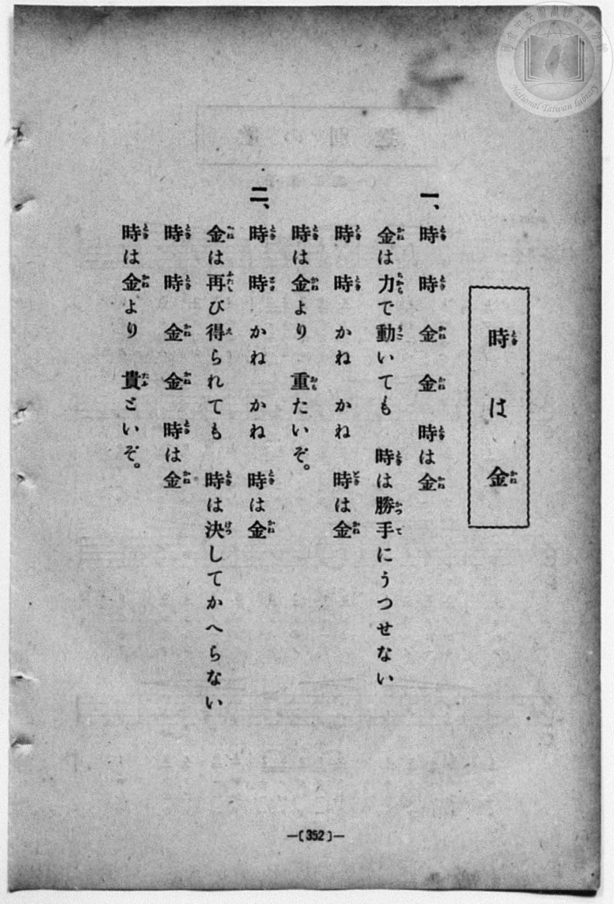
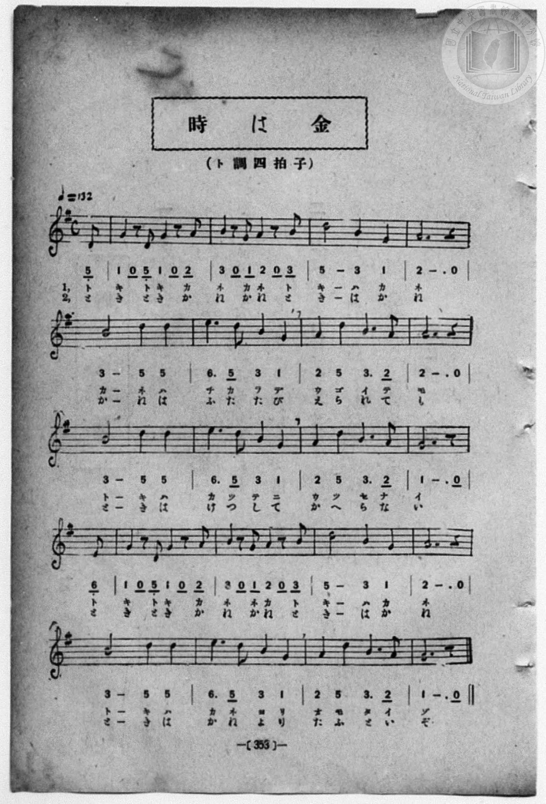

# 時は金

> Re:Shōka 使用 AI 協助辨識與重建樂譜，可能會有錯誤。歡迎回報。

<audio controls src="toki_wa_kane.mp3"></audio>

- book: 新編 小學校・公學校 唱歌教材集（高等科一・二學年用）
- 一條慎三郎 編《新編 小學校・公學校 唱歌教材集》（大正十二年十二月，索書號 0725-41）

## 說明

> [!NOTE]
> **原書資訊與歌詞全文**（對應 `P361.jpg`–`P362.jpg`，原書 p. 352–353，高等科一・二學年第 9 首）：
> - **調性與拍號**：ト調四拍子（G 大調 4/4 拍），速度 ♩= 132，弱起拍（第 4 拍後半八分音符起唱，全曲共 20 小節＋弱起）。
> - **版面校勘**：
>   1. 第 12 小節末（第四行開頭弱起八分音符）五線譜為下加一間 D4（`5_`，與第一行弱起相同），下方簡譜活字誤植為 `6_`，依五線譜記為 `5_`。
>   2. 第 14 小節第 1 節譜下片假名原版誤倒置為「ネ ネ カ ト」（對頁歌詞全文與第 2 節譜下平假名均作正確的「かね　かね　時は金」），本檔校改為「ネ カ ネ ト」並記於此。
>
> **一、**
> 時（とき）　時（とき）　金（かね）　金（かね）　時（とき）は金（かね）
> 金（かね）は力（ちから）で動（うご）いても　時（とき）は勝手（かつて）にうつせない
> 時（とき）　時（とき）　かね　かね　時（とき）は金（かね）
> 時（とき）は金（かね）より　重（おも）たいぞ。
>
> **二、**
> 時（とき）　時（とき）　かね　かね　時（とき）は金（かね）
> 金（かね）は再（ふたた）び得（え）られても　時（とき）は決（けつ）してかへらない
> 時（とき）　時（とき）　金（かね）　金（かね）　時（とき）は金（かね）
> 時（とき）は金（かね）より　貴（たふ）といぞ。


## 歌詞

```text
（TMD 檔案未包含歌詞註解）
```

## ABC

```abc
X:1
T:時は金
M:4/4
L:1/16
Q:1/4=132
K:G
V:V1 name="Piano" snm="Pia"
[V:V1]
z4 z4 z4 z2 D2 | G4 z2 D2 G4 z2 A2 | B4 z2 G2 A4 z2 B2 | d8 B4 G4 |
w: 1.~ト | キ ト キ カ | ネ カ ネ ト | キ ハ カ
w: 2.~と | き と き か | ね か ね と | き は か
A12 z4 | B8 d4 d4 | e6 d2 B4 G4 | A4 d4 B6 A2 |
w: 1.~ネ | カ ネ ハ | チ カ ラ デ | ウ ゴ イ テ
w: 2.~ね | か ね は | ふ た た び | え ら れ て
A12 z4 | B8 d4 d4 | e6 d2 B4 G4 | A4 d4 B6 A2 |
w: 1.~モ | ト キ ハ | カ ツ テ ニ | ウ ツ セ ナ
w: 2.~も | と き は | け つ し て | か へ ら な
G12 z2 D2 | G4 z2 D2 G4 z2 A2 | B4 z2 G2 A4 z2 B2 | d8 B4 G4 |
w: 1.~イ ト | キ ト キ カ | ネ カ ネ ト | キ ハ カ
w: 2.~い と | き と き か | ね か ね と | き は か
A12 z4 | B8 d4 d4 | e6 d2 B4 G4 | A4 d4 B6 A2 |
w: 1.~ネ | ト キ ハ | カ ネ ヨ リ | オ モ タ イ
w: 2.~ね | と き は | か ね よ り | た ふ と い
G12 z4 | z4 z4 z4 z2 D2 | G4 z2 D2 G4 z2 A2 | B4 z2 G2 A4 z2 B2 |
w: 1.~ゾ | ト | キ ト キ カ | ネ カ ネ ト
w: 2.~ぞ | と | き と き か | ね か ね と
d8 B4 G4 | A12 z4 | B8 d4 d4 | e6 d2 B4 G4 |
w: 1.~キ ハ カ | ネ | カ ネ ハ | チ カ ラ デ
w: 2.~き は か | ね | か ね は | ふ た た び
A4 d4 B6 A2 | A12 z4 | B8 d4 d4 | e6 d2 B4 G4 |
w: 1.~ウ ゴ イ テ | モ | ト キ ハ | カ ツ テ ニ
w: 2.~え ら れ て | も | と き は | け つ し て
A4 d4 B6 A2 | G12 z2 D2 | G4 z2 D2 G4 z2 A2 | B4 z2 G2 A4 z2 B2 |
w: 1.~ウ ツ セ ナ | イ ト | キ ト キ カ | ネ カ ネ ト
w: 2.~か へ ら な | い と | き と き か | ね か ね と
d8 B4 G4 | A12 z4 | B8 d4 d4 | e6 d2 B4 G4 |
w: 1.~キ ハ カ | ネ | ト キ ハ | カ ネ ヨ リ
w: 2.~き は か | ね | と き は | か ね よ り
A4 d4 B6 A2 | G12 z4 |
w: 1.~オ モ タ イ | ゾ
w: 2.~た ふ と い | ぞ
```

## TMD 檔案連結

- [主旋律 TMD 檔案](toki_wa_kane.tmd) [[在 TMD Studio 編輯](https://tmdlang.github.io/Tmd-TS/#tmd=s7IKdvYPcrWy4qpTUCpJTLdSSM7PyUlNLsnMz7MqzsjPTozPrsyvSsyML84ojTe0NDJWgqssy88pzU21ys4vyY83jDdCSBTnlxYlp1oVJ2fk5-fEl6RWlCTl52ejy8cXJKanWgUYmxkiZAqK8stS8xLzgLoLijLzSlJTwNoRClLLMlNSQdLFyYl58WWpRZlpmakpSG5KLSoGOx1iRUlRYl5xclFmAcg_CFX5RSUZ-elFiQUZlVYZmcUl-UWZyYk58dmJeYkIRSUZqUDf5eYXJeagC6YkZuZUxudkpqUqcWlpKTyb2fS4cf3L9okKWlpcirYKhsZGXPa2Cu5cNib6JnYgvSD_Wyk8m7bh-fYVCk839D9du-PZgoWPm3c_bV0DYSs8nbLx2dqeZ1NnPps74eXstvd7Ol6unvF8befz5ROf7GgAKn2yqweo9OnOLc-nrHi_pxPsJqDMs0Vzn7X2PdnR-bK5TwFo_OOGLlLsedzQDbTq6ZLlz9YuftrbCLJk5xYI49mcjvd7ep5vWfRs9o4XM-crGJgbmeqaGILt5tLXUrClFuBSUFCwU4hW9PMPcY2FcLS0nvbNB9m7uf3Fiq4XHe1AN79YOe9p64pn09q1tEBO3tD7rL1TIQGUgPSyCtITHjVMBnGMwBygwyEGKBToKRibGgEljU2NgaI4A3XNGgVLhZfLpgG9937PLIgrdIHueLFq_7OG5SAXdPcCQwFk96zHzR1A4aezZwPFnq6dAHSNuwIwCIFiCsAYVwCKgk3pedkw_-muZQqPZq4EJwqQo_ZsfLF1O1hBB8hKsOKn-3qe9nY9bV39tKPt5fzNz9csA6oBxhNIPdDDszc9bd2oYGQAitDn6xve7-mGmAK043FDE8Klzzs7Xs5dBIzjp90zwM6ESCkoGOopgOwyNIKa8GzOaoj1QB-8WNjzclr3ywVrIWYiOwJo_pNdU55vn_Vi7ZznTbue7Oh-2rUAGGwvp01WcDEBmpBgGg8KaGDYAM0CSgDNgpjyfPaOpxN6IGEA1PZs2s7nGxYCTXm2ZffTtdNfrFrybEkv0ESFBDOwAU_2zYVb9GLFDLAM0Gi45xQUjKA-MIH6AMxRADKAOoAWPO9sf9rY_nRCLzDOgaEAtOBpw6Tne9cBTXrc0PO4uVcBjJtWA-mOxw2gwAcmn5cLGpFTFcQbCkYIY5_u3Aw1dm77k71zgDnk-aJdz2e1gMxs7H7cuPZxQwOcAS8EwOaDfP5szppnq6YA4-PZlJ1ILgG7AuQikEue7FgG9PGzaXuerV0C8y8sB4BSaEMjsEgB84HmA539uHHF40aQ-RAb0USAtoNFQE7CJYKuC-xmZDUQ69A1Nq5_2jUbLLIQJNgE9CBQcPnT7qlgwbbHjVPAIi2PG5c9bmrCatHT7rnPOkHFDdjYJUCVYPHVYO1A7uzHjauAJhDvX6yxQIzvCCp73NTxuKkLHICg1PK4sQvoKbDK-WA_zsOIrF09JEYW2Y7HEjVtEEduBTtvPlhw89N908GCwEIc6B0gAiZanFHzbOMusMhEYESARaaDFIOs2AHSS2K8UDEdEh9TLzZtAYsDQ2ArWCVQC1JMUV5NQYGClj4Xl29iZp5VQGZiXr5DjUGNQjXIBgUbCy1welDAVjkqQAtYcPmloEGw8NdRgFVmmlgMA7oBZFGNggGw6Edg03iFGrCEj2GNQjxQCIGB5Q1MzghDrnEFUA630-HFu4IGrAQm0nmGMGdBGEZAIWMwyxDIBtHGQBFTIAsEQTIgdTVgORgE-QzhqcdNa-HegbOBRSpQBliownhwNsjTUHUg-Li5H0QCVYBsgaiCQVBQIAIImNzgQYNgd4N0NUJtBfIQbGAAQtWB7WlcDya7IfaAVaHagz-wd_WQE9ig8ANBUHiCcI2CGZSPGrIgOYhaUHzgC2tQOEHCDeQzSOiBwq0RIgoO6ZVgmXaITNMysPgWMLkEqrcNrGcRnrAGhRMk3EAhBQk9kPhWqOh8MAaxNkNlOsA2dILJHqiqZWAXNJEY1js66RfWIHFEWKPkVlBShQYCOLnCAxsaCY-bW8BBCWJBkxUksIHiID27oaq6wDKQoIcFAmreByVWWHCDoxUe3BOhokuAeDo0SCEyIBuBdQE80EG8VWAZkO1INhEuSSCNztGShE4lyZSBSt0oYU0wcYMaxKBk-bh5FVQGRENKjcdN-6F6l4Bl9uEJa1xJG1LCgMIP2GAAm9UFlYGUK6CSBqYblKhBMvMw7Knl4tK1UwBV_gpItDIXAA)]
- [鋼琴伴奏 TMD 檔案](toki_wa_kane_piano.tmd) [[在 TMD Studio 編輯](https://tmdlang.github.io/Tmd-TS/#tmd=s7IKdvYPcrWy4qpTUCpJTLdSSM7PyUlNLsnMz7MqzsjPTozPrsyvSsyML84ojTe0NDJWgqssy88pzU21ys4vyY83jDdCSBTnlxYlp1oVJ2fk5-fEl6RWlCTl52ejy8cXJKanWgUYmxkiZAqK8stS8xLzgLoLijLzSlJTwNoRClLLMlNSQdLFyYl58WWpRZlpmakpSG5KLSoGOx1iRUlRYl5xclFmAcg_CFX5RSUZ-elFiQUZlVYZmcUl-UWZyYk58dmJeYlKXFpaCs9mNj1uXP-yfeL7PR0vZ8981tn9snvP8wlbnuzZ8nRp__s9nQpaWlyKtgqGxkZc9rYK7lw2JvomdiDjQR61Ung2bcPz7SsUnm7of7p2x7MFCx83737augbCVng6ZeOztT3Pps58NnfCy9ltICtWz3i-tvP58olPdjQAlT7Z1QNU-nTnludTVgDtAjsbKPNs0dxnrX1PdnS-bO5TABr_uKGLFHseN3QDrXq6ZPmztYuf9jaCLNm5BcJ4Nqfj_Z6e51sWPZu948XM-QoG5kamuiaGYLu5fBMz86wCMhPz8oM8HGoMahSquRSAwMZCyw7MqFEwUNBFwqbxCjVgCR_DGoV4oBACP27ugMkZYcg1rgDKQU00hJkEYRgBhYzBLEMgG0QbA0VMgSwQBMmA1NWA5WAQ5BiEOx43rYW7AM5uWg3U87i5F86Ds0HuhKoDwcfN_SASqAJkC0QVDIJcj_DT40aoCUDfINjdIF2NUFuBPAQb6GeoOrA9jevBZDfEHrAqVHug4QPyMgiCggCEaxTMoHzUwADJQdSCghBf8IC8BvEqyDEQD4O82ggRBQfOSrBMO0SmaRlYfAuYXALV2wbWswhP8IC8BvEqyHMQD4PEt0JF54MxiLUZKtMBtqETTPZAVS0Du6CJusEDEkcED0oyBiUIqLvBiQIePtBwe9zcAvY9iAWNPEj4AMVBenZDVXWBZSChBXM3aqYAJQlYCIFjAh5CE6GiS4B4OjQUIDIgGx837oCHE4i3CiwDsh3JptEsRusshpqGUIKHYBLqBWJQ5D9uXgWVAdGQ7PS4aT9U7xKwzD48wYMrAUGyHsjLj5sgmaoLKgPJcKAsCNMNSjogmXkY9tQi1wg-KDWCCVKNAIEQZwGDJR6UsEAElG0aD-dEG8bCKGCCA4pHm8bHwhQg9KMoMwEyTLBpo5pBcAayngHwEE53AONB104BFBXRPkBRONsIzFbmAgA)]

## 分析

```text
================================================================================
📊 TMD Song Profile: [ 時は金 ]
================================================================================
⏱  Duration:       1:16 (76.4s), 42 measures total
🎼 Key & Tempo:    首調基準 G, != 132.0 BPM, <4/4>
   - 分析範圍：      由實際發聲的音符與和弦推測調性；播放脈絡另行呈現
🎤 人聲音域:    D4 (MIDI 62) – E5 (MIDI 76) [跨度: 14 個半音 / 1.2 個八度, 難度: moderate]
   - 最低音:  D4 in [Main #1 @ m.1, 0:01]
   - 最高音: E5 in [Main #1 @ m.7, 0:10]
   - 適合: soprano, mezzo-soprano, contralto, tenor, baritone, bass
🏛  結構:      Main (38.2s) -> Main (38.2s)
⚡ 編曲密度:        Peak 1 軌道同時演奏
🗝  調性診斷：       G 調性不明確（純淨自然大調，未偵測到可信轉調）
   - 風格氣質:    純淨自然大調（陽光明朗、易唱易記，無明顯調外色彩）
   - 轉調歷程:    全曲維持單一推測調性（未偵測到可信轉調）
   - 核心骨幹音:  B, D, A, G, E
   - 調性數值:    G 調性不明確 [相關度: 0.77, 穩定度: Ambiguous, 自然音純度: 100.0%]
   - 候選調性 (K-S): G 大調 (0.77), D 大調 (0.75), B 小調 (0.68)
   - 五度圈歷程:   +1 -> +1
   - 各段落調性細節:
     • [Main #1]: G 調性不明確 (r: 0.77, 自然音純度: 100.0%)
     • [Main #2]: G 調性不明確 (r: 0.77, 自然音純度: 100.0%)

  [ 五度圈游移軌跡 ]
               C  
         F           [G ]*
      Bb               D  
      Eb               A  
         Ab           E  
            Db       B  
               F# 
     (* = active key center)

  [ 十二半音累積音高分佈 ]
     C  :                            0.0%
     C# :                            0.0%
     D  : █████████████████████     22.9%
     D# :                            0.0%
     E  : ██████                     6.2%
     F  :                            0.0%
     F# :                            0.0%
     G  : █████████████████████     22.2%
     G# :                            0.0%
     A  : █████████████████████     22.9%
     A# :                            0.0%
     B  : ████████████████████████  25.7%
--------------------------------------------------------------------------------
Assignment 軌道音域：
  - Piano         : D4 – E5 (14 個半音 / 1.2 個八度, 124 個音符)
================================================================================
```


## 原書掃描頁






