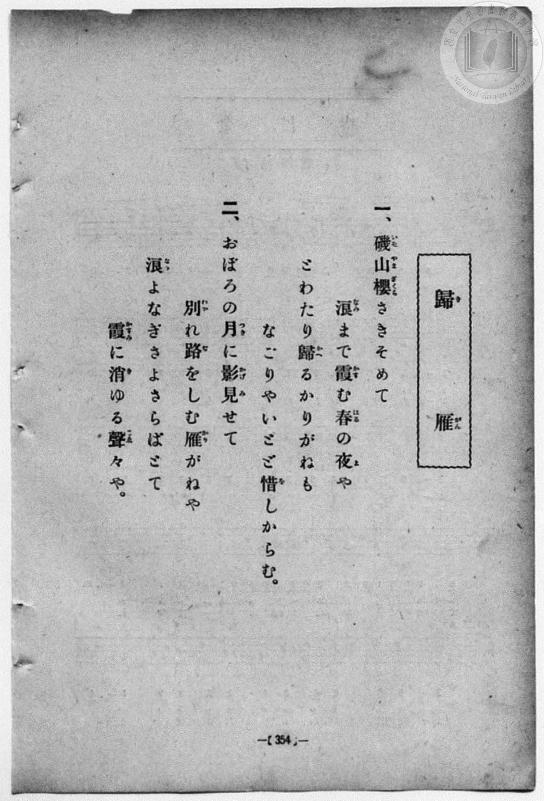
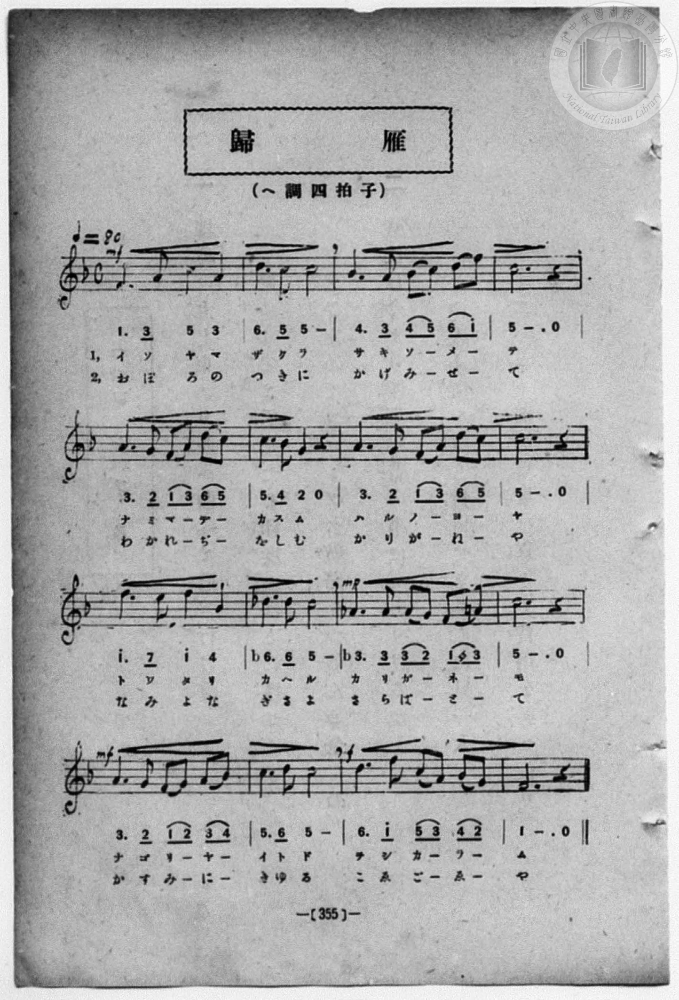

# 歸雁

> Re:Shōka 使用 AI 協助辨識與重建樂譜，可能會有錯誤。歡迎回報。

<audio controls src="kigan.mp3"></audio>

- book: 新編 小學校・公學校 唱歌教材集（高等科一・二學年用）
- 一條慎三郎 編《新編 小學校・公學校 唱歌教材集》（大正十二年十二月，索書號 0725-41）

## 說明

> [!NOTE]
> **原書資訊與歌詞全文**（對應 `P363.jpg`–`P364.jpg`，原書 p. 354–355，高等科一・二學年第 10 首）：
> - **調性與拍號**：ヘ調四拍子（F 大調 4/4 拍），速度 ♩= 80。
> - **比較校勘**：先前檔案轉植自手抄《唱歌帖》（`P198.jpg`），因網格時值混用導致每小節前半拍附點四分音符＋八分音符被誤縮為附點八分音符＋十六分音符，且第 11 小節第 4 拍還原記號 `(1 ♮3)` 與第 12 小節 `5` 被誤植為 `3,` 與低八度 `5_`。本檔依原書五線譜與數字譜完全重校：
>   1. 第 10 小節為 `| b6. 6 5 - |`（五線譜兩音均為第四線 D♭5，即 `6, - - 6, 5 - - -`）。
>   2. 第 11 小節（`mp`）為 `| b3. 3 (3 2) (1 ♮3) |`（前三個 `3` 為 A♭4 `3,`，最後一音還原為 A♮4 `3`，接第 12 小節第三間 C5 `5 - . 0`）。
>
> **一、**
> 磯山櫻（いそやまざくら）さきそめて
> 浪（なみ）まで霞（かす）む春（はる）の夜（よ）や
> とわたり歸（かへ）るかりがねも
> なごりやいとゞ惜（を）しからむ。
>
> **二、**
> おぼろの月（つき）に影見（かげみ）せて
> 別（わか）れ路（ぢ）をしむ雁（かり）がねや
> 浪（なみ）よなぎさよさらばとて
> 霞（かすみ）に消（き）ゆる聲々（こゑ／＼）や。


## 歌詞

```text
（TMD 檔案未包含歌詞註解）
```

## ABC

```abc
X:1
T:歸雁
M:4/4
L:1/16
Q:1/4=80
K:F
V:V1 name="Piano" snm="Pia"
[V:V1]
!mf! F6 A2 c4 A4 | d6 c2 c8 | B6 A2 B2 c2 d2 f2 | c12 z4 |
w: イ ソ ヤ マ | ザ ク ラ | サ キ ソ _ メ _ | テ
A6 G2 F2 A2 d2 c2 | c6 B2 G4 z4 | A6 G2 F2 A2 d2 c2 | c12 z4 |
w: ナ ミ マ _ デ _ | カ ス ム | ハ ル ノ _ ヨ _ | ヤ
f6 e2 f4 B4 | _d6 d2 c8 | !mp! _A6 A2 A2 G2 F2 =A2 | c12 z4 |
w: ト ワ タ リ | カ ヘ ル | カ リ ガ _ ネ _ | モ
!mf! A6 G2 F2 G2 A2 B2 | c6 d2 c8 | !f! d6 f2 c2 A2 B2 G2 | F12 z4 |
w: ナ ゴ リ _ ヤ _ | イ ト ド | ヲ シ カ _ ラ _ | ム
!mf! F6 A2 c4 A4 | d6 c2 c8 | B6 A2 B2 c2 d2 f2 | c12 z4 |
w: お ぼ ろ の | つ き に | か げ み _ せ _ | て
A6 G2 F2 A2 d2 c2 | c6 B2 G4 z4 | A6 G2 F2 A2 d2 c2 | c12 z4 |
w: わ か れ _ ぢ _ | を し む | か り が _ ね _ | や
f6 e2 f4 B4 | _d6 d2 c8 | !mp! _A6 A2 A2 G2 F2 =A2 | c12 z4 |
w: な み よ な | ぎ さ よ | さ ら ば _ と _ | て
!mf! A6 G2 F2 G2 A2 B2 | c6 d2 c8 | !f! d6 f2 c2 A2 B2 G2 | F12 z4 |
w: か す み _ に _ | き ゆ る | こ ゑ ご _ ゑ _ | や
```

## TMD 檔案連結

- [主旋律 TMD 檔案](kigan.tmd) [[在 TMD Studio 編輯](https://tmdlang.github.io/Tmd-TS/#tmd=s7IKdvYPcrWy4qpTUCpJTLdSSM7PyUlNLsnMz7MqzsjPTozPrsyvSsyML84ojTe0NDJWgqssy88pzU21ys4vyY83jDdCSBTnlxYlp1oVJ2fk5-fEl6RWlCTl52ejy8cXJKanWgUYmyEZWVCUX5aal5gH1F1QlJlXkpoC1o5QkFqWmZIKki5OTsyLL0stykzLTE1BclNqUTHY6RArSooS84qTizILQP5BqMovKsnITy9KLMiotMrILC7JL8pMTsyJz07MS0QoKslIBfouMS8zNzEHXbQ4NbE4P69YiUtLS-HZ2h0vZzcqaGlxKdoqWBhw2dsquHHZmOib2HGBdIG8bqXwbNqG59tXKDzd0P907Y5nCxY-bt79tHUNhK3wdMrGZ2t7nk2d-WzuhJez297v6Xi5esbztZ3Pl098sqMBqPTJrh6g0qc7tzyfsuL9nk6wa4AyzxbNfdba92RH58vmPgWg8Y8bukix53FDN9Cqp0uWP1u7-GlvI8iSnVsgjGdzOt7v6Xm-ZdGz2TtezJyvYGBuZKprYgi2m0tfS8GWWoBLQUHBTiFa0c8_xDUWwtHSeto3H2Tv5vYXK7pedLQD3fxi5bynrSueTWvX0gI5eUPvs_ZOhQRQ2tHLKkhPeNQwGcQxAXOADocYoFCgp2BsagKUNDY1BYriDNQ1axQMDRReLpsG9N_7PbMgztAFOuTFqv3PGpaDnNDdCwwGkOWzHjfPAAo_nT0bKPZ07QSgc9wUgGEIFFMAxrkCUBRsSs_LhvlPdy1TeDRzJShVPG5oQhj7bP2UF3uagTHytHsG2MynrR1PO3ufrZrybGHHi72dz5b0vmhf9ayz-1lXCzBOIdH2dMc0SIQlBBhaWkB9CrLo6ewFz7dterZgz7OZTU8b9jzbvh2YSp5u6HvRvuXZ-n5gSni-vgFo-tPeLqDbXs5sebl7HtD1TzvaXs7f_HzNsvd7up-2roZzXyxa_WLVkuc71j1v2gVVjCQLUtzb-LR1LZJIz5MdU8BBaAhKdkDLQBxwQLxsagHGxIsVM0BJKEHDEBgY64w1ExSAAQrWYATVoJBgChQEWwz0OtBihQRjHbCyJ3v7QNYDwzHBND4BGIjP5qwBBtOTfXMhUfxk15Tn22e9WDsHFEdTdzxdOx3IfrquB5hYXrb3AkMYHp0KCoZ6CtCYhjoTZE-NQpKZnoKZgikwYmqAAdoBN_Fp60qgD5_ObQeqA-oDBhlQXMHl0cy1oLT0tHezQoKZDlCXrgKQAmkHQlCMwGNaQcEIaiMsYECRl1sAUgSz2xiYQhU0jBWMNBVgwQNxBjDCgPn6aUM3MCgSFEDKHYE2m4ADBmj9szkNT_cBA74B6ERIKEOVrAMpAavoW4oSxkAOqKCYNlnB2RQYmEDX6ikYILsXlvlAmaOhEViagfnPF69_unHjs9W7gW563NjyuHHu4yYgue9x47THjf2Pm4AJsPNx49THjb1gqcbHjcsgGp9tXQXWsupx436wGqCW5S_nzAMLdj9unAkSbGp4NmMpWGT94yZg2gYqW_d0yRyQSBOwAAIqaIGY9rhxxeOm_seN8x83dQHLW5ghQAZQDZDRDRR_3NjzuHHt4yZo8IOtngISBzkYiIAmzHvWDDF8Etiu6WCNIGdgBMKuHqRAeNwINHzP4yagH9eBS0ag7UuAXgYbsvrp3o0vloEyJthJk2D-nQ0PiqcdYD-C3A_2Y1PPi-3rweoXgblALdOBbgBWIlBDmrrAJkC8Aw0B9PBsgrD7QIEPYgNJoJYNIG_C7EUObZirVj_bBnE_2PFNbcDQe9G46XFDK1hw8uOmie_39L_fswcS-NBgobyYhwIFLX0uLt_EzDyrgMzEvHyHGoMahWqQDQo2FlrgwFfAVrmAchEwWb5Y2KOgYQJNzzoKsAJfE4sGoD0gw4Cm56bVKhiCc6cxOJcagzI6MMODRExh-RYoYgJVYwIUM1MwjAMKwSRB0ACkCGymj2GNwuOmJWDRx017FR43g9iPm-eBjXnctA0qsx4othJu_OOmrVDxtWBdIB0LITLNbUj2xCPsMQLKNXZBdDXuAerqBbPWQXQ1Ql3Q2AvEqxH2NHZDxScB8X4wazZUZhmGPfhDfFcPOSEOCmBdBSNgoBuDy1VYOJoAxaDhiFMN1rBuhoZB83xoKD9uboeGKcTfj5t2AsUWwHwFZPdDdawG4j4wawVUBhJqWMO6CaoLGILALApmLYLaMwkqMx3IbkDYAwvrpi4gG6JjLVRHC4lhvaOTnLAGJlOQBeYQBigJA5M2eqUEzgUFtQrGEAkgBUSQsMcf7h3QUASm5CZwSmpehRruzTPAYYxI4zDxVUD2GjALlGZBZoFCElcaB5kKCrv9QF0gOyEiIBlQ3IH4U6EysDQ-FRrunUD2BrAKaPySmsaBtTrZpQoiERuByw1YYEIaE9CAB6qDlDXAGDIFKzMCxRueUIem9qYt0PCGpFmkMgcYL4-bOxGh0bwJqmM7NAYg5Q5IBpQncIU6rJyYCS8nQHpBMqA4A5nXBsQQVRDxyVDxiUD2FCgLV2qv5eLStVMAFfXRPoaxCnC2EZitzAUA)]
- [鋼琴伴奏 TMD 檔案](kigan_piano.tmd) [[在 TMD Studio 編輯](https://tmdlang.github.io/Tmd-TS/#tmd=s7IKdvYPcrWy4qpTUCpJTLdSSM7PyUlNLsnMz7MqzsjPTozPrsyvSsyML84ojTe0NDJWgqssy88pzU21ys4vyY83jDdCSBTnlxYlp1oVJ2fk5-fEl6RWlCTl52ejy8cXJKanWgUYmyEZWVCUX5aal5gH1F1QlJlXkpoC1o5QkFqWmZIKki5OTsyLL0stykzLTE1BclNqUTHY6RArSooS84qTizILQP5BqMovKsnITy9KLMiotMrILC7JL8pMTsyJz07MS1Ti0tJSeLZ2x8vZje_3dLycPfNZZ_fL7j3PJ2x5smfL06X97_d0KmhpcSnaKlgYcNnbKrhx2Zjom9hxgcwG-dJK4dm0Dc-3r1B4uqH_6dodzxYsfNy8-2nrGghb4emUjc_W9jybOvPZ3AkvZ7eBrFg94_nazufLJz7Z0QBU-mRXD1Dp051bnk9ZAbQL7GagzLNFc5-19j3Z0fmyuU8BaPzjhi5S7Hnc0A206umS5c_WLn7a2wiyZOcWCOPZnI73e3qeb1n0bPaOFzPnKxiYG5nqmhiC7ebyTczMswrITMzLD_JwqDGoUajmUgACGwstOzADKJCbVqtgqKALhMYKpmBSFyhsBhYxBYuAYI2CCVSNCVDMTMEwDigEkwRBA5AisJk-hjUKj5uWgEUfN-1VeNwMYj9ungc25nHTNqjMeqDYSrjxj5u2QsXXgnWBdCyEyDS3IdkTj7DHCCjX2AXR1bgHqKsXzFoH0dUIdUFjLxCvRtjT2A0VnwTE-8Gs2VCZZRj2QAMJFCa6CkbAcDIG-t0U7nUToBjU6zjVYA2eZqizm-dDA-Zxczs0GCBOfdy0Eyi2AOYQILsfqmM1EPeBWSugMhCPYg2eJqguoKcfN_WAWYug9kyCykwHshsQ9sCCp6kLyIboWAvV0YIreICJASRmDmGAEgowAemAxYAUIglV5xbUKhhDJIAUEEGCC39QdUA9DkwvTeD4al6FGlTNM8DBgkhJMPFVQPYaMAuUMkBmgTyPKyWBTAV5dz9QF8hOiAhIBhTcIP5UqAwsJU2FBlUnkL0BrAIaJbhTEji7IZKKEThDwfwPSjbwsAKqg2RCYKCagpUZgYIaT0BB01TTFmgQQVIGUmYEBuXj5k6EB5o3QXVshwYaJEOCZEApD1dAwTLQTHgGAukFyYCCGWReGxBDVEHEJ0PFJwLZU6AsXGmqFrnU8kEptUzgpZZhvEK0YSyMAhZO8UCWSTy6CJAFlwEGMohpCmSCGAZQL2Gaha4MQwGCj2oISA-IhtgGtTgXqhHEgGqFixHnKIhxeH0M0o_uLmA46topgIIy2gcoCmcbgdnKXAA)]

## 分析

```text
================================================================================
📊 TMD Song Profile: [ 歸雁 ]
================================================================================
⏱  Duration:       1:36 (96.0s), 32 measures total
🎼 Key & Tempo:    首調基準 F, != 80.0 BPM, <4/4>
   - 分析範圍：      由實際發聲的音符與和弦推測調性；播放脈絡另行呈現
🎤 人聲音域:    F4 (MIDI 65) – F5 (MIDI 77) [跨度: 12 個半音 / 1.0 個八度, 難度: easy]
   - 最低音:  F4 in [Main[L1] #1 @ m.1, 0:00]
   - 最高音: F5 in [Main[L1] #1 @ m.3, 0:08]
   - 適合: soprano, mezzo-soprano, contralto, tenor, baritone, bass
🏛  結構:      Main[L1] (48.0s) -> Main[L2] (48.0s)
⚡ 編曲密度:        Peak 1 軌道同時演奏
🗝  調性診斷：       F 大調（流行色彩大調，未偵測到可信轉調）
   - 風格氣質:    流行大調（略帶和弦色彩音與裝飾副屬和弦）
   - 轉調歷程:    全曲維持單一推測調性（未偵測到可信轉調）
   - 核心骨幹音:  C, F, A, D, A#
   - 調性數值:    F 大調 [相關度: 0.80, 穩定度: Moderate, 自然音純度: 92.4%]
   - 候選調性 (K-S): F 大調 (0.80), C 大調 (0.73), A 小調 (0.63)
   - 五度圈歷程:   -1 -> -1
   - 各段落調性細節:
     • [Main[L1] #1]: F 大調 (r: 0.80, 自然音純度: 92.4%, 調外音: C#, G#)
     • [Main[L2] #1]: F 大調 (r: 0.80, 自然音純度: 92.4%, 調外音: C#, G#)

  [ 五度圈游移軌跡 ]
               C  
        [F ]*          G  
      Bb               D  
      Eb               A  
         Ab           E  
            Db       B  
               F# 
     (* = active key center)

  [ 十二半音累積音高分佈 ]
     C  : ████████████████████████  36.4%
     C# : ██                         3.4%
     D  : ██████                     8.5%
     D# :                            0.0%
     E  : █                          0.8%
     F  : ███████████               16.9%
     F# :                            0.0%
     G  : ████                       6.8%
     G# : ███                        4.2%
     A  : ██████████                15.3%
     A# : █████                      7.6%
     B  :                            0.0%
--------------------------------------------------------------------------------
Assignment 軌道音域：
  - Piano         : F4 – F5 (12 個半音 / 1.0 個八度, 120 個音符)
================================================================================
```


## 原書掃描頁






