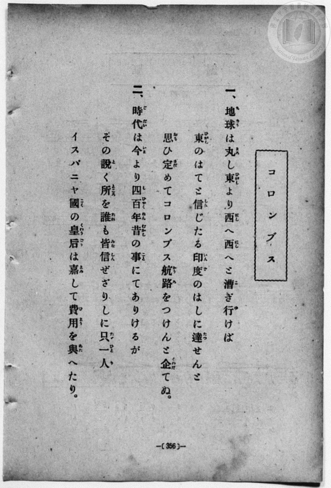
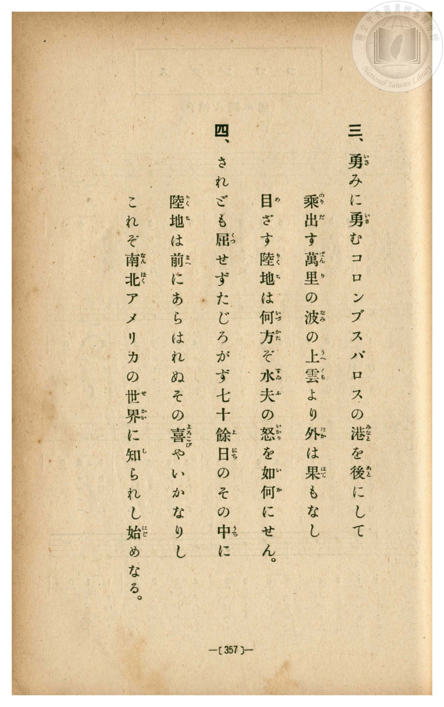
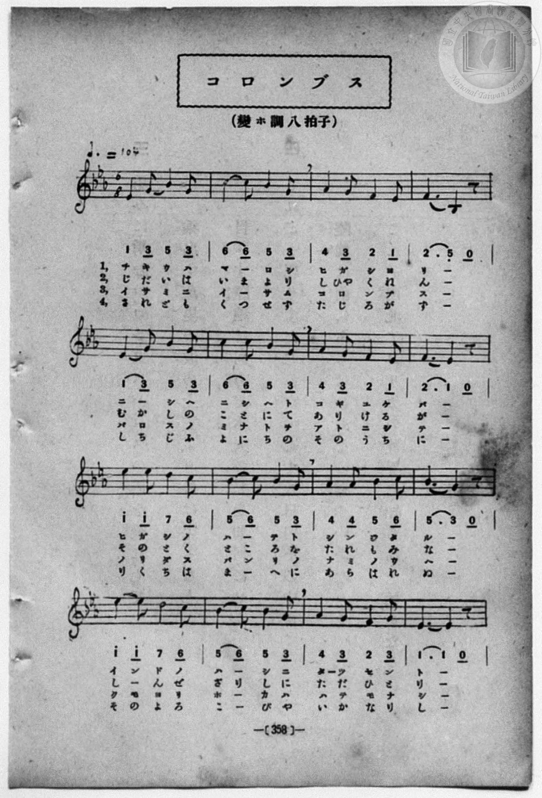
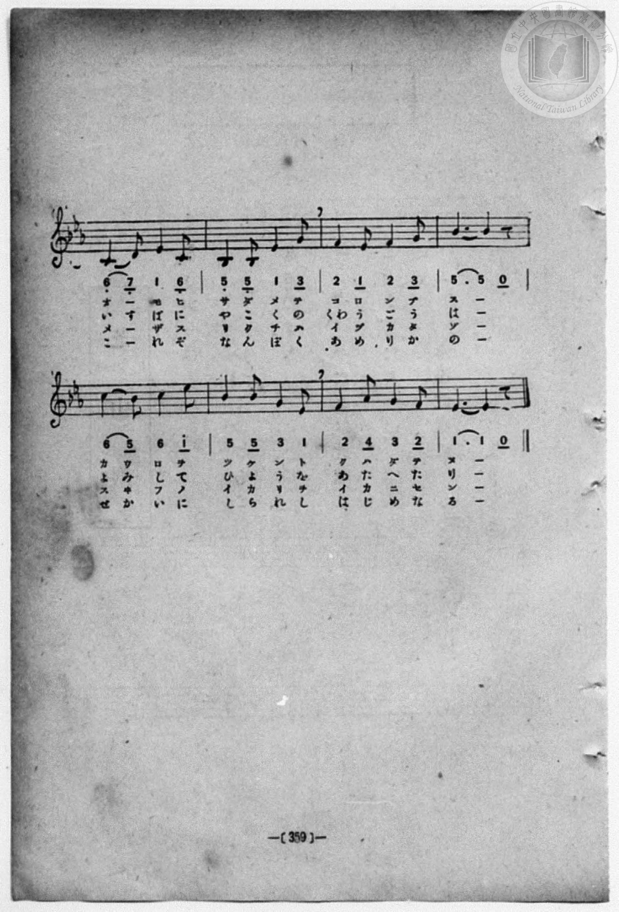

# コロンブス

> Re:Shōka 使用 AI 協助辨識與重建樂譜，可能會有錯誤。歡迎回報。

<audio controls src="koronbusu.mp3"></audio>

- 一條慎三郎 編《新編 小學校・公學校 唱歌教材集》（大正十二年十二月，索書號 0725-41）
- 出處：共益商社樂器店《唱歌教科書 教師用 巻三》第二十四～二十五頁（第二學期第六曲）
- NDL Digital Collections PID 854864（https://dl.ndl.go.jp/pid/854864）掃描 P018.jpg

## 說明

原書資訊與歌詞全文（NDL PID 854864《唱歌教科書 教師用 巻三》第二十四～二十五頁，掃描 P018.jpg）：
調性與拍號：ハ調四分ノ四拍子（C 大調 4/4 拍），♩=104，「流暢ニ」，弱起一拍（四分音符）
註記：單聲部，三節分節歌。目次及左頁樂譜標題為「コロンブス」，右頁歌詞標題印為「ころんぶす」。開頭 mf，第七小節末音為 #4（F#4，4'），第九小節末音為 #5（G#4，5'），第十二小節末拍（第四段弱起）轉 f，第十五小節標 rit.。
原典演奏注意：第四段於歌詞第三章之場合特須稍強歌唱；#5 音首次出現，須加注意。
原典曲意：「一の歌はころんぶすがえらいといふこと、二の歌は航海中の事、三の歌はいよ／＼發見した事をよんだのである。」
原典語釋：「かなたには」：あちらには；「陸ありとしも」：陸があるといふこともまー；「かくれなし」：誰知らぬ者はない；「いふほどに」：言うて居るまに。


## 跨冊／重複收錄參照

> 同曲＋同名異曲（《共益商社唱歌教科書》、《新編 小學校・公學校 唱歌教材集》、《楊金土手抄唱歌帖》跨冊對照曲目）

- **[同曲]** 《共益商社唱歌教科書》卷三・教師用（明治33年／1900）：[**〈コロンブス〉**](../../../kyoeki_shoka/kan_3_854864/11_koronbusu/index.md)（`C` / `4/4` — [原始 TMD](../../../kyoeki_shoka/kan_3_854864/11_koronbusu/koronbusu.tmd)）
- **[同名異曲]** 楊金土手抄《唱歌帖》第 10 冊・X（2020.006.0843）：[**〈コロンブス (哥倫布)〉**](../../../shokacho/vol_10/p203_koronbusu/index.md)（`E,` / `6/8` — [原始 TMD](../../../shokacho/vol_10/p203_koronbusu/koronbusu.tmd)）
- 總表：[跨冊重複與同名歌曲總索引](../../../duplicate_songs.md)

## 歌詞

```text
一、
大西洋の、かなたには、
陸ありとしも、知らぬ世に、
亞米利加州を、發見したる、
人の話は、かくれなし。

二、
舟乗りいだす、波の上、
西へ／＼と、進めども、
眼にさへぎる、山もなし、
はや百日も、すぐしたり。

三、
流るゝ草の、葉を見れば、
陸は近しと、いふほどに、
見とめし島は、サンサルバドル、
喜ぶ聲は、雲井まで。
```

## ABC

```abc
X:1
T:コロンブス
M:4/4
L:1/16
Q:1/4=104
K:C
V:V1 name="Voice" snm="Voi"
[V:V1]
!mf! z4 z4 z4 G4 | G6 A2 G2 F2 E2 D2 | E6 F2 E4 E2 F2 | G6 A2 G2 F2 E2 D2 |
w: 1.~た | い _ せ _ い _ | よ _ の か _ | な _ た _ に _
w: 2.~ふ | ね _ の _ り _ | い _ だ す _ | な _ み _ の う
w: 3.~な | が _ る _ る _ | く _ さ の _ | は _ を _ み れ
E12 G4 | G6 A2 G2 F2 E2 D2 | C6 D2 E4 F2 E2 | D6 A2 A2 G2 G2 ^F2 |
w: 1.~は り | く _ あ _ り _ | と _ し も _ | し _ ら _ ぬ よ
w: 2.~へ に | し _ へ _ に _ | し _ へ と _ | す _ す _ め ど
w: 3.~ば り | く _ は _ ち _ | か _ し と _ | い _ ふ _ ほ ど
G12 E2 G2 | c6 B2 B2 A2 A2 ^G2 | A6 B2 c4 B2 A2 | G6 A2 G2 F2 E2 D2 |
w: 1.~に あ _ | め _ り _ か _ | しゅ _ を は つ | け ん し _ た _
w: 2.~も ま _ | な _ こ _ に _ | さ _ へ ぎ る | や _ ま _ も な
w: 3.~に み _ | と _ め _ し _ | し _ ま は さ | ん _ さ る ば ど
!f! E12 E2 G2 | c6 d2 c2 B2 A2 G2 | c6 d2 e4 e2 d2 | c6 d2 c2 B2 A2 B2 |
w: 1.~る ひ _ | と の は _ な _ | し _ は か _ | く _ れ _ な _
w: 2.~し は _ | や _ ひゃ _ く _ | に _ ち も _ | す ぐ し _ た _
w: 3.~る よ ろ | こ _ ぶ _ こ _ | ゑ _ は く _ | も _ ゐ _ ま _
c12 z4 |
w: 1.~し
w: 2.~り
w: 3.~で
```

## TMD 檔案連結

- [主旋律 TMD 檔案](koronbusu.tmd) [[在 TMD Studio 編輯](https://tmdlang.github.io/Tmd-TS/#tmd=s7IKdvYPcrWy4qpTUCpJTLdSSM7PyUlNLsnMz7MqzsjPTozPrsyvSsyML84ojTe0NDJWgqssy88pzU21ys4vyY83jDdCSBTnlxYlp1oVJ2fk5-fEl6RWlCTl52ejy8cXJKanWgUYm5kiZAqK8stS8xLzgLoLijLzSlJTwNoRClLLMlNSQdKpKZkl-UWZiTlI7kktKgY7G2J8SVFiXnFyUWYByC8IVSUZqUBHZ2QWA7VXogsD9ZSlIhkJES1PLEktwqI0r7ggvwjoOC0thcdNmx83r33cDCSnPW7aqaClxaVoq2BoYMJlb6vgzGVjom9iBzLgyY6GZ4vmPmvte7Kj82Vzn8Lz7SseN3Q9m7YByFB4uqH_6dodzxYsfNy8-2nrGghb4emUjc_W9jybOvPZ3AkvZ7c9buh-v6fj6ZLlz9Yuftrb-GRXz9OdWyCMZ3M63u_peb5l0bPZO17MnK9gYG5kqmti-H5PJ9jxT9t3vZg59f2eWU9bNz6f3fV0atvzJfuerWh6OnPF013Tgc6A2_R8-USgEQpA1tMdq59PAbps-26gg4FWP1-zBmRjb-PT2bPf750HYT_ZNeXlgkagq6CyQHfPmQ9kP21d-2z2Jpj1fi4-Ci6Z6ZkliTkKzvBEVqwQ4OmiYGFqYmFmAjQho6SkoNhKXz8lRy8PiNPz9bIK9AsyU_RhKjqf9TU_6-9XCDAwtADKpStxcelrKdhSC3ApKCg87ZsPCsDN7S9WdL3oaAcGyYuV8562rng2rR3oQpA3EE6mQqj1oPkI6EdgHIEc8mLV_mcNy0FO6O4FxidQ9HFzP1AQaMrTjrbHzX1ABlDq6doJQHc5KwDTBFBSAZjUFICiYGN6Hs1caQtMhUDW44aeZ1sbn81a9Li5-3EDULrn6Z6NL7ZuB6VIkOoOiKkv529-vmYZUDPYASt2v1gxA5Ripq170bjpZfMKoDagl56vbwAqBZJAjz9uaHo-e92zNQuf9nc93b4M6CVgknqxds6zFTNfLux53rQLaDFa7oBa378ZpBgcuhDFT3s3QNU3Tn7c1Pu4afLjxm2PG2cC1QNteTmt--WCtQq5aaA0DgzQHc3A_AJyw5zVIEc37VJQBqUgNxDZY6IO8T9I4c65GApNgQrdwQpNEQqhuQmmFhIqIHFgKK_bCgktoOIXezsVoG6AxCJUx4qZCkWZJXpAl0IT0dPWHc_2THm6tP_Z5hXPWvqBwQg37Nm0PRCPgz3S-Xz1gic7u58u2PJ0Qsfzzp0vF3Q8X9H7dM92oBpg6nq_Z7ayqQLQ6S-XTQOFc_uu5_37gA4AKnvatQBiOKqtszdB7AMGJTB6HzeuA8VT43r0YG0ECnY8bup83NjyuHEFmNwKUgNkN4CCAq7xRceqZ6CUshYo8mQXMPk0gtI1wtiWx03Akgdo457nM_e8WNb9uHH648b5IJVNk4BSYBsXANU_blz-uLHpcRPQhCZgpCJc_GLVvJftwHIN5OLHjUD9q4D6HzeuBpkOSiyzQNoaF4LdChIEBglQ5cuZO8DGdYFdP_1xE8hQoGKwONAcsE1oHgOqadz3uHkPxASwXf2Pm4AMoI3AMhCk_cWqDc_nLwXbteZFQyvYh0DZFpgWiGm7HzeuBDkGomUFMJTbHjcue7qxFWzpPrBUExfIi6AoaGgEexaYQ5fuf7YFqGAdUAjDp2BF2HzVCHfQkx3TwEaDlT7ZNe_5xs1PO1YC08HT7fNAoQ1UihQF4KCGKt0FtPTFyo0QizA8DnUqMNIh6l90zH-yE2g50BVA_wIjD5gLG59tXgRKATu6YIqW7n_cuAMS85BU87Jh0-MmoOkrIc4GKXo-BygH9N9UoNLHjX0QJz3duBEcFRDLwepADmtqeT5z37PpQL-CdIPT6ASYT4CWwsITWKaCtQALNJBxTXNf9IKSI1D0xcROYCiA_A_y2gbkIF3_Yv9EsFkgd2LEIsQ_oHADphGg9PSnm4F5BBxUTVtBJReIXP24ecLj5k4QAxqh0-YA8xKwaIQofTl705NdQH8CY385NEdSXiVBgYKWPheXd35Rfl5SaXGpVVh-ZnKqQ41BTTXIFgUbQzMtOzCrOjetFswAVosakEJLE9g82a9QAySXKACTPpDeDaUhfKBM8wqICLBJ8rhpNVy0C6puP1S2Gy7Tj2R48yqQ40B21igYKOiCITptCqVr4CwQNIPKmACxMRAbgVWAWDAIkwFBEA3ik2oGMoS7A-xeH8MahXioCDoNTHRwNwOTC5o5jxtnw1kwOVAId2CoWwdndSOZtwpDHcw2YHJEUrceqy-Aqpq6YKogPjHC55OtSCauxe1ChJlYfbwAzpqJpA7TJ_tRTAYWjFCVO3D5BeFjiF-M8fkFZh_IxB50k5pgYYxggdT1Y9g4FcWNMHXooQ0sS-DqQL4ClipQlRtw-QUtXoC58HHTemg2WgTNRqvg2agDKrMdKgNRAUpIMJGVULoHSkMyKkhvN3L-hmiEZ0PCGcQQSQVIBJZhYKpqwKLIZsDMAZulDlaCbA0yBBkAkkPkMmxx0IQZZkDRFRjqpsPVwXSA1MFEESHfCdexBswH5UWQSljqwogruAsQeQiLufB0i5oz8amD-QGkDpZXEOpgIsCKBsxfCVEJ9x2mO_ehuhOYP7CFJyz1AltKSPbD8gFCHTw8UdyJmd9hpQawmkR2J57whOV8RNpvXoiS5pEql6btj5uXQiU3gWuUx80tYImNQNZmRBaA1j6gJL8audaZhJrkDeOQnGIOxfB0C0mvICayErgemFpKqpbqtFpsCR8cySjBBE_uqFUCsLXViqEUUf6AYvdx4xKo4okoqiaD5RDxilRzwctBzNjaBFOFlPoxS3OQ2RAWcuqHlZ8IdYjU3wd2E8hekP2Y6QqWmiEpHmInthyF0AFL2cjpH6OcgAc0wiTs-RRuPzRMQX4BuRTmU4RKkAzEJ5ASH5FXcYYquNQBdrPgrgXnAlA5D2xagRM7KKGDaEjjCrmsB8og5Q9IraEB6lSCkvsaLNqwJ34jEAcsAkvW4CSJRZExTATMAAsRNAtEoylChrAGH3LRjxxVsEYBorBCrtAxIwuhDm-FDq6YCZsHg7DmBFLSx5JQgX2ZZjgHZiW2EhBR4qLWUchlP7ArAyax51JYkUDAoeCUj5lOt8FZMDmQmchlBEQWEZhIvsGodx43gVwKUQeveYDs5QTdWMvFpWunAO-lKAA5ylwA)]
- [鋼琴伴奏 TMD 檔案](koronbusu_piano.tmd) [[在 TMD Studio 編輯](https://tmdlang.github.io/Tmd-TS/#tmd=s7IKdvYPcrWy4qpTUCpJTLdSSM7PyUlNLsnMz7MqzsjPTozPrsyvSsyML84ojTe0NDJWgqssy88pzU21ys4vyY83jDdCSBTnlxYlp1oVJ2fk5-fEl6RWlCTl52ejy8cXJKanWgUYm5kiZAqK8stS8xLzgLoLijLzSlJTwNoRClLLMlNSQdKpKZkl-UWZiTlI7kktKgY7G2J8SVFiXnFyUWYByC9KXFpaCo-bNj9uXvu4GUhOe9y08_2ejpezZz7r7H7Zvef5hC1P9mx5urT__Z5OBS0tLkVbBUMDEy57WwVnLhsTfRM7kC1PdjQ8WzT3WWvfkx2dL5v7FJ5vX_G4oevZtA1AhsLTDf1P1-54tmDh4-bdT1vXQNgKT6dsfLa259nUmc_mTng5u-1xQzfQ1qdLlj9bu_hpb-OTXT1Pd26BMJ7N6Xi_p-f5lkXPZu94MXO-goG5kamuiSHQPWAfPm3f9WLm1Pd7Zj1t3fh8dtfTqW3Pl-x7tqLp6cwVT3dNBzoDbtPz5ROBRigAWU93rH4-Beiy7buBDgZa_XzNGpCNvY1PZ89-v3cehP1k15SXCxqBroLKAt09Zz6Q_bR17bPZm2DW-7n4KLhkpmeWJOYoOMNTSLFCgKeLgoWpiYWZCdCEjJKSgmIrff2UHL08IE7P18sq0C_ITNGHqeh81tf8rL9fIcDA0AIol67ExeWdX5Sfl1RaXGoVkJmYlx_k4VBjUFPNpQAENoZmWnZgVnVuWi2Yoa-loPF0z8YXW7drAmNzv0INkFyi8Lh5D5DeDaUhfKBM8wqICDCmHjethot2QdXth8p2w2X6kQxvXqWgpQ-2s0bBQEEXDNFpUyhdA2eBoBlUxgSIjYHYCKwCxIJBmAwIgmgQn1QzkCHcHWD3-hjWKMRDRdDpx43z4W5-3NiCZs7jxtlwFkwOFMIdGOrWwVndSOatwlAHs-1x42okdeux-gKoqqkLpgriEyN8PtmKZOJa3C5EmInVxwvgrJlI6jB9sh_F5MeNbVCVO3D5BeFjiF-M8fkFZh_IxB50k5pgYYxggdT1Y9g4FcWNMHXoof24aRJcHchXj5tANoJUbsDlF7R4AebCx03rodloETQbrYJnow6ozHaoDEQFKCHBRFZC6R4oDcmoIL3dyPkbohGeDQlnEEMkFSARWIaBqaoBiyKbATMHbJY6WAmyNcgQZABIDpHLsMVBE2aYAUVXYKibDlcH0wFSBxNFhHwnXMcaMB-UF0EqYakLI67gLkDkISzmwtMtas7Epw7mB5A6WF5BqIOJPG5qBPNXQlTCfYfpzn2o7gTmD2zhCUu9jxsXItkPywcIdfDwRHEnZn6HlRqPG3cjuxNPeMJyPiLtNy9ESfNIlUvT9sfNS6GSm8A1yuPmFrDERiBrMyILQGsfUJJfjVzrTEJN8oZxSE4xh2J4uoWkVxATWQlcD0wtJVVLdVottoQPjmSUYIInd9QqYfrjplYMpYjyBxS7jxuXQBVPRFE1GSyHiFekmgteDmLG1iaYKqTUj1mag8yGsJBTP6z8RKhDpP4-sJtA9oLsx0xXsNQMSfEQO7HlKIQOWMpGTv8Y5QQ8oBEmYc-ncPuhYQryC8ilMJ8iVIJkID6BlPiIvIozVMGlzuOmXrhrwbkAVM4Dm1bgxA5K6CAa0rhCLuuBMkj5A1JraBRlluiBkvsaLNqwJ34jEAcsAkvW4CSJRZExTATMAAsRNAtEoylChrAGH3LRjxxVsEYBorBCrtAxIwuhDm-FDq6YCZsHg7DmBFLSx5JQNz1uaoZzYFZiKwERJS5qHYVc9j9unAAmsedSWJFAwKHglI-ZTrfBWTA5kJnIZQREFhGYSL7BqHceN4FcClEHr3mA7OUE3ViL0UnxQe6kmED7KMAs8aKv62V779PWHS9nt0J6k0iJOV4h2jAWRtUAoQmQaRKrYBoPpE3jgWJQlVBxKIVPJfFmwgWQTMUQw2kqLpVwcYR9JLkWi368JuNWjzDbABJjunYK8EiL9gFKoQoYoQsYgwWUuQA)]

## 分析

```text
================================================================================
📊 TMD Song Profile: [ コロンブス ]
================================================================================
⏱  Duration:       0:39 (39.2s), 17 measures total
🎼 Key & Tempo:    首調基準 C, != 104.0 BPM, <4/4>
   - 分析範圍：      由實際發聲的音符與和弦推測調性；播放脈絡另行呈現
🎤 人聲音域:    C4 (MIDI 60) – E5 (MIDI 76) [跨度: 16 個半音 / 1.3 個八度, 難度: moderate]
   - 最低音:  C4 in [Koronbusu #1 @ m.7, 0:13]
   - 最高音: E5 in [Koronbusu #1 @ m.15, 0:33]
   - 適合: soprano, mezzo-soprano, contralto, tenor, baritone, bass
🏛  結構:      Koronbusu (39.2s)
⚡ 編曲密度:        Peak 1 軌道同時演奏
🗝  調性診斷：       C 大調（純淨自然大調，未偵測到可信轉調）
   - 風格氣質:    純淨自然大調（陽光明朗、易唱易記，無明顯調外色彩）
   - 轉調歷程:    全曲維持單一推測調性（未偵測到可信轉調）
   - 核心骨幹音:  G, E, C, A, D
   - 調性數值:    C 大調 [相關度: 0.88, 穩定度: Moderate, 自然音純度: 98.4%]
   - 候選調性 (K-S): C 大調 (0.88), E 小調 (0.82), G 大調 (0.73)
   - 五度圈歷程:   +0
   - 各段落調性細節:
     • [Koronbusu #1]: C 大調 (r: 0.88, 自然音純度: 98.4%, 調外音: F#, G#)

  [ 五度圈游移軌跡 ]
              [C ]*
         F            G  
      Bb               D  
      Eb               A  
         Ab           E  
            Db       B  
               F# 
     (* = active key center)

  [ 十二半音累積音高分佈 ]
     C  : ███████████████████       19.5%
     C# :                            0.0%
     D  : █████████                  9.4%
     D# :                            0.0%
     E  : ███████████████████████   23.4%
     F  : █████                      5.5%
     F# : █                          0.8%
     G  : ████████████████████████  24.2%
     G# : █                          0.8%
     A  : ███████████               10.9%
     A# :                            0.0%
     B  : █████                      5.5%
--------------------------------------------------------------------------------
Assignment 軌道音域：
  - Voice         : C4 – E5 (16 個半音 / 1.3 個八度, 78 個音符)
================================================================================
```


## 原書掃描頁










