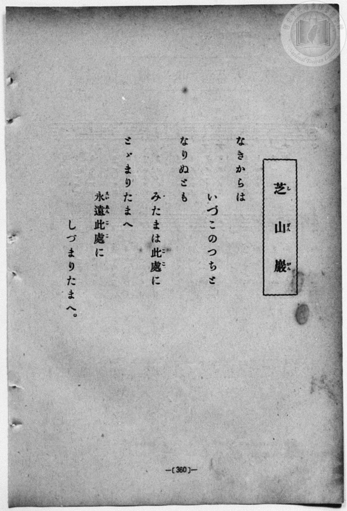
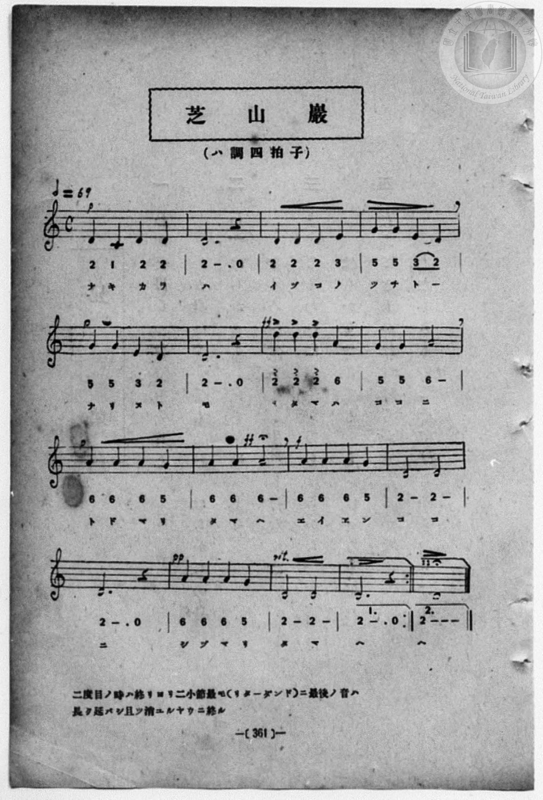

# 芝山巖

> Re:Shōka 使用 AI 協助辨識與重建樂譜，可能會有錯誤。歡迎回報。

- **鋼琴伴奏版**：<br><audio controls src="shizangan.mp3"></audio>
- **NEUTRINO 歌聲合成版**：<br><audio controls src="shizangan_neutrino.mp3"></audio>

- 詞：加部嚴夫
- 曲：高橋二三四
- book: 新編 小學校・公學校 唱歌教材集（高等科一・二學年用）
- 一條慎三郎 編《新編 小學校・公學校 唱歌教材集》（大正十二年十二月，索書號 0725-41）

## 說明

> [!NOTE]
> **原書資訊與歌詞全文**（對應 `P369.jpg`–`P370.jpg`，原書 p. 360–361，高等科一・二學年第 12 首）：
> - **調性與拍號**：ハ調四拍子（譜號無升降、4/4 拍，以 D 音 `2` 為終止音之莊嚴雅樂風旋法），♩ = 69
> - **詞曲作者**：加部嚴夫 作詞、高橋二三四 作曲（悼念芝山巖事件六氏先生之著名台灣總督府唱歌）。
> - **反覆與演奏指示**：樂譜設有一括號（`1.`，`2 - . 0 :|`）與二括號（`2.`，`2 - - -` 附延長記號）。第 4 小節 `5 5 3 2`（「ツチトー」）五線譜為四個四分音符（`3 2` 上方有圓滑線），簡譜 `3 2` 下方誤印連音底線，依拍號與五線譜記為四分音符。
> - **原書備考**：
>   「二度目ノ時ハ終リヨリ二小節最モ（リターダンド）ニ最後ノ音ハ長ク延バシ且ツ消ユルヤウニ終ル」
>
> **歌詞全文：**
> なきからは　いづこのつちと　なりぬとも
> みたまは此處（ここ）に　とゞまりたまへ
> 永遠（えいえん）此處（ここ）に　しづまりたまへ。


## 歌詞

```text
（TMD 檔案未包含歌詞註解）
```

## ABC

<div class="abc-score" data-abc-src="shizangan.abc" aria-label="五線譜載入中"></div>

[下載 ABC 原始檔](shizangan.abc)

## TMD 檔案連結

- [主旋律 TMD 檔案](shizangan.tmd) [[在 TMD Studio 編輯](https://tmdlang.github.io/Tmd-TS/#tmd=s7IKdvYPcrWy4qpTUCpJTLdSSM7PyUlNLsnMz7MqzsjPTozPrsyvSsyML84ojTe0NDJWgqssy88pzU21ys4vyY83jDdCSBTnlxYlp1oVJ2fk5-fEl6RWlCTl52ejy8cXJKanWgUYm1kiZAqK8stS8xLzgLoLijLzSlJTwNoRClLLMlNSQdLFyYl58WWpRZlpmakpSG5KLSoGOx1iRUlRYl5xclFmAcg_CFX5RSUZ-elFiQUZlVYZmcUl-UWZyYk58dmJeYkIRSUZqUDfQaQr0YVLEjPLE5FMhIjmpuYCjUrMQbYpMz0zD6o8Pj8tLTMZLK-lpfCia-7TjRufbp-moKXFpWirYGbJZW-r4MxlY6JvYgcyABRoVgrPpm14vn2FwtMN_U_X7ni2YOHj5t1PW9dA2ApPp2x8trbn2dSZz-ZOeDm77f2ejperZzxf2_l8-cQnOxqASp_s6gEqfbpzy_MpK97v6QQ7DCjzbNHcZ619T3Z0vmzuUwAa_7ihixR7Hjd0A616umT5s7WLn_Y2gizZuQXCeDan4_2enudbFj2bvePFzPkKBuZGpromhjC7X6yc937PrKddC142r3g6a8vTJavBws9mbwIKA93-bGU30BCgw57Onq3ExaWvpWBLLcCloKBgpxCt6Ocf4hoL4WhpPe2bD3Lo5vYXK7pedLQDPQl04dPWFc-mtWtpgfy4ofdZe6dCAiiZ6mUVpCc8apgM5JgbgDlAn0IMUCjQUzA2MwBKGpsB_dqDMxbWrFEwNFJ4uWwaMECAPoY4QxfokBer9j9rWA5yQncvMNxAls963NwPFAaGBFDs6doJQOe8WDsHKPm8ZeHT3vaXM3sfNzQCE4sCUBpo55PdSxVcFF7O36yQYJSg8Lxp1_OtTc_WLgIKPNnZ_aKvCxjcL2e3PlvR9HLRimfTu59tngp2Q8-jmSsVwKkP4ZaV84AR8mTvnBcNrWCHIMeXAkh85Tyg1WjRBZIAx2PHs6Y9T_dvhafvJ7u6n-ze9rR17TNg2mrteD5lPshBE6c_ndD7tH_D88bFz3fsfT538dNdcyDJDOisxw1NCOc87e99sawNFDR7pjxd2v-sp_35kl1gdwE9AwqRFWufzekEperuNcDQATogwVAPFDcJRkD9egoGClY1QG4n0ARQAoUrMkIoAsIEhZczW57u3vZy6vYXK2aAlYCcAYoxE1CueL6-QSHBVMFUwVjBCKiv43FDz-PmlsfNjY-bOx4373ncAIyDzie7pjzfPgvoJmDwA4PkaUM3iOxoA0bC8zXLQJaCdCs82QHMbjuBjn46Z_Kz3ROBWiBR8XzDQqBeBZiibqCiF6uWPO3d8LJhMdCIp7umgpX2PNk3F5JMwF6CWgl0NdRWmH2ooQhOqE-bZr5oaAYHHkRKQQHoEVD63LXs-ex1j5v7ns1sAqY7YNp53LzqcfMKIAmSBfv_2RxgYl4E8jtQqmk_yNfNQJHNj5uBju983NwNVPB0HzBY-oD2Aw0BBuXjpvXAMH3cPOFx0_YnO6YAQ-zZNqD2ZY-bVz9uXvK4CcjoBtu1GhiAYBfBciZyVgS6FlhGgiUeN6563Nj7uLH7cVPn48b1jxsaHje2PG5c-rhx8uPGdY8blzxuXPi4EVigAcWBjux63LgGxG2ChsTjxv2PG-c_btwH1Pts7ZIXM4GZoAOsdzLIC41AZwA1AtXPA6kBaYco3gHR_mzDjpeNC8BagAhob8fjJpBG3EZNB7sNxShotFBeokGBgpY-F1dwRmZVYl56Yp5VQGZiXr5DjUFNNcgWBRsTLXCYKmArSxWAyRuYcV4s7FHQgKVyHQVY-aaJRQPQLpBhNQrVBbUKRgqGQGwE5EEykQGYBYLGQBY0syjUgHX4GNYoPG7uUnjctBaIVwPZK4FqgKkErDMexG5aAuS3AunNQLoPLNsCxI1A3AFUU8OF3x-7esj1B9ylSP6oTksDejAOisyg_jEDuwPFP82rgLgH7EaQyCKEf5rnA_2yH0jPA_sT5EOgz8C-6ybCPzs6yfWPGRiaAnkgGuwTsMOBTGRJkGdBGNlDHUDcCXXyKrCTYR6YATbhcdMKSESB6ObNUE_pQkkCXgIWTkAvPe3sfbZuq4KGMWkeQ4qaAhQ_YvMGKHxhqWo7JFWheAnoYCAfpKeWi8s1LyUzL92QtJwDr28UNAzJ9AiSe0GBC3Yvwj1GJLoHVrWR7B5wcEJrQSyOggaSrp0CvIxRAHKggQZiYhEHGmenoMwFAA)]
- [鋼琴伴奏 TMD 檔案](shizangan_piano.tmd) [[在 TMD Studio 編輯](https://tmdlang.github.io/Tmd-TS/#tmd=s7IKdvYPcrWy4qpTUCpJTLdSSM7PyUlNLsnMz7MqzsjPTozPrsyvSsyML84ojTe0NDJWgqssy88pzU21ys4vyY83jDdCSBTnlxYlp1oVJ2fk5-fEl6RWlCTl52ejy8cXJKanWgUYm1kiZAqK8stS8xLzgLoLijLzSlJTwNoRClLLMlNSQdLFyYl58WWpRZlpmakpSG5KLSoGOx1iRUlRYl5xclFmAcg_CFX5RSUZ-elFiQUZlVYZmcUl-UWZyYk58dmJeYkIRYlFQM3pqbmpeSVWBZmJefnxicnJ-bkFiXmZIDGEwpIMoCKoOZXowiWJmeWJSFZDRHNTc4F2JuYocWlpKbzomvt048an26e939PxcvbMZ53dL7v3PJ-w5cmeLU-X9r_f06mgpcWlaKtgZsllb6vgzGVjom9iBzIQFKpWCs-mbXi-fYXC0w39T9fueLZg4ePm3U9b10DYCk-nbHy2tufZ1JnP5k54ObsNZMPqGc_Xdj5fPvHJjgag0ie7eoBKn-7c8nzKCqBVYIcCZZ4tmvuste_Jjs6XzX0KQOMfN3SRYs_jhm6gVU-XLH-2dvHT3kaQJTu3QBjP5nS839PzfMuiZ7N3vJg5X8HA3MhU18QQZveLlfPe75n1tGvBy-YVT2dtebpkNVj42exNQGGg25-t7AYaAnTY09mzlbi4gjMyq4CxlJhnFQCKoiAPhxqDmmouBSCwMdGyAzP0tRRs0YHC8zVrgN58sbBHQcME5Kfn6xt0FAKMzQ30sgrSNbFo0NIHG1ajUF1Qq2CkYAjERkCekYIuEBqAWSBoDGSZAqExSBasw8ewRuFxc5fC46a1QLwayF4JVPO4uR-sMx7EbloC5LcC6c1Aug8s2wLEjUDcAVRTw4XfH7t6yPUH3KVI_qhOSwN6MA6KzKD-MQO7A8U_zauAuAfsRpDIIoR_mucD_bIfSM8D-xPkQ6DPwL7rJsI_OzrJ9Y8ZGJoCeSAa7BOww4FMZEmQZ0EY2UMdQNwJdfIqsJNhHpgBNuFx0wpIRIHo5s1QT-lCSQJeAiZWoJeedvY-W7dVQcOYNI8hRU0Bih-xeQMUvrBUtR2SqlC8BHQwkA_SU4uRe3yw5R5ogo9XiDbKjYXTQMsRIuDUj6TAECRvCGGYxcN0IJmGIYduGiQNIhlpgmSkCZSPZCBUCESBLYfywcYA2bAUgK4Mw1ewEEdzDSjY0fWaghxvGg_1hVk8WDswTF3zUjLz0g3xlEdIMYoUcaBUBo44DENwRAuqIxG6jPBaDfYLxH7UhAOxH5owUEzCmSwg6UIX4gyoTl07BXiqivYBhhRQAOobGBeHvBGMq8wFAA)]

## 分析

```text
================================================================================
📊 TMD Song Profile: [ 芝山巖 ]
================================================================================
⏱  Duration:       1:51 (111.3s), 32 measures total
🎼 Key & Tempo:    首調基準 C, != 69.0 BPM, <4/4>
   - 分析範圍：      由實際發聲的音符與和弦推測調性；播放脈絡另行呈現
🎤 人聲音域:    C4 (MIDI 60) – D5 (MIDI 74) [跨度: 14 個半音 / 1.2 個八度, 難度: moderate]
   - 最低音:  C4 in [Shizangan #1 @ m.1, 0:00]
   - 最高音: D5 in [Shizangan #1 @ m.7, 0:20]
   - 適合: soprano, mezzo-soprano, contralto, tenor, baritone, bass
🏛  結構:      Shizangan (52.2s) -> Ending1 (3.5s) -> Shizangan (52.2s) -> Ending2 (3.5s)
⚡ 編曲密度:        Peak 1 軌道同時演奏
🗝  調性診斷：       D 大調（純淨自然大調，未偵測到可信轉調）
   - 風格氣質:    純淨自然大調（陽光明朗、易唱易記，無明顯調外色彩）
   - 轉調歷程:    全曲維持單一推測調性（未偵測到可信轉調）
   - 核心骨幹音:  D, A, G, E, C
   - 調性數值:    D 大調 [相關度: 0.87, 穩定度: Moderate, 自然音純度: 98.3%]
   - 候選調性 (K-S): D 大調 (0.87), D 小調 (0.75), G 大調 (0.57)
   - 五度圈歷程:   +2 -> +2 -> +2 -> +2
   - 各段落調性細節:
     • [Shizangan #1]: D 大調 (r: 0.87, 自然音純度: 98.2%, 調外音: C)
     • [Ending1 #1]: D 調性不明確 (r: 0.68, 自然音純度: 100.0%)
     • [Shizangan #2]: D 大調 (r: 0.87, 自然音純度: 98.2%, 調外音: C)
     • [Ending2 #1]: D 調性不明確 (r: 0.68, 自然音純度: 100.0%)

  [ 五度圈游移軌跡 ]
               C  
         F            G  
      Bb              [D ]*
      Eb               A  
         Ab           E  
            Db       B  
               F# 
     (* = active key center)

  [ 十二半音累積音高分佈 ]
     C  : █                          1.7%
     C# :                            0.0%
     D  : ████████████████████████  52.1%
     D# :                            0.0%
     E  : ██                         5.0%
     F  :                            0.0%
     F# :                            0.0%
     G  : ███████                   14.9%
     G# :                            0.0%
     A  : ████████████              26.4%
     A# :                            0.0%
     B  :                            0.0%
--------------------------------------------------------------------------------
Assignment 軌道音域：
  - Piano         : C4 – D5 (14 個半音 / 1.2 個八度, 92 個音符)
================================================================================
```


## 原書掃描頁






