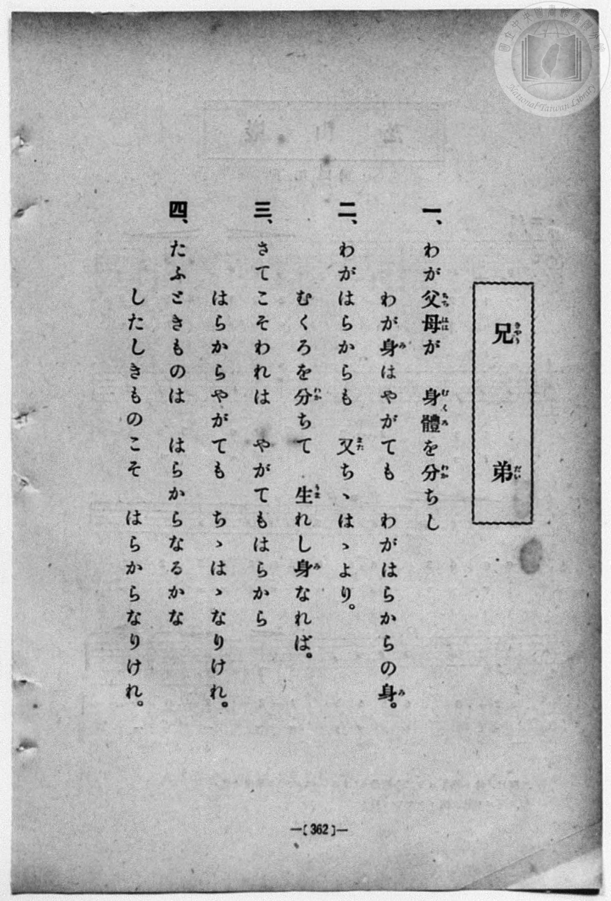
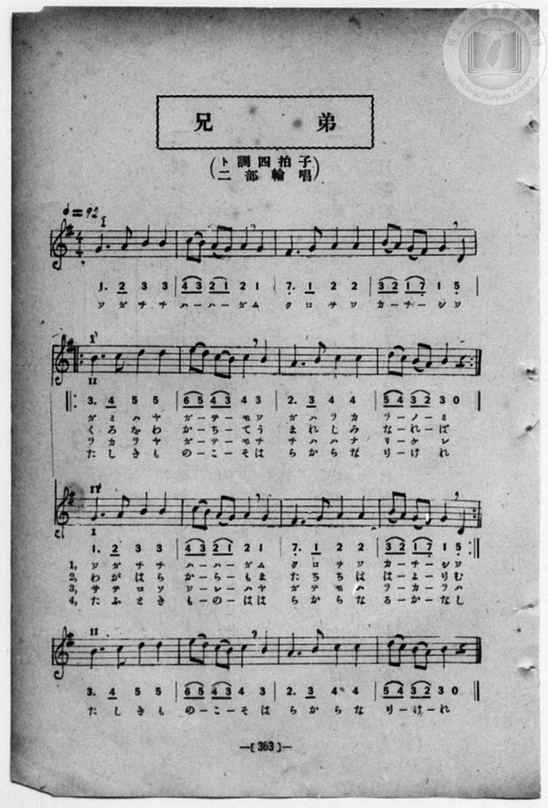

# 兄弟（二部輪唱）

> Re:Shōka 使用 AI 協助辨識與重建樂譜，可能會有錯誤。歡迎回報。

<audio controls src="kyodai.mp3"></audio>

- book: 新編 小學校・公學校 唱歌教材集（高等科一・二學年用）
- 一條慎三郎 編《新編 小學校・公學校 唱歌教材集》（大正十二年十二月，索書號 0725-41）
- 文部省《尋常小學唱歌 第四學年用》（明治四十五年）

## 說明

> [!NOTE]
> **原書資訊與歌詞全文**（對應 `P371.jpg`–`P372.jpg`，原書 p. 362–363，高等科一・二學年第 13 首）：
> - **調性與拍號**：ト調四拍子（G 大調 4/4 拍，二部輪唱），♩ = 92
> - **典據出處**：文部省唱歌（出《尋常小學唱歌 第四學年用》，1912 年）。
> - **輪唱結構**：全曲主旋律長 8 小節（前樂句 4 小節 + 後樂句 4 小節，注意第 4 小節第 4 拍為後樂句之弱起首字）。第一部（I）先唱前 4 小節（第一行），至第 5 小節進入後樂句（第二行）時，第二部（II）由頭進入前樂句（第三行），兩部疊合形成三度與六度對位之二部輪唱，最後由第二部獨唱後樂句（第四行）收束。
>
> **一、**
> わが父母（ちちはは）が　身體（むくろ）を分（わか）ちし
> わが身（み）はやがても　わがはらからの身（み）。
>
> **二、**
> わがはらからも　又（また）ちゝはゝより。
> むくろを分（わか）ちて　生（うま）れし身（み）なれば。
>
> **三、**
> さてこそわれは　やがてもはらから
> はらからやがても　ちゝはゝなりけれ。
>
> **四、**
> たふときものは　はらからなるかな
> したしきものこそ　はらからなりけれ。


## 歌詞

```text
（TMD 檔案未包含歌詞註解）
```

## ABC

```abc
X:1
T:兄弟（二部輪唱）
M:4/4
L:1/16
Q:1/4=92
K:G
V:V1 name="Alto" snm="Alt"
V:V2 name="Soprano" snm="Sop"
[V:V1]
z16 | z16 | z16 | z16 |
G6 A2 B4 B4 | c2 B2 A2 G2 A4 G4 | F6 G2 A4 A4 | B2 A2 G2 F2 G4 D4 |
w: ワ ガ チ チ | ハ _ ハ _ ガ ム | ク ロ ヲ ワ | カ _ チ _ シ ワ
B6 c2 d4 d4 | e2 d2 c2 B2 c4 B4 | A6 B2 c4 c4 | d2 c2 B2 A2 B4 z4 |
w: ガ ミ ハ ヤ | ガ _ テ _ モ ワ | ガ ハ ラ カ | ラ _ ノ _ ミ
z16 | z16 | z16 | z16 |
G6 A2 B4 B4 | c2 B2 A2 G2 A4 G4 | F6 G2 A4 A4 | B2 A2 G2 F2 G4 D4 |
w: わ が は ら | か _ ら _ も ま | た ち ち は | は _ よ _ り む
B6 c2 d4 d4 | e2 d2 c2 B2 c4 B4 | A6 B2 c4 c4 | d2 c2 B2 A2 B4 z4 |
w: く ろ を わ | か _ ち _ て う | ま れ し み | な _ れ _ ば
z16 | z16 | z16 | z16 |
G6 A2 B4 B4 | c2 B2 A2 G2 A4 G4 | F6 G2 A4 A4 | B2 A2 G2 F2 G4 D4 |
w: サ テ コ ソ | ワ _ レ _ ハ ヤ | ガ テ モ ハ | ラ _ カ _ ラ ハ
B6 c2 d4 d4 | e2 d2 c2 B2 c4 B4 | A6 B2 c4 c4 | d2 c2 B2 A2 B4 z4 |
w: ラ カ ラ ヤ | ガ _ テ _ モ チ | チ ハ ハ ナ | リ _ ケ _ レ
z16 | z16 | z16 | z16 |
G6 A2 B4 B4 | c2 B2 A2 G2 A4 G4 | F6 G2 A4 A4 | B2 A2 G2 F2 G4 D4 |
w: た ふ と き | も _ の _ は は | ら か ら な | る _ か _ な し
B6 c2 d4 d4 | e2 d2 c2 B2 c4 B4 | A6 B2 c4 c4 | d2 c2 B2 A2 B4 z4 |
w: た し き も | の _ こ _ そ は | ら か ら な | り _ け _ れ
[V:V2]
G6 A2 B4 B4 | c2 B2 A2 G2 A4 G4 | F6 G2 A4 A4 | B2 A2 G2 F2 G4 D4 |
w: ワ ガ チ チ | ハ _ ハ _ ガ ム | ク ロ ヲ ワ | カ _ チ _ シ ワ
B6 c2 d4 d4 | e2 d2 c2 B2 c4 B4 | A6 B2 c4 c4 | d2 c2 B2 A2 B4 z4 |
w: ガ ミ ハ ヤ | ガ _ テ _ モ ワ | ガ ハ ラ カ | ラ _ ノ _ ミ
z16 | z16 | z16 | z16 |
G6 A2 B4 B4 | c2 B2 A2 G2 A4 G4 | F6 G2 A4 A4 | B2 A2 G2 F2 G4 D4 |
w: わ が は ら | か _ ら _ も ま | た ち ち は | は _ よ _ り む
B6 c2 d4 d4 | e2 d2 c2 B2 c4 B4 | A6 B2 c4 c4 | d2 c2 B2 A2 B4 z4 |
w: く ろ を わ | か _ ち _ て う | ま れ し み | な _ れ _ ば
z16 | z16 | z16 | z16 |
G6 A2 B4 B4 | c2 B2 A2 G2 A4 G4 | F6 G2 A4 A4 | B2 A2 G2 F2 G4 D4 |
w: サ テ コ ソ | ワ _ レ _ ハ ヤ | ガ テ モ ハ | ラ _ カ _ ラ ハ
B6 c2 d4 d4 | e2 d2 c2 B2 c4 B4 | A6 B2 c4 c4 | d2 c2 B2 A2 B4 z4 |
w: ラ カ ラ ヤ | ガ _ テ _ モ チ | チ ハ ハ ナ | リ _ ケ _ レ
z16 | z16 | z16 | z16 |
G6 A2 B4 B4 | c2 B2 A2 G2 A4 G4 | F6 G2 A4 A4 | B2 A2 G2 F2 G4 D4 |
w: た ふ と き | も _ の _ は は | ら か ら な | る _ か _ な し
B6 c2 d4 d4 | e2 d2 c2 B2 c4 B4 | A6 B2 c4 c4 | d2 c2 B2 A2 B4 z4 |
w: た し き も | の _ こ _ そ は | ら か ら な | り _ け _ れ
z16 | z16 | z16 | z16 |
```

## TMD 檔案連結

- [主旋律 TMD 檔案](kyodai.tmd) [[在 TMD Studio 編輯](https://tmdlang.github.io/Tmd-TS/#tmd=s7IKdvYPcrWy4qpTUCpJTLdSSM7PyUlNLsnMz7MqzsjPTozPrsyvSsyML84ojTe0NDJWgqssy88pzU21ys4vyY83jDdCSBTnlxYlp1oVJ2fk5-fEl6RWlCTl52ejy8cXJKanWgUYmxsiZAqK8stS8xLzgLoLijLzSlJTwNoRClLLMlNSQdLFyYl58WWpRZlpmakpSG5KLSoGOx1iRUlRYl5xclFmAcg_CFX5RSUZ-elFiQUZlVYZmcUl-UWZyYk58dmJeYkIRSUZqUDfpSXmZuZUoovm5hcl5ihxaWkpPG1tebpn_vs9HU929bxsXvFiz6qnUza-39OpoKXFpWirYGnEZW-r4M5lY6JvYgcyBBQSVgrPpm14vn2FwtMN_U_X7ni2YOHj5t1PW9dA2ApAA56t7Xk2deazuRNezm4Dmv1y9YznazufL5_4ZEcDUCnQKqDSpzu3PJ-yAmgV2HFAmWeL5j5r7Xuyo_Nlc58C0PjHDV2k2PO4oRto1dMly5-tXfy0txFkyc4tEMazOR3v9_Q837Lo2ewdL2bOVzAwNzLVNTGE2f1sWjvQ68_nNAJtfLqh--mOHRALIRYoPF-z5uns2XAXQ-x5NqPv2abdIHGQDVOAUmDTuPS1FGypBbgUFBTsFKIV_fxDXGMhHC2tp33zQb7Y3P5iRdeLjnagA1-snPe0dQXQE1paoADY0PusvVMhAZQw9bIK0hMeNUwGcYzAHGAwQAxQKNBTMDYzAkoamxkDRXFG0Zo1CobGCi-XTQP67_2eWRBn6AId8mLV_mcNy0FO6O4FBirI8lmPmzuAwsBQAYo9XTsB6Bx3BWCMAMUUgAlIASgKtAotpQFFHs1cqQBOa3DDn7bueDZ51tP2XS9mTgWbDI8jSKSAPNq-i_j46jG0NDRSgMTS44YmJF-AnfF864Rny7vBFoGCcvamJzt2P5ve_XRf98up2xUsQAnw-foGkKWdvc9WND3tX6pgAhVU0FZ4uq8HTRBo4bPNK5619IOCDyYIYQPD4HnTLriWJzu7n-7Z-GLrdmAIP107HeI8oEpgNAD9C7TREyj0tLUD6Eig3UgWdEAUvVgIDAtQGL5o3wyywBSq4GXDpqetS-HWQNXv6oGofzazCZQhwCJQa0D2PJ-y8eWCtVCtMJ_CrOqEW_W0dSUoLqZ1PZ3Q8XTvomcdE4CyT3ctA6aFp61rgQxgGnyytxfoNdSoBubDBqCLgLbAbX7euwLkM1RnAmMP6swp257NnQ-LL1gOAKXQhkZg-QTmP27qf9zY87xj27P1wMTV8bhxIRitByJQYDb2PG5oeLFr9cvVU0CyTQ2PG_sfNwFVdj5umvS0A1Q6gU0AphGgYqDG6cjGAjWCzdwPll3_uKkFZGDjssdNTUBjIWrA4kDZbjC5DkULust3AV2D5nIU7WBjn_YDSyugCfseNwILZrCrmuaClc193AR0bRc8AcO9g8Mvy4CmPZ8CKt0fN7YBDQT7GmjjdFR_rQILbsAMZ6AHEK5tnAoysHHy40agM4CWgl0OCgSkMEHyC0wXsu9QQw_ZXyA3dD1unAgyFs0ZwNSA4oz5jxu3Pm5c8bgR6GugjeugzkCJBaBp3SB24yqYrulgjUASrgvsESwaUZ1BeSkOBQpa-lxc3pX5KYmZVsH5BcCKPd-hxqBGoRpki4KNhRbYwwrY6g9QiQYrD2YhSiANWGGgowAr36EqgeEFya-aWAwDugNkUY2CIbAA1FUwUjAGkiBcAyxdjIF8QyDWBcvWKJjHgxVBhEC4BqoEKAFSYQqSrwEb6GNYo_C4eT1Y_eOmNUB2I4gFJkEy_WAemATKgtgLIDJNUD3Na4F4E5gFEgHJrIab8LhpO0IGYp8RSAXIPKB4Yw8oqYHVdUL0NnbDecAYB6vZB5WZD9WzEIxBLKh9UBM6wGQXmGxA2GcMsm8r1K1tQPZmsIq9UP-B9TZDfAbx6xKoL0BiUD3Ni-DyID0rwSZAfAlmQ2Qg9pkgu3UrEK8As3qhpkL8tA7ufrgvwH4G8bth_m9cBZUBhwkkZMBiwBwBto_IpAev53AlPXD9gjfRgRKaLjChmQJJEK5RMAPSoIRnAuRBkiEonYHYIBEQroGqgCRVA0QIgVIcPHTnYw13UKiDSEi4w0IIpqcfJQ7gMQJsf0JM1FVASt-g9NYITW9NvUA8CcyCxiU0VCHpaRmYBNkMkgGlO5BKUBoFhTew3IXKgOMAKA4S24BqGyi1gV0DcR3MZbj9BstnIBrmN0h4gFIySAZi20awGEg_km0oaW06NJVB0hhIBpLKJoPJuWCScFoD55_GiXAfQmwjNqW1Pls5H95KgLQDEKkObwoDpQ9kSKYIPIVBSkBktWSJwNMQVc0DphKqmgdMB9QyrxZe3TnmlJBW10EbpaC6Dt7ifbJn4rO1i0YjfvBHPNFxS6gdM9qCgfFGWzCUtWDgiY6IFgyw8QzpgI62Y0bbMTjbMcDaTddOAVLBRfsYxiog8YxQeMYoPBMwT5kLAA)]
- [鋼琴伴奏 TMD 檔案](kyodai_piano.tmd) [[在 TMD Studio 編輯](https://tmdlang.github.io/Tmd-TS/#tmd=s7IKdvYPcrWy4qpTUCpJTLdSSM7PyUlNLsnMz7MqzsjPTozPrsyvSsyML84ojTe0NDJWgqssy88pzU21ys4vyY83jDdCSBTnlxYlp1oVJ2fk5-fEl6RWlCTl52ejy8cXJKanWgUYmxsiZAqK8stS8xLzgLoLijLzSlJTwNoRClLLMlNSQdLFyYl58WWpRZlpmakpSG5KLSoGOx1iRUlRYl5xclFmAcg_CFX5RSUZ-elFiQUZlVYZmcUl-UWZyYk58dmJeYkIRYlFQM3pqbmpeSVWBZmJefnxicnJ-bkFiXmZIDGEwpIMoCKrtMTczJxKdNHc_KLEHCUuLS2Fp60tT_fMf7-n48munpfNK17sWfV0ysb3ezqBIi9nz3zW2f2ye8_zCVue7NnydGk_UFxBS4tL0VbB0ojL3lbBncvGRN_EDmQ4KCitFJ5N2_B8-wqFpxv6n67d8WzBwsfNu5-2roGwFYAGP1vb82zqzGdzJ7yc3QayYfWM52s7ny-f-GRHA1Ap0AlApU93bnk-ZQXQKrCjgTLPFs191tr3ZEfny-Y-BaDxjxu6SLHncUM30KqnS5Y_W7v4aW8jyJKdWyCMZ3M63u_peb5l0bPZO17MnK9gYG5kqmtiCLP72bR2YJA8n9MItPHphu6nO3ZALIRYoPB8zZqns2fDXQyx59mMvmebdoPEQTZMAUqBTePyrsxPScy0Cs4vAEZfvkONQY1CNZcCENhYaNmBGTUKhgq6QGikYAwkQbhGwQRIGwHFjYA8kGyNgnk8WBFECIRroEqAEiAVpiD5GrCBPoY1Co-b14PVP25aA2Q3glhgEiTTD-aBSaAsiL0AItME1dO8Fog3gVkgEZDMargJj5u2I2Qg9hmBVIDMA4o39gAxSO5xUydEb2M3nPe4qQmsZh9UZj5Uz0IwBrGg9kFN6ACTXWCyAWGfMci-rVC3tgHZm8Eq9kL9B9bbDPEZxK9LoL4AiUH1NC-Cy4P0rASbAPElmA2RgdhnguzWrUC8AszqhZoK8dM6uPvhvgD7GcTvhvm_cRVUBhwmkJABiz1unA62D5oiQKlAF5gKTIEkCNcomAFpUKowAfIgaQSUCEBskAgI10BVQNKRAcL5oOQA9_p8rIECChIQCQkUmPNhevpRAggeXMBcCTFRVwEp8YESQyM0MTT1AvEkMAsa0FAvQyJ7GZgE2QySASUKkEpQAgIFxuPG_VAZcAABxUFiG1BtAyUFsGsgroO5DLffYJkARMP8BgkPUDIDyUBs2wgWA-lHsg0lIUyHJgFIAgDJQJLAZDA5F0wSTgjgxN04Ee5DiG3QZACKRGRIpgg8GUDKEGS1ZInAI5qq5gGjkqrmASOLWubVwstxx5wSHIX4aFwNjrgarVMhekbr1NE6dbRORapTEYV4AKj7FORBl8Y40EBtSMoz0gYapA1KeRASaLC2GZgNkgGpAtFAU8HqQZZoQ5IjQgpCAi1D0gRWBtEzQNZCsgVa8PqgBK8JInjjFaINY2EU0DFAhkks0OkwATDLNB4qBGJANIFYQNoA4cFBZRLQ-7p2CpAQiPYB6kLiGaHwjFF4QHuAPGUuAA)]

## 分析

```text
================================================================================
📊 TMD Song Profile: [ 兄弟（二部輪唱） ]
================================================================================
⏱  Duration:       2:05 (125.2s), 48 measures total
🎼 Key & Tempo:    首調基準 G, != 92.0 BPM, <4/4>
   - 分析範圍：      由實際發聲的音符與和弦推測調性；播放脈絡另行呈現
🎤 人聲音域:    D4 (MIDI 62) – E5 (MIDI 76) [跨度: 14 個半音 / 1.2 個八度, 難度: moderate]
   - 最低音:  D4 in [Kyodai[L1] #1 @ m.8, 0:20]
   - 最高音: E5 in [Kyodai[L1] #1 @ m.10, 0:23]
   - 適合: soprano, mezzo-soprano, contralto, tenor, baritone, bass
🏛  結構:      Kyodai[L1] (31.3s) -> Kyodai[L2] (31.3s) -> Kyodai[L3] (31.3s) -> Kyodai[L4] (31.3s)
⚡ 編曲密度:        Peak 2 軌道同時演奏
🗝  調性診斷：       G 大調（純淨自然大調，未偵測到可信轉調）
   - 風格氣質:    純淨自然大調（陽光明朗、易唱易記，無明顯調外色彩）
   - 轉調歷程:    全曲維持單一推測調性（未偵測到可信轉調）
   - 核心骨幹音:  B, A, C, G, D
   - 調性數值:    G 大調 [相關度: 0.70, 穩定度: Moderate, 自然音純度: 100.0%]
   - 候選調性 (K-S): G 大調 (0.70), B 小調 (0.60), D 大調 (0.53)
   - 五度圈歷程:   +1 -> +1 -> +1 -> +1
   - 各段落調性細節:
     • [Kyodai[L1] #1]: G 大調 (r: 0.70, 自然音純度: 100.0%)
     • [Kyodai[L2] #1]: G 大調 (r: 0.70, 自然音純度: 100.0%)
     • [Kyodai[L3] #1]: G 大調 (r: 0.70, 自然音純度: 100.0%)
     • [Kyodai[L4] #1]: G 大調 (r: 0.70, 自然音純度: 100.0%)

  [ 五度圈游移軌跡 ]
               C  
         F           [G ]*
      Bb               D  
      Eb               A  
         Ab           E  
            Db       B  
               F# 
     (* = active key center)

  [ 十二半音累積音高分佈 ]
     C  : ███████████████           16.1%
     C# :                            0.0%
     D  : ████████████              12.9%
     D# :                            0.0%
     E  : ██                         1.6%
     F  :                            0.0%
     F# : ██████                     6.5%
     G  : ███████████████           16.1%
     G# :                            0.0%
     A  : ████████████████████      21.0%
     A# :                            0.0%
     B  : ████████████████████████  25.8%
--------------------------------------------------------------------------------
Assignment 軌道音域：
  - Alto          : D4 – E5 (14 個半音 / 1.2 個八度, 156 個音符)
  - Soprano       : D4 – E5 (14 個半音 / 1.2 個八度, 156 個音符)
================================================================================
```


## 原書掃描頁






