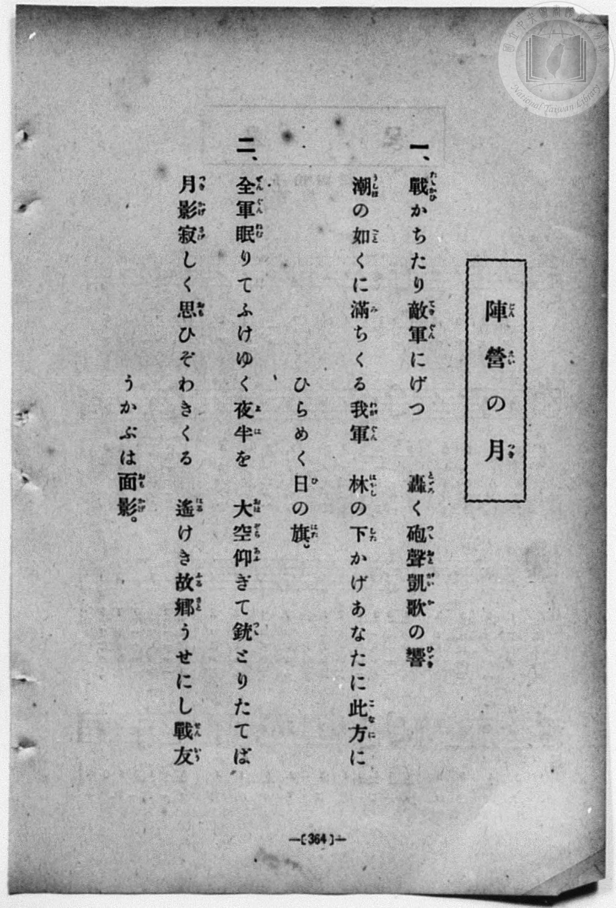
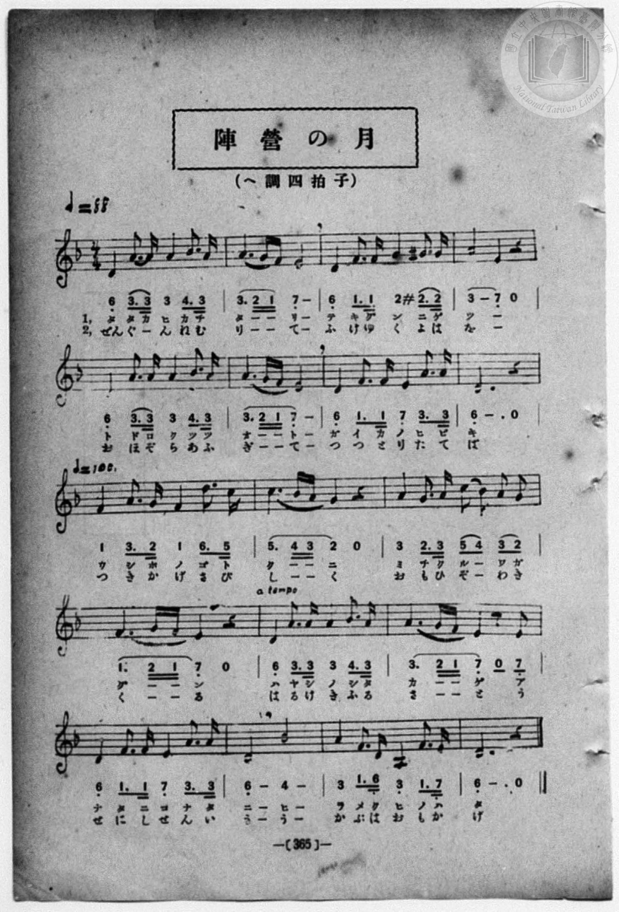

# 陣營の月

> Re:Shōka 使用 AI 協助辨識與重建樂譜，可能會有錯誤。歡迎回報。

- **鋼琴伴奏版**：<br><audio controls src="jinei_no_tsuki.mp3"></audio>
- **NEUTRINO 歌聲合成版**：<br><audio controls src="jinei_no_tsuki_neutrino.mp3"></audio>

- book: 新編 小學校・公學校 唱歌教材集（高等科一・二學年用）
- 一條慎三郎 編《新編 小學校・公學校 唱歌教材集》（大正十二年十二月，索書號 0725-41）

## 說明

> [!NOTE]
> **原書資訊與歌詞全文**（對應 `P373.jpg`–`P374.jpg`，原書 p. 364–365，高等科一・二學年第 14 首）：
> - **調性與拍號**：ヘ調四拍子（關係小調 D 小調，`?= F` 記法下以 `6_` 為終止音，4/4 拍），開頭 ♩ = 88，第 9 小節（第三行起）轉 ♩ = 100，第 13 小節（第四行第 2 小節）標 `a tempo` 回歸 ♩ = 88。
>
> **一、**
> 戰（たたかひ）かちたり敵軍（てきぐん）にげつ
> 轟（とどろ）く砲聲（つつおと）凱歌（がいか）の響（ひびき）
> 潮（うしほ）の如（ごと）くに滿（み）ちくる我軍（わがぐん）
> 林（はやし）の下（した）かげあなたに此方（こなた）に
> ひらめく日（ひ）の旗（はた）。
>
> **二、**
> 全軍（ぜんぐん）眠（ねむ）りてふけゆく夜半（よは）を
> 大空（おほぞら）仰（あふ）ぎて銃（つつ）とりたてば
> 月影（つきかげ）寂（さび）しく思（おも）ひぞわきくる
> 遙（はる）けき故郷（ふるさと）うせにし戰友（せんいう）
> うかぶは面影（おもかげ）。


## 歌詞

```text
（TMD 檔案未包含歌詞註解）
```

## ABC

<div class="abc-score" data-abc-src="jinei_no_tsuki.abc" aria-label="五線譜載入中"></div>

[下載 ABC 原始檔](jinei_no_tsuki.abc)

## TMD 檔案連結

- [主旋律 TMD 檔案](jinei_no_tsuki.tmd) [[在 TMD Studio 編輯](https://tmdlang.github.io/Tmd-TS/#tmd=s7IKdvYPcrWy4qpTUCpJTLdSSM7PyUlNLsnMz7MqzsjPTozPrsyvSsyML84ojTe0NDJWgqssy88pzU21ys4vyY83jDdCSBTnlxYlp1oVJ2fk5-fEl6RWlCTl52ejy8cXJKanWgUYmyMZWVCUX5aal5gH1F1QlJlXkpoC1o5QkFqWmZIKki5OTsyLL0stykzLTE1BclNqUTHY6RArSooS84qTizILQP5BqMovKsnITy9KLMiotMrILC7JL8pMTsyJz07MS0QoKslIBfouL7GktCgVXTQ3MyezJLGoEtnIzPTMPKuSxMxyoMPy09IykzMTc5S4tLQUXs5c_Lx9_uPGdc_mdChoaXEp2ipYWHDZ2yq4cdmY6JvYgcwABZCVwrNpG55vX6HwdEP_07U7ni1Y-Lh599PWNRC2wtMpG5-t7Xk2deazuRNezm57v6fj5eoZz9d2Pl8-8cmOBqDSJ7t6gEqf7tzyfMqK93s6wW4DyjxbNPdZa9-THZ0vm_sUgMY_bugixZ7HDd1Aq54uWf5s7eKnvY0gS3ZugTCA_nm_p-f5lkXPZu94MXO-goG5kamuiSHYbi59LQVbagEuBQUFO4VoRT__ENdYCEdL62nffJC9m9tfrOh60dEOdPOLlfOetq54Nq1dSwvk5A29z9o7FRJAKUwvqyA94VHDZBDHBMwBOhxigEKBnoKxmQlQ0tjMFCiKM1DXrFEwNFF4uWwa0H_v98yCOEMX6JAXq_Y_a1gOckJ3LzAYQJbPetw8Ayj8dPZsoNjTtRNAkTV9zpP9TcAgB4oruIDCHsgA2pcASggJCi9WzHi2eeqTHd1Pdi9VSDCLT1B43rTr-damZ2sXvZy_GagOmFIUgIaBLe95Oa375YK1Co9mrlQAJSZQLACdZwky9fn6BqBtQC4wxl8s7HmxdTtQy4u9nVDFhgYGUNWGxijKgW4FKgdJGMHFO5-tmKmQkKhQkppbkJ-g8HT2vGdrd8BtfdzQBA4EWISAAqyhEZjAwfxnHRuABj9uBCZ8IOp-3LgJaB6YsRAk0tT1bOrWF7uB_gGqWfa4sfdx44THTZPBalY_bpz0uHEJxJwXe-eD1ax43LjycRPI_48b-58v2PQCZCBQfAkYdQEVAKWetoPSLli853FjC9A6sPp1L-cDgxoouOlx42agXUBBqCP3rgOLtz1unP64cTdE8dNlTWDBKRAzgdYBnfRsN8QEIAkUAXqh_3FT97OOiVAvNAHVAG2EegFq-LzpYC3rHzcBXQJkgwwHxjBYEGgd0F-QAAF6tulx4ypwQK1-tnbJs2k7wWomQwQhYQIxE-SFps7HTY1ABzybvhTiKYjJz6bDrINoQY-dXT1IsQPMJ7DAnwN0M9zlz-csAAuufdwEin9gNIFjZ-vjxomPm4Ch1P90yZynvV1gL4PsAquZBDVzyfLnK3eBtQN17X7cOA_oVKCCJ7shKQHox61gp_YBzXzZ1QyPPrDgCrBdwBAAWrcBGoBzOp7u3QhTBkwhoLACxfJ6SARNBcYmWC8wMPufNcyFWt0ElAUKAuMa6ABgvAA1giILYubLxpmwSIGkjYlABc-mtr5sBuYToPhWoDjYZEjUA708G5wgpwPT89N-SNzNBocYME6BhTA0rsEqgRq3AU1-OXcRzNkgx8CdDY0RyotDKFDQ0ufi8srMS830yw8pLs3OtArITMzLd6gxqKkGWaRgY2imBY5_BWyFsQK4jGgAZnoFDRNoltdRgBWQmlg0AO0DGVajYBYPLPhA0BhKQmhdBRMovwYuAoJGCoYK5jAtMIhkiiGUNIKpV4dRqOaAINwcA5g5YDf5GNYoPG7aDxWDsR43rVZ43DwJLroaQjc3Ag1GqIbBx82rMNz4uLkNrnstlN4AFN0M19MNFd0EVt2CZgIMwlwNda0RUC0448GMaZwAtwYhBrOwAezcLnTnNi7DdG7jVrjsRKjuNiC7H256B1R2PdhMWNDgdi7-5LOrZxAlH7gamLFIatAhltTTDAkaUJx2Qum1wCBaDxeFxC2IBgUdelpB6Ec48XHTGphs0xIoDUqRfXA9kAh43DwZrHotDtdiSz2w5AAsaaH0PKAJEJeDeE1Qeis4WcBshLsWa-KBuBEkC3Vt4wqkhAcsneF6Qao3EHQtgbIH1D5R0IA1QxCJRwfUxLAFtlTwpqJqRZCSWmj0w2IdlFggfGjcm8YD1QIJhPtM4hWM4xWMMAoSeKKDlEPGCqYgxVCTQWLIRQ0s-B43bYfQzbORI7ZpC1S0AxyxsEQED35osYEUWEAxSPBCCiiIKeuBbEihBRIFmQJJUsgJARFpvVC6G4jhhV7jVCi9GRxp09FdAi8bkFyCSFxNsGS0CZzAYKIgPRD7CEQypFWJPZKR25oK0EYm3hiHxSwsnjHrAlCisLCopaiEARkG5iBHN3paR9QAyBEIL2abYbl9O0qigCYVYM0DMhMWsXAzgXUIwszHTYsQbgBHNMx0hHosiQhYsKPKgioCWNKAlAcwWZBqSOJAMhOY45Hc0Aiq_QhWAlMoqgRIKb4h0YeAiGiEmALUgCoANJTEWgCR9KFtCGBWfdyEqO8h8tA4hGdjePjBWxsIJz5uXgmXXQjVDcrY8CwKTSGg9IOtXQKD2GqB2TAzGqFtG2AGRxKFNiaAjVVwbMPaMnDXYoiAVMH8BGzNQmmga7EUCZAURLgJUcvFpWungNxQVQDylbkA)]
- [鋼琴伴奏 TMD 檔案](jinei_no_tsuki_piano.tmd) [[在 TMD Studio 編輯](https://tmdlang.github.io/Tmd-TS/#tmd=s7IKdvYPcrWy4qpTUCpJTLdSSM7PyUlNLsnMz7MqzsjPTozPrsyvSsyML84ojTe0NDJWgqssy88pzU21ys4vyY83jDdCSBTnlxYlp1oVJ2fk5-fEl6RWlCTl52ejy8cXJKanWgUYmyMZWVCUX5aal5gH1F1QlJlXkpoC1o5QkFqWmZIKki5OTsyLL0stykzLTE1BclNqUTHY6RArSooS84qTizILQP5BqMovKsnITy9KLMiotMrILC7JL8pMTsyJz07MS0QoSiwCak5PzU3NK7EqyEzMy49PTE7Ozy1IzMsEiSEUlmQAFVnlJZaUFqWii-Zm5mSWJBZVKnFpaSm8nLn4efv8x43rns3peL-n4-Xsmc86u19273k-YcuTPVueLu1_v6dTQUuLS9FWwcKCy95WwY3LxkTfxA5kJigErRSeTdvwfPsKhacb-p-u3fFswcLHzbuftq6BsBWeTtn4bG3Ps6kzn82d8HJ2G8iG1TOer-18vnzikx0NQKVPdvUAlT7dueX5lBVAq8BuBco8WzT3WWvfkx2dL5v7FIDGP27oIsWexw3dQKueLln-bO3ip72NIEt2boEwwP7seb5l0bPZO17MnK9gYG5kqmtiCLabyyszLzXTLz-kuDQ70yoAFMBBHg41BjXVXApAYGNopmUHZulrKdiiA4Xna9YAXf5iYY-ChgnImc_XN-goANOSiV5WQbomFg1a-mDDahTM4hV0wdBQ2xhMG8NZIDETqFgNkigIGikYKpiqx2ubw7TDIJKJZvHahhBjQEwjmE51GFUDNgHZVBCEm2gAMxHsUh_DGoXHTfuhYjDW46bVCo-bJ8FFV0Po5kag4QjVMPi4eRWGax83t8F1r4XSG4Cim-F6uqGim8CqW9BMgEGYq6GuNQKqbZzzuGkyzJjGCXBrEGIwCxvAzu1Cd27jMkznNm6Fy06E6m4DsvvhpndAZdeDzYQFDW7n4k9Uu3oGb6JCUWoOS0kgY43jteEa0CGWZNUMCTNQZHdC6bXAsFsPF4VEOogGhSl6IkLoR7j3cdMamGzTEigNSqp9cD2QmHncPBmsei0O12JLVrB08rhxN5SeBzQB4nIQrwlKbwWnF5iNcNdiTVUQN4Jkoa5tXIGUIh83zofrBaneQNC1BIqqTnCqMsZIVToKj2autDU0MMCbvKoVQUpqFUxhaQGR0IyQBaFpwDQeVNQgpweTeGASUTDCKGmQ0iMwPUFKLFDSNQXpAbNBNqAWSbDQfNy0HUI3z0aO56YtUNEOcDzD0hQ8NqDFC1LYAcUgoQ0pyCCmrAeyIYUbSBRkCiSFIacLRBz2QuluIIYXjo1TofRmcBxOR3cJvAxBcgkirTXBUtUmcHqDiYL0QOwjEOdPZ8_GGedAaWCwQsQVEhVKUnML8gmUL_A4hkQ6WmGAiFBgUrGwqKVagQQyGMxBTgHouQFReSDHKbyEboaVB9tR0gk09QArLZCZsLiGmwmsfhBmPm5ahHADOO5hpiPUY0lXwDoBVRZUh8BSC6TEgMmCVEPSC5KZwDIByQ2NoIqTYP0xhaL6g-zSHqQRGq0ICEk4iHiHqoQajSYOtIv0igSRXaDtE2D2ftyEaEtA5KGRDM_68ACGt2QQLn7cvBIuuxCqG1QYwLM1NAmBEhi2Ng8MYqtIZsPMaIS2m4CFApIotKHyuBFc7YGjG8W1GCIgVTA_PW7cBqWBrsVSjECSGOHmSS22lrEP1pYxKHpBGoFFOyhasTHBRT6Ej0u1MZhpHg8VQWQfgibC6xNQusFqCIKFmnjo53ITMNMQl7MQaqFmoyd-dHfDqmKwiaYIw7EzwU4A1cVwH2EwUSxBNgBJJVgUzAIbCJHBEpIQzxqhhQeWyoFaYQ8zHsLD6SIigh9uOghCfACNDQgHOZkhRxnCPOzpgMjIBeY6XTsF5IwX7WMYq4AhZgQWU-YCAA)]

## 分析

```text
================================================================================
📊 TMD Song Profile: [ 陣營の月 ]
================================================================================
⏱  Duration:       0:47 (47.8s), 18 measures total
🎼 Key & Tempo:    首調基準 F, != 88.0 BPM, <4/4>
   - 分析範圍：      由實際發聲的音符與和弦推測調性；播放脈絡另行呈現
🎤 人聲音域:    G3 (MIDI 55) – C5 (MIDI 72) [跨度: 17 個半音 / 1.4 個八度, 難度: challenging]
   - 最低音:  G3 in [JineiNoTsuki #1 @ m.10, 0:25]
   - 最高音: C5 in [JineiNoTsuki #1 @ m.11, 0:27]
   - 適合: mezzo-soprano, contralto, tenor, baritone, bass
🏛  結構:      JineiNoTsuki (47.8s)
⚡ 編曲密度:        Peak 1 軌道同時演奏
🗝  調性診斷：       D 小調（純淨自然小調，未偵測到可信轉調）
   - 風格氣質:    純淨自然小調（陰鬱抒情、旋律集中，無明顯調外色彩）
   - 轉調歷程:    全曲維持單一推測調性（未偵測到可信轉調）
   - 核心骨幹音:  A, D, E, F, A#
   - 調性數值:    D 小調 [相關度: 0.82, 穩定度: High, 自然音純度: 98.5%]
   - 候選調性 (K-S): D 小調 (0.82), A 小調 (0.67), D 大調 (0.63)
   - 五度圈歷程:   +2
   - 各段落調性細節:
     • [JineiNoTsuki #1]: D 小調 (r: 0.82, 自然音純度: 98.5%, 調外音: G#)

  [ 五度圈游移軌跡 ]
               C  
         F            G  
      Bb              [D ]*
      Eb               A  
         Ab           E  
            Db       B  
               F# 
     (* = active key center)

  [ 十二半音累積音高分佈 ]
     C  : ███                        3.4%
     C# :                            0.0%
     D  : ██████████████████        22.6%
     D# :                            0.0%
     E  : ████████████              14.7%
     F  : ███████████               13.5%
     F# :                            0.0%
     G  : █████                      6.8%
     G# : █                          1.5%
     A  : ████████████████████████  30.1%
     A# : ██████                     7.5%
     B  :                            0.0%
--------------------------------------------------------------------------------
Assignment 軌道音域：
  - Piano         : G3 – C5 (17 個半音 / 1.4 個八度, 82 個音符)
================================================================================
```


## 原書掃描頁






