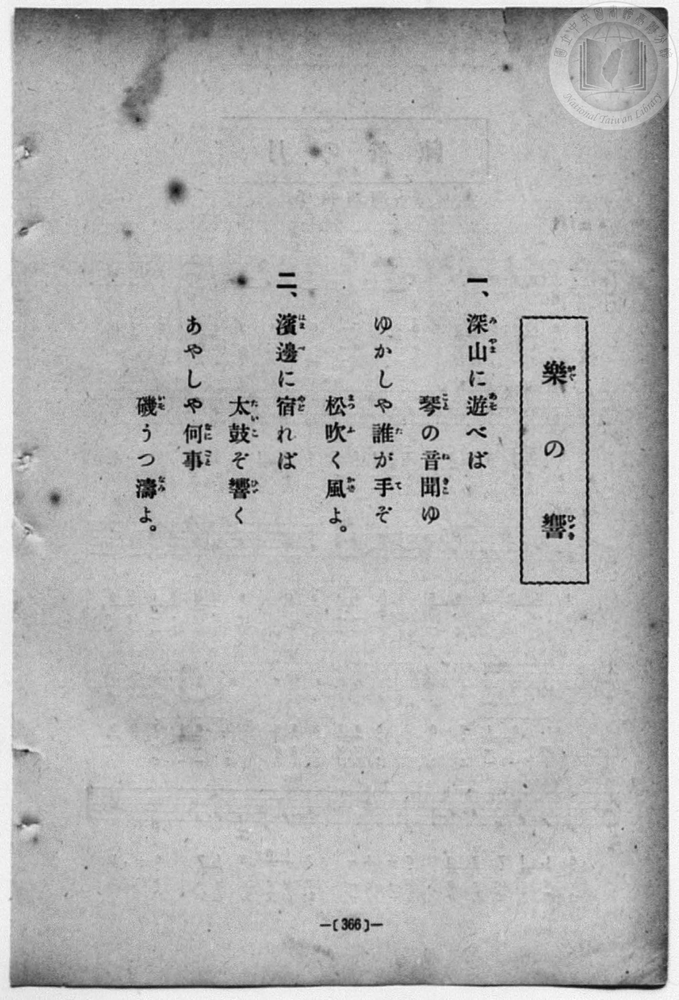
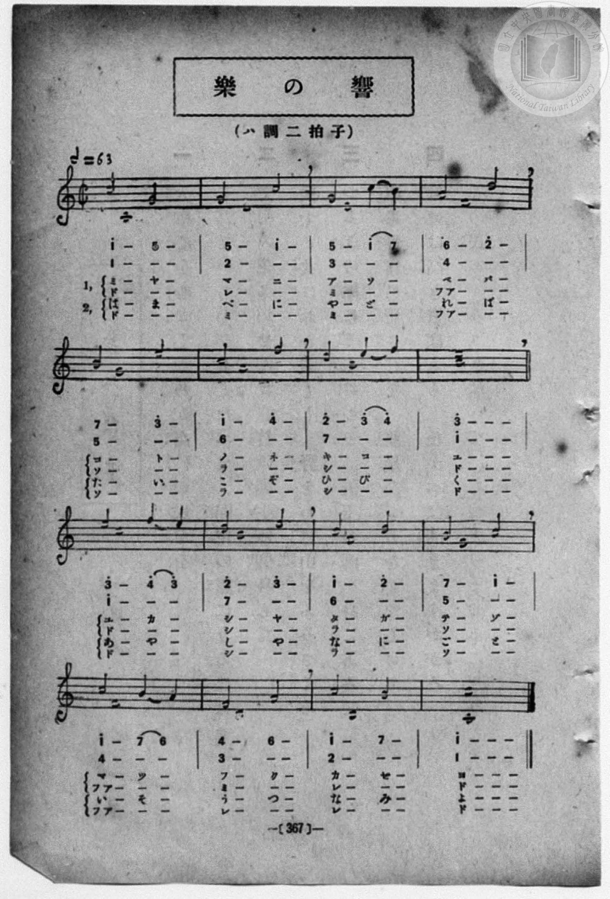

# 樂の響（二部）

> Re:Shōka 使用 AI 協助辨識與重建樂譜，可能會有錯誤。歡迎回報。

- **鋼琴伴奏版**：<br><audio controls src="gaku_no_hibiki.mp3"></audio>
- **NEUTRINO 歌聲合成版**：<br><audio controls src="gaku_no_hibiki_neutrino.mp3"></audio>

- book: 新編 小學校・公學校 唱歌教材集（高等科一・二學年用）
- 一條慎三郎 編《新編 小學校・公學校 唱歌教材集》（大正十二年十二月，索書號 0725-41）

## 說明

> [!NOTE]
> **原書資訊與歌詞全文**（對應 `P375.jpg`–`P376.jpg`，原書 p. 366–367，高等科一・二學年第 15 首）：
> - **調性與拍號**：ハ調二拍子（C 大調 2/2 拍 `¢`），𝅗𝅥 = 63（四分音符換算為 ♩ = 126）
> - **二部合唱設計**：本曲為極具巧思之音階對位二部合唱教材——低聲部（Alto）以全音符由下而上唱出八小節大調上行音階（`1`–`1^`：「ド・レ・ミ・フアー・ソ・ラ・シ・ド」），後八小節再由上而下唱出大調下行音階（`1^`–`1`：「ド・シ・ラ・ソ・フアー・ミ・レ・ド」），作為固定調／首調音階定旋律（Cantus firmus）；高聲部（Soprano）則於其上方交織優美對位旋律與詩意歌詞。
>
> **一、**
> 深山（みやま）に遊（あそ）べば　琴（こと）の音（ね）聞（きこ）ゆ
> ゆかしや誰（た）が手（て）ぞ　松吹（まつふ）く風（かぜ）よ。
>
> **二、**
> 濱邊（はまべ）に宿（やど）れば　太鼓（たいこ）ぞ響（ひび）く
> あやしや何事（なにごと）　磯（いそ）うつ濤（なみ）よ。


## 歌詞

```text
（TMD 檔案未包含歌詞註解）
```

## ABC

<div class="abc-score" data-abc-src="gaku_no_hibiki.abc" aria-label="五線譜載入中"></div>

[下載 ABC 原始檔](gaku_no_hibiki.abc)

## TMD 檔案連結

- [主旋律 TMD 檔案](gaku_no_hibiki.tmd) [[在 TMD Studio 編輯](https://tmdlang.github.io/Tmd-TS/#tmd=s7IKdvYPcrWy4qpTUCpJTLdSSM7PyUlNLsnMz7MqzsjPTozPrsyvSsyML84ojTe0NDJWgqssy88pzU21ys4vyY83jDdCSBTnlxYlp1oVJ2fk5-fEl6RWlCTl52ejy8cXJKanWgUYm5siZAqK8stS8xLzgLoLijLzSlJTwNoRClLLMlNSQdLFyYl58WWpRZlpmakpSG5KLSoGOx1iRUlRYl5xclFmAcg_CFX5RSUZ-elFiQUZlVYZmcUl-UWZyYk58dmJeYkIRSUZqUDf5SWWlBaloovmlhZnJiObl5memWdVmgdyXAnUSVpaCs9WND1uXPdy_v73ezqe7Op52bzi_Z5OBS0tLkVbBUMjMy57WwVnLhsjfSM7kFGgQLJSeDZtw_PtKxSebuh_unbHswULHzfvftq6BsJWeDpl47O1Pc-mznw2d8LL2W1AY1-unvF8befz5ROf7GgAKgXaAlT6dOeW51NAdoGdCJR5tmjus9a-Jzs6Xzb3KQCNf9zQRYo9jxu6gVY9XbL82drFT3sbQZbs3AJhPJvT8X5Pz_Mti57N3vFi5nwFA3MjU10TQ7DdXPpaCrbUAlwKCgp2CtGKfv4hrrEQjpbW0775IHs3t79Y0fWiox3o5hcr5z1tXfFsWruWFsjJG3qftXcqJIBSmV5WQXrCo4bJII4ZmAN0OMQAhQI9BWMzM6CksZk5UBRnoK5Zo2BoqvBy2TSg_97vmQVxhi7QIS9W7X_WsBzkhO5eYDCALJ_1uLkfKAwKo-7ep2snAJ3jrAAMQ6CYAjDKFYCiCgmHFgFdATSq58Pc1nkKtgpmxiBXz579tKPt5fzNz9cse9Y_-_m66c-bdik8mrkSqACYbIAaEBZDktXTCR3AKHuxYu2LFR1gu5_NWfNs9iagtmdLtz5t3f50-_JnDXOf7OwGGvpyVh8wWJ7s7UXWConqRw1TgOjJ3r4XjZvAibXDMackH2jfk91LgaEKcdHzKRuf7Oh-0dDzZEcXUOfT9l1PW1cDk9Hz9Q0Q3wHFXyzsgdgENCLBEBzqhnFAn8563NDzuLkTGKaPm9eAyflgcurjpkWPm_eA2E17wSIrweztYHbn44ZeSCg93deDsKytF-yULrBTuqFOgbqgG9UFcRAnoLoAajrEJoitSO6AugziSoQLnuydAwzVp7N3PV03C2jT-z39wNQAZEADdt2sZ9O7n-4DZRfnxLyS0mKFtMwiYGkB1jwbmK7gIRucXwAsnECB-7Sz_dm0PU9btwH98mzazie7ljzfOeVpy6rn-6ARBTESmLherFz5rKUfksofNzSBUwEsK4CSakMjsGwB859t3_h040agNY8b9z9uanncuA9o0ePG1S8bu8CCwHJpLlhk5-PGDY8bGp5P2AIWn_y4EVRugEutzWCRtUDui8Z5YHYvUAFItqkNYguQ8bix-3HjdKAVL1ZtAKuZD9be86wTFAaPG5eBuUDXNjybu-_phJ1gwX2PG5c8btwKlup_uQgUHGBz5oAN78Dw2q4eZK_t3_iyCeKL9WCjgGaCvPZ0HaiYBXt2JdicHojXni5Z9XIP0Nkgtz1uBMqCvdA4D1IsP27c9LgR6FOQS6CeAgYOyBCQp57snfpkF8Qjq4BWPG6cAg0fYIgtXg8WB6qEhCQwKJY8278EphhoOJJfKC__oEBBS5-Lyz0xu9Qv3yMzKTM70wqakBxqDGqqQVYp2JhogYNOAVvxqwAsw4BJBZg9FDRMQKU_MCfpKMCKRE0sGoAWggyrUTCMA5Y4pkBcAybBXDjTHMg0AzKNwKJgHT6GNQrAbATkP25eAlb7uHkemNcN4TUtAvGa9kLlZoLlJiD0GwFFG9eDRBv3QdQ07gTzVkP1t4B5K6G8HjBvA1g_fv_v6iHH_-ZAk40hngb73QTCBvsYKA7k1kDkQRApCJo2gz3WAfVmH5jXC3X0WnAQgFSA5Jah6gYHADgAG0FeBfEmg3mgYATxNoF5UN2N_XDdBKK_kxzvg70G9CSQRngaHhiQeAeHESRhICUBkK8eN8EibTtygmjaD5ZbA_V_G5gHjmykEGgCi8JCYDoKbxVygmicAuatIBwGwCqW7CxgDkzoNQomQBYowcMF4Uy06IemeaiDm6eCnQ9K1SDvgxz-uGkPVA7kcPToh6TxuVAPggOoERp4UM-DghBkFiiBQXTXohURoFqc5PIBWFci1-RPO3ufrdtKeojBHKVgBGcZw1mgQEQPrk64LLD2RWKD8gGMDa2nMYOLLN1EFBbogbGvh5zAAJWVEEeAUg6EBUo4EBa2xAMuHGHuBhV0UDY4F8HE4X5GhAOJ-ogoL8AhgGhWkZsc4H5E8jgiMOABhD09oLge2Vdw32JPCUToI6K0QA8B8tIAPMkjZQNE1oBnF6QAQEuuaIkZOZFjSQhk6QaWH7p2CshFiAKQr8wFAA)]
- [鋼琴伴奏 TMD 檔案](gaku_no_hibiki_piano.tmd) [[在 TMD Studio 編輯](https://tmdlang.github.io/Tmd-TS/#tmd=s7IKdvYPcrWy4qpTUCpJTLdSSM7PyUlNLsnMz7MqzsjPTozPrsyvSsyML84ojTe0NDJWgqssy88pzU21ys4vyY83jDdCSBTnlxYlp1oVJ2fk5-fEl6RWlCTl52ejy8cXJKanWgUYm5siZAqK8stS8xLzgLoLijLzSlJTwNoRClLLMlNSQdLFyYl58WWpRZlpmakpSG5KLSoGOx1iRUlRYl5xclFmAcg_CFX5RSUZ-elFiQUZlVYZmcUl-UWZyYk58dmJeYkIRYlFQM3pqbmpeSVWBZmJefnxicnJ-bkFiXmZIDGEwpIMoCKrvMSS0qJUdNHc0uLMZCUuLS2FZyuaHjeuezl___s9HU929bxsXvF-TyeQ_XL2zGed3S-79zyfsOXJni1Pl_YDxRW0tLgUbRUMjcy47G0VnLlsjPSN7EBGgwLSSuHZtA3Pt69QeLqh_-naHc8WLHzcvPtp6xoIW-HplI3P1vY8mzrz2dwJL2e3gaxYPeP52s7nyyc-2dEAVAq0Haj06c4tz6eA3AB2MlDm2aK5z1r7nuzofNncpwA0_nFDFyn2PG7oBlr1dMnyZ2sXP-1tBFmycwuE8WxOx_s9Pc-3LHo2e8eLmfMVDMyNTHVNDMF2c7knZpf65XtkJmVmZ1oF5xcAAz3focagRqGaSwEIbEy07MCMGgXDOAVdBVMgrgGTYC6caQ5kmgGZRmBRsA4fwxqFx83zgfzHzUvAah83zwPzuiG8pkUgXtNeqNxMsNwEhH4joGjjepBo4z6ImsadYN5qqP4WMG8llNcD5m0A64c62RzIMYa4E-xcEwgb7EigOJBbA5EHQSRXN20Gu6UD6rI-MK8Xas9asKtBKkByy1B1g90M9nMjyHUg3mQwD-RzEG8TmAfV3dgP1w11Mdg1QHcBaYQ74e6HhC7YW5DgRwpokEMeN8GCZjtysDftB8utgTq5DcwDBymSo5vAojBHT0fhrUIO9sYpYN4KZGeDXWMOTAE1CiZAFiglwAXhTLRAhiYGqB3NU8E2gqIb5GKQXY-b9kDlQHahBzIk8udC3QT2UyPUv1D3gnwNMgsUjRDdtWjp3TGnBFdih-lRMIKzjOEskB_RfdMJl33cDAppGBuUGGDsqcA0_7gZ5Cs035ClG-pUUA6EKAEFO4QFCnUIC1vIg7MczFRQ9oGywakGJg53EcKVJOpDThvozkI4Fe587GGJYjaynXC3YA9FIvRB3QePTKQIRkQ6PCEgOQ8tItCiCTn6sAQiWbrRE24AqEIM8sCRdrXBQW6oDSmsjcC0EUQQ6Ekw1xjENdYGFdsm2qDIMNFGKrqBsQKUApb22tDSxwyi20wbWoKaQ1Sbg-TNQYKgaIYoRngXIQakgWogPFTNKIZDizeY3UhFHMiVkBIcKAdyMMgfoIgzBjse5ElIAQnWCg8CPIHngyvw4hWiDWNhFNAx8UCWaXwsggFXYwykjHNBAiZAlkmsghGQMgIJwApzqAIMhVAKr-lAygARkES4Ct0RCDmYNlhQojkCKk3IUbpgVSA3AQNU104BOUyjfYBSGGJGYDFlLgA)]

## 分析

```text
================================================================================
📊 TMD Song Profile: [ 樂の響（二部） ]
================================================================================
⏱  Duration:       0:30 (30.5s), 16 measures total
🎼 Key & Tempo:    首調基準 C, != 126.0 BPM, <2/2>
   - 分析範圍：      由實際發聲的音符與和弦推測調性；播放脈絡另行呈現
🎤 人聲音域:    C4 (MIDI 60) – C5 (MIDI 72) [跨度: 12 個半音 / 1.0 個八度, 難度: easy]
   - 最低音:  C4 in [GakuNoHibiki #1 @ m.1, 0:00]
   - 最高音: C5 in [GakuNoHibiki #1 @ m.8, 0:13]
   - 適合: soprano, mezzo-soprano, contralto, tenor, baritone, bass
🏛  結構:      GakuNoHibiki (30.5s)
⚡ 編曲密度:        Peak 2 軌道同時演奏
🗝  調性診斷：       C 大調（純淨自然大調，未偵測到可信轉調）
   - 風格氣質:    純淨自然大調（陽光明朗、易唱易記，無明顯調外色彩）
   - 轉調歷程:    全曲維持單一推測調性（未偵測到可信轉調）
   - 核心骨幹音:  C, E, D, B, F
   - 調性數值:    C 大調 [相關度: 0.90, 穩定度: High, 自然音純度: 100.0%]
   - 候選調性 (K-S): C 大調 (0.90), A 小調 (0.73), G 大調 (0.56)
   - 五度圈歷程:   +0
   - 各段落調性細節:
     • [GakuNoHibiki #1]: C 大調 (r: 0.90, 自然音純度: 100.0%)

  [ 五度圈游移軌跡 ]
              [C ]*
         F            G  
      Bb               D  
      Eb               A  
         Ab           E  
            Db       B  
               F# 
     (* = active key center)

  [ 十二半音累積音高分佈 ]
     C  : ████████████████████████  27.3%
     C# :                            0.0%
     D  : ███████████               12.5%
     D# :                            0.0%
     E  : ██████████████            15.6%
     F  : ██████████                10.9%
     F# :                            0.0%
     G  : ██████████                10.9%
     G# :                            0.0%
     A  : █████████                 10.2%
     A# :                            0.0%
     B  : ███████████               12.5%
--------------------------------------------------------------------------------
Assignment 軌道音域：
  - Alto          : C4 – C5 (12 個半音 / 1.0 個八度, 16 個音符)
  - Soprano       : F4 – F5 (12 個半音 / 1.0 個八度, 34 個音符)
================================================================================
```


## 原書掃描頁






