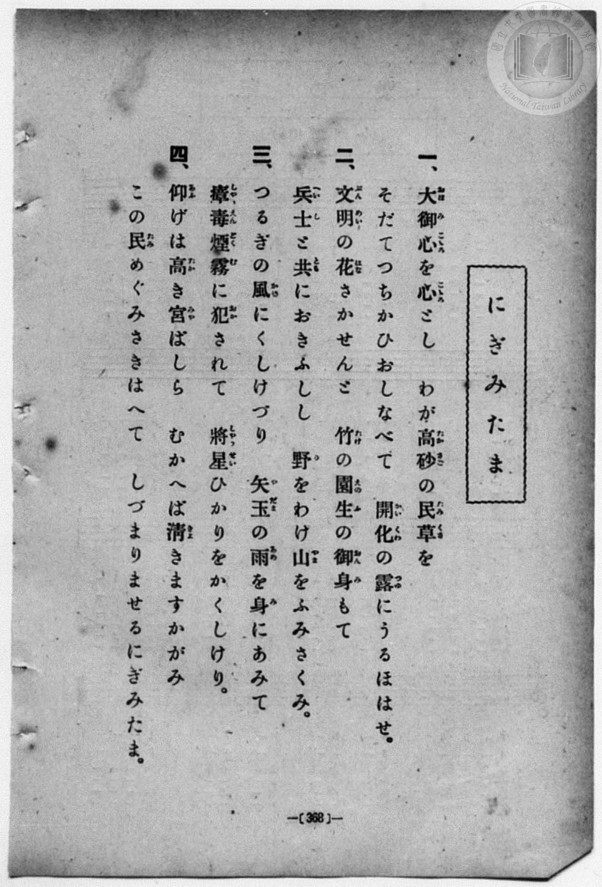
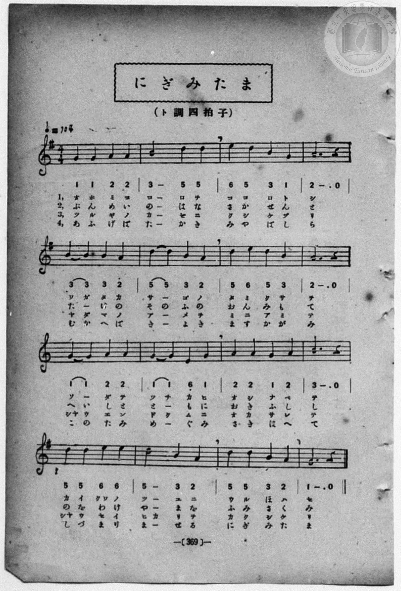

# にぎみたま

> Re:Shōka 使用 AI 協助辨識與重建樂譜，可能會有錯誤。歡迎回報。

<audio controls src="nigimitama.mp3"></audio>

- book: 新編 小學校・公學校 唱歌教材集（高等科一・二學年用）
- 一條慎三郎 編《新編 小學校・公學校 唱歌教材集》（大正十二年十二月，索書號 0725-41）

## 說明

> [!NOTE]
> **原書資訊與歌詞全文**（對應 `P377.jpg`–`P378.jpg`，原書 p. 368–369，高等科一・二學年第 16 首）：
> - **調性與拍號**：ト調四拍子（G 大調 4/4 拍，全曲採用 `1 2 3 5 6` 四七拔五聲音階），♩ = 104
> - **版本比較（同名同詞異曲）**：本曲歌詞雖與大正四年（1915）臺灣總督府《公學校唱歌集》所錄芝葛鎮作曲之〈にぎみたま〉（`5_ 1 3 5 | 4 - 3 2 | ...`）完全相同，惟本書（1923）所載樂譜為另一首完全不同之五聲音階旋律（`1 1 2 2 | 3 - 5 5 | 6 5 3 1 | 2 - . 0`）。
> - **字音對位細節**：第 14 小節原譜記為 `5 - 3 2`，第一、二、四章於二分音符 `5 -` 唱一字（「ツー」「やー」「まー」），第三章則於 `5` 與 `-` 下方分印「ヒ」「カ」二字（「ヒカリヲ」），轉錄時細分為 `5 5 3 2` 以精確對齊四章字音。
>
> **一、**
> 大御心（おほみこころ）を心（こころ）とし　わが高砂（たかさご）の民草（たみくさ）を
> そだてつちかひおしなべて　開化（かいくわ）の露（つゆ）にうるほはせ。
>
> **二、**
> 文明（ぶんめい）の花（はな）さかせんと　竹（たけ）の園生（そのふ）の御身（おんみ）もて
> 兵士（へいし）と共（とも）におきふしし　野（の）をわけ山（やま）をふみさくみ。
>
> **三、**
> つるぎの風（かぜ）にくしけづり　矢玉（やだま）の雨（あめ）を身（み）にあみて
> 瘴煙毒霧（しやうえんどくむ）に犯（おか）されて　將星（しやうせい）ひかりをかくしけり。
>
> **四、**
> 仰（あふ）げば高（たか）き宮（みや）ばしら　むかへば清（きよ）きますかがみ
> この民（たみ）めぐみさきはへて　しづまりませるにぎみたま。


## 歌詞

```text
（TMD 檔案未包含歌詞註解）
```

## ABC

```abc
X:1
T:にぎみたま
M:4/4
L:1/16
Q:1/4=104
K:G
V:V1 name="Piano" snm="Pia"
[V:V1]
G4 G4 A4 A4 | B8 d4 d4 | e4 d4 B4 G4 | A12 z4 |
w: オ ホ ミ コ | コ ロ ヲ | コ コ ロ ト | シ
B4 B4 B4 A4 | d4 d4 B4 A4 | d4 e4 d4 B4 | A12 z4 |
w: ワ ガ タ カ | サ _ ゴ ノ | タ ミ ク サ | ヲ
G4 G4 A4 A4 | G4 G4 E4 G4 | A4 A4 G4 A4 | B12 z4 |
w: ソ _ ダ テ | ツ チ カ ヒ | オ シ ナ ベ | テ
!f! d4 d4 e4 e4 | d4 d4 B4 A4 | d4 d4 B4 A4 | G12 z4 |
w: カ イ クワ ノ | ツ _ ユ ニ | ウ ル ホ ハ | セ
G4 G4 A4 A4 | B8 d4 d4 | e4 d4 B4 G4 | A12 z4 |
w: ぶ ん め い | の は な | さ か せ ん | と
B4 B4 B4 A4 | d4 d4 B4 A4 | d4 e4 d4 B4 | A12 z4 |
w: た _ け の | そ の ふ の | お ん み も | て
G4 G4 A4 A4 | G4 G4 E4 G4 | A4 A4 G4 A4 | B12 z4 |
w: へ い し と | と _ も に | お き ふ し | し
!f! d4 d4 e4 e4 | d4 d4 B4 A4 | d4 d4 B4 A4 | G12 z4 |
w: の を わ け | や _ ま を | ふ み さ く | み
G4 G4 A4 A4 | B8 d4 d4 | e4 d4 B4 G4 | A12 z4 |
w: ツ ル ギ ノ | カ ゼ ニ | ク シ ケ ヅ | リ
B4 B4 B4 A4 | d4 d4 B4 A4 | d4 e4 d4 B4 | A12 z4 |
w: ヤ ダ マ ノ | ア _ メ ヲ | ミ ニ ア ミ | テ
G4 G4 A4 A4 | G4 G4 E4 G4 | A4 A4 G4 A4 | B12 z4 |
w: シヤ ウ エ ン | ド ク ム ニ | オ カ サ レ | テ
!f! d4 d4 e4 e4 | d4 d4 B4 A4 | d4 d4 B4 A4 | G12 z4 |
w: シヤ ウ セ イ | ヒ カ リ ヲ | カ ク シ ケ | リ
G4 G4 A4 A4 | B8 d4 d4 | e4 d4 B4 G4 | A12 z4 |
w: あ ふ げ ば | た か き | み や ば し | ら
B4 B4 B4 A4 | d4 d4 B4 A4 | d4 e4 d4 B4 | A12 z4 |
w: む か へ ば | き _ よ き | ま す か が | み
G4 G4 A4 A4 | G4 G4 E4 G4 | A4 A4 G4 A4 | B12 z4 |
w: こ の た み | め _ ぐ み | さ き は へ | て
!f! d4 d4 e4 e4 | d4 d4 B4 A4 | d4 d4 B4 A4 | G12 z4 |
w: し づ ま り | ま _ せ る | に ぎ み た | ま
```

## TMD 檔案連結

- [主旋律 TMD 檔案](nigimitama.tmd) [[在 TMD Studio 編輯](https://tmdlang.github.io/Tmd-TS/#tmd=s7IKdvYPcrWy4qpTUCpJTLdSSM7PyUlNLsnMz7MqzsjPTozPrsyvSsyML84ojTe0NDJWgqssy88pzU21ys4vyY83jDdCSBTnlxYlp1oVJ2fk5-fEl6RWlCTl52ejy8cXJKanWgUYm5sjZAqK8stS8xLzgLoLijLzSlJTwNoRClLLMlNSQdLFyYl58WWpRZlpmakpSG5KLSoGOx1iRUlRYl5xclFmAcg_CFX5RSUZ-elFiQUZlVYZmcUl-UWZyYk58dmJeYkIRSUZqUDfFaXmZKajaIaIlyRmlicCRbW0FB43rn7c2Pe4cf_jxvmPG_cpaGlxKdoqGBqYcNnbKrhz2Zjom9iBdIMCwUrh2bQNz7evUHi6of_p2h3PFix83Lz7aesaCFvh6ZSNz9b2PJs689ncCS9nt73f0_Fy9YznazufL5_4ZEcDUOmTXT1ApU93bnk-ZcX7PZ1gVwFlni2a-6y178mOzpfNfQpA4x83dJFiz-OGbqBVT5csf7Z28dPeRpAlO7dAGM_mdLzf0_N8y6Jns3e8mDlfwcDcyFTXxBBsN5e-loIttQCXgoKCnUK0op9_iGsshKOl9bRvPsjeze0vVnS96GgHuvnFynlPW1c8m9aupQVy8obeZ-2dCgmgVKSXVZCe8KhhMohjAeYAHQ4xQKFAT8HYzAIoaWxmCRTFGahr1igYmim8XDYN6L_3e2ZBnKELdMiLVfufNSwHOaG7FxgMIMtnPW7uAAo_nT0bKPZ07QSgc9wVgGEIFFMARrkCUBTkAKBjZ2961rcQGGEKCYYKRgrGCqYKZgkKQH1PdjQ_657yZNeUF42bXs7f_HJWH9jankczVypAEhDc_uedHc_mrHm2fsqLPc0gf0_oeTqhF0gCg-P51A1AG4A6wY4CqQLaBw6ol7OnAV0MjdbZs4EeBGo1tDQ0BSp-0b7reePi5zv2Pp-7-OmuOcAEA08dkMQBSRbPOhte9rS86Jr7YuLsl33rnuydAzT9yc7uxw0daMn-cQPQ6R0JpvEKhmAv1iiYAF1uDPRwjYKenh4wMjqfrgMFx_PZO4AOB3rzWfN8sGt3gF1lZAxUAbTuBZBc0fRi7ZznTbue9i8DxhAwOiA6n-wAeRloO3KQPZve_XQfKPkCAxcUvCD7jIE2m4LdYAYkjYHiNUBxXQU9BQOQOx43NCFC9una6UCDgAnpyd7e51s2PF_fAA5HcFIwAWUfoAgwFQEd9GLFDKCbFBJMIf4CJS-gKlASagDlFCAJDOTnqxc8m7YHlKI62oDmPl-zDKwBGN9TNgKVAm0DOvVxQ8_j5pbHzXseN_SC2E1IbGBIgtmQpAC2oBNo6NPOdqC5QLMSFIBxqpAANPHJju5n03YC7XnauwFs4iSYcauBDHCihls2CSTYvOpx8ya40S_2dgKj9tnMJqCvgYZAvQYKLiOg2buXPt-07_miXcCAebm3C-IxSFDBQg-WRyEBACz0wHxganu6b-HT_aBU-rix63HjbnAKmQxCTSCbHzdNgskiCTaueNw4_XFDw-Om_seN4Py5oAmsBpi0uh83Tn3cOAWsbN2zDRNf9IJSGlgKaDJQ_VSIsRAHPG6c-7hxwePGZY8blzxuXAjWvgnskumPG1c9btwJkmpoeDmt-2kPMJsDzQEqaAGZ09QPseLlHGBuAoovedwELIGBIsB03va4CagM6Jf1jxtnY4QAOPJhIQAsm57NAOZkoAnbHjcBPdgINB9i8ouujWBxoCGrwCJAfwGNnQ1SBgyBhobnq3fCvDYRouXpnEnPp8wHCwL9te5x41ao-L6FL3athgYySPt-cCA0AX0HjYjWrU8XQxTsAHsQmBZA4fy0FeKGFUDFMN8BA6cXaDI4iECx8LId4v51kIAFR8rEpxvBGoFptXEfVBykBRgFQF8AFezHTBjAnAYPFnB4Aj0LLDHWvVwErLwgIT8H5gagCUDbJz5uXPq4qQsUFPMXPe8DRzTIRmCEgi0F6p0N0dsEDFiIM2DhAA4BkFHAQAC6ChoOz2dsed4689n6SS_nLAcrmw42sO1xI9BkYLitBEd9A0Tv8671sHQLLFLAEdQEzJKgBPN0AzBaIREBN2E2LGaBCawb5GxQmAA9BfMLyCOoYQLMSEhh8mT3BqhfoNEK1L4BmPjhKR8s2Pt0HTAiQB4E2gsW2QB2AzB0gfmlAWwjMIo3PNvRClbW-7gJWGeDNIIKk8aZYAVAX-yHRQTQ16B8BM9E4GAEptIJsNgEagQmUaCZII-D_bIUZBTQOyADgckVaCBa4Q_2JuWtAChQ0NLn4vIDNrxyM0sScxOtAjIT8_IdagxqqkHWKNiYaIFDVAFbA0QBUii_WNijoAErwHUUYI0CTSwagJaBDKsB1hOEahBdBQOFGrBqH8MahcdNqxQeN88G4vlA9magGhCpC-SvBeJNUD4Yg0U6wCLbwebEw8wxAoo1bgOKTwbiRiC7BaSqcR3InMb1QLwKzJ8KxN1ADLQNqBIksgLVHGOgWHMLEK8GqlgHpPvAtq0GmdO0B8jvBvOBJgJd8LhpI1CkFSTSvArVHBOQ2U1AvBWIJwHxBrBt88HuAbmgF8zfDzQDaBtQFphAwCZ3ws3BHze7esiJG2MwBMUNtJICsyCxgzVumkE-XQPEIJeuBrtwKzgstsDDBigDjjmQyq3gsNiEJW4gPp8IjhMQfy6YBQkfiEgXJPbAYdIEFlmGJW6WAHEDEM-D278InFYWwtIKyC3AWAKJg9ggkTbMuGkCmgGOhx3wuOkF-6sDHjf7gHgmVFUPNLaIi5sdnZTlGxDLDNQEBEWJEVgYkpnQM85esNdBwdEG9igo4QITPzCigI0VcOAAsxYooTYDA7d5JrbAAEcOKBBAyXA6OEPAsgUoGoBFFCxygMECiS5wQgWSGJHTtB0cP03LgHgF0CpwXm7uhKSN5gXw3ANyFCh_AQ1rXoMrhhpBaQGUQoDxCQx5kL5GcBqaAOODczPIUaD8vQMtxeCNIWAFQk4MVafVgvONGRCi5iAYyxBLJIF8CgqV9eDMBEm0wJgCxRwwoKBBAmKBYg1UDPaDRXZjiSdgcDQBC5OmfnBWAqkCmwNKqkBxkApQ_AAzEDhowOYgJVqs8bQb7DqQk0AGg5wAKo0hpS7I5YiSDlcpB0o0S6GO6ILmHJCjQGUs2HPAJASs5qAOA-dIsAqIObVcXLp2CohaKtrHMFYBTcQIQ8QYQ8QELKLMBQA)]
- [鋼琴伴奏 TMD 檔案](nigimitama_piano.tmd) [[在 TMD Studio 編輯](https://tmdlang.github.io/Tmd-TS/#tmd=s7IKdvYPcrWy4qpTUCpJTLdSSM7PyUlNLsnMz7MqzsjPTozPrsyvSsyML84ojTe0NDJWgqssy88pzU21ys4vyY83jDdCSBTnlxYlp1oVJ2fk5-fEl6RWlCTl52ejy8cXJKanWgUYm5sjZAqK8stS8xLzgLoLijLzSlJTwNoRClLLMlNSQdLFyYl58WWpRZlpmakpSG5KLSoGOx1iRUlRYl5xclFmAcg_CFX5RSUZ-elFiQUZlVYZmcUl-UWZyYk58dmJeYkIRYlFQM3pqbmpeSVWBZmJefnxicnJ-bkFiXmZIDGEwpIMoCKrotSczHQUWyDiJYmZ5YlAUS0thceNqx839j1u3P-4cf7jxn3v93S8nD3zWWf3y-49zydsebJny9Ol_e_3dCpoaXEp2ioYGphw2dsquHPZmOib2IFMBYWilcKzaRueb1-h8HRD_9O1O54tWPi4effT1jUQtsLTKRufre15NnXms7kTXs5uA1mxesbztZ3Pl098sqMBqPTJrh6g0qc7tzyfsgJoF9i1QJlni-Y-a-17sqPzZXOfAtD4xw1dpNjzuKEbaNXTJcufrV38tLcRZMnOLRDGszkd7_f0PN-y6NnsHS9mzlcwMDcy1TUxBNvN5QcMstzMksTcRKsAUBAHeTjUGNRUcykAgY2Jlh2Yoa-lYIsOFJ6vWQN09ouFPQoaJiA3Pl_foKMATEwWelkF6ZpYNGjpgw2rUTAEQiMgrFEwVtBVMAXCGgUzIGkMFK8BiusCoYFCDVi1j2GNwuOmVQqPm2cD8XwgezNQDYjUBfLXAvEmKB-MwSIdYJHtYHPiYeYYAcUatwHFJwNxI5DdAlLVuA5kTuN6IF4F5k8F4m4gBtoGVAkSWYFqjjFQrLkFiFcDVawD0n1g21aDzGnaA-R3g_lAE4EueNy0ESjSChJpXoVqjgnI7CYg3grEk4B4A9i2-WD3gFzQC-bvB5oBtA0o-7hxOtjkTrg5-ONmVw85cWMMhqC4AcULjAWJHaxx0wzy6RogBrl0NdiFW8FhsQUeNkAZcMyBVG4Fh8UmLHED8flEcJyA-HPBLEj4QES6ILEHDpMmsMgyLHGzBIgbgHge3P5F4LSyEJZWQG4BxhJIHMQGibRhxk0T0AxwPOyAx00v2F8d8LjZB8Qzoap6oLFFXNzs6KQs34BYZvHQ7GIEFoZkJvSMsxfsdVBwtIE9Ckq4wMQPjKjHzZPAgQPMWqCE2gwM3OaZ2AIDHDmgQAAlw-ngDAHLFqBoABapsMgBBgskusAJFUhiRE7TdnD8NC0D4hVAq8B5ubkTkjaaF8BzD8hRoPwFNKx5Da4YagSlBVAKAcYnMORB-hrBaWgCjA_OzSBHgfL3DrQUgzeGns6eTU4MVafVgvONGRCi5iAYyxBLJIF8CgqV9eDMBEm0wJgCxRwwoKBBAmKBYg1UDPaDRXZjiSdgcDQBC5OmfnBWAqkCmwNKqkBxkApQ_AAzEDhowOYgJVqs8bQb7DqQk0AGg5wAKo0hpS7I5YiSDlcpB0o0S6GO6ILmHJCjQGUs2HPAJASslqEOA-dIsAqIObWYlZQPtkoKGLbxCtGGsQqm8UDaND4WIQKlahRMgAwTJD5cKYgBixQUbRjmYDcYv0FILjIDMc3ic2ORWGjaMaxAmAdKX1BxqFfw-BqnWcAQ1bVTQARqtA9QDk3ECEPEGEMEaD1QRJkLAA)]

## 分析

```text
================================================================================
📊 TMD Song Profile: [ にぎみたま ]
================================================================================
⏱  Duration:       2:27 (147.7s), 64 measures total
🎼 Key & Tempo:    首調基準 G, != 104.0 BPM, <4/4>
   - 分析範圍：      由實際發聲的音符與和弦推測調性；播放脈絡另行呈現
🎤 人聲音域:    E4 (MIDI 64) – E5 (MIDI 76) [跨度: 12 個半音 / 1.0 個八度, 難度: easy]
   - 最低音:  E4 in [Nigimitama[L1] #1 @ m.10, 0:21]
   - 最高音: E5 in [Nigimitama[L1] #1 @ m.3, 0:04]
   - 適合: soprano, mezzo-soprano, contralto, tenor, baritone, bass
🏛  結構:      Nigimitama[L1] (36.9s) -> Nigimitama[L2] (36.9s) -> Nigimitama[L3] (36.9s) -> Nigimitama[L4] (36.9s)
⚡ 編曲密度:        Peak 1 軌道同時演奏
🗝  調性診斷：       D 大調（純淨自然大調，未偵測到可信轉調）
   - 風格氣質:    純淨自然大調（陽光明朗、易唱易記，無明顯調外色彩）
   - 轉調歷程:    全曲維持單一推測調性（未偵測到可信轉調）
   - 核心骨幹音:  A, D, B, G, E
   - 調性數值:    D 大調 [相關度: 0.78, 穩定度: Moderate, 自然音純度: 100.0%]
   - 候選調性 (K-S): D 大調 (0.78), G 大調 (0.71), B 小調 (0.58)
   - 五度圈歷程:   +2 -> +2 -> +2 -> +2
   - 各段落調性細節:
     • [Nigimitama[L1] #1]: D 大調 (r: 0.78, 自然音純度: 100.0%)
     • [Nigimitama[L2] #1]: D 大調 (r: 0.78, 自然音純度: 100.0%)
     • [Nigimitama[L3] #1]: D 大調 (r: 0.78, 自然音純度: 100.0%)
     • [Nigimitama[L4] #1]: D 大調 (r: 0.78, 自然音純度: 100.0%)

  [ 五度圈游移軌跡 ]
               C  
         F            G  
      Bb              [D ]*
      Eb               A  
         Ab           E  
            Db       B  
               F# 
     (* = active key center)

  [ 十二半音累積音高分佈 ]
     C  :                            0.0%
     C# :                            0.0%
     D  : ██████████████████        21.7%
     D# :                            0.0%
     E  : ███████                    8.3%
     F  :                            0.0%
     F# :                            0.0%
     G  : █████████████████         20.0%
     G# :                            0.0%
     A  : ████████████████████████  28.3%
     A# :                            0.0%
     B  : ██████████████████        21.7%
--------------------------------------------------------------------------------
Assignment 軌道音域：
  - Piano         : E4 – E5 (12 個半音 / 1.0 個八度, 204 個音符)
================================================================================
```


## 原書掃描頁






