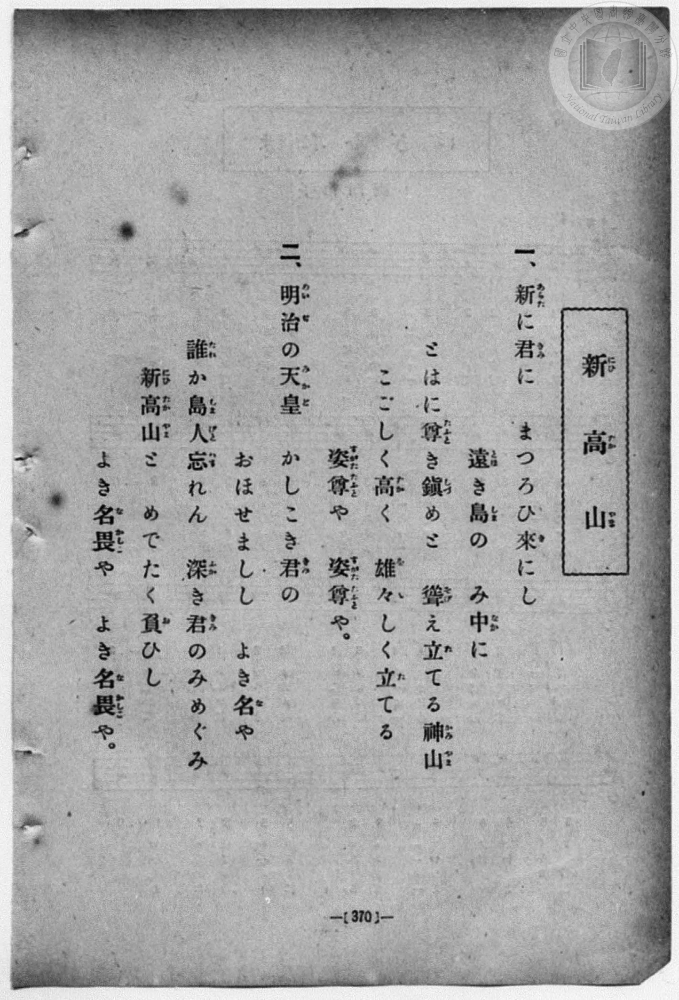
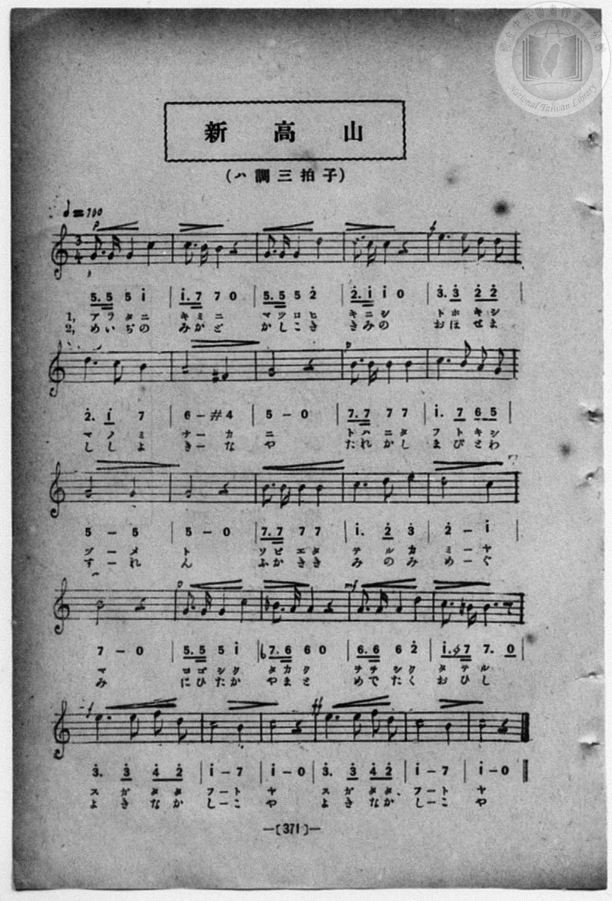

# 新高山

> Re:Shōka 使用 AI 協助辨識與重建樂譜，可能會有錯誤。歡迎回報。

- **鋼琴伴奏版**：<br><audio controls src="niitakayama.mp3"></audio>
- **NEUTRINO 歌聲合成版**：<br><audio controls src="niitakayama_neutrino.mp3"></audio>

- 詞：加部嚴夫
- 曲：岡野貞一
- book: 新編 小學校・公學校 唱歌教材集（高等科一・二學年用）
- 一條慎三郎 編《新編 小學校・公學校 唱歌教材集》（大正十二年十二月，索書號 0725-41）

## 說明

> [!NOTE]
> **原書資訊與歌詞全文**（對應 `P379.jpg`–`P380.jpg`，原書 p. 370–371，高等科一・二學年第 17 首）：
> - **調性與拍號**：ハ調三拍子（C 大調 3/4 拍），♩ = 100
> - **詞曲作者**：加部嚴夫 作詞、岡野貞一 作曲（初出臺灣總督府《公學校唱歌集》）。
> - **力度與臨時記號**：開頭 `p`，第 5 小節（第一行末小節）轉 `f`，第 7 小節含 `#4`（F♯4），第 17 小節轉 `p`、第 18 小節含 `b7`（B♭4），第 19 小節轉 `mf`、第 20 小節含 `#4`（F♯4），第 21 小節轉 `f`，第 24 小節（結尾重句）推至最高潮 `ff`。
>
> **一、**
> 新（あらた）に君（きみ）に　まつろひ來（き）にし
> 遠（とほ）き島（しま）の　み中（なか）に
> とはに尊（たふと）き鎮（しづ）めと
> 聳（そび）え立（た）てる神山（かみやま）
> こごしく高（たか）く　雄々（をを）しく立（た）てる
> 姿尊（すがたたふと）や　姿尊（すがたたふと）や。
>
> **二、**
> 明治（めいぢ）の天皇（みかど）　かしこき君（きみ）の
> おほせましし　よき名（な）や
> 誰（たれ）か島人（しまびと）忘（わす）れん
> 深（ふか）き君（きみ）のみめぐみ
> 新高山（にひたかやま）と　めでたく負（お）ひし
> よき名畏（なかしこ）や　よき名畏（なかしこ）や。


## 歌詞

```text
（TMD 檔案未包含歌詞註解）
```

## ABC

<div class="abc-score" data-abc-src="niitakayama.abc" aria-label="五線譜載入中"></div>

[下載 ABC 原始檔](niitakayama.abc)

## TMD 檔案連結

- [主旋律 TMD 檔案](niitakayama.tmd) [[在 TMD Studio 編輯](https://tmdlang.github.io/Tmd-TS/#tmd=s7IKdvYPcrWy4qpTUCpJTLdSSM7PyUlNLsnMz7MqzsjPTozPrsyvSsyML84ojTe0NDJWgqssy88pzU21ys4vyY83jDdCSBTnlxYlp1oVJ2fk5-fEl6RWlCTl52ejy8cXJKanWgUYm1siZAqK8stS8xLzgLoLijLzSlJTwNoRClLLMlNSQdLFyYl58WWpRZlpmakpSG5KLSoGOx1iRUlRYl5xclFmAcg_CFX5RSUZ-elFiQUZlVYZmcUl-UWZyYk58dmJeYkIRSUZqUDf5SWWlBaloouWJGaWJyIZCBHNzS_NA8qgWJSZnplnlZuamZWJJSCg0hDT4vPT0jKTMxNzlLi0tBSeTdvwcvWMpxs3KmhpcSnaKhgaGHDZ2yo4c9kY65vYgUwAGWUFUvd8-wqFpxv6n67d8WzBwsfNu5-2roGwFZ5O2fhsbc-zqTOfzZ3wcnbb-z0dQDOfr-18vnzikx0NQKVPdvUAlT7dueX5lBXv93SCXQaUebZo7rPWvic7Ol829ykAjX_c0EWKPY8buoFWPV2y_NnaxU97G0GW7NwCYTyb0_F-T8_zLYuezd7xYuZ8BQNzI1NdE0OY3S9Wznu_Z9bTrgUvm1c8nbXl6ZLVYOFnszeBhDctfNne92LTPKALlbi49LUUbKkFuBQUFOwUohX9_ENcYyEcLa2nffNBrtzc_mJF14uOdqAPgc572rri2bR2LS2QBzf0PmvvVEgAJWG9rIL0hEcNk4EcCwMwB-hNiAEKBXoKxuYGQEljc6BHe3BGwZo1CobmCi-XTQOGBtC7EGfoAh3yYtX-Zw3LQU7o7gUGGsjyWY-b-4HCwCgCij1dOwHoHGcFYIgDxRSACUQBKAo2pefRzJUKkNSDMG7lPGCAPtk750VDK9gs5PBWAImvnPe4oRE5uEGi4EjoeNox92n7rhftu543Ln6-Y-_zuYuf7poDTB_wxABJC7BU0Pm4oQlh89Ou2U93LQN65EX7imczm16smAHzzstp3S8XrFVIKACFGygkTEFJ7fn6BqCVQC7QCS8WAhPPaphg54u9wJBPg6k2h6p-OmG1QoKyCVC4w-3RzPUmkDCAhixECVhjQQLQg2BhC2SdSeYgnU6PZq5F1mmJrDM3DabVyICgpUaGyFrhrjUyQfLc1glPN-x72d77tH8pUOOzvhUv2jc_m9MATCXP9q4DagLZBwlCWLoEpZuGRmCxAOYDMybQmMeNTY-bOh83zgcFeePqpxNmgwV7Hzfuh4g8bmh43LjvceOSx01AwU1P9oFKA6ACqGzjdIhpLxsXgMVXPG7cDZbqfbp5G1hkOlA7WGQd2Chg0lsLFl_1uBEcz42rISaA9a4HuWFDF1jB_MeNW4GCENNe9q2DmQby7uOmRqAUROOLxs1gqbmPQQyg4o7nq0HlCMxTyx43dT9fOg9YJIIFu4FueNzUAnEVzOrJjxungA3vB4YfzHaI8_qBzn45u-VxQytIvGkSEIHFQYoxLYIY-HT5fpgvZj5u7AGbhuQdoO0NDUSoQYu-XT3I0Tej79kmYFADnQQMCqB3FkEC-emSlc9ntYON3Q_27EpwZgKGPJANdDPQp70YsbwOFg5dwOh73DgbHONAxdNBGptAKp9OAMY4KNYgboOG_CpIEpr_uKkHbE43MNKf7NoFj3dgjEC883Q_OFSb-oGeBZvQ87hpMtQj2yHxAvQ4JMCxOA8cZUBvTgAy4KkXUs2BVQLT4SZIlMFjFpScQI4H6loOlup_sQmSRIFhDpQFqocmXbgHn0_th6dMSFjBI4sINeDIorxGgQIFLX0uLr_MzJLE7MTKxNxEq4DMxLx8hxqDmmqQPQo2hmZa4JShgK06U4AXfQoasAJRRwFWxWhi0QC0DmRYjUJ1QS2wDNUFQlMoratgGAdl1MCY5kAIETKAS6HrMkLogjKBmuFGIfRVp9UqGEOEgRRcF0I72GU-hjXAmFoEFnncvBLI3g-Vf9zcDTfrcdNaqNh8JPF4hHzzPKh8CxBD1IJ4k7CY0A1kb8diQgdUfjZcLZAHVwl1rRHIpEaIXCPQrkaIy0G8dQizGiF-AKYlIF6JaRdQHCI_HVRGwU3oRVIBYYNMQpiMbEIXVH43EM-Gm7AP7lr8aWhXDzlpCB51IAiOcVhqqVEwQ5ICQRN1uBQs4cAgIolAtCMSHcI4eHqCCYPMBxmElGqgcQ71O7BlCkkf8DBqhoQRkpqm1UiysFQEg9jSQj-SOkTKBKmYimI3SD0k1UBSDFJqAcYxkkowD1jqIEyCxzpCzSqEbFMLblc2QvwKLHThKQpmA0wFLD1AZDaDyRVgPf1gVxIoaTrJSSXo0Q3jUyEhgBMgtExBKn8QEFGiISWTVjRFj5sXwk2ARTXWAG7aC1U_GcgGBRskuJGTQRuKuaDkhZrIYMkRoWYJqgvBSWQmuipglCJcASsgsLiwcStEPbig6YXpRilIYK6FyICKEoQYojBDVjMB7kK8yePp7NnkJA9Y1MIgUoWBv4oy1wEzzOBFDZLOXGBdAxFGSCPVU1BTgGUSsu0g_biKE7RwbgJlHVC8bEGqEh43rUdSAS3ygbGPEEcuUjZB5IE0AROAaQqSkpDdgZxakGMUzZZGiD5gMwhePEBSB8IWSIECKhogRQG6T2GV23IUE0DFBcwOWNUDsgO5cIO4k0DFMwWcZsxIbLwgmhIQCOaYgAhwLKMVEyCIowQBQeQmCm0MRmrZ7ESSf9y0BkyCIhBCotckYFXwIgkkCysukAMZKkc7s5HaOsjFI6RggdRPkESFXr9BVMEKLAL1F-3M5qrl4tK1U0BqZysAucpcAA)]
- [鋼琴伴奏 TMD 檔案](niitakayama_piano.tmd) [[在 TMD Studio 編輯](https://tmdlang.github.io/Tmd-TS/#tmd=s7IKdvYPcrWy4qpTUCpJTLdSSM7PyUlNLsnMz7MqzsjPTozPrsyvSsyML84ojTe0NDJWgqssy88pzU21ys4vyY83jDdCSBTnlxYlp1oVJ2fk5-fEl6RWlCTl52ejy8cXJKanWgUYm1siZAqK8stS8xLzgLoLijLzSlJTwNoRClLLMlNSQdLFyYl58WWpRZlpmakpSG5KLSoGOx1iRUlRYl5xclFmAcg_CFX5RSUZ-elFiQUZlVYZmcUl-UWZyYk58dmJeYkIRYlFQM3pqbmpeSVWBZmJefnxicnJ-bkFiXmZIDGEwpIMoCKrvMSS0qJUdNGSxMzyRCSbIaK5-aV5QBmguJaWwrNpG16unvF048b3ezpezp75rLP7Zfee5xO2PNmz5enS_vd7OhW0tLgUbRUMDQy47G0VnLlsjPVN7EAmgkLVCqT_-fYVCk839D9du-PZgoWPm3c_bV0DYSs8nbLx2dqeZ1NnPps74eXsNpAVq2c8X9v5fPnEJzsagEqf7OoBKn26c8vzKSuAdoFdCpR5tmjus9a-Jzs6Xzb3KQCNf9zQRYo9jxu6gVY9XbL82drFT3sbQZbs3AJhPJvT8X5Pz_Mti57N3vFi5nwFA3MjU10TQ5jdL1bOe79n1tOuBS-bVzydteXpktVg4WezN4GENy182d73YtM8oAuVuLj8MjNLErMTKxNzE60CQDEU5OFQY1BTzaUABDaGZlp2YJa-loItOlB4vmYN0JAXC3sUNExBfnq-vkFHIcDYwkAvqyBdE4sGLX2wYTUK1QW1CqYKukBoCqV1FYy1TbUN46CcGmSuuYIRkGMOlTKAK0E3wQSoyghhAhIXaBCK8QgzqtOALgFKaBtD5ICUibY5whgUTg3Y-T6GNQqPmxaBRR43rwSy90PlHzd3ww1-3LQWKjYfSTweId88DyrfAsQQtSDeJCwmdAPZ27GY0AGVnw1XC-TBVUJdawQyqREi1wi0qxHichBvHcKsRogfHjcC7WpciWkXUBwiPx2IJ8NN6EVSAWGDTEKYjGxCF1R-NxDPhpuwD-5a_AltVw85CQ0l-sDxC0kEyAmqRsFQ20Rd2wxJFQgaahsBheFqzOOBfFhKg0FEOkIYiJpaUS1CSYTI0kAXgB1gqA1UAg4NeEqDphNoeAGLEkiagodrMyRckdQ0rUaShaU8GMSWfvqR1CFSM0jFVBS7QeohKQ2SypBSGDBdIKkE8x43QcxHTh3IalYhZJtacLuyEeLXx0098FQIswGmApaGIDKbweQKsJ5-sCsJFGGd5KQsWEwhQ5Q0gl0JxSkGnqKRSy1IcYeW1EEQtVBFSlStaAofNy-EmwRLGFijo2kvVP1kIBsUyJDIQU40bSjmghIjapKEJV6EmiWoLgQnqJnoqoAJAOEKWBGExYWNWyHqwUVZL0w3SlEFcy1EBlRYIcQQxSWymglwF-JNTE9nzyYnMSHHOQwi1VHE1JbmOmCmGbwoQTMjF1jRQYTNoDQoLZmhVJjqMCOB5R66k0BG4SqV0CKgCZQDQRG2Bak2ety0HkkFtLYBJguEOHLJtAkiD6QJmABMbJAkhuwO5GSEHNVotjRC9D1uBNoCLWUgyQZhC6RcApUwkBIF3aewenU5igmgUgdmB6zWA9mBXEZC3EmgzpsCTkxmJDau0Jo0EAjmmIGETUAseGmBpYgBQQKlEAgiN6LobSVSQ2wnkvzjpjVgEhTpEBK9EgOrgpdvIFlY2YMcMVA52pmN1DRDLmshpRSkaoQkRPSqFaIKVvoRqDppZzZXLZaugw9y18EE2nOAFF-G8QrRhrEgCthsjwdyTONjgbGJxAExgFUmRB1IBpSMQVy4JNQ4NB1GQJ5RLIgibDKIB3ICsklA2zCsxqMVIYduEMxedO-aANkmUClQIQx2cC7UxSAOugdhHgcaANSLx5ngbEeMSlBs6dopIEVYtA9QBl0IGIxAIWUuAA)]

## 分析

```text
================================================================================
📊 TMD Song Profile: [ 新高山 ]
================================================================================
⏱  Duration:       0:46 (46.8s), 26 measures total
🎼 Key & Tempo:    首調基準 C, != 100.0 BPM, <3/4>
   - 分析範圍：      由實際發聲的音符與和弦推測調性；播放脈絡另行呈現
🎤 人聲音域:    F#4 (MIDI 66) – F5 (MIDI 77) [跨度: 11 個半音 / 0.9 個八度, 難度: easy]
   - 最低音:  F#4 in [Niitakayama #1 @ m.7, 0:12]
   - 最高音: F5 in [Niitakayama #1 @ m.21, 0:37]
   - 適合: soprano, mezzo-soprano, contralto, tenor, baritone, bass
🏛  結構:      Niitakayama (46.8s)
⚡ 編曲密度:        Peak 1 軌道同時演奏
🗝  調性診斷：       G 大調（純淨自然大調，未偵測到可信轉調）
   - 風格氣質:    純淨自然大調（陽光明朗、易唱易記，無明顯調外色彩）
   - 轉調歷程:    全曲維持單一推測調性（未偵測到可信轉調）
   - 核心骨幹音:  C, B, G, D, E
   - 調性數值:    G 大調 [相關度: 0.83, 穩定度: Moderate, 自然音純度: 97.5%]
   - 候選調性 (K-S): G 大調 (0.83), C 大調 (0.74), E 小調 (0.60)
   - 五度圈歷程:   +1
   - 各段落調性細節:
     • [Niitakayama #1]: G 大調 (r: 0.83, 自然音純度: 97.5%, 調外音: F, A#)

  [ 五度圈游移軌跡 ]
               C  
         F           [G ]*
      Bb               D  
      Eb               A  
         Ab           E  
            Db       B  
               F# 
     (* = active key center)

  [ 十二半音累積音高分佈 ]
     C  : ████████████████████████  24.8%
     C# :                            0.0%
     D  : ██████████████            14.0%
     D# :                            0.0%
     E  : ████████                   8.6%
     F  : █                          1.4%
     F# : ██                         1.8%
     G  : ███████████████████       19.4%
     G# :                            0.0%
     A  : ████████                   8.3%
     A# : █                          1.1%
     B  : ████████████████████      20.5%
--------------------------------------------------------------------------------
Assignment 軌道音域：
  - Piano         : F#4 – F5 (11 個半音 / 0.9 個八度, 73 個音符)
================================================================================
```


## 原書掃描頁






