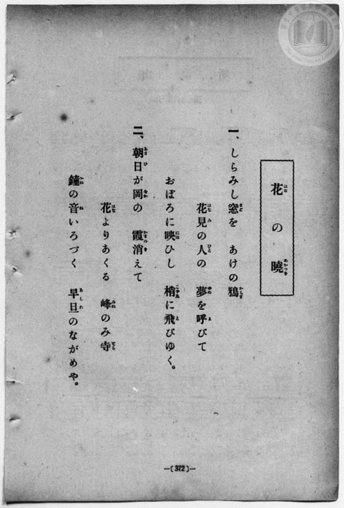
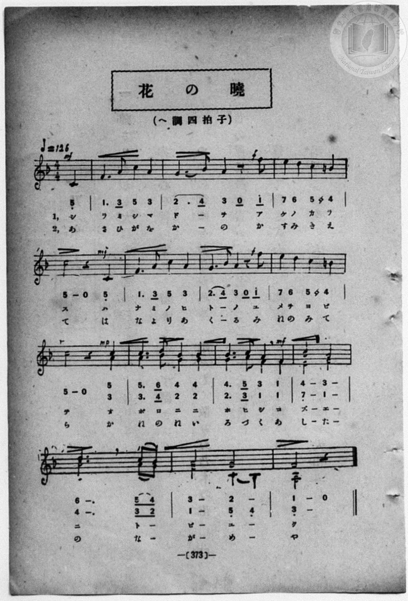

# 花の曉（二部）

> Re:Shōka 使用 AI 協助辨識與重建樂譜，可能會有錯誤。歡迎回報。

<audio controls src="hana_no_akatsuki.mp3"></audio>

- book: 新編 小學校・公學校 唱歌教材集（高等科一・二學年用）
- 一條慎三郎 編《新編 小學校・公學校 唱歌教材集》（大正十二年十二月，索書號 0725-41）

## 說明

> [!NOTE]
> **原書資訊與歌詞全文**（對應 `P381.jpg`–`P382.jpg`，原書 p. 372–373，高等科一・二學年第 18 首）：
> - **調性與拍號**：ヘ調四拍子（F 大調 4/4 拍，弱起一拍），♩ = 126
> - **二部合唱結構**：前兩行（第 1–8 小節第 3 拍）為齊唱，開頭 `mf`，第 2、6 小節末八分音符轉 `f` 並於第 3、7 小節引入 `#4`（B♮4，屬調導音）；自第 8 小節第 4 拍弱起（`mp`）進入二部合唱，第 10 小節第 4 拍轉 `mf`，第 13 小節後半拍低聲部以四分音符下行經過音 `5_ 4_`（C4–B♭3）解決至終止三音 `3_`（A3）。
>
> **一、**
> しらみし窓（まど）を　あけの鴉（からす）
> 花見（はなみ）の人（ひと）の　夢（ゆめ）を呼（よ）びて
> おぼろに映（にほ）ひし　梢（こずゑ）に飛（と）びゆく。
>
> **二、**
> 朝日（あさひ）が岡（をか）の　霞（かすみ）消（き）えて
> 花（はな）よりあくる　峰（みね）のみ寺（てら）
> 鐘（かね）の音（ね）いろづく　早旦（あした）のながめや。


## 歌詞

```text
（TMD 檔案未包含歌詞註解）
```

## ABC

```abc
X:1
T:花の曉（二部）
M:4/4
L:1/16
Q:1/4=126
K:F
V:V1 name="Alto" snm="Alt"
V:V2 name="Soprano" snm="Sop"
[V:V1]
!mf! z4 z4 z4 C4 | F6 A2 c4 A4 | !f! G6 B2 A4 z2 f2 | e4 d4 c4 =B4 |
w: 1.~シ | ラ ミ シ マ | ド _ ヲ ア | ケ ノ カ ラ
w: 2.~あ | さ ひ が を | か _ の か | す み き え
!mf! c8 z4 C4 | F6 A2 c4 A4 | !f! G6 B2 A4 z2 f2 | e4 d4 c4 =B4 |
w: 1.~ス ハ | ナ ミ ノ ヒ | ト _ ノ ユ | メ ヲ ヨ ビ
w: 2.~て は | な よ り あ | く _ る み | ね の み て
!mp! c8 z4 A4 | A6 B2 G4 G4 | !mf! G6 A2 F4 F4 | E8 F8 |
w: 1.~テ オ | ボ ロ ニ ニ | ホ ヒ シ コ | ズ ヱ
w: 2.~ら か | ね の ね い | ろ づ く あ | し た
B12 A2 G2 | F8 C4 B,4 | A,8 z8 | !mf! z4 z4 z4 C4 |
w: 1.~ニ ト _ | ビ ユ _ | ク | シ
w: 2.~の な _ | が め _ | や | あ
F6 A2 c4 A4 | !f! G6 B2 A4 z2 f2 | e4 d4 c4 =B4 | !mf! c8 z4 C4 |
w: 1.~ラ ミ シ マ | ド _ ヲ ア | ケ ノ カ ラ | ス ハ
w: 2.~さ ひ が を | か _ の か | す み き え | て は
F6 A2 c4 A4 | !f! G6 B2 A4 z2 f2 | e4 d4 c4 =B4 | !mp! c8 z4 A4 |
w: 1.~ナ ミ ノ ヒ | ト _ ノ ユ | メ ヲ ヨ ビ | テ オ
w: 2.~な よ り あ | く _ る み | ね の み て | ら か
A6 B2 G4 G4 | !mf! G6 A2 F4 F4 | E8 F8 | B12 A2 G2 |
w: 1.~ボ ロ ニ ニ | ホ ヒ シ コ | ズ ヱ | ニ ト _
w: 2.~ね の ね い | ろ づ く あ | し た | の な _
F8 C4 B,4 | A,8 z8 |
w: 1.~ビ ユ _ | ク
w: 2.~が め _ | や
[V:V2]
!mf! z4 z4 z4 C4 | F6 A2 c4 A4 | !f! G6 B2 A4 z2 f2 | e4 d4 c4 =B4 |
w: 1.~シ | ラ ミ シ マ | ド _ ヲ ア | ケ ノ カ ラ
w: 2.~あ | さ ひ が を | か _ の か | す み き え
!mf! c8 z4 C4 | F6 A2 c4 A4 | !f! G6 B2 A4 z2 f2 | e4 d4 c4 =B4 |
w: 1.~ス ハ | ナ ミ ノ ヒ | ト _ ノ ユ | メ ヲ ヨ ビ
w: 2.~て は | な よ り あ | く _ る み | ね の み て
!mp! c8 z4 c4 | c6 d2 B4 B4 | !mf! B6 c2 A4 F4 | B8 A8 |
w: 1.~テ オ | ボ ロ ニ ニ | ホ ヒ シ コ | ズ ヱ
w: 2.~ら か | ね の ね い | ろ づ く あ | し た
d12 c2 B2 | A8 G8 | F8 z8 | !mf! z4 z4 z4 C4 |
w: 1.~ニ ト _ | ビ ユ | ク | シ
w: 2.~の な _ | が め | や | あ
F6 A2 c4 A4 | !f! G6 B2 A4 z2 f2 | e4 d4 c4 =B4 | !mf! c8 z4 C4 |
w: 1.~ラ ミ シ マ | ド _ ヲ ア | ケ ノ カ ラ | ス ハ
w: 2.~さ ひ が を | か _ の か | す み き え | て は
F6 A2 c4 A4 | !f! G6 B2 A4 z2 f2 | e4 d4 c4 =B4 | !mp! c8 z4 c4 |
w: 1.~ナ ミ ノ ヒ | ト _ ノ ユ | メ ヲ ヨ ビ | テ オ
w: 2.~な よ り あ | く _ る み | ね の み て | ら か
c6 d2 B4 B4 | !mf! B6 c2 A4 F4 | B8 A8 | d12 c2 B2 |
w: 1.~ボ ロ ニ ニ | ホ ヒ シ コ | ズ ヱ | ニ ト _
w: 2.~ね の ね い | ろ づ く あ | し た | の な _
A8 G8 | F8 z8 |
w: 1.~ビ ユ | ク
w: 2.~が め | や
```

## TMD 檔案連結

- [主旋律 TMD 檔案](hana_no_akatsuki.tmd) [[在 TMD Studio 編輯](https://tmdlang.github.io/Tmd-TS/#tmd=s7IKdvYPcrWy4qpTUCpJTLdSSM7PyUlNLsnMz7MqzsjPTozPrsyvSsyML84ojTe0NDJWgqssy88pzU21ys4vyY83jDdCSBTnlxYlp1oVJ2fk5-fEl6RWlCTl52ejy8cXJKanWgUYWxgiZAqK8stS8xLzgLoLijLzSlJTwNoRClLLMlNSQdLFyYl58WWpRZlpmakpSG5KLSoGOx1iRUlRYl5xclFmAcg_CFX5RSUZ-elFiQUZlVYZmcUl-UWZyYk58dmJeYkIRSUZqUDf5SWWlBaloosWpyYWIxsIFQW5OV2JS0tL4UXXxseN657N7ny_p-PJrp6XzSve7-lU0NLiUrRVMDQy47K3VXDjsjHRN7EDmQEKHiuFZ9M2PN--QuHphv6na3c8W7DwcfPup61rIGyFp1M2Plvb82zqzGdzJ7yc3QY09uXqGc_Xdj5fPvHJjgagUqAtQKVPd255PgVkF9htQJlni-Y-a-17sqPzZXOfAtD4xw1dpNjzuKEbaNXTJcufrV38tLcRZMnOLRDGszkd7_f0PN-y6NnsHS9mzlcwMDcy1TUxBNvNpa-lYEstwKWgoGCnEK3o5x_iGgvhaGk97ZsPsndz-4sVXS862oFufrFy3tPWFc-mtWtpgZy8ofdZe6dCAih96WUVpCc8apgM4hiBOUCHQwxQKNBTMDY3AkoamxsDRXEG6po1CoYWCi-XTQP67_2eWRBn6AId8mLV_mcNy0FO6O4FBgPI8lmPm2cAhZ_Ong0Ue7p2AtA5bgrAMASKKQCjXAEoCnLAno0vtm4HRRGICzS059HMlQqQ5AE3HZJ2nk7oAMbL860Tni3vBlvwtLP3aevKFwt7gEaDnQb0gAUoRp-vbwDxjSF2dD5v2vVybxdQL8hr07pfLlirkJCbBvI-SJXR44ZGM6iuZ3NWP21d_bSj7eX8zc_XLHuxFxh2aQkKT3YsezZtD9hIoGJzqOKne6Y-bV2qkKBsAjSqw-nRzHUmIA9tXAPy9YY-oBFgD81-0b4KpBXZZWDfQ7wO1JqQWwA0ofNlwyagech-hbrQ0ABdK9hhCC8YGsOctK_naW8XUMGTvX0vGjcBDXqyeykwBuA-erKjGxhez7dNftkIcqBCgmm8gkk8yP3OJsDQA3piLTABdL5YvvjZxl0v2jc_39r0bO0iUMYBKTYGq3QEqXjc0ASOH1hKBKWUhkZg1gbzHzdOf9zU-bhxP5DxfNVkoKbHjfseN64EaWya9Lih4XFj0-PGicDC4eUWUOHwuLEbrH4mUAHEBGDR8WIZKNc9blz_uHEV0CiQ3sZ1T3btAgtuetwIyuBAEaBpT5csAgk2tT1uaoRY8XTiHrAIMHMC1Wx-3LgM5rCux417Hjf1Pm5c_WzGArBRqx837gYrA5o5HWjas0Vg0xonP26c9bhpIlhq9cvFs8GCEEs3g-xq7McIhF09SIHwbM7cZ9OXgnUBPTsVaD5Yb8_TTQvBbpsE9DXcCy_nzIOGQ-NMiGefbQM6HigCSsGPG4EMqBeAIQMPFrBngUYBPQW0ov9xUzcoNDZvACsABv5aqPmN-5-uh4TbMmA4wwP55YQZMEuhKsGJFigC4baAA2op2KcNz6avfDZ9Gcw70x83zocZDoydHmDIP25qgQYI5aUdFCho6XNxeQArJL98x-zEkuLS7Eyr4PwCYH2W71BjUKNQDbJNwcZCCxwFCtjKWwVINgMWTcCcAkylwOSvoGGoDcsxOgqw4lATi16g9SBzaxQMgOUQDFfnptUqAPONLlDcEEjqAgsaUzAJEjECi5iAeQYK1UClhnFAYXMg1wyIQQpN1EEqwSb7GNYogEyC4cdN28GmPG5eCTbncfN8qNjj5nlQmU6wDEhkE1jX46ZFIPGmjWCxPrApq8FskBlQe4zQ7GlsgpjWOBViVuMmIO4B650ElemG2dO4DmIPUAQkPhMsth9M9oLJDrA9uKMAFPK7esAhb0JauIOCCwRpEe6Pm3ZCTQeHSHM_NHy7ECEPCc1maIg0g_wJkQOJA0OkeRlYfCE8Nh43rwCTk1FCHpjtkG1qXA8N4VUQ05o6gBhkKyJWQG6ByIFiART2-8Hia-HxAYsBkMmEwn5HJ7iSnIVZw1AYIQXACAG7GCJsBgx_UByAREAkKNhB8QGOOVCUwYQhkQaCSNHR3IYcSE2gwAGJzoEG-VogBgUGhATJzIbKTIJlkabNEJmmXfCIAmUKJHtAkdEEy0CQyICaBg5aSODCgrkFahookYP4S6ERg4im6TB7GufD7cEbFcC6GJwNSCx-QCkYBk2BYVgDDz9IskdkCUjMoIcsLCtDwgScXaGJFCICS54g34ISJyx00EIOnPDg5oCTL0gUVGxAEmsjkjmg0EM1pxajLHfMKaGkIAclaXDDbrREH6gSHSkKRov2YVa0Q0IfUtKYgGMBhGHxYQyOKaSi3RyW02El0WjZTkyww2pESJgaIZXk4AxhAskVxrDAHdTFu66dAmoJr4BVRJkLAA)]
- [鋼琴伴奏 TMD 檔案](hana_no_akatsuki_piano.tmd) [[在 TMD Studio 編輯](https://tmdlang.github.io/Tmd-TS/#tmd=s7IKdvYPcrWy4qpTUCpJTLdSSM7PyUlNLsnMz7MqzsjPTozPrsyvSsyML84ojTe0NDJWgqssy88pzU21ys4vyY83jDdCSBTnlxYlp1oVJ2fk5-fEl6RWlCTl52ejy8cXJKanWgUYWxgiZAqK8stS8xLzgLoLijLzSlJTwNoRClLLMlNSQdLFyYl58WWpRZlpmakpSG5KLSoGOx1iRUlRYl5xclFmAcg_CFX5RSUZ-elFiQUZlVYZmcUl-UWZyYk58dmJeYkIRYlFQM3pqbmpeSVWBZmJefnxicnJ-bkFiXmZIDGEwpIMoCKrvMSS0qJUdNHi1MRiZJuhoiDPpStxaWkpvOja-Lhx3bPZne_3dDzZ1fOyecX7PSD2y9kzn3V2v-ze83zClid7tjxd2g8UV9DS4lK0VTA0MuOyt1Vw47Ix0TexA5kNCl8rhWfTNjzfvkLh6Yb-p2t3PFuw8HHz7qetayBshadTNj5b2_Ns6sxncye8nN0GsmL1jOdrO58vn_hkRwNQKdB2oNKnO7c8nwJyA9jNQJlni-Y-a-17sqPzZXOfAtD4xw1dpNjzuKEbaNXTJcufrV38tLcRZMnOLRDGszkd7_f0PN-y6NnsHS9mzlcwMDcy1TUxBNvN5QGMC798x-zEkuLS7Eyr4PwCYGzkO9QY1ChUcykAgY2Flh2YUaNgoKALx9W5abUKpvFAVo2CIZDUVTBWMAWTIBEjsIgJmGegUA1UahgHFDYHcs2AGKTQRB2kEmyyj2GNAsgkGH7ctB1syuPmlWBzHjfPh4o9bp4HlekEy4BENoF1PW5aBBJv2ggW6wObshrMBpkBtccIzZ7GJohpjVMhZjVuAuIesN5JUJlumD2N6yD2AEVA4jPBYvvBZC-Y7ADbAw0qkA9BkBZB9bhpJ9R0sCea-6FB0oUILEgANEM90QxyGkQOJA70RPMysPhCeAA-bl4BJiejBNbjxmXINjWuhwbKKohpTR1ADLIVEZAgt0DkQAEHCq79YPG18CCEBRrIZBzBVQAMLrB5EGEzYOiAQggkAiJBgQIKLXC4ggIUJgwJUhBECqzmNmQvNIGcDhKdAw2QtUAMciqEBMnMhspMgqW5ps0QmaZd8GAEpTIke0BB1QRLkZCggpoG9jjE67BAaIGaBko1IP5SaLAhAnE6zJ7G-XB7oAEFShIwaAr0dg3cy5B0hEhjkMBEDwxYcoZ4A5xkobEOEYHFN8iBoNiGeQjNs-CYhJsDTg8gUVDWgcR-I5I5IA-jmlOLUe445pSMFjqjhc7AFjqQsIFkKBNwGIEwLLSMweGIVOiYwxI0LMMN21IHVrxCgsEIqYwBpzATSDIzhoXHUCp4AkAtziAP8soeQ21QGjLUhiQc83htWL6CCCHlLCNtUN4y1AblLqA6kDazeG2kPAbWTigD09Y-UA4ACwGjEiplAjTASBsU_RASZDAkMYBUQGxFyRFQWZgjEbEHTERgx8CTEVA_yCyg5-AqTSEeMoFQoASljVmX4YhCH5QoNEGKQggE2hOvEG0YC6OA2T8eyDKNB4uA5EFhBxYzilUwglAwp8OVQkyC-JiKxgFDHmoOXAqLgZAEgRAE2wsLXCDXJBZGQTWjmgfVAbYTFIq6dgqoARntA5TGIgp0OVBUmQsA)]

## 分析

```text
================================================================================
📊 TMD Song Profile: [ 花の曉（二部） ]
================================================================================
⏱  Duration:       0:57 (57.1s), 30 measures total
🎼 Key & Tempo:    首調基準 F, != 126.0 BPM, <4/4>
   - 分析範圍：      由實際發聲的音符與和弦推測調性；播放脈絡另行呈現
🎤 人聲音域:    A3 (MIDI 57) – F5 (MIDI 77) [跨度: 20 個半音 / 1.7 個八度, 難度: challenging]
   - 最低音:  A3 in [HanaNoAkatsuki #1 @ m.15, 0:26]
   - 最高音: F5 in [HanaNoAkatsuki #1 @ m.3, 0:05]
   - 適合: soprano, mezzo-soprano, contralto, tenor, baritone, bass
🏛  結構:      HanaNoAkatsuki (28.6s) -> HanaNoAkatsuki (28.6s)
⚡ 編曲密度:        Peak 2 軌道同時演奏
🗝  調性診斷：       F 大調（純淨自然大調，未偵測到可信轉調）
   - 風格氣質:    純淨自然大調（陽光明朗、易唱易記，無明顯調外色彩）
   - 轉調歷程:    全曲維持單一推測調性（未偵測到可信轉調）
   - 核心骨幹音:  C, A, F, A#, G
   - 調性數值:    F 大調 [相關度: 0.88, 穩定度: High, 自然音純度: 96.2%]
   - 候選調性 (K-S): F 大調 (0.88), A 小調 (0.75), C 大調 (0.74)
   - 五度圈歷程:   -1 -> -1
   - 各段落調性細節:
     • [HanaNoAkatsuki #1]: F 大調 (r: 0.88, 自然音純度: 96.2%, 調外音: B)
     • [HanaNoAkatsuki #2]: F 大調 (r: 0.88, 自然音純度: 96.2%, 調外音: B)

  [ 五度圈游移軌跡 ]
               C  
        [F ]*          G  
      Bb               D  
      Eb               A  
         Ab           E  
            Db       B  
               F# 
     (* = active key center)

  [ 十二半音累積音高分佈 ]
     C  : ████████████████████████  23.6%
     C# :                            0.0%
     D  : ███████                    7.2%
     D# :                            0.0%
     E  : ██████                     5.8%
     F  : █████████████████         16.3%
     F# :                            0.0%
     G  : ████████████              11.5%
     G# :                            0.0%
     A  : ████████████████████      19.7%
     A# : ████████████              12.0%
     B  : ████                       3.8%
--------------------------------------------------------------------------------
Assignment 軌道音域：
  - Alto          : A3 – F5 (20 個半音 / 1.7 個八度, 92 個音符)
  - Soprano       : C4 – F5 (17 個半音 / 1.4 個八度, 90 個音符)
================================================================================
```


## 原書掃描頁






