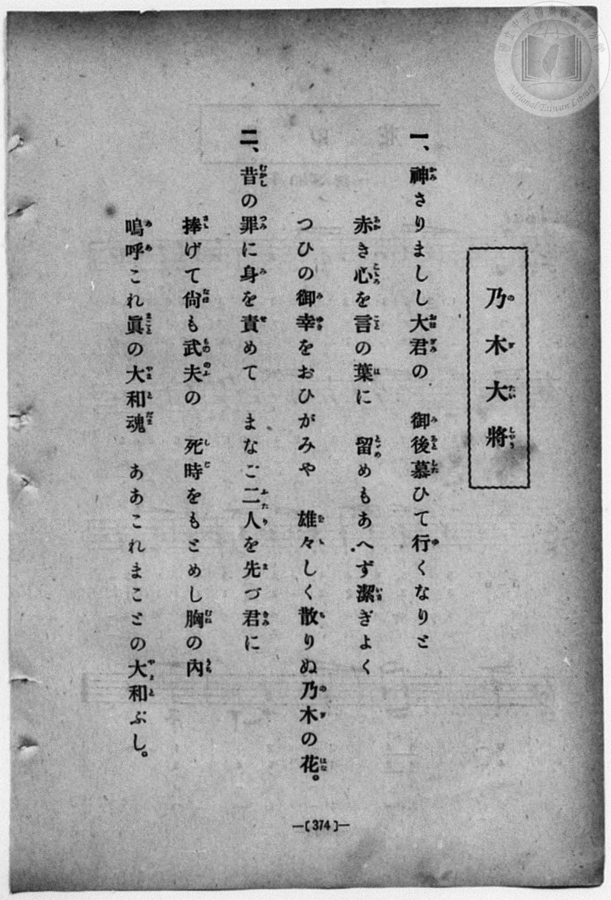
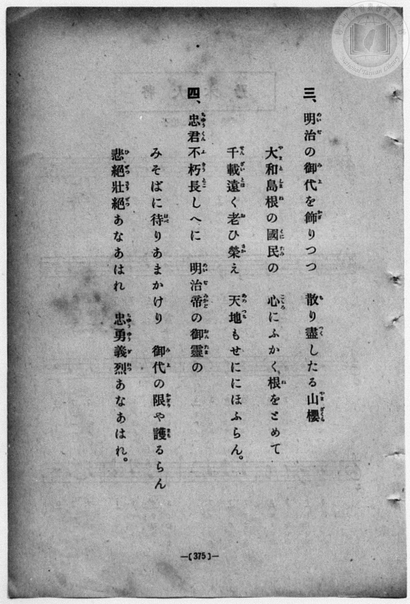
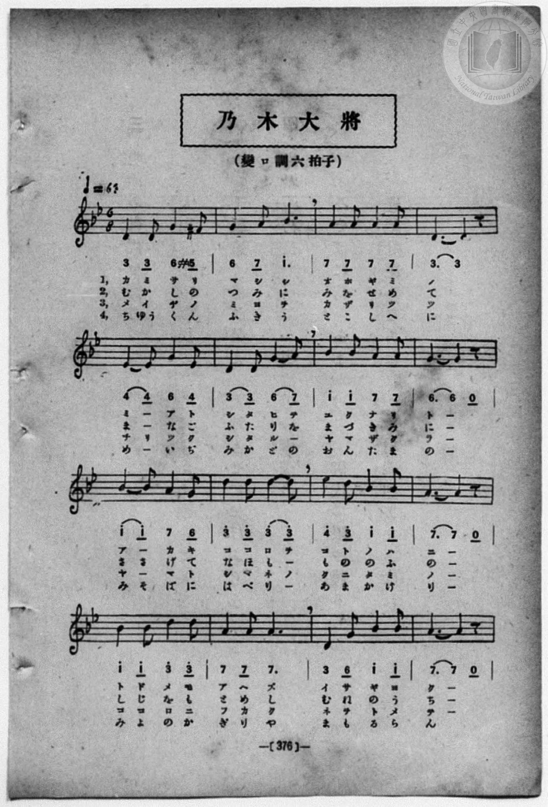
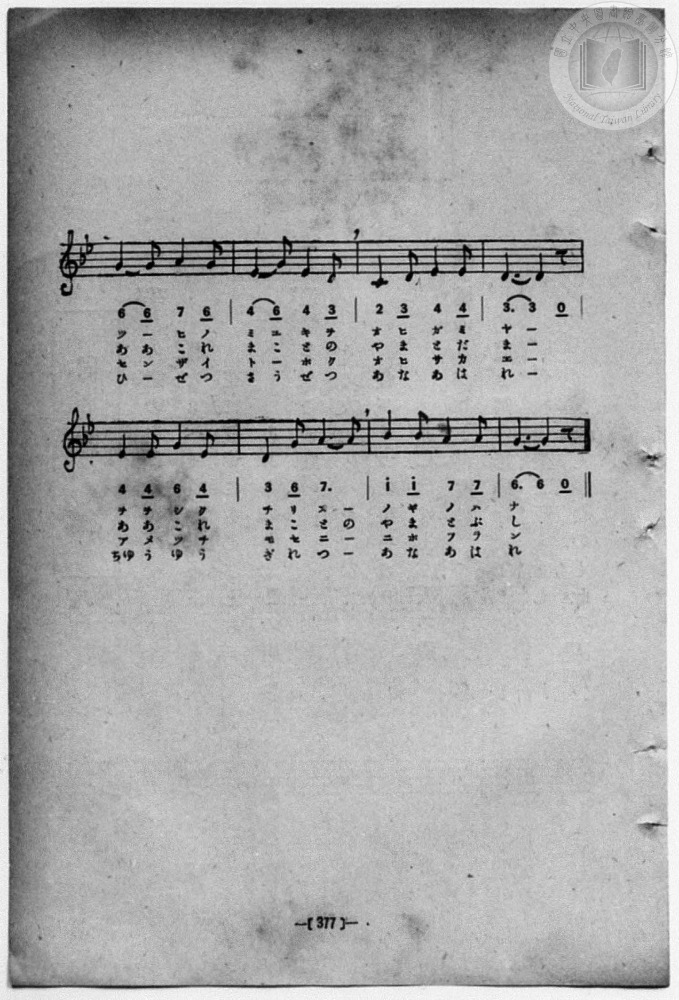

# 乃木大將

> Re:Shōka 使用 AI 協助辨識與重建樂譜，可能會有錯誤。歡迎回報。

- **鋼琴伴奏版**：<br><audio controls src="nogi_taisho.mp3"></audio>
- **NEUTRINO 歌聲合成版**：<br><audio controls src="nogi_taisho_neutrino.mp3"></audio>

- 詞：武島羽衣
- 曲：田中穗積
- book: 新編 小學校・公學校 唱歌教材集（高等科一・二學年用）
- 一條慎三郎 編《新編 小學校・公學校 唱歌教材集》（大正十二年十二月，索書號 0725-41）

## 說明

> [!NOTE]
> **原書資訊與歌詞全文**（對應 `P383.jpg`–`P386.jpg`，原書 p. 374–377，高等科一・二學年第 19 首）：
> - **調性與拍號**：變ロ調六拍子（關係小調 G 小調 6/8 拍，含導音 `#5` 即 F♯4），♩. = 63
> - **詞曲作者與版本辨析**：武島羽衣 作詞、田中穗積 作曲（大正元年發表之〈乃木大將の歌〉，「神さりましし大君の」）。注意本曲與臺灣教育會《新定兒童唱歌》所錄小松耕輔作曲之 E 小調 2/4 拍〈乃木大將〉（「夢より淡き三日月の」）為同名異曲。
> - **音高與字音註記**：原書簡譜以 B♭3 為 `1`，故 B♭4 標為高音點 `1^`；TMD 於 `?= B,` 下以 B♭4 為中音 `1`，故依五線譜實際音高（C4–E♭5）記為 `2_`–`4`。第 22 小節原譜記為 `3 6 7.`，第一、三、四章於附點四分音符 `7.` 唱一字（「ヌー」「ニー」「つー」），第二章則唱二字（「まことの」），轉錄時細分為 `3_ - 6_ 7_ - 7_` 以對齊四章字音。
>
> **一、**
> 神（かみ）さりましし大君（おほぎみ）の　御後慕（みあとした）ひて行（ゆ）くなりと
> 赤（あか）き心（こころ）を言（こと）の葉（は）に　留（とど）めもあへず潔（いさ）ぎよく
> つひの御幸（みゆき）をおひがみや　雄々（をを）しく散（ち）りぬ乃木（のぎ）の花（はな）。
>
> **二、**
> 昔（むかし）の罪（つみ）に身（み）を責（せ）めて　まなご二人（ふたり）を先（ま）づ君（きみ）に
> 捧（ささ）げて尚（なほ）も武夫（もののふ）の　死時（しじ）をもとめし胸（むね）の内（うち）
> 嗚呼（ああ）これ眞（まこと）の大和魂（やまとだま）　ああこれまことの大和（やまと）ぶし。
>
> **三、**
> 明治（めいぢ）の御代（みよ）を飾（かざ）りつつ　散（ち）り盡（つく）したる山櫻（やまざくら）
> 大和島根（やまとしまね）の國民（くにたみ）の　心（こころ）にふかく根（ね）をとめて
> 千載遠（せんざいとほ）く老（お）ひ榮（さか）え　天地（あめつち）もせににほふらん。
>
> **四、**
> 忠君不朽長（ちゆうくんふきうとこ）しへに　明治帝（めいぢみかど）の御靈（おんたま）の
> みそばに侍（はべ）りあまかけり　御代（みよ）の限（かぎり）や護（まも）るらん
> 悲絶壯絶（ひぜつさうぜつ）あなあはれ　忠勇義烈（ちゆうゆうぎれつ）あなあはれ。


## 歌詞

```text
（TMD 檔案未包含歌詞註解）
```

## ABC

```abc
X:1
T:乃木大將
C:曲：田中穗積
M:6/8
L:1/16
Q:3/8=42
K:Gm
V:V1 name="Piano" snm="Pia"
[V:V1]
D4 D2 G4 ^F2 | G4 A2 B6 | A4 A2 A4 A2 | D6 D4 z2 |
w: 1.~カ ミ サ リ | マ シ シ | オ ホ ギ ミ | ノ _
w: 2.~む か し の | つ み に | み を せ め | て _
w: 3.~メ イ ヂ ノ | ミ ヨ ヲ | カ ザ リ ツ | ツ _
w: 4.~ち ゆう く ん | ふ き う | と こ し へ | に _
E4 E2 G4 E2 | D4 D2 G4 A2 | B4 B2 A4 A2 | G6 G4 z2 |
w: 1.~ミ _ ア ト | シ タ ヒ テ | ユ ク ナ リ | ト _
w: 2.~ま _ な ご | ふ た り を | ま づ き み | に _
w: 3.~チ _ リ ツ | ク シ タ ル | ヤ マ ザ ク | ラ _
w: 4.~め _ い ぢ | み か ど の | お ん た ま | の _
B4 B2 A4 G2 | d4 d2 d4 d2 | e4 d2 B4 B2 | A6 A4 z2 |
w: 1.~ア _ カ キ | コ コ ロ ヲ | コ ト ノ ハ | ニ _
w: 2.~さ さ げ て | な ほ も _ | も の の ふ | の _
w: 3.~ヤ _ マ ト | シ マ ネ ノ | ク ニ タ ミ | ノ _
w: 4.~み そ ば に | は べ り _ | あ ま か け | り _
B4 B2 d4 d2 | A4 A2 A6 | D4 G2 B4 B2 | A6 A4 z2 |
w: 1.~ト ド メ モ | ア ヘ ズ | イ サ ギ ヨ | ク _
w: 2.~し じ を も | と め し | む ね の う | ち _
w: 3.~コ コ ロ ニ | フ カ ク | ネ ヲ ト メ | テ _
w: 4.~み よ の か | ぎ り や | ま も る ら | ん _
G4 G2 A4 G2 | E4 G2 E4 D2 | C4 D2 E4 E2 | D6 D4 z2 |
w: 1.~ツ _ ヒ ノ | ミ ユ キ ヲ | オ ヒ ガ ミ | ヤ _
w: 2.~あ あ こ れ | ま こ と の | や ま と だ | ま _
w: 3.~セ ン ザ イ | ト _ ホ ク | オ ヒ サ カ | エ _
w: 4.~ひ _ ぜ つ | さ う ぜ つ | あ な あ は | れ _
E4 E2 G4 E2 | D4 G2 A4 A2 | B4 B2 A4 A2 | G6 G4 z2 |
w: 1.~ヲ ヲ シ ク | チ リ ヌ _ | ノ ギ ノ ハ | ナ _
w: 2.~あ あ こ れ | ま こ と の | や ま と ぶ | し _
w: 3.~ア メ ツ チ | モ セ ニ _ | ニ ホ フ ラ | ン _
w: 4.~ちゆ う ゆ う | ぎ れ つ _ | あ な あ は | れ _
D4 D2 G4 ^F2 | G4 A2 B6 | A4 A2 A4 A2 | D6 D4 z2 |
w: 1.~カ ミ サ リ | マ シ シ | オ ホ ギ ミ | ノ _
w: 2.~む か し の | つ み に | み を せ め | て _
w: 3.~メ イ ヂ ノ | ミ ヨ ヲ | カ ザ リ ツ | ツ _
w: 4.~ち ゆう く ん | ふ き う | と こ し へ | に _
E4 E2 G4 E2 | D4 D2 G4 A2 | B4 B2 A4 A2 | G6 G4 z2 |
w: 1.~ミ _ ア ト | シ タ ヒ テ | ユ ク ナ リ | ト _
w: 2.~ま _ な ご | ふ た り を | ま づ き み | に _
w: 3.~チ _ リ ツ | ク シ タ ル | ヤ マ ザ ク | ラ _
w: 4.~め _ い ぢ | み か ど の | お ん た ま | の _
B4 B2 A4 G2 | d4 d2 d4 d2 | e4 d2 B4 B2 | A6 A4 z2 |
w: 1.~ア _ カ キ | コ コ ロ ヲ | コ ト ノ ハ | ニ _
w: 2.~さ さ げ て | な ほ も _ | も の の ふ | の _
w: 3.~ヤ _ マ ト | シ マ ネ ノ | ク ニ タ ミ | ノ _
w: 4.~み そ ば に | は べ り _ | あ ま か け | り _
B4 B2 d4 d2 | A4 A2 A6 | D4 G2 B4 B2 | A6 A4 z2 |
w: 1.~ト ド メ モ | ア ヘ ズ | イ サ ギ ヨ | ク _
w: 2.~し じ を も | と め し | む ね の う | ち _
w: 3.~コ コ ロ ニ | フ カ ク | ネ ヲ ト メ | テ _
w: 4.~み よ の か | ぎ り や | ま も る ら | ん _
G4 G2 A4 G2 | E4 G2 E4 D2 | C4 D2 E4 E2 | D6 D4 z2 |
w: 1.~ツ _ ヒ ノ | ミ ユ キ ヲ | オ ヒ ガ ミ | ヤ _
w: 2.~あ あ こ れ | ま こ と の | や ま と だ | ま _
w: 3.~セ ン ザ イ | ト _ ホ ク | オ ヒ サ カ | エ _
w: 4.~ひ _ ぜ つ | さ う ぜ つ | あ な あ は | れ _
E4 E2 G4 E2 | D4 G2 A4 A2 | B4 B2 A4 A2 | G6 G4 z2 |
w: 1.~ヲ ヲ シ ク | チ リ ヌ _ | ノ ギ ノ ハ | ナ _
w: 2.~あ あ こ れ | ま こ と の | や ま と ぶ | し _
w: 3.~ア メ ツ チ | モ セ ニ _ | ニ ホ フ ラ | ン _
w: 4.~ちゆ う ゆ う | ぎ れ つ _ | あ な あ は | れ _
```

## TMD 檔案連結

- [主旋律 TMD 檔案](nogi_taisho.tmd) [[在 TMD Studio 編輯](https://tmdlang.github.io/Tmd-TS/#tmd=s7IKdvYPcrWy4qpTUCpJTLdSSM7PyUlNLsnMz7MqzsjPTozPrsyvSsyML84ojTe0NDJWgqssy88pzU21ys4vyY83jDdCSBTnlxYlp1oVJ2fk5-fEl6RWlCTl52ejy8cXJKanWgUYWyAZWVCUX5aal5gH1F1QlJlXkpoC1o5QkFqWmZIKki5OTsyLL0stykzLTE1BclNqUTHY6RArSooS84qTizILQP5BqMovKsnITy9KLMiotMrILC7JL8pMTsyJz07MS0QoKslIBfouNzMnsySxqBJdHKINQzg3NRdoWGIOsl2Z6Zl5QInMrEyksNDSUniys_nZnBVPlyx_uqFdQUuLS9FWwcyYy95WwUmHKzu10lbBPZfLxkzfwg5kFkiXlcKzaRueb1-h8HRD_9O1O54tWPi4effT1jUQtsLTKRufre15NnXms7kTXs5ue7-n4-XqGc_Xdj5fPvHJjgag0ie7eoBKn-7c8nzKivd7OsFuBMo8WzT3WWvfkx2dL5v7FIDGP27oIsWexw3dQKuA3ni2dvHT3kaQJTu3QBjP5nS839PzfMuiZ7N3vJg5X8HA3MhU18QQZveLlfPe75n1bO2yp5u3Pd-398XCxWDhZ7M3AYWfT9nwZMfa5yunP1_Zq8TFpa-lYEstwKWgoGCnEK3o5x_iGgvhaGk97ZsPcuXm9hcrul50tAN9CHTe09YVz6a1a2mBPLih91l7p0ICKMHqZRWkJzxqmAzimIE5QG9CDFAo0FMwNjcBShqbmwNFcUbBmjUKhpYKL5dNA4YG0LsQZ-gCHfJi1f5nDctBTujuBQYayPJZL9Z1PW5eC5R52roWKPx07QRQ7E6f82R_EzCOgOIK7qDIAjGACUYBqATkoAmrn27oezl_s0KCsmmCwtPezQpuj2auNwFb2PNo5ko9BXCKQ9i8ch4w7J_snfOioRVo__POjmdz1rzYt-LZvAlgVyDHlAJI2cp5jxsakSMKJAqOPlh6aG0G-XXmnhcLVzzZ2f24oQM50T9uXAcM5scNIOc8buh5vnTe48apj5u6Hjfue9w4HYhAyibMBip73AD0UOfjhqZnm1c8a-kHOgtoC9CJL9p3PW9cDEyKL5o2PZvTDEm5T9fNeto66fnqpZCECkyfzzobXva0AAPo2dx9LxqmvtgzBeJOoJMUXGEBZ6RvAgo4dDeCXNcBdN3TJYseN3UAXfds-8LHjb3A7PJs-lJgAoe77nnTrqcTgIHe-3zqBqDZQMciQhYYCcCEAHTw07XTgewXK3a_WDEDHKaQVPN8w8IXa-c82b1UwenRzLXGCkCzFBIMQanq2dRWsBjQbStmAoWBxoAM2z0PKB8HVDA7xNcFWCzsUUgAFxwJCk92dMPMMQGZA4wbcBKAmfZk39wnu6Y83z4LaOHT9ctezpoNcRzQl86gZOsK1GgK9A7QgWBXGMWDU7pJAtBDoERrZAQKsOfrG4AuBxoBU2asYKZgrgeyA6gIlNYbGoFBBCSfzp79fPUCoAtfzmwBOhvIfdrRBrTy-ZplCglAHaDiBKgeGDCQcH7cDER7gEEKZncj2I1LIGxI8gXZsqsHaPLTznaQCaB8BTMBlHwmP25cAY8aoPoXezuBSeDZzKbnWzYAHQBxczwwcsziFcxBtHk8MOx2LwVm85d7uyCOhkQWLCJhBQXEc8DyGswHJlqQrY3djxv3g5IotgQMVgAU3P24sQ-mDOiyhqf7Fj7d1_OsdSpYwf7HjU1gRwM1zger2fS4cdmLhT0g2SZgcQ4U6X_cuAps_gqI7S-2LgHrBWoEFsJABb1P9zeDRYD-n_y4CZxrmia9WNEAEwQV_EDbX0wEJ-vG9WDuaqBjnk-dCRYBOmAlWFfj4yagsUC043HjrGd7p4BlW4AeBGvpA2WGxn6IM0BxA3LtOpCPdu6AeqepDegeiAPA3gcqAMYNULwFaN3L2UCyFey1SUAENhPo8f5nUxeDtS8EawTqWgPJjWDBdUB7oe7v2ghxPzBAICUDahztAmZ7eBw9mwF2fFMDOJqAqQRkwvO9QI1AE4Auh8TI6he7VkNcDg20TWvAXGD0gUOjcRnQ2eCYXfW4cQrQhie7doEVbAXGF9CpEF1PW4FVHlBwH9jMpbDY74XbAnVS73Kw-FRYeAKDaNnTDbPAgkDzd4NNawKVuEvArgLFBdD7QLQVnn6erd0NTNBgLcCgA-ZgcFCDVK4AO3j6i2ZwXIA8vhai62kbOMwbgVEDCmGIY55On_V04h5YQgIaCFQJTDw9z-dA0jY0O0FNACbpST0v14LtBUYlSBaYZhZAvQwKIkiyAZmAnBUhGpF1gQ3cBnI8RhYDlRyI6Ot7tgkYIECNQE8B9S6CumTfwie7IakFmKiAwQ7y_svFQGdA8iOoZgUnIWAULwEFF2rSej4byIAkgH5Y8gPGY_fTjRufrYZYB3HnNFC-awLmF1hwgT0CrAmfLdiJGghAE4AMWFDP6X62YSLYCmC2XQ0yHDnvY-ZTkBpgWgK6vB9qMsQoUPaBROgyqAN6m1_s6XzZuACSPh83AQ0BOhLoDKAbwCmnsf9FQyOk2IGUJM-WrYOlN0hBASwoG54uWfl0zgZovIPMBwYFJHCA0QesdoHuASJgqbUV6H2QLWjRBCwlkaLp6f4FwNT-ZEfvszl7X07dDglqcCEARMAABDoS6DtgRgByge6cDAtzYPECKn8gsfx0x1zkiAaXisAAAZdI4Bh_OReSv7rABgKDFJLR1sEKIqD6uY8bNwDNfLIPGKqQIgIYmJCUAPQXMIKABk4EccElMHoSalz3ciaodQVWBizlIPm65cVaiI_2AQMHLNINCRNoEm3a9HzrtqeL1wNJsDJgWTcHHJ7AAAf6F8QGGw50ADB3A8n1oNwBSgYLnna3P9-38nkzxF-wEIOGG9ABoJoPm15wXFDeGIYCBS19Li6__PTMkMRMYL_PKiAzMS_focagphpkjYKNhRY42hWwtcMVIFU-sKpS0DCBtg50FIBtY1NQ21gTiwagZSDDahTAVTCQANbCugqm6vFAITATWCUbAildIB9aO8NpqCawNl0FA4UasFE-hjUKj5tWA0UeN88HsraCWauAqh83zwOxm7aDMcTMx02rwPKzgax1UD0glX1geRAE2gMx1wikugGkprEbiKeDWetAqhuXgNn7gRhkL9hcIA9k1yQgazaY1QgWXYZprjHIvoVgNUuArCawK_rArpgPZq8A4k1w94J91rQN7CeQbAtYZQumuSYg-yDmgpIQkNMP5kwGOwQcLI29QNwGd_IKsNhkuOd2gEUhXoIZjT_ud_WQE_cmoPgDEuAIB9JoqQEc1aBEYIgU9WAZcKMNLerBgQby5yJw8HSAAw0U3Y-bgBHUPAks2gYONFBkPG5aD2R1ISWSDuxR37gPYm4jONgbpyCFIiiZgU0ARjdMJbDKB4cvJGFghiMi6hsh5iJHJ9BNsIQKTkbNq8EuAyczYCIGRT_E5SDRldijHpjgIO4FJQ1gCYpIlODkC9IFS74Qt4PiHZzggO4HiYKyA7HxvqOTnHhHilNgPAJjHRTpUBKYKsA0RA0084PjHj2rg-IZ5H5IxlgLDr_NYPZmYOisBYfZJoQoMH4h2ftxcz84_LpxxPdUcFhMBWJwmgFmXZAoJPZ3A00DZVRIlgRnWWB4QcIMlCowww8R36BYhMQjWvoExWwzOMVAsj8kFQDdB0sFOIsmcFaHxO1cIN4AZoHTTCPYjMad0BQKyecQ9-4DpwQQayLYNog8UfENrO_Jj29Y_KIU5yCHwXphBKMcnEUfN3fCys1mcOKGZvgZQNYueNSAswywDoCV7ivgAYstyiHFHsgEcJQDIxZeLAKzE0QeYi6kHlgLj3JwgQIubbFEOUZy7AZHJDiBAZMtzD0gMUj0b4L7cSFYFFJE44jyJmCChroCbG4jOHEDoxPYWIFHObhIAvoH2FwBszrBvphMfJQDhwowoxw85IU3ysHlM6xnDc7k4MIeyALTwCivUTCCsmDVAJ56HVrPwYpx5FpyGTjzIzI7pDgF1r9Na8AsSOaBZD7MmIdkCWD4AKs_UPj0IBXkoIIRUjWCi0twqEKyD0R0AVwttrjfDbYdGPfQQnsJUiUDaneAxMAFOZKLwdUKMGWAREF2YIt7SIsA2KIEk2BToUUWqKpHFoX4bRWcBbGth_i4B441khP3OKp1xDgLSdU6yL_gnAGtzCGVH6iSA1WdwMEisEZYAQnK76jFPGrxRp2Y3wZWCykVMGMeUh4thKZakFtB7gCLAlMFrOKBVUHgNiikTABW6SBRUKmBLeZBPQNYRMNZiIzfA4541LIef-TXcnHp2ikg2vwKGDxlLgA)]
- [鋼琴伴奏 TMD 檔案](nogi_taisho_piano.tmd) [[在 TMD Studio 編輯](https://tmdlang.github.io/Tmd-TS/#tmd=s7IKdvYPcrWy4qpTUCpJTLdSSM7PyUlNLsnMz7MqzsjPTozPrsyvSsyML84ojTe0NDJWgqssy88pzU21ys4vyY83jDdCSBTnlxYlp1oVJ2fk5-fEl6RWlCTl52ejy8cXJKanWgUYWyAZWVCUX5aal5gH1F1QlJlXkpoC1o5QkFqWmZIKki5OTsyLL0stykzLTE1BclNqUTHY6RArSooS84qTizILQP5BqMovKsnITy9KLMiotMrILC7JL8pMTsyJz07MS0QoSiwCak5PzU3NK7EqyEzMy49PTE7Ozy1IzMsEiSEUlmQAFVnlZuZkliQWVaKLQ8zHEM5NzQXampijxKWlpfBkZ_OzOSueLln-dEP7-z0dL2fPfNbZ_bJ7z_MJW57s2fJ0af_7PZ0KWlpcirYKZsZc9rYKTjpc2amVtgruuVw2ZvoWdiDDQWFspfBs2obn21coPN3Q_3TtjmcLFj5u3v20dQ2ErfB0ysZna3ueTZ35bO6El7PbQFatnvF8befz5ROf7GgAKn2yqweo9OnOLc-nrADaCXY0UObZornPWvue7Oh82dynADT-cUMXKfY8bugGWgX03rO1i5_2NoIs2bkFwng2p-P9np7nWxY9m73jxcz5CgbmRqa6JoYwu1-snPd-z6xna5c93bzt-b69LxYuBgs_m70JKPx8yoYnO9Y-Xzn9-cpeJS4uv_z0zJDETGCitQoARVeQh0ONQU01lwIQ2Fho2YEZ-loKtuhA4fmaNUBPvljYo6BhAvLR8_UNOgrAhGmql1WQrolFg5Y-2LAaBeN4BV0QYQaiTdXjgUJgpnm8giGQ0gXygUwwH0ZDNYG16SoYKNSAjfIxrFF43LQaKPK4eT6QtRXMWgVU_bh5HojdtB2MIWY-bloFlp8NZK2D6gGp7APLgyDQHoi5RiDVDSA1jd1APB3MWgdS3bgEzN4PxCB7weYCeSC7JgFZs8GsRrDoMkxzjUH2LQSrWQJkNYFd0Qd2xXwwewUQb4K7F-yzpm1gP4FkW8AqWzDNNQHZBzG37XFjG5DTD-ZMBjsEHCyNvUDcBnfyCrDYZLjndoBFIV6CGY0_7nf1kBP3JqD4AxLgCAfSaKkBHNWgRGCIFPVgGV0IhRL14EAD-XMROHg6wIEGiu7HTcAIap4EFm0DBxooMh43rQeyupASSQf2qG_cBzG3ERzsjVOQQhGUzMAmAKMbpvJx41Jw-EISBmY4IqK-EWIucnQC3QRLqOBk1Lwa7DJwMgMmYlD0Q1wOEl2JPeqBCQ7iXlDSeNy4CJEowckXpAuWfCFuB8U7OMEB3Q8SBWUHYuN9Ryc58Y4Up8B4BMY6KNKhJDBVgGmIGmjmB8c9elYHxTPI_ZCMsRYcfpvB7M3A0FkLDrNNCFFg_EKy9-PmfnD4deOI76ngsJgKxOA0A8y6IFFI7O8GmgbKqJAsCc6ywPCChBkoVWCGHyK-QbEIiUe09AmK2WZwioFkf0gqALoPlgpwFk3grA6J27lAvAHMAqeZRrAZjTuhKRSSzyHu3QdOCSDWRLBtEHmi4vvp7NnkxzcsflGKc5DDwJkemBAIRjk4iz5u7oSVm83gxA3N8DOArF3wqAFnGWAdACvdV8ADFluUQ4o9kAngKAdGLLxYBGYniDzEXEg9sBYe5eACBVzaYolyjOTYDY5IcAIDJluYe0BikOjfBPfjQrAopIjGEeVNwAQNdQXY3EZw4gZG5-MmSK0AL5KA_nncBI7ypk6wLyYTH-VPdk3BjHIzglEOLp-BBCKTgwt7IAtMA6O8RsEIyoJVA3jqdWg9ByvGkWvJZeDMj8jskOIUWP82rQGzIJkHkvkwYx6SJYDhA6z-QOHTg1SQgwpGSNUILi7BoQrJPhDRBXC12OJ-N9h2YNxDC-0lSJUMqN0BEgMX5EguBlcrwJQBEgXZgS3uIS2Cx41zwCTYVGiRBarqkUUhflsFZ0Fs6yE-7p-2riUn7nFU67DUQGK1DvIvOGdAK3NI5Qeq5EBV5-NmiH9gBSQov6MW86jFG3VifhtYLaRUwIx5SHm0EJpqQW4FuQMsCkwVsIoHVgWB26CQMgFYpYNEQaUGtphfCGzQwSIazkJk_B5wxKOW9fgjvxazye-DrckPih5QxESbxefGorDxyRhDeMYgHjIbmwwsykGFAljOCCSHzCbKJiSLsOtA2IPbNEMwxzAWwQAlaTDbBGgsAaux24BkFPGOJdEOVE24wxG3DB6LiIsWnB4iIlqAiVHXTgGRHqN9gMGFJmKEIWKMIWICFlHmAgA)]

## 分析

```text
================================================================================
📊 TMD Song Profile: [ 乃木大將 ]
================================================================================
⏱  Duration:       2:17 (137.1s), 48 measures total
🎼 Key & Tempo:    首調基準 B,, != 63.0 BPM, <6/8>
   - 分析範圍：      由實際發聲的音符與和弦推測調性；播放脈絡另行呈現
🎤 人聲音域:    C4 (MIDI 60) – D#5 (MIDI 75) [跨度: 15 個半音 / 1.2 個八度, 難度: moderate]
   - 最低音:  C4 in [NogiTaisho #1 @ m.19, 0:51]
   - 最高音: D#5 in [NogiTaisho #1 @ m.11, 0:28]
   - 適合: soprano, mezzo-soprano, contralto, tenor, baritone, bass
🏛  結構:      NogiTaisho (68.6s) -> NogiTaisho (68.6s)
⚡ 編曲密度:        Peak 1 軌道同時演奏
🗝  調性診斷：       G 小調（純淨自然小調，未偵測到可信轉調）
   - 風格氣質:    純淨自然小調（陰鬱抒情、旋律集中，無明顯調外色彩）
   - 轉調歷程:    全曲維持單一推測調性（未偵測到可信轉調）
   - 核心骨幹音:  A, D, G, A#, D#
   - 調性數值:    G 小調 [相關度: 0.72, 穩定度: Moderate, 自然音純度: 99.3%]
   - 候選調性 (K-S): G 小調 (0.72), D 大調 (0.60), D 小調 (0.54)
   - 五度圈歷程:   +1 -> +1
   - 各段落調性細節:
     • [NogiTaisho #1]: G 小調 (r: 0.72, 自然音純度: 99.3%, 調外音: F#)
     • [NogiTaisho #2]: G 小調 (r: 0.72, 自然音純度: 99.3%, 調外音: F#)

  [ 五度圈游移軌跡 ]
               C  
         F           [G ]*
      Bb               D  
      Eb               A  
         Ab           E  
            Db       B  
               F# 
     (* = active key center)

  [ 十二半音累積音高分佈 ]
     C  : █                          1.4%
     C# :                            0.0%
     D  : █████████████████████     23.2%
     D# : ███████████               12.3%
     E  :                            0.0%
     F  :                            0.0%
     F# : █                          0.7%
     G  : ██████████████████        20.3%
     G# :                            0.0%
     A  : ████████████████████████  26.8%
     A# : ██████████████            15.2%
     B  :                            0.0%
--------------------------------------------------------------------------------
Assignment 軌道音域：
  - Piano         : C4 – D#5 (15 個半音 / 1.2 個八度, 164 個音符)
================================================================================
```


## 原書掃描頁










