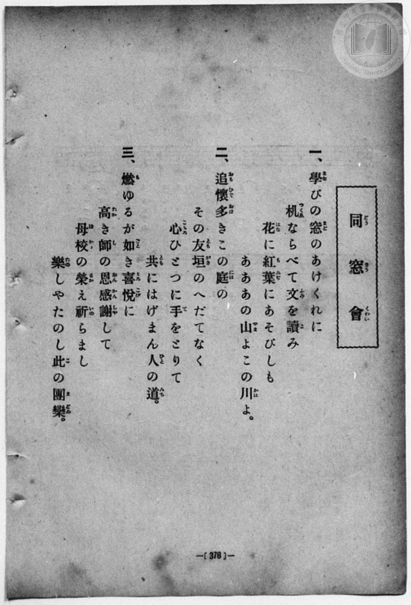
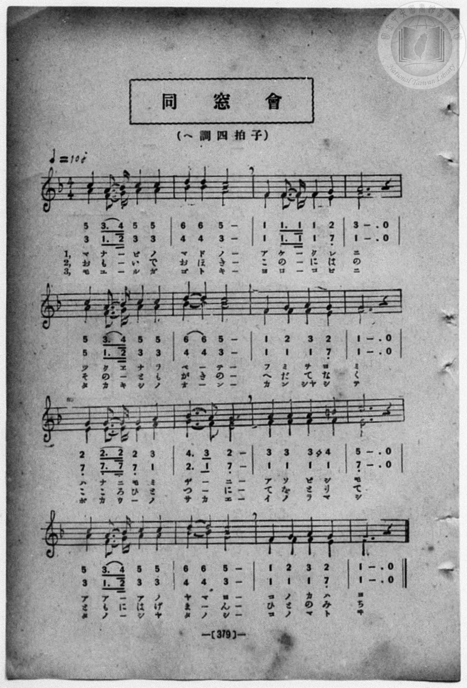

# 同窓會（二部）

> Re:Shōka 使用 AI 協助辨識與重建樂譜，可能會有錯誤。歡迎回報。

<audio controls src="dosokai.mp3"></audio>

- 詞：旗野士良
- 曲：モツアルト（獨）（Wolfgang Amadeus Mozart）
- 一條慎三郎 編《新編 小學校・公學校 唱歌教材集》（大正十二年十二月，索書號 0725-41）
- 臺灣教育會公認《新定兒童唱歌》高等科男子用（2020.006.0848）

## 說明

原書資訊與歌詞全文（對應 P104.jpg，書頁 p. 27，高二第二學期第 9 首）：
調性與拍號：ヘ長調（F Major，1 降記號）、4/4 拍（快活ニ ♩=104，弱起後半小節進入）
出處註記：（松邑三松堂發行檢定唱歌集）


## 跨冊／重複收錄參照

> 同曲＋同名異曲（《新定兒童唱歌》、《新編 小學校・公學校 唱歌教材集》、《楊金土手抄唱歌帖》跨冊對照曲目）

- **[同曲]** 《新定兒童唱歌》高等科男子用（2020.006.0848）：[**〈同窓會〉**](../../../shintei_jido_shoka/koto_boys_2020.006.0848/2_2_09_dosokai/index.md)（`F` / `4/4` — [原始 TMD](../../../shintei_jido_shoka/koto_boys_2020.006.0848/2_2_09_dosokai/dosokai.tmd)）
- **[同名異曲]** 楊金土手抄《唱歌帖》第 2 冊・II（2020.006.0843）：[**〈同窓會（二部合唱）〉**](../../../shokacho/vol_02/p088_dosokai/index.md)（`F` / `4/4` — [原始 TMD](../../../shokacho/vol_02/p088_dosokai/dosokai.tmd)）
- 總表：[跨冊重複與同名歌曲總索引](../../../duplicate_songs.md)

## 歌詞

```text
一
窓の戶の曙に、同じ花護りし友、
其花の露だにも、背きたる心はなく、
のどかなる風の共、お互にかをらひ來し
「年頃の親しさ重ねる、圓居なれ今日こそは。」復唱

二
學校の夕暮に、同じ月眺めし友、
其月の影だにも　違ひたる思はなく、
清らなる光着て、共々に照合來し、
「年頃の親しさ重ねる、圓居なれ今日こそは。」復唱
```

## ABC

```abc
X:1
T:同窓會（二部）
C:曲：モツアルト（獨）（Wolfgang Amadeus Mozart）
M:4/4
L:1/16
Q:1/4=104
K:F
V:V1 name="Piano" snm="Pia"
[V:V1]
!mf! z4 z4 z2 C2 C2 C2 | F4 F4 G2 A2 B2 G2 | A8 z2 A2 B2 c2 | d4 f4 c2 A2 B2 G2 |
A2 F2 C4 z2 C2 D2 E,2 | F6 G2 A2 B2 c2 d2 | c4 G4 z2 G2 A2 B2 | A4 F4 B2 A2 G2 F2 |
!p! G4 F4 z2 A2 A2 A2 | c4 B4 G2 A2 B2 G2 | F8 z2 G2 G2 G2 | B4 A4 F2 G2 A2 F2 |
!f! A2 G2 G4 z2 c2 c2 c2 | D2 E,2 F2 G2 A2 B2 c2 d2 | c3 B A4 z2 d2 d2 d2 | c4 F4 B2 A2 G2 A2 |
!f! F8 z2 c2 c2 c2 | D2 E,2 F2 G2 A2 B2 c2 d2 | c3 B A4 z2 d2 d2 d2 | c4 F4 B2 A2 G2 A2 |
F8 z4 z4 |
```

## TMD 檔案連結

- [主旋律 TMD 檔案](dosokai.tmd) [[在 TMD Studio 編輯](https://tmdlang.github.io/Tmd-TS/#tmd=s7IKdvYPcrWy4qpTUCpJTLdSSM7PyUlNLsnMz7MqzsjPTozPrsyvSsyML84ojTe0NDJWgqssy88pzU21ys4vyY83jDdCSBTnlxYlp1oVJ2fk5-fEl6RWlCTl52ejy8cXJKanWgUYW5gjZAqK8stS8xLzgLoLijLzSlJTwNoRClLLMlNSQdKpKZkl-UWZiTlI7kktKgY7G2J8SVFiXnFyUWYByC8IVSUZqUBHQ92Wk5mWii6VVpSZmpdSnJFZoMSlpaXwdELP81WTn81pfr-n48munpfNK97v6VTQ0uJStFUwNDDhsrdVcOOyMdE3sQOZ82RHw7NFc5-19j3Z0fmyuU_h-fYVjxu6nk3bAGQoPN3Q_3TtjmcLFj5u3v20dQ2ErfB0ysZna3ueTZ35bO6El7PbHjd0A216umT5s7WLn_Y2Aq18unMLhPFsTsf7PT3Ptyx6NnvHi5nzFQzMjUx1TQyB7gH74cXKee_3zHo2ffrL9r6ni1e_6FwPFn42exNQ-HHzosfNLY-bgOTqx81Aczqe94J8AmSE5-ekpSfmpSs45iampJYWK_gCI7yoBG5s-67njYuB7nvRtAkYDECHv1jVC_HU03WznrZOer56KcQPQKe_XD3j-drO58snPp-y_enaCc-nAO3oMDIwMtAzMDDTM7AwsQAby6WvpWBLLcCloKDwtG8-KFA2t79Y0fWiox3oGGBoPG1d8WxaOyg0N_Q-a-9UCADGl15WQTowEIGKXy5oVCjQUzAyB3KBzgaG7_M1a0DBDYyWOfOBbAVLhZfLpoHDaBbIjher9j9rWA4yvbsXGPzgQJ3xcup2oDjQDjcF38Ss_CKgYYYKL2f2vlgxA6ym83FDIzBxKAD1gByyf_WzLbsfN3crPJq50hboHKDyp3s2vti6_em-nqe9XcAU8nx9w8uGTU9blwL1gn3WvuvFzKkvVuwGmgi0EmjIs7n7XjZNBCYwIOPpgqbnM_e8WNjzbNUiUGyA4wGYikCaQbqB6RFEAVPw48Z1zzq2gcjZMx83rgY6C5iyHzfOeNG18cXa7Y-buh43Tn_a3w0UB9vaug0oAVT9cs6mx40LQBqamoByL5qBenofN85_3NT9dH_z48b1jxtXPW7sh2oDanjcuPJxYzdItKn75aIVQJGnrRuB0o8bu57smgQyCCjbNOlxU-fjxk1P9rUBrQXrbACl85cLgEaue7EMaOT0x41TX7YDrVoLNAjk2jmTn25sBZvb82R317PpSx83Aj01F-SEBqDTep_uWwn0PsTXu3rAnoBkNqALlkx9NgvoMoSvgVnp-Zxdj5uAzkL1NVACpGEv0O9wXze8bJwKdCzE188awFYi-_rZjlawd0Beftra-Xxuw-PGZSCrQB4HOnn189blTyd0QDwLCylq-RdoFuVZCAoUtPS5uMKAxSiwXM5MzMt3qDGoUagGWaFgY2imZQdmAbMuNMmCEysoVXf2KhiBUjgwBT_ZM_HZ2kXAZP24eZ7C4-ZOIO4DpsLOpw3AoFn9tKPt5fzNz9csgydxkJUgU2sUDBR0wRCZrs5Nq1UwjQeyEEQNOIpBzgDl1x0NwMQPdIMxqHQFOwduJFAFsKQDOwBY7gHxRiB7DphfAyS7gSKrgHQXkN4BFumH8MAOB6pvBso2bUc40BDqMBhtBMTGQGwCZdeAecgQ5AWYClOwCjOYGXFQBkgYxRAU3-3qIey7PRDXNu2F-BToC5BfQP4A8VqAeBkQN8D8DFe7AEivRfgO5AiQz8BhDHM8mGMGIszjwWEP9zx6AID8AfJcDZgFk4WZg6wSLf468fqwaT_QpauB9GYIbl6L7MOm9VBfApNZ02q4v0HqQRgUMiDZBai-RI5DkINAYiAHgsRq4M6GqQAnw4JasCoYRngSpB9rWkD25NPZswl6EpQUwfQasDcmQRMoyBugIFgJFgPKgAMB6DFgwgRHP4hu2oKZSJGTIMhBMFwDdzJyUMCcDwkCWIAgx2A1KCMCaRhGS6dTIB40gXuw5-mE1ZAS6ml_74tlbaCG0ZqFIPHWjQoWOJIzKHJBmRXkJ1BYgOit0FDYCg6XHmiCB4qAsykoA2yAR_waaCafCk0we-HZGktIISVr5CDAlphN4IEFCgqQDAwjUgK2FAVJK9iiBDM4YUUrOMzAbQtahcbgCAFkuoarlotL104BXPUoABnKXFwA)]
- [鋼琴伴奏 TMD 檔案](dosokai_piano.tmd) [[在 TMD Studio 編輯](https://tmdlang.github.io/Tmd-TS/#tmd=s7IKdvYPcrWy4qpTUCpJTLdSSM7PyUlNLsnMz7MqzsjPTozPrsyvSsyML84ojTe0NDJWgqssy88pzU21ys4vyY83jDdCSBTnlxYlp1oVJ2fk5-fEl6RWlCTl52ejy8cXJKanWgUYW5gjZAqK8stS8xLzgLoLijLzSlJTwNoRClLLMlNSQdKpKZkl-UWZiTlI7kktKgY7G2J8SVFiXnFyUWYByC9KXFpaCk8n9DxfNfnZnOb3ezqe7Op52bzi_Z5OIPvl7JnPOrtfdu95PmHLkz1bni7tB4oraGlxKdoqGBqYcNnbKrhx2Zjom9iB7Hqyo-HZornPWvue7Oh82dyn8Hz7iscNXc-mbQAyFJ5u6H-6dsezBQsfN-9-2roGwlZ4OmXjs7U9z6bOfDZ3wsvZbY8buoG2Pl2y_NnaxU97G4FOebpzC4TxbE7H-z09z7csejZ7x4uZ8xUMzI1MdU0Mge4B-_PFynnv98x6Nn36y_a-p4tXv-hcDxZ-NnsTUPhx86LHzS2Pm4Dk6sfNQHM6nvdCfRien5OWnpiXruCYm5iSWlqs4AuM06ISuLHtu543Lga670XTJmDwAB3-YlUvxFNP18162jrp-eqlED8Anf5y9YznazufL5_4fMr2p2snPJ8CtKPDyMDIQM_AwEzPwMLEAmwsVxgwOoDxm5mYlx_k4VBjUKNQzaUABDaGZlp2YJY-MEr2bHyxdTsw1J6vb1DQ0gcL1ygYKOiCITJdnZtWq2AaD2QhiBoumDnP16wBxsuLhT0IQwyhmmG0ERAbA7EJlF0D5iFDkDUwFaZgFWYwM-KgDJAwiiEoLtjVg-ICkEKQ7WC3wiwAc8xAhHk82A9wB6I7EmQXyAE1YBZMFmYOskq0cOjEcAVyOIA0gMRABoDEauDGwlSAg7ugFqwKhhGOAOnHGp7Ijng6ezbWyEAOapAmGK6BG4vsXJgVEGfCHI0cCtWgRAGkYRgtPqYAHQHKahNWP923EpiCn_b3vljWBs7dMJchRQWyldgiwATuOJDVIBkYRoQOtlCGhB-2IMB0_iBwFDJdw1WLkpN9UHKyCeGMDIF4Myo4ZxvGK0QbxgJzB5A2jY8FOQ0iAqSA-hVMgDwToDhIFCyPL-MhGQbSC-XCjACGC8gWhAJ8uQe7XpALoA4DZRS4GML5eDMDis-QDQQJI4lgcx8xaRqUrJADDNVUqL0EQhxqFHnG6ILFQKYAk4-unQI4BSkAGcpcXAA)]

## 分析

```text
================================================================================
📊 TMD Song Profile: [ 同窓會（二部） ]
================================================================================
⏱  Duration:       0:48 (48.5s), 21 measures total
🎼 Key & Tempo:    首調基準 F, != 104.0 BPM, <4/4>
   - 分析範圍：      由實際發聲的音符與和弦推測調性；播放脈絡另行呈現
🎤 人聲音域:    E3 (MIDI 52) – F5 (MIDI 77) [跨度: 25 個半音 / 2.1 個八度, 難度: difficult]
   - 最低音:  E3 in [Verse #1 @ m.5, 0:11]
   - 最高音: F5 in [Verse #1 @ m.4, 0:07]
   - 適合: contralto, bass
🏛  結構:      Verse (48.5s)
⚡ 編曲密度:        Peak 1 軌道同時演奏
🗝  調性診斷：       F 大調（純淨自然大調，未偵測到可信轉調）
   - 風格氣質:    純淨自然大調（陽光明朗、易唱易記，無明顯調外色彩）
   - 轉調歷程:    全曲維持單一推測調性（未偵測到可信轉調）
   - 核心骨幹音:  F, A, C, G, A#
   - 調性數值:    F 大調 [相關度: 0.93, 穩定度: High, 自然音純度: 100.0%]
   - 候選調性 (K-S): F 大調 (0.93), C 大調 (0.65), D 小調 (0.64)
   - 五度圈歷程:   -1
   - 各段落調性細節:
     • [Verse #1]: F 大調 (r: 0.93, 自然音純度: 100.0%)

  [ 五度圈游移軌跡 ]
               C  
        [F ]*          G  
      Bb               D  
      Eb               A  
         Ab           E  
            Db       B  
               F# 
     (* = active key center)

  [ 十二半音累積音高分佈 ]
     C  : ███████████████████       18.7%
     C# :                            0.0%
     D  : ██████████                 9.3%
     D# :                            0.0%
     E  : ██                         2.0%
     F  : ████████████████████████  23.3%
     F# :                            0.0%
     G  : ████████████████          15.3%
     G# :                            0.0%
     A  : █████████████████████     20.7%
     A# : ███████████               10.7%
     B  :                            0.0%
--------------------------------------------------------------------------------
Assignment 軌道音域：
  - Piano         : E3 – F5 (25 個半音 / 2.1 個八度, 114 個音符)
================================================================================
```


## 原書掃描頁






