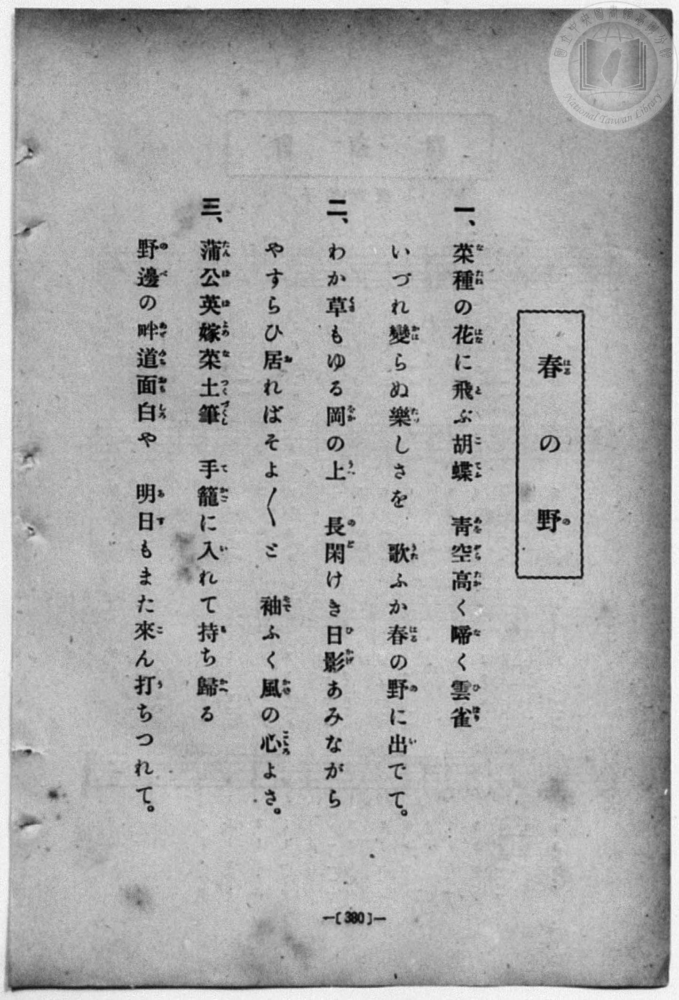
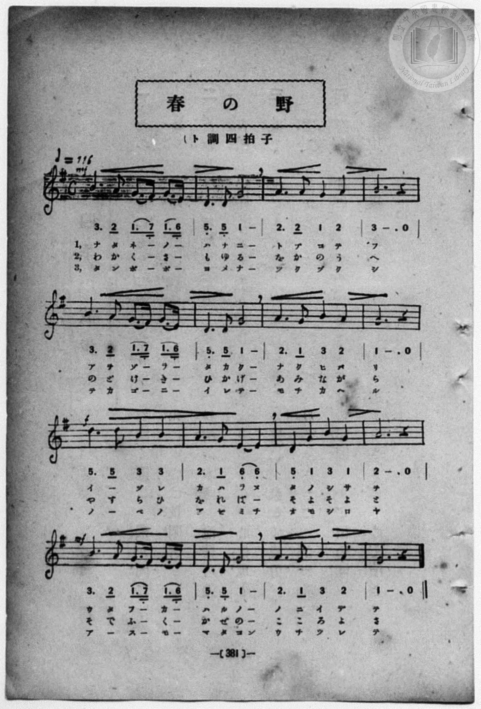

# 春の野

> Re:Shōka 使用 AI 協助辨識與重建樂譜，可能會有錯誤。歡迎回報。

<audio controls src="haru_no_no.mp3"></audio>

- book: 新編 小學校・公學校 唱歌教材集（高等科一・二學年用）
- 一條慎三郎 編《新編 小學校・公學校 唱歌教材集》（大正十二年十二月，索書號 0725-41）

## 說明

> [!NOTE]
> **原書資訊與歌詞全文**（對應 `P389.jpg`–`P390.jpg`，原書 pp. 380–381，高等科一・二學年第 21 首）：
> - **曲名**：春の野
> - **調性與拍號**：ト調四拍子（G 大調 4/4 拍），速度 ♩= 116
> - **版本對照**：本曲與《新定兒童唱歌》尋常科第五學年用〈春の野〉同詞，惟本書譜面速度為 ♩= 116，且第一、二、四行第 1 小節第 3、4 拍記為附點八分音符接十六分音符圓滑線（`1. 7_ 1. 6_`），旋律細節亦有差異（如第 3–4 小節作 `2. 2 1 2 | 3 - . 0`、第 11 小節作 `5_ 1 3 1`）。
>
> **一、**
> 菜種（なたね）の花（はな）に飛（と）ぶ胡蝶（こてふ）　青空（あをぞら）高（たか）く啼（な）く雲雀（ひばり）
> いづれ變（かは）らぬ樂（たの）しさを　歌（うた）ふか春（はる）の野（の）に出（い）でて。
>
> **二、**
> わか草（くさ）もゆる岡（をか）の上（うへ）　長閑（のど）けき日影（ひかげ）あみながら
> やすらひ居（を）ればそよ〳〵と　袖（そで）ふく風（かぜ）の心（こころ）よさ。
>
> **三、**
> 蒲公英（たんぽぽ）嫁菜（よめな）土筆（つくづくし）　手籠（てかご）に入（い）れて持（も）ち歸（かへ）る
> 野邊（のべ）の畔道（あぜみち）面白（おもしろ）や　明日（あす）もまた來（こ）ん打（う）ちつれて。


## 歌詞

```text
（TMD 檔案未包含歌詞註解）
```

## ABC

```abc
X:1
T:春の野
M:4/4
L:1/16
Q:1/4=116
K:G
V:V1 name="Piano" snm="Pia"
[V:V1]
!mf! B6 A2 G3 F G3 E | D6 D2 G8 | A6 A2 G4 A4 | B12 z4 |
w: な た ね _ の _ | は な に | と ぶ こ て | ふ
B6 A2 G3 F G3 E | D6 D2 G8 | A6 G2 B4 A4 | G12 z4 |
w: あ を ぞ _ ら _ | た か く | な く ひ ば | り
!f! d6 d2 B4 B4 | A6 G2 E4 E4 | D4 G4 B4 G4 | A12 z4 |
w: い _ づ れ | か は ら ぬ | た の し さ | を
!mf! B6 A2 G3 F G3 E | D6 D2 G8 | A6 G2 B4 A4 | G12 z4 |
w: う た ふ _ か _ | は る の | の に い で | て
!mf! B6 A2 G3 F G3 E | D6 D2 G8 | A6 A2 G4 A4 | B12 z4 |
w: わ か く _ さ _ | も ゆ る | を か の う | へ
B6 A2 G3 F G3 E | D6 D2 G8 | A6 G2 B4 A4 | G12 z4 |
w: の ど け _ き _ | ひ か げ | あ み な が | ら
!f! d6 d2 B4 B4 | A6 G2 E4 E4 | D4 G4 B4 G4 | A12 z4 |
w: や す ら ひ | を れ ば _ | そ よ そ よ | と
!mf! B6 A2 G3 F G3 E | D6 D2 G8 | A6 G2 B4 A4 | G12 z4 |
w: そ で ふ _ く _ | か ぜ の | こ こ ろ よ | さ
!mf! B6 A2 G3 F G3 E | D6 D2 G8 | A6 A2 G4 A4 | B12 z4 |
w: た ん ぽ _ ぽ _ | よ め な | つ く づ く | し
B6 A2 G3 F G3 E | D6 D2 G8 | A6 G2 B4 A4 | G12 z4 |
w: て か ご _ に _ | い れ て | も ち か へ | る
!f! d6 d2 B4 B4 | A6 G2 E4 E4 | D4 G4 B4 G4 | A12 z4 |
w: の _ べ の | あ ぜ み ち | お も し ろ | や
!mf! B6 A2 G3 F G3 E | D6 D2 G8 | A6 G2 B4 A4 | G12 z4 |
w: あ _ す _ も _ | ま た こん | う ち つ れ | て
```

## TMD 檔案連結

- [主旋律 TMD 檔案](haru_no_no.tmd) [[在 TMD Studio 編輯](https://tmdlang.github.io/Tmd-TS/#tmd=s7IKdvYPcrWy4qpTUCpJTLdSSM7PyUlNLsnMz7MqzsjPTozPrsyvSsyML84ojTe0NDJWgqssy88pzU21ys4vyY83jDdCSBTnlxYlp1oVJ2fk5-fEl6RWlCTl52ejy8cXJKanWgUYW1giZAqK8stS8xLzgLoLijLzSlJTwNoRClLLMlNSQdLFyYl58WWpRZlpmakpSG5KLSoGOx1iRUlRYl5xclFmAcg_CFX5RSUZ-elFiQUZlVYZmcUl-UWZyYk58dmJeYkIRSUZqUDfFacmFufnFStxaWkpPJux9HHjupftfQpaWlyKtgqGhmZc9rYK7lw2JvomdiCNIH9aKTybtuH59hUKTzf0P12749mChY-bdz9tXQNhKzydsvHZ2p5nU2c-mzvh5ey293s6Xq6e8Xxt5_PlE5_saAAqfbKrB6j06c4tz6eseL-nE-wgoMyzRXOftfY92dH5srlPAWj844YuUux53NANtOrpkuXP1i5-2tsIsmTnFgjj2ZyO93t6nm9Z9Gz2jhcz5ysYmBuZ6poYgu3m0tdSsKUW4FJQULBTiFb08w9xjYVwtLSe9s0H2bu5_cWKrhcd7UA3v1g572nrimfT2rW0QE7e0PusvVMhAZRQ9LIK0hMeNUwGciwNwBygwyEGKBQU6CkYWxgAZY0tgG7vwRmqa9YoGBkqvFw2DejB93tmQdyhC3TJs9mbnk7oBVk6Cx7TCNkXq_Y_a1gOcmF3LzCUwMoeN3cAhZ_Ong0Ue7p2AtC17grAIAaKKQBThAJQFGxHz8uG-U93LVN4NHMlJNHADX3e2fFszhqgF5-3LodYPGcN0BlAWyDR-3TdrKetk56vXgqJTWAkPt3Q_XTHDqC3gP54smsKPKU8buiAO_pxQ-fTCaBgBFr9rHk-2MwdL9bOeTl3EcQlz5t2wR0DVPNkxxSQacBwagClByAJ9NKLhT2goDIEJa_n6xtAbGOgDNhXL1bMABrxcmbLy93AqFr9tKPt5fzNz9cse9a3FJiknrauhYs8nTP52e6Jz7fPAoZNgqGegnm8ApA0iwdGHChgnk3vfrqv-_mWDUAbnuxa9mxO59Pt655P3QCK92VNYDuBEWoCdcOTvXMUEoz0FIyArjJSqFEwBoahnoJBAtBZYKfC3ApWZwq0CajCEGTT44YmcJjD0hzEq8BMDOa_6J_zfMU6oJWPG1c9bpz_uHEtSEvjuhddG8GC64HiYJHVLxfPBouA8uXjxm0vmhe-mLsNLDL5ceOyx41bwXY1vJw76fnKXWDxpsdNkx43znvcBPRtJzBJggWBVgAzI9CE_qdT90DshXBfzt70cnYDWGTT48YNj5u6gOIQRz5ubHncuPRxU8-LdUBBoIJuoMNAupqAGtc8W9EEMxnoEaDI9MeNU0FWNzQAkw1Yqg0oC5baCtQLTCpQrzVBXAJKNmARiPbVT9sh7m8Bc5eDfIcehuCEAgvDx039QGNf9AK9CdQFZE8Fuw3o_TagFU83LQSJg4ICat2THRBfAF21AxpoU7e_nDYR4obHjSvByiY-bux9Nn3p072QiACGCdDXk8BSTY8b94PjqwcYAjA3AINoJjhANj3d2AqxEeyMHlBgNs593NTxuGHz4wZgCADzS8OLRcAiAGjsXKAHYSHT_3IRMHIhwTsH4tSn-5thUTz5cRMoR4PMAQYvRqICegORqCZtApbFL7ohLp__uAmofS8QAbU_Xd0ITHJg5wFRIyT2n86Z_3wtqDZ43LgEHIDAvAwkp0MC51ln9_ONC8CywGQGdNsUaDS1QuIRHE0gby571tMINhmYHoAKFj5bCwxeiHfA4dzUDXEeMLpfglIXJLR3Qnz6fOqUl42Toem2cQ44hIER1wksN57PBLocKN4FilNg6oKGQwvIbTP6gHEE0zUTGu-N-4C-frIP4iOgmUDByc86IYYDBUFuA_kU7GZoSFJewUCBgpY-F5dHYlGpX75fvlVAZmJevkONQU01yBIFG0MzLXCcKWCr2hQgBSGw8FPQgBU7Ogqw6kYTiwagXSDDahSqc9NqwUUSDBoBsSGYBSr1wAyzeKBCYMmEUATmQCQRsAasF9McCBuiAtkmZGgAUwF2lo9hDbDoWIUkD4wWMLkWzl8HNxNYIKCoBOkDpjIM1wHzD4q6bWByMpy_DEnlVuLcaQRU29SPYmo3mISJAXMcwtSmJmSVTW1gEqQezZ1Nk7CYCPMvMCEiuXMHce40BqkFhSDCdpC_gTkbbiqMBbK_A0VlI1geOTZgti9BcSfIz8ASAIUPUzmdoDvxJ-5dPeQkblqka5AszFxEukbXg-k_RLpGTQWguAbWtXB-J9xMtBhDS1kI16HnFEg8bILzNyBUNnUR505QuoanOIgpK8HkRDi_F8l-mF3I7kROwzB1KD5v3A8mYW4H1olI7oSFAgF3gtM1LN8i2z4FzoeVAyCVLcgqm0D2oeqG2Y7qzoVwcyF8WJ4DqUTPvZjuJFBod5JVaAPLbFMk20BsWJqE0ZipFpjcIRw4Ayn1wxIwTDuMj2oMdi8ikjZyAEMCC14cgIMbGmzwwISoARXfiCgHNgyRVMKyAHIBCCtMUAtX9ASHw53gIhslITTORLMflpwximJokoFlKBgEuXMuXA2s8MQmhl4J4XEnOGkjZ0GImTvhLOQKEDXBzgGToOwF4YMSMEwlrABAJHKk8GzqRahECSPs7sSbtCGdscHTHqG83IbVu5BAg7RHYO0ERJLGaI-AywjMqMQsYUElFSILAZv3SCrRSykc7gSX27BkhzAF2Z3ItTJqNoQkG2zuhLWRIOrALQd4UkFN3LAMScCd4MSNnGghJoMyIsRMmBxI3T4UNZBwB_ZpkB0FU4oaRZCCG9ZIQS2BCAdoLReXrp0CrEEe7WMYq4DCN0LjG4P5ylwA)]
- [鋼琴伴奏 TMD 檔案](haru_no_no_piano.tmd) [[在 TMD Studio 編輯](https://tmdlang.github.io/Tmd-TS/#tmd=s7IKdvYPcrWy4qpTUCpJTLdSSM7PyUlNLsnMz7MqzsjPTozPrsyvSsyML84ojTe0NDJWgqssy88pzU21ys4vyY83jDdCSBTnlxYlp1oVJ2fk5-fEl6RWlCTl52ejy8cXJKanWgUYW1giZAqK8stS8xLzgLoLijLzSlJTwNoRClLLMlNSQdLFyYl58WWpRZlpmakpSG5KLSoGOx1iRUlRYl5xclFmAcg_CFX5RSUZ-elFiQUZlVYZmcUl-UWZyYk58dmJeYkIRYlFQM3pqbmpeSVWBZmJefnxicnJ-bkFiXmZIDGEwpIMoCKr4tTE4vy8YiUuLS2FZzOWPm5c97K97_2ejpezZz7r7H7Zvef5hC1P9mx5urT__Z5OBS0tLkVbBUNDMy57WwV3LhsTfRM7kIGggLJSeDZtw_PtKxSebuh_unbHswULHzfvftq6BsJWeDpl47O1Pc-mznw2d8LL2W0gK1bPeL628_nyiU92NACVPtnVA1T6dOeW51NWAO0COxQo82zR3GetfU92dL5s7lMAGv-4oYsUex43dAOterpk-bO1i5_2NoIs2bkFwng2p-P9np7nWxY9m73jxcz5CgbmRqa6JoZgu7k8EotK_fL98q0CQGEY5OFQY1BTzaUABDaGZlp2YJa-loItOlB4vmYN0NUvFvYoaJiAnPh8fYOOQoCxpYFeVkG6JhYNWvpgw2oUqnPTahWMFXTh0AiIDcEs83gowyweqNA0HkkRmAORRMAasF5McyBsiApkm5ChAUwF2Fk-hjUKjxtXIck_bpwPJtfC-evgZj5uXI-iEqTvceNqDNc9blyBom4bmJwM5y9DUrmVOHcaAdU29aOY2g0mYWKPG6ciTG1qQlbZ1AYmQerR3Nk0CYuJMP8-bgTpg7lzB3HuNAapBYUgwnaQvx837oWbCmOB7O9AUdkIlkeODZjtS1DcCfLz48alKHyYyukE3Yk_ce_qISdx0yJdg2Rh5iLSNboeTP8h0jVqKgDF9ePGeXB-J9xMtBhDS1kI16HnFEg8bILzNyBUNnUR505QuoanOIgpK8HkRDi_F8l-mF3I7kROwzB1KD5v3A8mYW5_3NiD5E5YKBBwJzhdw_Itsu1T4HxYOQBS2YKssglkH6pumO2o7lwINxfCh-U5kEr03IvpTgKFdidZhTawzDZFsg3EhqVJGI2ZaoHJHcKBM5BSPywBw7TD-KjGYPciImkjBzAksODFATi4ocEGD0yIGlDxjYjyx41rkFTCsgByAQgrTFALV_QEh8Od4CIbJSE0zkSzH5acMYpiaJKBZSgYBLlzLlwNrPDEJoZeCeFxJzhpI2dBiJk74SzkChA1wc4Bk6DsBeGDEjBMJawAQCRypPBs6kWoRAkj7O7Em7Sfzp49qNojlJfbsHoXEmiQ9gisnYBI0hjtEXAZgRmVmCUsqKRCZKHHjcuRVKKXUjjcCS63YckOYQqyO5FrZdRsCEk22NwJayNB1IFbDvCkgpq4YRmSgDvBiRs50UJMBmVEiJkwOZC6fShqIOE-GdKAQXcoahRBCm5YIwW1BCIcoLXo7XEf5Pa4CaI5_mxG37M505-1dD7dv_rJzm5gwn_W3ft07YSn25cBezOQfgxaAjeMV4g2jIVRoMQMZJnGYxOBM4CJFa7LABqQyGKUmgSqVHCaZgZimMXnomrGYgGSedTyKDAidO0UYHER7QOUQeEbofGNwXxlLgA)]

## 分析

```text
================================================================================
📊 TMD Song Profile: [ 春の野 ]
================================================================================
⏱  Duration:       1:39 (99.3s), 48 measures total
🎼 Key & Tempo:    首調基準 G, != 116.0 BPM, <4/4>
   - 分析範圍：      由實際發聲的音符與和弦推測調性；播放脈絡另行呈現
🎤 人聲音域:    D4 (MIDI 62) – D5 (MIDI 74) [跨度: 12 個半音 / 1.0 個八度, 難度: easy]
   - 最低音:  D4 in [HaruNoNo[L1] #1 @ m.2, 0:02]
   - 最高音: D5 in [HaruNoNo[L1] #1 @ m.9, 0:16]
   - 適合: soprano, mezzo-soprano, contralto, tenor, baritone, bass
🏛  結構:      HaruNoNo[L1] (33.1s) -> HaruNoNo[L2] (33.1s) -> HaruNoNo[L3] (33.1s)
⚡ 編曲密度:        Peak 1 軌道同時演奏
🗝  調性診斷：       G 大調（純淨自然大調，未偵測到可信轉調）
   - 風格氣質:    純淨自然大調（陽光明朗、易唱易記，無明顯調外色彩）
   - 轉調歷程:    全曲維持單一推測調性（未偵測到可信轉調）
   - 核心骨幹音:  G, A, B, D, E
   - 調性數值:    G 大調 [相關度: 0.82, 穩定度: High, 自然音純度: 100.0%]
   - 候選調性 (K-S): G 大調 (0.82), D 大調 (0.62), E 小調 (0.51)
   - 五度圈歷程:   +1 -> +1 -> +1
   - 各段落調性細節:
     • [HaruNoNo[L1] #1]: G 大調 (r: 0.82, 自然音純度: 100.0%)
     • [HaruNoNo[L2] #1]: G 大調 (r: 0.82, 自然音純度: 100.0%)
     • [HaruNoNo[L3] #1]: G 大調 (r: 0.82, 自然音純度: 100.0%)

  [ 五度圈游移軌跡 ]
               C  
         F           [G ]*
      Bb               D  
      Eb               A  
         Ab           E  
            Db       B  
               F# 
     (* = active key center)

  [ 十二半音累積音高分佈 ]
     C  :                            0.0%
     C# :                            0.0%
     D  : ██████████                15.0%
     D# :                            0.0%
     E  : ███                        4.6%
     F  :                            0.0%
     F# : █                          1.2%
     G  : ████████████████████████  35.0%
     G# :                            0.0%
     A  : ████████████████          23.3%
     A# :                            0.0%
     B  : ██████████████            20.8%
--------------------------------------------------------------------------------
Assignment 軌道音域：
  - Piano         : D4 – D5 (12 個半音 / 1.0 個八度, 165 個音符)
================================================================================
```


## 原書掃描頁






